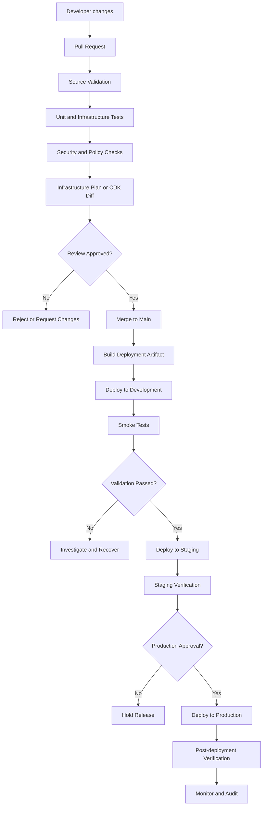
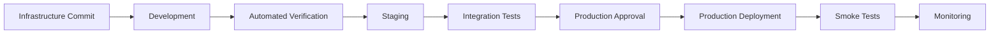
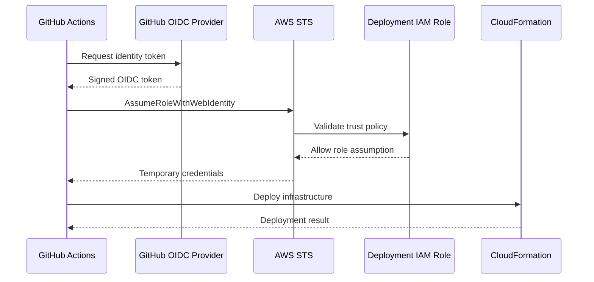

# 01- S3 Deployment Pipeline Architecture

## Overview

An Amazon S3 deployment pipeline automates the provisioning, validation, deployment, and verification of S3 infrastructure and dependent application components.

A production deployment pipeline should treat infrastructure changes as controlled releases rather than isolated AWS CLI commands. Changes to bucket policies, encryption, versioning, lifecycle rules, replication, event notifications, and CloudFront configuration can affect application availability, data protection, and operational costs.

The pipeline should provide:

- Repeatable infrastructure provisioning.
- Automated code and configuration validation.
- Security and policy checks before deployment.
- Environment-specific configuration.
- Controlled promotion from development to staging and production.
- Deployment approval and auditability.
- Post-deployment verification.
- Recovery procedures for failed or partially completed deployments.

This document describes the architecture and responsibilities of an S3 deployment pipeline. Detailed implementations for Terraform, CloudFormation, CDK, and GitHub Actions belong in their respective deployment documents.

## Deployment Pipeline Architecture

A typical deployment pipeline consists of source control, validation, infrastructure planning, approval, deployment, and verification stages.



The pipeline separates infrastructure validation from deployment. A successful test or synthesis operation does not mean that AWS deployment will succeed or that the deployed infrastructure behaves correctly.

## Core Components

| Component | Responsibility |
|---|---|
| Source control | Stores infrastructure definitions, application code, and deployment configuration |
| CI runner | Executes validation, tests, security checks, and deployment commands |
| Infrastructure as Code | Defines S3 buckets and dependent AWS resources |
| Artifact storage | Stores build outputs and deployment artifacts when required |
| IAM deployment role | Provides temporary, scoped permissions to the pipeline |
| Approval mechanism | Controls promotion into protected environments |
| CloudFormation | Executes deployments for CDK and CloudFormation stacks |
| Monitoring and audit services | Record deployment activity and infrastructure behavior |

### Source Repository

The repository should contain infrastructure definitions, tests, environment configuration, and deployment workflows.

A practical repository layout is:

```text
s3-infrastructure/
├── infrastructure/
│   ├── terraform/
│   ├── cloudformation/
│   └── cdk-python/
├── policies/
│   └── iam/
├── tests/
│   ├── unit/
│   └── integration/
├── environments/
│   ├── dev/
│   ├── staging/
│   └── prod/
├── scripts/
│   ├── validate.sh
│   ├── deploy.sh
│   └── verify.sh
└── .github/
    └── workflows/
        ├── validate.yml
        └── deploy.yml
```

The layout is illustrative. A project using one IaC tool should avoid maintaining duplicate implementations of the same infrastructure in multiple directories.

### CI/CD Runner

The runner executes the pipeline workflow.

Examples include:

- GitHub Actions.
- AWS CodePipeline with CodeBuild.
- GitLab CI.
- Jenkins.

The runner should use temporary AWS credentials obtained through an identity federation mechanism, such as GitHub Actions OIDC or an appropriately configured AWS service role.

Do not store long-lived AWS access keys in repository secrets when OIDC federation is available.

### Infrastructure as Code

Infrastructure as Code defines the desired state of S3 resources.

| Tool | Deployment mechanism | Typical use |
|---|---|---|
| Terraform | Terraform plan and apply | Multi-cloud or Terraform-standardized infrastructure |
| AWS CloudFormation | CloudFormation stack operations | Native AWS infrastructure provisioning |
| AWS CDK | Synthesized CloudFormation templates | Infrastructure defined using Python, TypeScript, or another supported language |

The tool should be selected according to organizational standards, team expertise, state-management requirements, and infrastructure complexity.

## Deployment Lifecycle

A reliable pipeline should move through clearly defined stages.

### Source Validation

Validate the submitted changes before deployment.

Typical checks include:

- YAML, JSON, and Python syntax validation.
- Terraform formatting and validation.
- CDK application synthesis.
- Dependency and version checks.
- Unit tests.
- Infrastructure assertions.
- Static analysis.
- Secret detection.

For Python CDK:

```bash
python -m compileall .
python -m pytest -v
cdk synth
```

For Terraform:

```bash
terraform fmt -check -recursive
terraform init -backend=false
terraform validate
```

These commands validate different aspects of the project. They do not replace deployment testing.

### Infrastructure Review

Infrastructure changes should be reviewed before they reach production.

Examples of changes requiring additional scrutiny include:

- Removing or replacing an existing bucket.
- Changing bucket encryption configuration.
- Modifying bucket policies.
- Changing public-access settings.
- Disabling versioning.
- Changing lifecycle expiration rules.
- Modifying replication configuration.
- Changing CloudFront origin access.
- Removing IAM permissions.

For Terraform, inspect the plan:

```bash
terraform plan -out=tfplan
terraform show tfplan
```

For CDK, inspect the proposed changes:

```bash
cdk diff
```

For CloudFormation, use change sets to review the proposed stack update before execution.

A pipeline should prevent unreviewed destructive changes from reaching production.

### Deployment

Deploy the approved infrastructure using the selected IaC tool.

Examples:

```bash
terraform apply tfplan
```

```bash
cdk deploy S3StorageStack
```

```bash
aws cloudformation deploy \
  --template-file infrastructure.yaml \
  --stack-name s3-storage-stack \
  --capabilities CAPABILITY_NAMED_IAM
```

The deployment identity should have only the permissions required by the deployment process.

Deployment commands should not be executed with unrestricted administrator credentials as a routine CI/CD practice.

### Post-deployment Verification

A successful deployment command is not sufficient evidence that the intended configuration is active.

Verify important properties through AWS APIs or the AWS CLI.

Inspect the bucket:

```bash
aws s3api head-bucket \
  --bucket "$BUCKET_NAME"
```

Check public-access configuration:

```bash
aws s3api get-public-access-block \
  --bucket "$BUCKET_NAME"
```

Check encryption:

```bash
aws s3api get-bucket-encryption \
  --bucket "$BUCKET_NAME"
```

Check versioning:

```bash
aws s3api get-bucket-versioning \
  --bucket "$BUCKET_NAME"
```

Check lifecycle configuration:

```bash
aws s3api get-bucket-lifecycle-configuration \
  --bucket "$BUCKET_NAME"
```

Check bucket policy:

```bash
aws s3api get-bucket-policy \
  --bucket "$BUCKET_NAME"
```

Some commands return errors when an optional configuration has not been configured. The verification script should distinguish an expected absence from an unexpected deployment failure.

## Environment Promotion

Use separate deployment environments to reduce the risk of introducing unverified changes into production.

| Environment | Purpose | Typical deployment policy |
|---|---|---|
| Development | Validate changes during active development | Automated |
| Staging | Validate production-like configuration | Automated after development checks |
| Production | Serve production workloads | Approval-controlled |

Environment configuration should define:

- AWS account ID.
- AWS Region.
- Bucket naming convention.
- Encryption configuration.
- Retention and deletion policy.
- Lifecycle rules.
- Replication requirements.
- IAM deployment role.
- Monitoring configuration.

Avoid using the same physical S3 bucket across development, staging, and production unless there is a deliberate shared-storage architecture with explicit isolation controls.

### Promotion Flow



Promotion should use the same reviewed source revision across environments. Environment-specific values should be injected through controlled configuration rather than by maintaining divergent infrastructure code.

## IAM and Deployment Security

The deployment pipeline is a privileged system. Compromise of its identity can result in unauthorized infrastructure changes or data exposure.

### OIDC-Based Authentication

For GitHub Actions, OIDC allows a workflow to assume an AWS IAM role without storing long-lived AWS access keys.



The IAM trust policy should restrict role assumption using conditions such as:

- Expected OIDC provider.
- Repository identity.
- Branch or protected environment.
- Organization identity.
- Expected audience.

Example trust policy structure:

```json
{
  "Version": "2012-10-17",
  "Statement": [
    {
      "Effect": "Allow",
      "Principal": {
        "Federated": "arn:aws:iam::111111111111:oidc-provider/token.actions.githubusercontent.com"
      },
      "Action": "sts:AssumeRoleWithWebIdentity",
      "Condition": {
        "StringEquals": {
          "token.actions.githubusercontent.com:aud": "sts.amazonaws.com",
          "token.actions.githubusercontent.com:sub": "repo:example-org/s3-infrastructure:ref:refs/heads/main"
        }
      }
    }
  ]
}
```

Replace the account and repository values with the actual deployment environment. The trust policy should match the workflow's real identity claims.

### Permission Separation

Use separate roles where different pipeline stages require different permissions.

| Role | Responsibility |
|---|---|
| Validation role | Read-only access where AWS lookups are required |
| Deployment role | Provision and update approved infrastructure |
| Application runtime role | Access application objects and required S3 operations |
| Monitoring role | Read monitoring and audit information |

The deployment role should not automatically receive application-level access to all objects in the bucket.

### Security Controls

- Use least-privilege IAM policies.
- Restrict production deployment to protected branches or environments.
- Require approval for sensitive infrastructure changes.
- Keep credentials temporary.
- Protect state files and deployment artifacts.
- Enable audit logging for deployment activity.
- Review policy changes as part of pull requests.
- Avoid wildcard resource permissions where resource-level restrictions are supported.

## Deployment of S3-Dependent Resources

S3 deployments frequently involve resources beyond the bucket itself.

Examples include:

| Resource | Deployment concern |
|---|---|
| S3 bucket | Encryption, versioning, ownership, and public access |
| Bucket policy | Principal scope and resource restrictions |
| KMS key | Key policy, grants, and rotation |
| Lambda | Runtime, packaging, execution role, and environment variables |
| S3 event notification | Destination permissions and resource dependencies |
| SQS queue | Queue policy and dead-letter configuration |
| CloudFront | Origin Access Control, cache policy, and TLS |
| IAM roles | Trust relationships and permission boundaries |

Resource dependencies must be explicit where the deployment tool cannot infer them.

For example, an S3 event notification targeting Lambda requires the Lambda destination permission and function to be configured correctly. A bucket notification deployment can fail if the destination is not authorized.

Avoid treating a successful bucket creation as proof that the complete application integration has been deployed successfully.

## Failure Handling and Recovery

Infrastructure deployment is not always atomic from the perspective of an application. A pipeline can fail after some resources have been updated but before all dependent resources are ready.

Common failure categories include:

| Failure | Possible impact | Recovery approach |
|---|---|---|
| IAM authorization failure | Deployment cannot create or update resources | Inspect role trust and permission policies |
| Bucket name conflict | Bucket creation fails | Use a globally unique name or import the intended existing resource |
| CloudFormation rollback | Stack update fails and resources may be rolled back | Inspect stack events and correct the failed resource |
| Terraform state conflict | Concurrent or inconsistent infrastructure operations | Resolve state locking and reconcile actual resources |
| KMS permission failure | Encrypted object operations fail | Review both IAM permissions and KMS key policy |
| Event destination failure | S3 notification configuration cannot be applied | Verify destination resource and invocation permissions |
| CloudFront deployment failure | Content delivery configuration is incomplete | Inspect distribution status and configuration |
| Smoke test failure | Deployed resources do not satisfy application expectations | Investigate runtime configuration and recover safely |

### Recovery Principles

- Inspect deployment logs and CloudFormation events before retrying.
- Identify which resources were successfully created or modified.
- Avoid manually changing IaC-managed resources without reconciling the source configuration.
- Preserve production data and retained buckets.
- Use the IaC tool's state and change-management mechanisms to recover.
- Verify the final infrastructure state after recovery.

A rollback of infrastructure configuration does not necessarily restore deleted S3 objects or reverse data transformations. Data recovery must be designed separately using versioning, backups, replication, and appropriate retention controls.

## Monitoring and Auditability

The pipeline should record enough information to reconstruct a deployment.

Capture:

- Repository and commit identifier.
- Workflow run identifier.
- Deployment environment.
- AWS account and Region.
- Deployment role identity.
- Infrastructure tool and version.
- Deployment start and completion times.
- Change review or approval reference.
- Deployment outcome.
- Smoke-test outcome.

Use AWS CloudTrail for AWS API activity auditing. Use CloudFormation events, CI logs, and application monitoring to diagnose deployment and runtime failures.

Useful operational signals include:

| Signal | Why it matters |
|---|---|
| Deployment failure rate | Identifies unstable infrastructure releases |
| Deployment duration | Helps detect pipeline regressions |
| Rollback frequency | Indicates risky or insufficiently tested changes |
| Smoke-test failure rate | Detects incorrect deployed behavior |
| Unauthorized deployment attempts | Helps identify access-control problems |
| Infrastructure drift | Identifies changes outside the deployment process |

Monitoring should distinguish pipeline failures from application runtime failures.

## Cost Considerations

CI/CD introduces costs beyond the S3 storage itself.

Potential cost sources include:

- CI runner execution time.
- CodeBuild and CodePipeline usage.
- CloudFormation-managed resources.
- S3 storage and requests.
- CloudWatch logs and metrics.
- KMS requests and key usage.
- CloudFront requests and data transfer.
- Replication and inter-Region data transfer.

Avoid creating temporary production-sized infrastructure for every pull request. Use synthesis, unit tests, and isolated test environments where possible.

Ensure temporary resources are cleaned up safely and that cleanup cannot delete production data.

## Common Mistakes

| Mistake | Why it is problematic | Better approach |
|---|---|---|
| Deploying directly from a developer workstation | Changes are difficult to audit and reproduce | Use controlled CI/CD workflows |
| Storing permanent AWS keys in GitHub secrets | Increases credential exposure risk | Use OIDC and temporary credentials |
| Deploying every change directly to production | Skips validation and controlled promotion | Use development, staging, and production gates |
| Treating synthesis as deployment verification | Synthesis does not validate deployed AWS behavior | Run post-deployment checks |
| Using administrator permissions for all pipeline stages | Expands the impact of compromised credentials | Separate roles and apply least privilege |
| Ignoring destructive changes | Can cause data loss or resource replacement | Review plans, diffs, and change sets |
| Sharing one bucket across environments without isolation | Creates data and permission boundary risks | Use environment-specific resources or explicit isolation |
| Assuming rollback restores S3 data | Infrastructure rollback does not restore deleted object versions automatically | Design data recovery independently |
| Ignoring drift | Manual changes can conflict with IaC | Detect and reconcile drift regularly |

## Production Readiness Checklist

### Source and Validation

- [ ] Infrastructure code is version-controlled.
- [ ] Dependencies and tool versions are pinned.
- [ ] Unit tests and infrastructure assertions run in CI.
- [ ] Security and policy checks run before deployment.
- [ ] Infrastructure plans or diffs are reviewed.

### Identity and Security

- [ ] CI/CD uses temporary AWS credentials.
- [ ] OIDC trust policies restrict repository and branch identity.
- [ ] Deployment roles follow least privilege.
- [ ] Production deployment requires appropriate approval.
- [ ] Secrets and state files are protected.

### Deployment and Recovery

- [ ] Development and staging environments are isolated.
- [ ] Production uses reviewed infrastructure changes.
- [ ] Destructive operations receive additional review.
- [ ] Post-deployment smoke tests are automated.
- [ ] Failure and recovery procedures are documented.
- [ ] S3 data recovery is addressed independently of infrastructure rollback.

### Operations

- [ ] Deployment activity is auditable.
- [ ] Infrastructure drift is monitored.
- [ ] Logs and deployment results are retained appropriately.
- [ ] Cost-producing resources are monitored.
- [ ] Cleanup procedures protect retained production data.

## Key Takeaways

- An S3 deployment pipeline should validate, review, deploy, and verify infrastructure changes through controlled stages.
- Use IaC and environment-specific configuration to make deployments repeatable and auditable.
- Prefer OIDC federation and temporary IAM credentials over long-lived AWS access keys.
- Validate deployed S3 behavior independently of successful synthesis or deployment commands.
- Infrastructure rollback does not guarantee data recovery; design S3 retention, backup, and recovery separately.