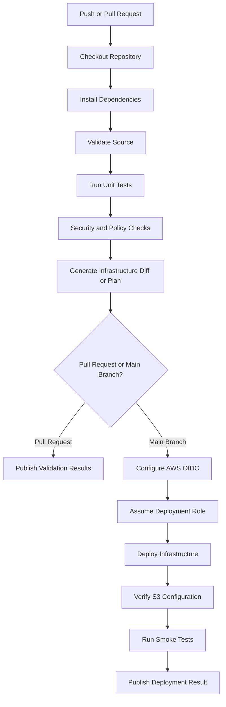
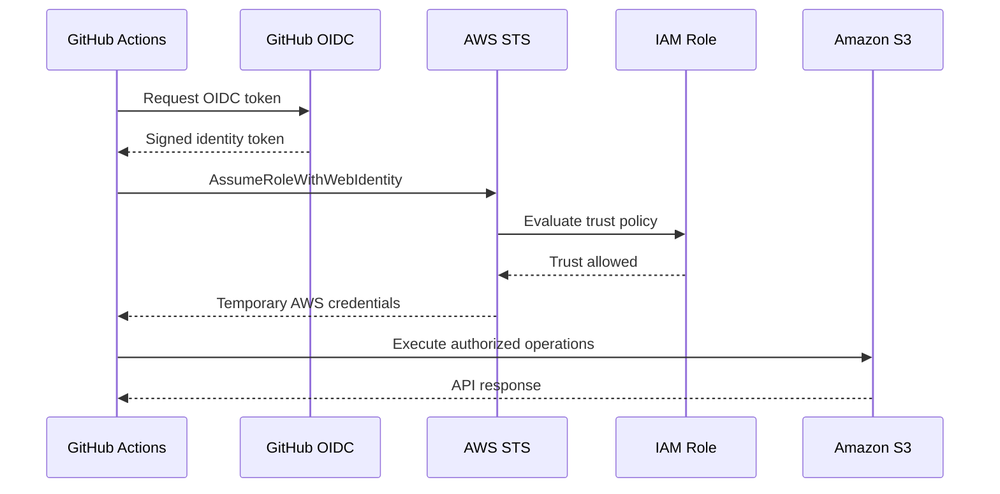
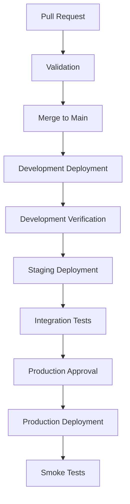

# 02- GitHub Actions Workflow Design

## Overview

GitHub Actions provides an automated CI/CD platform for validating, testing, and deploying Amazon S3 infrastructure and applications.

For S3-based systems, GitHub Actions can manage workflows such as:

- Validating Terraform, CloudFormation, or AWS CDK definitions.
- Running infrastructure unit tests and security checks.
- Generating deployment plans and reviewing infrastructure changes.
- Provisioning S3 buckets and dependent AWS resources.
- Deploying static website assets to S3.
- Deploying Lambda functions and event-driven processing components.
- Invalidating CloudFront caches after website releases.
- Verifying deployed resources.
- Promoting infrastructure changes across development, staging, and production.

A production workflow should separate validation from deployment, use temporary AWS credentials, restrict production permissions, and verify the resulting AWS resources.

This document focuses on workflow architecture, reusable workflow design, job dependencies, OIDC authentication, environment promotion, and operational considerations.

## GitHub Actions Architecture

A GitHub Actions workflow is defined in YAML under:

```text
.github/
└── workflows/
    ├── s3-validation.yml
    ├── s3-deploy-dev.yml
    ├── s3-deploy-staging.yml
    └── s3-deploy-prod.yml
```

A workflow contains one or more jobs. Each job runs on a GitHub-hosted or self-hosted runner and can contain multiple steps.

For S3 infrastructure, a typical workflow has these stages:



The workflow should fail early when validation or testing fails. AWS credentials should only be requested by jobs that actually need AWS access.

## Workflow Components

### Events and Triggers

The `on` section defines when a workflow executes.

Common triggers include:

| Trigger | Purpose | Typical use |
|---|---|---|
| `push` | Executes after a branch receives commits | Deploy development infrastructure |
| `pull_request` | Executes when a pull request is opened or updated | Validate infrastructure changes |
| `workflow_dispatch` | Allows manual execution | Controlled deployment or recovery |
| `workflow_call` | Allows another workflow to invoke it | Reusable deployment workflows |
| `schedule` | Executes on a cron schedule | Drift detection or scheduled checks |
| `release` | Executes when a release is published | Versioned application deployment |

Example:

```yaml
name: S3 Infrastructure Validation

on:
  pull_request:
    branches:
      - main
    paths:
      - "infrastructure/**"
      - "tests/**"
      - ".github/workflows/**"

  push:
    branches:
      - main
    paths:
      - "infrastructure/**"
      - "tests/**"
      - ".github/workflows/**"

  workflow_dispatch:
```

Path filters prevent unrelated repository changes from triggering expensive infrastructure workflows.

However, be careful when applying path filters to required pull-request checks. If a workflow is skipped because no configured path changed, its expected check may remain pending depending on branch protection configuration.

### Jobs and Dependencies

Jobs execute independently by default. Use `needs` to establish dependencies.

```yaml
jobs:
  validate:
    runs-on: ubuntu-latest
    steps:
      - name: Validate infrastructure
        run: echo "Validation"

  test:
    needs: validate
    runs-on: ubuntu-latest
    steps:
      - name: Run tests
        run: echo "Tests"

  deploy:
    needs:
      - validate
      - test
    runs-on: ubuntu-latest
    steps:
      - name: Deploy infrastructure
        run: echo "Deployment"
```

The deployment job executes only after its required jobs succeed.

This prevents infrastructure deployment when validation or tests fail.

### Steps and Actions

A job contains steps. A step can execute a shell command or invoke an existing GitHub Action.

Example:

```yaml
steps:
  - name: Checkout source
    uses: actions/checkout@v4

  - name: Set up Python
    uses: actions/setup-python@v5
    with:
      python-version: "3.12"

  - name: Install dependencies
    run: |
      python -m pip install --upgrade pip
      pip install -r requirements.txt

  - name: Run tests
    run: |
      python -m pytest -v
```

Use maintained action versions and review third-party actions before introducing them into privileged deployment workflows.

For high-assurance environments, pin third-party actions to reviewed full commit SHAs and update them through a controlled dependency-management process.

## Repository and Workflow Structure

A practical repository structure for S3 infrastructure is:

```text
s3-platform/
├── infrastructure/
│   ├── terraform/
│   └── cdk-python/
├── application/
│   ├── lambda/
│   └── website/
├── tests/
│   ├── unit/
│   └── integration/
├── scripts/
│   ├── deploy_s3.sh
│   └── verify_s3.sh
├── environments/
│   ├── dev/
│   ├── staging/
│   └── prod/
└── .github/
    └── workflows/
        ├── s3-validation.yml
        ├── s3-deploy.yml
        └── s3-drift-check.yml
```

Keep infrastructure definitions, application code, and deployment configuration logically separated.

Avoid duplicating complete workflows for every environment. Prefer reusable workflows or a shared workflow with environment-specific inputs when the deployment process is materially the same.

## Pull Request Validation Workflow

Pull requests should validate infrastructure without automatically modifying production resources.

A validation workflow can perform:

- Source checkout.
- Dependency installation.
- Formatting and syntax checks.
- Unit tests.
- Infrastructure synthesis or validation.
- Security scanning.
- Infrastructure diff generation.

Example for a Python CDK project:

```yaml
name: S3 CDK Validation

on:
  pull_request:
    branches:
      - main
    paths:
      - "infrastructure/cdk-python/**"
      - ".github/workflows/**"

permissions:
  contents: read

jobs:
  validate:
    name: Validate CDK Application
    runs-on: ubuntu-latest

    defaults:
      run:
        working-directory: infrastructure/cdk-python

    steps:
      - name: Checkout repository
        uses: actions/checkout@v4

      - name: Set up Python
        uses: actions/setup-python@v5
        with:
          python-version: "3.12"
          cache: pip
          cache-dependency-path: infrastructure/cdk-python/requirements*.txt

      - name: Install dependencies
        run: |
          python -m pip install --upgrade pip
          pip install -r requirements.txt
          pip install -r requirements-dev.txt

      - name: Compile Python files
        run: python -m compileall .

      - name: Run tests
        run: python -m pytest -v --cov=. --cov-report=term-missing

      - name: Synthesize CDK application
        run: cdk synth
```

The example assumes that the project contains a valid `cdk.json`, application entry point, and compatible dependencies.

A CDK synthesis operation generates CloudFormation templates locally. It does not provision AWS resources.

For Terraform, use the corresponding validation sequence:

```bash
terraform fmt -check -recursive
terraform init -backend=false
terraform validate
```

For production Terraform workflows, initialization and planning should use the configured backend and controlled state access rather than disabling the backend.

## AWS Authentication with GitHub OIDC

### Why OIDC Is Preferred

GitHub Actions needs AWS credentials to deploy infrastructure or interact with S3.

A traditional approach stores AWS access keys in GitHub repository secrets. These credentials can remain valid until manually rotated or revoked.

OIDC provides a safer alternative:

1. GitHub Actions requests an identity token.
2. GitHub issues a signed OIDC token containing workflow identity claims.
3. The workflow presents the token to AWS STS.
4. AWS validates the token against the IAM role trust policy.
5. AWS returns temporary credentials.
6. The workflow uses those credentials to perform permitted operations.



### Configure GitHub OIDC Provider

Create an IAM OIDC identity provider for:

```text
https://token.actions.githubusercontent.com
```

The audience for AWS role assumption is:

```text
sts.amazonaws.com
```

Create the provider once per AWS account where it is required.

### Create an IAM Trust Policy

The following example restricts role assumption to a specific repository and branch.

```json
{
  "Version": "2012-10-17",
  "Statement": [
    {
      "Effect": "Allow",
      "Principal": {
        "Federated": "arn:aws:iam::111111111111:oidc-provider/token.actions.githubusercontent.com"
      },
      "Action": "sts:AssumeRoleWithWebIdentity",
      "Condition": {
        "StringEquals": {
          "token.actions.githubusercontent.com:aud": "sts.amazonaws.com",
          "token.actions.githubusercontent.com:sub": "repo:example-org/s3-platform:ref:refs/heads/main"
        }
      }
    }
  ]
}
```

Replace the account ID, organization, and repository with actual values.

For deployments through GitHub protected environments, the OIDC subject claim can use an environment-based identity, for example:

```text
repo:example-org/s3-platform:environment:production
```

The trust policy must match the actual token claims generated by the workflow. Do not assume branch-based and environment-based subjects are interchangeable.

### Configure the Deployment Role

The role's permission policy should contain only the actions required by the deployment.

The exact permissions depend on the infrastructure being managed.

For example, a workflow deploying a static website may require:

- `s3:ListBucket` on the target bucket.
- `s3:PutObject` on the deployment prefix.
- `s3:DeleteObject` only when synchronization intentionally removes obsolete assets.
- `cloudfront:CreateInvalidation` on the intended distribution.

Infrastructure provisioning may additionally require permissions to manage CloudFormation, IAM, S3 configuration, KMS, Lambda, or other dependent services.

Avoid attaching broad administrator permissions merely to make deployment failures disappear.

## GitHub Actions Permissions

GitHub Actions permissions control access to GitHub-issued workflow tokens and are separate from AWS IAM permissions.

For OIDC authentication, the workflow needs:

```yaml
permissions:
  id-token: write
  contents: read
```

The permissions have different responsibilities:

| Permission | Purpose |
|---|---|
| `id-token: write` | Allows the workflow to request an OIDC token |
| `contents: read` | Allows repository checkout |
| `contents: write` | Allows repository modifications when explicitly required |
| `pull-requests: write` | Allows pull-request comments or updates when required |

Set permissions at the narrowest appropriate level.

Do not grant `contents: write` or `pull-requests: write` to deployment workflows unless their functionality requires it.

## Infrastructure Deployment Workflow

The following workflow demonstrates deployment of an AWS CDK Python application using OIDC.

It separates dependency installation, synthesis, and deployment.

```yaml
name: Deploy S3 Infrastructure

on:
  push:
    branches:
      - main
    paths:
      - "infrastructure/cdk-python/**"
      - ".github/workflows/s3-deploy.yml"

  workflow_dispatch:

permissions:
  id-token: write
  contents: read

concurrency:
  group: s3-infrastructure-production
  cancel-in-progress: false

jobs:
  deploy:
    name: Deploy S3 Infrastructure
    runs-on: ubuntu-latest
    environment: production

    defaults:
      run:
        working-directory: infrastructure/cdk-python

    env:
      AWS_REGION: ap-south-1
      CDK_DEFAULT_REGION: ap-south-1
      CDK_DEFAULT_ACCOUNT: ${{ vars.AWS_ACCOUNT_ID }}

    steps:
      - name: Checkout repository
        uses: actions/checkout@v4

      - name: Set up Python
        uses: actions/setup-python@v5
        with:
          python-version: "3.12"
          cache: pip
          cache-dependency-path: infrastructure/cdk-python/requirements.txt

      - name: Install dependencies
        run: |
          python -m pip install --upgrade pip
          pip install -r requirements.txt

      - name: Install AWS CDK CLI
        run: npm install --global aws-cdk

      - name: Configure AWS credentials
        uses: aws-actions/configure-aws-credentials@v4
        with:
          role-to-assume: ${{ vars.AWS_DEPLOYMENT_ROLE_ARN }}
          aws-region: ${{ env.AWS_REGION }}

      - name: Verify AWS identity
        run: aws sts get-caller-identity

      - name: Synthesize CDK application
        run: cdk synth

      - name: Review infrastructure changes
        run: cdk diff

      - name: Deploy infrastructure
        run: cdk deploy --all --require-approval never
```

This is an illustrative deployment workflow. Before using it in production:

- Pin actions to reviewed commit SHAs.
- Pin the CDK CLI to a compatible version.
- Configure the AWS account and role ARN as GitHub environment variables.
- Bootstrap the target account and Region.
- Ensure the role has the permissions required by the synthesized CloudFormation deployment.
- Review whether `--all` is appropriate for the repository.
- Add automated post-deployment verification.
- Use protected GitHub environments for production approval.

`--require-approval never` suppresses CDK's interactive approval prompts. It is appropriate only when the workflow already enforces an explicit review and approval process.

## Environment-Specific Deployment

Use GitHub Environments to separate deployment targets.

Example environments:

```text
development
staging
production
```

Each environment can define:

- AWS account ID.
- AWS Region.
- Deployment role ARN.
- Bucket name.
- CloudFront distribution ID.
- Environment-specific configuration.
- Required reviewers.
- Deployment branch restrictions.

Example workflow configuration:

```yaml
jobs:
  deploy:
    runs-on: ubuntu-latest

    environment:
      name: production

    env:
      AWS_REGION: ap-south-1
      BUCKET_NAME: ${{ vars.S3_BUCKET_NAME }}
      AWS_ROLE_ARN: ${{ vars.AWS_DEPLOYMENT_ROLE_ARN }}
```

Use separate AWS accounts for production and non-production environments when practical.

Environment-specific roles should be scoped to their corresponding account and resources.

### Environment Promotion Strategy



The same reviewed source revision should be promoted through the environments.

Avoid changing infrastructure code manually between staging and production. Inject environment-specific values through controlled configuration.

## Deploying Static Website Assets to S3

GitHub Actions can deploy static website assets to an S3 bucket.

For a production architecture, a private S3 bucket behind CloudFront with Origin Access Control is generally preferable to making the bucket public.

The workflow should:

1. Build the website.
2. Validate the generated assets.
3. Assume the deployment role.
4. Upload assets to the intended S3 bucket.
5. Remove obsolete assets only when that behavior is intentional.
6. Invalidate the CloudFront distribution when necessary.
7. Verify the deployed website.

Example:

```yaml
name: Deploy Static Website

on:
  push:
    branches:
      - main
    paths:
      - "website/**"

permissions:
  id-token: write
  contents: read

concurrency:
  group: website-production-deployment
  cancel-in-progress: false

jobs:
  deploy:
    runs-on: ubuntu-latest
    environment: production

    steps:
      - name: Checkout repository
        uses: actions/checkout@v4

      - name: Build website
        working-directory: website
        run: |
          npm ci
          npm run build

      - name: Verify build output
        run: test -d website/dist

      - name: Configure AWS credentials
        uses: aws-actions/configure-aws-credentials@v4
        with:
          role-to-assume: ${{ vars.AWS_DEPLOYMENT_ROLE_ARN }}
          aws-region: ap-south-1

      - name: Deploy website assets
        run: |
          aws s3 sync website/dist/ \
            "s3://${{ vars.S3_BUCKET_NAME }}/" \
            --only-show-errors

      - name: Invalidate CloudFront cache
        run: |
          aws cloudfront create-invalidation \
            --distribution-id "${{ vars.CLOUDFRONT_DISTRIBUTION_ID }}" \
            --paths "/*"
```

The example intentionally does not use `--delete`.

If the deployment process uses `--delete`, ensure that the target bucket and prefix are isolated for that website release. A misconfigured destination can remove unrelated objects.

### Cache Management

CloudFront caching affects how quickly users receive updated website content.

A common strategy is:

| Asset type | Cache strategy |
|---|---|
| Hashed JavaScript bundles | Long-lived cache |
| Hashed CSS bundles | Long-lived cache |
| HTML entry points | Short cache or revalidation |
| Frequently updated configuration | Short cache |
| Immutable images | Long-lived cache |

Content-hashed filenames reduce the need for broad invalidations.

For larger deployments, consider invalidating only changed paths rather than invalidating the entire distribution.

## Reusable Workflows

Reusable workflows allow multiple repositories or deployment jobs to share common CI/CD logic.

A reusable workflow is triggered through `workflow_call`.

Example:

```yaml
name: Reusable S3 Deployment

on:
  workflow_call:
    inputs:
      environment:
        required: true
        type: string
      aws-region:
        required: true
        type: string
      bucket-name:
        required: true
        type: string
    secrets:
      deployment-role-arn:
        required: true

permissions:
  id-token: write
  contents: read

jobs:
  deploy:
    runs-on: ubuntu-latest
    environment: ${{ inputs.environment }}

    steps:
      - name: Checkout repository
        uses: actions/checkout@v4

      - name: Configure AWS credentials
        uses: aws-actions/configure-aws-credentials@v4
        with:
          role-to-assume: ${{ secrets.deployment-role-arn }}
          aws-region: ${{ inputs.aws-region }}

      - name: Deploy S3 assets
        run: |
          aws s3 sync ./dist/ \
            "s3://${{ inputs.bucket-name }}/" \
            --only-show-errors
```

A caller workflow can invoke it:

```yaml
name: Deploy Production Website

on:
  workflow_dispatch:

jobs:
  deploy:
    uses: ./.github/workflows/reusable-s3-deploy.yml
    with:
      environment: production
      aws-region: ap-south-1
      bucket-name: example-production-assets
    secrets:
      deployment-role-arn: ${{ secrets.AWS_DEPLOYMENT_ROLE_ARN }}
```

The called workflow should be treated as privileged code because it can receive deployment credentials.

Validate caller permissions, environment restrictions, and workflow references carefully.

## Concurrency and Deployment Safety

Concurrent deployments to the same S3 destination can produce inconsistent releases.

For example:

- Deployment A uploads an older frontend build.
- Deployment B uploads a newer frontend build.
- Deployment A continues uploading after deployment B.
- The resulting bucket contains a mixture of releases.

Use workflow concurrency controls:

```yaml
concurrency:
  group: s3-production-deployment
  cancel-in-progress: false
```

This prevents simultaneous executions in the same concurrency group.

For production deployments, avoid cancelling a deployment while it is modifying infrastructure or synchronizing assets unless the process is designed to recover safely.

Concurrency controls should be scoped by environment and deployment target. Separate buckets can often be deployed independently.

## Deployment Verification

Post-deployment verification should check both AWS resource configuration and application behavior.

### Verify S3 Bucket Configuration

Check that the bucket exists:

```bash
aws s3api head-bucket \
  --bucket "$BUCKET_NAME"
```

Check encryption:

```bash
aws s3api get-bucket-encryption \
  --bucket "$BUCKET_NAME"
```

Check versioning:

```bash
aws s3api get-bucket-versioning \
  --bucket "$BUCKET_NAME"
```

Check public-access settings:

```bash
aws s3api get-public-access-block \
  --bucket "$BUCKET_NAME"
```

Check lifecycle configuration:

```bash
aws s3api get-bucket-lifecycle-configuration \
  --bucket "$BUCKET_NAME"
```

### Verify Deployed Website

For a CloudFront-backed website:

```bash
curl --fail --silent --show-error \
  "https://${WEBSITE_DOMAIN}/"
```

A successful HTTP response confirms that the endpoint returned a response. It does not independently prove that every asset is correct or that the intended release is active.

For stronger verification:

- Check the expected release identifier.
- Request representative CSS and JavaScript assets.
- Verify important API or application routes.
- Check response status codes.
- Validate TLS.
- Inspect CloudFront deployment status.
- Confirm cache behavior.

### Fail the Workflow on Verification Errors

Use shell strict mode in verification scripts:

```bash
#!/usr/bin/env bash

set -Eeuo pipefail

: "${BUCKET_NAME:?BUCKET_NAME is required}"

aws s3api head-bucket \
  --bucket "$BUCKET_NAME"

aws s3api get-bucket-versioning \
  --bucket "$BUCKET_NAME"

echo "S3 verification completed."
```

A production verification script should also validate expected configuration values instead of merely checking whether API calls return successfully.

## Drift Detection Workflow

Infrastructure drift occurs when the actual AWS resources differ from the desired configuration maintained in IaC.

Drift can result from:

- Manual AWS Console changes.
- AWS CLI operations outside the pipeline.
- Changes made by another deployment system.
- Configuration changes not reflected in source control.

A scheduled workflow can detect drift.

Example Terraform workflow:

```yaml
name: S3 Infrastructure Drift Check

on:
  schedule:
    - cron: "30 2 * * *"

  workflow_dispatch:

permissions:
  id-token: write
  contents: read

jobs:
  drift-check:
    runs-on: ubuntu-latest
    environment: staging

    defaults:
      run:
        working-directory: infrastructure/terraform

    steps:
      - name: Checkout repository
        uses: actions/checkout@v4

      - name: Configure AWS credentials
        uses: aws-actions/configure-aws-credentials@v4
        with:
          role-to-assume: ${{ vars.AWS_READONLY_ROLE_ARN }}
          aws-region: ap-south-1

      - name: Set up Terraform
        uses: hashicorp/setup-terraform@v3

      - name: Initialize Terraform
        run: terraform init

      - name: Check formatting
        run: terraform fmt -check -recursive

      - name: Detect infrastructure drift
        run: |
          terraform plan \
            -detailed-exitcode \
            -out=tfplan
```

For `terraform plan -detailed-exitcode`:

| Exit code | Meaning |
|---|---|
| `0` | No changes detected |
| `1` | Terraform error |
| `2` | Changes detected |

A scheduled drift workflow should distinguish expected planned changes from unexpected drift. It should not automatically apply changes simply because a plan reports differences.

Protect Terraform state access and use a read-only AWS role for drift detection where the workflow permits it.

CloudFormation-managed resources can use CloudFormation drift detection. Note that drift detection support varies by resource type and property.

## Testing Strategy

A production CI/CD workflow should use multiple levels of testing.

| Test type | Purpose | Example |
|---|---|---|
| Syntax validation | Detect invalid configuration | YAML and Python checks |
| Unit tests | Validate application logic | pytest |
| Infrastructure assertions | Validate synthesized resources | CDK assertions |
| Static analysis | Detect risky configuration | Ruff, Checkov, tfsec |
| Deployment tests | Validate actual AWS resources | AWS CLI or SDK |
| Integration tests | Validate service interactions | S3 upload and download |
| Smoke tests | Validate critical application paths | HTTP requests |
| Drift checks | Identify out-of-band changes | Terraform plan or CloudFormation drift detection |

### CDK Infrastructure Assertions

Example using Python CDK assertions:

```python
from aws_cdk import App, Stack, aws_s3 as s3
from aws_cdk.assertions import Template


def test_bucket_is_private_and_encrypted() -> None:
    app = App()
    stack = Stack(app, "TestStack")

    s3.Bucket(
        stack,
        "PrivateBucket",
        block_public_access=s3.BlockPublicAccess.BLOCK_ALL,
        encryption=s3.BucketEncryption.S3_MANAGED,
        enforce_ssl=True,
    )

    template = Template.from_stack(stack)

    template.resource_count_is("AWS::S3::Bucket", 1)

    template.has_resource_properties(
        "AWS::S3::Bucket",
        {
            "PublicAccessBlockConfiguration": {
                "BlockPublicAcls": True,
                "BlockPublicPolicy": True,
                "IgnorePublicAcls": True,
                "RestrictPublicBuckets": True,
            },
            "BucketEncryption": {
                "ServerSideEncryptionConfiguration": [
                    {
                        "ServerSideEncryptionByDefault": {
                            "SSEAlgorithm": "AES256"
                        }
                    }
                ]
            },
        },
    )
```

This test validates the synthesized CloudFormation template. It does not verify that a bucket has been deployed or that runtime access is correctly configured.

## Notifications and Deployment Audit Trails

A production deployment workflow should expose its result to the team.

Useful notification events include:

- Deployment started.
- Deployment succeeded.
- Deployment failed.
- Production approval required.
- Drift detected.
- Smoke tests failed.

GitHub Actions supports job summaries and workflow artifacts.

Example job summary:

```yaml
- name: Publish deployment summary
  if: always()
  run: |
    {
      echo "## S3 Deployment"
      echo ""
      echo "- Environment: production"
      echo "- Commit: $GITHUB_SHA"
      echo "- Workflow: $GITHUB_RUN_ID"
      echo "- Result: ${{ job.status }}"
    } >> "$GITHUB_STEP_SUMMARY"
```

For AWS-side auditing, use CloudTrail to record relevant API activity. GitHub workflow logs and CloudTrail provide complementary views of deployment activity.

Avoid writing secrets, presigned URLs, sensitive object metadata, or temporary credentials into workflow logs.

## Rollback and Recovery

A failed deployment requires a controlled recovery process.

The recovery method depends on the resource being deployed.

| Deployment target | Recovery approach |
|---|---|
| Terraform infrastructure | Reconcile state and apply a reviewed corrective plan |
| CloudFormation stack | Inspect stack events and recover from rollback or update failure |
| CDK stack | Review synthesized changes and CloudFormation deployment events |
| Static website | Restore a known-good release or redeploy a previous artifact |
| Lambda function | Restore a previous deployment package or published version |
| CloudFront distribution | Restore the previous configuration and wait for propagation |

### Website Release Strategy

For important static websites, store releases under separate prefixes:

```text
s3://example-assets/
├── releases/
│   ├── release-2026-10-01/
│   ├── release-2026-10-15/
│   └── release-2026-11-01/
└── current/
```

An alternative is to use immutable content-hashed assets and versioned deployment manifests.

A release-based strategy allows a known-good build to be restored without relying on an incomplete synchronization operation.

For infrastructure deployments, prefer a corrective IaC change over manually reversing individual AWS resources.

### Important Recovery Considerations

- S3 versioning can help recover previous object versions but does not automatically roll back an entire website release.
- CloudFront invalidation does not restore deleted S3 objects.
- CloudFormation rollback does not guarantee recovery of data deleted outside the stack lifecycle.
- Terraform state recovery and AWS resource recovery are separate operations.
- A partially completed asset deployment may leave mixed versions unless releases are isolated.
- Production data buckets should have deletion protection and retention controls appropriate to the workload.

## Security Best Practices

- Use OIDC federation instead of long-lived AWS access keys.
- Restrict IAM trust policies to expected repositories, branches, or environments.
- Separate validation, deployment, and runtime permissions.
- Set explicit GitHub workflow permissions.
- Protect production environments with required reviewers.
- Pin and review third-party actions.
- Keep deployment roles scoped to the required AWS account and resources.
- Avoid logging secrets and sensitive deployment configuration.
- Protect Terraform state and infrastructure artifacts.
- Require review for destructive changes.
- Audit deployments using GitHub logs and AWS CloudTrail.

## Common Mistakes

| Mistake | Impact | Recommended approach |
|---|---|---|
| Storing AWS access keys in repository secrets | Long-lived credential exposure | Use OIDC |
| Giving every workflow administrator access | Excessive privilege and larger blast radius | Use separate least-privilege roles |
| Deploying from pull requests without restrictions | Untrusted code may access privileged credentials | Keep privileged deployment out of untrusted PR execution |
| Running deployment and validation in one uncontrolled job | Makes failure isolation difficult | Separate validation and deployment jobs |
| Using `aws s3 sync --delete` without checking the target | Can remove unrelated objects | Scope the destination and review deletion behavior |
| Running multiple deployments concurrently | Can create mixed releases or conflicting infrastructure changes | Use concurrency controls |
| Treating `cdk synth` as deployment verification | Does not test actual AWS resources | Run post-deployment checks |
| Ignoring OIDC subject restrictions | Untrusted workflows may assume deployment roles | Restrict trust policies |
| Automatically applying drift changes | Can overwrite intentional infrastructure changes | Review and approve remediation |
| Rebuilding different artifacts for each environment | Environments may receive different application builds | Promote the same immutable artifact |
| Cancelling deployments during resource modification | Can leave partial deployment state | Use safe concurrency and recovery procedures |

## Production Readiness Checklist

### Workflow Design

- [ ] Pull requests trigger validation workflows.
- [ ] Infrastructure tests run before deployment.
- [ ] Deployment jobs depend on successful validation.
- [ ] Environment-specific configuration is separated from source code.
- [ ] Reusable workflows are used where they reduce duplication.
- [ ] Concurrent deployments are controlled.

### AWS Authentication

- [ ] GitHub OIDC provider is configured.
- [ ] IAM trust policies restrict repository and environment identity.
- [ ] Temporary credentials are used.
- [ ] Deployment roles follow least privilege.
- [ ] Runtime and deployment permissions are separated.

### Deployment

- [ ] Infrastructure plans or diffs are reviewed.
- [ ] Production uses protected GitHub Environments.
- [ ] Destructive operations require appropriate approval.
- [ ] Application artifacts are versioned.
- [ ] S3 and CloudFront deployment behavior is documented.

### Verification and Recovery

- [ ] S3 encryption and versioning are verified.
- [ ] Public-access settings are checked.
- [ ] Lifecycle and replication configurations are checked where applicable.
- [ ] Application smoke tests run after deployment.
- [ ] Deployment results are recorded.
- [ ] Rollback and recovery procedures are tested.
- [ ] Drift detection is configured where appropriate.

## Key Takeaways

- Design GitHub Actions workflows as separate validation, testing, deployment, and verification stages.
- Use AWS OIDC federation to obtain temporary credentials instead of storing long-lived access keys.
- Protect production deployments with environment approvals, least-privilege roles, and controlled concurrency.
- Verify actual AWS resources and application behavior after deployment; successful workflow execution alone is insufficient.
- Design release and recovery strategies independently for infrastructure, S3 objects, Lambda functions, and CloudFront.