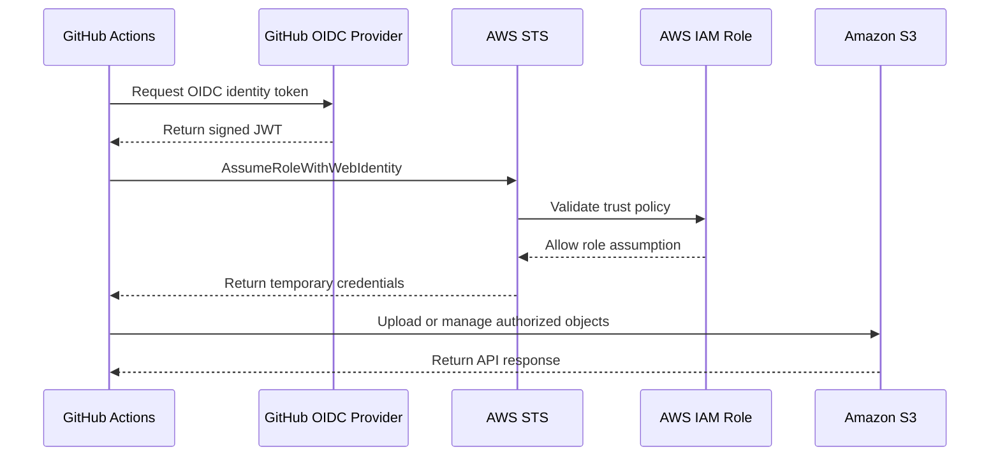

# 03- AWS IAM OIDC Federation

## Overview

AWS IAM OpenID Connect (OIDC) federation allows external identity providers to authenticate workloads and obtain temporary AWS credentials without storing long-lived AWS access keys.

For Amazon S3 deployment pipelines, OIDC is particularly useful when GitHub Actions needs to:

- Provision S3 buckets and related infrastructure.
- Deploy static website assets.
- Deploy Lambda functions and event-driven workloads.
- Update CloudFront distributions.
- Execute Terraform, CloudFormation, or AWS CDK deployments.
- Run automated infrastructure verification.

Instead of storing an AWS access key and secret key in GitHub repository secrets, a workflow requests a signed identity token from GitHub. AWS Security Token Service (STS) validates the token against an IAM OIDC identity provider and an IAM role trust policy.

If the identity satisfies the trust conditions, STS issues temporary credentials that the workflow can use to access permitted AWS resources.

The key security benefit is that the workflow does not need a permanent AWS credential.

## OIDC Federation Architecture

### Core Components

| Component | Responsibility |
|---|---|
| GitHub Actions | Executes CI/CD workflows |
| GitHub OIDC Provider | Issues signed identity tokens for workflows |
| AWS IAM OIDC Identity Provider | Establishes trust with GitHub's OIDC issuer |
| IAM Role | Defines the identity that GitHub Actions can assume |
| IAM Trust Policy | Controls which external identities can assume the role |
| IAM Permission Policy | Defines what the assumed role can do |
| AWS STS | Validates the identity token and issues temporary credentials |
| Amazon S3 | Receives authorized requests from the workflow |

### Authentication Flow



The workflow uses the temporary credentials returned by STS to sign AWS API requests. S3 evaluates the assumed role's permissions and applicable resource policies before allowing each operation.

### Authentication Lifecycle

1. A GitHub Actions job starts.
2. The job requests an OIDC token using its GitHub-provided identity endpoint.
3. GitHub issues a signed JWT containing identity claims.
4. The workflow passes the JWT to AWS STS.
5. STS validates the token's issuer, audience, signature, and relevant claims.
6. AWS evaluates the IAM role trust policy.
7. If the trust conditions match, STS issues temporary AWS credentials.
8. The workflow uses those credentials to call AWS APIs.
9. The credentials expire according to the STS session duration.

OIDC authentication and AWS authorization are separate operations. Successfully assuming a role does not automatically grant access to every AWS resource.

## OIDC Identity Provider Configuration

### GitHub OIDC Provider Details

The GitHub Actions OIDC issuer is:

```text
https://token.actions.githubusercontent.com
```

The audience used for AWS role assumption is:

```text
sts.amazonaws.com
```

An IAM OIDC identity provider must be configured in each AWS account that requires this federation relationship.

### Create the OIDC Provider

Using AWS CLI:

```bash
aws iam create-open-id-connect-provider \
  --url https://token.actions.githubusercontent.com \
  --client-id-list sts.amazonaws.com
```

The command creates the provider in the AWS account associated with the active AWS credentials.

Inspect the provider:

```bash
aws iam list-open-id-connect-providers
```

Retrieve provider details:

```bash
aws iam get-open-id-connect-provider \
  --open-id-connect-provider-arn \
  arn:aws:iam::111111111111:oidc-provider/token.actions.githubusercontent.com
```

Replace the account ID with the target AWS account.

The OIDC provider should normally be created once per account rather than recreated for every repository or workflow.

## OIDC Token Claims

An OIDC token contains claims that identify the workload requesting AWS access.

Common GitHub Actions claims include:

| Claim | Purpose |
|---|---|
| `iss` | Identifies the token issuer |
| `aud` | Identifies the intended audience |
| `sub` | Identifies the workflow subject |
| `repository` | Repository name |
| `repository_owner` | Repository owner |
| `ref` | Git reference associated with the workflow |
| `sha` | Commit SHA |
| `workflow` | Workflow identity |
| `job_workflow_ref` | Reusable workflow reference, when applicable |
| `environment` | GitHub deployment environment, when applicable |

The exact claims available depend on the workflow context and GitHub's token configuration.

### Understanding the Subject Claim

The `sub` claim is particularly important because AWS IAM commonly uses it to restrict which GitHub workflows can assume a role.

For a workflow running on the `main` branch, a typical subject is:

```text
repo:example-org/s3-platform:ref:refs/heads/main
```

For a workflow using a GitHub environment:

```text
repo:example-org/s3-platform:environment:production
```

For a pull request:

```text
repo:example-org/s3-platform:pull_request
```

These subjects represent different execution contexts. A trust policy must match the actual subject generated by the workflow.

Do not assume that a branch-based subject and an environment-based subject are interchangeable.

## IAM Role Trust Policy

### What Is a Trust Policy?

An IAM role trust policy defines which principals can assume the role.

For OIDC federation, the principal is the configured OIDC identity provider rather than a traditional IAM user or role.

The trust policy determines whether a GitHub-issued identity token is allowed to assume the role.

It does not define the AWS resources that the assumed role can access.

### Repository and Branch Restriction

The following example allows only the `main` branch of a specific repository to assume the role.

```json
{
  "Version": "2012-10-17",
  "Statement": [
    {
      "Effect": "Allow",
      "Principal": {
        "Federated": "arn:aws:iam::111111111111:oidc-provider/token.actions.githubusercontent.com"
      },
      "Action": "sts:AssumeRoleWithWebIdentity",
      "Condition": {
        "StringEquals": {
          "token.actions.githubusercontent.com:aud": "sts.amazonaws.com",
          "token.actions.githubusercontent.com:sub": "repo:example-org/s3-platform:ref:refs/heads/main"
        }
      }
    }
  ]
}
```

Important restrictions:

- Use the exact AWS account ID.
- Restrict the repository identity.
- Restrict the branch or deployment environment.
- Require the expected audience.
- Avoid unrestricted subject patterns.

A broad condition such as the following is dangerous:

```json
{
  "StringLike": {
    "token.actions.githubusercontent.com:sub": "repo:example-org/*"
  }
}
```

It may allow unintended repositories within the organization to assume the role.

### Environment-Based Trust Policy

For production deployments, GitHub Environments can provide an additional deployment boundary.

Example:

```json
{
  "Version": "2012-10-17",
  "Statement": [
    {
      "Effect": "Allow",
      "Principal": {
        "Federated": "arn:aws:iam::111111111111:oidc-provider/token.actions.githubusercontent.com"
      },
      "Action": "sts:AssumeRoleWithWebIdentity",
      "Condition": {
        "StringEquals": {
          "token.actions.githubusercontent.com:aud": "sts.amazonaws.com",
          "token.actions.githubusercontent.com:sub": "repo:example-org/s3-platform:environment:production"
        }
      }
    }
  ]
}
```

The corresponding GitHub Actions job must declare the same environment:

```yaml
jobs:
  deploy:
    runs-on: ubuntu-latest
    environment: production
```

GitHub Environment protection rules can require reviewers and restrict deployment branches.

This provides two complementary controls:

- GitHub controls whether the workflow can enter the protected environment.
- AWS IAM controls whether the resulting identity can assume the deployment role.

For stronger restrictions, use additional supported token claims and GitHub OIDC subject customization where appropriate. Validate the actual token claims before constructing the trust policy.

## IAM Permission Policies

### Trust Policy vs Permission Policy

These policies solve different problems.

| Policy | Question answered |
|---|---|
| Trust policy | Who can assume this IAM role? |
| Permission policy | What can the assumed role do? |

A workflow may successfully assume an IAM role but still receive `AccessDenied` when accessing S3 because the role lacks the required permission.

### Example: S3 Deployment Permissions

The following policy allows a deployment role to list a specific bucket and manage objects under a designated deployment prefix.

```json
{
  "Version": "2012-10-17",
  "Statement": [
    {
      "Sid": "ListDeploymentBucket",
      "Effect": "Allow",
      "Action": [
        "s3:ListBucket"
      ],
      "Resource": "arn:aws:s3:::example-production-assets",
      "Condition": {
        "StringLike": {
          "s3:prefix": [
            "website/*",
            "website"
          ]
        }
      }
    },
    {
      "Sid": "ManageWebsiteObjects",
      "Effect": "Allow",
      "Action": [
        "s3:PutObject",
        "s3:GetObject",
        "s3:DeleteObject"
      ],
      "Resource": "arn:aws:s3:::example-production-assets/website/*"
    }
  ]
}
```

The policy separates bucket-level permissions from object-level permissions.

Important distinctions:

- `s3:ListBucket` applies to the bucket ARN.
- `s3:PutObject` applies to object ARNs.
- `s3:GetObject` applies to object ARNs.
- `s3:DeleteObject` applies to object ARNs.

The `DeleteObject` permission is only required when the deployment process intentionally deletes existing objects.

Do not grant deletion permission merely because an example deployment command uses it. Review the actual synchronization behavior and required operations.

### CloudFront Invalidation Permission

If the workflow invalidates CloudFront after uploading website assets, it needs an additional permission.

```json
{
  "Version": "2012-10-17",
  "Statement": [
    {
      "Sid": "InvalidateWebsiteDistribution",
      "Effect": "Allow",
      "Action": [
        "cloudfront:CreateInvalidation"
      ],
      "Resource": "arn:aws:cloudfront::111111111111:distribution/EXAMPLE123456"
    }
  ]
}
```

Keep CloudFront permissions separate from S3 object permissions so that each permission boundary remains understandable.

### Infrastructure Deployment Permissions

A role provisioning S3 infrastructure through Terraform, CloudFormation, or CDK may require additional permissions for:

- CloudFormation stack operations.
- S3 bucket configuration.
- IAM role and policy creation.
- KMS key configuration.
- Lambda functions.
- EventBridge rules.
- SQS queues.
- CloudFront distributions.

The exact policy depends on the infrastructure definitions and deployment mechanism.

Avoid attaching `AdministratorAccess` as a permanent solution to deployment failures. Identify the denied API action and resource, then grant only the permissions required.

## GitHub Actions OIDC Workflow

### Workflow Permissions

A GitHub Actions workflow needs permission to request an OIDC token.

```yaml
permissions:
  id-token: write
  contents: read
```

| Permission | Purpose |
|---|---|
| `id-token: write` | Allows the workflow to request an OIDC identity token |
| `contents: read` | Allows repository checkout |

These are GitHub token permissions, not AWS IAM permissions.

A workflow can request an OIDC token without having permission to access S3. AWS IAM authorization is evaluated separately after role assumption.

### Configure AWS Credentials

Use the official AWS credentials action:

```yaml
- name: Configure AWS credentials
  uses: aws-actions/configure-aws-credentials@v4
  with:
    role-to-assume: arn:aws:iam::111111111111:role/GitHubS3DeploymentRole
    aws-region: ap-south-1
```

For production, use a GitHub environment variable for the role ARN:

```yaml
- name: Configure AWS credentials
  uses: aws-actions/configure-aws-credentials@v4
  with:
    role-to-assume: ${{ vars.AWS_DEPLOYMENT_ROLE_ARN }}
    aws-region: ap-south-1
```

Pin third-party actions to reviewed full commit SHAs in high-assurance production environments. Review and update pinned versions through a controlled dependency-management process.

### Verify the Assumed Identity

After configuring credentials, verify the AWS identity:

```yaml
- name: Verify AWS identity
  run: aws sts get-caller-identity
```

The returned ARN should identify an assumed role, typically in this form:

```text
arn:aws:sts::111111111111:assumed-role/GitHubS3DeploymentRole/GitHubActions
```

Do not continue with deployment if the workflow assumes an unexpected AWS role or account.

## Complete GitHub Actions Example

The following example demonstrates a deployment workflow for S3 website assets using OIDC.

```yaml
name: Deploy S3 Website

on:
  push:
    branches:
      - main
    paths:
      - "website/**"

  workflow_dispatch:

permissions:
  id-token: write
  contents: read

concurrency:
  group: s3-website-production
  cancel-in-progress: false

jobs:
  deploy:
    name: Deploy Website Assets
    runs-on: ubuntu-latest
    environment: production

    steps:
      - name: Checkout repository
        uses: actions/checkout@v4

      - name: Configure AWS credentials
        uses: aws-actions/configure-aws-credentials@v4
        with:
          role-to-assume: ${{ vars.AWS_DEPLOYMENT_ROLE_ARN }}
          aws-region: ap-south-1

      - name: Verify AWS identity
        run: aws sts get-caller-identity

      - name: Verify target bucket
        run: |
          aws s3api head-bucket \
            --bucket "${{ vars.S3_BUCKET_NAME }}"

      - name: Deploy website assets
        run: |
          aws s3 sync website/dist/ \
            "s3://${{ vars.S3_BUCKET_NAME }}/website/" \
            --only-show-errors

      - name: Invalidate CloudFront cache
        run: |
          aws cloudfront create-invalidation \
            --distribution-id "${{ vars.CLOUDFRONT_DISTRIBUTION_ID }}" \
            --paths "/*"
```

This example assumes that the website build has already generated `website/dist/`.

The deployment role needs the S3 and CloudFront permissions required by these operations. The bucket should remain private when CloudFront Origin Access Control is used.

The workflow should also include build validation, smoke tests, release verification, and an explicit recovery strategy before being used as a complete production deployment pipeline.

## Separate Roles for Different Environments

Development, staging, and production should not automatically share one deployment role.

A recommended structure is:

```text
AWS Account
│
├── Development
│   └── GitHubS3DevelopmentRole
│
├── Staging
│   └── GitHubS3StagingRole
│
└── Production
    └── GitHubS3ProductionRole
```

For stronger isolation, use separate AWS accounts for each environment.

| Environment | Role | Permission scope |
|---|---|---|
| Development | `GitHubS3DevelopmentRole` | Development buckets and infrastructure |
| Staging | `GitHubS3StagingRole` | Staging buckets and infrastructure |
| Production | `GitHubS3ProductionRole` | Production resources only |

Separate accounts reduce the impact of compromised credentials and accidental deployment mistakes.

### GitHub Environment Configuration

Configure environment-specific variables:

| Variable | Development | Staging | Production |
|---|---|---|---|
| `AWS_DEPLOYMENT_ROLE_ARN` | Development role | Staging role | Production role |
| `AWS_REGION` | Selected Region | Selected Region | Selected Region |
| `S3_BUCKET_NAME` | Development bucket | Staging bucket | Production bucket |
| `CLOUDFRONT_DISTRIBUTION_ID` | Development distribution | Staging distribution | Production distribution |

Production should use protected environment rules and restricted deployment branches.

## OIDC with Terraform

Terraform deployments also use OIDC federation.

A typical workflow:

1. Checks out the repository.
2. Installs the required Terraform version.
3. Initializes the backend.
4. Assumes the AWS deployment role through OIDC.
5. Validates Terraform configuration.
6. Generates an execution plan.
7. Applies an approved plan.

Example:

```yaml
name: Terraform S3 Deployment

on:
  pull_request:
    branches:
      - main

  workflow_dispatch:

permissions:
  id-token: write
  contents: read

jobs:
  terraform:
    runs-on: ubuntu-latest
    environment: staging

    defaults:
      run:
        working-directory: infrastructure/terraform

    steps:
      - name: Checkout repository
        uses: actions/checkout@v4

      - name: Configure AWS credentials
        uses: aws-actions/configure-aws-credentials@v4
        with:
          role-to-assume: ${{ vars.AWS_DEPLOYMENT_ROLE_ARN }}
          aws-region: ap-south-1

      - name: Set up Terraform
        uses: hashicorp/setup-terraform@v3

      - name: Initialize Terraform
        run: terraform init

      - name: Validate Terraform
        run: |
          terraform fmt -check -recursive
          terraform validate

      - name: Generate Terraform plan
        run: terraform plan -out=tfplan
```

This example demonstrates authentication and plan generation. It deliberately does not apply changes automatically.

For production:

- Generate plans in a trusted workflow.
- Protect the plan artifact.
- Ensure the apply operation uses the same reviewed plan and compatible state context.
- Restrict who can approve and execute production changes.
- Protect remote state and state-locking resources.
- Avoid exposing sensitive plan contents in logs or pull-request comments.

Terraform's backend may need AWS permissions separate from the permissions required to provision S3 resources.

## OIDC with AWS CDK

AWS CDK deployments use CloudFormation to provision resources.

The workflow requires:

- AWS credentials obtained through OIDC.
- CDK CLI and application dependencies.
- A bootstrapped CDK environment.
- Permissions required by the deployment role.
- Appropriate CloudFormation execution permissions.

Example:

```yaml
name: CDK S3 Deployment

on:
  workflow_dispatch:

permissions:
  id-token: write
  contents: read

jobs:
  deploy:
    runs-on: ubuntu-latest
    environment: staging

    defaults:
      run:
        working-directory: infrastructure/cdk-python

    steps:
      - name: Checkout repository
        uses: actions/checkout@v4

      - name: Set up Python
        uses: actions/setup-python@v5
        with:
          python-version: "3.12"

      - name: Install Python dependencies
        run: |
          python -m pip install --upgrade pip
          pip install -r requirements.txt

      - name: Install CDK CLI
        run: npm install --global aws-cdk

      - name: Configure AWS credentials
        uses: aws-actions/configure-aws-credentials@v4
        with:
          role-to-assume: ${{ vars.AWS_DEPLOYMENT_ROLE_ARN }}
          aws-region: ap-south-1

      - name: Verify AWS identity
        run: aws sts get-caller-identity

      - name: Synthesize infrastructure
        run: cdk synth

      - name: Deploy infrastructure
        run: cdk deploy --all --require-approval never
```

The CDK bootstrap process creates deployment resources in the target account and Region. The workflow role must have the required permissions to interact with the bootstrap resources and CloudFormation.

The `--require-approval never` option should only be used when approval and change review are enforced by the surrounding CI/CD process.

## Cross-Account OIDC Federation

OIDC federation can be used when a GitHub workflow deploys infrastructure into a separate AWS account.

For example:

```text
GitHub Repository
       |
       | OIDC token
       v
AWS STS
       |
       | AssumeRoleWithWebIdentity
       v
Production AWS Account
       |
       v
Production Deployment Role
       |
       v
S3 Infrastructure
```

The OIDC identity provider must exist in the target account, and the target account's role trust policy must reference that provider.

The deployment role should be restricted to the expected repository and deployment environment.

Cross-account federation does not require storing permanent credentials for the target account in GitHub.

For organizations using a central deployment account, an additional role-assumption step may be required. In that design, the workflow first assumes a role in the central account and then assumes a target-account role. Each trust relationship and permission boundary must be configured explicitly.

## Credential Lifetime and Session Management

OIDC-based AWS credentials are temporary STS credentials.

They include:

- Access key ID.
- Secret access key.
- Session token.
- Expiration time.

The credentials are used by AWS SDKs and CLI tools through the standard credential provider mechanisms.

### Session Duration

The IAM role's maximum session duration controls the upper limit of an assumed-role session. The actual requested session duration must also be supported by the STS operation and the credentials action configuration.

For GitHub Actions deployments:

- Use the shortest practical session duration.
- Avoid unnecessarily long sessions.
- Keep deployment jobs focused.
- Do not persist temporary credentials in build artifacts.
- Avoid printing credentials or session tokens in logs.

Long-running deployments should be designed around the supported session duration and credential refresh behavior rather than assuming credentials remain valid indefinitely.

## Troubleshooting OIDC Federation

### `Not authorized to perform sts:AssumeRoleWithWebIdentity`

**Possible causes:**

- OIDC provider is missing.
- IAM role trust policy references an incorrect provider ARN.
- Audience does not match.
- Subject claim does not match.
- Repository or branch restrictions are incorrect.
- GitHub workflow does not have `id-token: write`.

**Verification:**

Inspect the IAM role:

```bash
aws iam get-role \
  --role-name GitHubS3DeploymentRole
```

Inspect the OIDC provider:

```bash
aws iam list-open-id-connect-providers
```

Check the workflow permissions:

```yaml
permissions:
  id-token: write
  contents: read
```

Compare the actual token claims with the IAM trust policy conditions.

**Corrective action:**

- Configure the correct OIDC provider.
- Correct the federated principal ARN.
- Match the audience.
- Match the actual `sub` claim.
- Ensure the job has permission to request an OIDC token.

### `AccessDenied` After Successful Role Assumption

**Symptoms:**

- `aws sts get-caller-identity` succeeds.
- S3 commands fail with `AccessDenied`.

**Likely causes:**

- Missing S3 identity-based permissions.
- Bucket policy denies the operation.
- An AWS Organizations service control policy restricts access.
- Permissions boundary or session policy restricts access.
- KMS permissions are missing for SSE-KMS objects.

**Verification:**

Inspect the assumed identity:

```bash
aws sts get-caller-identity
```

Inspect the role's attached policies:

```bash
aws iam list-attached-role-policies \
  --role-name GitHubS3DeploymentRole
```

Inspect inline policies:

```bash
aws iam list-role-policies \
  --role-name GitHubS3DeploymentRole
```

Inspect the bucket policy:

```bash
aws s3api get-bucket-policy \
  --bucket "$BUCKET_NAME"
```

For encrypted objects using SSE-KMS, inspect the relevant KMS key policy and the role's KMS permissions.

**Corrective action:**

Identify the exact denied action and resource. Add only the required permission and account for explicit denies and applicable organizational restrictions.

### `The provided token has an invalid audience`

**Likely causes:**

- The IAM OIDC provider does not include the expected client ID.
- The workflow requests a token with an incorrect audience.
- The credentials action is configured with an unexpected audience.

**Corrective action:**

Confirm that the provider includes:

```text
sts.amazonaws.com
```

Ensure the workflow uses the expected audience configuration.

### Role Assumption Works Locally but Fails in GitHub Actions

Local AWS credentials and GitHub OIDC credentials use different authentication mechanisms.

Local success does not prove that GitHub's OIDC token satisfies the IAM trust policy.

Check:

- Workflow identity.
- Repository name and owner.
- Branch or tag.
- GitHub Environment.
- OIDC audience.
- IAM trust conditions.
- Workflow permissions.

### Expired Token or Credentials

**Possible causes:**

- A deployment exceeded the credential session duration.
- A long-running job continued using expired credentials.
- Temporary credentials were incorrectly reused by a later job.

**Corrective action:**

- Configure a suitable session duration within supported limits.
- Keep deployment jobs focused.
- Configure credential refresh where the integration supports it.
- Do not pass temporary credentials between jobs as persistent secrets.

## Security Best Practices

### Identity Restrictions

- Restrict OIDC trust to specific repositories.
- Restrict production roles to protected branches or environments.
- Validate audience claims.
- Avoid wildcard subject conditions.
- Use separate roles for separate environments.
- Review reusable workflow permissions and caller restrictions.

### Permission Restrictions

- Separate role trust policies from permission policies.
- Scope S3 permissions to specific bucket and object ARNs.
- Grant `s3:DeleteObject` only when required.
- Restrict CloudFront invalidation to the intended distribution.
- Separate infrastructure deployment permissions from application runtime permissions.
- Review KMS permissions independently from S3 permissions.

### Workflow Restrictions

- Grant only the required GitHub token permissions.
- Protect production environments.
- Review third-party actions.
- Pin actions to reviewed commit SHAs where appropriate.
- Avoid exposing OIDC tokens or temporary credentials.
- Do not run privileged deployment jobs for untrusted pull-request code.
- Record deployment activity for audit purposes.

### Monitoring and Audit

Use AWS CloudTrail to investigate role assumption and AWS API activity.

Important events include:

- `AssumeRoleWithWebIdentity`.
- S3 object operations.
- S3 bucket configuration changes.
- IAM policy and role changes.
- CloudFormation stack operations.
- KMS operations where applicable.

Use GitHub workflow logs to correlate AWS activity with:

- Repository.
- Commit.
- Workflow run.
- Deployment environment.
- Job execution time.

Avoid logging sensitive token contents or credentials.

## Common Mistakes

| Mistake | Why it happens | Recommended approach |
|---|---|---|
| Using `id-token: write` without configuring AWS OIDC | GitHub can issue a token, but AWS has no matching trust configuration | Create the IAM OIDC provider and role trust policy |
| Treating the trust policy as an S3 permission policy | Authentication and authorization are confused | Configure separate trust and permission policies |
| Using a wildcard repository subject | Makes role assumption available to unintended workflows | Restrict repository and branch or environment |
| Using the wrong OIDC audience | STS rejects the token | Match `sts.amazonaws.com` |
| Assuming a role but receiving S3 `AccessDenied` | The role lacks required S3 permissions or another policy denies access | Inspect identity, bucket, KMS, and organizational policies |
| Sharing one production role across every repository | Expands the impact of a compromised repository | Use narrowly scoped deployment roles |
| Storing AWS access keys despite OIDC support | Legacy authentication remains in use | Remove unnecessary long-lived credentials |
| Giving deployment roles administrator access | Broad permissions simplify initial setup but increase risk | Apply least privilege |
| Assuming local AWS CLI success proves OIDC works | Local credentials bypass GitHub's token exchange | Test the actual GitHub workflow identity |
| Ignoring credential expiration | Long-running jobs can outlive the STS session | Configure appropriate session duration and refresh behavior |

## Production Readiness Checklist

### OIDC Provider

- [ ] GitHub OIDC provider is configured in the target AWS account.
- [ ] Provider URL is correct.
- [ ] `sts.amazonaws.com` is configured as an accepted audience.
- [ ] Provider configuration is managed and audited.

### IAM Role

- [ ] Trust policy references the correct federated provider.
- [ ] Repository identity is restricted.
- [ ] Branch or environment restrictions are configured.
- [ ] Audience condition is enforced.
- [ ] Permission policy follows least privilege.
- [ ] S3 bucket and object permissions use appropriate resource ARNs.
- [ ] KMS permissions are configured separately where required.

### GitHub Actions

- [ ] Workflow has `id-token: write`.
- [ ] Workflow has only the necessary GitHub token permissions.
- [ ] AWS credentials action is configured.
- [ ] AWS account and assumed role are verified.
- [ ] Production environment protection is enabled.
- [ ] Third-party actions are reviewed and pinned appropriately.

### Operations

- [ ] Deployment events are auditable.
- [ ] Temporary credentials are not logged or persisted.
- [ ] Credential lifetime is appropriate for deployment duration.
- [ ] Role permissions are reviewed periodically.
- [ ] OIDC failure and recovery procedures are documented.
- [ ] Cross-account trust relationships are explicitly reviewed.

## Key Takeaways

- AWS IAM OIDC federation allows GitHub Actions to obtain temporary AWS credentials without storing long-lived access keys.
- The IAM trust policy controls who can assume a role, while the permission policy controls what the assumed role can access.
- Restrict OIDC trust using repository, branch or environment identity, and audience conditions.
- Successful role assumption does not guarantee S3 access; S3, KMS, bucket, and organizational policies still apply.
- Use separate least-privilege deployment roles, protected GitHub environments, and CloudTrail auditing for production deployments.