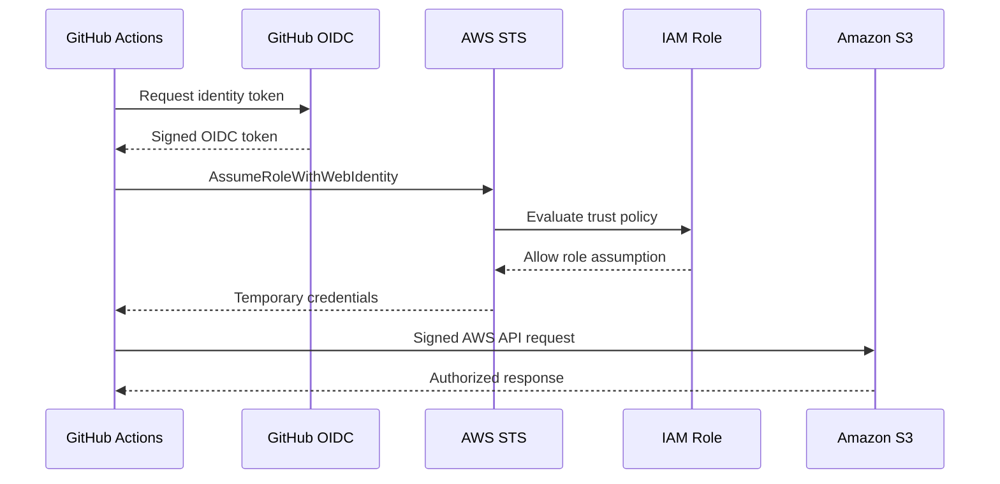
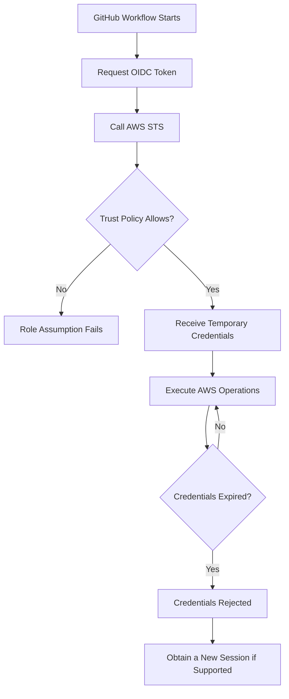

# 04- Short-Lived Credentials for Deployment

## Overview

Short-lived credentials provide temporary access to AWS resources without requiring applications or CI/CD workflows to store permanent AWS access keys.

In an Amazon S3 deployment pipeline, GitHub Actions may need AWS permissions to:

- Upload website assets to S3.
- Provision S3 buckets and related infrastructure.
- Deploy Lambda functions and event-driven processing components.
- Configure CloudFront distributions.
- Execute Terraform, CloudFormation, or AWS CDK deployments.
- Verify deployed resources.

Using long-lived IAM user access keys in GitHub repository secrets creates unnecessary credential-management overhead and increases the impact of credential exposure.

A production deployment pipeline should prefer temporary credentials obtained through IAM roles and federation.

For GitHub Actions, AWS IAM OIDC federation is the recommended approach. GitHub provides a signed identity token, AWS STS validates it, and AWS issues temporary credentials for an authorized IAM role.

This document focuses on temporary credential behavior, lifecycle, implementation, security boundaries, and operational considerations. The detailed OIDC provider and trust-policy configuration belongs in `03- AWS IAM OIDC Federation.md`.

## Long-Lived vs Short-Lived Credentials

### Long-Lived IAM Access Keys

IAM user access keys consist of:

- Access key ID.
- Secret access key.

They remain valid until they are rotated, deactivated, or deleted.

A traditional CI/CD configuration stores these values as GitHub repository or environment secrets.

```yaml
- name: Configure AWS credentials
  uses: aws-actions/configure-aws-credentials@v4
  with:
    aws-access-key-id: ${{ secrets.AWS_ACCESS_KEY_ID }}
    aws-secret-access-key: ${{ secrets.AWS_SECRET_ACCESS_KEY }}
    aws-region: ap-south-1
```

This approach has several operational disadvantages:

- Credentials must be stored and protected.
- Rotation requires coordination between AWS and GitHub.
- Leaked credentials may remain usable until revoked.
- The same credentials may accidentally be reused across environments.
- Credential ownership and expiration are harder to manage.

### Short-Lived AWS Credentials

Short-lived credentials are temporary credentials issued by AWS STS.

They contain:

- Access key ID.
- Secret access key.
- Session token.
- Expiration timestamp.

A workflow obtains these credentials by assuming an IAM role through a supported authentication mechanism.

```yaml
- name: Configure AWS credentials
  uses: aws-actions/configure-aws-credentials@v4
  with:
    role-to-assume: ${{ vars.AWS_DEPLOYMENT_ROLE_ARN }}
    aws-region: ap-south-1
```

The credentials action handles the OIDC token exchange and configures the temporary credentials for subsequent AWS CLI and SDK operations.

### Comparison

| Characteristic | Long-lived access keys | Short-lived credentials |
|---|---|---|
| Validity | Until rotated or revoked | Limited session duration |
| Credential storage | Usually stored as secrets | Obtained at runtime |
| Rotation | Requires operational coordination | New sessions are issued automatically when requested |
| Exposure impact | May persist until revoked | Limited by session expiration and other controls |
| Authentication | IAM user credentials | IAM role assumption or federation |
| CI/CD suitability | Legacy or constrained integrations | Preferred for supported modern workflows |
| Auditability | IAM user identity | Assumed-role session identity |
| Operational overhead | Higher credential-management burden | Lower long-term credential-management burden |

Temporary credentials reduce credential exposure risk, but they do not eliminate it. A compromised workflow can still use valid temporary credentials within the role's permission scope.

## AWS STS and Temporary Credentials

### What Is AWS STS?

AWS Security Token Service (STS) issues temporary security credentials for authenticated identities.

These credentials allow users, applications, and workloads to access AWS resources without relying on permanent IAM user access keys.

Common STS operations include:

| Operation | Purpose |
|---|---|
| `AssumeRole` | Assumes an IAM role using an existing AWS identity |
| `AssumeRoleWithWebIdentity` | Assumes a role using a web identity token |
| `AssumeRoleWithSAML` | Assumes a role using a SAML assertion |
| `GetCallerIdentity` | Returns details about the calling identity |
| `GetSessionToken` | Obtains temporary credentials for an IAM user or root identity |

For GitHub Actions OIDC federation, the relevant operation is `AssumeRoleWithWebIdentity`.

### Credential Issuance Flow



The process has two separate authorization stages:

1. **Role assumption:** AWS evaluates whether the external identity is trusted to assume the IAM role.
2. **Resource access:** AWS evaluates whether the assumed role is authorized to perform the requested operation.

For example, a workflow may successfully assume a deployment role but still receive `AccessDenied` when attempting to upload an object because the role lacks `s3:PutObject`.

## Temporary Credential Components

STS returns a temporary credential set.

| Component | Description |
|---|---|
| Access key ID | Identifies the temporary credential |
| Secret access key | Used to sign AWS requests |
| Session token | Required when using temporary credentials |
| Expiration | Defines when the credentials become invalid |

Unlike permanent IAM access keys, temporary credentials require the session token when signing authenticated AWS requests.

AWS CLI and SDK credential providers handle this automatically when the complete credential set is configured.

Do not manually construct AWS authorization headers or omit the session token.

## Credential Lifecycle

A temporary credential session has a defined lifecycle.



### Credential Issuance

The workflow authenticates through its OIDC identity and requests an AWS role session.

AWS STS validates the identity and returns temporary credentials if the trust policy allows the request.

### Credential Usage

The workflow uses the credentials for AWS API operations.

Examples include:

```bash
aws s3api head-bucket \
  --bucket "$BUCKET_NAME"
```

```bash
aws s3 cp ./dist/index.html \
  "s3://$BUCKET_NAME/index.html"
```

### Credential Expiration

After expiration, AWS rejects requests signed with the expired credentials.

The workflow must obtain a new session before continuing.

A new session requires a valid authentication path. For OIDC, that means obtaining a valid GitHub identity token and successfully assuming the role again.

Do not assume that temporary credentials remain valid for the entire duration of a long-running workflow.

## Session Duration and Expiration

### Role Session Duration

IAM roles define a maximum session duration.

The actual session duration is determined by the STS operation and the requested duration, subject to the role's configured maximum and operation-specific limits.

For `AssumeRoleWithWebIdentity`, the requested session duration must satisfy the operation's supported range and the role's maximum session duration.

For GitHub Actions deployments:

- Use the shortest practical duration.
- Consider the expected deployment duration.
- Avoid unnecessarily long sessions.
- Monitor long-running deployment jobs.
- Do not persist credentials beyond the workflow execution context.

### Configure Session Duration

The AWS credentials action supports a session duration configuration.

```yaml
- name: Configure AWS credentials
  uses: aws-actions/configure-aws-credentials@v4
  with:
    role-to-assume: ${{ vars.AWS_DEPLOYMENT_ROLE_ARN }}
    aws-region: ap-south-1
    role-duration-seconds: 1800
```

This requests a 30-minute session.

The requested duration must be supported by the STS operation and the IAM role configuration.

A longer duration should not be used merely to hide credential-expiration problems. Investigate why the deployment takes longer than expected and whether credential refresh is supported by the workflow design.

## GitHub Actions Implementation

### Workflow Permissions

GitHub Actions needs permission to request an OIDC token.

```yaml
permissions:
  id-token: write
  contents: read
```

| Permission | Purpose |
|---|---|
| `id-token: write` | Allows the workflow to request an OIDC identity token |
| `contents: read` | Allows repository checkout |

These permissions control GitHub token capabilities. They do not grant AWS resource access.

AWS authorization is controlled separately by the assumed IAM role.

### Configure AWS Credentials

Use the AWS credentials action to exchange the GitHub OIDC token for temporary AWS credentials.

```yaml
- name: Configure AWS credentials
  uses: aws-actions/configure-aws-credentials@v4
  with:
    role-to-assume: ${{ vars.AWS_DEPLOYMENT_ROLE_ARN }}
    aws-region: ap-south-1
    role-duration-seconds: 1800
```

The action:

1. Requests a GitHub OIDC token.
2. Calls AWS STS.
3. Assumes the configured IAM role.
4. Receives temporary credentials.
5. Configures the AWS credential environment for later steps.

Pin third-party actions to reviewed full commit SHAs in high-assurance production environments. Update pinned versions through a controlled dependency-management process.

### Verify the Credential Identity

Always verify the identity before performing privileged deployment operations.

```yaml
- name: Verify AWS identity
  run: aws sts get-caller-identity
```

Expected identity format:

```text
arn:aws:sts::111111111111:assumed-role/GitHubS3DeploymentRole/GitHubActions
```

The returned account and assumed role should match the intended deployment environment.

Never print access keys, secret access keys, or session tokens in workflow logs.

## Complete S3 Deployment Example

The following workflow demonstrates the use of short-lived credentials to deploy static website assets to S3.

It assumes that:

- The website build has generated `website/dist/`.
- The GitHub production environment is configured.
- The AWS OIDC provider and IAM role are configured.
- The role has permission to upload objects to the target bucket.
- The S3 bucket is private and configured for the intended delivery architecture.

```yaml
name: Deploy S3 Website

on:
  push:
    branches:
      - main
    paths:
      - "website/**"

  workflow_dispatch:

permissions:
  id-token: write
  contents: read

concurrency:
  group: s3-production-deployment
  cancel-in-progress: false

jobs:
  deploy:
    name: Deploy Website
    runs-on: ubuntu-latest
    environment: production

    steps:
      - name: Checkout repository
        uses: actions/checkout@v4

      - name: Verify build output
        run: test -d website/dist

      - name: Configure AWS credentials
        uses: aws-actions/configure-aws-credentials@v4
        with:
          role-to-assume: ${{ vars.AWS_DEPLOYMENT_ROLE_ARN }}
          aws-region: ap-south-1
          role-duration-seconds: 1800

      - name: Verify AWS identity
        run: aws sts get-caller-identity

      - name: Verify S3 bucket
        run: |
          aws s3api head-bucket \
            --bucket "${{ vars.S3_BUCKET_NAME }}"

      - name: Deploy website assets
        run: |
          aws s3 sync website/dist/ \
            "s3://${{ vars.S3_BUCKET_NAME }}/website/" \
            --only-show-errors

      - name: Verify deployed content
        run: |
          aws s3api head-object \
            --bucket "${{ vars.S3_BUCKET_NAME }}" \
            --key "website/index.html"
```

The example does not use `--delete`, avoiding accidental removal of objects outside the intended deployment operation.

A production pipeline should additionally validate the website build, run smoke tests, and implement a documented recovery strategy.

## Credential Isolation Across Environments

Development, staging, and production should use separate deployment roles.

```text
GitHub Actions
     |
     ├── Development Workflow
     │      |
     │      └── Temporary Development Session
     │                |
     │                └── Development S3 Resources
     │
     ├── Staging Workflow
     │      |
     │      └── Temporary Staging Session
     │                |
     │                └── Staging S3 Resources
     │
     └── Production Workflow
            |
            └── Temporary Production Session
                      |
                      └── Production S3 Resources
```

| Environment | IAM role | Resource scope |
|---|---|---|
| Development | `GitHubS3DevelopmentRole` | Development resources |
| Staging | `GitHubS3StagingRole` | Staging resources |
| Production | `GitHubS3ProductionRole` | Production resources |

Separate AWS accounts provide stronger isolation than relying only on different bucket names within one account.

Use GitHub Environments to configure environment-specific role ARNs and deployment variables.

Production environments should have:

- Required reviewers where appropriate.
- Restricted deployment branches.
- Separate deployment role.
- Explicit deployment permissions.
- Audit records.

## Short-Lived Credentials in Different Deployment Tools

Temporary credentials can be used with multiple AWS deployment tools.

### AWS CLI

The AWS CLI automatically uses credentials configured by the GitHub Actions credentials action.

```bash
aws sts get-caller-identity

aws s3 sync ./dist/ \
  "s3://${BUCKET_NAME}/" \
  --only-show-errors
```

### Boto3

Boto3 can use the standard AWS credential provider chain.

```python
import boto3


def create_s3_client() -> boto3.client:
    session = boto3.Session(
        region_name="ap-south-1",
    )

    return session.client("s3")


def upload_file(
    file_path: str,
    bucket_name: str,
    object_key: str,
) -> None:
    s3_client = create_s3_client()

    s3_client.upload_file(
        Filename=file_path,
        Bucket=bucket_name,
        Key=object_key,
    )
```

The code does not contain access keys. Boto3 resolves credentials from the configured environment or another supported credential provider.

In GitHub Actions, the credentials action makes the temporary credentials available to the AWS SDK through the environment.

### Terraform

Terraform's AWS provider can use the standard AWS credential chain.

```hcl
provider "aws" {
  region = var.aws_region
}
```

The workflow configures temporary AWS credentials before running Terraform.

```bash
terraform init
terraform validate
terraform plan
```

The Terraform backend may require additional permissions for state storage and locking. These permissions should be reviewed independently from the permissions required to create S3 infrastructure.

### AWS CDK

AWS CDK deployment commands use the configured AWS credential chain.

```bash
cdk synth
cdk diff
cdk deploy
```

The deployment role must have the permissions required by the target CloudFormation deployment and the CDK bootstrap resources.

## Credential Refresh and Long-Running Workflows

Temporary credentials eventually expire. This matters when a deployment performs several long-running operations.

Examples include:

- Deploying multiple CloudFormation stacks.
- Uploading large collections of files.
- Deploying large Lambda packages.
- Running extensive integration tests against AWS.
- Provisioning infrastructure across multiple environments.

### Refresh Considerations

Credential refresh depends on the authentication mechanism and credential provider.

A workflow using static environment credentials obtained at the beginning of a job should not assume that the credentials will automatically refresh after expiration.

Some SDK credential providers can refresh credentials when configured with a renewable source. A GitHub Actions OIDC workflow must have a valid way to obtain a new OIDC token and assume the role again.

For long-running deployment processes:

- Request an appropriate session duration.
- Prefer supported credential-provider refresh mechanisms.
- Avoid passing credentials between independent jobs.
- Re-authenticate in each job that needs AWS access.
- Split unrelated deployment stages into separate jobs when practical.
- Keep deployment operations idempotent and recoverable.

GitHub Actions jobs run in separate execution environments. Credentials configured in one job should not be assumed to exist in another.

## Credential Handling Across Containers

A deployment workflow may execute AWS commands inside Docker containers.

The container needs access to the temporary credentials without embedding them into the image.

A simple approach is to pass the relevant environment variables to the container:

```yaml
- name: Run deployment container
  run: |
    docker run --rm \
      -e AWS_ACCESS_KEY_ID \
      -e AWS_SECRET_ACCESS_KEY \
      -e AWS_SESSION_TOKEN \
      -e AWS_REGION \
      deployment-image:latest
```

Important considerations:

- Do not use Docker build arguments for credentials.
- Do not copy AWS credentials into the image filesystem.
- Do not persist credential files in image layers.
- Do not publish containers containing temporary credentials.
- Keep the container's AWS permissions restricted to the intended deployment operations.

For more complex container deployments, consider workload identity or a dedicated credential-provider integration rather than manually forwarding credentials.

## Security Boundaries

Temporary credentials reduce the lifetime of exposed credentials, but security still depends on the role and workflow configuration.

### Least-Privilege IAM

The deployment role should have only the permissions required by the pipeline.

For example, a static website deployment role may need:

- `s3:ListBucket` on the target bucket.
- `s3:PutObject` on the website prefix.
- `cloudfront:CreateInvalidation` on the intended distribution, if invalidation is required.

It should not automatically receive:

- `s3:*` on every bucket.
- `iam:*`.
- `kms:*` on every key.
- Administrator access.

Infrastructure provisioning roles may need broader permissions, but those permissions should be scoped to the deployment architecture and controlled through an explicit trust and approval process.

### Separate Authentication and Authorization

| Layer | Responsibility |
|---|---|
| GitHub workflow permissions | Controls GitHub token capabilities |
| OIDC trust policy | Controls which external identity can assume the role |
| IAM permission policy | Controls AWS API actions available to the role |
| S3 bucket policy | Controls resource-level access |
| KMS key policy | Controls access to encryption keys |
| Organizations SCP | Establishes organization-level permission boundaries |

A successful OIDC exchange does not bypass any of these authorization controls.

### Prevent Credential Exposure

Never:

- Print temporary credentials in workflow logs.
- Store STS credentials as permanent repository secrets.
- Upload credentials as workflow artifacts.
- Commit `.aws/credentials` files.
- Bake credentials into Docker images.
- Pass credentials to untrusted pull-request code.
- Expose OIDC tokens to unnecessary workflow steps.

Treat temporary credentials as secrets for their entire validity period.

## Monitoring and Audit

Temporary credential activity should be auditable.

Use AWS CloudTrail to inspect role assumption and subsequent AWS API calls.

Relevant events include:

- `AssumeRoleWithWebIdentity`.
- S3 object operations.
- S3 bucket configuration changes.
- IAM role and policy changes.
- CloudFormation deployment operations.
- KMS operations where applicable.

The assumed-role session identity can help correlate AWS activity with the deployment workflow.

Use meaningful session names where supported by the credentials action configuration.

For example:

```yaml
- name: Configure AWS credentials
  uses: aws-actions/configure-aws-credentials@v4
  with:
    role-to-assume: ${{ vars.AWS_DEPLOYMENT_ROLE_ARN }}
    aws-region: ap-south-1
    role-session-name: github-s3-deployment
```

Avoid placing sensitive information in session names.

For incident investigation, correlate:

- GitHub repository.
- Commit SHA.
- Workflow run ID.
- Deployment environment.
- Assumed IAM role.
- CloudTrail event time.
- AWS resource and API operation.

## Troubleshooting

### Credentials Expired During Deployment

**Symptoms:**

- Initial AWS commands succeed.
- Later commands return an expired-token error.
- Long-running deployment or upload operations fail.

**Likely causes:**

- The STS session expired.
- The deployment exceeded the configured session duration.
- The workflow continued using credentials that were not refreshed.

**Verification:**

```bash
aws sts get-caller-identity
```

Check the workflow configuration:

```yaml
role-duration-seconds: 1800
```

Review CloudTrail events and deployment timestamps to establish whether the session expired before the failed operation.

**Corrective action:**

- Select an appropriate supported session duration.
- Reduce unnecessary deployment duration.
- Use a credential provider that supports refresh where appropriate.
- Re-authenticate through OIDC when a new session is required.
- Make deployment stages safe to retry.

### `AccessDenied` After Credentials Are Issued

**Symptoms:**

- OIDC authentication succeeds.
- `aws sts get-caller-identity` returns the expected role.
- S3 operations fail.

**Likely causes:**

- Missing IAM permission.
- Bucket policy denial.
- KMS authorization failure.
- Organizations SCP restriction.
- Permissions boundary or session policy restriction.

**Verification:**

```bash
aws sts get-caller-identity
```

Inspect the role's policies:

```bash
aws iam list-attached-role-policies \
  --role-name GitHubS3DeploymentRole
```

Inspect the bucket policy:

```bash
aws s3api get-bucket-policy \
  --bucket "$BUCKET_NAME"
```

For SSE-KMS objects, inspect the relevant key policy and KMS permissions.

**Corrective action:**

Identify the exact denied action and resource. Correct the relevant policy without granting broad administrative permissions.

### Credentials Work in One Job but Not Another

**Symptoms:**

- One job can access S3.
- A dependent job receives `Unable to locate credentials`.

**Likely cause:**

GitHub Actions jobs run in separate execution environments. Credentials configured in one job are not automatically available in another.

**Corrective action:**

Configure AWS credentials independently in every job that requires AWS access.

```yaml
jobs:
  deploy:
    runs-on: ubuntu-latest
    permissions:
      id-token: write
      contents: read

    steps:
      - name: Configure AWS credentials
        uses: aws-actions/configure-aws-credentials@v4
        with:
          role-to-assume: ${{ vars.AWS_DEPLOYMENT_ROLE_ARN }}
          aws-region: ap-south-1
```

Do not transfer temporary credentials between jobs as workflow artifacts.

### AWS CLI Works but Boto3 Fails

**Possible causes:**

- Boto3 uses a different credential provider.
- The Python process does not receive the expected environment.
- The AWS Region is configured incorrectly.
- A container or subprocess does not receive the credential environment.

**Verification:**

```python
import boto3


session = boto3.Session(region_name="ap-south-1")

credentials = session.get_credentials()

if credentials is None:
    raise RuntimeError("AWS credentials are unavailable")

print("AWS credentials are configured")
```

Do not print the actual credential values.

**Corrective action:**

Use the standard credential provider chain, ensure the process receives the required environment, and verify the AWS Region.

## Common Mistakes

| Mistake | Impact | Recommended approach |
|---|---|---|
| Treating temporary credentials as non-sensitive | Exposed credentials can still be used until expiration | Protect them as secrets |
| Assuming credentials never expire during a job | Long deployments fail unexpectedly | Configure session duration and refresh behavior |
| Sharing credentials between GitHub jobs | Subsequent jobs may lack valid credentials | Authenticate independently in each job |
| Using one deployment role for all environments | Increases the impact of a compromised workflow | Use separate environment roles |
| Granting administrator permissions to deployment roles | Expands the blast radius | Apply least privilege |
| Storing temporary credentials in repository secrets | Defeats the purpose of runtime federation | Obtain credentials through OIDC |
| Passing credentials through Docker build arguments | Credentials may be persisted in image layers | Pass runtime credentials securely |
| Assuming successful role assumption guarantees S3 access | Resource authorization is evaluated separately | Validate IAM, bucket, KMS, and organizational policies |
| Increasing session duration without investigating slow deployments | Hides inefficient or unreliable deployment behavior | Optimize deployment and use a suitable session duration |
| Logging credential environment variables | Exposes credentials to workflow logs | Log identity and status, never secret values |

## Production Readiness Checklist

### Authentication

- [ ] GitHub Actions uses OIDC federation where supported.
- [ ] AWS OIDC provider and IAM trust policy are configured.
- [ ] Repository and environment restrictions are enforced.
- [ ] Workflow has only the required GitHub permissions.
- [ ] Each deployment job authenticates independently.

### Credential Management

- [ ] Temporary credentials are used instead of long-lived access keys.
- [ ] Session duration matches deployment requirements.
- [ ] Credential refresh or re-authentication behavior is understood.
- [ ] Credentials are never printed or uploaded as artifacts.
- [ ] Docker images do not contain AWS credentials.
- [ ] Credentials are not transferred unnecessarily between jobs.

### Authorization

- [ ] Deployment roles follow least privilege.
- [ ] Development, staging, and production roles are separated.
- [ ] S3 bucket and object permissions are scoped correctly.
- [ ] KMS permissions are reviewed independently.
- [ ] Infrastructure provisioning permissions are explicitly controlled.

### Operations

- [ ] Assumed identity is verified before deployment.
- [ ] CloudTrail records role assumption and AWS API activity.
- [ ] Deployment runs have traceable session identities.
- [ ] Expiration failures have a documented recovery process.
- [ ] Deployment operations are safe to retry.
- [ ] Production deployment approvals and audit trails are configured.

## Key Takeaways

- AWS STS issues temporary credentials that allow deployment workflows to access AWS without storing permanent access keys.
- GitHub Actions can obtain short-lived AWS credentials through OIDC federation and `AssumeRoleWithWebIdentity`.
- Temporary credentials include an access key ID, secret access key, session token, and expiration time; all components are required for authenticated requests.
- Credential expiration, job isolation, and refresh behavior must be considered when designing long-running deployment pipelines.
- Short-lived credentials reduce exposure risk, but least-privilege IAM, protected workflows, and CloudTrail auditing remain essential.