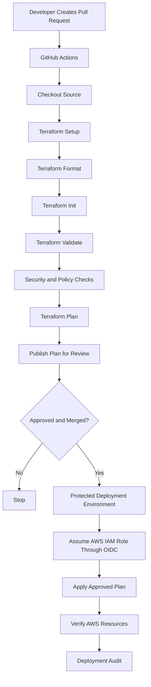
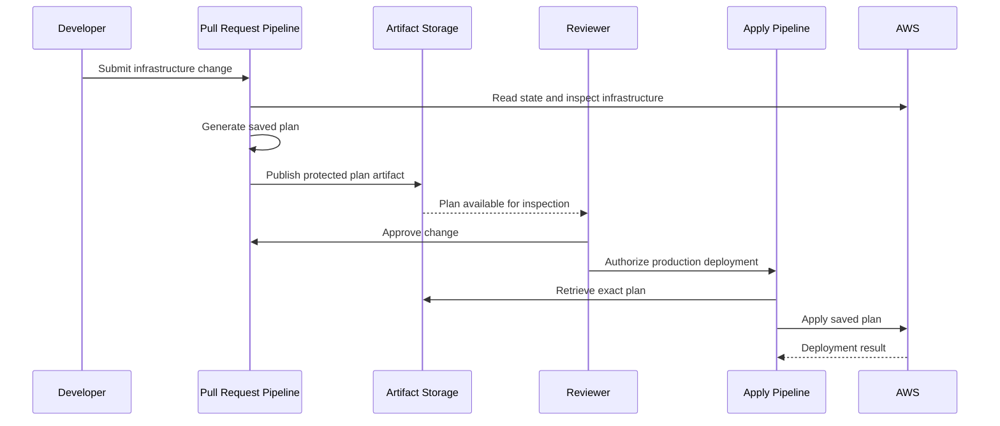

# 05- Terraform Plan and Apply Pipelines

## Overview

Terraform plan and apply pipelines automate infrastructure provisioning while preserving a controlled review and deployment process.

For Amazon S3 infrastructure, Terraform may manage:

- S3 buckets and bucket policies.
- Versioning and encryption configuration.
- Lifecycle rules.
- IAM roles and policies.
- Replication configuration.
- Event notifications.
- CloudFront distributions and Origin Access Control.
- Supporting Lambda, SQS, SNS, and KMS resources.

A production pipeline must distinguish between **evaluating infrastructure changes** and **executing those changes**.

- `terraform plan` calculates the proposed changes without applying them.
- `terraform apply` executes the approved changes against the target infrastructure.

The recommended workflow is to validate and plan changes during pull requests, review the resulting plan, and apply an approved plan through a protected deployment environment.

The pipeline must also protect Terraform state, isolate environments, authenticate securely, prevent concurrent modifications, and provide recovery procedures for failed deployments.

## Terraform Pipeline Architecture

### Core Pipeline Stages

A typical Terraform CI/CD pipeline contains these stages:

| Stage | Responsibility |
|---|---|
| Source checkout | Retrieves the Terraform configuration |
| Toolchain setup | Installs the required Terraform version |
| Formatting | Checks configuration formatting |
| Initialization | Downloads providers and configures the backend |
| Validation | Checks configuration consistency |
| Security checks | Detects insecure infrastructure configuration |
| Plan | Calculates proposed infrastructure changes |
| Review | Allows engineers to inspect and approve changes |
| Apply | Executes the approved plan |
| Verification | Checks deployed AWS resources |
| Audit | Records deployment identity and execution details |

### Architecture Diagram



The plan and apply stages should operate against the same intended configuration, Terraform state, provider versions, variables, and target environment.

A plan generated for one environment must never be applied accidentally to another.

## Terraform Project Structure

A maintainable S3 infrastructure repository should separate reusable infrastructure definitions from environment-specific configuration.

Example:

```text
s3-infrastructure/
│
├── .github/
│   └── workflows/
│       ├── terraform-plan.yml
│       └── terraform-apply.yml
│
├── environments/
│   ├── dev/
│   │   ├── backend.hcl
│   │   └── terraform.tfvars
│   │
│   ├── staging/
│   │   ├── backend.hcl
│   │   └── terraform.tfvars
│   │
│   └── production/
│       ├── backend.hcl
│       └── terraform.tfvars
│
├── modules/
│   └── s3-bucket/
│       ├── main.tf
│       ├── variables.tf
│       └── outputs.tf
│
├── main.tf
├── variables.tf
├── outputs.tf
├── versions.tf
└── README.md
```

### Responsibilities

| Path | Responsibility |
|---|---|
| `modules/s3-bucket/` | Reusable S3 bucket implementation |
| `environments/` | Environment-specific backend and variable configuration |
| `main.tf` | Root module composition |
| `variables.tf` | Input variables |
| `outputs.tf` | Exported resource information |
| `versions.tf` | Terraform and provider constraints |
| `.github/workflows/` | CI/CD pipeline definitions |

Keep credentials outside Terraform source code and configuration files.

## Terraform Configuration for S3

The following example creates a private S3 bucket with versioning, encryption, public-access blocking, and ownership controls.

### Provider and Version Constraints

`versions.tf`:

```hcl
terraform {
  required_version = ">= 1.9.0, < 2.0.0"

  required_providers {
    aws = {
      source  = "hashicorp/aws"
      version = "~> 6.0"
    }
  }

  backend "s3" {}
}

provider "aws" {
  region = var.aws_region
}
```

The version constraints are examples. Use versions supported by the project's tested toolchain and commit the dependency lock file.

The S3 backend stores Terraform state remotely. Backend configuration is supplied separately during initialization.

### Input Variables

`variables.tf`:

```hcl
variable "aws_region" {
  description = "AWS Region for the S3 infrastructure"
  type        = string
  default     = "ap-south-1"
}

variable "bucket_name" {
  description = "Globally unique S3 bucket name"
  type        = string
}

variable "environment" {
  description = "Deployment environment"
  type        = string

  validation {
    condition = contains(
      ["dev", "staging", "production"],
      var.environment
    )

    error_message = "Environment must be dev, staging, or production."
  }
}

variable "force_destroy" {
  description = "Allow Terraform to delete a non-empty bucket"
  type        = bool
  default     = false
}
```

`force_destroy` should remain disabled for production unless an explicitly approved teardown procedure requires otherwise.

### S3 Bucket Resource

`main.tf`:

```hcl
resource "aws_s3_bucket" "application" {
  bucket        = var.bucket_name
  force_destroy = var.force_destroy

  tags = {
    Name        = var.bucket_name
    Environment = var.environment
    ManagedBy   = "Terraform"
  }

  lifecycle {
    prevent_destroy = true
  }
}

resource "aws_s3_bucket_ownership_controls" "application" {
  bucket = aws_s3_bucket.application.id

  rule {
    object_ownership = "BucketOwnerEnforced"
  }
}

resource "aws_s3_bucket_public_access_block" "application" {
  bucket = aws_s3_bucket.application.id

  block_public_acls       = true
  ignore_public_acls      = true
  block_public_policy     = true
  restrict_public_buckets = true
}

resource "aws_s3_bucket_versioning" "application" {
  bucket = aws_s3_bucket.application.id

  versioning_configuration {
    status = "Enabled"
  }
}

resource "aws_s3_bucket_server_side_encryption_configuration" "application" {
  bucket = aws_s3_bucket.application.id

  rule {
    apply_server_side_encryption_by_default {
      sse_algorithm = "AES256"
    }

    bucket_key_enabled = true
  }
}
```

This example uses SSE-S3. If the deployment requires SSE-KMS, define the KMS key and its policies separately, then configure the bucket with the appropriate key ARN and encryption permissions.

The `prevent_destroy` lifecycle rule is a Terraform safeguard. It does not prevent deletion through the AWS Console, AWS CLI, or another principal.

### Outputs

`outputs.tf`:

```hcl
output "bucket_name" {
  description = "Name of the application bucket"
  value       = aws_s3_bucket.application.bucket
}

output "bucket_arn" {
  description = "ARN of the application bucket"
  value       = aws_s3_bucket.application.arn
}

output "bucket_region" {
  description = "Region of the application bucket"
  value       = var.aws_region
}
```

### Environment Configuration

`environments/dev/terraform.tfvars`:

```hcl
aws_region   = "ap-south-1"
bucket_name  = "company-app-dev-assets-example"
environment  = "dev"
force_destroy = false
```

`environments/production/terraform.tfvars`:

```hcl
aws_region   = "ap-south-1"
bucket_name  = "company-app-production-assets-example"
environment  = "production"
force_destroy = false
```

Bucket names must be globally unique within the S3 general purpose bucket namespace. Replace the illustrative names with names that satisfy the project's naming convention.

## Remote State Management

### Why Remote State Matters

Terraform state records the relationship between Terraform resource addresses and real infrastructure resources.

For a team-based deployment pipeline, local state is unsuitable because:

- State remains on the developer's machine.
- Different engineers may work with inconsistent state.
- CI/CD runners cannot reliably share local state.
- Concurrent deployments can create conflicting changes.
- State may be lost when a runner is destroyed.

Use a remote backend for shared infrastructure.

The S3 backend supports remote state storage and state locking through a configured lock file.

### Backend Configuration

Example `environments/dev/backend.hcl`:

```hcl
bucket       = "company-terraform-state-example"
key          = "s3-infrastructure/dev/terraform.tfstate"
region       = "ap-south-1"
encrypt      = true
use_lockfile = true
```

Example production configuration:

```hcl
bucket       = "company-terraform-state-example"
key          = "s3-infrastructure/production/terraform.tfstate"
region       = "ap-south-1"
encrypt      = true
use_lockfile = true
```

The state bucket must be provisioned separately from the infrastructure that depends on it.

A state bucket should have:

- Versioning enabled.
- Encryption enabled.
- Public access blocked.
- Restricted IAM permissions.
- Appropriate retention and recovery procedures.
- A separate administrative ownership boundary where practical.

The Terraform execution role needs access to the relevant state object and the permissions required for S3 backend lock-file operations.

### Initialize the Backend

```bash
terraform init \
  -backend-config=environments/dev/backend.hcl
```

For another environment:

```bash
terraform init \
  -backend-config=environments/production/backend.hcl
```

When changing backend configuration, Terraform may require backend reconfiguration or state migration.

Do not casually use `-reconfigure` or `-migrate-state` in an automated production pipeline. Review the implications before changing backend settings.

### State Isolation

Use separate state keys for each environment.

| Environment | State key |
|---|---|
| Development | `s3-infrastructure/dev/terraform.tfstate` |
| Staging | `s3-infrastructure/staging/terraform.tfstate` |
| Production | `s3-infrastructure/production/terraform.tfstate` |

Separate AWS accounts provide an additional isolation boundary.

Do not let development and production pipelines share the same state file.

## Terraform Plan and Apply Lifecycle

### Terraform Plan

`terraform plan` compares the desired configuration with the current state and remote infrastructure.

It produces a proposed execution plan.

```bash
terraform plan \
  -var-file=environments/dev/terraform.tfvars \
  -out=tfplan
```

The saved plan file contains the decisions Terraform intends to execute.

It may contain sensitive values, including values that are not displayed in normal terminal output.

Treat plan files as sensitive artifacts.

### Terraform Apply

Apply the saved plan:

```bash
terraform apply tfplan
```

When a saved plan file is supplied, Terraform applies that plan rather than interactively generating a new one.

This is important for CI/CD because the reviewed plan should be the plan that gets applied.

### Plan and Apply Differences

| Operation | `terraform plan` | `terraform apply` |
|---|---|---|
| Evaluates configuration | Yes | Yes |
| Compares desired and actual infrastructure | Yes | Yes |
| Calculates proposed changes | Yes | Uses the supplied plan when provided |
| Modifies AWS resources | No | Yes |
| Requires AWS read permissions | Yes | Yes |
| Requires resource modification permissions | Not generally for planning | Yes |
| Suitable for pull-request review | Yes | No |
| Requires deployment approval | Usually not | Recommended for production |

A plan is not a guarantee that the subsequent apply will succeed. Infrastructure may change between planning and application, credentials may expire, or AWS APIs may reject operations.

## Pull Request Plan Pipeline

A pull request should run validation and generate a plan without applying infrastructure changes.

The plan allows reviewers to inspect:

- Resources to be created.
- Resources to be modified.
- Resources to be destroyed.
- Security-related changes.
- S3 bucket configuration changes.
- IAM policy modifications.
- KMS and encryption changes.
- CloudFront and event-notification changes.

### Plan Workflow

`.github/workflows/terraform-plan.yml`:

```yaml
name: Terraform Plan

on:
  pull_request:
    branches:
      - main
    paths:
      - "**/*.tf"
      - "**/*.tfvars"
      - ".terraform.lock.hcl"
      - "environments/**"
      - "modules/**"

permissions:
  contents: read

jobs:
  plan:
    name: Validate Terraform
    runs-on: ubuntu-latest

    steps:
      - name: Checkout source
        uses: actions/checkout@v4

      - name: Setup Terraform
        uses: hashicorp/setup-terraform@v3
        with:
          terraform_version: "1.9.8"

      - name: Terraform Format
        run: terraform fmt -check -recursive

      - name: Terraform Init
        run: |
          terraform init \
            -backend=false

      - name: Terraform Validate
        run: terraform validate
```

This workflow performs formatting and configuration validation without accessing the remote state backend or AWS infrastructure.

For a remote plan, the workflow needs AWS authentication and backend permissions. Do not give untrusted pull-request code privileged AWS access.

### Remote Plan Security

A plan against real infrastructure may require:

- Read access to Terraform state.
- Backend lock-file permissions.
- AWS permissions to inspect managed resources.
- Provider access to relevant AWS APIs.

A pull request from a fork is untrusted input. It must not receive production credentials, unrestricted secrets, or privileged OIDC role access.

A safer design is to separate untrusted validation from trusted remote planning:

1. Run formatting and static validation for all pull requests without AWS credentials.
2. Run remote plans only in a trusted context with carefully restricted permissions.
3. Require review before applying production changes.
4. Restrict OIDC trust to the intended repository, branch, and GitHub environment.
5. Never execute untrusted pull-request code with production deployment credentials.

For sensitive infrastructure, use a trusted post-merge plan or a controlled plan-generation workflow rather than granting a pull request unrestricted access to the production backend.

## Production Apply Pipeline

Production infrastructure changes should be applied only after review and approval.

A protected GitHub Environment can enforce required reviewers and deployment branch restrictions.

The following workflow assumes:

- The workflow runs from a trusted branch.
- The production GitHub Environment is configured.
- The IAM role trusts the intended GitHub OIDC identity.
- The Terraform state backend already exists.
- The plan artifact is generated by a trusted workflow and associated with the same commit and environment.

### Apply Workflow

`.github/workflows/terraform-apply.yml`:

```yaml
name: Terraform Apply

on:
  workflow_dispatch:

permissions:
  contents: read
  id-token: write
  actions: read

concurrency:
  group: terraform-production
  cancel-in-progress: false

jobs:
  apply:
    name: Apply Production Infrastructure
    runs-on: ubuntu-latest

    environment: production

    steps:
      - name: Checkout source
        uses: actions/checkout@v4

      - name: Setup Terraform
        uses: hashicorp/setup-terraform@v3
        with:
          terraform_version: "1.9.8"

      - name: Configure AWS credentials
        uses: aws-actions/configure-aws-credentials@v4
        with:
          role-to-assume: ${{ vars.AWS_TERRAFORM_ROLE_ARN }}
          aws-region: ap-south-1
          role-duration-seconds: 3600

      - name: Verify AWS identity
        run: aws sts get-caller-identity

      - name: Initialize Terraform
        run: |
          terraform init \
            -backend-config=environments/production/backend.hcl

      - name: Download approved plan
        uses: actions/download-artifact@v4
        with:
          name: terraform-production-plan
          path: ./plan-artifact

      - name: Verify plan artifact
        run: test -s ./plan-artifact/tfplan

      - name: Apply approved plan
        run: terraform apply -input=false ./plan-artifact/tfplan
```

This is an apply-stage illustration, not a complete secure plan-artifact promotion system.

A production implementation must establish artifact provenance and verify that the downloaded plan belongs to:

- The intended repository.
- The expected commit SHA.
- The production environment.
- The approved workflow run.
- The expected Terraform configuration and backend.

Do not download an artifact merely because it has a matching name.

A saved Terraform plan is environment- and state-dependent. It should not be reused across different environments or after its underlying assumptions have changed.

## Secure Plan Artifact Promotion

### Why Promote the Saved Plan?

Generating a new plan immediately before applying it can result in a different change set from the one reviewers approved.

For example:

1. A reviewer approves a plan that creates an S3 bucket.
2. The configuration changes before deployment.
3. The apply workflow generates a new plan.
4. The new plan also modifies an IAM policy.
5. The pipeline applies changes that were never reviewed.

Promoting the exact saved plan avoids silently replacing the reviewed execution plan with a newly generated one.

### Plan Artifact Lifecycle



### Artifact Handling Requirements

| Requirement | Reason |
|---|---|
| Bind artifact to commit SHA | Prevents applying a plan from different source |
| Bind artifact to environment | Prevents cross-environment application |
| Restrict artifact access | Plan files may contain sensitive information |
| Use short retention | Reduces exposure and stale-plan risk |
| Verify workflow provenance | Prevents arbitrary artifact substitution |
| Use exact plan file | Preserves reviewed change decisions |
| Re-plan when stale | Prevents applying outdated assumptions |

Saved plans can become stale when the state changes after planning. Terraform may reject a stale saved plan. Generate a new plan and repeat review rather than attempting to force an outdated plan through.

### Plan Inspection

A saved plan can be rendered for review:

```bash
terraform show tfplan
```

For machine-readable inspection:

```bash
terraform show -json tfplan
```

The JSON output may contain sensitive values. Do not publish it as a public artifact or expose it to untrusted pull-request logs.

Avoid assuming that masking terminal output makes a plan artifact safe to share.

## Terraform Apply Approval Strategies

### GitHub Environment Protection

GitHub Environments can require manual approval before a deployment job starts.

Configure the production environment with:

- Required reviewers.
- Deployment branch restrictions.
- Environment-specific variables.
- Environment-specific secrets, if needed.
- Deployment protection rules where appropriate.

The approval gate controls whether the job can proceed. It does not independently verify the contents of a Terraform plan.

### Separate Plan and Apply Roles

Use different IAM roles for planning and applying.

| Role | Typical permissions |
|---|---|
| Terraform plan role | Read managed AWS resources and access the relevant state |
| Terraform apply role | Read state and perform approved infrastructure changes |
| State administration role | Manage the Terraform state infrastructure |
| Break-glass role | Perform controlled emergency recovery |

The plan role may need additional service-specific read permissions to calculate changes. The apply role needs the relevant write permissions.

Avoid granting the plan role the full deployment role simply because it is easier to configure.

## IAM Permissions and OIDC

Terraform pipelines should authenticate to AWS using GitHub OIDC federation instead of permanent IAM user credentials.

The workflow requests a GitHub OIDC token and assumes an IAM role through AWS STS.

### Workflow Permissions

```yaml
permissions:
  contents: read
  id-token: write
```

`id-token: write` allows the workflow to request an OIDC token. It does not itself grant AWS access.

### Role Separation

A recommended role structure is:

```text
GitHub Actions
     |
     ├── Terraform Plan Role
     │      ├── Read Terraform state
     │      ├── Inspect AWS resources
     │      └── Inspect S3 configuration
     │
     └── Terraform Apply Role
            ├── Read and update Terraform state
            ├── Create and modify S3 resources
            ├── Manage approved IAM resources
            └── Manage related deployment resources
```

The exact permissions depend on the Terraform configuration and resources being managed.

For S3 infrastructure, permissions may include:

- `s3:ListBucket`
- `s3:GetBucketLocation`
- `s3:GetBucketVersioning`
- `s3:GetEncryptionConfiguration`
- `s3:GetBucketPolicy`
- `s3:PutBucketVersioning`
- `s3:PutEncryptionConfiguration`
- `s3:PutBucketPolicy`
- `s3:PutBucketPublicAccessBlock`
- `s3:PutBucketOwnershipControls`

These are illustrative examples, not a complete policy. Terraform may need additional read and write operations for other managed resources.

The backend permissions are separate from permissions for application infrastructure.

For detailed OIDC trust policies, role configuration, and temporary credential handling, refer to:

- `03- AWS IAM OIDC Federation.md`
- `04- Short-Lived Credentials for Deployment.md`

## Concurrency and State Locking

Terraform deployments must not modify the same state simultaneously.

Two concurrent applies can cause:

- Conflicting infrastructure changes.
- State lock contention.
- Stale plans.
- Inconsistent deployment outcomes.
- Unexpected resource replacement.

### Terraform State Locking

The S3 backend supports state locking with a lock file when `use_lockfile = true` is configured.

Terraform acquires the lock before operations that require state protection and releases it when the operation completes.

Do not manually delete a lock file to resolve an active lock.

If a lock is genuinely stale, investigate the owning process and Terraform operation before using the supported force-unlock procedure.

### GitHub Actions Concurrency

```yaml
concurrency:
  group: terraform-production
  cancel-in-progress: false
```

This prevents multiple workflow runs in the same concurrency group from executing concurrently.

Use environment-specific groups:

```yaml
concurrency:
  group: terraform-${{ inputs.environment }}
  cancel-in-progress: false
```

GitHub Actions concurrency is not a replacement for Terraform backend locking. Backend locking protects state across different runners and other Terraform clients.

## Drift Detection

### What Is Infrastructure Drift?

Drift occurs when actual AWS infrastructure differs from the configuration and state Terraform expects to manage.

Examples:

- An engineer manually changes bucket encryption.
- A bucket policy is modified through the AWS Console.
- A lifecycle rule is removed.
- Versioning is suspended outside Terraform.
- An IAM policy is changed manually.

Drift can cause unexpected changes during later deployment operations.

### Detect Drift

A refresh-only plan can identify changes in remote infrastructure that affect Terraform state.

```bash
terraform plan -refresh-only \
  -var-file=environments/production/terraform.tfvars
```

A normal plan also refreshes managed resources and compares the resulting state with the desired configuration.

Use the normal plan to identify proposed reconciliation changes.

### Controlled Drift Reconciliation

Do not automatically apply every detected difference.

Use the following process:

1. Identify the resource and changed attribute.
2. Determine whether the change was authorized.
3. Identify whether Terraform or an external process should own the configuration.
4. Update Terraform configuration if the change is intended.
5. Restore the intended configuration if the change is unauthorized.
6. Generate a new plan.
7. Review and apply through the normal approval process.

For production resources, drift remediation should be auditable and controlled.

## Security and Policy Validation

Infrastructure plans should be checked for security-sensitive changes before deployment.

For S3, validate:

- Public-access block settings.
- Bucket ownership controls.
- Encryption configuration.
- Versioning requirements.
- Bucket policy changes.
- IAM policy scope.
- KMS key usage and permissions.
- Logging and monitoring configuration.
- Lifecycle and retention changes.
- Replication configuration.

Useful validation tools include:

| Tool | Purpose |
|---|---|
| `terraform fmt` | Formatting validation |
| `terraform validate` | Terraform configuration validation |
| TFLint | Terraform linting |
| Checkov | Infrastructure security checks |
| Trivy | Infrastructure and configuration scanning |
| OPA | Policy-as-code evaluation |
| Terraform test | Terraform module and configuration tests |

Example security scan:

```bash
checkov -d . \
  --framework terraform
```

A security scanner should complement, not replace, plan review and policy enforcement.

### Protect Sensitive Plan Data

Terraform plans and state can contain sensitive infrastructure information.

Use:

- Private workflow artifacts.
- Restricted artifact access.
- Short artifact retention.
- Protected workflow logs.
- Encrypted remote state.
- Least-privilege backend permissions.
- Controlled access to plan JSON.

Do not commit `terraform.tfstate`, saved plan files, or credential files to source control.

## Terraform Pipeline Testing

Infrastructure pipelines should test both configuration correctness and expected resource behavior.

### Formatting and Validation

```bash
terraform fmt -check -recursive

terraform init -backend=false

terraform validate
```

### Module Tests

Terraform supports native tests through `.tftest.hcl` files.

Example `modules/s3-bucket/s3_bucket.tftest.hcl`:

```hcl
run "valid_bucket_configuration" {
  command = plan

  variables {
    bucket_name  = "example-test-bucket-123456"
    environment  = "dev"
    force_destroy = false
  }

  assert {
    condition     = aws_s3_bucket.application.bucket == "example-test-bucket-123456"
    error_message = "The S3 bucket name does not match the configured input."
  }

  assert {
    condition     = aws_s3_bucket_versioning.application.versioning_configuration[0].status == "Enabled"
    error_message = "S3 versioning must be enabled."
  }
}
```

This example assumes the resource definitions and variables are located in the module being tested.

Run:

```bash
terraform test
```

Terraform tests can validate configuration and resource behavior through planning or apply-based tests. Apply-based tests may create real resources and incur AWS charges.

### Integration Testing

For an AWS-backed integration test:

1. Use a dedicated test account or isolated environment.
2. Deploy infrastructure with a dedicated state key.
3. Verify bucket configuration through AWS APIs.
4. Execute representative object operations.
5. Validate permissions and encryption behavior.
6. Destroy test resources only after confirming they are safe to remove.

Do not run destructive integration tests against production resources.

## Deployment Verification

Terraform reporting success does not guarantee that every application-level requirement has been met.

Verify the deployed S3 configuration after apply.

### Verify Bucket Existence

```bash
aws s3api head-bucket \
  --bucket "$BUCKET_NAME"
```

### Verify Versioning

```bash
aws s3api get-bucket-versioning \
  --bucket "$BUCKET_NAME"
```

Expected configuration:

```json
{
  "Status": "Enabled"
}
```

### Verify Encryption

```bash
aws s3api get-bucket-encryption \
  --bucket "$BUCKET_NAME"
```

### Verify Public Access Block

```bash
aws s3api get-public-access-block \
  --bucket "$BUCKET_NAME"
```

### Verify Ownership Controls

```bash
aws s3api get-bucket-ownership-controls \
  --bucket "$BUCKET_NAME"
```

### Verify Terraform Outputs

```bash
terraform output
```

For automated pipelines, use explicit checks and fail the deployment verification stage if required controls are missing.

## Failure Handling and Recovery

Terraform deployment failures require careful state and infrastructure inspection.

### Plan Failure

**Symptoms:**

- `terraform plan` exits with an error.
- Provider initialization fails.
- Terraform cannot read remote state.
- AWS API calls return authorization errors.

**Likely causes:**

- Invalid configuration.
- Provider version mismatch.
- Incorrect backend configuration.
- Missing IAM permissions.
- Expired credentials.
- State lock contention.

**Recovery:**

1. Inspect the exact error.
2. Verify the AWS identity.
3. Check backend access and state locking.
4. Validate provider versions and configuration.
5. Correct the underlying problem.
6. Generate a new plan.

### Apply Failure

**Symptoms:**

- Some AWS resources are created or modified.
- Terraform exits with an error.
- The deployment is incomplete.

An apply operation can partially modify infrastructure before failing.

Do not assume that an unsuccessful apply leaves AWS resources unchanged.

**Recovery:**

1. Preserve the workflow logs and error details.
2. Check the Terraform state.
3. Inspect the affected AWS resources.
4. Identify which operations succeeded.
5. Resolve the underlying cause.
6. Run a new plan.
7. Review the proposed reconciliation.
8. Apply through the normal controlled process.

Do not delete resources manually merely to make Terraform apply succeed.

### Stale Saved Plan

**Symptoms:**

- Applying a saved plan fails because the state changed after planning.

**Likely cause:**

Another Terraform operation changed the state between plan generation and apply.

**Recovery:**

1. Discard the stale plan.
2. Reinitialize or refresh only if required by the actual backend problem.
3. Generate a new plan.
4. Review the updated changes.
5. Obtain approval again.
6. Apply the new plan.

Never bypass stale-plan protection to force an old deployment through.

### State Lock Failure

**Symptoms:**

- Terraform reports that the state is locked.
- Another operation appears to be running.

**Recovery:**

1. Identify the operation holding the lock.
2. Check whether its workflow is still active.
3. Wait for a legitimate operation to complete.
4. If the lock is stale, verify that no process is using the state.
5. Use `terraform force-unlock` only when the lock owner and impact are understood.

Example:

```bash
terraform force-unlock LOCK_ID
```

This command is potentially dangerous. Do not use it as a routine retry mechanism.

### Resource Deletion Blocked

**Symptoms:**

- Terraform attempts to destroy a protected S3 bucket.
- Apply fails because `prevent_destroy` is enabled.

**Likely cause:**

The configuration contains an explicit Terraform deletion safeguard.

**Recovery:**

- Confirm whether the bucket is genuinely intended for deletion.
- Inspect object versions and delete markers.
- Verify retention and backup requirements.
- Follow the approved data-removal procedure.
- Change the lifecycle protection only through a reviewed infrastructure change.

A versioned bucket may contain multiple object versions that require separate handling before deletion.

## Rollback Strategies

Terraform does not provide a universal transaction rollback for infrastructure deployments.

If an apply partially succeeds, Terraform may have already changed some resources.

A safe recovery strategy depends on the resource and the nature of the change.

| Situation | Recommended recovery |
|---|---|
| Incorrect bucket policy | Restore the reviewed policy configuration |
| Incorrect lifecycle rule | Reapply the intended lifecycle configuration |
| Unintended IAM change | Restore the approved IAM policy |
| Failed CloudFront configuration update | Restore the known-good configuration and validate distribution deployment |
| Incorrect bucket encryption configuration | Apply the intended encryption configuration after checking key dependencies |
| Accidental resource replacement | Investigate state and AWS resources before attempting recovery |
| Data deletion | Use versioning, backups, or replication recovery procedures where configured |

For critical infrastructure:

- Keep configuration changes in version control.
- Review destructive plan actions carefully.
- Enable appropriate S3 versioning and recovery controls.
- Protect critical resources from accidental destruction.
- Maintain a documented recovery procedure.
- Test recovery in a non-production environment.

Do not assume that reverting a Git commit automatically restores deleted data or reverses every infrastructure side effect.

## Production Best Practices

### Pipeline Design

- Separate pull-request validation from production deployment.
- Require approval for production applies.
- Apply reviewed saved plans rather than silently generating new plans.
- Bind plan artifacts to a commit, environment, and workflow run.
- Use environment-specific state keys.
- Use separate deployment roles for different environments.
- Serialize applies against the same state.
- Verify deployed resources after applying changes.

### Terraform State

- Use a remote S3 backend.
- Enable state bucket versioning and encryption.
- Use S3 backend lock-file support.
- Restrict state access to authorized deployment roles.
- Keep state files out of source control.
- Test state recovery procedures.
- Avoid manual state editing.

### AWS Security

- Use OIDC federation instead of permanent AWS access keys.
- Apply least-privilege IAM permissions.
- Restrict production role trust to intended GitHub identities.
- Prevent untrusted pull requests from accessing privileged credentials.
- Review changes to S3 public-access controls and bucket policies.
- Protect sensitive plan and state artifacts.

### Reliability

- Keep Terraform and provider versions controlled.
- Commit `.terraform.lock.hcl`.
- Use deployment concurrency controls.
- Make deployment operations safe to retry.
- Detect and investigate infrastructure drift.
- Preserve workflow logs and deployment audit records.
- Test infrastructure changes in isolated environments.

### Cost Management

Terraform pipelines can create resources that incur AWS charges.

Review plans for:

- Additional S3 storage.
- Replication configuration.
- CloudFront distributions.
- KMS keys and requests.
- Lambda resources.
- Logging and monitoring resources.
- Data transfer and request charges.

Destroy temporary infrastructure only after confirming that it does not contain required data or shared dependencies.

## Common Mistakes

| Mistake | Impact | Prevention |
|---|---|---|
| Running `terraform apply` automatically on every pull request | Unreviewed infrastructure changes | Separate plan and apply stages |
| Applying a newly generated plan instead of the reviewed plan | Deploys changes that reviewers did not approve | Promote the exact saved plan |
| Reusing a plan across environments | Applies an environment-specific plan to the wrong infrastructure | Bind plans to their target environment |
| Using local state in CI/CD | Inconsistent state and unreliable deployments | Use a remote backend |
| Running concurrent applies | State contention and conflicting changes | Use backend locking and workflow concurrency |
| Sharing production and development state | Environment isolation failure | Use separate state keys and preferably separate accounts |
| Exposing state or plan files | Sensitive infrastructure information may leak | Restrict artifact and backend access |
| Giving fork pull requests AWS credentials | Untrusted code can access AWS resources | Validate untrusted changes without privileged credentials |
| Granting broad IAM permissions to Terraform | Increases the impact of pipeline compromise | Scope permissions to required resources and actions |
| Automatically applying drift corrections | Can overwrite legitimate emergency changes | Review drift before remediation |
| Ignoring partial apply failures | Leaves infrastructure in an unexpected state | Inspect state and remote resources before retrying |
| Treating Git rollback as infrastructure rollback | Does not reverse every side effect or recover deleted data | Use resource-specific recovery procedures |
| Removing `prevent_destroy` casually | Critical S3 resources may be deleted | Require explicit review and recovery planning |

## Production Deployment Checklist

### Source and Configuration

- [ ] Terraform and provider versions are constrained.
- [ ] `.terraform.lock.hcl` is committed.
- [ ] Environment-specific variables are reviewed.
- [ ] Formatting and validation checks pass.
- [ ] Security and policy checks are executed.
- [ ] Infrastructure changes are reviewed in version control.

### State and Backend

- [ ] Remote S3 state backend is configured.
- [ ] State bucket versioning and encryption are enabled.
- [ ] State access follows least privilege.
- [ ] S3 backend lock-file support is configured.
- [ ] Each environment has an independent state key.
- [ ] State recovery procedures are documented.

### Authentication and Authorization

- [ ] GitHub Actions uses OIDC federation.
- [ ] Production role trust is restricted.
- [ ] Plan and apply permissions are separated where practical.
- [ ] Untrusted pull requests cannot access privileged AWS credentials.
- [ ] AWS identity is verified before deployment.

### Plan and Apply

- [ ] Pull requests generate and expose reviewable plans through a trusted process.
- [ ] Saved plans are protected as sensitive artifacts.
- [ ] Plan artifacts are bound to the correct commit and environment.
- [ ] Production approval is configured.
- [ ] Apply uses the approved saved plan.
- [ ] Stale plans are regenerated and reviewed.
- [ ] Concurrent applies are prevented.

### Post-Deployment

- [ ] Terraform apply completes successfully.
- [ ] S3 bucket configuration is verified.
- [ ] Encryption and versioning are checked.
- [ ] Public-access controls are verified.
- [ ] IAM and resource policies are validated.
- [ ] Deployment activity is auditable.
- [ ] Failure and recovery procedures are available.

## Key Takeaways

- Separate Terraform validation and planning from infrastructure-changing apply operations; production changes should pass through an explicit review and approval process.
- Use a remote S3 backend with versioning, encryption, restricted access, and state locking to protect shared Terraform state.
- Apply the exact reviewed saved plan, and bind plan artifacts to the intended commit, workflow run, and environment.
- Combine GitHub Actions concurrency controls with Terraform backend locking to prevent conflicting infrastructure operations.
- Treat partial applies, stale plans, drift, and state-lock failures as controlled recovery scenarios rather than forcing deployments through.