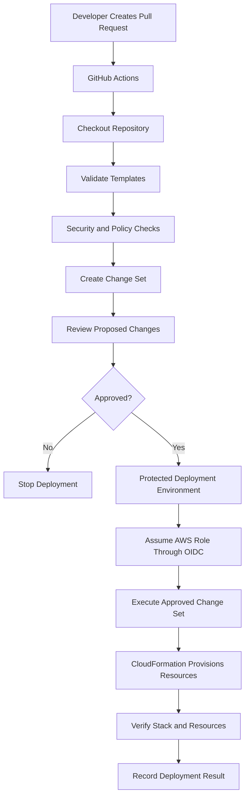
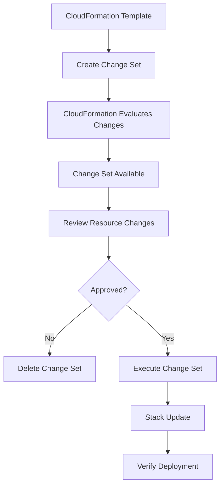
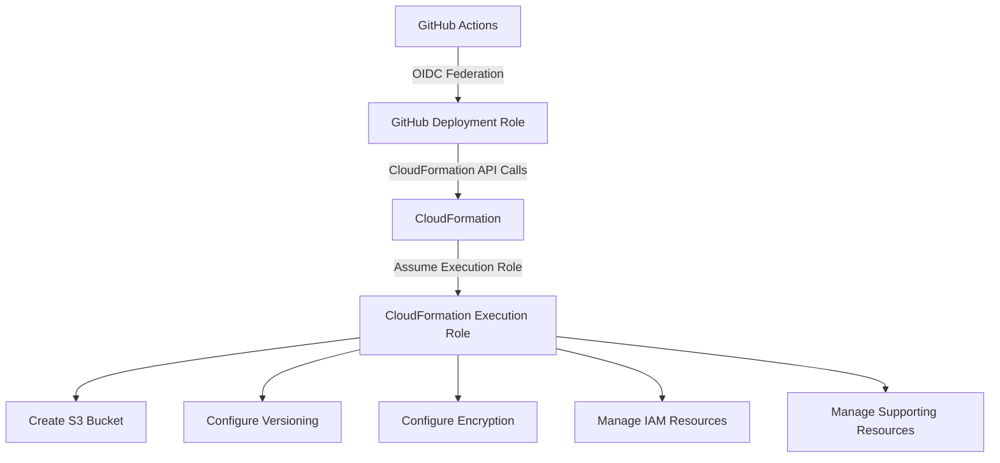

# 06- CloudFormation Deployment Pipelines

## Overview

CloudFormation deployment pipelines automate the provisioning, updating, validation, and recovery of AWS infrastructure through declarative templates.

For Amazon S3-based architectures, CloudFormation can manage:

- S3 buckets and bucket policies.
- Versioning, encryption, and public-access controls.
- Lifecycle configurations and replication.
- IAM roles and policies.
- Lambda functions and S3 event notifications.
- SQS queues, SNS topics, and EventBridge rules.
- CloudFront distributions and Origin Access Control.
- KMS keys and supporting infrastructure.

A production pipeline must do more than execute a deployment command after a Git push. It should validate templates, inspect proposed changes, enforce approval controls, deploy through controlled stages, verify resources, and provide predictable recovery procedures.

This document covers CloudFormation deployment architecture, GitHub Actions integration, change sets, environment isolation, security, testing, rollback, and operational recovery.

## CloudFormation Deployment Architecture

### Core Components

| Component | Responsibility |
|---|---|
| CloudFormation template | Defines the desired AWS infrastructure |
| Parameters | Supplies environment-specific configuration |
| Stack | Represents a deployed collection of resources |
| Change set | Describes proposed stack changes before execution |
| GitHub Actions | Automates validation and deployment |
| IAM deployment role | Authorizes deployment API operations |
| CloudFormation execution role | Allows CloudFormation to provision resources |
| Stack policy | Protects selected resources from certain updates |
| CloudTrail | Records AWS API activity |
| CloudWatch | Provides operational monitoring |

### Deployment Lifecycle



A typical deployment follows this sequence:

1. A developer changes a CloudFormation template.
2. GitHub Actions checks out the repository.
3. Template validation and security checks execute.
4. A CloudFormation change set is created.
5. Engineers inspect proposed resource changes.
6. An authorized reviewer approves the production deployment.
7. GitHub Actions obtains temporary AWS credentials through OIDC.
8. The approved change set is executed.
9. CloudFormation provisions resources.
10. The pipeline verifies stack status and application-level requirements.

Change sets are particularly important for production because they expose proposed infrastructure changes before execution.

## CloudFormation Project Structure

A maintainable repository should separate reusable templates, environment configuration, deployment scripts, and workflow definitions.

```text
s3-cloudformation/
│
├── .github/
│   └── workflows/
│       ├── cloudformation-validate.yml
│       └── cloudformation-deploy.yml
│
├── templates/
│   ├── s3-bucket.yml
│   ├── iam-deployment-role.yml
│   └── application-storage.yml
│
├── parameters/
│   ├── dev.json
│   ├── staging.json
│   └── production.json
│
├── scripts/
│   ├── validate.sh
│   ├── create-change-set.sh
│   ├── execute-change-set.sh
│   └── verify-stack.sh
│
└── README.md
```

| Directory | Responsibility |
|---|---|
| `.github/workflows/` | CI/CD workflow definitions |
| `templates/` | CloudFormation templates |
| `parameters/` | Environment-specific parameter values |
| `scripts/` | Reusable deployment and verification scripts |
| `README.md` | Prerequisites, deployment procedures, and recovery guidance |

Avoid duplicating complete templates for each environment. Use parameters, mappings, and conditions where they provide a clear separation of environment-specific configuration.

## CloudFormation Template for S3

The following template creates a private S3 bucket with versioning, encryption, ownership controls, and public-access protection.

### Template Definition

`templates/s3-bucket.yml`:

```yaml
AWSTemplateFormatVersion: "2010-09-09"

Description: >
  Secure S3 bucket with versioning, encryption,
  ownership controls, and public access protection.

Parameters:
  Environment:
    Type: String
    AllowedValues:
      - dev
      - staging
      - production

  BucketName:
    Type: String
    Description: Globally unique S3 bucket name

Resources:
  ApplicationBucket:
    Type: AWS::S3::Bucket

    Properties:
      BucketName: !Ref BucketName

      VersioningConfiguration:
        Status: Enabled

      OwnershipControls:
        Rules:
          - ObjectOwnership: BucketOwnerEnforced

      PublicAccessBlockConfiguration:
        BlockPublicAcls: true
        IgnorePublicAcls: true
        BlockPublicPolicy: true
        RestrictPublicBuckets: true

      BucketEncryption:
        ServerSideEncryptionConfiguration:
          - ServerSideEncryptionByDefault:
              SSEAlgorithm: AES256

      Tags:
        - Key: Environment
          Value: !Ref Environment

        - Key: ManagedBy
          Value: CloudFormation

Outputs:
  BucketName:
    Description: Name of the application bucket
    Value: !Ref ApplicationBucket

  BucketArn:
    Description: ARN of the application bucket
    Value: !GetAtt ApplicationBucket.Arn
```

This example uses SSE-S3. If the application requires SSE-KMS, define or reference the KMS key and its permissions separately, then configure the bucket with the appropriate key ARN.

The bucket name must be globally unique within the S3 general purpose bucket namespace.

### Environment Parameter Files

`parameters/dev.json`:

```json
[
  {
    "ParameterKey": "Environment",
    "ParameterValue": "dev"
  },
  {
    "ParameterKey": "BucketName",
    "ParameterValue": "company-app-dev-assets-example"
  }
]
```

`parameters/production.json`:

```json
[
  {
    "ParameterKey": "Environment",
    "ParameterValue": "production"
  },
  {
    "ParameterKey": "BucketName",
    "ParameterValue": "company-app-production-assets-example"
  }
]
```

Replace illustrative bucket names with names that satisfy the organization's naming convention.

Keep environment configuration separate from credentials. Do not store AWS access keys in parameter files.

## CloudFormation Template Validation

Template validation should run before creating or updating a stack.

### Validate Template Syntax

```bash
aws cloudformation validate-template \
  --template-body file://templates/s3-bucket.yml \
  --region ap-south-1
```

This checks whether the template is valid CloudFormation input and returns information such as parameter definitions.

It does not guarantee that every resource property, IAM permission, or deployment dependency will work as intended.

### Lint Templates

Use `cfn-lint` to detect template errors and potential configuration problems.

Install:

```bash
python -m pip install cfn-lint
```

Run:

```bash
cfn-lint templates/s3-bucket.yml
```

### Security Scanning

Use tools such as Checkov to detect infrastructure security misconfigurations.

```bash
checkov \
  --framework cloudformation \
  -d templates/
```

Security scanning should complement template review and deployment verification.

### Validation Pipeline Responsibilities

A pull-request validation pipeline should:

- Check YAML and JSON syntax.
- Validate CloudFormation templates.
- Run `cfn-lint`.
- Run security scanning.
- Check parameter files.
- Review IAM and bucket policy changes.
- Reject unintended public-access configurations.
- Ensure destructive changes receive additional scrutiny.

## CloudFormation Change Sets

### What Is a Change Set?

A change set describes the changes CloudFormation proposes to make when creating or updating a stack.

It provides a reviewable representation of infrastructure modifications before execution.

A change set can identify:

- Resources to create.
- Resources to modify.
- Resources to delete.
- Replacement behavior.
- Property changes.
- Changes that may require resource interruption.

### Why Change Sets Matter

Consider an existing production S3 bucket. A developer modifies the CloudFormation template to change bucket configuration.

Without reviewing the change set, a deployment may introduce an unexpected resource replacement or deletion.

A change set gives engineers an opportunity to identify the impact before the update is executed.

### Change Set Lifecycle



### Create a Change Set

For an existing stack:

```bash
aws cloudformation create-change-set \
  --stack-name application-storage-production \
  --change-set-name production-update-001 \
  --change-set-type UPDATE \
  --template-body file://templates/s3-bucket.yml \
  --parameters file://parameters/production.json
```

For an initial deployment, use:

```bash
--change-set-type CREATE
```

A production pipeline should determine whether the target stack already exists rather than assuming every deployment is an update.

If the template creates or modifies IAM resources, supply the appropriate capability acknowledgment:

```bash
--capabilities CAPABILITY_IAM CAPABILITY_NAMED_IAM
```

### Inspect a Change Set

```bash
aws cloudformation describe-change-set \
  --stack-name application-storage-production \
  --change-set-name production-update-001
```

Inspect detailed resource changes:

```bash
aws cloudformation describe-change-set \
  --stack-name application-storage-production \
  --change-set-name production-update-001 \
  --query "Changes[].ResourceChange"
```

Review the following fields:

| Field | Purpose |
|---|---|
| `Action` | Add, modify, or remove a resource |
| `LogicalResourceId` | Resource identifier in the template |
| `ResourceType` | AWS resource type |
| `Replacement` | Whether replacement is required |
| `Scope` | Resource properties affected |
| `Details` | Additional change information |

A change set is a deployment review mechanism, not a guarantee that execution will succeed.

### Execute a Change Set

```bash
aws cloudformation execute-change-set \
  --stack-name application-storage-production \
  --change-set-name production-update-001
```

### Wait for Completion

For an update:

```bash
aws cloudformation wait stack-update-complete \
  --stack-name application-storage-production
```

For an initial creation:

```bash
aws cloudformation wait stack-create-complete \
  --stack-name application-storage-production
```

The pipeline should select the appropriate waiter based on the deployment operation.

### Handle Empty Change Sets

If no changes are detected, CloudFormation can return a change-set status indicating that there are no changes to deploy.

Treat this as a successful no-op rather than an infrastructure deployment failure.

A pipeline should distinguish:

- Successful change-set creation with changes.
- Successful change-set creation with no changes.
- Actual template, permission, or stack errors.

Do not treat every non-zero command exit code as a deployment failure without inspecting the AWS response.

## GitHub Actions Validation Pipeline

A pull-request workflow should validate templates without applying infrastructure changes.

`.github/workflows/cloudformation-validate.yml`:

```yaml
name: CloudFormation Validation

on:
  pull_request:
    branches:
      - main
    paths:
      - "templates/**"
      - "parameters/**"
      - ".github/workflows/**"

permissions:
  contents: read

jobs:
  validate:
    name: Validate Templates
    runs-on: ubuntu-latest

    steps:
      - name: Checkout repository
        uses: actions/checkout@v4

      - name: Setup Python
        uses: actions/setup-python@v5
        with:
          python-version: "3.12"

      - name: Install validation tools
        run: |
          python -m pip install --upgrade pip
          pip install cfn-lint checkov

      - name: Run cfn-lint
        run: cfn-lint templates/*.yml

      - name: Run Checkov
        run: checkov --framework cloudformation -d templates/
```

This validation workflow does not require AWS credentials.

If remote CloudFormation validation is required, run it in a trusted workflow with an appropriately restricted identity.

Untrusted pull requests, particularly those from forks, must not receive production AWS credentials or privileged OIDC role access.

## Production Deployment Pipeline

Production deployment should use:

- A protected GitHub Environment.
- OIDC authentication.
- A dedicated deployment role.
- A reviewed CloudFormation change set.
- Explicit approval.
- Post-deployment verification.

### Deployment Architecture

```text
Trusted Source Revision
        |
        v
Template Validation
        |
        v
AWS OIDC Authentication
        |
        v
Create Change Set
        |
        v
Inspect Resource Changes
        |
        v
Approval Gate
        |
        v
Execute Approved Change Set
        |
        v
Wait for Stack Completion
        |
        v
Verify S3 Configuration
```

### Create Change Set Workflow

The following example creates a production change set and waits for CloudFormation to finish evaluating it.

`.github/workflows/cloudformation-deploy.yml`:

```yaml
name: CloudFormation Production Deployment

on:
  workflow_dispatch:

permissions:
  contents: read
  id-token: write

concurrency:
  group: cloudformation-production
  cancel-in-progress: false

jobs:
  create-change-set:
    name: Create Production Change Set
    runs-on: ubuntu-latest

    environment: production-plan

    outputs:
      change_set_name: ${{ steps.change-set.outputs.name }}

    steps:
      - name: Checkout repository
        uses: actions/checkout@v4

      - name: Configure AWS credentials
        uses: aws-actions/configure-aws-credentials@v4
        with:
          role-to-assume: ${{ vars.AWS_CLOUDFORMATION_ROLE_ARN }}
          aws-region: ap-south-1
          role-duration-seconds: 1800

      - name: Verify AWS identity
        run: aws sts get-caller-identity

      - name: Create change set
        id: change-set
        env:
          STACK_NAME: application-storage-production
        run: |
          CHANGE_SET_NAME="production-${GITHUB_SHA}-${GITHUB_RUN_ID}"

          aws cloudformation create-change-set \
            --stack-name "$STACK_NAME" \
            --change-set-name "$CHANGE_SET_NAME" \
            --change-set-type UPDATE \
            --template-body file://templates/s3-bucket.yml \
            --parameters file://parameters/production.json

          aws cloudformation wait change-set-create-complete \
            --stack-name "$STACK_NAME" \
            --change-set-name "$CHANGE_SET_NAME"

          echo "name=$CHANGE_SET_NAME" >> "$GITHUB_OUTPUT"

      - name: Display change set
        env:
          CHANGE_SET_NAME: ${{ steps.change-set.outputs.name }}
        run: |
          aws cloudformation describe-change-set \
            --stack-name application-storage-production \
            --change-set-name "$CHANGE_SET_NAME"
```

This example assumes the stack already exists. Initial stack creation requires a `CREATE` change set rather than an `UPDATE` change set.

For templates containing IAM resources, add the appropriate capability acknowledgment.

A production implementation should also persist the change-set identity and deployment metadata in a trusted artifact or deployment record.

### Execute the Approved Change Set

The execution stage should run only after the change set has been reviewed and approved.

```yaml
  execute-change-set:
    name: Execute Approved Change Set
    runs-on: ubuntu-latest

    needs: create-change-set

    environment: production

    steps:
      - name: Checkout repository
        uses: actions/checkout@v4

      - name: Configure AWS credentials
        uses: aws-actions/configure-aws-credentials@v4
        with:
          role-to-assume: ${{ vars.AWS_CLOUDFORMATION_ROLE_ARN }}
          aws-region: ap-south-1
          role-duration-seconds: 1800

      - name: Execute change set
        env:
          CHANGE_SET_NAME: ${{ needs.create-change-set.outputs.change_set_name }}
        run: |
          aws cloudformation execute-change-set \
            --stack-name application-storage-production \
            --change-set-name "$CHANGE_SET_NAME"

      - name: Wait for stack update
        run: |
          aws cloudformation wait stack-update-complete \
            --stack-name application-storage-production

      - name: Verify stack
        run: |
          aws cloudformation describe-stacks \
            --stack-name application-storage-production
```

The two jobs illustrate the separation of planning and execution. In a production implementation, the change set must be reviewed before the execution job is authorized.

Configure the production GitHub Environment with required reviewers and deployment branch restrictions. Ensure that approval is bound to the intended change-set identity rather than allowing an unreviewed deployment to replace it.

Also account for no-op change sets and initial stack creation separately.

## Environment Isolation

Development, staging, and production should have independent CloudFormation stacks.

```text
GitHub Repository
       |
       v
GitHub Actions
       |
       ├── Development Deployment
       │      └── application-storage-dev
       │
       ├── Staging Deployment
       │      └── application-storage-staging
       │
       └── Production Deployment
              └── application-storage-production
```

### Environment Configuration

| Environment | Stack | Deployment control |
|---|---|---|
| Development | `application-storage-dev` | Automated deployment after validation |
| Staging | `application-storage-staging` | Controlled deployment and integration tests |
| Production | `application-storage-production` | Approval required |

Use separate AWS accounts where practical. Separate accounts provide stronger isolation than relying only on stack names and resource tags.

### Parameter Management

Use environment-specific parameter files:

```text
parameters/
├── dev.json
├── staging.json
└── production.json
```

Avoid duplicating the complete CloudFormation template for each environment.

Sensitive values should be supplied through appropriate secret-management mechanisms, such as AWS Secrets Manager or Systems Manager Parameter Store, rather than committed as plaintext parameters.

## IAM and OIDC Authentication

GitHub Actions should use IAM OIDC federation instead of permanent AWS access keys.

The workflow requests an OIDC identity token, and AWS STS issues temporary credentials when the configured IAM role trust policy permits the request.

### Workflow Permissions

```yaml
permissions:
  contents: read
  id-token: write
```

`id-token: write` allows GitHub Actions to request an OIDC token. It does not grant AWS resource permissions.

### Deployment Role Responsibilities

The GitHub deployment role should have the permissions required to:

- Create and inspect change sets.
- Execute approved change sets.
- Describe stack status and events.
- Access required deployment artifacts.
- Pass the CloudFormation execution role when configured.

The CloudFormation execution role should have the permissions required to create, update, and delete the resources defined in the template.

### Separate Deployment and Execution Roles



This separation limits direct resource-management permissions in the GitHub deployment role.

### CloudFormation Execution Role

A stack can be configured to use a dedicated execution role.

Example:

```bash
aws cloudformation create-change-set \
  --stack-name application-storage-production \
  --change-set-name production-update-001 \
  --change-set-type UPDATE \
  --template-body file://templates/s3-bucket.yml \
  --parameters file://parameters/production.json \
  --role-arn arn:aws:iam::111111111111:role/CloudFormationExecutionRole
```

The GitHub deployment role must be allowed to pass the execution role through `iam:PassRole`.

Restrict `iam:PassRole` to the intended CloudFormation execution role and use an appropriate service condition where applicable.

The execution role should have only the permissions required by the template.

For detailed OIDC trust-policy and temporary credential configuration, refer to:

- `03- AWS IAM OIDC Federation.md`
- `04- Short-Lived Credentials for Deployment.md`

## CloudFormation Capabilities

CloudFormation requires explicit capability acknowledgment for certain IAM resource operations.

| Capability | Purpose |
|---|---|
| `CAPABILITY_IAM` | Acknowledges that a template creates or modifies IAM resources |
| `CAPABILITY_NAMED_IAM` | Acknowledges that a template creates or modifies named IAM resources |
| `CAPABILITY_AUTO_EXPAND` | Acknowledges processing of certain macros and transforms |

Example:

```bash
aws cloudformation deploy \
  --template-file templates/application-storage.yml \
  --stack-name application-storage-production \
  --parameter-overrides file://parameters/production.json \
  --capabilities CAPABILITY_IAM CAPABILITY_NAMED_IAM
```

Use only the capabilities required by the template.

Capability acknowledgment is not a security approval. IAM policies and role changes still require review.

## Stack Updates and Resource Dependencies

CloudFormation manages resource dependencies using references and intrinsic functions.

For example:

```yaml
Resources:
  ApplicationBucket:
    Type: AWS::S3::Bucket

  BucketPolicy:
    Type: AWS::S3::BucketPolicy

    Properties:
      Bucket: !Ref ApplicationBucket

      PolicyDocument:
        Version: "2012-10-17"

        Statement:
          - Effect: Allow
            Principal:
              Service: cloudfront.amazonaws.com

            Action:
              - s3:GetObject

            Resource: !Sub "${ApplicationBucket.Arn}/*"
```

The bucket policy references the bucket, allowing CloudFormation to establish the resource dependency.

In a real CloudFront architecture, the policy should also restrict access to the intended distribution using the appropriate source ARN condition. Do not use an unrestricted service principal as a substitute for a complete Origin Access Control design.

### Update Behavior

CloudFormation resource updates may have different effects.

| Update behavior | Meaning |
|---|---|
| No interruption | Resource updates without interrupting service |
| Some interruption | Resource may experience temporary disruption |
| Replacement | Existing resource is replaced |

Always inspect replacement behavior before updating critical S3-related resources.

Some resource properties are immutable or require replacement. For stateful resources, replacement may result in data loss or service disruption.

## Stack Policies and Resource Protection

### Stack Policies

A stack policy controls which update actions CloudFormation can perform on protected resources.

It is useful for preventing accidental updates or replacements of critical resources.

Example:

```json
{
  "Statement": [
    {
      "Effect": "Deny",
      "Action": "Update:*",
      "Principal": "*",
      "Resource": "LogicalResourceId/ApplicationBucket"
    },
    {
      "Effect": "Allow",
      "Action": "Update:*",
      "Principal": "*",
      "Resource": "*"
    }
  ]
}
```

This policy denies updates to the logical resource `ApplicationBucket` while allowing updates to other resources.

Stack policies are not IAM policies and do not replace resource-level authorization.

They also do not provide universal protection against deletion or changes made outside CloudFormation.

### Apply a Stack Policy

```bash
aws cloudformation set-stack-policy \
  --stack-name application-storage-production \
  --stack-policy-body file://stack-policy.json
```

### Deletion Protection

For critical stacks, consider termination protection:

```bash
aws cloudformation update-termination-protection \
  --stack-name application-storage-production \
  --enable-termination-protection
```

Termination protection prevents accidental stack deletion through CloudFormation while enabled.

It does not replace S3 data protection, versioning, backups, or IAM controls.

## Deployment of S3-Dependent Resources

CloudFormation can deploy complete S3-based architectures.

### S3 and Lambda

A template can create:

- An S3 bucket.
- A Lambda function.
- An execution role.
- An event notification configuration.
- Required invocation permissions.

Important deployment considerations:

- The Lambda execution role must have the required S3 permissions.
- The bucket must be allowed to invoke the Lambda function.
- Notification configuration must reference a valid destination.
- Resource dependencies must be handled correctly.
- Separate input and output prefixes should prevent recursive invocation.

### S3 and CloudFront

A private S3 origin delivered through CloudFront typically requires:

- S3 bucket.
- CloudFront distribution.
- Origin Access Control.
- Bucket policy granting the intended CloudFront distribution access.
- HTTPS viewer configuration.
- Cache policies.
- DNS configuration where applicable.

Do not make the S3 bucket public merely to simplify deployment.

### S3 and KMS

For SSE-KMS:

- Define or reference the KMS key.
- Configure the bucket encryption resource.
- Configure the key policy and IAM permissions.
- Verify that the deployment and application roles can perform required KMS operations.

S3 authorization and KMS authorization are separate checks. A valid bucket policy does not automatically grant permission to use the encryption key.

## Deployment Verification

A successful CloudFormation stack operation should be followed by resource-level verification.

### Check Stack Status

```bash
aws cloudformation describe-stacks \
  --stack-name application-storage-production \
  --query "Stacks[0].StackStatus"
```

Expected successful update status:

```text
UPDATE_COMPLETE
```

For an initial deployment:

```text
CREATE_COMPLETE
```

### Inspect Stack Events

```bash
aws cloudformation describe-stack-events \
  --stack-name application-storage-production
```

Stack events help identify the resource and operation that caused a failure.

### Verify S3 Bucket

```bash
aws s3api head-bucket \
  --bucket "$BUCKET_NAME"
```

### Verify Versioning

```bash
aws s3api get-bucket-versioning \
  --bucket "$BUCKET_NAME"
```

### Verify Encryption

```bash
aws s3api get-bucket-encryption \
  --bucket "$BUCKET_NAME"
```

### Verify Public Access Block

```bash
aws s3api get-public-access-block \
  --bucket "$BUCKET_NAME"
```

### Verify Stack Outputs

```bash
aws cloudformation describe-stacks \
  --stack-name application-storage-production \
  --query "Stacks[0].Outputs"
```

For production pipelines, convert important verification checks into automated assertions.

## Monitoring and Audit

CloudFormation deployment activity should be observable and traceable.

### CloudFormation Stack Events

Stack events provide resource-level deployment information.

Use them to investigate:

- Resource creation failures.
- Resource update failures.
- Dependency failures.
- Rollback operations.
- Resource replacement.
- Stack status transitions.

### CloudTrail

CloudTrail records AWS API activity, including CloudFormation API calls and underlying resource-management operations.

Use it to correlate:

- GitHub workflow run.
- Assumed IAM role.
- Stack operation.
- CloudFormation API request.
- Resource changes.
- Deployment timestamp.

### CloudWatch

Use CloudWatch for operational metrics and logs from deployed services.

Examples include:

- Lambda execution failures.
- SQS queue depth.
- Application errors.
- Processing latency.
- CloudFront request metrics.
- Relevant S3 request metrics.

CloudFormation deployment status and application health are separate concerns. A stack can reach `UPDATE_COMPLETE` while the application still has a functional problem.

## Failure Handling and Recovery

CloudFormation can roll back failed stack operations, but rollback behavior depends on the resource type and the nature of the failure.

### Stack Creation Failure

**Symptoms:**

- Stack reaches `CREATE_FAILED`.
- Some resources are created before another resource fails.
- CloudFormation begins rollback.

**Likely causes:**

- Invalid resource configuration.
- Missing IAM permissions.
- Bucket naming conflicts.
- Invalid KMS key configuration.
- Resource dependency problems.
- Service quota restrictions.

**Diagnosis:**

```bash
aws cloudformation describe-stack-events \
  --stack-name application-storage-production
```

Inspect the first resource-level failure rather than focusing only on the final stack status.

**Recovery:**

1. Identify the resource that failed.
2. Inspect its status reason.
3. Verify IAM permissions and resource dependencies.
4. Correct the template or configuration.
5. Recreate or update the stack as appropriate.
6. Verify the resulting resources.

### Stack Update Failure

**Symptoms:**

- Stack reaches `UPDATE_FAILED`.
- CloudFormation starts rollback.
- Some resources may return to their previous configuration.

**Likely causes:**

- Invalid resource property update.
- Resource replacement failure.
- Permission denial.
- External resource conflict.
- Resource deletion protection.

**Recovery:**

1. Inspect stack events.
2. Identify the first failed resource operation.
3. Determine whether the resource was modified or replaced.
4. Review rollback events.
5. Verify actual AWS resource state.
6. Correct the underlying problem.
7. Create and review a new change set.

Do not assume rollback restored every external side effect.

### Rollback Failure

A stack may enter a state such as `UPDATE_ROLLBACK_FAILED` when CloudFormation cannot complete rollback.

Possible causes include:

- Missing permissions.
- Resources manually modified or deleted.
- External dependencies blocking restoration.
- Resource configuration that cannot be restored.
- Resource deletion or replacement restrictions.

Inspect the stack:

```bash
aws cloudformation describe-stacks \
  --stack-name application-storage-production
```

Inspect events:

```bash
aws cloudformation describe-stack-events \
  --stack-name application-storage-production
```

After identifying and correcting the root cause, continue rollback when appropriate:

```bash
aws cloudformation continue-update-rollback \
  --stack-name application-storage-production
```

If specific resources prevent rollback, CloudFormation supports skipping resources in certain recovery scenarios.

Use `--resources-to-skip` only after understanding the resulting stack state and documenting the required reconciliation. Skipped resources may no longer match the template.

After recovery:

1. Inspect all affected resources.
2. Reconcile the template and actual infrastructure.
3. Create a new change set.
4. Review the proposed changes.
5. Apply through the normal deployment process.

### Resource Already Exists

**Symptoms:**

CloudFormation fails because a globally named S3 bucket or another resource already exists.

**Likely causes:**

- Bucket name is already owned by another account.
- Resource was created manually.
- Resource belongs to another stack.
- Stack import was not performed.

**Recovery:**

- Verify resource ownership.
- Inspect whether the resource is managed by another stack.
- Use a unique resource name where appropriate.
- Import an existing supported resource when adoption is intended.
- Avoid manually deleting resources without checking their data and dependencies.

### Change Set Creation Failure

**Symptoms:**

CloudFormation cannot create a change set.

**Likely causes:**

- Invalid template.
- Incorrect stack operation type.
- Missing IAM permissions.
- Invalid parameter values.
- Unsupported resource configuration.
- Stack in an incompatible status.

**Recovery:**

Inspect the response from `describe-change-set` when a change set was created, or the original API error when creation failed.

Verify the stack's current status:

```bash
aws cloudformation describe-stacks \
  --stack-name application-storage-production
```

Correct the configuration and create a new change set.

## Rollback and Recovery Strategy

CloudFormation rollback is not a universal transaction mechanism.

Some infrastructure changes have irreversible side effects, and some resource replacements can affect availability or data.

| Failure scenario | Recovery approach |
|---|---|
| Invalid bucket policy | Restore the intended policy through a reviewed stack update |
| Incorrect lifecycle configuration | Reapply the correct lifecycle configuration |
| Failed IAM update | Correct permissions and deploy a new change set |
| CloudFormation rollback failure | Diagnose resource events, correct the blocker, and continue rollback carefully |
| Accidental resource replacement | Inspect resource identity and data before attempting recovery |
| S3 object deletion | Use versioning, backups, or replication recovery procedures where configured |
| CloudFront configuration issue | Restore the known-good distribution configuration and verify deployment |
| Lambda deployment failure | Restore a known-good package or function configuration |

For critical S3 resources:

- Protect important resources from accidental deletion.
- Enable versioning where appropriate.
- Maintain independent backups when required.
- Review replacement behavior before production deployment.
- Keep infrastructure templates in version control.
- Test recovery procedures in a non-production environment.

Reverting a CloudFormation template does not automatically recover deleted S3 objects or reverse every external operation.

## Drift Detection

### What Is Stack Drift?

Drift occurs when actual AWS resources differ from their expected CloudFormation configuration.

Examples:

- An engineer changes bucket encryption through the AWS Console.
- A bucket policy is modified manually.
- Versioning is suspended outside CloudFormation.
- A lifecycle rule is removed.
- A resource is deleted outside the stack.

CloudFormation drift detection helps identify differences between supported resource properties and the stack template.

### Detect Drift

```bash
aws cloudformation detect-stack-drift \
  --stack-name application-storage-production
```

Retrieve the drift detection operation:

```bash
aws cloudformation describe-stack-drift-detection-status \
  --stack-drift-detection-id DETECTION_ID
```

Inspect resource drift:

```bash
aws cloudformation describe-stack-resource-drifts \
  --stack-name application-storage-production
```

Drift detection has resource-type and property coverage limitations. A result of `IN_SYNC` does not guarantee that every possible resource setting or external dependency matches the intended design.

### Controlled Drift Remediation

Use this process:

1. Identify the drifted resource.
2. Inspect the actual AWS configuration.
3. Determine whether the change was authorized.
4. Update the template if the change is intended.
5. Restore the expected configuration if the change is unauthorized.
6. Create a new change set.
7. Review and execute the change set.

Avoid automatically overwriting production changes without understanding why they occurred.

## Resource Import and Adoption

CloudFormation resource import allows supported existing resources to become managed by a stack.

This is useful when an S3 bucket was created manually but should now be managed through infrastructure as code.

A safe adoption process involves:

1. Confirming the resource is supported for import.
2. Preparing a template that accurately describes the existing resource.
3. Creating an appropriate resource identifier mapping.
4. Executing the import operation.
5. Verifying stack and resource status.
6. Running drift detection.
7. Reconciling the template with the actual resource configuration.

Resource import does not automatically configure every property of an existing resource.

For important S3 buckets, inspect encryption, versioning, ownership controls, public-access settings, policies, lifecycle configuration, and replication before adopting the resource.

Do not attempt to import a resource already managed by another stack without first resolving ownership.

## Production Best Practices

### Template Management

- Keep templates focused and reusable.
- Use parameters for environment-specific configuration.
- Use mappings and conditions only where they improve maintainability.
- Define outputs for important resource identifiers.
- Use explicit resource dependencies when implicit references are insufficient.
- Review resource replacement behavior before deployment.
- Keep templates and parameter files in version control.

### Deployment Pipeline

- Validate templates before creating change sets.
- Run security and policy checks.
- Use change sets for production updates.
- Require approval for production execution.
- Bind approvals to the exact change-set identity.
- Use separate deployment roles and execution roles.
- Verify stack completion and resource configuration.
- Record deployment metadata.

### Security

- Use OIDC federation for GitHub Actions.
- Avoid permanent AWS access keys.
- Restrict deployment roles to intended repositories and environments.
- Scope CloudFormation execution-role permissions.
- Restrict `iam:PassRole`.
- Protect sensitive parameter values.
- Use private S3 buckets and Block Public Access by default.
- Review IAM, KMS, and bucket policy changes carefully.

### Reliability

- Keep development, staging, and production stacks isolated.
- Use termination protection for critical stacks.
- Apply stack policies where appropriate.
- Monitor stack events.
- Test rollback and recovery procedures.
- Detect infrastructure drift.
- Avoid uncontrolled manual modifications.
- Maintain known-good template revisions.

### Cost Management

CloudFormation deployment pipelines can provision resources that incur AWS charges.

Review change sets for:

- New S3 storage.
- Replication configuration.
- CloudFront distributions.
- KMS keys.
- Lambda functions.
- SQS queues and SNS topics.
- Monitoring and logging resources.
- Data transfer and request charges.

A successful stack deployment does not imply that the resulting infrastructure is cost-neutral.

## Common Mistakes

| Mistake | Impact | Prevention |
|---|---|---|
| Deploying directly without reviewing changes | Unexpected resource modification or replacement | Use change sets |
| Treating `validate-template` as complete validation | Runtime configuration errors remain undetected | Use linting, security scans, and deployment tests |
| Applying the wrong change set | Unreviewed infrastructure changes | Bind approval to the exact change-set identity |
| Using one stack for every environment | Weak environment isolation | Separate stacks and preferably AWS accounts |
| Granting broad permissions to GitHub Actions | Increased compromise impact | Use least-privilege deployment roles |
| Giving CloudFormation excessive execution permissions | Templates can create or modify unintended resources | Use a dedicated execution role |
| Ignoring resource replacement warnings | Service disruption or data loss | Inspect change-set replacement behavior |
| Treating stack rollback as complete data recovery | Deleted objects and external side effects may remain lost | Maintain data recovery controls |
| Ignoring `UPDATE_ROLLBACK_FAILED` | Stack remains difficult to update | Diagnose the failed resource and continue rollback carefully |
| Making manual changes without drift review | Stack and actual infrastructure diverge | Detect and reconcile drift |
| Using public S3 buckets for CloudFront delivery | Unnecessary public exposure | Use private origins with Origin Access Control |
| Assuming stack success means application success | Runtime failures go undetected | Perform post-deployment smoke tests |

## Production Deployment Checklist

### Template and Validation

- [ ] CloudFormation templates are stored in version control.
- [ ] Template syntax validation is performed.
- [ ] `cfn-lint` checks are executed.
- [ ] Security scanning is configured.
- [ ] Parameters are validated.
- [ ] IAM and bucket policy changes are reviewed.
- [ ] Resource replacement behavior is understood.

### Authentication and Authorization

- [ ] GitHub Actions uses OIDC federation.
- [ ] Deployment role trust is restricted.
- [ ] CloudFormation execution role is configured where appropriate.
- [ ] `iam:PassRole` is restricted.
- [ ] Production credentials are not exposed to untrusted pull requests.
- [ ] Sensitive parameters are handled securely.

### Change Management

- [ ] Production updates use change sets.
- [ ] Proposed resource changes are inspected.
- [ ] No-op change sets are handled correctly.
- [ ] Production approval is required.
- [ ] Approval is bound to the intended change set.
- [ ] Stack concurrency is controlled.
- [ ] Destructive changes receive additional review.

### Deployment Verification

- [ ] Stack reaches the expected successful status.
- [ ] Stack events contain no unresolved failures.
- [ ] S3 bucket existence is verified.
- [ ] Encryption and versioning are verified.
- [ ] Public-access controls are verified.
- [ ] IAM and KMS permissions are validated.
- [ ] Application-level smoke tests pass.

### Operations and Recovery

- [ ] CloudTrail auditing is available.
- [ ] Stack drift detection is performed.
- [ ] Termination protection is enabled for critical stacks.
- [ ] Stack policies protect important resources where appropriate.
- [ ] Rollback procedures are documented.
- [ ] Resource import and adoption procedures are controlled.
- [ ] Data recovery procedures are tested.
- [ ] Deployment costs are reviewed.

## Key Takeaways

- CloudFormation deployment pipelines should separate template validation, change-set creation, review, execution, and post-deployment verification.
- Change sets provide visibility into proposed resource changes, including replacement behavior, before production infrastructure is modified.
- Use GitHub OIDC federation, restricted deployment roles, and dedicated CloudFormation execution roles to control deployment permissions.
- CloudFormation rollback does not guarantee recovery of deleted S3 data or reversal of every infrastructure side effect; maintain resource-specific recovery procedures.
- Stack policies, termination protection, drift detection, and deployment approvals help protect critical infrastructure from uncontrolled changes.