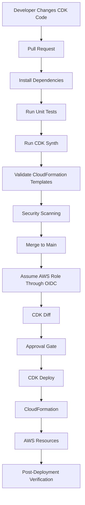
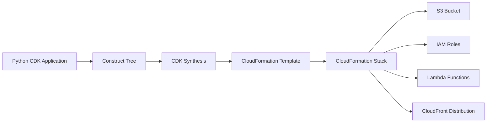
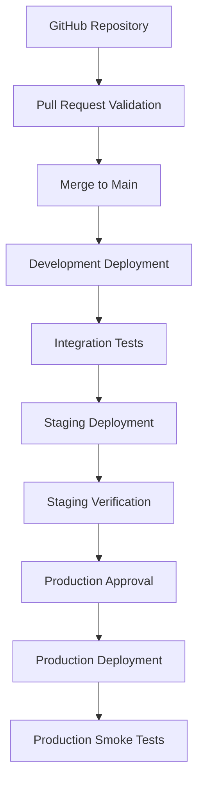

# 07- CDK Deployment Pipelines

## Overview

AWS Cloud Development Kit (CDK) enables engineers to define cloud infrastructure using familiar programming languages such as Python, TypeScript, Java, and C#.

For Amazon S3-based architectures, CDK provides a programmable approach to provisioning and managing infrastructure, including:

- S3 buckets and bucket policies.
- Versioning, encryption, and public-access controls.
- Lifecycle configurations and replication.
- IAM roles and policies.
- Lambda functions and S3 event notifications.
- SQS queues, SNS topics, and EventBridge rules.
- CloudFront distributions and Origin Access Control.
- KMS keys and supporting infrastructure.

CDK applications are synthesized into CloudFormation templates. CloudFormation then provisions and manages the resulting AWS resources.

A production CDK deployment pipeline should therefore combine software engineering practices with infrastructure deployment controls: dependency management, unit tests, synthesis validation, security checks, change review, controlled deployment, and post-deployment verification.

This document focuses on CDK with Python, GitHub Actions, AWS IAM OIDC federation, and CloudFormation-backed deployment workflows.

## CDK Deployment Architecture

### How CDK Deployment Works

A CDK application describes infrastructure using constructs. Constructs are organized into stacks, and stacks are synthesized into CloudFormation templates.

The deployment process has several distinct stages:

| Stage | Responsibility |
|---|---|
| CDK application | Defines infrastructure using Python or another supported language |
| Constructs | Encapsulate reusable infrastructure components |
| CDK stack | Defines a deployable unit of infrastructure |
| Synthesis | Converts CDK application code into CloudFormation templates and assets |
| Bootstrap resources | Provide deployment infrastructure in the target AWS environment |
| CloudFormation | Provisions and updates AWS resources |
| GitHub Actions | Automates validation, synthesis, and deployment |
| IAM OIDC role | Provides temporary AWS credentials to CI/CD |
| CloudWatch and CloudTrail | Support operational monitoring and auditing |

### Deployment Lifecycle



The important distinction is that CDK does not directly provision S3 resources itself. It generates CloudFormation infrastructure definitions and uses the deployment toolchain to deliver them.

### CDK and CloudFormation Relationship



This architecture provides two useful levels of abstraction:

- CDK provides reusable programming constructs and application-level composition.
- CloudFormation manages resource provisioning, updates, dependencies, and stack lifecycle.

Engineers should understand both layers when diagnosing deployment failures.

## CDK Project Structure

A maintainable Python CDK project should separate application entry points, infrastructure constructs, stacks, tests, and deployment configuration.

```text
s3-cdk/
│
├── .github/
│   └── workflows/
│       ├── cdk-validate.yml
│       └── cdk-deploy.yml
│
├── app.py
├── cdk.json
├── requirements.txt
├── requirements-dev.txt
│
├── s3_cdk/
│   ├── __init__.py
│   ├── storage_stack.py
│   └── constructs/
│       ├── __init__.py
│       └── secure_bucket.py
│
├── tests/
│   ├── __init__.py
│   └── test_storage_stack.py
│
├── scripts/
│   ├── validate.sh
│   └── verify.sh
│
└── README.md
```

| File or directory | Responsibility |
|---|---|
| `app.py` | CDK application entry point |
| `cdk.json` | CDK application configuration |
| `requirements.txt` | Runtime dependencies |
| `requirements-dev.txt` | Development and testing dependencies |
| `s3_cdk/` | Infrastructure implementation |
| `constructs/` | Reusable infrastructure components |
| `storage_stack.py` | Deployable infrastructure stack |
| `tests/` | CDK assertions and unit tests |
| `.github/workflows/` | CI/CD workflow definitions |
| `scripts/` | Validation and verification utilities |

Keep infrastructure logic out of the application entry point. Reusable constructs should encapsulate resource configuration, while stacks should compose those constructs into deployable units.

## Environment Setup

### Prerequisites

Install the following tools:

- Python.
- Node.js.
- AWS CLI.
- AWS CDK CLI.
- Docker when asset bundling or container-based synthesis requires it.

Check the installed versions:

```bash
python --version
node --version
aws --version
cdk --version
```

Install the CDK CLI:

```bash
npm install -g aws-cdk
```

### Create a Python CDK Project

```bash
mkdir s3-cdk
cd s3-cdk

cdk init app --language python
```

Create and activate a virtual environment:

```bash
python -m venv .venv
```

Linux/macOS:

```bash
source .venv/bin/activate
```

Windows PowerShell:

```powershell
.venv\Scripts\Activate.ps1
```

Install dependencies:

```bash
pip install -r requirements.txt
```

For an existing project, install the CDK dependencies explicitly rather than relying on globally installed Python packages.

### Dependency Management

Example `requirements.txt`:

```text
aws-cdk-lib==2.215.0
constructs>=10.0.0,<11.0.0
```

Example `requirements-dev.txt`:

```text
-r requirements.txt

pytest
```

The version shown is an illustrative pin. Select a CDK release compatible with the project's requirements, lock the complete dependency set, and update it through a reviewed dependency-management process.

For reproducible CI builds, use a lock file or fully pinned dependencies rather than allowing unbounded upgrades.

## CDK Application Configuration

### Entry Point

`app.py`:

```python
#!/usr/bin/env python3

import aws_cdk as cdk

from s3_cdk.storage_stack import StorageStack


app = cdk.App()

environment = app.node.try_get_context("environment") or "dev"

account = app.node.try_get_context("account")
region = app.node.try_get_context("region") or "ap-south-1"

if not account:
    raise ValueError("CDK context variable 'account' is required")

env = cdk.Environment(
    account=account,
    region=region,
)

StorageStack(
    app,
    f"application-storage-{environment}",
    environment_name=environment,
    env=env,
)

app.synth()
```

The account and Region are explicit so that synthesis and deployment target a predictable environment.

Do not assume that the credentials currently configured on a developer machine or GitHub runner identify the intended deployment account.

### CDK Context

`cdk.json`:

```json
{
  "app": "python app.py",
  "context": {
    "@aws-cdk/core:checkSecretUsage": true
  }
}
```

Pass environment-specific context through the CDK CLI:

```bash
cdk synth \
  -c environment=dev \
  -c account=111111111111 \
  -c region=ap-south-1
```

Context values are configuration, not secret storage. Never commit passwords, access keys, or other sensitive credentials in CDK context.

## Building a Reusable S3 Construct

A reusable construct encapsulates common S3 configuration so that multiple stacks can use the same security and naming conventions.

### Secure Bucket Construct

`s3_cdk/constructs/secure_bucket.py`:

```python
from aws_cdk import RemovalPolicy
from aws_cdk import aws_s3 as s3
from constructs import Construct


class SecureBucket(Construct):

    def __init__(
        self,
        scope: Construct,
        construct_id: str,
        *,
        bucket_name: str | None = None,
        environment_name: str,
    ) -> None:
        super().__init__(scope, construct_id)

        self.bucket = s3.Bucket(
            self,
            "Bucket",
            bucket_name=bucket_name,
            versioned=True,
            encryption=s3.BucketEncryption.S3_MANAGED,
            block_public_access=s3.BlockPublicAccess.BLOCK_ALL,
            enforce_ssl=True,
            object_ownership=s3.ObjectOwnership.BUCKET_OWNER_ENFORCED,
            removal_policy=RemovalPolicy.RETAIN,
            auto_delete_objects=False,
        )

        self.bucket.add_tag(
            "Environment",
            environment_name,
        )

        self.bucket.add_tag(
            "ManagedBy",
            "AWS-CDK",
        )
```

Important design choices:

- Versioning supports object recovery and version history.
- S3-managed encryption enables server-side encryption.
- Block Public Access prevents accidental public exposure.
- SSL enforcement requires secure transport.
- Bucket-owner-enforced ownership disables ACL-based ownership management.
- Retention prevents ordinary stack deletion from automatically deleting the bucket.
- Automatic object deletion is disabled.

`RemovalPolicy.RETAIN` means the bucket can remain after the CloudFormation stack is deleted. The resource must then be managed or cleaned up separately.

For production data, retention behavior should be intentional and documented.

### Create the Storage Stack

`s3_cdk/storage_stack.py`:

```python
from aws_cdk import Stack
from aws_cdk import CfnOutput
from constructs import Construct

from s3_cdk.constructs.secure_bucket import SecureBucket


class StorageStack(Stack):

    def __init__(
        self,
        scope: Construct,
        construct_id: str,
        *,
        environment_name: str,
        **kwargs,
    ) -> None:
        super().__init__(scope, construct_id, **kwargs)

        storage = SecureBucket(
            self,
            "ApplicationStorage",
            environment_name=environment_name,
        )

        CfnOutput(
            self,
            "BucketName",
            value=storage.bucket.bucket_name,
        )

        CfnOutput(
            self,
            "BucketArn",
            value=storage.bucket.bucket_arn,
        )
```

The stack composes the reusable bucket construct and exposes important resource identifiers through CloudFormation outputs.

Avoid exposing sensitive information through outputs.

## CDK Synthesis

### What Is Synthesis?

Synthesis converts the CDK construct tree into CloudFormation templates and associated deployment assets.

It is a critical CI/CD stage because it allows infrastructure changes to be reviewed before deployment.

Run:

```bash
cdk synth \
  -c environment=dev \
  -c account=111111111111 \
  -c region=ap-south-1
```

CDK writes synthesized output to the `cdk.out` directory by default.

A typical output structure:

```text
cdk.out/
├── manifest.json
├── tree.json
├── application-storage-dev.template.json
└── asset.<hash>
```

The exact files depend on the CDK application and its assets.

### Why Synthesis Matters

Synthesis helps identify:

- Invalid construct configuration.
- Incorrect resource properties.
- Unexpected resource creation.
- Unintended IAM policy changes.
- Incorrect environment configuration.
- Unexpected CloudFormation output.

The synthesized template is the infrastructure artifact that CloudFormation ultimately deploys.

Reviewing only Python source code is insufficient because construct defaults and generated resources can introduce changes that are not immediately obvious from the source.

### Validate Synthesized Templates

Use `cfn-lint`:

```bash
pip install cfn-lint
```

Run:

```bash
cfn-lint cdk.out/*.template.json
```

Run security scanning:

```bash
checkov \
  --framework cloudformation \
  -d cdk.out/
```

These checks complement CDK unit tests. They do not prove that deployment will succeed in the target AWS account.

## CDK Diff

### What Is CDK Diff?

`cdk diff` compares the synthesized infrastructure with the deployed CloudFormation stack.

It helps engineers understand the impact of a proposed deployment.

Run:

```bash
cdk diff application-storage-dev \
  -c environment=dev \
  -c account=111111111111 \
  -c region=ap-south-1
```

The output can identify:

- New resources.
- Removed resources.
- Modified properties.
- IAM policy changes.
- Potential resource replacement.
- Changes to stack configuration.

### Why CDK Diff Matters

Suppose a developer changes an S3 bucket encryption configuration.

A CDK source-code review may show a small property change. The synthesized infrastructure diff provides a more useful view of what CloudFormation intends to change.

For production, review changes involving:

- S3 bucket replacement.
- Bucket policy modification.
- Encryption and KMS configuration.
- Versioning changes.
- IAM permission expansion.
- Lifecycle configuration.
- Replication configuration.
- CloudFront origin changes.

CDK diff is a review aid, not a complete guarantee of deployment behavior. CloudFormation change sets can provide additional deployment-time information about proposed resource changes.

## CDK Bootstrap

### What Is Bootstrapping?

CDK bootstrap provisions supporting infrastructure required by CDK deployments.

Depending on the bootstrap configuration and assets used, this infrastructure can include:

- An S3 bucket for deployment assets.
- An ECR repository for container assets.
- IAM roles for publishing assets and deploying CloudFormation stacks.

Bootstrap resources are created in a target AWS account and Region.

### Bootstrap a Development Environment

```bash
cdk bootstrap aws://111111111111/ap-south-1
```

### Bootstrap a Production Environment

```bash
cdk bootstrap aws://222222222222/ap-south-1
```

Use the appropriate credentials and bootstrap configuration for each target account.

### Verify Bootstrap Resources

```bash
aws cloudformation describe-stacks \
  --stack-name CDKToolkit \
  --region ap-south-1
```

### Bootstrap Considerations

- Bootstrap each target account and Region before deploying.
- Use a controlled bootstrap process.
- Review bootstrap template changes.
- Restrict bootstrap execution permissions.
- Avoid casually modifying shared bootstrap resources.
- Use a consistent bootstrap configuration across environments.

Bootstrapping is an infrastructure prerequisite, not something that should be performed automatically with broad administrative permissions on every application deployment.

## CDK Deployment Commands

### Synthesize

```bash
cdk synth \
  -c environment=dev \
  -c account=111111111111 \
  -c region=ap-south-1
```

### Compare Changes

```bash
cdk diff application-storage-dev \
  -c environment=dev \
  -c account=111111111111 \
  -c region=ap-south-1
```

### Deploy a Stack

```bash
cdk deploy application-storage-dev \
  -c environment=dev \
  -c account=111111111111 \
  -c region=ap-south-1
```

### Deploy Without Interactive Approval

```bash
cdk deploy application-storage-dev \
  --require-approval never \
  -c environment=dev \
  -c account=111111111111 \
  -c region=ap-south-1
```

Use `--require-approval never` only in a controlled pipeline where approval and review are implemented through other mechanisms.

It should not be used as a replacement for production change review.

### Deploy Multiple Stacks

```bash
cdk deploy \
  application-storage-dev \
  application-processing-dev \
  --require-approval never
```

Deploy related stacks in a deliberate order and make dependencies explicit.

### Destroy a Stack

```bash
cdk destroy application-storage-dev \
  -c environment=dev \
  -c account=111111111111 \
  -c region=ap-south-1
```

Before destruction, inspect retained resources and data dependencies.

A stack can be deleted while retained S3 buckets remain in the account.

## CDK Unit Testing

CDK applications should have automated tests that verify the synthesized infrastructure.

The CDK assertions library allows tests to inspect CloudFormation resources without deploying them.

### Test Dependencies

`requirements-dev.txt`:

```text
-r requirements.txt
pytest
```

### S3 Stack Tests

`tests/test_storage_stack.py`:

```python
import aws_cdk as cdk

from aws_cdk import assertions

from s3_cdk.storage_stack import StorageStack


def create_template():
    app = cdk.App()

    stack = StorageStack(
        app,
        "TestStorageStack",
        environment_name="test",
        env=cdk.Environment(
            account="111111111111",
            region="ap-south-1",
        ),
    )

    return assertions.Template.from_stack(stack)


def test_bucket_has_versioning_enabled():
    template = create_template()

    template.has_resource_properties(
        "AWS::S3::Bucket",
        {
            "VersioningConfiguration": {
                "Status": "Enabled",
            }
        },
    )


def test_bucket_blocks_public_access():
    template = create_template()

    template.has_resource_properties(
        "AWS::S3::Bucket",
        {
            "PublicAccessBlockConfiguration": {
                "BlockPublicAcls": True,
                "IgnorePublicAcls": True,
                "BlockPublicPolicy": True,
                "RestrictPublicBuckets": True,
            }
        },
    )


def test_bucket_enforces_ssl():
    template = create_template()

    template.has_resource_properties(
        "AWS::S3::BucketPolicy",
        {
            "PolicyDocument": {
                "Statement": assertions.Match.array_with(
                    [
                        assertions.Match.object_like(
                            {
                                "Effect": "Deny",
                                "Principal": "*",
                                "Action": "s3:*",
                            }
                        )
                    ]
                )
            }
        },
    )
```

The tests verify important security and configuration properties in the synthesized template.

The exact generated policy structure can change with CDK versions. Keep assertions aligned with the pinned CDK version and inspect synthesized output when a test fails.

### Run Tests

```bash
pytest -q
```

### Testing Strategy

| Test type | Purpose | Requires AWS account |
|---|---|---|
| Unit tests | Verify construct configuration | No |
| CDK assertions | Inspect synthesized CloudFormation resources | No |
| Template linting | Detect CloudFormation template issues | No |
| Security scanning | Identify infrastructure security risks | Usually no |
| Integration tests | Verify deployed AWS resource behavior | Yes |
| Smoke tests | Verify application-level behavior after deployment | Usually yes |

Do not treat passing CDK unit tests as proof that AWS deployment will succeed.

## GitHub Actions Validation Pipeline

Pull requests should run tests and synthesize the CDK application without deploying infrastructure.

`.github/workflows/cdk-validate.yml`:

```yaml
name: CDK Validation

on:
  pull_request:
    branches:
      - main
    paths:
      - "app.py"
      - "cdk.json"
      - "requirements*.txt"
      - "s3_cdk/**"
      - "tests/**"
      - ".github/workflows/**"

permissions:
  contents: read

jobs:
  validate:
    runs-on: ubuntu-latest

    steps:
      - name: Checkout repository
        uses: actions/checkout@v4

      - name: Setup Python
        uses: actions/setup-python@v5
        with:
          python-version: "3.12"
          cache: pip

      - name: Setup Node.js
        uses: actions/setup-node@v4
        with:
          node-version: "22"

      - name: Install CDK CLI
        run: npm install --global aws-cdk

      - name: Install Python dependencies
        run: |
          python -m pip install --upgrade pip
          pip install -r requirements-dev.txt
          pip install cfn-lint checkov

      - name: Run tests
        run: pytest -q

      - name: Synthesize CDK application
        run: |
          cdk synth \
            -c environment=dev \
            -c account=111111111111 \
            -c region=ap-south-1

      - name: Validate synthesized templates
        run: cfn-lint cdk.out/*.template.json

      - name: Security scan
        run: checkov --framework cloudformation -d cdk.out/
```

This workflow does not require AWS credentials because it performs local synthesis and validation.

For projects that require AWS context lookups during synthesis, provide a controlled and appropriately restricted context-resolution strategy. Do not expose production deployment credentials to untrusted pull requests merely to make synthesis succeed.

## AWS IAM OIDC Federation

GitHub Actions should authenticate to AWS using OIDC federation rather than long-lived access keys.

The workflow requests an identity token from GitHub. AWS STS validates the token against the configured IAM OIDC provider and trust policy before issuing temporary credentials.

### Workflow Permissions

```yaml
permissions:
  contents: read
  id-token: write
```

`id-token: write` allows the workflow to request an OIDC token. It does not independently grant access to AWS resources.

### Deployment Role Trust Policy

A trust policy should restrict access to the intended repository and deployment context.

Example branch-based trust policy:

```json
{
  "Version": "2012-10-17",
  "Statement": [
    {
      "Effect": "Allow",
      "Principal": {
        "Federated": "arn:aws:iam::111111111111:oidc-provider/token.actions.githubusercontent.com"
      },
      "Action": "sts:AssumeRoleWithWebIdentity",
      "Condition": {
        "StringEquals": {
          "token.actions.githubusercontent.com:aud": "sts.amazonaws.com",
          "token.actions.githubusercontent.com:sub": "repo:YOUR_ORG/YOUR_REPOSITORY:ref:refs/heads/main"
        }
      }
    }
  ]
}
```

Replace the repository placeholders with the actual organization and repository.

If GitHub Environments are used, the OIDC subject can be environment-based instead of branch-based. Configure the trust policy to match the actual token claims.

### Deployment Permissions

The deployment role needs permissions for the CDK deployment process, which may include:

- CloudFormation stack operations.
- Access to the CDK bootstrap asset bucket.
- Publishing container assets when used.
- Passing the required CloudFormation execution role.
- Reading deployment metadata.

Avoid granting broad administrator permissions by default.

The CloudFormation execution role should separately have permissions required to create and update the resources defined by the CDK application.

For detailed trust-policy design and credential handling, refer to:

- `03- AWS IAM OIDC Federation.md`
- `04- Short-Lived Credentials for Deployment.md`

## Environment-Specific Deployment Pipelines

A production CDK pipeline should separate development, staging, and production deployments.



### Environment Separation

| Environment | AWS account | Deployment policy |
|---|---|---|
| Development | Development account | Automated deployment |
| Staging | Staging account | Controlled deployment and tests |
| Production | Production account | Protected approval required |

Separate AWS accounts provide stronger isolation than using only different stack names.

Use environment-specific:

- AWS account and Region.
- CDK context.
- IAM deployment role.
- CloudFormation execution role.
- Stack names.
- Resource naming conventions.
- Configuration values.

Do not rely on a developer's default AWS CLI profile to select a production account.

## Production Deployment Workflow

The following workflow illustrates a controlled production deployment using CDK, OIDC, and a protected GitHub Environment.

`.github/workflows/cdk-deploy.yml`:

```yaml
name: CDK Production Deployment

on:
  workflow_dispatch:

permissions:
  contents: read
  id-token: write

concurrency:
  group: cdk-production
  cancel-in-progress: false

jobs:
  deploy:
    name: Deploy Production Infrastructure
    runs-on: ubuntu-latest

    environment: production

    steps:
      - name: Checkout repository
        uses: actions/checkout@v4

      - name: Setup Python
        uses: actions/setup-python@v5
        with:
          python-version: "3.12"
          cache: pip

      - name: Setup Node.js
        uses: actions/setup-node@v4
        with:
          node-version: "22"

      - name: Install CDK CLI
        run: npm install --global aws-cdk

      - name: Install dependencies
        run: |
          python -m pip install --upgrade pip
          pip install -r requirements.txt

      - name: Configure AWS credentials
        uses: aws-actions/configure-aws-credentials@v4
        with:
          role-to-assume: ${{ vars.AWS_CDK_DEPLOYMENT_ROLE_ARN }}
          aws-region: ap-south-1
          role-duration-seconds: 3600

      - name: Verify AWS identity
        run: aws sts get-caller-identity

      - name: Run unit tests
        run: |
          pip install -r requirements-dev.txt
          pytest -q

      - name: Synthesize CDK application
        run: |
          cdk synth \
            -c environment=production \
            -c account="${{ vars.AWS_ACCOUNT_ID }}" \
            -c region=ap-south-1

      - name: Review infrastructure changes
        run: |
          cdk diff application-storage-production \
            -c environment=production \
            -c account="${{ vars.AWS_ACCOUNT_ID }}" \
            -c region=ap-south-1

      - name: Deploy CDK stack
        run: |
          cdk deploy application-storage-production \
            --require-approval never \
            -c environment=production \
            -c account="${{ vars.AWS_ACCOUNT_ID }}" \
            -c region=ap-south-1

      - name: Verify deployed stack
        run: |
          aws cloudformation describe-stacks \
            --stack-name application-storage-production \
            --region ap-south-1
```

### Production Workflow Considerations

This workflow is a deployment example, not a complete change-set approval implementation.

A production organization should:

- Configure required reviewers on the GitHub Environment.
- Restrict production deployments to trusted branches or approved revisions.
- Review `cdk diff` output before execution.
- Preserve the exact synthesized template and deployment revision.
- Use a controlled CloudFormation change-set process where required.
- Bind approval to the reviewed artifact and intended change set.
- Handle no-op deployments correctly.
- Verify the target AWS account before deployment.
- Record workflow run IDs and deployment metadata.

`cdk diff` is useful for pre-deployment review, but it should not be treated as an immutable approval artifact. The synthesized template and the deployed change set must correspond to the same source revision.

## CDK Pipelines

CDK Pipelines is an AWS CDK construct library for defining self-updating continuous delivery pipelines.

It can automate:

- Source retrieval.
- CDK synthesis.
- Asset publishing.
- CloudFormation deployment.
- Multi-stage environment promotion.
- Approval workflows.
- Cross-account deployment.

CDK Pipelines is useful when the infrastructure delivery process itself is managed as CDK code.

### CDK Pipelines vs GitHub Actions

| Concern | GitHub Actions | CDK Pipelines |
|---|---|---|
| Workflow definition | YAML | CDK constructs |
| Source integration | GitHub events | Supported source connections |
| Synthesis | Explicit workflow steps | Pipeline synth stage |
| Asset publishing | Workflow and CDK tooling | Managed pipeline stages |
| Environment promotion | GitHub Environments and jobs | CDK stages |
| Approval | GitHub Environment reviewers | Manual approval actions |
| AWS authentication | OIDC federation | Pipeline service roles |
| Pipeline infrastructure | GitHub-hosted workflow | AWS-managed pipeline resources |

Choose based on the existing engineering toolchain, governance requirements, and operational ownership.

Do not introduce both systems without a clear reason. Running two independent deployment orchestration systems for the same stacks increases complexity.

### Example CDK Pipeline

A simplified Python CDK pipeline can be defined using `aws_cdk.pipelines`.

```python
from aws_cdk import (
    Stack,
    Stage,
    pipelines,
)
from constructs import Construct


class ApplicationStage(Stage):

    def __init__(
        self,
        scope: Construct,
        construct_id: str,
        **kwargs,
    ) -> None:
        super().__init__(scope, construct_id, **kwargs)

        StorageStack(
            self,
            "ApplicationStorage",
            environment_name="production",
            env=self.env,
        )


class DeploymentPipelineStack(Stack):

    def __init__(
        self,
        scope: Construct,
        construct_id: str,
        *,
        source_connection_arn: str,
        **kwargs,
    ) -> None:
        super().__init__(scope, construct_id, **kwargs)

        pipeline = pipelines.CodePipeline(
            self,
            "ApplicationPipeline",
            pipeline_name="s3-application-pipeline",
            synth=pipelines.ShellStep(
                "Synth",
                input=pipelines.CodePipelineSource.connection(
                    "YOUR_ORG/YOUR_REPOSITORY",
                    "main",
                    connection_arn=source_connection_arn,
                ),
                commands=[
                    "python -m pip install -r requirements.txt",
                    "python -m pip install -r requirements-dev.txt",
                    "pytest -q",
                    "npm install -g aws-cdk",
                    "cdk synth",
                ],
            ),
        )

        pipeline.add_stage(
            ApplicationStage(
                self,
                "Production",
                env=self.env,
            )
        )
```

This is an architectural example. A complete implementation must configure:

- The source connection.
- The pipeline stack's AWS environment.
- Bootstrap resources and trust relationships.
- Dependencies required by the CDK application.
- Cross-account deployment roles where applicable.
- Approval stages.
- Environment-specific configuration.
- Deployment verification and notifications.

CDK Pipelines creates and manages supporting pipeline infrastructure. Review the generated IAM roles and policies rather than assuming they are automatically least-privilege for every organization.

## Cross-Account CDK Deployment

For production architectures, CDK may deploy infrastructure into multiple AWS accounts.

Example:

```text
Tooling Account
      |
      v
CDK Pipeline
      |
      ├── Development Account
      │      └── S3 Development Stack
      │
      ├── Staging Account
      │      └── S3 Staging Stack
      │
      └── Production Account
             └── S3 Production Stack
```

Important considerations:

- Bootstrap each target account and Region.
- Configure cross-account trust deliberately.
- Restrict deployment roles to the required pipeline identity.
- Separate deployment permissions from resource execution permissions.
- Keep account IDs and environment configuration explicit.
- Review cross-account KMS and S3 resource policies.
- Verify the target account before every deployment.

Cross-account deployment is not achieved simply by changing the account ID in CDK context. The required bootstrap trust and IAM role assumptions must also be configured.

## Deployment of S3-Dependent Resources

CDK can compose multiple AWS services into a single infrastructure application.

### S3 and Lambda

A CDK application can define:

- S3 input and output buckets or prefixes.
- Lambda processing functions.
- Execution roles.
- Event notifications.
- Dead-letter handling where appropriate.
- CloudWatch log groups and alarms.

Important considerations:

- Lambda must have permission to read input objects.
- Lambda must have permission to write output objects.
- S3 must be authorized to invoke the function.
- Event notification configuration must reference a valid destination.
- Input and output locations should be separated to prevent recursive invocation.
- Processing should be idempotent because event delivery can be repeated.

### S3 and CloudFront

A private S3 origin delivered through CloudFront typically requires:

- S3 bucket.
- CloudFront distribution.
- Origin Access Control.
- Bucket policy restricted to the intended distribution.
- HTTPS viewer configuration.
- Cache policies.
- DNS configuration where required.

Use private bucket access with Origin Access Control rather than enabling public access for convenience.

### S3 and KMS

When using SSE-KMS:

- Define or reference the KMS key.
- Configure the bucket encryption settings.
- Configure the key policy and IAM permissions.
- Ensure the application and deployment identities have the required permissions.
- Verify encryption configuration after deployment.

S3 authorization and KMS authorization are separate permission checks.

## Deployment Verification

A successful CDK deployment should be followed by CloudFormation and resource-level verification.

### Verify AWS Identity

```bash
aws sts get-caller-identity
```

Confirm that the deployment is running in the intended AWS account.

### Verify CloudFormation Stack

```bash
aws cloudformation describe-stacks \
  --stack-name application-storage-production \
  --region ap-south-1
```

Expected successful update status:

```text
UPDATE_COMPLETE
```

For initial creation:

```text
CREATE_COMPLETE
```

### Inspect Stack Events

```bash
aws cloudformation describe-stack-events \
  --stack-name application-storage-production \
  --region ap-south-1
```

### Verify Bucket Existence

```bash
aws s3api head-bucket \
  --bucket "$BUCKET_NAME"
```

### Verify Versioning

```bash
aws s3api get-bucket-versioning \
  --bucket "$BUCKET_NAME"
```

### Verify Encryption

```bash
aws s3api get-bucket-encryption \
  --bucket "$BUCKET_NAME"
```

### Verify Public Access Block

```bash
aws s3api get-public-access-block \
  --bucket "$BUCKET_NAME"
```

### Verify Stack Outputs

```bash
aws cloudformation describe-stacks \
  --stack-name application-storage-production \
  --query "Stacks[0].Outputs"
```

For production, automate these checks and fail the deployment verification stage if a required security or configuration property is missing.

## Monitoring and Deployment Auditing

CDK deployments are ultimately managed through CloudFormation, so deployment observability should include both CDK pipeline activity and CloudFormation resource events.

### CloudFormation Events

Use stack events to diagnose:

- Resource creation failures.
- Resource update failures.
- Resource replacement.
- Dependency errors.
- Rollback activity.
- Stack status transitions.

### CloudTrail

Use CloudTrail to correlate:

- GitHub workflow or pipeline execution.
- Assumed IAM role.
- CloudFormation API operations.
- Resource-level API activity.
- Deployment timestamps.

### CloudWatch

Monitor deployed application resources independently of deployment status.

Examples include:

- Lambda invocation errors.
- Lambda duration.
- SQS queue depth.
- Application processing failures.
- CloudFront error rates.
- Relevant S3 request metrics.

A successful CDK deployment does not prove that the deployed application is healthy.

## Rollback and Recovery

CDK deployment failures are generally handled through CloudFormation stack operations.

The CDK CLI reports deployment failures, while CloudFormation stack events provide resource-level diagnostic information.

### Deployment Failure

Inspect the stack:

```bash
aws cloudformation describe-stacks \
  --stack-name application-storage-production
```

Inspect events:

```bash
aws cloudformation describe-stack-events \
  --stack-name application-storage-production
```

Identify the first failed resource operation and determine whether the issue is related to:

- Invalid resource properties.
- IAM authorization.
- KMS permissions.
- Resource conflicts.
- Missing dependencies.
- Service quotas.
- Resource replacement.

Correct the underlying problem before retrying deployment.

### Rollback Failure

A stack can enter `UPDATE_ROLLBACK_FAILED` if CloudFormation cannot complete rollback.

After diagnosing and correcting the cause, continue rollback when appropriate:

```bash
aws cloudformation continue-update-rollback \
  --stack-name application-storage-production
```

If resources must be skipped, use the supported recovery procedure only after understanding the consequences.

Skipped resources may no longer match the synthesized template. Reconcile the actual infrastructure before the next CDK deployment.

### Reverting a CDK Change

To restore a previous infrastructure configuration:

1. Revert the relevant CDK source changes.
2. Run unit tests.
3. Synthesize the application.
4. Inspect `cdk diff`.
5. Review the resulting CloudFormation changes.
6. Deploy through the normal pipeline.
7. Verify the resulting infrastructure.

Reverting source code does not guarantee that CloudFormation can reverse every resource change.

For example, deleted S3 objects are not automatically recovered by deploying an older CDK template.

### Resource Retention and Data Recovery

For important S3 resources:

- Use deliberate removal policies.
- Enable versioning where appropriate.
- Maintain independent backups where required.
- Protect critical buckets against accidental deletion.
- Verify data recovery procedures separately from infrastructure rollback.

`RemovalPolicy.RETAIN` can protect a bucket from stack deletion, but it does not provide a complete backup or disaster recovery solution.

## Drift Detection

Drift occurs when actual AWS resources differ from the configuration represented by the CloudFormation stack.

For example, an engineer manually changes an S3 bucket policy outside CDK.

CloudFormation drift detection can identify differences for supported resource properties.

Run:

```bash
aws cloudformation detect-stack-drift \
  --stack-name application-storage-production
```

Retrieve the detection status:

```bash
aws cloudformation describe-stack-drift-detection-status \
  --stack-drift-detection-id DETECTION_ID
```

Inspect resource drift:

```bash
aws cloudformation describe-stack-resource-drifts \
  --stack-name application-storage-production
```

Drift detection has resource and property coverage limitations. An `IN_SYNC` result does not guarantee that every external dependency or resource setting matches the intended architecture.

### Controlled Drift Remediation

1. Identify the drifted resource.
2. Inspect the actual AWS configuration.
3. Determine whether the change was authorized.
4. Update CDK code if the change is intended.
5. Restore the expected configuration if the change is unauthorized.
6. Synthesize and inspect the resulting infrastructure.
7. Deploy through the normal pipeline.
8. Run drift detection again.

Avoid automatically overwriting production changes without understanding their cause.

## Security Best Practices

### CDK Source Code

- Never hardcode AWS credentials.
- Avoid storing secrets in CDK context.
- Use environment-specific configuration.
- Review generated IAM policies.
- Pin dependencies and update them through controlled changes.
- Keep production configuration separate from development configuration.

### IAM and OIDC

- Use OIDC federation for GitHub Actions.
- Restrict trust policies to intended repositories and environments.
- Use temporary credentials.
- Separate deployment and CloudFormation execution roles.
- Restrict `iam:PassRole`.
- Avoid administrator permissions for routine deployment.

### S3 Resources

- Block public access by default.
- Enforce HTTPS.
- Enable encryption.
- Enable versioning where appropriate.
- Use bucket-owner-enforced ownership.
- Review bucket policies.
- Restrict access to intended CloudFront distributions.
- Configure KMS permissions independently when SSE-KMS is used.

### Pipeline Security

- Do not expose production credentials to untrusted pull requests.
- Protect production GitHub Environments.
- Restrict deployment branches.
- Review synthesized CloudFormation templates.
- Preserve deployment artifacts.
- Record deployment identities and workflow run IDs.

## Cost and Operational Considerations

CDK itself is an infrastructure development tool, but the resources it deploys can incur AWS charges.

Review synthesized changes and deployment plans for:

- S3 storage and requests.
- Cross-Region replication.
- KMS keys and requests.
- Lambda invocations and execution duration.
- CloudFront data transfer and requests.
- SQS and SNS usage.
- CloudWatch logs and metrics.
- CDK bootstrap asset storage.

For development environments, consider automated cleanup where resources are safe to delete.

For production environments, prioritize data retention and recovery requirements over automatic cleanup.

## Common Mistakes

| Mistake | Impact | Prevention |
|---|---|---|
| Deploying without reviewing synthesis output | Unexpected CloudFormation resources | Inspect synthesized templates |
| Treating `cdk diff` as a complete deployment guarantee | Runtime deployment issues remain possible | Review CloudFormation changes and verify after deployment |
| Using unpinned dependencies | Non-reproducible infrastructure builds | Lock dependency versions |
| Hardcoding account IDs throughout constructs | Difficult environment promotion | Centralize environment configuration |
| Using permanent AWS keys in GitHub | Long-lived credential exposure | Use OIDC federation |
| Giving deployment roles administrator access | Excessive privilege | Use scoped deployment and execution roles |
| Skipping CDK tests | Configuration regressions | Add CDK assertions |
| Ignoring bootstrap requirements | Asset publishing or deployment failures | Bootstrap target accounts and Regions |
| Deploying into the wrong account | Infrastructure changes in an unintended environment | Verify AWS identity and explicit stack environment |
| Automatically deleting retained resources | Data loss or orphaned resources | Define removal and cleanup policies deliberately |
| Assuming CloudFormation rollback restores S3 data | Deleted objects may remain lost | Maintain separate data recovery controls |
| Running CDK and another deployment system independently | Conflicting infrastructure ownership | Establish one authoritative deployment process |

## Production Readiness Checklist

### CDK Application

- [ ] CDK application uses a clear project structure.
- [ ] Constructs encapsulate reusable infrastructure.
- [ ] Environment configuration is explicit.
- [ ] Dependencies are pinned or locked.
- [ ] Synthesized templates are reviewed.
- [ ] CDK assertions cover critical resource properties.

### Validation

- [ ] Unit tests execute in CI.
- [ ] CDK synthesis succeeds.
- [ ] CloudFormation templates are linted.
- [ ] Security scanning is configured.
- [ ] IAM policy changes are reviewed.
- [ ] Production changes are inspected before deployment.

### AWS Authentication

- [ ] GitHub Actions uses OIDC.
- [ ] OIDC trust is restricted to the intended repository and environment.
- [ ] Deployment roles use least privilege.
- [ ] CloudFormation execution permissions are separated where appropriate.
- [ ] `iam:PassRole` is restricted.
- [ ] The target AWS account and Region are verified.

### Deployment

- [ ] Target accounts and Regions are bootstrapped.
- [ ] Development, staging, and production are isolated.
- [ ] Production approval is configured.
- [ ] Deployment concurrency is controlled.
- [ ] The exact synthesized revision is deployed.
- [ ] Deployment metadata is recorded.

### Verification and Recovery

- [ ] CloudFormation stack status is verified.
- [ ] S3 encryption and versioning are verified.
- [ ] Public-access controls are verified.
- [ ] Application-level smoke tests are performed.
- [ ] CloudTrail and CloudWatch monitoring are available.
- [ ] Drift detection is performed.
- [ ] Rollback and recovery procedures are documented.
- [ ] Resource retention and cleanup behavior are understood.

## Key Takeaways

- AWS CDK defines infrastructure using programming languages, but synthesis produces CloudFormation templates that ultimately manage AWS resources.
- Treat synthesis, CDK assertions, template validation, and infrastructure diff review as essential CI/CD stages.
- Use OIDC federation, restricted deployment roles, and separate CloudFormation execution permissions for secure deployments.
- Bootstrap each target AWS account and Region deliberately, and keep environment configuration explicit.
- CloudFormation rollback does not guarantee recovery of S3 object data; combine infrastructure deployment controls with independent data protection and recovery procedures.