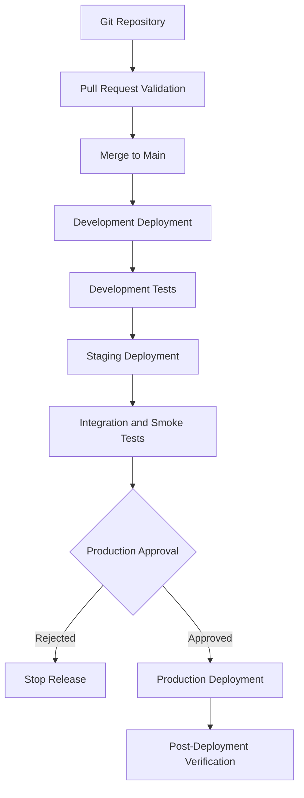
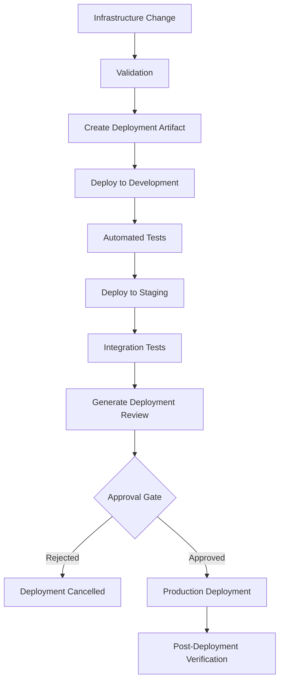
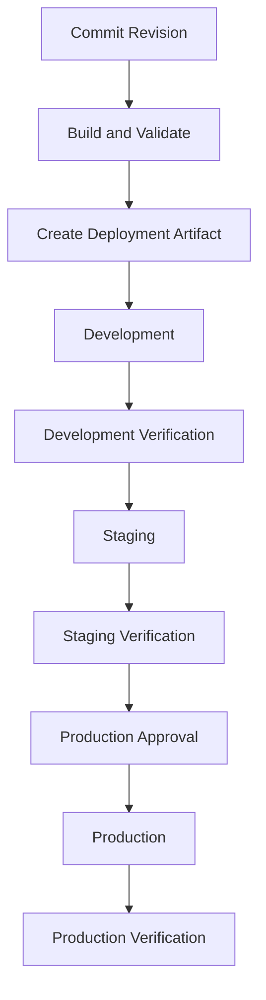

# 08- Environment Protection and Approval Gates

## Overview

Environment protection and approval gates control how infrastructure changes move from development to staging and production.

For Amazon S3 deployments, a pipeline may modify critical resources such as:

- Production buckets and bucket policies.
- Encryption and KMS configuration.
- Versioning and lifecycle rules.
- Replication configuration.
- IAM roles and resource policies.
- CloudFront distributions and origin access.
- Lambda functions and event notifications.

An incorrectly deployed infrastructure change can expose sensitive data, interrupt application traffic, delete resources, or introduce unexpected costs.

A production deployment pipeline therefore needs controls that establish:

- Which source revisions are allowed to deploy.
- Which identities can initiate deployments.
- Which environments require approval.
- Who can approve production changes.
- Which infrastructure changes require additional review.
- How deployment artifacts are validated and promoted.
- How approvals and deployment activity are audited.
- How failed deployments are recovered.

Environment protection should be implemented as part of the deployment architecture rather than treated as a manual step outside CI/CD.

## Environment Isolation

### Why Environment Isolation Matters

Development, staging, and production have different risk profiles.

| Environment | Purpose | Risk tolerance | Deployment approach |
|---|---|---|---|
| Development | Feature development and infrastructure testing | Higher | Automated |
| Staging | Integration and release validation | Moderate | Controlled |
| Production | Customer-facing workloads and persistent data | Low | Protected approval |

Environment isolation reduces the possibility that an experimental deployment affects production infrastructure.

### Recommended Architecture



For stronger isolation, use separate AWS accounts for development, staging, and production.

```text
AWS Organization
│
├── Development Account
│   ├── S3 Development Buckets
│   ├── Lambda Development Functions
│   └── Development IAM Roles
│
├── Staging Account
│   ├── S3 Staging Buckets
│   ├── Lambda Staging Functions
│   └── Staging IAM Roles
│
└── Production Account
    ├── S3 Production Buckets
    ├── Lambda Production Functions
    └── Production IAM Roles
```

Separate accounts provide stronger security and operational boundaries than relying exclusively on different bucket names or CloudFormation stack names.

### Environment Configuration

Each environment should have explicit configuration.

| Configuration | Development | Staging | Production |
|---|---|---|---|
| AWS account | Development account | Staging account | Production account |
| Region | Configured Region | Configured Region | Approved Region |
| Stack name | `app-storage-dev` | `app-storage-staging` | `app-storage-production` |
| S3 bucket | Development bucket | Staging bucket | Production bucket |
| IAM role | Development deployment role | Staging deployment role | Production deployment role |
| Approval | Usually not required | Optional or required | Required |
| Data | Synthetic or test data | Representative test data | Production data |

Avoid sharing production buckets with development workloads.

A shared bucket with prefixes is not equivalent to account-level isolation. It can be appropriate for selected multi-tenant designs, but it requires carefully designed authorization and operational boundaries.

## GitHub Environments

GitHub Environments provide deployment-specific configuration and protection controls.

An environment can define:

- Required reviewers.
- Deployment branch restrictions.
- Environment-specific variables.
- Environment-specific secrets.
- Deployment protection rules.
- A deployment history.

Typical environments:

```text
GitHub Repository
│
├── development
├── staging
└── production
```

A workflow job references an environment using:

```yaml
jobs:
  deploy:
    runs-on: ubuntu-latest

    environment: production

    steps:
      - name: Deploy infrastructure
        run: echo "Production deployment stage"
```

When the `production` environment has required reviewers configured, the job waits for approval before executing its deployment steps.

### Configure Environment Protection

In GitHub:

1. Open the repository.
2. Navigate to **Settings**.
3. Open **Environments**.
4. Create an environment named `production`.
5. Configure required reviewers.
6. Configure deployment branch restrictions.
7. Add environment-specific variables and secrets where necessary.
8. Review deployment protection settings.

The exact controls available depend on the GitHub plan and repository configuration.

### Required Reviewers

Required reviewers prevent a deployment job from proceeding until an authorized reviewer approves it.

For production, configure reviewers who understand the infrastructure and operational impact.

Useful reviewer responsibilities include:

- Reviewing infrastructure changes.
- Confirming the deployment target.
- Evaluating destructive changes.
- Checking security implications.
- Confirming maintenance windows where applicable.
- Approving or rejecting the release.

Do not assume that an approval alone guarantees a safe deployment. The reviewer must have access to meaningful deployment information.

### Deployment Branch Restrictions

Restrict production deployment to trusted branches or approved release references.

For example:

```text
Allowed production deployment branch:
main
```

This prevents arbitrary feature branches from deploying directly into production.

For stronger release governance, use protected release tags or an approved release workflow.

## Approval Gates

### What Is an Approval Gate?

An approval gate is a control that prevents a deployment from advancing until a required condition is satisfied.

Common approval gates include:

- Manual production approval.
- Security review.
- Infrastructure change review.
- Automated test success.
- Compliance validation.
- Cost-impact review.
- Change-management authorization.

### Approval Gate Lifecycle



A gate should evaluate the release being deployed, not merely the fact that a workflow completed successfully.

### When Approval Is Required

Not every infrastructure change needs the same level of approval.

| Change | Recommended control |
|---|---|
| Development bucket configuration | Automated validation |
| Staging lifecycle configuration | Automated validation and review |
| Production bucket policy | Security review and production approval |
| Production KMS key policy | Security review and restricted approval |
| Production replication changes | Infrastructure review and approval |
| Production bucket replacement | Explicit destructive-change approval |
| Production IAM permission expansion | Security review and approval |
| Production CloudFront origin changes | Release review and approval |

The approval policy should be proportional to the operational impact.

### Approval Responsibilities

A mature approval process separates responsibilities where practical.

| Role | Responsibility |
|---|---|
| Developer | Implements infrastructure changes |
| Reviewer | Reviews code and configuration |
| Platform engineer | Reviews deployment architecture and infrastructure impact |
| Security reviewer | Reviews access-control and data-protection changes |
| Release approver | Authorizes production deployment |
| Operations engineer | Monitors deployment and verifies service health |

Avoid making one person responsible for implementing, approving, and independently verifying every production change when organizational controls require separation of duties.

## GitHub Actions Approval Gate

### Basic Production Approval

The following workflow uses a protected GitHub Environment.

```yaml
name: Production Deployment

on:
  workflow_dispatch:

permissions:
  contents: read
  id-token: write

jobs:
  validate:
    runs-on: ubuntu-latest

    steps:
      - name: Checkout repository
        uses: actions/checkout@v4

      - name: Validate infrastructure
        run: |
          echo "Run infrastructure validation"
          echo "Run unit tests"
          echo "Run security checks"

  deploy-production:
    runs-on: ubuntu-latest
    needs: validate

    environment: production

    steps:
      - name: Checkout repository
        uses: actions/checkout@v4

      - name: Deploy infrastructure
        run: |
          echo "Deploy approved production infrastructure"
```

The `production` environment must be configured with required reviewers. Otherwise, the environment reference alone does not create a manual approval gate.

The example uses placeholder commands for illustration. A real deployment job must configure AWS credentials through OIDC and execute the intended deployment toolchain.

### Approval Before AWS Authentication

Place the production environment on the job that performs deployment.

This ensures the job does not begin its deployment steps until the environment's protection rules have been satisfied.

Do not configure a privileged AWS authentication job before the approval gate if the intention is to prevent production access until approval.

For more complex workflows, separate validation and deployment jobs while ensuring that only the protected deployment job can obtain production credentials.

## AWS IAM and Environment Protection

GitHub approval controls and AWS IAM authorization solve different problems.

- GitHub Environment protection controls whether a workflow job can proceed.
- AWS IAM controls which AWS operations the resulting identity can perform.

Both are necessary.

### Separate IAM Roles

Use distinct deployment roles for each environment.

| Role | Target account | Intended permissions |
|---|---|---|
| `GitHubS3DevDeploymentRole` | Development | Development infrastructure deployment |
| `GitHubS3StagingDeploymentRole` | Staging | Staging infrastructure deployment |
| `GitHubS3ProductionDeploymentRole` | Production | Approved production deployment |

Do not use one unrestricted role for every environment.

### OIDC Trust Policy

An example production role trust policy can restrict access to a specific GitHub repository and environment.

```json
{
  "Version": "2012-10-17",
  "Statement": [
    {
      "Effect": "Allow",
      "Principal": {
        "Federated": "arn:aws:iam::111111111111:oidc-provider/token.actions.githubusercontent.com"
      },
      "Action": "sts:AssumeRoleWithWebIdentity",
      "Condition": {
        "StringEquals": {
          "token.actions.githubusercontent.com:aud": "sts.amazonaws.com",
          "token.actions.githubusercontent.com:sub": "repo:YOUR_ORG/YOUR_REPOSITORY:environment:production"
        }
      }
    }
  ]
}
```

Replace the placeholders with the actual AWS account, organization, and repository.

The trust policy must match the OIDC subject emitted by GitHub. Environment-based subjects differ from branch-based subjects.

If customized OIDC subject claims are configured, validate the actual token claims before constructing the trust policy.

### Production Deployment Permissions

The production role should have only the permissions needed by the deployment process.

Depending on the selected infrastructure tool, this can include:

- CloudFormation stack operations.
- CDK bootstrap asset access.
- Terraform state access.
- Required deployment artifact access.
- `iam:PassRole` for the intended CloudFormation execution role.
- Resource inspection and verification.

The CloudFormation execution role should have the resource-management permissions required by the template.

Avoid granting unrestricted S3 access merely because the deployment manages S3 resources.

For example, a deployment role that manages a specific bucket should not automatically receive permission to read every object in every production bucket.

## Protecting Infrastructure Changes

Approval should be based on the actual infrastructure change rather than only the source-code diff.

Different infrastructure tools provide different ways to inspect proposed changes.

| Tool | Review mechanism |
|---|---|
| Terraform | `terraform plan` |
| CloudFormation | Change sets |
| CDK | `cdk diff` and synthesized CloudFormation templates |

### Terraform Plan Review

A Terraform plan describes the infrastructure changes proposed by a configuration.

```bash
terraform init
terraform validate
terraform plan -out=tfplan
```

The plan should be reviewed before applying it.

A production pipeline should preserve the exact plan artifact and apply that reviewed plan rather than generating a new plan after approval.

For example:

```bash
terraform apply tfplan
```

Plan artifacts must be protected because they can contain sensitive values. Use restricted artifact access, controlled retention, and appropriate integrity verification.

### CloudFormation Change Set Review

CloudFormation change sets show proposed stack changes before execution.

Create a change set:

```bash
aws cloudformation create-change-set \
  --stack-name application-storage-production \
  --change-set-name production-release-001 \
  --change-set-type UPDATE \
  --template-body file://templates/s3-bucket.yml \
  --parameters file://parameters/production.json
```

Inspect it:

```bash
aws cloudformation describe-change-set \
  --stack-name application-storage-production \
  --change-set-name production-release-001
```

Execute the approved change set:

```bash
aws cloudformation execute-change-set \
  --stack-name application-storage-production \
  --change-set-name production-release-001
```

Approval must refer to the same change set that is ultimately executed.

A production pipeline should also handle empty change sets explicitly rather than treating a no-op deployment as an ordinary infrastructure failure.

### CDK Diff Review

CDK can display differences between the synthesized application and the deployed stack.

```bash
cdk diff application-storage-production
```

Review changes involving:

- Resource replacement.
- Bucket policy changes.
- IAM permission expansion.
- Encryption changes.
- Versioning changes.
- Replication configuration.
- Lifecycle configuration.
- CloudFront origin configuration.

For higher-assurance production deployments, preserve the synthesized template and bind the approval to the exact source revision and deployment artifact.

`cdk diff` is a review mechanism, not an immutable deployment artifact.

## Destructive Change Protection

Some infrastructure changes require additional controls because their consequences may be difficult or impossible to reverse.

Examples include:

- Deleting an S3 bucket.
- Replacing a bucket.
- Removing versioning protections.
- Changing lifecycle expiration rules.
- Modifying KMS key policies.
- Removing replication configuration.
- Deleting CloudFront distributions.
- Removing IAM roles used by running workloads.

### Classify Deployment Risk

| Risk level | Example | Control |
|---|---|---|
| Low | Adding a non-critical output | Automated validation |
| Moderate | Adding a lifecycle transition rule | Review and staging verification |
| High | Modifying a production bucket policy | Security review and approval |
| Critical | Deleting or replacing a production bucket | Explicit destructive-change approval and recovery review |

### Protect Critical S3 Buckets

Use infrastructure-level protections in addition to pipeline approvals.

For CloudFormation-managed buckets, a retention policy can help prevent accidental deletion during stack removal.

For CDK:

```python
from aws_cdk import RemovalPolicy

bucket = s3.Bucket(
    self,
    "ProductionBucket",
    removal_policy=RemovalPolicy.RETAIN,
    auto_delete_objects=False,
)
```

For Terraform:

```hcl
resource "aws_s3_bucket" "production" {
  bucket = var.bucket_name

  lifecycle {
    prevent_destroy = true
  }
}
```

These controls have different behavior:

- CDK `RemovalPolicy.RETAIN` configures CloudFormation retention behavior.
- Terraform `prevent_destroy` blocks Terraform plans that would destroy the protected resource while the lifecycle rule remains in configuration.

Neither mechanism replaces versioning, backups, replication, or data recovery procedures.

## S3-Specific Approval Scenarios

### Production Bucket Policy Changes

A bucket policy can grant or deny access to sensitive objects.

Approval should include:

- Review of principals.
- Review of allowed actions.
- Review of resource ARNs.
- Review of wildcard permissions.
- Cross-account access implications.
- Public-access implications.
- Application compatibility.

An apparently small policy change can expose an entire bucket.

### Encryption and KMS Changes

Changes to encryption configuration and KMS key policies can affect application availability.

Review:

- KMS key identity.
- Key policy changes.
- IAM permissions.
- Cross-account access.
- Existing encrypted objects.
- Application read and write behavior.
- Key lifecycle and recovery implications.

Do not assume that changing the default bucket encryption configuration automatically re-encrypts existing objects.

### Lifecycle Changes

Lifecycle configuration can cause object transitions or expiration.

Before approval, inspect:

- Prefix and tag filters.
- Current-version expiration.
- Noncurrent-version expiration.
- Transition timing.
- Incomplete multipart upload cleanup.
- Retention requirements.
- Recovery implications.

Lifecycle changes can have delayed effects, so staging tests may not fully demonstrate long-term production behavior.

### Replication Changes

Replication changes can affect data movement, storage costs, and recovery architecture.

Review:

- Source and destination buckets.
- Versioning configuration.
- Replication IAM role.
- Encryption compatibility.
- KMS permissions.
- Existing-object replication requirements.
- Replication metrics and failure monitoring.

Do not interpret successful deployment of a replication rule as proof that all required objects have replicated.

## Promotion Between Environments

A reliable promotion process should move the same reviewed infrastructure revision through environments.



### Promote the Same Revision

Avoid rebuilding or modifying infrastructure code independently for production after it has been tested in staging.

A promotion process should preserve:

- Source commit SHA.
- Dependency versions.
- Synthesized infrastructure artifact.
- Parameter configuration revision.
- Deployment tool versions.
- Validation results.
- Approval identity.
- Deployment result.

Environment-specific values can differ, but the infrastructure implementation should remain consistent unless a deliberate environment-specific difference is documented.

### Artifact Integrity

For higher-assurance pipelines:

- Store synthesized templates or deployment artifacts in a controlled artifact repository.
- Restrict write access.
- Record artifact checksums.
- Bind artifacts to source revisions.
- Prevent unapproved replacement.
- Validate artifact identity before deployment.

For Terraform, the saved plan must correspond to the reviewed configuration and state context.

For CloudFormation, execute the reviewed change set.

For CDK, preserve and deploy the reviewed synthesized application output through a controlled release process.

## GitHub Actions Multi-Environment Example

The following example illustrates development, staging, and production jobs using GitHub Environments.

It assumes that the relevant GitHub Environments and AWS IAM roles have already been configured.

`.github/workflows/s3-environment-deployment.yml`:

```yaml
name: S3 Infrastructure Deployment

on:
  workflow_dispatch:

permissions:
  contents: read
  id-token: write

concurrency:
  group: s3-infrastructure-deployment
  cancel-in-progress: false

jobs:
  validate:
    name: Validate Infrastructure
    runs-on: ubuntu-latest

    steps:
      - name: Checkout repository
        uses: actions/checkout@v4

      - name: Validate templates
        run: |
          echo "Run template validation"
          echo "Run security checks"
          echo "Run infrastructure tests"

  deploy-development:
    name: Development Deployment
    runs-on: ubuntu-latest

    needs: validate
    environment: development

    steps:
      - name: Checkout repository
        uses: actions/checkout@v4

      - name: Configure AWS credentials
        uses: aws-actions/configure-aws-credentials@v4
        with:
          role-to-assume: ${{ vars.AWS_DEPLOYMENT_ROLE_ARN }}
          aws-region: ap-south-1

      - name: Deploy development infrastructure
        run: |
          echo "Replace with the selected IaC deployment command"

  verify-development:
    name: Development Verification
    runs-on: ubuntu-latest

    needs: deploy-development

    steps:
      - name: Run development verification
        run: |
          echo "Run development smoke tests"

  deploy-staging:
    name: Staging Deployment
    runs-on: ubuntu-latest

    needs: verify-development
    environment: staging

    steps:
      - name: Checkout repository
        uses: actions/checkout@v4

      - name: Configure AWS credentials
        uses: aws-actions/configure-aws-credentials@v4
        with:
          role-to-assume: ${{ vars.AWS_DEPLOYMENT_ROLE_ARN }}
          aws-region: ap-south-1

      - name: Deploy staging infrastructure
        run: |
          echo "Replace with the selected IaC deployment command"

  verify-staging:
    name: Staging Verification
    runs-on: ubuntu-latest

    needs: deploy-staging

    steps:
      - name: Run staging verification
        run: |
          echo "Run integration and smoke tests"

  deploy-production:
    name: Production Deployment
    runs-on: ubuntu-latest

    needs: verify-staging
    environment: production

    steps:
      - name: Checkout repository
        uses: actions/checkout@v4

      - name: Configure AWS credentials
        uses: aws-actions/configure-aws-credentials@v4
        with:
          role-to-assume: ${{ vars.AWS_DEPLOYMENT_ROLE_ARN }}
          aws-region: ap-south-1

      - name: Deploy production infrastructure
        run: |
          echo "Replace with the selected IaC deployment command"

  verify-production:
    name: Production Verification
    runs-on: ubuntu-latest

    needs: deploy-production

    steps:
      - name: Verify production deployment
        run: |
          echo "Run production smoke tests"
```

### Important Workflow Considerations

The workflow illustrates stage dependencies and environment protection. It is not a complete deployment implementation.

Before using it in production:

- Replace placeholder commands with actual deployment and verification scripts.
- Configure environment-specific AWS account IDs and role ARNs.
- Ensure the deployment jobs use the intended environment's variables.
- Configure branch restrictions and required reviewers.
- Preserve and promote the same source revision and deployment artifact.
- Ensure each AWS role is restricted to its intended account and environment.
- Add explicit failure notifications and recovery procedures.

A job-level environment approval is useful, but it does not independently guarantee that the infrastructure artifact has not changed since review.

## Approval Evidence and Audit Trails

A production approval process should produce an auditable record.

Record:

| Field | Purpose |
|---|---|
| Repository | Identifies the source project |
| Commit SHA | Identifies the deployed revision |
| Workflow run ID | Identifies the deployment execution |
| Environment | Identifies the deployment target |
| AWS account and Region | Identifies the infrastructure boundary |
| Deployment artifact | Identifies the reviewed infrastructure |
| Change set or plan | Records proposed infrastructure changes |
| Approver | Identifies the approval decision |
| Approval timestamp | Establishes when authorization occurred |
| Deployment result | Records success or failure |
| Verification result | Records post-deployment checks |

### GitHub Deployment History

GitHub Environments provide deployment history and approval information.

Use this history to investigate:

- Who initiated a deployment.
- Which workflow executed.
- Which environment was targeted.
- Whether approval was required.
- Whether the deployment succeeded.

### AWS CloudTrail

CloudTrail records AWS API activity.

Use it to correlate the deployment identity with operations such as:

- CloudFormation stack updates.
- S3 bucket configuration changes.
- IAM policy modifications.
- KMS key policy changes.
- CloudFront distribution updates.

GitHub approval history and AWS CloudTrail provide complementary evidence. Neither should be treated as a complete substitute for the other.

## Failure Handling

Approval and deployment failures should be handled explicitly.

| Scenario | Expected behavior | Recovery |
|---|---|---|
| Validation fails | Stop before deployment | Correct code or configuration |
| Reviewer rejects deployment | Do not execute production deployment | Address review feedback |
| Approval expires or is unavailable | Deployment remains blocked or is cancelled according to workflow policy | Restart through the authorized release process |
| AWS OIDC authentication fails | Stop before AWS changes | Inspect trust policy, audience, and subject claims |
| Deployment fails | Report failure and inspect infrastructure state | Follow IaC-specific rollback procedure |
| Post-deployment verification fails | Treat release as unhealthy | Investigate and execute the approved recovery plan |
| Artifact integrity check fails | Reject deployment | Rebuild and revalidate the artifact |

Do not automatically retry destructive deployment operations without determining whether the previous attempt partially changed infrastructure.

### Rejected Deployment

When a reviewer rejects a production deployment:

1. Record the rejection.
2. Do not execute the production deployment.
3. Review the requested changes.
4. Update the source if necessary.
5. Re-run validation.
6. Create a new deployment candidate.
7. Request approval again.

An approved deployment should not silently change after approval.

### Failed Production Deployment

When deployment fails:

1. Stop further promotion.
2. Inspect workflow logs.
3. Inspect AWS identity and authorization.
4. Inspect CloudFormation events or Terraform state and plan output.
5. Determine which resources changed.
6. Assess application and data impact.
7. Follow the documented rollback or recovery procedure.
8. Verify infrastructure and application health.
9. Record the incident and corrective action.

## Common Mistakes

| Mistake | Impact | Prevention |
|---|---|---|
| Using GitHub Environments without configuring protection rules | Deployment may proceed without manual approval | Configure required reviewers and branch restrictions |
| Assuming approval grants AWS permissions | AWS deployment still fails or uses excessive permissions | Configure IAM authorization separately |
| Using one IAM role for all environments | Weak environment isolation | Use separate account-scoped roles |
| Approving source code without reviewing infrastructure changes | Destructive or insecure changes may be missed | Review plans, change sets, or synthesized templates |
| Regenerating a Terraform plan after approval | Applied changes may differ from reviewed changes | Apply the saved reviewed plan |
| Executing a different CloudFormation change set | Unapproved infrastructure changes may be applied | Bind approval to the exact change-set identity |
| Re-synthesizing different CDK code after approval | Deployed template may differ from reviewed output | Preserve and verify the approved artifact |
| Allowing feature branches to deploy production | Unreviewed code can affect production | Restrict deployment branches |
| Giving reviewers no deployment context | Approval becomes a formality | Provide change details, risk, and verification evidence |
| Treating stack success as application health | Runtime failures remain undetected | Run post-deployment smoke tests |
| Relying only on approval for data protection | Approved destructive changes can still cause data loss | Use versioning, backups, retention, and recovery controls |

## Production Readiness Checklist

### Environment Isolation

- [ ] Development, staging, and production are separated.
- [ ] Separate AWS accounts are used where practical.
- [ ] Each environment has explicit account and Region configuration.
- [ ] Environment-specific IAM roles are configured.
- [ ] Production data is not exposed to development workloads.

### GitHub Protection

- [ ] Production GitHub Environment is configured.
- [ ] Required reviewers are configured.
- [ ] Deployment branch restrictions are enabled.
- [ ] Environment variables are configured correctly.
- [ ] Production secrets are not exposed to untrusted workflows.
- [ ] Deployment history is available.

### IAM and OIDC

- [ ] OIDC trust policies are restricted.
- [ ] Production role trusts the intended repository and environment.
- [ ] Deployment permissions follow least privilege.
- [ ] CloudFormation execution permissions are separated where appropriate.
- [ ] `iam:PassRole` is restricted.
- [ ] AWS account identity is verified before deployment.

### Change Review

- [ ] Infrastructure changes are validated before deployment.
- [ ] Terraform plans, CloudFormation change sets, or CDK diffs are reviewed.
- [ ] Destructive changes receive additional approval.
- [ ] Approval is tied to the exact deployment artifact.
- [ ] Artifact integrity is verified.
- [ ] The same reviewed revision is promoted across environments.

### Production Deployment

- [ ] Production deployment requires approval.
- [ ] Deployment concurrency is controlled.
- [ ] Failed deployments stop further promotion.
- [ ] Post-deployment smoke tests execute.
- [ ] Deployment and approval evidence is retained.
- [ ] Rollback and recovery procedures are documented.
- [ ] Critical S3 resources have appropriate retention and data recovery controls.

## Key Takeaways

- Environment isolation should use separate AWS accounts and environment-specific IAM roles where practical, rather than relying only on different stack or bucket names.
- GitHub Environment protection controls workflow progression, while AWS IAM independently controls access to AWS resources.
- Production approval must be based on the exact infrastructure changes and deployment artifact that will be executed.
- Destructive S3 changes require additional review and independent data-protection mechanisms because deployment rollback does not guarantee object-data recovery.
- Preserve deployment identity, artifact integrity, approval evidence, and post-deployment verification results to make production releases auditable and recoverable.