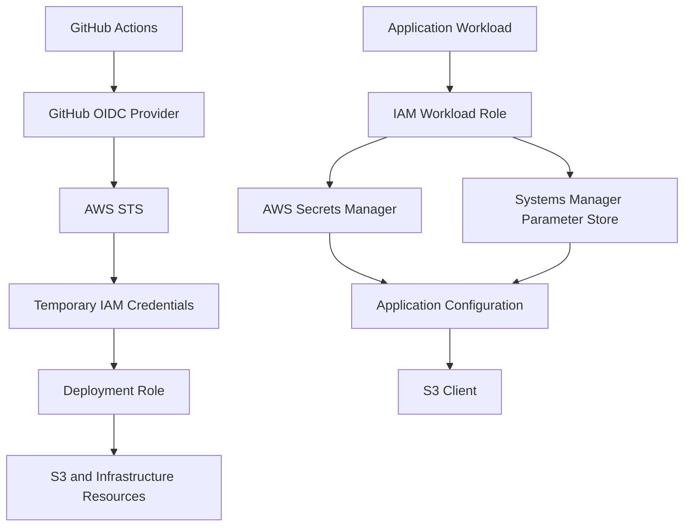
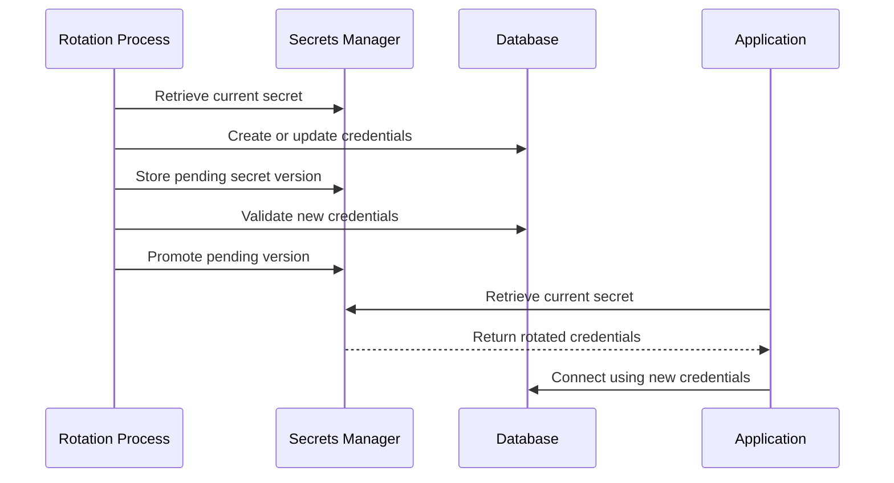

# 09- Secrets and Configuration Management

## Overview

Secrets and configuration management are critical parts of a production Amazon S3 deployment pipeline.

Infrastructure deployments require configuration values and sensitive information such as:

- AWS account IDs and deployment role ARNs.
- AWS Region and environment identifiers.
- Terraform backend configuration.
- S3 bucket names and resource ARNs.
- KMS key ARNs.
- Database credentials used by application workloads.
- API tokens and third-party integration credentials.
- Private keys and certificates.
- Application environment variables.

Poor secrets management can expose production credentials, allow unauthorized infrastructure changes, or cause deployment failures.

A production deployment architecture should distinguish between:

1. **Configuration** — non-sensitive values that control application or infrastructure behavior.
2. **Secrets** — sensitive values that must be protected from unauthorized access.
3. **Workload identity** — temporary credentials obtained through IAM roles and federation rather than stored access keys.
4. **Deployment artifacts** — generated files that may contain sensitive configuration or infrastructure state.

The preferred AWS approach is to use IAM roles and temporary credentials, AWS Secrets Manager or Systems Manager Parameter Store where appropriate, and protected CI/CD configuration.

## Configuration vs Secrets

### Configuration

Configuration describes how an application or infrastructure component should operate.

Examples:

```env
APP_ENV=production
AWS_REGION=ap-south-1
S3_BUCKET_NAME=company-production-documents
S3_UPLOAD_PREFIX=uploads/
LOG_LEVEL=INFO
```

These values are not necessarily confidential, but they may still be security-sensitive.

For example, a production bucket name is not a credential, but exposing it can help an attacker understand the infrastructure.

### Secrets

Secrets are sensitive values that provide access to systems or protected information.

Examples:

```text
Database passwords
Third-party API tokens
Private keys
OAuth client secrets
Webhook signing secrets
Application encryption keys
```

Never commit secrets to source control or embed them in container images.

### Comparison

| Property | Configuration | Secrets |
|---|---|---|
| Purpose | Control application behavior | Authenticate or authorize access |
| Examples | Region, bucket name, log level | Password, API token, private key |
| Storage | Environment variables, configuration files, Parameter Store | Secrets Manager, secure Parameter Store, approved secret vault |
| Source control | Non-sensitive values may be committed | Must not be committed |
| Access | Based on operational requirements | Strictly restricted |
| Rotation | Usually changes with deployments | May require a dedicated rotation process |

A value should be classified based on its sensitivity rather than its filename or storage location.

## Secrets Management Architecture

A production S3 deployment pipeline should avoid long-lived AWS access keys.

GitHub Actions can authenticate to AWS using OpenID Connect (OIDC), allowing AWS STS to issue temporary credentials.

Other application secrets can be retrieved from AWS Secrets Manager or Parameter Store using workload IAM roles.



The responsibilities are separate:

| Component | Responsibility |
|---|---|
| GitHub OIDC | Establishes workload identity for CI/CD |
| AWS STS | Issues temporary credentials |
| IAM role | Defines permitted AWS operations |
| Secrets Manager | Stores and manages sensitive values |
| Parameter Store | Stores configuration and secure parameters |
| GitHub Environment | Controls environment-specific deployment authorization |
| S3 | Stores application objects and deployment assets |

## AWS Credential Management

### Prefer IAM Roles Over Access Keys

AWS supports multiple credential mechanisms.

| Credential mechanism | Typical use | Recommendation |
|---|---|---|
| IAM user access keys | Legacy integrations | Avoid for new workloads |
| IAM role credentials | EC2, ECS, Lambda and other AWS workloads | Preferred |
| GitHub OIDC federation | GitHub Actions deployments | Preferred |
| AWS IAM Identity Center | Human developer access | Preferred |
| Static credentials in environment variables | Temporary local compatibility | Avoid as a persistent solution |

An IAM role provides temporary credentials through AWS STS.

These credentials have an expiration time and are automatically refreshed by supported credential providers.

### GitHub Actions OIDC

GitHub Actions can request an OIDC token and exchange it for temporary AWS credentials.

The workflow requires:

```yaml
permissions:
  contents: read
  id-token: write
```

Configure AWS credentials:

```yaml
- name: Configure AWS credentials
  uses: aws-actions/configure-aws-credentials@v4
  with:
    role-to-assume: ${{ vars.AWS_DEPLOYMENT_ROLE_ARN }}
    aws-region: ap-south-1
```

`AWS_DEPLOYMENT_ROLE_ARN` is a non-secret configuration value containing the ARN of the intended IAM role.

The security boundary is the IAM trust policy and permission policy, not the secrecy of the role ARN.

The AWS role should trust only the intended repository and deployment environment.

Example OIDC trust policy:

```json
{
  "Version": "2012-10-17",
  "Statement": [
    {
      "Effect": "Allow",
      "Principal": {
        "Federated": "arn:aws:iam::111111111111:oidc-provider/token.actions.githubusercontent.com"
      },
      "Action": "sts:AssumeRoleWithWebIdentity",
      "Condition": {
        "StringEquals": {
          "token.actions.githubusercontent.com:aud": "sts.amazonaws.com",
          "token.actions.githubusercontent.com:sub": "repo:YOUR_ORG/YOUR_REPOSITORY:environment:production"
        }
      }
    }
  ]
}
```

Replace the account, organization, and repository placeholders with actual values.

The `sub` condition must match the subject claim emitted by GitHub. If customized OIDC subject claims are enabled, verify the actual token subject before configuring the trust policy.

For detailed federation architecture and IAM configuration, refer to:

`03- AWS IAM OIDC Federation.md`

### Verify the AWS Identity

After configuring credentials, verify the identity before executing deployment commands.

```yaml
- name: Verify AWS identity
  run: |
    aws sts get-caller-identity
```

Expected output includes:

```json
{
  "UserId": "AROAXXXXXXXXXXXXX:GitHubActions",
  "Account": "111111111111",
  "Arn": "arn:aws:sts::111111111111:assumed-role/GitHubS3ProductionDeploymentRole/GitHubActions"
}
```

Do not rely only on the presence of AWS environment variables. Verify that the assumed role belongs to the intended account.

## GitHub Actions Secrets and Variables

GitHub provides two mechanisms for storing workflow configuration.

### GitHub Secrets

Secrets are intended for sensitive values.

Examples:

- Third-party API tokens.
- External service credentials.
- Private signing keys.
- Credentials for systems that do not support OIDC.

Secrets can be configured at repository, organization, or environment scope, depending on repository permissions and plan capabilities.

Example:

```yaml
- name: Access external service
  env:
    API_TOKEN: ${{ secrets.EXTERNAL_API_TOKEN }}
  run: |
    python scripts/notify_external_service.py
```

Do not print secret values in workflow logs.

### GitHub Variables

Variables store non-secret configuration.

Examples:

- AWS Region.
- Deployment role ARN.
- S3 bucket name.
- Environment identifier.
- Infrastructure stack name.

Example:

```yaml
- name: Deploy S3 infrastructure
  env:
    AWS_REGION: ${{ vars.AWS_REGION }}
    S3_BUCKET_NAME: ${{ vars.S3_BUCKET_NAME }}
  run: |
    echo "Deploying infrastructure to configured environment"
    aws sts get-caller-identity
```

Do not use GitHub variables as a substitute for secret storage.

### Repository, Organization and Environment Scope

| Scope | Use case |
|---|---|
| Repository | Configuration specific to one repository |
| Organization | Shared configuration across repositories |
| Environment | Environment-specific deployment configuration |

For production deployments, environment-scoped variables and secrets help prevent development configuration from being reused accidentally.

Example:

```text
GitHub Repository
│
├── Repository Variables
│   └── Shared non-sensitive configuration
│
├── development
│   ├── AWS_REGION
│   ├── AWS_DEPLOYMENT_ROLE_ARN
│   └── S3_BUCKET_NAME
│
├── staging
│   ├── AWS_REGION
│   ├── AWS_DEPLOYMENT_ROLE_ARN
│   └── S3_BUCKET_NAME
│
└── production
    ├── AWS_REGION
    ├── AWS_DEPLOYMENT_ROLE_ARN
    └── S3_BUCKET_NAME
```

A job must reference the corresponding GitHub Environment for environment-scoped variables to be available.

## AWS Secrets Manager

### Overview

AWS Secrets Manager is a managed service for storing, retrieving, and rotating sensitive information.

Typical use cases include:

- Database credentials.
- Third-party API credentials.
- Application integration secrets.
- Credentials required by backend services.
- Secrets shared across multiple workloads.

Secrets Manager encrypts secrets at rest using AWS KMS.

Applications retrieve secrets through authenticated AWS API requests.

### Secret Structure

A secret can contain a JSON document.

Example:

```json
{
  "username": "application_user",
  "password": "REPLACE_WITH_SECRET",
  "host": "database.internal.example",
  "port": 5432,
  "database": "application"
}
```

The application retrieves the secret using its IAM role.

### Create a Secret

```bash
aws secretsmanager create-secret \
  --name production/application/database \
  --description "Production application database credentials" \
  --secret-string file://database-secret.json \
  --region ap-south-1
```

The JSON file must not be committed to source control or included in an unprotected build artifact.

For interactive creation, prefer a secure input mechanism rather than placing secret values directly in shell history.

### Retrieve a Secret

```bash
aws secretsmanager get-secret-value \
  --secret-id production/application/database \
  --region ap-south-1
```

The command returns the secret value to the caller.

Avoid running this command in shared CI logs or terminals where the output may be captured.

### Retrieve a Secret Using Python

Install Boto3:

```bash
pip install boto3
```

Implementation:

```python
import json
import boto3
from botocore.exceptions import ClientError


class SecretRetrievalError(Exception):
    pass


class SecretsService:
    def __init__(self, region_name: str):
        self.client = boto3.client(
            "secretsmanager",
            region_name=region_name,
        )

    def get_secret(self, secret_id: str) -> dict:
        try:
            response = self.client.get_secret_value(
                SecretId=secret_id
            )

            secret_string = response.get("SecretString")

            if secret_string is None:
                raise SecretRetrievalError(
                    "Binary secrets are not supported by this implementation"
                )

            return json.loads(secret_string)

        except ClientError as exc:
            error_code = exc.response.get(
                "Error", {}
            ).get("Code", "Unknown")

            raise SecretRetrievalError(
                f"Unable to retrieve secret: {error_code}"
            ) from exc

        except json.JSONDecodeError as exc:
            raise SecretRetrievalError(
                "Secret value is not valid JSON"
            ) from exc
```

The service uses the default Boto3 credential provider chain.

On AWS workloads, credentials should come from the workload's IAM role.

Do not pass static access keys into the service constructor.

### IAM Permissions

An application retrieving one secret should receive only the necessary permission.

Example identity policy:

```json
{
  "Version": "2012-10-17",
  "Statement": [
    {
      "Sid": "ReadApplicationDatabaseSecret",
      "Effect": "Allow",
      "Action": [
        "secretsmanager:GetSecretValue"
      ],
      "Resource": "arn:aws:secretsmanager:ap-south-1:111111111111:secret:production/application/database-*"
    }
  ]
}
```

If the secret uses a customer-managed KMS key, the principal may also require `kms:Decrypt`, subject to the key policy and grant configuration.

Secrets Manager authorization and KMS authorization are separate permission checks.

### Secret Caching

Retrieving a secret on every application request introduces unnecessary latency and API cost.

Use a bounded cache where appropriate.

A practical approach:

- Retrieve the secret during application startup.
- Cache it in memory.
- Refresh it periodically or when credentials are rotated.
- Avoid logging the secret.
- Ensure refresh failures do not silently replace valid credentials with incomplete configuration.

For long-running applications, use the AWS Secrets Manager caching library when its behavior matches the application's refresh requirements.

A cache introduces a consistency delay: the application may continue using an old secret until refresh completes.

### Secret Rotation

Secrets Manager supports managed rotation integrations and Lambda-based rotation workflows.

A typical rotation lifecycle:



Rotation must account for application connection pools and in-flight requests.

For database credentials, design the rotation process so that the application can transition without unnecessary downtime.

## AWS Systems Manager Parameter Store

### Overview

Systems Manager Parameter Store provides centralized storage for configuration values and secure parameters.

It is useful for:

- Environment configuration.
- Application feature flags.
- Service endpoints.
- S3 bucket names.
- KMS key identifiers.
- Non-secret deployment parameters.
- Sensitive values stored as `SecureString`.

### Parameter Types

| Type | Description | Typical use |
|---|---|---|
| `String` | Plain text value | Region, bucket name |
| `StringList` | Comma-separated string values | Multiple endpoints |
| `SecureString` | Encrypted parameter | Passwords and tokens |

Use `SecureString` for sensitive values.

For stronger separation of responsibilities and managed secret rotation, use Secrets Manager where appropriate.

### Parameter Naming Convention

Use hierarchical paths to organize parameters.

```text
/application/
    development/
        aws-region
        s3-bucket-name
        database-url

    staging/
        aws-region
        s3-bucket-name
        database-url

    production/
        aws-region
        s3-bucket-name
        database-url
```

A more service-specific structure can be used for larger systems:

```text
/platform/s3/production/bucket-name
/platform/s3/production/kms-key-arn
/platform/api/production/database-url
/platform/worker/production/redis-url
```

Choose one convention and use it consistently.

### Create Parameters

Create a regular configuration parameter:

```bash
aws ssm put-parameter \
  --name "/platform/s3/production/bucket-name" \
  --type String \
  --value "company-production-documents" \
  --region ap-south-1
```

Create a secure parameter:

```bash
aws ssm put-parameter \
  --name "/platform/api/production/database-password" \
  --type SecureString \
  --value "REPLACE_WITH_SECRET" \
  --region ap-south-1
```

For sensitive values, avoid passing literal secrets in shell commands because they may be exposed through shell history or process inspection.

### Retrieve Parameters

Retrieve a regular parameter:

```bash
aws ssm get-parameter \
  --name "/platform/s3/production/bucket-name" \
  --region ap-south-1
```

Retrieve a secure parameter:

```bash
aws ssm get-parameter \
  --name "/platform/api/production/database-password" \
  --with-decryption \
  --region ap-south-1
```

The caller needs the appropriate Systems Manager permission. Decrypting a customer-managed-key-encrypted parameter also requires applicable KMS permissions.

### Retrieve Parameters Using Python

```python
import boto3
from botocore.exceptions import ClientError


class ParameterStoreError(Exception):
    pass


class ParameterStoreService:
    def __init__(self, region_name: str):
        self.client = boto3.client(
            "ssm",
            region_name=region_name,
        )

    def get_parameter(
        self,
        name: str,
        decrypt: bool = False,
    ) -> str:
        try:
            response = self.client.get_parameter(
                Name=name,
                WithDecryption=decrypt,
            )

            return response["Parameter"]["Value"]

        except ClientError as exc:
            error_code = exc.response.get(
                "Error", {}
            ).get("Code", "Unknown")

            raise ParameterStoreError(
                f"Unable to retrieve parameter: {error_code}"
            ) from exc
```

### IAM Permissions

An application should only retrieve the parameters it needs.

Example:

```json
{
  "Version": "2012-10-17",
  "Statement": [
    {
      "Sid": "ReadProductionS3Configuration",
      "Effect": "Allow",
      "Action": [
        "ssm:GetParameter"
      ],
      "Resource": "arn:aws:ssm:ap-south-1:111111111111:parameter/platform/s3/production/*"
    }
  ]
}
```

For `SecureString` parameters encrypted with a customer-managed KMS key, grant the required KMS decrypt permission separately.

Avoid granting broad `ssm:GetParametersByPath` permissions if an application only needs one parameter.

## Secrets Manager vs Parameter Store

Both services can store sensitive values, but their operational characteristics differ.

| Capability | Secrets Manager | Parameter Store |
|---|---|---|
| Plain configuration | Supported | Supported |
| Encrypted values | Supported | Supported through `SecureString` |
| Secret rotation | Managed rotation integrations and custom rotation | No equivalent native managed secret-rotation workflow |
| Typical use | Credentials and secrets | Configuration and parameters |
| Versioning | Supported | Supported |
| KMS integration | Supported | Supported |
| Hierarchical naming | Supported through naming conventions | Native hierarchical paths |
| Application integration | SDK and caching libraries | SDK and parameter retrieval |
| Cost model | Generally higher per stored secret and API usage | Standard parameters have different pricing characteristics; advanced features may incur charges |

Choose based on lifecycle and operational requirements rather than storing everything in one service.

A common architecture uses:

- Parameter Store for non-sensitive environment configuration.
- Secrets Manager for credentials requiring rotation or dedicated secret lifecycle management.
- IAM roles for AWS service access.
- GitHub OIDC for CI/CD authentication.

## Managing Application Configuration

### Environment-Specific Configuration

Applications should load configuration from their runtime environment rather than hardcoding deployment values.

Example:

```env
APP_ENV=production
AWS_REGION=ap-south-1
S3_BUCKET_NAME=company-production-documents
S3_UPLOAD_PREFIX=uploads/
AWS_SECRET_NAME=production/application/database
LOG_LEVEL=INFO
```

This file is an example of configuration, not a production secret store.

Never commit a real `.env` file containing credentials.

### Python Configuration

A centralized configuration layer prevents AWS configuration from being scattered across application modules.

```python
import os
from dataclasses import dataclass


@dataclass(frozen=True)
class Settings:
    app_env: str
    aws_region: str
    s3_bucket_name: str
    s3_upload_prefix: str
    aws_secret_name: str

    @classmethod
    def from_environment(cls) -> "Settings":
        required = [
            "APP_ENV",
            "AWS_REGION",
            "S3_BUCKET_NAME",
            "AWS_SECRET_NAME",
        ]

        missing = [
            name for name in required
            if not os.getenv(name)
        ]

        if missing:
            raise RuntimeError(
                f"Missing required configuration: {', '.join(missing)}"
            )

        return cls(
            app_env=os.environ["APP_ENV"],
            aws_region=os.environ["AWS_REGION"],
            s3_bucket_name=os.environ["S3_BUCKET_NAME"],
            s3_upload_prefix=os.getenv(
                "S3_UPLOAD_PREFIX",
                "uploads/",
            ),
            aws_secret_name=os.environ["AWS_SECRET_NAME"],
        )
```

Initialize settings once during application startup and inject them into service objects.

This improves testability and makes environment-specific behavior explicit.

### Django and FastAPI

For Django:

```python
import os

AWS_REGION = os.environ["AWS_REGION"]
AWS_STORAGE_BUCKET_NAME = os.environ["S3_BUCKET_NAME"]
```

For FastAPI:

```python
from functools import lru_cache
from pydantic_settings import BaseSettings, SettingsConfigDict


class Settings(BaseSettings):
    app_env: str
    aws_region: str
    s3_bucket_name: str

    model_config = SettingsConfigDict(
        env_file=None,
        extra="ignore",
    )


@lru_cache
def get_settings() -> Settings:
    return Settings()
```

Install the required dependency:

```bash
pip install pydantic-settings
```

Do not retrieve Secrets Manager values inside individual API route handlers.

Use a dedicated configuration or secrets service during application startup, with an appropriate refresh strategy for rotating credentials.

## Docker Configuration

### Avoid Embedding Secrets in Docker Images

Do not use this pattern:

```dockerfile
ENV AWS_ACCESS_KEY_ID=AKIA...
ENV AWS_SECRET_ACCESS_KEY=...
```

Image layers and build metadata can expose embedded credentials.

Instead, use runtime identity and configuration injection.

Example Dockerfile:

```dockerfile
FROM python:3.12-slim

WORKDIR /app

COPY requirements.txt .

RUN pip install --no-cache-dir -r requirements.txt

COPY . .

RUN useradd --create-home appuser

USER appuser

CMD ["uvicorn", "app.main:app", "--host", "0.0.0.0", "--port", "8000"]
```

Pass non-sensitive configuration at runtime.

For AWS-hosted workloads:

- ECS tasks should use task roles.
- EC2 workloads should use instance profiles.
- EKS workloads should use an appropriate pod identity mechanism.
- Lambda functions should use execution roles.

Avoid mounting developer AWS credentials into production containers.

### Docker Compose for Local Development

```yaml
services:
  api:
    build: .
    environment:
      APP_ENV: development
      AWS_REGION: ap-south-1
      S3_BUCKET_NAME: local-development-bucket
    ports:
      - "8000:8000"
```

For local AWS integration, use an explicitly configured developer credential provider or a local AWS-compatible service.

Do not copy production credentials into Compose files.

## GitHub Actions Secrets Management

### Secure Workflow Design

A production workflow should use:

- OIDC for AWS authentication.
- GitHub Environment protection.
- Environment-scoped variables.
- Secrets only for external systems that require static credentials.
- Restricted workflow permissions.
- Pinned and trusted third-party actions.
- No secret values in workflow logs.

Example:

```yaml
name: Deploy S3 Infrastructure

on:
  workflow_dispatch:

permissions:
  contents: read
  id-token: write

jobs:
  deploy:
    runs-on: ubuntu-latest

    environment: production

    steps:
      - name: Checkout repository
        uses: actions/checkout@v4

      - name: Configure AWS credentials
        uses: aws-actions/configure-aws-credentials@v4
        with:
          role-to-assume: ${{ vars.AWS_DEPLOYMENT_ROLE_ARN }}
          aws-region: ${{ vars.AWS_REGION }}

      - name: Verify AWS identity
        run: aws sts get-caller-identity

      - name: Deploy infrastructure
        run: |
          echo "Execute the selected infrastructure deployment command"
```

The environment must be protected independently in GitHub settings.

For high-assurance environments, pin third-party actions to reviewed full commit SHAs rather than relying only on mutable version tags.

### Fork Pull Requests

Untrusted pull requests must not receive production secrets or privileged AWS credentials.

A safe design separates:

- Pull request validation without production credentials.
- Trusted branch deployment using OIDC.
- Production deployment behind environment protection.

Do not use `pull_request_target` to execute untrusted pull-request code with privileged credentials.

### Avoid Secret Exposure

Do not:

- Print environment variables.
- Run commands that dump secret files.
- Upload `.env` files as artifacts.
- Include secrets in exception messages.
- Pass secrets as command-line arguments unnecessarily.
- Store secrets in Terraform outputs or state without understanding the exposure risk.
- Use workflow debug logging when it can reveal sensitive values.

GitHub's log masking is a defense-in-depth measure, not a guarantee that every transformed or encoded secret will be hidden.

## Terraform Secrets and Configuration

Terraform manages infrastructure, but its state and plan files can contain sensitive information.

### Use Variables for Non-Sensitive Configuration

Example:

```hcl
variable "aws_region" {
  description = "AWS deployment Region"
  type        = string
  default     = "ap-south-1"
}

variable "bucket_name" {
  description = "S3 bucket name"
  type        = string
}

variable "environment" {
  description = "Deployment environment"
  type        = string

  validation {
    condition = contains(
      ["development", "staging", "production"],
      var.environment
    )

    error_message = "Unsupported deployment environment."
  }
}
```

### Sensitive Variables

Terraform supports sensitive variable declarations.

```hcl
variable "database_password" {
  description = "Application database password"
  type        = string
  sensitive   = true
}
```

The `sensitive` flag suppresses normal display of the value in many CLI outputs.

It does not automatically encrypt or remove the value from Terraform state.

Protect the backend, state access, plan artifacts, and CI/CD logs accordingly.

### Avoid Hardcoded Secrets

Never write:

```hcl
resource "example_resource" "application" {
  password = "production-password"
}
```

Prefer retrieving the secret through an approved secret-management mechanism.

For example, when a deployment genuinely needs to read a secret:

```hcl
data "aws_secretsmanager_secret_version" "database" {
  secret_id = "production/application/database"
}
```

Be aware that retrieving a secret through Terraform can place its value in Terraform state and potentially in plan artifacts.

If Terraform only needs to provision infrastructure, avoid retrieving application secrets during deployment.

Let the runtime workload retrieve its own secrets using its IAM role whenever possible.

### Protect Terraform State

Remote Terraform state should be:

- Stored in a dedicated private S3 bucket.
- Encrypted.
- Versioned.
- Access-controlled.
- Protected from accidental deletion.
- Isolated by environment.
- Managed with state locking.

Restrict access to both state and saved plan files.

Terraform state may contain credentials and other sensitive values even when variables are marked `sensitive`.

For state architecture and locking, refer to:

`04- Terraform Plan and Apply Pipelines.md`

## CloudFormation and CDK Configuration

### CloudFormation Parameters

Use parameters for environment-specific non-sensitive values.

```yaml
Parameters:
  Environment:
    Type: String
    AllowedValues:
      - development
      - staging
      - production

  BucketName:
    Type: String

Resources:
  StorageBucket:
    Type: AWS::S3::Bucket
    Properties:
      BucketName: !Ref BucketName
```

Do not place credentials directly in template files.

CloudFormation supports dynamic references to Secrets Manager and Systems Manager Parameter Store for supported resource properties.

Example dynamic reference:

```yaml
Parameters:
  DatabaseSecretArn:
    Type: String

Resources:
  ApplicationConfiguration:
    Type: AWS::SomeService::Example
    Properties:
      Password: !Sub
        - "{{resolve:secretsmanager:${SecretArn}:SecretString:password}}"
        - SecretArn: !Ref DatabaseSecretArn
```

This is a structural illustration. Replace the example resource with a real resource whose property supports the relevant dynamic reference.

The deployment identity and CloudFormation execution role must have the necessary permissions to resolve the reference.

Dynamic references do not remove the need to protect deployment logs, templates, and resource configuration.

### CDK Context and Environment Configuration

CDK context is useful for non-secret deployment configuration.

Example `cdk.json`:

```json
{
  "app": "python app.py",
  "context": {
    "environment": "development",
    "region": "ap-south-1"
  }
}
```

Do not store passwords or API tokens in CDK context.

Context values may be included in source control, synthesized templates, or deployment artifacts.

Use environment configuration for resource names, account IDs, and Regions, and use IAM roles for AWS authentication.

## Secret Rotation and Application Reliability

### Rotation Strategy

A secret rotation process must consider every workload using that secret.

For example, rotating a database password affects:

- Django application instances.
- FastAPI services.
- Celery workers.
- Background jobs.
- Connection pools.
- Scheduled tasks.
- Other services sharing the credential.

A safe rotation strategy should include:

1. Create or update the new credential.
2. Validate that the new credential works.
3. Update the secret version.
4. Allow workloads to refresh credentials.
5. Verify new connections.
6. Retire the old credential when safe.

The exact sequence depends on the target system's ability to support overlapping credentials.

### Avoid Application-Wide Downtime

Applications that cache secrets indefinitely may continue using expired credentials.

Applications that retrieve secrets on every request may introduce unnecessary dependency on Secrets Manager availability.

A balanced design uses:

- Bounded secret caching.
- Explicit refresh intervals.
- Connection-pool lifecycle management.
- Safe fallback behavior.
- Monitoring of authentication failures.
- Controlled rotation procedures.

Do not silently fall back to hardcoded credentials when secret retrieval fails.

## Monitoring and Auditing

Secrets management requires visibility into access and changes.

### AWS CloudTrail

Use CloudTrail to audit relevant API operations.

Examples include:

| Service | Relevant operations |
|---|---|
| Secrets Manager | `GetSecretValue`, `PutSecretValue`, `CreateSecret`, `UpdateSecret` |
| Parameter Store | `GetParameter`, `PutParameter`, `DeleteParameter` |
| KMS | `Decrypt`, key policy and grant operations |
| IAM | Role and policy changes |
| STS | Role assumption and temporary credential issuance |

CloudTrail can help identify:

- Unexpected secret retrieval.
- Unauthorized access attempts.
- Secret changes.
- Role assumption from unexpected principals.
- Changes to secret access policies.

### Operational Metrics

Monitor:

- Secret retrieval failures.
- Parameter retrieval failures.
- KMS authorization failures.
- Secret rotation failures.
- Expired credentials.
- Application authentication failures.
- Unexpected increases in secret API usage.

Avoid logging the secret itself when investigating failures.

### Cost Considerations

Secrets Manager and Parameter Store have different pricing models.

Costs depend on factors such as:

- Number of stored secrets or parameters.
- Advanced Parameter Store features.
- API request volume.
- Secret rotation Lambda execution.
- KMS usage.
- Cross-Region access patterns.

Cache frequently accessed values where appropriate and review current AWS pricing before choosing a storage strategy.

## Troubleshooting

### AccessDeniedException from Secrets Manager

**Symptoms**

The application cannot retrieve a secret.

**Possible causes**

- Missing `secretsmanager:GetSecretValue`.
- Incorrect secret ARN.
- Resource policy denial.
- Incorrect AWS account or Region.
- KMS decrypt permission failure.

**Diagnosis**

```bash
aws sts get-caller-identity

aws secretsmanager describe-secret \
  --secret-id production/application/database \
  --region ap-south-1
```

Inspect the role's identity policy and the secret resource policy.

If the secret uses a customer-managed KMS key, inspect the key policy and relevant IAM permissions.

Do not assume that every `AccessDeniedException` originates from Secrets Manager authorization. KMS authorization can also prevent successful retrieval.

### Parameter Store Access Failure

**Symptoms**

The application receives an authorization error when retrieving a parameter.

**Possible causes**

- Missing `ssm:GetParameter`.
- Incorrect parameter path.
- Wrong Region.
- Missing `kms:Decrypt` for a customer-managed key.
- Explicit deny in an IAM or resource-level control.

**Diagnosis**

```bash
aws ssm get-parameter \
  --name "/platform/s3/production/bucket-name" \
  --region ap-south-1
```

For secure parameters:

```bash
aws ssm get-parameter \
  --name "/platform/api/production/database-password" \
  --with-decryption \
  --region ap-south-1
```

Check the caller identity, parameter ARN, Region, IAM policy, and KMS key policy.

### GitHub OIDC Authentication Failure

**Symptoms**

GitHub Actions cannot assume the AWS deployment role.

**Possible causes**

- Missing `id-token: write`.
- Incorrect role ARN.
- Incorrect OIDC provider configuration.
- Audience mismatch.
- Repository subject mismatch.
- Environment subject mismatch.
- Trust policy does not match the actual token claims.

**Diagnosis**

Verify workflow permissions:

```yaml
permissions:
  contents: read
  id-token: write
```

Verify the AWS role trust policy and ensure that the GitHub Environment referenced by the deployment job matches the expected OIDC subject.

Then inspect the failed `AssumeRoleWithWebIdentity` operation in workflow logs and AWS audit records.

Never solve an OIDC failure by replacing federation with permanent production access keys.

### Secret Rotation Failure

**Symptoms**

Applications begin receiving authentication failures after rotation.

**Possible causes**

- Rotation completed but application cache was not refreshed.
- Connection pools still use old credentials.
- Rotation workflow updated the wrong credential.
- New credential was not validated.
- Application has insufficient permission to retrieve the updated secret.

**Recovery**

1. Inspect the secret's version stages.
2. Verify the target system's active credential.
3. Check application refresh behavior.
4. Validate new connections.
5. Restore a known-good credential state if required.
6. Correct the rotation workflow before retrying.

## Security Best Practices

### General Rules

- Prefer workload IAM roles over long-lived AWS access keys.
- Use GitHub OIDC for GitHub Actions deployments.
- Store application secrets in Secrets Manager or an approved secure vault.
- Use Parameter Store for non-sensitive configuration.
- Restrict secret retrieval to specific secret ARNs or parameter paths.
- Use customer-managed KMS keys when required by the security model.
- Separate development, staging, and production secrets.
- Rotate credentials according to their risk and operational requirements.
- Never commit `.env` files containing real credentials.
- Never embed secrets in Docker images.
- Never print secret values in CI/CD logs.
- Protect Terraform state and plan artifacts.
- Audit secret access and configuration changes.

### Production Configuration Checklist

- [ ] No static AWS access keys are stored in application source code.
- [ ] GitHub Actions uses OIDC for AWS authentication.
- [ ] Production deployment roles are restricted to trusted repositories and environments.
- [ ] AWS account identity is verified before deployment.
- [ ] GitHub Environment variables are separated by environment.
- [ ] Sensitive values are stored in an approved secret manager.
- [ ] Application workloads use IAM roles to retrieve secrets.
- [ ] Secret access policies follow least privilege.
- [ ] KMS permissions are configured independently from service permissions.
- [ ] Terraform state and plan artifacts are protected.
- [ ] Docker images do not contain credentials.
- [ ] Secret rotation and application refresh behavior are tested.
- [ ] CloudTrail auditing is enabled and reviewed.
- [ ] Secret retrieval failures are monitored.
- [ ] No sensitive values appear in logs, artifacts, or exception messages.

## Key Takeaways

- Separate non-sensitive configuration, application secrets, and AWS workload identity; each requires a different management approach.
- Prefer IAM roles and temporary credentials, using GitHub OIDC for CI/CD instead of storing long-lived AWS access keys.
- Use Secrets Manager for managed secret lifecycle and rotation, and Parameter Store for centralized configuration and secure parameters.
- Protect Terraform state, saved plans, deployment artifacts, container images, and CI/CD logs because sensitive values can leak through them.
- Design secret caching, rotation, IAM permissions, KMS authorization, and auditing together to maintain secure and reliable production workloads.