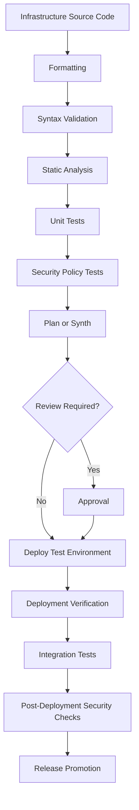

# 10- Automated Infrastructure Testing

## Overview

Automated infrastructure testing validates cloud infrastructure definitions before and after deployment.

For Amazon S3 deployments, infrastructure testing helps detect configuration errors that can cause:

- Public exposure of private buckets.
- Missing encryption or versioning.
- Incorrect IAM permissions.
- Broken lifecycle policies.
- Invalid replication configuration.
- Incorrect CloudFront origin access.
- Missing Lambda permissions.
- Resource replacement or accidental deletion.
- Deployment failures caused by invalid infrastructure dependencies.

Infrastructure code should be tested like application code. A successful Terraform plan, CloudFormation deployment, or CDK synthesis does not automatically prove that the resulting infrastructure is secure or behaves as expected.

A production-grade testing strategy combines:

1. Static validation.
2. Unit testing of infrastructure definitions.
3. Security and policy validation.
4. Deployment testing.
5. Integration testing.
6. Post-deployment verification.
7. Drift detection.

## Infrastructure Testing Layers

Different testing layers detect different classes of defects.

| Testing layer | What it validates | Typical tools |
|---|---|---|
| Formatting | Code consistency | `terraform fmt`, formatters |
| Syntax validation | Configuration structure | Terraform validate, CloudFormation validation |
| Static analysis | Misconfigurations and anti-patterns | Checkov, cfn-lint |
| Unit testing | Infrastructure resource definitions | CDK assertions, Terraform tests |
| Security testing | IAM, encryption, public access | Checkov, policy checks |
| Plan or diff testing | Proposed infrastructure changes | Terraform plan, CDK diff |
| Deployment testing | Actual resource creation and configuration | AWS CLI, SDK |
| Integration testing | Interactions between AWS resources | Boto3, application tests |
| Drift detection | Difference between declared and deployed state | Terraform plan, CloudFormation drift detection |

A mature pipeline executes inexpensive checks early and reserves AWS-dependent tests for controlled environments.

## Testing Architecture



### Testing Stages

| Stage | AWS credentials required? | Typical execution |
|---|---|---|
| Formatting | No | Pull request |
| Syntax validation | Usually no | Pull request |
| Static analysis | Usually no | Pull request |
| Unit tests | Usually no | Pull request |
| Policy tests | Usually no | Pull request |
| Terraform plan | Depends on backend and provider operations | Trusted CI |
| CDK synthesis | Usually no | Pull request |
| Deployment | Yes | Protected deployment job |
| Integration tests | Yes | Development or staging |
| Drift detection | Yes | Scheduled or controlled workflow |

Avoid granting production AWS permissions to untrusted pull-request workflows.

## Terraform Infrastructure Testing

Terraform supports multiple validation mechanisms.

### Formatting

Run:

```bash
terraform fmt -check -recursive
```

This verifies that Terraform files follow the standard formatting rules.

To apply formatting:

```bash
terraform fmt -recursive
```

Formatting should be enforced in CI.

### Syntax and Configuration Validation

Initialize the project without configuring its remote backend when validating configuration that does not require backend access:

```bash
terraform init -backend=false
terraform validate
```

This checks Terraform configuration syntax and internal consistency.

It does not prove that AWS will accept every resource configuration.

### Static Analysis with Checkov

Checkov scans infrastructure code for security and configuration issues.

Install:

```bash
pip install checkov
```

Scan Terraform:

```bash
checkov -d terraform/
```

Scan a specific file:

```bash
checkov -f terraform/s3.tf
```

Typical S3 checks include:

- Public access restrictions.
- Encryption configuration.
- Versioning.
- Logging configuration.
- IAM policy restrictions.
- Secure transport requirements.

Static analysis is rule-based. A passing scan does not guarantee that the infrastructure is secure.

Review findings in the context of the workload.

### Example Terraform S3 Module

A reusable S3 module should expose configuration through variables and enforce secure defaults.

`modules/s3/main.tf`:

```hcl
resource "aws_s3_bucket" "this" {
  bucket = var.bucket_name

  tags = {
    Environment = var.environment
    ManagedBy   = "Terraform"
  }

  lifecycle {
    prevent_destroy = true
  }
}

resource "aws_s3_bucket_ownership_controls" "this" {
  bucket = aws_s3_bucket.this.id

  rule {
    object_ownership = "BucketOwnerEnforced"
  }
}

resource "aws_s3_bucket_public_access_block" "this" {
  bucket = aws_s3_bucket.this.id

  block_public_acls       = true
  block_public_policy     = true
  ignore_public_acls      = true
  restrict_public_buckets = true
}

resource "aws_s3_bucket_versioning" "this" {
  bucket = aws_s3_bucket.this.id

  versioning_configuration {
    status = "Enabled"
  }
}

resource "aws_s3_bucket_server_side_encryption_configuration" "this" {
  bucket = aws_s3_bucket.this.id

  rule {
    apply_server_side_encryption_by_default {
      sse_algorithm = "AES256"
    }
  }
}

resource "aws_s3_bucket_policy" "this" {
  bucket = aws_s3_bucket.this.id

  policy = jsonencode({
    Version = "2012-10-17"
    Statement = [
      {
        Sid       = "DenyInsecureTransport"
        Effect    = "Deny"
        Principal = "*"
        Action    = "s3:*"
        Resource = [
          aws_s3_bucket.this.arn,
          "${aws_s3_bucket.this.arn}/*"
        ]
        Condition = {
          Bool = {
            "aws:SecureTransport" = "false"
          }
        }
      }
    ]
  })

  depends_on = [
    aws_s3_bucket_public_access_block.this
  ]
}
```

`modules/s3/variables.tf`:

```hcl
variable "bucket_name" {
  description = "Globally unique S3 bucket name"
  type        = string

  validation {
    condition     = length(var.bucket_name) >= 3
    error_message = "Bucket name must contain at least 3 characters."
  }
}

variable "environment" {
  description = "Deployment environment"
  type        = string

  validation {
    condition = contains(
      ["development", "staging", "production"],
      var.environment
    )

    error_message = "Unsupported environment."
  }
}
```

`modules/s3/outputs.tf`:

```hcl
output "bucket_name" {
  description = "Created bucket name"
  value       = aws_s3_bucket.this.id
}

output "bucket_arn" {
  description = "Created bucket ARN"
  value       = aws_s3_bucket.this.arn
}
```

This module demonstrates a baseline private bucket configuration. Production modules may need additional controls such as access logging, lifecycle configuration, KMS encryption, replication, and environment-specific retention.

### Terraform Tests

Terraform provides a native testing framework using `.tftest.hcl` files.

Example `tests/s3.tftest.hcl`:

```hcl
run "validate_s3_configuration" {
  command = plan

  variables {
    bucket_name = "example-production-storage-001"
    environment = "production"
  }

  assert {
    condition     = aws_s3_bucket.this.bucket == "example-production-storage-001"
    error_message = "Unexpected S3 bucket name."
  }

  assert {
    condition = (
      aws_s3_bucket_versioning.this.versioning_configuration[0].status
      == "Enabled"
    )

    error_message = "S3 versioning must be enabled."
  }

  assert {
    condition = (
      aws_s3_bucket_public_access_block.this.block_public_acls
      && aws_s3_bucket_public_access_block.this.block_public_policy
      && aws_s3_bucket_public_access_block.this.ignore_public_acls
      && aws_s3_bucket_public_access_block.this.restrict_public_buckets
    )

    error_message = "All S3 public access block settings must be enabled."
  }
}
```

Run:

```bash
terraform test
```

Terraform tests can execute plans or applies depending on the test configuration. Apply-based tests may create real infrastructure and incur AWS charges.

Use isolated test accounts and explicit cleanup procedures for apply-based testing.

### Terraform Plan Assertions

A Terraform plan can be saved for inspection:

```bash
terraform plan -out=tfplan
terraform show -json tfplan > tfplan.json
```

The JSON output can be consumed by policy tools or custom validation scripts.

Do not assume that the plan JSON is safe to publish. It can contain sensitive configuration values.

Use restricted storage and retention for plan artifacts.

## CloudFormation Testing

CloudFormation supports template validation, change sets, drift detection, and integration with static-analysis tools.

### Template Validation

```bash
aws cloudformation validate-template \
  --template-body file://templates/s3-bucket.yml
```

This checks whether the template is valid according to CloudFormation's template validation rules.

It does not prove that deployment will succeed or that the configuration satisfies security requirements.

### cfn-lint

`cfn-lint` validates CloudFormation templates against resource specifications and additional rules.

Install:

```bash
pip install cfn-lint
```

Run:

```bash
cfn-lint templates/s3-bucket.yml
```

Validate all templates:

```bash
cfn-lint templates/**/*.yml
```

Use a version of `cfn-lint` compatible with the resource specifications and template features used by the project.

### Checkov for CloudFormation

```bash
checkov -f templates/s3-bucket.yml
```

This can detect configuration risks such as:

- Public S3 access.
- Missing encryption.
- Missing versioning.
- Weak IAM permissions.
- Insecure transport policies.

### Example CloudFormation Template

`templates/s3-bucket.yml`:

```yaml
AWSTemplateFormatVersion: "2010-09-09"

Description: Private S3 bucket with baseline security controls

Parameters:
  BucketName:
    Type: String

Resources:
  StorageBucket:
    Type: AWS::S3::Bucket
    Properties:
      BucketName: !Ref BucketName

      VersioningConfiguration:
        Status: Enabled

      OwnershipControls:
        Rules:
          - ObjectOwnership: BucketOwnerEnforced

      PublicAccessBlockConfiguration:
        BlockPublicAcls: true
        BlockPublicPolicy: true
        IgnorePublicAcls: true
        RestrictPublicBuckets: true

      BucketEncryption:
        ServerSideEncryptionConfiguration:
          - ServerSideEncryptionByDefault:
              SSEAlgorithm: AES256

      Tags:
        - Key: ManagedBy
          Value: CloudFormation

Outputs:
  BucketName:
    Value: !Ref StorageBucket

  BucketArn:
    Value: !GetAtt StorageBucket.Arn
```

### CloudFormation Change Set Testing

A change set helps inspect proposed infrastructure changes before execution.

```bash
aws cloudformation create-change-set \
  --stack-name application-storage-test \
  --change-set-name validation-run-001 \
  --change-set-type CREATE \
  --template-body file://templates/s3-bucket.yml \
  --parameters \
    ParameterKey=BucketName,ParameterValue=example-test-storage-001
```

Inspect the proposed changes:

```bash
aws cloudformation describe-change-set \
  --stack-name application-storage-test \
  --change-set-name validation-run-001
```

A change set is useful for reviewing resource creation, modification, replacement, and deletion.

It is not a substitute for integration testing after deployment.

### CloudFormation Drift Detection

Start drift detection:

```bash
aws cloudformation detect-stack-drift \
  --stack-name application-storage-test
```

Inspect the detection status:

```bash
aws cloudformation describe-stack-drift-detection-status \
  --stack-drift-detection-id DETECTION_ID
```

Inspect drifted resources:

```bash
aws cloudformation describe-stack-resource-drifts \
  --stack-name application-storage-test
```

Drift detection compares supported resource properties with the expected stack configuration.

Not every property or resource type supports drift detection. A clean result does not prove that all external configuration is correct.

## AWS CDK Testing

AWS CDK supports unit testing through its assertions library.

For Python CDK applications, use `pytest` and `aws-cdk-lib.assertions`.

### Example CDK Stack

```python
from aws_cdk import (
    Stack,
    RemovalPolicy,
    aws_s3 as s3,
)
from constructs import Construct


class StorageStack(Stack):
    def __init__(
        self,
        scope: Construct,
        construct_id: str,
        **kwargs,
    ) -> None:
        super().__init__(scope, construct_id, **kwargs)

        self.bucket = s3.Bucket(
            self,
            "StorageBucket",
            versioned=True,
            block_public_access=s3.BlockPublicAccess.BLOCK_ALL,
            encryption=s3.BucketEncryption.S3_MANAGED,
            enforce_ssl=True,
            removal_policy=RemovalPolicy.RETAIN,
        )
```

### CDK Assertions

`tests/test_storage_stack.py`:

```python
import aws_cdk as cdk

from aws_cdk.assertions import Match, Template
from app.storage_stack import StorageStack


def test_storage_bucket_security_configuration():
    app = cdk.App()

    stack = StorageStack(
        app,
        "StorageStack",
        env=cdk.Environment(
            account="111111111111",
            region="ap-south-1",
        ),
    )

    template = Template.from_stack(stack)

    template.resource_count_is(
        "AWS::S3::Bucket",
        1,
    )

    template.has_resource_properties(
        "AWS::S3::Bucket",
        {
            "VersioningConfiguration": {
                "Status": "Enabled"
            },
            "PublicAccessBlockConfiguration": {
                "BlockPublicAcls": True,
                "BlockPublicPolicy": True,
                "IgnorePublicAcls": True,
                "RestrictPublicBuckets": True,
            },
            "BucketEncryption": Match.object_like({
                "ServerSideEncryptionConfiguration": Match.any_value(),
            }),
        },
    )
```

Run:

```bash
pytest -q
```

CDK assertions validate the synthesized CloudFormation template.

They do not create AWS resources or prove that the deployed configuration behaves correctly.

### CDK Synthesis Validation

Synthesize the application:

```bash
cdk synth
```

Inspect the generated templates in:

```text
cdk.out/
```

Run static analysis against the synthesized CloudFormation templates:

```bash
checkov -d cdk.out/
```

This can detect security issues that are not obvious from the high-level CDK constructs.

## IAM Policy Testing

IAM policy testing is essential for S3 because authorization mistakes can expose objects or prevent workloads from operating.

Test both intended access and prohibited access.

### Policy Simulator

AWS provides an IAM policy simulation API.

CLI example:

```bash
aws iam simulate-principal-policy \
  --policy-source-arn arn:aws:iam::111111111111:role/ApplicationS3Role \
  --action-names s3:GetObject s3:PutObject s3:DeleteObject \
  --resource-arns \
    arn:aws:s3:::company-production-documents/uploads/example.pdf
```

The output includes the evaluation decision for each action.

Important limitations:

- Simulation does not reproduce every real AWS authorization context.
- Resource policies, service-specific behavior, session policies, SCPs, permissions boundaries, and KMS policies may affect actual access.
- A simulated allow does not guarantee that a real request will succeed.

### Positive and Negative Authorization Tests

For an application role, define expected access explicitly.

| Action | Expected result |
|---|---|
| Upload to approved prefix | Allow |
| Read approved object | Allow |
| Delete object without business authorization | Deny |
| Read unrelated bucket | Deny |
| Modify bucket policy | Deny |
| Disable public-access block | Deny |

Use a test identity and isolated test resources to verify real authorization behavior.

### Policy Validation with Access Analyzer

IAM Access Analyzer can validate policy documents and identify policy findings.

Use it as part of infrastructure review, especially for resource-based policies and cross-account access.

Example:

```bash
aws accessanalyzer validate-policy \
  --policy-document file://policies/s3-bucket-policy.json \
  --policy-type RESOURCE_POLICY \
  --validate-policy-resource-type AWS::S3::Bucket
```

Review findings rather than treating validation as a binary security guarantee.

## S3 Deployment Verification

Static checks cannot prove that AWS resources were deployed correctly.

After deployment, verify the actual bucket configuration.

### Verify Bucket Existence

```bash
aws s3api head-bucket \
  --bucket company-production-documents
```

### Verify Versioning

```bash
aws s3api get-bucket-versioning \
  --bucket company-production-documents
```

Expected configuration:

```json
{
  "Status": "Enabled"
}
```

### Verify Encryption

```bash
aws s3api get-bucket-encryption \
  --bucket company-production-documents
```

Check that the configured encryption algorithm and key match the intended environment.

### Verify Public Access Block

```bash
aws s3api get-public-access-block \
  --bucket company-production-documents
```

Expected configuration:

```json
{
  "PublicAccessBlockConfiguration": {
    "BlockPublicAcls": true,
    "IgnorePublicAcls": true,
    "BlockPublicPolicy": true,
    "RestrictPublicBuckets": true
  }
}
```

### Verify Bucket Ownership Controls

```bash
aws s3api get-bucket-ownership-controls \
  --bucket company-production-documents
```

Verify that the ownership mode matches the intended access-control design.

### Verify TLS Enforcement Policy

```bash
aws s3api get-bucket-policy \
  --bucket company-production-documents
```

Inspect the policy for a deny statement covering requests where `aws:SecureTransport` is false.

### Automate Verification with Python

```python
import boto3


def verify_s3_bucket(bucket_name: str, region: str) -> None:
    client = boto3.client(
        "s3",
        region_name=region,
    )

    client.head_bucket(Bucket=bucket_name)

    versioning = client.get_bucket_versioning(
        Bucket=bucket_name
    )

    assert versioning.get("Status") == "Enabled", (
        "S3 versioning is not enabled"
    )

    encryption = client.get_bucket_encryption(
        Bucket=bucket_name
    )

    rules = encryption["ServerSideEncryptionConfiguration"]["Rules"]

    assert rules, "No default encryption rule configured"

    public_access = client.get_public_access_block(
        Bucket=bucket_name
    )["PublicAccessBlockConfiguration"]

    required_settings = [
        "BlockPublicAcls",
        "IgnorePublicAcls",
        "BlockPublicPolicy",
        "RestrictPublicBuckets",
    ]

    for setting in required_settings:
        assert public_access.get(setting) is True, (
            f"S3 public access setting is disabled: {setting}"
        )

    ownership = client.get_bucket_ownership_controls(
        Bucket=bucket_name
    )

    rules = ownership["OwnershipControls"]["Rules"]

    assert any(
        rule["ObjectOwnership"] == "BucketOwnerEnforced"
        for rule in rules
    ), "Bucket ownership controls are not configured as expected"
```

This verification function assumes that the bucket is intended to use `BucketOwnerEnforced` and has a default encryption rule.

Adapt the assertions for environments with different approved configurations.

Run it using an identity with read-only permissions for the relevant bucket configuration APIs.

## Integration Testing

Integration testing validates the behavior of deployed AWS resources.

For S3, useful integration tests include:

- Uploading an object.
- Reading object metadata.
- Downloading the object.
- Deleting the object.
- Verifying encryption behavior.
- Checking access restrictions.
- Verifying event notifications.
- Confirming Lambda processing.
- Checking CloudFront delivery.

### Test Object Upload and Retrieval

Example using Boto3:

```python
import uuid

import boto3
from botocore.exceptions import ClientError


def test_s3_upload_download_delete():
    bucket_name = "example-integration-test-bucket"
    object_key = f"integration-tests/{uuid.uuid4()}.txt"

    client = boto3.client(
        "s3",
        region_name="ap-south-1",
    )

    payload = b"S3 integration test"

    try:
        client.put_object(
            Bucket=bucket_name,
            Key=object_key,
            Body=payload,
            ContentType="text/plain",
        )

        response = client.get_object(
            Bucket=bucket_name,
            Key=object_key,
        )

        downloaded = response["Body"].read()

        assert downloaded == payload
        assert response["ContentType"] == "text/plain"

    finally:
        try:
            client.delete_object(
                Bucket=bucket_name,
                Key=object_key,
            )
        except ClientError:
            raise
```

The example assumes that the bucket already exists and that the test identity can perform the required operations.

For versioned buckets, a normal delete may create a delete marker rather than permanently remove the test object version.

Use a dedicated test prefix or bucket and clean up test versions where required.

### Idempotent Test Cleanup

Integration tests should not leave persistent objects or resources behind.

Use:

- Unique object keys.
- Dedicated test buckets or prefixes.
- Cleanup in `finally` blocks.
- Explicit cleanup jobs for failed test runs.
- Version-aware deletion for versioned buckets.

Do not run destructive cleanup against shared production buckets.

## Local Testing with LocalStack

LocalStack can provide local AWS-compatible service emulation for development and automated tests.

It is useful for:

- S3 API integration tests.
- Object upload and download workflows.
- Event-driven development scenarios.
- Local application testing without creating production AWS resources.

It does not perfectly reproduce every AWS service behavior or authorization boundary.

### Docker Compose

```yaml
services:
  localstack:
    image: localstack/localstack
    container_name: localstack
    ports:
      - "4566:4566"
    environment:
      SERVICES: s3
      AWS_DEFAULT_REGION: ap-south-1
    volumes:
      - localstack-data:/var/lib/localstack

volumes:
  localstack-data:
```

For reproducible CI, pin the LocalStack image to a reviewed version or digest rather than relying on a mutable tag.

Start the service:

```bash
docker compose up -d
```

Create a bucket:

```bash
aws --endpoint-url=http://localhost:4566 \
  s3api create-bucket \
  --bucket local-development-bucket \
  --region ap-south-1 \
  --create-bucket-configuration LocationConstraint=ap-south-1
```

Upload a file:

```bash
aws --endpoint-url=http://localhost:4566 \
  s3 cp sample.txt s3://local-development-bucket/sample.txt
```

Download the file:

```bash
aws --endpoint-url=http://localhost:4566 \
  s3 cp s3://local-development-bucket/sample.txt downloaded.txt
```

LocalStack is suitable for fast feedback but does not replace testing against real AWS accounts.

### Testing Boundaries

| Capability | LocalStack suitability | Real AWS testing |
|---|---|---|
| Basic S3 upload and download | Good | Recommended |
| Object metadata | Good | Recommended |
| Basic event workflows | Depends on service and configuration | Recommended |
| IAM policy evaluation | Not equivalent to AWS | Required |
| KMS integration | Depends on supported implementation | Required |
| Cross-account access | Limited fidelity | Required |
| CloudFront and OAC | Not a full substitute | Required |
| Replication behavior | Limited fidelity | Required |
| Production deployment permissions | Not representative | Required |

## GitHub Actions Infrastructure Testing

A pull-request workflow should run validation without production credentials.

Example `.github/workflows/infrastructure-tests.yml`:

```yaml
name: Infrastructure Tests

on:
  pull_request:
    paths:
      - "terraform/**"
      - "templates/**"
      - "cdk/**"
      - ".github/workflows/infrastructure-tests.yml"

permissions:
  contents: read

jobs:
  terraform:
    name: Terraform Validation
    runs-on: ubuntu-latest

    steps:
      - name: Checkout
        uses: actions/checkout@v4

      - name: Setup Terraform
        uses: hashicorp/setup-terraform@v3
        with:
          terraform_version: "1.9.8"

      - name: Format check
        run: terraform fmt -check -recursive
        working-directory: terraform

      - name: Initialize without backend
        run: terraform init -backend=false
        working-directory: terraform

      - name: Validate
        run: terraform validate
        working-directory: terraform

      - name: Terraform tests
        run: terraform test
        working-directory: terraform

  security:
    name: Infrastructure Security Scan
    runs-on: ubuntu-latest

    steps:
      - name: Checkout
        uses: actions/checkout@v4

      - name: Install Checkov
        run: pip install checkov

      - name: Scan Terraform
        run: checkov -d terraform/

      - name: Scan CloudFormation
        run: checkov -d templates/

  cloudformation:
    name: CloudFormation Validation
    runs-on: ubuntu-latest

    steps:
      - name: Checkout
        uses: actions/checkout@v4

      - name: Install cfn-lint
        run: pip install cfn-lint

      - name: Validate templates
        run: cfn-lint templates/**/*.yml

  cdk:
    name: CDK Unit Tests
    runs-on: ubuntu-latest

    steps:
      - name: Checkout
        uses: actions/checkout@v4

      - name: Setup Python
        uses: actions/setup-python@v5
        with:
          python-version: "3.12"

      - name: Install dependencies
        run: |
          python -m pip install --upgrade pip
          pip install -r cdk/requirements.txt
          pip install pytest

      - name: Run tests
        run: pytest -q
        working-directory: cdk
```

This is a template for a repository containing all four directories. Remove jobs for tools that are not used.

For a production pipeline:

- Pin action dependencies to reviewed commit SHAs.
- Pin Terraform, Python, CDK, and security-scanner versions.
- Lock provider and package dependencies.
- Publish test reports.
- Configure appropriate failure thresholds.
- Add trusted deployment and AWS integration-test workflows separately.
- Do not expose AWS credentials to pull-request code.

## Security Testing

Security validation should cover both resource configuration and identity permissions.

### S3 Security Test Matrix

| Test | Expected result |
|---|---|
| Bucket public-access block | All required settings enabled |
| Object Ownership | Intended ownership mode enforced |
| Default encryption | Required encryption configured |
| TLS enforcement | Insecure transport denied |
| Versioning | Enabled where required |
| Bucket policy | No unintended public or cross-account access |
| IAM permissions | Only required actions allowed |
| KMS access | Intended principals can use the key |
| Cross-account access | Only approved accounts can access resources |
| Presigned URL | Access is limited by intended method, object and expiration |

### Negative Security Tests

Security testing must verify that prohibited operations actually fail.

Examples:

- An unauthenticated principal cannot read a private object.
- An application role cannot access another tenant's prefix.
- A deployment role cannot disable production public-access protections.
- A workload cannot modify a bucket policy unless explicitly authorized.
- An application cannot retrieve secrets belonging to another environment.

Negative tests are important because successful upload and download tests only demonstrate that allowed operations work.

### Avoid Destructive Security Tests in Production

Use isolated accounts and test resources.

Do not intentionally disable encryption, expose buckets, or weaken production IAM policies to prove that security controls work.

## Deployment and Post-Deployment Testing

A deployment should have two separate validation phases.

### Pre-Deployment Validation

Validate the proposed infrastructure before making changes.

```text
Format
  |
Syntax validation
  |
Static analysis
  |
Unit tests
  |
Security policy checks
  |
Plan / Diff / Synth
  |
Review and approval
```

### Post-Deployment Validation

Verify actual AWS resources after deployment.

```text
Deployment
  |
Resource existence
  |
Bucket configuration
  |
IAM authorization
  |
Encryption and access checks
  |
Application integration tests
  |
Smoke tests
  |
Release acceptance
```

A successful infrastructure deployment is not sufficient evidence that the application is operational.

For example, a bucket may exist and have correct encryption while the application role is missing `s3:PutObject`.

Post-deployment tests should validate the complete application access path.

## Testing Event-Driven S3 Workflows

S3 event notifications introduce asynchronous behavior.

A successful object upload does not guarantee that a Lambda function or downstream worker has completed processing.

Test:

- Event notification configuration.
- Destination permissions.
- Event payload parsing.
- Object key decoding.
- Duplicate event handling.
- Retry behavior.
- Processing failures.
- Dead-letter or failure destination behavior.
- Idempotency.
- Output object validation.

### Example Event Test

Use a representative S3 event fixture:

```json
{
  "Records": [
    {
      "eventSource": "aws:s3",
      "eventName": "ObjectCreated:Put",
      "s3": {
        "bucket": {
          "name": "example-input-bucket"
        },
        "object": {
          "key": "incoming/sample-image.jpg",
          "size": 1024
        }
      }
    }
  ]
}
```

Test the event handler with:

- Valid events.
- Missing fields.
- Unexpected event types.
- URL-encoded object keys.
- Duplicate notifications.
- Objects that no longer exist.
- Objects outside the allowed prefix.

S3 event notifications are delivered at least once. Consumers must tolerate duplicate processing.

### Event Workflow Verification

For a deployed image-processing workflow:

1. Upload a sample image.
2. Confirm that the event notification is delivered.
3. Inspect Lambda logs.
4. Verify the expected output object.
5. Validate the output image dimensions and content.
6. Confirm that processing the same event again does not produce incorrect results.
7. Test failure handling and retry behavior.

Use separate input and output prefixes or buckets to avoid recursive event invocation.

## Drift Detection and Continuous Validation

Infrastructure drift occurs when deployed resources differ from the declared infrastructure configuration.

Possible causes include:

- Manual AWS console changes.
- Emergency CLI modifications.
- Changes made by another deployment pipeline.
- External automation.
- Incomplete deployment recovery.

### Terraform Drift Detection

Run:

```bash
terraform plan -detailed-exitcode
```

Exit codes:

| Exit code | Meaning |
|---|---|
| `0` | No changes required |
| `1` | Error |
| `2` | Changes detected |

A scheduled drift workflow must handle exit code `2` as a detected difference, not automatically treat it as an infrastructure execution failure.

Do not automatically apply drift remediation in production without review.

### CloudFormation Drift Detection

Use:

```bash
aws cloudformation detect-stack-drift \
  --stack-name application-storage-production
```

Inspect the result and determine whether the difference is expected or unauthorized.

### Controlled Remediation

A safe remediation workflow:

1. Detect drift.
2. Identify the affected resource.
3. Determine whether the change was intentional.
4. Compare the deployed state with the source configuration.
5. Review security and application impact.
6. Correct the source of truth.
7. Apply a reviewed change.
8. Verify the resource again.

Avoid manually changing infrastructure to match a pipeline's expectations without understanding why the drift occurred.

## Test Data and Resource Isolation

Infrastructure integration tests should not share mutable resources with production workloads.

Use:

- Dedicated AWS test accounts where practical.
- Unique bucket names.
- Dedicated test prefixes.
- Environment-specific IAM roles.
- Short-lived test resources.
- Automated cleanup.
- Explicit cost limits and resource ownership tags.

Example naming convention:

```text
company-s3-test-<account-suffix>-<region>
company-s3-staging-<account-suffix>-<region>
company-s3-production-<account-suffix>-<region>
```

Bucket names are globally unique within the applicable S3 namespace. Validate naming constraints and avoid relying on a fixed name that may already be owned by another account.

### Cleanup Strategy

For test objects:

```bash
aws s3 rm \
  s3://example-integration-test-bucket/integration-tests/ \
  --recursive
```

For a versioned bucket, this command does not necessarily permanently remove all object versions and delete markers.

Use version-aware cleanup for versioned test buckets.

For test infrastructure, destroy only resources created by the test run and ensure that protected or retained resources are not unintentionally removed.

## Performance and Cost Considerations

Automated testing adds AWS API requests, infrastructure resources, and execution time.

Consider:

- Cost of temporary buckets and stored objects.
- PUT, GET, LIST and DELETE request charges.
- KMS request charges.
- Lambda invocations.
- CloudWatch log ingestion and retention.
- CloudFormation stack operations.
- CloudFront requests and data transfer.
- Test environment lifetime.
- Data transfer between Regions.
- Security scanning and CI runner execution.

Keep most validation local to CI and reserve real AWS tests for cases where service behavior must be verified.

Do not create a new complete AWS environment for every pull request unless the cost and lifecycle are controlled.

## Common Mistakes

| Mistake | Impact | Prevention |
|---|---|---|
| Relying only on Terraform validation | Security and runtime defects remain undetected | Add static analysis and integration tests |
| Treating CDK synthesis as deployment verification | Actual AWS behavior remains untested | Verify deployed resources |
| Testing only successful S3 operations | Authorization defects remain hidden | Add negative security tests |
| Using production credentials in pull-request workflows | Untrusted code can access production | Separate validation and deployment identities |
| Ignoring Terraform state sensitivity | Secrets can leak through artifacts | Restrict state and plan access |
| Running integration tests against shared buckets | Tests can overwrite or delete application data | Use isolated buckets and unique prefixes |
| Ignoring object versions during cleanup | Test data remains stored | Implement version-aware cleanup |
| Treating LocalStack as identical to AWS | Service-specific differences go unnoticed | Validate critical behavior in AWS |
| Treating a successful deployment as application health | Runtime failures remain undetected | Add application-level smoke tests |
| Automatically fixing drift | Unexpected changes can affect production | Require investigation and controlled remediation |
| Ignoring duplicate S3 events | Repeated processing creates incorrect results | Implement idempotent consumers |
| Using unpinned CI dependencies | Toolchain changes can introduce inconsistent results | Pin and review tool versions |

## Production Testing Checklist

### Static Validation

- [ ] Terraform formatting and validation run in CI.
- [ ] CloudFormation templates pass validation.
- [ ] CDK synthesis completes successfully.
- [ ] Static security scanning is enabled.
- [ ] Dependencies and tool versions are controlled.

### Unit and Policy Testing

- [ ] S3 bucket configuration is tested.
- [ ] Versioning and encryption assertions are included.
- [ ] Public-access restrictions are tested.
- [ ] IAM permissions are validated.
- [ ] Negative authorization tests are included.
- [ ] Destructive resource changes receive review.

### Integration Testing

- [ ] Upload and download operations are tested.
- [ ] Metadata and object integrity are verified.
- [ ] Cleanup is reliable and version-aware.
- [ ] S3 event processing is tested.
- [ ] Duplicate event handling is tested.
- [ ] KMS-dependent access is tested where applicable.
- [ ] Critical integrations are verified against real AWS.

### CI/CD

- [ ] Pull-request validation runs without production credentials.
- [ ] AWS deployments use OIDC or workload identity.
- [ ] Deployment artifacts are protected.
- [ ] Production deployment requires approval.
- [ ] Post-deployment verification is automated.
- [ ] Failed tests block release promotion.

### Operations

- [ ] Drift detection is scheduled.
- [ ] Drift findings are reviewed.
- [ ] Test resources have cleanup procedures.
- [ ] Test environments have cost controls.
- [ ] Logs and test reports are retained appropriately.
- [ ] Deployment and verification evidence is auditable.

## Key Takeaways

- Infrastructure testing requires multiple layers: formatting, validation, static analysis, unit tests, security checks, deployment verification, and integration tests.
- Terraform tests, CloudFormation validation, and CDK assertions verify infrastructure definitions, but they do not replace testing actual AWS resources.
- S3 security testing must include negative authorization tests, encryption checks, public-access restrictions, and least-privilege validation.
- Use isolated test resources and accounts, unique object keys, and version-aware cleanup to prevent test execution from affecting production data.
- Treat drift detection and post-deployment verification as continuous operational controls, not one-time deployment steps.