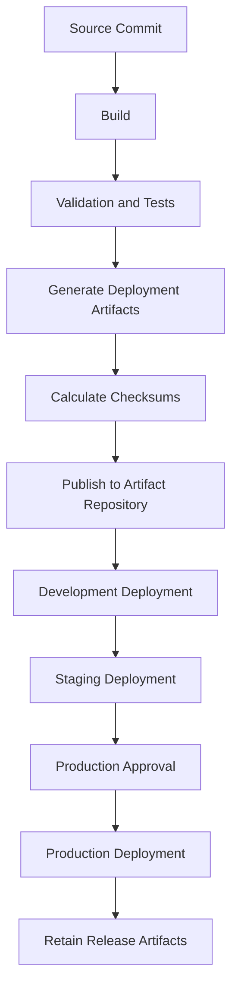
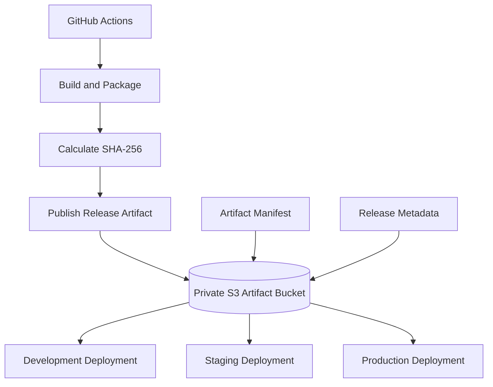
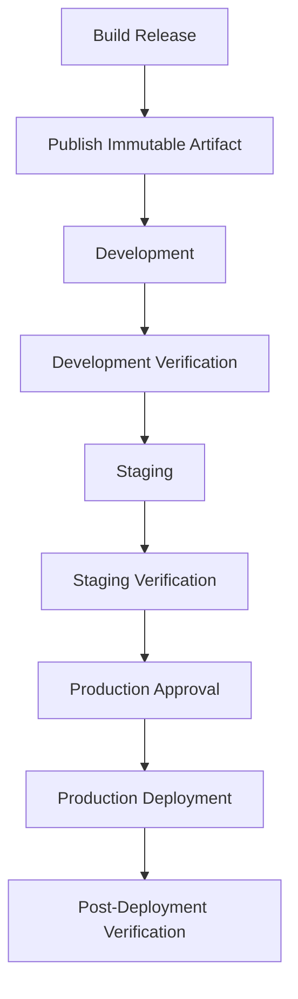

# 11- Deployment Artifacts and Versioning

## Overview

Deployment artifacts are the files and packages produced during a CI/CD pipeline and consumed by later deployment stages.

For Amazon S3 infrastructure deployments, artifacts may include:

- Terraform configuration and saved plans.
- Synthesized CDK CloudFormation templates.
- CloudFormation templates and parameter files.
- Lambda deployment packages.
- Static website assets.
- Container images and application packages.
- Database migration packages.
- Deployment manifests and configuration files.
- Test reports and security scan results.

Artifact versioning ensures that the exact code and infrastructure definition reviewed during validation are the ones deployed to an environment.

Without reliable artifact management, a pipeline can accidentally deploy different code to staging and production, overwrite a previously approved release, or lose the ability to reproduce and investigate a deployment.

A production-grade artifact strategy should establish:

1. Immutable artifact creation.
2. Traceability to source code and build execution.
3. Versioned storage and controlled retention.
4. Integrity verification.
5. Environment promotion without rebuilding.
6. Secure access and artifact provenance.
7. Recovery and rollback procedures.

## Deployment Artifact Lifecycle

A deployment artifact moves through several stages.



The artifact should be generated once and promoted through environments.

Rebuilding separately for production can introduce differences in:

- Dependency versions.
- Compiler or packaging versions.
- Infrastructure synthesis output.
- Build-time configuration.
- Static assets.
- Lambda dependencies.
- Container image contents.

A promotion pipeline should preserve the artifact identity and change only approved environment-specific deployment parameters.

## Types of Deployment Artifacts

Different deployment tools generate different artifacts.

| Tool or component | Artifact | Purpose |
|---|---|---|
| Terraform | Saved plan file | Captures a proposed infrastructure operation |
| Terraform | State file | Records Terraform-managed resource state |
| CloudFormation | YAML or JSON template | Defines AWS resources |
| CloudFormation | Change set | Describes proposed stack changes |
| CDK | Synthesized CloudFormation templates | Converts constructs into deployable templates |
| Lambda | ZIP deployment package or container image | Contains function code and dependencies |
| Static website | HTML, CSS, JavaScript and assets | Website content delivered through S3 and CloudFront |
| Docker | Container image | Packages application runtime and dependencies |
| CI/CD | Test reports and manifests | Provides release evidence and metadata |

Not every artifact should be stored in the same repository or have the same retention policy.

For example, Terraform state requires stricter access controls than a public frontend build artifact.

## Artifact Versioning Strategy

### Versioning Approaches

Common artifact identification strategies include:

| Strategy | Example | Characteristics |
|---|---|---|
| Semantic version | `v2.4.1` | Human-readable release identity |
| Git commit SHA | `a1b2c3d4e5f6` | Identifies exact source revision |
| Build number | `build-1042` | Identifies a pipeline execution |
| Timestamp | `2026-11-01T10-30-00Z` | Provides chronological identification |
| Content digest | `sha256:...` | Identifies artifact content |
| Release identifier | `release-2026.11.01.1` | Represents a controlled release |

A robust release identifier combines multiple identifiers.

Example:

```text
application-storage/
    releases/
        v2.4.1/
            source-commit.txt
            artifact-manifest.json
            terraform/
            cloudformation/
            cdk/
            lambda/
            website/
```

A release identifier alone does not guarantee immutability. The repository must also prevent unauthorized replacement or modification.

### Recommended Artifact Identity

Record the following metadata for each release:

```json
{
  "release": "v2.4.1",
  "source_commit": "a1b2c3d4e5f6",
  "repository": "company/application-storage",
  "workflow_run_id": "1042",
  "build_timestamp": "2026-11-01T10:30:00Z",
  "terraform_version": "1.9.8",
  "python_version": "3.12",
  "artifacts": [
    {
      "name": "s3-infrastructure.zip",
      "sha256": "REPLACE_WITH_SHA256"
    },
    {
      "name": "website-build.zip",
      "sha256": "REPLACE_WITH_SHA256"
    }
  ]
}
```

The values above illustrate the manifest structure. Generate actual hashes and build metadata during the pipeline rather than copying example values.

## Artifact Storage Using Amazon S3

Amazon S3 can act as a deployment artifact repository.

It is suitable for:

- Infrastructure templates.
- Lambda packages.
- Static website build outputs.
- Deployment manifests.
- Release archives.
- Test reports.
- Build metadata.

S3 provides object versioning, access control, encryption, lifecycle management, and integration with AWS deployment services.

### Recommended Architecture



The artifact bucket should be separate from application data buckets.

This separation provides independent:

- IAM permissions.
- Lifecycle policies.
- Retention requirements.
- Access auditing.
- Deployment ownership.
- Recovery procedures.

### Artifact Bucket Naming

Use a dedicated bucket with a clear ownership and purpose.

Example:

```text
company-platform-deployment-artifacts
```

Organize artifacts by application and release:

```text
s3://company-platform-deployment-artifacts/
    application-storage/
        releases/
            v2.4.1/
                manifest.json
                terraform/
                cloudformation/
                lambda/
                website/
            v2.4.2/
                manifest.json
                terraform/
                cloudformation/
                lambda/
                website/
```

S3 prefixes are logical key groupings, not independent directories or authorization boundaries by themselves.

Use IAM and bucket policies to enforce actual access restrictions.

### Enable Bucket Versioning

Versioning preserves multiple versions of an object under the same key.

Enable it:

```bash
aws s3api put-bucket-versioning \
  --bucket company-platform-deployment-artifacts \
  --versioning-configuration Status=Enabled
```

Inspect the configuration:

```bash
aws s3api get-bucket-versioning \
  --bucket company-platform-deployment-artifacts
```

Versioning helps recover an overwritten or deleted artifact.

However, versioning alone does not make artifacts immutable. A principal with sufficient permissions can still upload a new version, delete versions, or change bucket configuration.

### Enable Default Encryption

For a basic artifact repository using SSE-S3:

```bash
aws s3api put-bucket-encryption \
  --bucket company-platform-deployment-artifacts \
  --server-side-encryption-configuration '{
    "Rules": [
      {
        "ApplyServerSideEncryptionByDefault": {
          "SSEAlgorithm": "AES256"
        },
        "BucketKeyEnabled": false
      }
    ]
  }'
```

For environments requiring customer-managed keys, use SSE-KMS and configure the appropriate IAM and KMS permissions.

Encryption protects stored artifact data. It does not replace authorization controls or artifact integrity verification.

### Block Public Access

Deployment artifacts should normally remain private.

Verify the bucket's public-access block:

```bash
aws s3api get-public-access-block \
  --bucket company-platform-deployment-artifacts
```

A typical private artifact repository should have all four public-access block settings enabled.

## Uploading and Downloading Artifacts

### Upload a Release Artifact

```bash
aws s3 cp \
  s3-infrastructure.zip \
  s3://company-platform-deployment-artifacts/application-storage/releases/v2.4.1/s3-infrastructure.zip
```

### Download a Specific Artifact

```bash
aws s3 cp \
  s3://company-platform-deployment-artifacts/application-storage/releases/v2.4.1/s3-infrastructure.zip \
  s3-infrastructure.zip
```

### Inspect Object Metadata

```bash
aws s3api head-object \
  --bucket company-platform-deployment-artifacts \
  --key application-storage/releases/v2.4.1/s3-infrastructure.zip
```

This returns object metadata, including:

- Content length.
- Last modified timestamp.
- ETag.
- Version ID, when versioning is enabled.
- User-defined metadata.
- Encryption information.

Do not treat an ETag as a universal SHA-256 checksum. Its behavior depends on how the object was uploaded and encrypted.

### Retrieve a Specific Object Version

List versions:

```bash
aws s3api list-object-versions \
  --bucket company-platform-deployment-artifacts \
  --prefix application-storage/releases/v2.4.1/
```

Download a specific version:

```bash
aws s3api get-object \
  --bucket company-platform-deployment-artifacts \
  --key application-storage/releases/v2.4.1/s3-infrastructure.zip \
  --version-id VERSION_ID \
  s3-infrastructure.zip
```

Using a specific version ID helps ensure that a deployment retrieves the intended object even if a newer version exists under the same key.

## Artifact Integrity Verification

Artifact integrity ensures that the downloaded artifact matches the artifact produced by the build pipeline.

A common approach is to calculate a SHA-256 checksum during packaging and verify it before deployment.

### Generate a Checksum

Linux:

```bash
sha256sum s3-infrastructure.zip
```

macOS:

```bash
shasum -a 256 s3-infrastructure.zip
```

Python:

```python
import hashlib
from pathlib import Path


def calculate_sha256(file_path: str) -> str:
    digest = hashlib.sha256()

    with Path(file_path).open("rb") as file:
        for chunk in iter(lambda: file.read(1024 * 1024), b""):
            digest.update(chunk)

    return digest.hexdigest()


if __name__ == "__main__":
    checksum = calculate_sha256("s3-infrastructure.zip")
    print(checksum)
```

Streaming the file in chunks avoids loading large artifacts entirely into memory.

### Verify a Checksum

```bash
sha256sum --check s3-infrastructure.zip.sha256
```

A matching checksum confirms that the downloaded file matches the checksum reference.

However, a checksum stored beside an artifact in the same writable location does not provide independent authenticity. An attacker able to replace both files can replace the artifact and its checksum.

For stronger assurance:

- Protect the artifact repository.
- Restrict write permissions.
- Use immutable release identifiers.
- Sign release manifests or artifacts.
- Verify signatures using a trusted public key.
- Record artifact provenance.
- Restrict production deployment identities to approved artifact locations.

### Artifact Signing

For higher-assurance release pipelines, digitally sign artifacts or their manifests.

A signing workflow should:

1. Build the artifact.
2. Calculate its digest.
3. Create a release manifest.
4. Sign the manifest or artifact digest.
5. Publish the artifact and signature.
6. Verify the signature before deployment.

The signing identity should be protected separately from ordinary build and deployment permissions.

A checksum detects content changes when the reference checksum is trusted. A digital signature provides authenticity when verified against a trusted signing identity.

## Immutable Artifact Management

### Why Immutability Matters

An immutable release artifact cannot be silently replaced after approval.

Consider this release process:

```text
Build v2.4.1
    |
Upload artifact
    |
Test in development
    |
Test in staging
    |
Approve production
    |
Deploy same artifact
```

If the artifact is overwritten between staging and production, the production deployment may no longer match the tested release.

### Enforce Unique Release Keys

Prefer unique release paths:

```text
releases/v2.4.1/s3-infrastructure.zip
releases/v2.4.2/s3-infrastructure.zip
```

Avoid using a mutable key as the only release identifier:

```text
latest/s3-infrastructure.zip
```

A `latest` pointer can be useful for discovery, but it should not be the production deployment reference.

### Conditional Object Creation

S3 supports conditional writes that can prevent an upload from replacing an existing object.

For example, the AWS CLI supports conditional request options for supported S3 operations:

```bash
aws s3api put-object \
  --bucket company-platform-deployment-artifacts \
  --key application-storage/releases/v2.4.1/manifest.json \
  --body manifest.json \
  --if-none-match '*'
```

This prevents creation when an object already exists at that key.

Use conditional creation where supported by the operation and client version. Handle precondition failures explicitly.

For stronger retention requirements, consider S3 Object Lock.

### S3 Object Lock

S3 Object Lock provides WORM-style protection for object versions.

It supports:

- Governance mode.
- Compliance mode.
- Retention periods.
- Legal holds.

Use Object Lock when artifacts must be retained against deletion or modification for audit, compliance, or recovery requirements.

Object Lock requires a bucket configured with Object Lock support. Retention mode and permissions must be selected carefully.

| Mode | Behavior |
|---|---|
| Governance | Authorized principals with the required bypass permission may bypass retention |
| Compliance | Protected object versions cannot be overwritten or deleted before retention expires |
| Legal hold | Prevents deletion until the legal hold is removed by an authorized principal |

Object Lock protects individual object versions. It does not automatically prevent all changes to bucket policies, IAM permissions, or unrelated infrastructure.

Do not enable compliance-mode retention without understanding the retention and recovery requirements.

## Terraform Deployment Artifacts

Terraform generates plans and maintains state.

These files have different purposes and security implications.

### Terraform Plan File

A saved plan captures a proposed operation against a particular configuration and state context.

Generate a plan:

```bash
terraform plan -out=tfplan
```

Inspect it:

```bash
terraform show tfplan
```

Apply the saved plan:

```bash
terraform apply tfplan
```

A production pipeline should apply the exact reviewed plan rather than generating a new plan after approval.

Saved plans may contain sensitive values. Treat them as protected artifacts.

### Terraform State

Terraform state records the relationship between declared resources and deployed infrastructure.

State may contain:

- Resource identifiers.
- Configuration values.
- Sensitive resource attributes.
- Provider information.
- Dependency information.

Never publish Terraform state in a public artifact repository.

Use a dedicated private S3 state bucket with appropriate encryption, versioning, access control, and state locking configuration.

The artifact repository and Terraform state backend should normally be separate.

### Plan and State Artifact Separation

| Artifact | Purpose | Access requirement |
|---|---|---|
| Terraform configuration | Declares infrastructure | Source repository access |
| Saved plan | Approved proposed operation | Restricted deployment access |
| Terraform state | Records managed infrastructure | Highly restricted |
| Plan JSON | Machine-readable plan representation | Restricted; may contain sensitive data |
| Test report | Records validation results | CI and audit access |

Do not place state files and ordinary release packages under the same unrestricted prefix.

## CloudFormation Deployment Artifacts

CloudFormation templates are deployment artifacts that define AWS resources.

Store templates with the release that produced them.

Example:

```text
application-storage/
    releases/
        v2.4.1/
            cloudformation/
                s3-bucket.yml
                parameters-development.json
                parameters-staging.json
                parameters-production.json
```

### Deploy a Template from S3

Upload a template:

```bash
aws s3 cp \
  templates/s3-bucket.yml \
  s3://company-platform-deployment-artifacts/application-storage/releases/v2.4.1/cloudformation/s3-bucket.yml
```

Create a stack using the uploaded template:

```bash
aws cloudformation create-stack \
  --stack-name application-storage-production \
  --template-url https://company-platform-deployment-artifacts.s3.ap-south-1.amazonaws.com/application-storage/releases/v2.4.1/cloudformation/s3-bucket.yml \
  --parameters file://parameters-production.json \
  --capabilities CAPABILITY_IAM
```

The template bucket must be accessible to the CloudFormation deployment process.

For private artifacts, use an access design supported by the CloudFormation operation and deployment workflow. Do not assume that a private object URL is accessible simply because the deployment role can access it.

For large templates or complex deployment packages, use the supported CloudFormation packaging and deployment mechanisms.

### Change Set Traceability

Associate each production change set with:

- Release identifier.
- Source commit.
- Template object key.
- Template version or content digest.
- Parameter configuration.
- Change-set identifier.
- Approval record.

This makes it easier to establish exactly which template was reviewed and deployed.

## CDK Synthesized Artifacts

AWS CDK converts application constructs into CloudFormation templates.

Run:

```bash
cdk synth
```

Generated output is stored in:

```text
cdk.out/
```

Typical contents include:

```text
cdk.out/
    manifest.json
    tree.json
    StorageStack.template.json
    asset.<hash>.zip
```

The exact output depends on the application and configured assets.

### Preserve Synthesized Output

For a controlled release:

1. Run CDK synthesis.
2. Validate synthesized templates.
3. Run CDK assertions and security scans.
4. Record the source commit.
5. Package the synthesized output and required assets.
6. Publish the release artifact.
7. Deploy from the preserved output.

This avoids silently generating a different template during production deployment.

For example:

```bash
cdk synth StorageStack --output cdk.out
```

Inspect the synthesized template:

```bash
cat cdk.out/StorageStack.template.json
```

A CDK deployment can also depend on staged assets and bootstrap resources. Preserve and promote all required assets, not just the CloudFormation template.

For a complete deployment, use the CDK asset and bootstrap workflow appropriate to the application.

## Lambda Deployment Artifacts

Lambda deployment packages contain function code and dependencies.

For ZIP-based deployment:

```text
lambda/
    src/
        handler.py
    requirements.txt
    package/
```

Create a package:

```bash
mkdir -p package

pip install \
  --target package \
  -r requirements.txt

cp handler.py package/

cd package
zip -r ../lambda-function.zip .
cd ..
```

Use a build environment compatible with the Lambda runtime and target architecture.

Native dependencies must be built for the appropriate operating system, runtime, and architecture.

### Publish a Lambda Package to S3

```bash
aws s3 cp \
  lambda-function.zip \
  s3://company-platform-deployment-artifacts/application-storage/releases/v2.4.1/lambda/lambda-function.zip
```

Deploy using the S3 artifact location:

```bash
aws lambda update-function-code \
  --function-name image-processing-production \
  --s3-bucket company-platform-deployment-artifacts \
  --s3-key application-storage/releases/v2.4.1/lambda/lambda-function.zip
```

For reproducibility, use the exact object version where supported by the deployment mechanism, or deploy through an immutable release key and verify the artifact digest.

### Lambda Versioning

Lambda function versions are immutable snapshots of function code and configuration at publication time.

Publish a version:

```bash
aws lambda publish-version \
  --function-name image-processing-production \
  --description "Release v2.4.1"
```

Inspect versions:

```bash
aws lambda list-versions-by-function \
  --function-name image-processing-production
```

Use aliases such as `staging` and `production` to control which published version receives traffic.

An alias can be updated to point to a different version during release promotion or rollback.

This provides a controlled deployment model for Lambda functions, but associated event-source mappings, permissions, environment variables, and external dependencies still require appropriate release management.

## Static Website Deployment Artifacts

Static website deployments commonly generate a build directory containing:

```text
dist/
    index.html
    assets/
        app-8f3a1c.js
        app-3d4e5f.css
    images/
        logo.svg
```

The build directory is the deployment artifact.

Do not rebuild the website independently for each environment if the objective is to promote the same release.

Instead, promote the same build output and apply approved environment-specific configuration through a controlled mechanism.

### Upload to S3

```bash
aws s3 sync \
  dist/ \
  s3://company-production-website/
```

For a versioned deployment layout:

```text
releases/
    v2.4.1/
        index.html
        assets/
    v2.4.2/
        index.html
        assets/
```

CloudFront can be configured to deliver the active release through a controlled origin path or routing strategy.

Avoid assuming that merely uploading a new versioned directory automatically switches website traffic to that release.

### Cache Considerations

Use content-hashed filenames for static assets.

Example:

```text
app-8f3a1c.js
app-3d4e5f.css
```

Hashed assets can generally use long-lived cache headers because their names change when content changes.

HTML entry points should have a shorter cache lifetime or an appropriate revalidation policy.

A deployment should account for the relationship between:

- HTML references.
- Versioned static assets.
- CloudFront cache behavior.
- Cache invalidation.
- Rollback availability.

Do not delete old assets immediately if cached HTML may still reference them.

## GitHub Actions Artifact Management

GitHub Actions provides workflow artifacts for passing files between jobs and retaining build outputs.

Use workflow artifacts for pipeline handoff and S3 for longer-term release storage where appropriate.

### Build and Publish Example

The following workflow demonstrates packaging a release, generating a checksum, and publishing it to a private S3 artifact bucket using OIDC.

`.github/workflows/publish-artifact.yml`:

```yaml
name: Publish Deployment Artifact

on:
  push:
    tags:
      - "v*"

permissions:
  contents: read
  id-token: write

jobs:
  build:
    runs-on: ubuntu-latest

    outputs:
      release: ${{ steps.release.outputs.release }}

    steps:
      - name: Checkout repository
        uses: actions/checkout@v4

      - name: Extract release
        id: release
        shell: bash
        run: |
          echo "release=${GITHUB_REF_NAME}" >> "$GITHUB_OUTPUT"

      - name: Package infrastructure
        run: |
          mkdir -p dist
          cp -r terraform dist/
          cp -r templates dist/

          tar -czf s3-infrastructure.tar.gz -C dist .

      - name: Generate checksum
        run: |
          sha256sum s3-infrastructure.tar.gz \
            > s3-infrastructure.tar.gz.sha256

      - name: Upload workflow artifacts
        uses: actions/upload-artifact@v4
        with:
          name: s3-infrastructure-${{ steps.release.outputs.release }}
          path: |
            s3-infrastructure.tar.gz
            s3-infrastructure.tar.gz.sha256
          retention-days: 30

  publish:
    runs-on: ubuntu-latest
    needs: build

    environment: artifact-publishing

    steps:
      - name: Download workflow artifacts
        uses: actions/download-artifact@v4
        with:
          name: s3-infrastructure-${{ needs.build.outputs.release }}

      - name: Configure AWS credentials
        uses: aws-actions/configure-aws-credentials@v4
        with:
          role-to-assume: ${{ vars.AWS_ARTIFACT_PUBLISH_ROLE_ARN }}
          aws-region: ${{ vars.AWS_REGION }}

      - name: Verify AWS identity
        run: aws sts get-caller-identity

      - name: Verify checksum
        run: |
          sha256sum --check s3-infrastructure.tar.gz.sha256

      - name: Publish artifact
        env:
          RELEASE: ${{ needs.build.outputs.release }}
          BUCKET: ${{ vars.ARTIFACT_BUCKET }}
        run: |
          aws s3 cp \
            s3-infrastructure.tar.gz \
            "s3://${BUCKET}/application-storage/releases/${RELEASE}/s3-infrastructure.tar.gz"

          aws s3 cp \
            s3-infrastructure.tar.gz.sha256 \
            "s3://${BUCKET}/application-storage/releases/${RELEASE}/s3-infrastructure.tar.gz.sha256"
```

This is a publishing example, not a complete production release pipeline.

Before using it:

- Configure the `artifact-publishing` GitHub Environment.
- Configure the OIDC trust policy for the repository and environment.
- Restrict the publishing role to the intended bucket and prefix.
- Ensure the tag is protected and release creation is authorized.
- Add a release manifest containing the source commit and toolchain metadata.
- Use conditional creation or an equivalent immutability control for release keys.
- Pin third-party actions to reviewed full commit SHAs.
- Ensure the packaging step includes every file required by the deployment process.

The workflow artifact is a temporary handoff between jobs. The S3 copy is the longer-term release artifact.

### Separate Build and Deployment Permissions

Use different roles for publishing and deploying where practical.

| Role | Responsibility |
|---|---|
| Artifact build role | Creates and packages artifacts |
| Artifact publishing role | Writes release artifacts to S3 |
| Development deployment role | Reads artifacts and deploys development resources |
| Staging deployment role | Reads artifacts and deploys staging resources |
| Production deployment role | Reads approved artifacts and deploys production resources |

A deployment role should not need permission to overwrite or delete release artifacts.

## Artifact Promotion Between Environments

Promotion should move the same artifact through development, staging, and production.



### Promotion Rules

- Build once.
- Publish under a unique release identifier.
- Verify the artifact checksum before each deployment.
- Record the artifact's S3 key and version ID.
- Preserve the source commit and manifest.
- Use environment-specific parameters separately.
- Do not modify the artifact after staging verification.
- Require approval before production deployment.

### Environment-Specific Configuration

Not every deployment parameter belongs inside the artifact.

For example:

| Configuration | Artifact or environment configuration? |
|---|---|
| Terraform module source | Artifact |
| CloudFormation template | Artifact |
| CDK synthesized template | Artifact |
| Lambda application code | Artifact |
| Static website assets | Artifact |
| AWS account ID | Environment configuration |
| AWS Region | Environment configuration |
| S3 production bucket name | Environment configuration |
| KMS key ARN | Environment configuration |
| Deployment role ARN | CI/CD configuration |
| Application secret | Secret-management service |

Keep environment-specific values external to the immutable artifact unless they are intentionally part of the build output.

## Rollback and Recovery

Artifact retention is essential for reliable rollback.

A rollback should restore a previously verified release rather than reconstructing an older deployment manually.

### Infrastructure Rollback

For infrastructure deployments, rollback must account for both the artifact and the current AWS resource state.

A previous Terraform plan is not generally a safe rollback mechanism because it was generated against an earlier state.

Instead:

1. Retrieve the previous approved Terraform configuration.
2. Generate a new plan against the current state.
3. Review the proposed changes.
4. Apply through the normal approval process.

For CloudFormation, use stack update and rollback mechanisms appropriate to the current stack state.

For CDK, deploy the previously approved synthesized release or source revision using the controlled deployment process.

### Lambda Rollback

Lambda aliases can be moved back to a previous published version.

Example:

```bash
aws lambda update-alias \
  --function-name image-processing-production \
  --name production \
  --function-version 12
```

This changes the alias target to version `12`.

Verify the function version and alias configuration after the operation.

### Static Website Rollback

If website assets are stored under release-specific prefixes, rollback can switch the active origin path or release pointer to a previous release.

If the same S3 keys are overwritten, S3 versioning may help recover previous object versions.

CloudFront cache behavior must also be considered. Invalidating or revalidating affected paths may be necessary to ensure clients receive the intended release.

### Recovery Checklist

- [ ] Identify the failed release.
- [ ] Identify the last verified release.
- [ ] Retrieve the exact previous artifact.
- [ ] Verify its digest or signature.
- [ ] Inspect the current infrastructure state.
- [ ] Evaluate compatibility and data migration implications.
- [ ] Obtain required approval.
- [ ] Execute the rollback or recovery operation.
- [ ] Verify resource and application health.
- [ ] Record the recovery action.

## Artifact Retention and Lifecycle

Artifact repositories accumulate storage over time.

Retention should reflect operational, audit, and recovery requirements.

### Example Retention Strategy

| Artifact | Suggested retention approach |
|---|---|
| Production release packages | Retain according to release and recovery policy |
| Terraform plans | Short retention after deployment, subject to audit needs |
| Terraform state | Retain according to infrastructure recovery policy |
| Build logs | Retain according to CI/CD audit requirements |
| Test reports | Retain long enough for release investigation |
| Temporary build artifacts | Short retention |
| Lambda packages | Retain versions needed for rollback |
| Website assets | Retain assets referenced by active and rollback releases |

These are policy categories, not universal retention periods. Define actual periods based on compliance, recovery objectives, and cost.

### Lifecycle Configuration

An artifact bucket can use lifecycle rules to transition or expire objects according to policy.

Example:

```json
{
  "Rules": [
    {
      "ID": "ExpireTemporaryBuildArtifacts",
      "Status": "Enabled",
      "Filter": {
        "Prefix": "temporary/"
      },
      "Expiration": {
        "Days": 30
      },
      "AbortIncompleteMultipartUpload": {
        "DaysAfterInitiation": 7
      }
    }
  ]
}
```

Do not apply broad expiration rules to production release prefixes without confirming rollback and audit requirements.

For versioned buckets, noncurrent object versions require separate lifecycle consideration.

Object Lock retention can also prevent deletion until the applicable retention requirements are satisfied.

## Artifact Security

Deployment artifacts can contain sensitive information even when they are not traditional secrets.

Examples include:

- Terraform plans containing sensitive values.
- Infrastructure templates revealing resource structure.
- Lambda packages containing embedded credentials.
- Debug symbols and configuration files.
- Database connection strings.
- Internal service endpoints.
- Private certificates or keys.

### Security Controls

| Control | Purpose |
|---|---|
| Private S3 bucket | Prevent public artifact exposure |
| Block Public Access | Prevent accidental public access |
| IAM least privilege | Restrict artifact read and write |
| SSE-KMS | Apply customer-managed encryption controls where required |
| Versioning | Recover previous object versions |
| Object Lock | Enforce retention where required |
| CloudTrail | Audit relevant access and changes |
| Checksums | Detect content changes |
| Digital signatures | Verify artifact authenticity |
| Separate publisher and deployer roles | Restrict modification during deployment |
| Restricted CI artifacts | Prevent unauthorized downloads |

### Avoid Storing Secrets in Artifacts

Never package real credentials into:

- Terraform source archives.
- CDK context files.
- CloudFormation parameter files.
- Docker images.
- Static website bundles.
- Lambda ZIP packages.

Use IAM roles and runtime secret retrieval instead.

Terraform state and plan files require special handling because sensitive values may be present even when the configuration uses sensitive variables.

## Observability and Auditability

A deployment artifact repository should support investigation and release traceability.

Track:

- Artifact creation.
- Artifact upload.
- Artifact download.
- Object version creation.
- Artifact deletion.
- Release promotion.
- Deployment execution.
- Artifact checksum verification.

Use CloudTrail to audit relevant S3 API activity.

For operational reporting, maintain a release manifest or deployment record containing:

```text
Release ID
Source commit
Build workflow ID
Artifact bucket
Artifact key
S3 object version ID
SHA-256 checksum
Deployment environment
Deployment timestamp
Approver
Deployment result
Verification result
```

Do not rely exclusively on S3 object timestamps to identify the deployed release.

The deployment record should link the exact artifact to the environment and infrastructure change.

## Common Mistakes

| Mistake | Impact | Prevention |
|---|---|---|
| Rebuilding separately for production | Production may differ from staging | Build once and promote the same artifact |
| Using mutable `latest` keys for production | The artifact can change without changing its identifier | Use unique release keys and verify digests |
| Assuming S3 versioning makes artifacts immutable | New versions and deletions may still occur | Use access restrictions, conditional writes, and Object Lock where required |
| Treating ETag as SHA-256 | Integrity verification may be incorrect | Calculate and verify SHA-256 independently |
| Storing Terraform state with normal build artifacts | Sensitive infrastructure state may be exposed | Use a dedicated restricted backend |
| Publishing secrets in deployment packages | Credentials can leak to users or CI systems | Retrieve secrets at runtime |
| Deleting old website assets immediately | Cached HTML may reference missing files | Retain assets for the required cache and rollback window |
| Retaining only the CloudFormation template from a CDK release | Required staged assets may be missing | Preserve all deployment dependencies |
| Applying an old Terraform plan during rollback | The plan may not match current state | Generate and review a new plan |
| Allowing deployment roles to overwrite artifacts | Approved releases can be replaced | Separate publishing and deployment permissions |
| Storing checksum and artifact without access protection | Both can be replaced together | Protect the repository and sign release metadata |
| Applying lifecycle expiration to all release objects | Rollback and audit artifacts may disappear | Define prefix-specific retention policies |

## Production Readiness Checklist

### Artifact Creation

- [ ] Every release has a unique identifier.
- [ ] Source commit SHA is recorded.
- [ ] Build toolchain versions are recorded.
- [ ] All required deployment files are packaged.
- [ ] Artifact manifests are generated.
- [ ] SHA-256 checksums are calculated.
- [ ] Secrets are excluded from packages.
- [ ] Build outputs are reproducible where practical.

### Artifact Storage

- [ ] Artifact bucket is private.
- [ ] Block Public Access is enabled.
- [ ] Default encryption is configured.
- [ ] Versioning is enabled where required.
- [ ] Publisher and deployer roles are separated.
- [ ] Release keys cannot be silently replaced.
- [ ] Object Lock is configured where retention requirements justify it.
- [ ] Lifecycle policies preserve required releases.

### Promotion and Deployment

- [ ] The same artifact is promoted through environments.
- [ ] Artifact integrity is checked before deployment.
- [ ] Deployment uses an exact release identifier.
- [ ] Terraform plans are protected.
- [ ] CDK synthesized assets are preserved.
- [ ] CloudFormation change sets are associated with the release.
- [ ] Lambda versions and aliases are managed.
- [ ] Static website cache behavior is considered.
- [ ] Production deployment requires approval.

### Recovery and Audit

- [ ] Previous verified releases remain available.
- [ ] Rollback procedures are documented.
- [ ] Artifact version IDs are recorded.
- [ ] Deployment records include source and artifact identity.
- [ ] CloudTrail auditing is enabled.
- [ ] Artifact access is restricted and monitored.
- [ ] Retention and cleanup policies are reviewed regularly.

## Key Takeaways

- Deployment artifacts should be built once, assigned a unique release identity, and promoted unchanged through development, staging, and production.
- S3 versioning supports recovery but does not guarantee immutability; combine unique release keys, restricted IAM permissions, integrity verification, and Object Lock where required.
- Terraform plans, state files, CDK synthesized assets, Lambda packages, and website builds have different security and retention requirements.
- SHA-256 checksums detect content changes when the reference checksum is trusted, while digital signatures provide stronger artifact authenticity.
- Reliable rollback depends on retaining verified release artifacts, recording exact deployment identities, and evaluating the current infrastructure state before recovery.