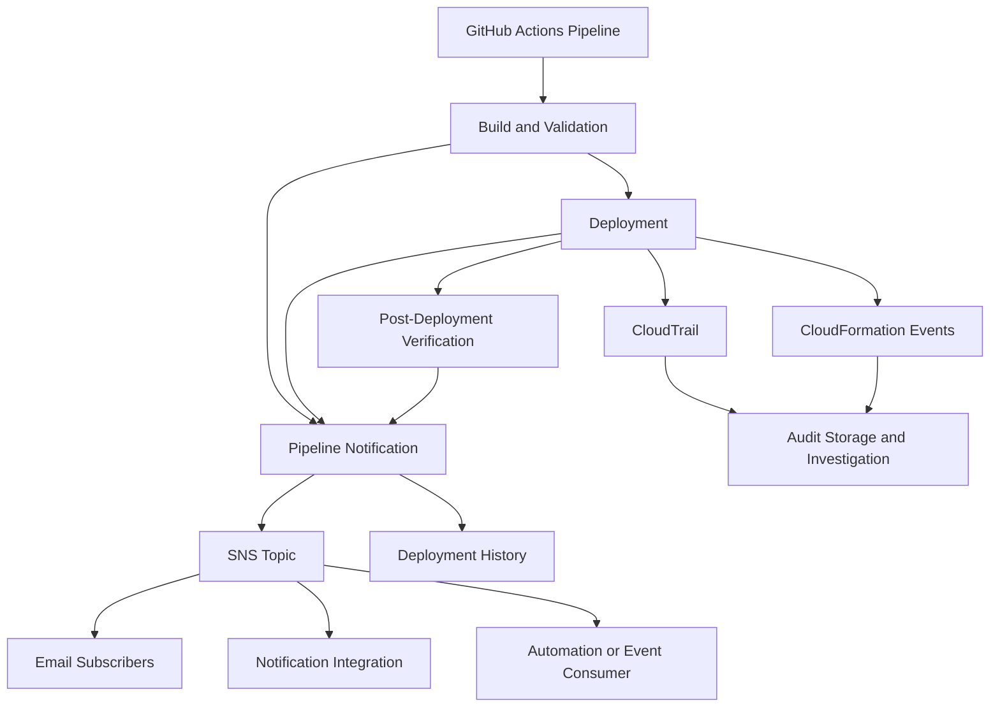
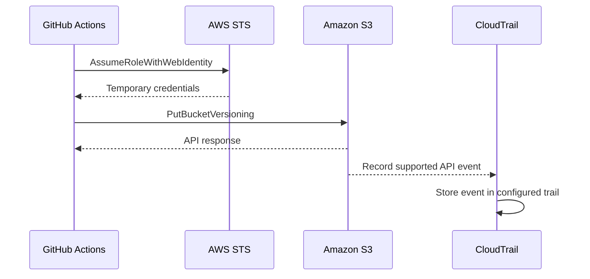
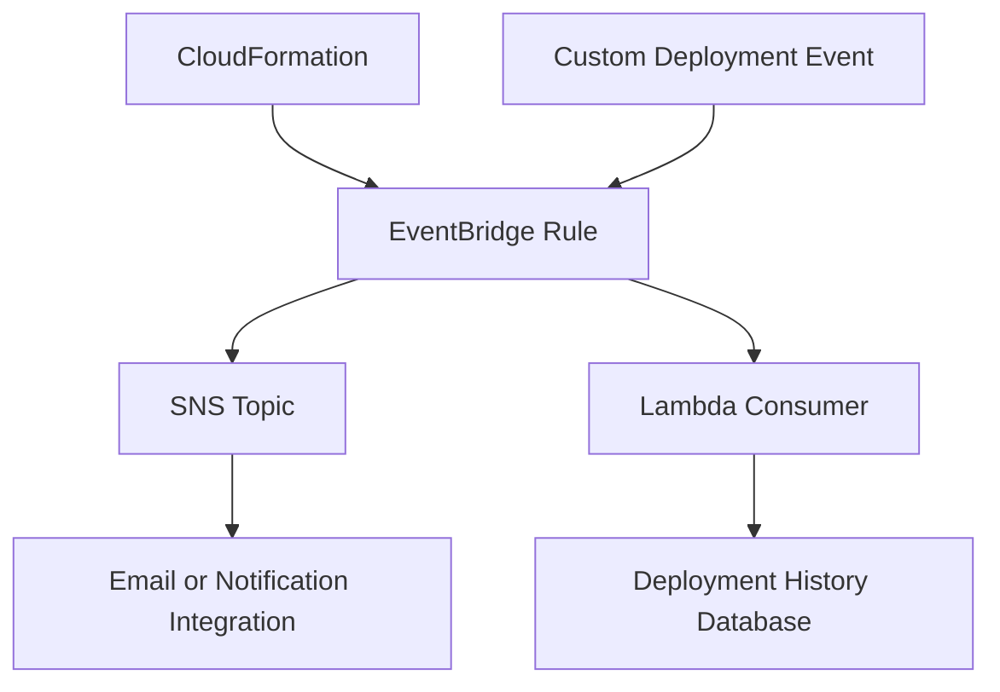
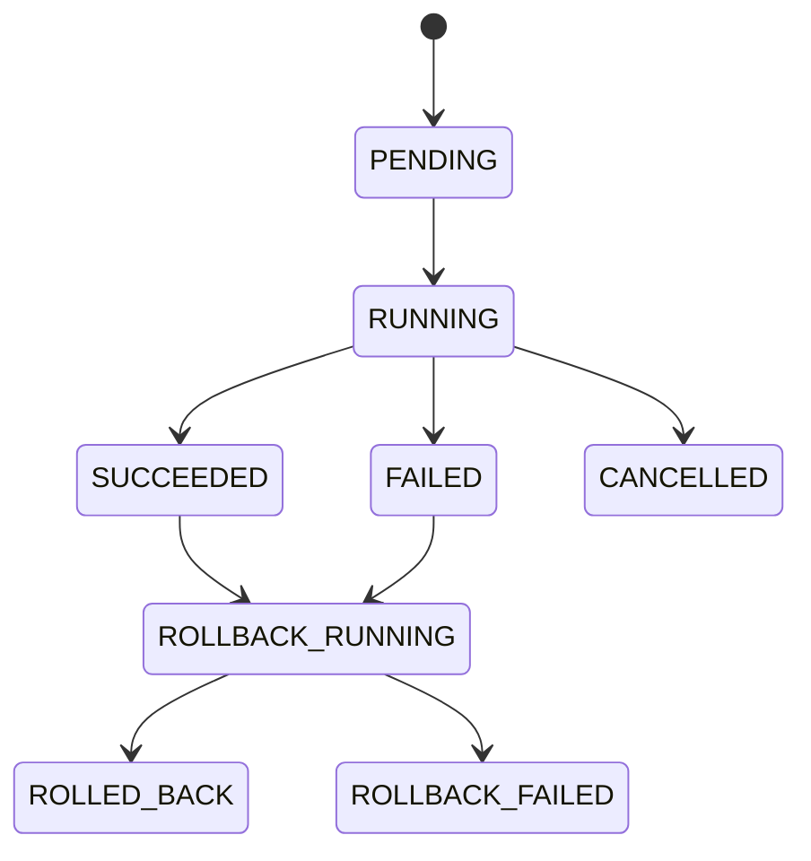

# 12- Deployment Notifications and Audit Trails

## Overview

Deployment notifications and audit trails provide visibility into infrastructure changes, deployment execution, approval decisions, and operational outcomes.

For Amazon S3 deployments, these capabilities are important because infrastructure changes can affect data availability, access permissions, encryption, retention, replication, and application delivery.

A deployment pipeline should answer:

- Who initiated the deployment?
- Which source commit and release artifact were deployed?
- Which AWS account and Region were affected?
- Which infrastructure resources changed?
- Who approved the production deployment?
- Did the deployment succeed?
- Were post-deployment checks successful?
- What failed, and how was the failure recovered?
- Can the deployment be reconstructed or investigated later?

Notifications communicate operational events to engineers and stakeholders. Audit trails preserve evidence for investigation, compliance, and accountability.

These are related but distinct capabilities:

| Capability | Primary purpose | Typical implementation |
|---|---|---|
| Deployment notifications | Communicate pipeline events | GitHub Actions, SNS, Chatbot integrations, email |
| Deployment audit trails | Preserve evidence of changes | CloudTrail, CloudFormation events, deployment records |
| Application and infrastructure monitoring | Detect runtime problems | CloudWatch metrics, logs, alarms |
| Release traceability | Connect source code to deployed resources | Artifact manifests, release metadata, deployment records |

A production deployment system should implement all four rather than relying on a single notification channel.

## Deployment Notification Architecture

A notification system receives deployment events and distributes relevant information to appropriate recipients.

### Architecture



### Component Responsibilities

| Component | Responsibility |
|---|---|
| GitHub Actions | Executes build, validation, approval, and deployment workflows |
| AWS deployment role | Performs authorized infrastructure operations |
| Amazon SNS | Distributes notifications to subscribers |
| Email subscription | Sends deployment messages to recipients |
| CloudTrail | Records supported AWS API activity |
| CloudFormation | Records stack operations and resource-level deployment events |
| CloudWatch | Stores logs, metrics, and alarm state changes |
| Deployment manifest | Connects the release to its source and artifacts |
| Deployment history | Records the overall deployment outcome |

Do not use notifications as the only record of a deployment. Email delivery can fail, messages can be deleted, and chat messages are not a substitute for durable audit evidence.

## Deployment Events Worth Notifying

Not every pipeline step requires a notification.

Notify on events that require awareness, action, or investigation.

| Event | Recommended notification | Reason |
|---|---|---|
| Build failure | Optional | Useful when build failures block a release |
| Validation failure | Optional | Helps identify infrastructure defects |
| Security scan failure | Yes | May indicate a security policy violation |
| Development deployment success | Optional | Useful for development teams |
| Staging deployment success | Yes | Signals readiness for acceptance testing |
| Production deployment started | Yes | Provides operational visibility |
| Production approval requested | Yes | Requires human action |
| Production deployment succeeded | Yes | Confirms release completion |
| Production deployment failed | Yes | Requires investigation |
| Rollback initiated | Yes | Signals recovery activity |
| Post-deployment verification failed | Yes | Deployment may be incomplete or unhealthy |
| Infrastructure drift detected | Yes | May require reconciliation |
| Artifact integrity verification failed | Yes | Indicates a release integrity problem |

### Notification Severity

Use severity levels to distinguish informational events from incidents.

| Severity | Example | Delivery approach |
|---|---|---|
| INFO | Development deployment completed | Pipeline summary |
| WARNING | Drift detected | Engineering notification |
| ERROR | Staging deployment failed | Team notification |
| CRITICAL | Production deployment or recovery failure | Incident notification channel |

Avoid sending every pipeline log line to email or chat. Notifications should summarize important events and link to the detailed execution record.

## Amazon SNS for Deployment Notifications

Amazon Simple Notification Service (SNS) is a managed publish-subscribe messaging service.

It can distribute deployment notifications to multiple subscribers.

Typical use cases include:

- Deployment success and failure notifications.
- Infrastructure change alerts.
- Security validation failures.
- Replication or recovery alerts.
- Operational approval notifications.

### Create an SNS Topic

```bash
aws sns create-topic \
  --name s3-deployment-notifications
```

The response contains the topic ARN.

Example format:

```text
arn:aws:sns:ap-south-1:123456789012:s3-deployment-notifications
```

Use the actual ARN returned by AWS in subsequent commands.

### Subscribe an Email Address

```bash
aws sns subscribe \
  --topic-arn arn:aws:sns:ap-south-1:123456789012:s3-deployment-notifications \
  --protocol email \
  --notification-endpoint devops@example.com
```

The recipient must confirm the subscription before email notifications are delivered.

Inspect subscriptions:

```bash
aws sns list-subscriptions-by-topic \
  --topic-arn arn:aws:sns:ap-south-1:123456789012:s3-deployment-notifications
```

### Publish a Notification

```bash
aws sns publish \
  --topic-arn arn:aws:sns:ap-south-1:123456789012:s3-deployment-notifications \
  --subject "S3 Production Deployment Successful" \
  --message "Release v2.4.1 was deployed successfully to the production environment."
```

The publishing principal needs permission to publish to the topic.

### SNS Topic Access Policy

Use a topic policy to control who can publish or subscribe.

For example, a topic can restrict publishing to a specific AWS account or authorized IAM principals.

Do not grant unrestricted public publishing permissions.

For cross-account publishers, configure the topic policy and the publisher's identity permissions deliberately.

## Structured Deployment Notifications

A useful notification should contain enough information to identify the release and locate its execution record.

Example notification:

```text
Deployment Status: SUCCESS

Application: application-storage
Release: v2.4.1
Environment: production
AWS Account: 123456789012
AWS Region: ap-south-1

Source Commit: a1b2c3d4e5f6
Artifact: s3-infrastructure.tar.gz
Deployment Workflow: 1042
Deployment Role: production-deployment-role

Started: 2026-11-01T10:30:00Z
Completed: 2026-11-01T10:34:21Z

Verification:
- S3 bucket configuration: PASSED
- Versioning: PASSED
- Encryption: PASSED
- Public access block: PASSED

Workflow: https://github.com/company/application-storage/actions/runs/1042
```

Do not include:

- AWS access keys.
- Session tokens.
- Passwords.
- Secret values.
- Presigned URLs.
- Sensitive Terraform plan contents.
- Confidential object names or customer data unless explicitly approved.

### JSON Notification Payload

For automation and downstream consumers, use a structured message.

```json
{
  "event_type": "deployment.completed",
  "status": "SUCCESS",
  "application": "application-storage",
  "release": "v2.4.1",
  "environment": "production",
  "aws_account_id": "123456789012",
  "aws_region": "ap-south-1",
  "source_commit": "a1b2c3d4e5f6",
  "workflow_run_id": "1042",
  "artifact": {
    "bucket": "company-platform-deployment-artifacts",
    "key": "application-storage/releases/v2.4.1/s3-infrastructure.tar.gz",
    "version_id": "EXAMPLE_VERSION_ID",
    "sha256": "REPLACE_WITH_ACTUAL_SHA256"
  },
  "verification": {
    "bucket_configuration": "PASSED",
    "versioning": "PASSED",
    "encryption": "PASSED"
  },
  "timestamp": "2026-11-01T10:34:21Z"
}
```

The values are illustrative. Generate the actual release, account, artifact, and verification metadata from the deployment execution.

## GitHub Actions Deployment Notifications

GitHub Actions can send notifications after deployment jobs complete.

A basic workflow can publish to SNS using the AWS CLI.

### Configure AWS Access

Use GitHub Actions OIDC federation instead of long-lived AWS access keys.

The workflow requires:

```yaml
permissions:
  id-token: write
  contents: read
```

The AWS role trust policy must restrict the repository and GitHub Environment identity.

For production, use a protected GitHub Environment and an appropriately scoped deployment role.

### Example Notification Job

```yaml
name: S3 Infrastructure Deployment

on:
  workflow_dispatch:

permissions:
  contents: read
  id-token: write

jobs:
  deploy:
    runs-on: ubuntu-latest

    environment: production

    steps:
      - name: Checkout repository
        uses: actions/checkout@v4

      - name: Configure AWS credentials
        uses: aws-actions/configure-aws-credentials@v4
        with:
          role-to-assume: ${{ vars.AWS_DEPLOYMENT_ROLE_ARN }}
          aws-region: ${{ vars.AWS_REGION }}

      - name: Verify AWS identity
        run: aws sts get-caller-identity

      - name: Deploy infrastructure
        run: |
          terraform init
          terraform plan -out=tfplan
          terraform apply -auto-approve tfplan

      - name: Verify S3 configuration
        run: |
          aws s3api get-bucket-versioning \
            --bucket "${{ vars.S3_BUCKET_NAME }}"

          aws s3api get-bucket-encryption \
            --bucket "${{ vars.S3_BUCKET_NAME }}"

  notify:
    runs-on: ubuntu-latest
    needs: deploy
    if: always()

    permissions:
      id-token: write
      contents: read

    steps:
      - name: Configure AWS credentials
        uses: aws-actions/configure-aws-credentials@v4
        with:
          role-to-assume: ${{ vars.AWS_NOTIFICATION_ROLE_ARN }}
          aws-region: ${{ vars.AWS_REGION }}

      - name: Publish deployment result
        env:
          SNS_TOPIC_ARN: ${{ vars.DEPLOYMENT_SNS_TOPIC_ARN }}
          DEPLOYMENT_RESULT: ${{ needs.deploy.result }}
          RELEASE: ${{ github.ref_name }}
          COMMIT: ${{ github.sha }}
          RUN_ID: ${{ github.run_id }}
          REPOSITORY: ${{ github.repository }}
        run: |
          STATUS="FAILED"

          if [ "$DEPLOYMENT_RESULT" = "success" ]; then
            STATUS="SUCCESS"
          elif [ "$DEPLOYMENT_RESULT" = "cancelled" ]; then
            STATUS="CANCELLED"
          fi

          MESSAGE=$(cat <<EOF
          Deployment Status: ${STATUS}
          Repository: ${REPOSITORY}
          Release: ${RELEASE}
          Commit: ${COMMIT}
          Workflow Run: ${RUN_ID}
          Environment: production
          Workflow: https://github.com/${REPOSITORY}/actions/runs/${RUN_ID}
          EOF
          )

          aws sns publish \
            --topic-arn "$SNS_TOPIC_ARN" \
            --subject "S3 Deployment ${STATUS}" \
            --message "$MESSAGE"
```

This example demonstrates the notification pattern, not a complete production Terraform workflow.

Production implementation considerations:

- Use a separate notification role with only `sns:Publish` permission on the intended topic.
- Ensure the deployment job has its own least-privilege role.
- Validate the Terraform plan before applying.
- Use protected environments and approval gates.
- Preserve the exact reviewed plan and its provenance.
- Add artifact verification and post-deployment checks.
- Pin third-party GitHub Actions to reviewed full commit SHAs.
- Avoid exposing sensitive output in workflow logs.
- Ensure notification failures do not overwrite the actual deployment result.

The `if: always()` condition allows the notification job to run after success, failure, or cancellation of its dependency. It does not guarantee notification delivery.

A notification failure should be visible as a separate pipeline outcome.

### Deployment and Notification Status Are Different

A deployment can succeed while notification delivery fails.

Record these outcomes separately:

```text
Deployment: SUCCESS
Verification: SUCCESS
Notification: FAILED
```

Do not mark the infrastructure deployment as failed solely because a downstream email or SNS notification failed.

However, notification failure should be observable and retried or investigated according to operational requirements.

## CloudTrail for Deployment Audit Trails

AWS CloudTrail records supported AWS API activity.

It is a primary source of evidence for investigating infrastructure changes.

For S3 deployments, CloudTrail can help identify:

- Which principal called an AWS API.
- Which API operation was performed.
- When the operation occurred.
- Which AWS Region received the request.
- Which resource was involved, where recorded.
- Whether the request succeeded or failed.
- The source IP address and user-agent information, where available.

### CloudTrail Event Flow



CloudTrail records supported management and data events according to the configured trail and event selectors.

Do not assume every S3 object request is recorded by default.

### Management Events

Management events capture control-plane operations.

Examples relevant to S3 infrastructure deployment include:

- Creating or deleting buckets.
- Updating bucket configuration.
- Changing bucket policies.
- Updating public-access block configuration.
- Updating versioning.
- Updating encryption settings.
- Configuring lifecycle rules.
- Configuring replication.

These operations help investigate infrastructure configuration changes.

### Data Events

Data events capture object-level API activity when configured.

Examples include:

- `GetObject`
- `PutObject`
- `DeleteObject`

S3 data events can generate substantial event volume and additional CloudTrail charges.

Enable them selectively based on audit and security requirements.

For a deployment artifact bucket, object-level audit events can help identify who uploaded, downloaded, or deleted release artifacts.

### Management Events vs Data Events

| Event category | Examples | Typical purpose |
|---|---|---|
| Management events | `PutBucketPolicy`, `PutBucketVersioning` | Infrastructure and configuration auditing |
| Data events | `GetObject`, `PutObject`, `DeleteObject` | Object access and modification auditing |

The exact event coverage depends on the selected event source and configuration.

## Configure CloudTrail for S3 Deployment Auditing

### Create an Audit Bucket

Use a dedicated, private S3 bucket for CloudTrail logs.

Example:

```text
company-platform-cloudtrail-logs
```

The audit bucket should have:

- Block Public Access.
- Encryption.
- Restricted write permissions.
- Restricted read permissions.
- Appropriate retention controls.
- Versioning where required by the audit design.

Do not use the deployment artifact bucket as the CloudTrail log destination.

Separating the audit destination reduces the risk that deployment permissions can modify or delete audit evidence.

### Create a CloudTrail Trail

Create a trail:

```bash
aws cloudtrail create-trail \
  --name s3-deployment-audit-trail \
  --s3-bucket-name company-platform-cloudtrail-logs \
  --is-multi-region-trail
```

Start logging:

```bash
aws cloudtrail start-logging \
  --name s3-deployment-audit-trail
```

Inspect trail status:

```bash
aws cloudtrail get-trail-status \
  --name s3-deployment-audit-trail
```

A production trail should also be configured with appropriate log-file validation and event selectors.

### Enable Log File Validation

```bash
aws cloudtrail update-trail \
  --name s3-deployment-audit-trail \
  --enable-log-file-validation
```

Log file validation provides digest files that can be used to verify the integrity of CloudTrail log files.

It helps detect changes to delivered log files. It does not prevent an authorized principal from changing trail configuration or deleting the destination bucket.

Protect the trail and destination using separate administrative controls.

### Configure S3 Data Events

Data events can be configured using CloudTrail advanced event selectors.

Example:

```json
[
  {
    "Name": "DeploymentArtifactObjectEvents",
    "FieldSelectors": [
      {
        "Field": "eventCategory",
        "Equals": ["Data"]
      },
      {
        "Field": "resources.type",
        "Equals": ["AWS::S3::Object"]
      },
      {
        "Field": "resources.ARN",
        "StartsWith": [
          "arn:aws:s3:::company-platform-deployment-artifacts/application-storage/releases/"
        ]
      }
    ]
  }
]
```

This selector targets S3 object data events under the specified release prefix.

Apply it to the trail using the appropriate CloudTrail event-selector API.

Review selector behavior and supported fields before deployment.

Use prefix-level selection where possible instead of enabling all S3 object data events indiscriminately.

## CloudTrail Event Investigation

### Search Recent Events

Use CloudTrail Event History for supported management events.

Example:

```bash
aws cloudtrail lookup-events \
  --lookup-attributes \
  AttributeKey=EventName,AttributeValue=PutBucketVersioning \
  --max-results 20
```

Search for bucket policy changes:

```bash
aws cloudtrail lookup-events \
  --lookup-attributes \
  AttributeKey=EventName,AttributeValue=PutBucketPolicy \
  --max-results 20
```

Search for encryption configuration changes:

```bash
aws cloudtrail lookup-events \
  --lookup-attributes \
  AttributeKey=EventName,AttributeValue=PutBucketEncryption \
  --max-results 20
```

Event History is useful for recent investigation but should not be treated as a complete long-term audit archive.

Use the configured trail and retained logs for longer-term investigation.

### Inspect Event Details

CloudTrail event records commonly include:

| Field | Purpose |
|---|---|
| `eventTime` | Time of the event |
| `eventName` | API operation |
| `eventSource` | AWS service |
| `awsRegion` | AWS Region |
| `sourceIPAddress` | Request source |
| `userIdentity` | Principal identity |
| `requestParameters` | Request details, when available |
| `responseElements` | Response details, when available |
| `errorCode` | Error identifier |
| `errorMessage` | Error details |
| `resources` | Associated resources, when recorded |

A deployment investigation should correlate CloudTrail events with:

- GitHub Actions workflow run.
- AWS assumed role session.
- Release identifier.
- CloudFormation stack events.
- Terraform execution logs.
- Deployment timestamps.

## CloudFormation Deployment Events

CloudFormation provides stack-level and resource-level deployment history.

Inspect stack events:

```bash
aws cloudformation describe-stack-events \
  --stack-name application-storage-production
```

Inspect stack status:

```bash
aws cloudformation describe-stacks \
  --stack-name application-storage-production
```

Inspect stack resources:

```bash
aws cloudformation list-stack-resources \
  --stack-name application-storage-production
```

Stack events help distinguish between:

- Template validation failures.
- Resource creation failures.
- Permission errors.
- Dependency failures.
- Rollback operations.
- Resource update failures.

CloudFormation events are particularly useful when the deployment uses CDK because CDK ultimately deploys CloudFormation-managed resources.

Terraform deployments require separate correlation with Terraform logs, state, and AWS API activity.

## CloudWatch Logs and Deployment Observability

CloudWatch complements CloudTrail.

CloudTrail records supported API activity, while CloudWatch provides monitoring, logs, and alarms.

For deployment pipelines, useful signals include:

- Lambda deployment and execution errors.
- Failed S3 event processing.
- Application health checks.
- CloudFormation rollback failures.
- Replication failure metrics.
- Post-deployment verification failures.
- Deployment duration.

### Deployment Log Groups

Store deployment-related logs in dedicated log groups where appropriate.

Example:

```text
/platform/deployments/application-storage
/platform/deployments/verification
/platform/deployments/notifications
```

Include structured fields:

```json
{
  "timestamp": "2026-11-01T10:34:21Z",
  "event": "deployment.completed",
  "release": "v2.4.1",
  "environment": "production",
  "status": "SUCCESS",
  "workflow_run_id": "1042",
  "aws_region": "ap-south-1"
}
```

Avoid logging credentials, secret values, or sensitive request payloads.

### CloudWatch Alarms

Alarms can notify operational teams when a deployment-related metric exceeds an acceptable threshold.

Examples:

- Lambda error count increases after deployment.
- Application health checks fail.
- SQS queue age increases.
- Dead-letter queue messages appear.
- Replication failures are detected.
- Custom deployment verification metric indicates failure.

A deployment notification and a runtime alarm serve different purposes.

A successful infrastructure deployment does not guarantee that the application is healthy.

## EventBridge for Deployment Event Routing

Amazon EventBridge can route supported AWS service events to targets.

It is useful when deployment events must trigger automation or notifications beyond the CI/CD workflow.

Examples include:

- CloudFormation stack status changes.
- CodePipeline execution state changes.
- AWS Health events.
- Selected security findings.
- Custom deployment events published by a pipeline.

### CloudFormation Stack Event Rule

A rule can match CloudFormation stack status changes.

Example event pattern:

```json
{
  "source": [
    "aws.cloudformation"
  ],
  "detail-type": [
    "CloudFormation Stack Status Change"
  ],
  "detail": {
    "status-details": {
      "status": [
        "CREATE_COMPLETE",
        "UPDATE_COMPLETE",
        "ROLLBACK_COMPLETE",
        "UPDATE_ROLLBACK_COMPLETE",
        "CREATE_FAILED",
        "UPDATE_FAILED"
      ]
    }
  }
}
```

Event patterns must match the actual event structure emitted by the relevant AWS service.

Validate the event pattern against captured or documented events before using it in production.

### EventBridge Routing Architecture



Use EventBridge when multiple consumers need deployment events or when routing and filtering rules are required.

For simple GitHub Actions notifications, direct SNS publishing may be sufficient.

### Custom Deployment Events

A CI/CD pipeline can publish a custom event after deployment.

Example:

```bash
aws events put-events \
  --entries '[
    {
      "Source": "company.deployment",
      "DetailType": "Deployment Completed",
      "EventBusName": "default",
      "Detail": "{\"application\":\"application-storage\",\"release\":\"v2.4.1\",\"environment\":\"production\",\"status\":\"SUCCESS\"}"
    }
  ]'
```

A successful API response indicates that EventBridge accepted the event entry. It does not guarantee that every target processed it successfully.

Inspect the response entries and configure retry and dead-letter handling for targets where supported.

## Durable Deployment History

Notifications are transient communication. A deployment history is a durable record of release activity.

For larger systems, maintain a deployment history store.

Possible storage options include:

| Storage | Suitable use |
|---|---|
| DynamoDB | Queryable deployment records and event-driven workflows |
| PostgreSQL | Relational release and approval history |
| S3 | Immutable or retained deployment manifests and audit exports |
| CloudTrail | AWS API audit evidence |
| GitHub Actions | Workflow execution history |

A practical architecture can combine these services.

For example:

- S3 stores release manifests.
- DynamoDB stores deployment status and environment history.
- CloudTrail records AWS API activity.
- GitHub Actions stores workflow execution logs.
- SNS distributes notifications.

### Example Deployment Record

```json
{
  "deployment_id": "deploy-2026-11-01-1042",
  "application": "application-storage",
  "release": "v2.4.1",
  "environment": "production",
  "status": "SUCCESS",
  "source_commit": "a1b2c3d4e5f6",
  "artifact": {
    "bucket": "company-platform-deployment-artifacts",
    "key": "application-storage/releases/v2.4.1/s3-infrastructure.tar.gz",
    "version_id": "EXAMPLE_VERSION_ID",
    "sha256": "REPLACE_WITH_ACTUAL_SHA256"
  },
  "aws_account_id": "123456789012",
  "aws_region": "ap-south-1",
  "initiated_by": "github-actions",
  "approved_by": "release-approver",
  "started_at": "2026-11-01T10:30:00Z",
  "completed_at": "2026-11-01T10:34:21Z",
  "verification_status": "PASSED"
}
```

Use a stable deployment identifier to correlate:

- Pipeline execution.
- Artifact manifest.
- AWS role session.
- CloudTrail events.
- Infrastructure deployment events.
- Notification messages.
- Verification results.

### Deployment State Model

A deployment record should distinguish lifecycle states.



Do not overwrite historical deployment records when a rollback occurs.

Record rollback as a separate operation linked to the original deployment.

## Correlating Deployment Events

Correlation is essential when investigating a failed release.

Consider a deployment that updates an S3 bucket policy and then fails a verification step.

A useful investigation sequence is:

1. Identify the GitHub Actions run.
2. Retrieve the release identifier and source commit.
3. Identify the assumed AWS role and session.
4. Locate CloudTrail events around the deployment time.
5. Inspect CloudFormation or Terraform execution details.
6. Inspect the affected S3 bucket configuration.
7. Review post-deployment verification output.
8. Record the root cause and corrective action.

### Recommended Correlation Fields

| Field | Purpose |
|---|---|
| `deployment_id` | Unique deployment correlation |
| `workflow_run_id` | Identifies CI/CD execution |
| `release` | Human-readable release |
| `source_commit` | Identifies source revision |
| `artifact_version_id` | Identifies exact S3 object version |
| `aws_account_id` | Identifies target account |
| `aws_region` | Identifies target Region |
| `role_session_name` | Helps correlate AWS API activity |
| `stack_id` | Identifies CloudFormation stack |
| `started_at` | Deployment start |
| `completed_at` | Deployment completion |

When assuming an AWS role, use a meaningful session name where supported.

This helps associate CloudTrail activity with a pipeline execution.

## Failure Handling and Notification Reliability

Notification delivery is a distributed-system operation.

SNS, EventBridge, Lambda, and external notification providers can experience delivery failures.

A robust design should account for:

- Transient API failures.
- Throttling.
- Subscriber endpoint failures.
- Event duplication.
- Delayed delivery.
- Consumer processing failures.
- Malformed event payloads.

### Retry Strategy

Use bounded retries with backoff for transient failures.

Do not retry indefinitely for permanent failures such as invalid permissions or malformed payloads.

For EventBridge targets and SNS subscriptions, configure delivery and retry behavior appropriate to the target type.

For Lambda consumers, implement idempotent event processing.

### Dead-Letter Queues

A dead-letter queue can preserve messages that cannot be successfully processed after configured retry attempts.

Use DLQs when notification processing triggers important downstream automation or when failed event processing must be investigated.

A DLQ requires an operational process:

1. Monitor queue depth.
2. Alert when messages appear.
3. Inspect failed messages.
4. Determine the root cause.
5. Correct the underlying problem.
6. Redrive messages safely.
7. Confirm successful processing.

A DLQ without monitoring and redrive procedures only moves failures to another location.

### Idempotency

EventBridge and other event-driven systems can deliver duplicate events.

Use a stable event or deployment identifier to prevent duplicate processing.

For example, a deployment-history consumer should avoid creating multiple independent records for the same deployment completion event.

Use conditional writes or transactional operations in the destination store to enforce idempotency.

## Security and Access Control

Deployment notifications and audit systems often contain sensitive operational information.

Protect them independently from the deployment execution path.

### IAM Permission Separation

| Principal | Example permissions |
|---|---|
| Deployment role | Required infrastructure deployment actions |
| Notification role | `sns:Publish` to the designated topic |
| Audit administrator | Manage CloudTrail configuration and audit controls |
| Audit reader | Read approved audit records |
| Notification consumer | Read and process events |
| Artifact publisher | Publish release artifacts |
| Production deployer | Read approved artifacts and deploy resources |

Avoid granting deployment roles broad permission to modify CloudTrail trails or delete audit records.

### Protect the Audit Destination

Use a dedicated audit bucket and restrictive bucket policy.

Consider:

- Block Public Access.
- Encryption.
- Restricted read and write principals.
- Versioning.
- Object Lock where required.
- CloudTrail log file validation.
- Monitoring for trail configuration changes.
- Separate administrative ownership.

The audit destination should not be writable by ordinary application deployment roles.

### Protect Notification Content

Do not publish sensitive deployment parameters or infrastructure secrets.

A notification should contain references to protected execution records rather than complete logs or configuration dumps.

For chat integrations, verify workspace access, retention, and external sharing controls.

## Deployment Audit and Compliance

Audit requirements vary by organization, industry, and regulatory environment.

A production audit trail should preserve enough evidence to reconstruct a deployment.

Typical evidence includes:

| Evidence | Source |
|---|---|
| Source revision | Git repository |
| Build execution | CI/CD workflow |
| Artifact identity | Release manifest |
| Artifact integrity | Checksum or signature verification |
| Approval record | Protected deployment environment or approval system |
| AWS API activity | CloudTrail |
| Infrastructure change details | Terraform logs or CloudFormation events |
| Deployment outcome | Deployment history |
| Post-deployment health | Verification results and monitoring |
| Recovery activity | Rollback record and associated events |

Retain evidence according to organizational policy.

Do not assume that GitHub workflow retention, CloudTrail Event History, or SNS messages alone satisfy long-term audit requirements.

## Operational Monitoring

Monitor the notification and audit systems themselves.

| Signal | Why it matters |
|---|---|
| Failed SNS publishing attempts | Deployment events may not be communicated |
| Unconfirmed SNS subscriptions | Expected recipients may not receive messages |
| EventBridge failed invocations | Event targets may not process events |
| DLQ message count | Notification processing failures may be accumulating |
| Missing deployment records | Audit history may be incomplete |
| CloudTrail logging status | API activity may not be recorded |
| Audit bucket access changes | Audit evidence may be exposed |
| Deployment duration | Identifies abnormal pipeline behavior |
| Verification failures | Indicates incomplete or unhealthy deployment |

Use CloudWatch alarms and operational dashboards where appropriate.

A successful deployment should not be considered fully complete until the required post-deployment verification has passed.

## Common Mistakes

| Mistake | Impact | Prevention |
|---|---|---|
| Using email as the only audit record | Messages may be deleted or unavailable | Preserve durable deployment records |
| Treating CloudTrail as a complete object-access log by default | S3 object activity may be missing | Configure required data events |
| Sending every pipeline step to SNS | Notification fatigue | Notify only on meaningful events |
| Giving the deployment role CloudTrail administration permissions | Deployment compromise can affect audit configuration | Separate audit administration |
| Publishing sensitive values in notifications | Operational data exposure | Include identifiers and protected links, not secrets |
| Treating notification failure as deployment failure | Confuses infrastructure outcome with communication outcome | Track both outcomes separately |
| Ignoring unconfirmed SNS subscriptions | Recipients never receive messages | Monitor subscription status |
| Ignoring EventBridge delivery failures | Events may not reach consumers | Configure retries, DLQs, and alarms |
| Failing to correlate AWS API events with pipeline runs | Investigations become difficult | Use deployment IDs and role session names |
| Overwriting deployment history during rollback | Original failure evidence is lost | Record rollback as a separate operation |
| Allowing deployment roles to delete audit logs | Weakens audit integrity | Isolate audit storage and administration |
| Assuming successful deployment means healthy application | Runtime failures may remain undetected | Run smoke tests and monitor application health |

## Production Readiness Checklist

### Notifications

- [ ] Important deployment events are identified.
- [ ] Success, failure, cancellation, and rollback are distinguishable.
- [ ] SNS topics have restricted access policies.
- [ ] Required email subscriptions are confirmed.
- [ ] Notification payloads include release and workflow identifiers.
- [ ] Secrets and sensitive values are excluded.
- [ ] Notification failures are monitored independently.
- [ ] Duplicate event processing is handled safely.

### Audit Trails

- [ ] CloudTrail is configured for required AWS accounts and Regions.
- [ ] Relevant management events are recorded.
- [ ] Required S3 data events are configured.
- [ ] CloudTrail log file validation is enabled where required.
- [ ] Audit logs use a dedicated private destination.
- [ ] Audit bucket permissions are restricted.
- [ ] Retention requirements are documented.
- [ ] Trail configuration changes are monitored.

### Deployment Traceability

- [ ] Every deployment has a unique deployment ID.
- [ ] Source commit and release are recorded.
- [ ] Exact artifact identity and version are recorded.
- [ ] AWS account and Region are recorded.
- [ ] Approval information is preserved.
- [ ] Infrastructure events can be correlated with CI/CD execution.
- [ ] Post-deployment verification results are retained.
- [ ] Rollback activity is recorded separately.

### Operations

- [ ] Notification failures generate observable signals.
- [ ] EventBridge target failures are monitored.
- [ ] DLQs have monitoring and redrive procedures.
- [ ] Deployment history is queryable.
- [ ] Audit records are accessible to authorized investigators.
- [ ] Incident investigation procedures are documented.
- [ ] Audit and notification permissions are reviewed regularly.

## Key Takeaways

- Deployment notifications communicate important pipeline events, while CloudTrail and durable deployment records preserve evidence for investigation and audit.
- CloudTrail management events capture infrastructure control-plane activity; S3 object-level auditing requires appropriately configured data events.
- Use SNS for straightforward notification distribution and EventBridge when event filtering, routing, and multiple consumers are required.
- Correlate source commits, release artifacts, workflow runs, AWS role sessions, infrastructure events, and verification results using a stable deployment identifier.
- Separate deployment, notification, and audit permissions so a compromised deployment process cannot easily modify or destroy its own audit evidence.