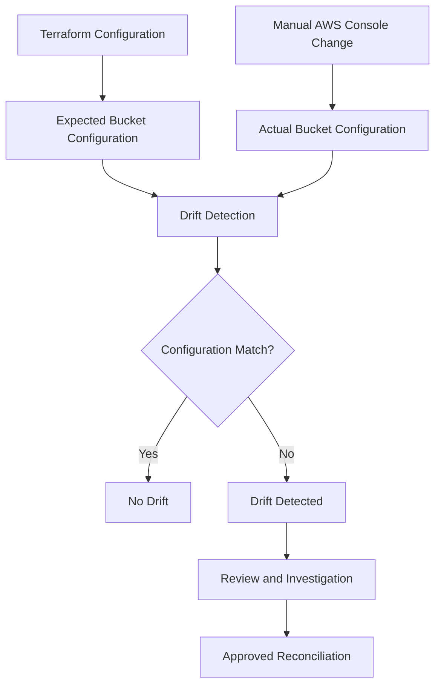
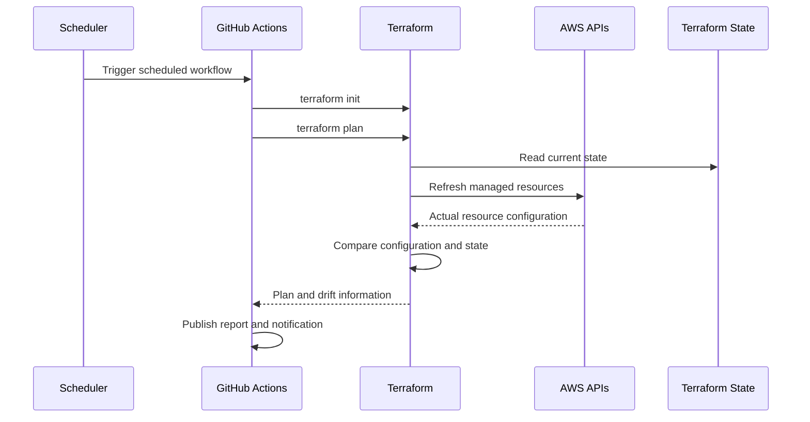
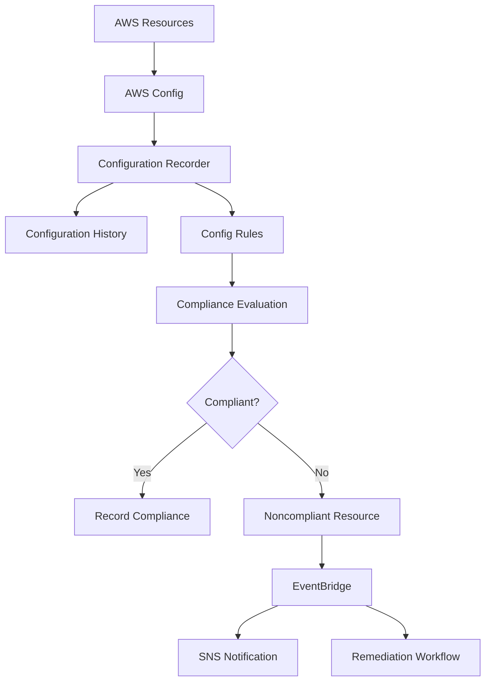
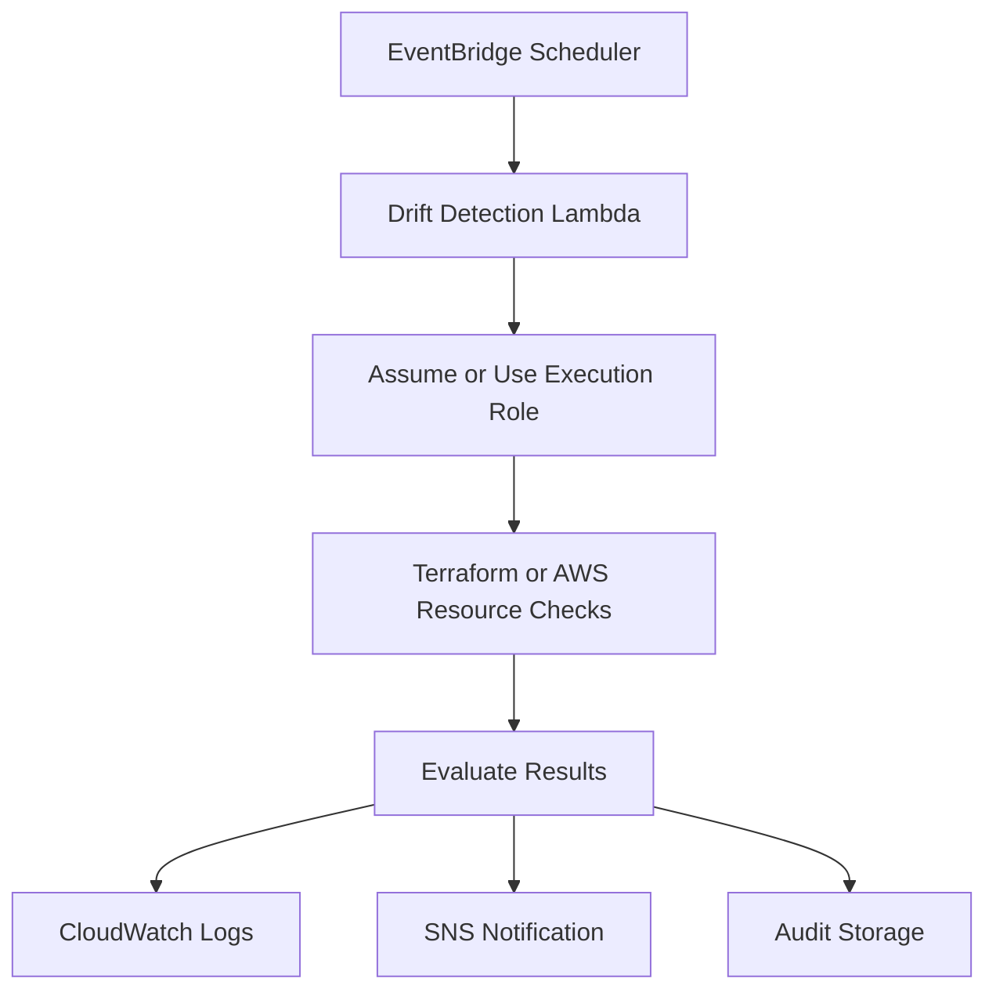
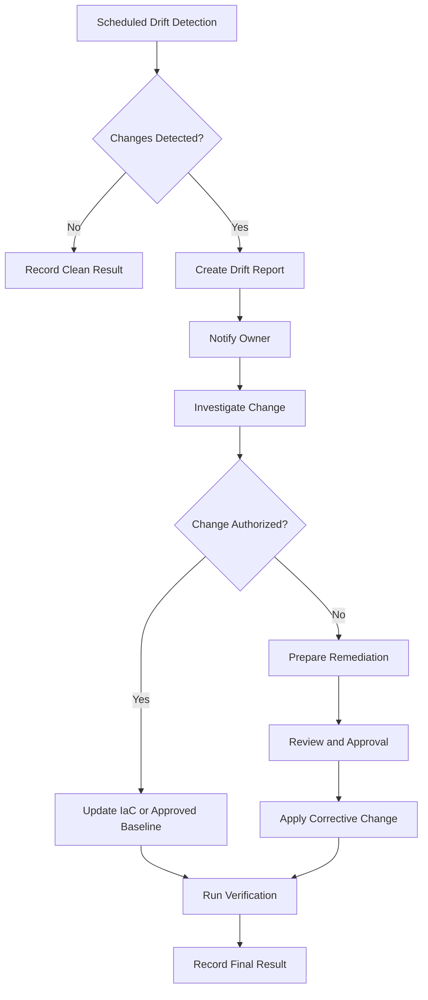

# 13- Scheduled Drift Detection

## Overview

Infrastructure drift occurs when the actual AWS resources differ from the configuration managed by an infrastructure-as-code (IaC) tool.

Drift can be introduced by:

- Manual changes through the AWS Management Console.
- AWS CLI commands executed outside the deployment pipeline.
- Changes made by another automation system.
- Emergency production fixes.
- Configuration updates performed by application teams.
- Resource modifications made by AWS services or other integrations.

For Amazon S3, drift can affect important security and operational settings, including:

- Bucket versioning.
- Server-side encryption.
- Public access block configuration.
- Bucket policies.
- Lifecycle rules.
- Replication configuration.
- Object ownership controls.
- Logging configuration.
- Event notification configuration.

Scheduled drift detection periodically compares the declared infrastructure configuration with the actual deployed resources.

The objective is to detect unexpected changes before they cause security, availability, compliance, or cost problems.

A production drift detection process should:

1. Run on a predictable schedule.
2. Use read-only AWS permissions wherever possible.
3. Identify drifted resources.
4. Preserve execution results.
5. Notify responsible teams.
6. Require controlled review before remediation.
7. Avoid automatically overwriting legitimate emergency changes.

## Understanding Infrastructure Drift

### What Is Infrastructure Drift?

Consider an S3 bucket managed by Terraform.

The declared configuration enables versioning:

```hcl
resource "aws_s3_bucket_versioning" "artifacts" {
  bucket = aws_s3_bucket.artifacts.id

  versioning_configuration {
    status = "Enabled"
  }
}
```

An administrator later disables versioning through the AWS Console.

The actual AWS resource no longer matches the Terraform configuration.



Drift detection identifies the difference. It does not automatically determine whether the change is malicious, accidental, or legitimate.

### Common Sources of Drift

| Source | Example | Potential impact |
|---|---|---|
| Manual console changes | Disable bucket versioning | Recovery capability reduced |
| AWS CLI | Modify bucket policy | Unauthorized access |
| External automation | Change lifecycle configuration | Unexpected retention behavior |
| Emergency operations | Temporarily relax bucket restrictions | Security exposure |
| Configuration management | Change encryption settings | Compliance violations |
| Resource replacement | Delete and recreate a managed resource | Terraform state inconsistency |

### Configuration Drift vs Data Changes

Infrastructure drift is different from ordinary application data changes.

For example:

- Changing an S3 bucket policy is infrastructure configuration drift.
- Uploading a new object is normally an application data operation.
- Updating object tags may be data or metadata management, depending on the IaC ownership model.
- Changing bucket versioning is infrastructure configuration drift.

Do not treat every S3 object modification as infrastructure drift.

Define which resources and configuration properties are managed by IaC and which are managed by applications.

## Drift Detection Strategies

Different IaC tools provide different drift detection mechanisms.

| Tool | Detection mechanism | Typical execution |
|---|---|---|
| Terraform | Refresh and plan comparison | `terraform plan` |
| CloudFormation | Stack drift detection | `detect-stack-drift` |
| AWS Config | Resource configuration history and compliance rules | Continuous or periodic evaluation |
| CDK | Synthesized CloudFormation templates and CloudFormation drift detection | Synthesis and stack inspection |

These mechanisms are complementary rather than interchangeable.

Terraform compares managed resources with configuration and state. CloudFormation detects differences for supported resource properties. AWS Config evaluates recorded resource configurations against rules.

## Terraform Scheduled Drift Detection

Terraform detects drift by refreshing its view of managed infrastructure and comparing the observed state with the configuration.

### How Terraform Detects Drift

A typical workflow:

1. Load Terraform configuration.
2. Initialize the backend and providers.
3. Read the existing Terraform state.
4. Refresh managed resource attributes from AWS.
5. Compare observed infrastructure with the desired configuration.
6. Produce a plan describing proposed changes.



### Run a Manual Drift Check

Navigate to the Terraform root module:

```bash
terraform init
```

Run a normal plan:

```bash
terraform plan
```

Terraform refreshes managed resources during planning and reports proposed changes.

For a more explicit refresh-only comparison:

```bash
terraform plan -refresh-only
```

This produces a plan that proposes updating Terraform state to reflect remote changes.

Do not automatically apply a refresh-only plan simply because it reports differences. Review the changes and determine whether the remote infrastructure or Terraform configuration should be corrected.

### Inspect the Plan

```bash
terraform show
```

For machine-readable output:

```bash
terraform show -json tfplan > plan.json
```

A saved plan can be created using:

```bash
terraform plan -out=tfplan
```

The JSON representation may contain sensitive values. Protect plan files and generated JSON output accordingly.

### Terraform Exit Codes

When using:

```bash
terraform plan -detailed-exitcode
```

Terraform returns:

| Exit code | Meaning |
|---|---|
| `0` | Successful plan with no changes |
| `1` | Error |
| `2` | Successful plan with changes |

Exit code `2` does not automatically mean unexpected drift.

A plan can contain changes because:

- Actual infrastructure differs from configuration.
- Terraform configuration changed.
- Provider behavior changed.
- A resource is scheduled for replacement.
- A managed attribute is computed differently.

A scheduled drift process must distinguish expected configuration changes from unapproved infrastructure changes.

### Example Drift Detection Script

The following Bash script runs a Terraform plan and distinguishes the three exit codes.

```bash
#!/usr/bin/env bash

set -uo pipefail

terraform init -input=false

set +e
terraform plan \
  -input=false \
  -detailed-exitcode \
  -out=tfplan

PLAN_EXIT_CODE=$?
set -e

case "$PLAN_EXIT_CODE" in
  0)
    echo "No Terraform changes detected."
    ;;
  1)
    echo "Terraform plan failed."
    exit 1
    ;;
  2)
    echo "Terraform plan contains changes."
    terraform show -no-color tfplan
    ;;
  *)
    echo "Unexpected Terraform exit code: $PLAN_EXIT_CODE"
    exit 1
    ;;
esac
```

This script identifies plan changes but does not prove that all changes are drift.

For a scheduled audit, compare the plan against the expected source revision and approved deployment history.

### Avoid Applying During Detection

Drift detection should normally be read-only.

Do not include:

```bash
terraform apply -auto-approve
```

in a scheduled detection job.

Automatic reconciliation can overwrite legitimate emergency changes or introduce additional production changes without review.

Use a separate approved workflow for remediation.

## CloudFormation Scheduled Drift Detection

AWS CloudFormation supports drift detection for stacks.

It compares supported resource properties in the deployed stack with the expected template configuration.

### Detect Stack Drift

Start drift detection:

```bash
aws cloudformation detect-stack-drift \
  --stack-name application-storage-production
```

The response contains a drift detection ID.

Check detection status:

```bash
aws cloudformation describe-stack-drift-detection-status \
  --stack-drift-detection-id DRIFT_DETECTION_ID
```

Possible detection statuses include:

- `DETECTION_IN_PROGRESS`
- `DETECTION_COMPLETE`
- `DETECTION_FAILED`

After successful detection, inspect stack drift:

```bash
aws cloudformation describe-stack-resource-drifts \
  --stack-name application-storage-production
```

The response reports resource drift information.

### Drift Status Values

| Status | Meaning |
|---|---|
| `IN_SYNC` | Resource matches supported expected properties |
| `MODIFIED` | One or more supported properties differ |
| `DELETED` | A managed resource is missing |
| `NOT_CHECKED` | Drift was not evaluated |
| `UNKNOWN` | Drift status could not be determined |

CloudFormation drift detection has important limitations:

- Only supported resource types and properties are checked.
- Some resource properties cannot be compared.
- Drift detection does not detect every possible external change.
- A stack can contain resources that are not fully covered by drift detection.

A stack reporting `IN_SYNC` does not prove that every AWS resource attribute or application data object is unchanged.

### Inspect a Specific Resource

```bash
aws cloudformation describe-stack-resource-drifts \
  --stack-name application-storage-production \
  --query 'StackResourceDrifts[].{
    LogicalId:LogicalResourceId,
    ResourceType:ResourceType,
    DriftStatus:StackResourceDriftStatus
  }' \
  --output table
```

Use the detailed resource drift response to inspect expected and actual property differences.

### Important Operational Consideration

CloudFormation drift detection is asynchronous.

A scheduled pipeline must:

1. Start drift detection.
2. Capture the detection ID.
3. Poll for completion.
4. Handle detection failure or timeout.
5. Retrieve resource drift details.
6. Publish the report.
7. Notify responsible teams when relevant.

Do not assume the initial `detect-stack-drift` API response contains the final drift result.

## AWS Config for Continuous Drift Monitoring

AWS Config records supported resource configurations and evaluates them against compliance rules.

It is useful when an organization needs visibility across multiple accounts and Regions.

For S3, AWS Config can evaluate settings such as:

- Bucket public access restrictions.
- Bucket versioning.
- Bucket encryption.
- Logging configuration.
- SSL enforcement through supported policy checks.
- Other supported S3 configuration requirements.

### AWS Config Architecture



### Managed Rules for S3

AWS Config provides managed rules for common S3 configuration requirements.

Examples include:

| Rule identifier | Purpose |
|---|---|
| `s3-bucket-public-read-prohibited` | Checks for public read access |
| `s3-bucket-public-write-prohibited` | Checks for public write access |
| `s3-bucket-server-side-encryption-enabled` | Checks server-side encryption |
| `s3-bucket-versioning-enabled` | Checks bucket versioning |
| `s3-bucket-ssl-requests-only` | Checks whether bucket policies enforce SSL requests |

Verify the rule's current scope and evaluation behavior before deploying it.

### Example: Create a Config Rule

Create a managed rule for S3 bucket versioning:

```bash
aws configservice put-config-rule \
  --config-rule '{
    "ConfigRuleName": "s3-bucket-versioning-enabled",
    "Source": {
      "Owner": "AWS",
      "SourceIdentifier": "S3_BUCKET_VERSIONING_ENABLED"
    }
  }'
```

The AWS Config recorder and delivery channel must already be configured.

Inspect compliance:

```bash
aws configservice get-compliance-details-by-config-rule \
  --config-rule-name s3-bucket-versioning-enabled
```

### AWS Config vs Terraform Drift Detection

| Area | Terraform | AWS Config |
|---|---|---|
| Primary purpose | Compare IaC configuration with actual resources | Record configuration and evaluate compliance |
| Scope | Terraform-managed resources | Supported recorded resources |
| Trigger | Pipeline or scheduled execution | Configuration changes and periodic evaluations |
| Desired state | Terraform configuration | Config rules and conformance requirements |
| Change proposal | Terraform plan | Compliance evaluation |
| Remediation | Controlled Terraform reconciliation | Config remediation or external automation |
| Best use | IaC ownership and change reconciliation | Organization-wide configuration compliance |

AWS Config does not replace Terraform plan-based drift detection.

Use both when infrastructure ownership and organization-wide compliance requirements justify the additional operational cost.

## Scheduled Drift Detection with GitHub Actions

GitHub Actions can run drift detection on a recurring schedule.

The workflow should:

- Use OIDC for AWS authentication.
- Run with read-only infrastructure permissions.
- Initialize the correct Terraform backend.
- Execute drift detection.
- Preserve the report.
- Notify the responsible team.
- Avoid automatic infrastructure changes.

### Example Repository Structure

```text
infrastructure/
    terraform/
        main.tf
        providers.tf
        backend.tf
        variables.tf
        outputs.tf

.github/
    workflows/
        scheduled-drift-detection.yml
```

### GitHub Actions Workflow

`.github/workflows/scheduled-drift-detection.yml`:

```yaml
name: Scheduled Infrastructure Drift Detection

on:
  schedule:
    - cron: "30 2 * * *"

  workflow_dispatch:

permissions:
  contents: read
  id-token: write

jobs:
  drift-detection:
    runs-on: ubuntu-latest

    environment: infrastructure-audit

    defaults:
      run:
        working-directory: infrastructure/terraform

    steps:
      - name: Checkout repository
        uses: actions/checkout@v4

      - name: Configure AWS credentials
        uses: aws-actions/configure-aws-credentials@v4
        with:
          role-to-assume: ${{ vars.AWS_DRIFT_DETECTION_ROLE_ARN }}
          aws-region: ${{ vars.AWS_REGION }}

      - name: Verify AWS identity
        run: aws sts get-caller-identity

      - name: Setup Terraform
        uses: hashicorp/setup-terraform@v3
        with:
          terraform_version: "1.9.8"

      - name: Initialize Terraform
        run: terraform init -input=false

      - name: Validate Terraform configuration
        run: terraform validate

      - name: Run drift detection
        id: drift
        shell: bash
        run: |
          set +e

          terraform plan \
            -input=false \
            -detailed-exitcode \
            -no-color \
            -out=tfplan \
            > drift-report.txt 2>&1

          PLAN_EXIT_CODE=$?

          set -e

          echo "plan_exit_code=${PLAN_EXIT_CODE}" >> "$GITHUB_OUTPUT"

          case "$PLAN_EXIT_CODE" in
            0)
              echo "No Terraform changes detected."
              ;;
            1)
              echo "Terraform plan failed."
              cat drift-report.txt
              exit 1
              ;;
            2)
              echo "Terraform plan contains changes."
              cat drift-report.txt
              ;;
            *)
              echo "Unexpected exit code: ${PLAN_EXIT_CODE}"
              exit 1
              ;;
          esac

      - name: Upload drift report
        if: always()
        uses: actions/upload-artifact@v4
        with:
          name: terraform-drift-report-${{ github.run_id }}
          path: infrastructure/terraform/drift-report.txt
          if-no-files-found: ignore
          retention-days: 30

      - name: Report drift status
        if: always()
        env:
          PLAN_EXIT_CODE: ${{ steps.drift.outputs.plan_exit_code }}
        run: |
          if [ "$PLAN_EXIT_CODE" = "0" ]; then
            echo "Drift detection completed without proposed changes."
          elif [ "$PLAN_EXIT_CODE" = "2" ]; then
            echo "Terraform reported proposed changes. Review required."
          else
            echo "Drift detection did not complete successfully."
          fi
```

This workflow is a baseline example.

It reports Terraform plan changes, not definitively confirmed drift. A production implementation should compare the plan against the expected configuration revision and approved deployment records.

Additional production considerations:

- Pin third-party actions to reviewed full commit SHAs.
- Use a dedicated read-only AWS role.
- Protect the audit environment.
- Protect Terraform backend credentials and state access.
- Prevent concurrent scheduled runs against the same state.
- Store reports in an approved audit location when longer retention is required.
- Add an explicit notification step for detected changes.
- Avoid uploading sensitive plan JSON or unrestricted plan files.
- Handle cancellation and timeouts.

### Terraform Backend Permissions

A read-only drift detection role may need:

- Read access to Terraform state.
- Permission to inspect managed AWS resources.
- Permission to retrieve backend configuration.
- KMS decrypt permission if the state is encrypted with a customer-managed key.
- Any additional read operations required by the configured providers.

Do not grant infrastructure modification permissions to the drift detection role.

Terraform refresh operations can require provider read permissions even when the workflow does not apply changes.

## Scheduled CloudFormation Drift Detection

CloudFormation drift detection can also be scheduled through GitHub Actions.

Example:

```yaml
name: CloudFormation Drift Detection

on:
  schedule:
    - cron: "0 3 * * *"

  workflow_dispatch:

permissions:
  contents: read
  id-token: write

jobs:
  detect-drift:
    runs-on: ubuntu-latest

    environment: infrastructure-audit

    steps:
      - name: Configure AWS credentials
        uses: aws-actions/configure-aws-credentials@v4
        with:
          role-to-assume: ${{ vars.AWS_DRIFT_DETECTION_ROLE_ARN }}
          aws-region: ${{ vars.AWS_REGION }}

      - name: Start drift detection
        id: detect
        env:
          STACK_NAME: application-storage-production
        run: |
          DETECTION_ID=$(aws cloudformation detect-stack-drift \
            --stack-name "$STACK_NAME" \
            --query StackDriftDetectionId \
            --output text)

          echo "detection_id=${DETECTION_ID}" >> "$GITHUB_OUTPUT"

      - name: Wait for drift detection
        env:
          DETECTION_ID: ${{ steps.detect.outputs.detection_id }}
        run: |
          for attempt in $(seq 1 30); do
            STATUS=$(aws cloudformation describe-stack-drift-detection-status \
              --stack-drift-detection-id "$DETECTION_ID" \
              --query DetectionStatus \
              --output text)

            echo "Detection status: ${STATUS}"

            if [ "$STATUS" = "DETECTION_COMPLETE" ]; then
              exit 0
            fi

            if [ "$STATUS" = "DETECTION_FAILED" ]; then
              echo "CloudFormation drift detection failed."
              exit 1
            fi

            sleep 10
          done

          echo "Timed out waiting for drift detection."
          exit 1

      - name: Retrieve drift results
        env:
          STACK_NAME: application-storage-production
        run: |
          aws cloudformation describe-stack-resource-drifts \
            --stack-name "$STACK_NAME" \
            --output json > drift-report.json

      - name: Upload drift report
        if: always()
        uses: actions/upload-artifact@v4
        with:
          name: cloudformation-drift-report-${{ github.run_id }}
          path: drift-report.json
          if-no-files-found: ignore
          retention-days: 30
```

This example detects and stores CloudFormation drift results.

A production workflow should also evaluate the returned resource statuses and fail or notify according to the organization's policy.

The polling limit is an example operational timeout. Adjust it based on stack size and detection behavior.

## Scheduled Drift Detection with EventBridge

For AWS-native scheduling, EventBridge Scheduler can trigger a Lambda function or another supported target.

This avoids depending entirely on an external CI/CD scheduler.

### Architecture



Use this approach when drift checks are part of centralized AWS operations.

A Lambda-based implementation is appropriate for bounded checks that fit within Lambda execution limits.

For large Terraform repositories, complex provider initialization, or long-running infrastructure comparisons, a CI/CD runner is usually more suitable.

### Scheduling Considerations

Use a schedule that matches the risk profile.

| Environment | Example cadence | Reason |
|---|---|---|
| Development | Daily | Lower operational risk |
| Staging | Daily | Detect changes before production release |
| Production | Daily or more frequently | Higher security and availability requirements |
| Critical security configuration | Continuous evaluation where supported | Reduce detection latency |

The cadence should reflect risk, cost, resource count, and operational capacity.

Do not schedule multiple drift processes concurrently against the same Terraform state unless the workflow is designed to coordinate them.

## S3-Specific Drift Detection

S3 has several configuration properties that deserve explicit monitoring.

### Important S3 Properties

| Property | Why it matters | Suggested validation |
|---|---|---|
| Versioning | Supports object recovery and version history | `get-bucket-versioning` |
| Encryption | Protects stored data | `get-bucket-encryption` |
| Public access block | Restricts public exposure | `get-public-access-block` |
| Bucket policy | Controls resource access | `get-bucket-policy` |
| Lifecycle | Controls retention and transitions | `get-bucket-lifecycle-configuration` |
| Replication | Supports cross-bucket or cross-Region copies | `get-bucket-replication` |
| Object ownership | Controls ownership and ACL behavior | `get-bucket-ownership-controls` |
| Logging | Supports access auditing | `get-bucket-logging` |
| Event notifications | Controls event-driven processing | `get-bucket-notification-configuration` |

### Example S3 Configuration Audit

The following Python script checks selected S3 bucket configurations using Boto3.

It is a targeted configuration audit, not a replacement for Terraform or CloudFormation drift detection.

```python
import json
import logging
from typing import Any

import boto3
from botocore.exceptions import ClientError

logging.basicConfig(level=logging.INFO)
logger = logging.getLogger(__name__)


def inspect_bucket(
    s3_client: Any,
    bucket_name: str,
) -> dict[str, Any]:
    result: dict[str, Any] = {
        "bucket": bucket_name,
        "checks": {},
    }

    checks = {
        "versioning": lambda: s3_client.get_bucket_versioning(
            Bucket=bucket_name
        ),
        "encryption": lambda: s3_client.get_bucket_encryption(
            Bucket=bucket_name
        ),
        "public_access_block": lambda: s3_client.get_public_access_block(
            Bucket=bucket_name
        ),
        "ownership_controls": lambda: s3_client.get_bucket_ownership_controls(
            Bucket=bucket_name
        ),
    }

    for check_name, operation in checks.items():
        try:
            response = operation()

            result["checks"][check_name] = {
                "status": "SUCCESS",
                "configuration": response,
            }

        except ClientError as exc:
            error_code = exc.response.get(
                "Error",
                {},
            ).get("Code", "Unknown")

            result["checks"][check_name] = {
                "status": "ERROR",
                "error_code": error_code,
            }

            logger.warning(
                "Bucket check failed: bucket=%s check=%s error=%s",
                bucket_name,
                check_name,
                error_code,
            )

    return result


def main() -> None:
    session = boto3.Session()
    s3_client = session.client("s3")

    bucket_name = "company-platform-deployment-artifacts"

    report = inspect_bucket(
        s3_client=s3_client,
        bucket_name=bucket_name,
    )

    print(
        json.dumps(
            report,
            indent=2,
            default=str,
        )
    )


if __name__ == "__main__":
    main()
```

### Important Limitations

This script:

- Reads selected bucket configuration.
- Reports API failures separately from successful reads.
- Does not compare actual values against an approved baseline.
- Does not identify every possible configuration difference.
- Does not modify AWS resources.

A production implementation should compare normalized actual configuration against a version-controlled expected configuration.

It should also distinguish an absent optional configuration from an access-denied or API failure.

For example, a bucket without a lifecycle configuration may return `NoSuchLifecycleConfiguration`. That is different from an IAM permission failure.

### Compare Against an Expected Baseline

A configuration audit should use explicit expected values.

Example:

```python
EXPECTED_CONFIGURATION = {
    "versioning": "Enabled",
    "public_access_block": {
        "BlockPublicAcls": True,
        "IgnorePublicAcls": True,
        "BlockPublicPolicy": True,
        "RestrictPublicBuckets": True,
    },
}
```

Normalize the AWS API response before comparing it.

Avoid comparing complete API response dictionaries directly because they may contain timestamps, identifiers, or other fields that are not part of the desired configuration.

## Drift Classification and Remediation

Not every detected difference should be fixed automatically.

Classify drift before deciding what to do.

| Classification | Example | Recommended action |
|---|---|---|
| Unauthorized drift | Public access block disabled unexpectedly | Investigate and escalate |
| Accidental drift | Versioning disabled by mistake | Restore through approved IaC workflow |
| Emergency change | Temporary bucket policy update | Review and reconcile |
| Intentional change | Approved configuration update outside the current branch | Update IaC after review |
| Provider or service behavior | Computed attribute changes | Validate provider and resource semantics |
| Detection limitation | Unsupported property | Use a separate audit mechanism |

### Remediation Workflow



### Terraform Remediation

If the desired configuration remains correct, restore the actual infrastructure using the normal Terraform deployment workflow.

If the remote change was intentional and approved:

1. Review the actual resource configuration.
2. Update Terraform configuration.
3. Review the proposed plan.
4. Obtain approval.
5. Apply the approved change.
6. Run drift detection again.

Do not use `terraform refresh` or refresh-only apply as a substitute for understanding the intended desired state.

### CloudFormation Remediation

If a CloudFormation-managed resource has drifted:

1. Inspect the resource drift details.
2. Determine whether the template or the live resource is correct.
3. Update the template if the change is approved.
4. Create and review a change set.
5. Execute the change set through the normal deployment process.
6. Run drift detection again.

CloudFormation drift detection reports differences; it does not automatically repair them.

### Emergency Changes

Emergency changes should be documented and reconciled into IaC.

Otherwise, the next deployment may revert the emergency fix.

Maintain an exception record containing:

- Change identifier.
- Resource identifier.
- Reason for the change.
- Initiator.
- Approval.
- Start and expiry time.
- Required IaC reconciliation.
- Verification evidence.

Temporary exceptions should have an expiry and an owner.

## IAM Permissions for Drift Detection

Drift detection should use a dedicated role with read-only permissions.

The exact permissions depend on:

- Terraform provider resources.
- CloudFormation stack resources.
- AWS Config configuration.
- Backend type.
- Encryption and KMS usage.
- Additional custom validation scripts.

### Permission Separation

| Role | Responsibility |
|---|---|
| Drift detection role | Read AWS configuration and infrastructure state |
| Deployment role | Create or modify infrastructure |
| Notification role | Publish drift alerts |
| Audit role | Read and preserve drift reports |
| Remediation role | Apply approved infrastructure corrections |

A drift detection role should not have broad permissions such as unrestricted:

- `s3:PutBucketPolicy`
- `s3:PutBucketVersioning`
- `s3:PutBucketEncryption`
- `cloudformation:UpdateStack`
- `cloudformation:DeleteStack`

### Terraform Backend Access

If Terraform uses an S3 backend, the drift detection role needs the backend access required to read the state and coordinate safely.

For example:

- Read access to the state object.
- Required KMS decrypt permission.
- Backend lock coordination permissions where required by the configured locking mechanism.

A drift detection job should not bypass backend locking or use an unsafe local copy of production state.

## Monitoring Drift Detection

Drift detection itself needs monitoring.

Important signals include:

| Metric or signal | Interpretation |
|---|---|
| Drifted resource count | Number of resources with detected differences |
| Drift detection failures | Checks that could not complete |
| Detection duration | Possible performance or API throttling issue |
| Last successful scan | Indicates monitoring freshness |
| Unresolved drift age | Time since drift was first detected |
| Critical configuration drift | Potential security or availability issue |
| Repeated drift | Possible external automation or recurring misconfiguration |

A useful drift report should contain:

```text
Environment: production
Scan Time: 2026-11-01T02:30:00Z
IaC Tool: Terraform
Source Commit: a1b2c3d4e5f6

Managed Resources Checked: 42
Resources With Changes: 2
Detection Errors: 0

Detected Differences:
- S3 artifact bucket versioning
- S3 artifact bucket lifecycle configuration

Remediation Status: REVIEW REQUIRED
```

The values are illustrative.

### Unresolved Drift Tracking

Maintain a record for each detected difference.

Useful fields include:

- Resource identifier.
- Environment.
- Detection timestamp.
- Last observed timestamp.
- Expected value.
- Actual value.
- Detection source.
- Severity.
- Owner.
- Investigation status.
- Remediation deadline.
- Resolution timestamp.

This prevents repeated notifications from becoming noise and makes unresolved drift measurable.

## Cost and Operational Considerations

Drift detection can generate AWS API calls and operational costs.

Potential cost sources include:

- AWS Config configuration recording and evaluations.
- CloudTrail management and data events.
- CloudTrail log storage.
- EventBridge and Lambda execution.
- S3 audit report storage.
- CI/CD runner usage.
- Terraform provider API calls.

### Operational Recommendations

- Schedule checks according to resource risk and change frequency.
- Avoid running duplicate scans against the same infrastructure.
- Use read-only roles.
- Limit AWS Config recording and rule scope to required resources.
- Store reports according to retention requirements.
- Use separate schedules for critical and noncritical environments.
- Monitor scan failures and stale reports.
- Keep detection and remediation workflows separate.

## Common Mistakes

| Mistake | Impact | Prevention |
|---|---|---|
| Treating every Terraform plan change as drift | Configuration changes are misclassified | Compare against approved source and deployment history |
| Applying Terraform automatically after detection | Legitimate emergency changes may be overwritten | Require review and approval |
| Assuming CloudFormation checks every property | Some differences may remain undetected | Understand supported resource and property coverage |
| Using a deployment role for scheduled detection | Excessive permissions increase risk | Use a dedicated read-only role |
| Ignoring Terraform exit code `2` | Actual plan changes may be missed | Handle detailed exit codes explicitly |
| Treating exit code `2` as confirmed drift | Normal configuration updates may trigger false alerts | Classify changes against the expected baseline |
| Ignoring AWS Config recorder setup | Rules may not have reliable configuration data | Verify recorder and delivery configuration |
| Running concurrent Terraform scans | State or backend coordination problems | Use concurrency controls |
| Failing to preserve drift reports | Investigation evidence is lost | Store reports with controlled retention |
| Treating `IN_SYNC` as proof of complete compliance | Unsupported properties may not be checked | Combine drift detection with security and compliance validation |
| Automatically accepting emergency changes | Unreviewed changes become permanent | Require explicit reconciliation into IaC |
| Ignoring failed scans | Infrastructure may remain unmonitored | Alert on scan failures and stale scan timestamps |

## Production Readiness Checklist

### Detection

- [ ] Terraform drift detection is scheduled.
- [ ] CloudFormation drift detection is configured where applicable.
- [ ] AWS Config records required resource configurations.
- [ ] S3 security-sensitive settings are included.
- [ ] Unsupported or unmanaged properties have alternative checks.
- [ ] Detection failures are distinguishable from clean results.
- [ ] Terraform exit codes are handled correctly.

### Security

- [ ] Drift detection uses dedicated read-only permissions.
- [ ] Terraform state access is restricted.
- [ ] KMS permissions are scoped appropriately.
- [ ] Detection roles cannot modify infrastructure.
- [ ] Audit reports are stored securely.
- [ ] Notification roles have only required permissions.

### Operations

- [ ] Scheduled scans do not overlap.
- [ ] Scan duration and freshness are monitored.
- [ ] Drift reports identify affected resources.
- [ ] Critical drift triggers an alert.
- [ ] Unresolved drift has an assigned owner.
- [ ] Emergency changes are documented.
- [ ] Remediation requires review and approval.
- [ ] A second scan verifies successful remediation.

## Key Takeaways

- Infrastructure drift occurs when actual AWS resources differ from their declared IaC configuration, and scheduled detection helps identify unexpected changes before they become operational or security incidents.
- Terraform plans, CloudFormation drift detection, and AWS Config provide complementary detection capabilities; their coverage and limitations must be understood.
- Terraform exit code `2` means a plan contains changes, not necessarily that infrastructure drift has been confirmed.
- Scheduled drift detection should use dedicated read-only permissions and must remain separate from approved remediation workflows.
- Every detected difference should be classified, investigated, assigned an owner, reconciled through IaC, and verified with a subsequent scan.