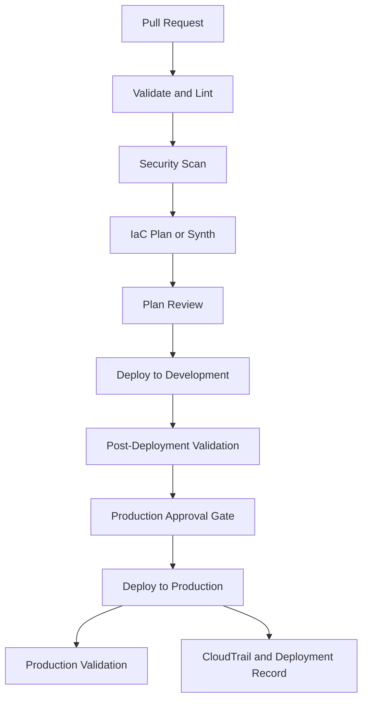

# README

## Overview

CI/CD and automated deployment for Amazon S3 covers the pipeline architecture, GitHub Actions workflow design, IAM OIDC federation, short-lived credential configuration, IaC deployment pipelines, environment protection, secrets management, infrastructure testing, artifact versioning, deployment notifications, and scheduled drift detection required to deliver S3 infrastructure changes safely and automatically. It addresses the full automated deployment lifecycle from source control commit through environment-specific pipeline execution, approval gates, infrastructure validation, and audit trail generation.

This section of the Backend Engineering Playbook provides a structured reference for backend engineers, platform engineers, and DevOps engineers who automate S3 infrastructure and application deployments through CI/CD pipelines.

The focus is on practical pipeline engineering: using OIDC federation to eliminate long-lived credentials, designing pipelines that enforce environment separation and approval gates, integrating automated validation into the deployment path, and producing auditable deployment records.

## Navigation

| # | File | Description |
|---|---|---|
| 01 | [01- S3 Deployment Pipeline Architecture](./01-%20S3%20Deployment%20Pipeline%20Architecture.md) | Pipeline structure for S3 infrastructure and application deployment, stages, and component interactions |
| 02 | [02- GitHub Actions Workflow Design](./02-%20GitHub%20Actions%20Workflow%20Design.md) | Designing reusable, maintainable GitHub Actions workflows for S3 infrastructure and content deployment |
| 03 | [03- AWS IAM OIDC Federation](./03-%20AWS%20IAM%20OIDC%20Federation.md) | Federating GitHub Actions with AWS using OIDC to obtain temporary credentials without stored access keys |
| 04 | [04- Short-Lived Credentials for Deployment](./04-%20Short-Lived%20Credentials%20for%20Deployment.md) | Configuring `aws-actions/configure-aws-credentials` with OIDC, scoped roles, and session duration |
| 05 | [05- Terraform Plan and Apply Pipelines](./05-%20Terraform%20Plan%20and%20Apply%20Pipelines.md) | Automating Terraform plan review and apply for S3 infrastructure through CI/CD with plan output review |
| 06 | [06- CloudFormation Deployment Pipelines](./06-%20CloudFormation%20Deployment%20Pipelines.md) | Automating CloudFormation change set creation, review, and execution for S3 stacks through pipelines |
| 07 | [07- CDK Deployment Pipelines](./07-%20CDK%20Deployment%20Pipelines.md) | Automating CDK synth, diff, and deploy for S3 infrastructure through GitHub Actions or CDK Pipelines |
| 08 | [08- Environment Protection and Approval Gates](./08-%20Environment%20Protection%20and%20Approval%20Gates.md) | Controlling how infrastructure changes progress from development to staging and production with approval gates |
| 09 | [09- Secrets and Configuration Management](./09-%20Secrets%20and%20Configuration%20Management.md) | Managing deployment secrets, environment-specific configuration, and sensitive values in CI/CD pipelines |
| 10 | [10- Automated Infrastructure Testing](./10-%20Automated%20Infrastructure%20Testing.md) | Running static analysis, security scanning, and post-deployment validation checks within the pipeline |
| 11 | [11- Deployment Artifacts and Versioning](./11-%20Deployment%20Artifacts%20and%20Versioning.md) | Versioning deployment packages, managing artifact storage in S3, and tracing deployments to source versions |
| 12 | [12- Deployment Notifications and Audit Trails](./12-%20Deployment%20Notifications%20and%20Audit%20Trails.md) | Generating deployment notifications, recording deployment events, and producing audit evidence in CloudTrail |
| 13 | [13- Scheduled Drift Detection](./13-%20Scheduled%20Drift%20Detection.md) | Automating periodic IaC drift detection runs and alerting on divergence between state and actual infrastructure |

## Why CI/CD for S3 Deployment Matters

Manual S3 deployments are not reproducible, reviewable, or auditable. Production environments that rely on manual CLI commands or console operations cannot enforce consistent security configuration, prevent unauthorized changes, or produce reliable deployment records.

Common CI/CD deployment risks include:

- Long-lived AWS access keys stored in CI/CD secrets that accumulate over time and are not rotated, creating a persistent credential exposure risk.
- Pipelines that deploy to production without approval gates, allowing untested changes to reach production automatically.
- No automated security scanning in the deployment path, allowing insecure IaC configurations to be deployed without detection.
- Deployment artifacts not versioned, making it impossible to trace a production deployment back to the source code and IaC configuration that produced it.
- Drift between IaC state and actual infrastructure that accumulates between deployments and is not detected until a deployment behaves unexpectedly.
- No deployment audit trail, making incident investigation slow and incomplete when a security or availability event occurs.

Effective S3 CI/CD deployment combines OIDC-based short-lived credentials, environment separation with approval gates, automated validation in the deployment path, versioned artifacts, and deployment audit evidence.

## Documentation Structure

This section is organized into focused documents covering pipeline architecture, credential management, IaC-specific pipelines, environment protection, testing, artifact management, and observability.

| Area | Primary focus |
|---|---|
| Pipeline architecture | Overall pipeline structure and component relationships |
| Workflow design | GitHub Actions reusable workflows, triggers, and job structure |
| Credentials | OIDC federation and short-lived credential configuration |
| IaC pipelines | Terraform, CloudFormation, and CDK-specific pipeline patterns |
| Environment protection | Approval gates and deployment progression controls |
| Secrets management | Deployment-time secrets and configuration values |
| Testing | Automated validation and security scanning in the pipeline |
| Artifacts | Deployment package versioning and artifact tracing |
| Observability | Notifications, audit trails, and deployment records |
| Drift detection | Scheduled divergence detection and alerting |

## Core CI/CD Principles for S3 Deployment

### Use OIDC Federation, Not Stored Access Keys

Configure GitHub Actions to obtain temporary AWS credentials through IAM OIDC federation. This eliminates the need to store long-lived AWS access keys in GitHub Secrets, reduces the credential exposure window to the duration of a single workflow run, and provides a clean audit trail of pipeline-initiated AWS API calls.

### Scope Deployment Roles to Minimum Required Permissions

Create dedicated IAM roles for each deployment pipeline and environment. Scope each role to the specific S3 actions, bucket ARNs, KMS key ARNs, and dependent service permissions required for that pipeline. Do not use broadly permissive roles for deployment.

### Require Approval Gates Before Production

Configure environment protection rules on production environments. Require at least one human approval before a deployment workflow executes against production. Approval gates are the primary control preventing unvalidated changes from reaching production automatically.

### Include Automated Validation in Every Pipeline

Run IaC linting, security scanning (`checkov`, `tfsec`, `cfn-nag`), and post-deployment validation checks in every pipeline run. Failing validation should block the deployment, not generate a warning that is ignored.

### Schedule Drift Detection Between Deployments

Infrastructure can diverge from its declared state between deployments through console modifications, incident remediation, or external automation. Schedule regular drift detection runs and alert on detected divergence. Treat drift findings as deployment blockers until resolved.

## Recommended CI/CD Workflow

## Operational Standards

- **Credentials:** Use OIDC federation for all GitHub Actions workflows that interact with AWS. Do not store long-lived access keys in CI/CD secrets.
- **Role scoping:** Create dedicated deployment roles per pipeline and environment. Scope to minimum required permissions.
- **Approval gates:** Require human approval before production deployments. Configure environment protection rules in GitHub.
- **Validation:** Run lint, security scan, and IaC plan or synth in every pipeline run. Fail the pipeline on validation errors.
- **Post-deployment tests:** Run smoke tests and configuration validation after every deployment. Alert on failures.
- **Artifact versioning:** Tag deployment artifacts with the source commit SHA. Store artifacts in a versioning-enabled S3 bucket.
- **Audit trail:** Ensure CloudTrail data events are enabled for buckets modified by deployment pipelines. Record deployment metadata in a structured audit log.
- **Drift detection:** Schedule automated drift detection runs. Alert on detected divergence. Treat unresolved drift as a deployment blocker.

## Key Takeaways

- OIDC federation for CI/CD credentials eliminates the persistent exposure risk of stored AWS access keys and provides a clean per-deployment audit trail.
- Approval gates before production deployments are the primary control preventing unvalidated changes from reaching production automatically.
- Automated security scanning and IaC validation in the deployment path catch insecure configurations before they are deployed to AWS.
- Scheduled drift detection between deployments is the only way to detect infrastructure divergence that occurs outside of the deployment pipeline.
- Deployment artifact versioning and CloudTrail audit coverage together make it possible to trace any production state back to the source change that produced it.
