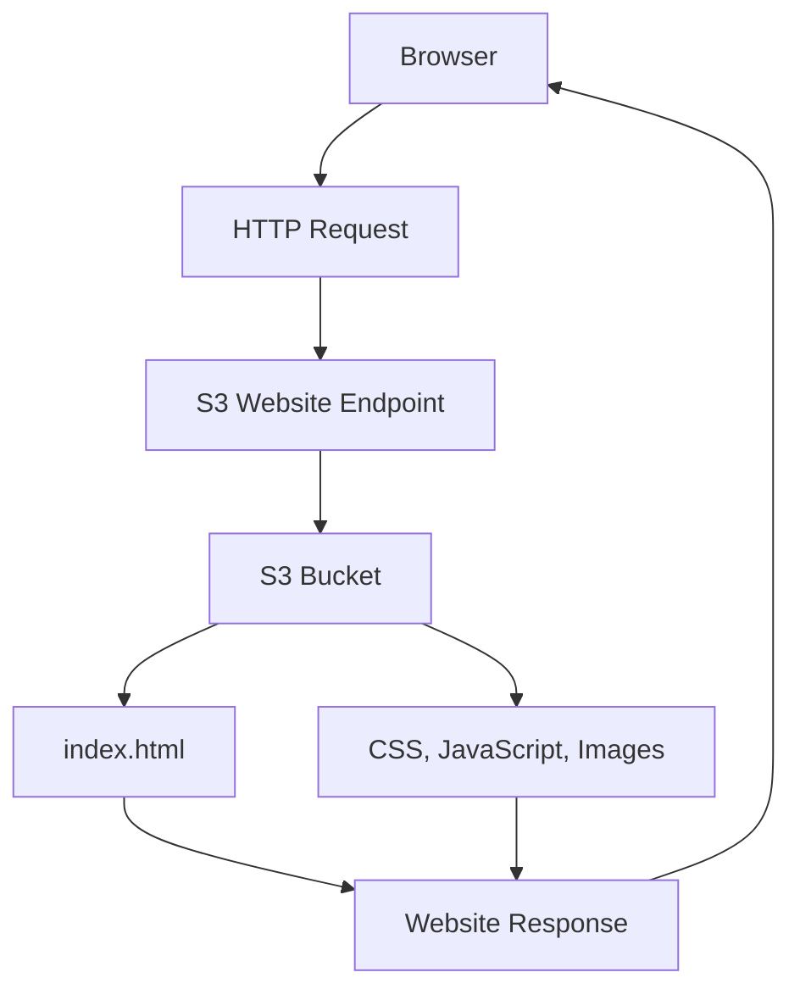
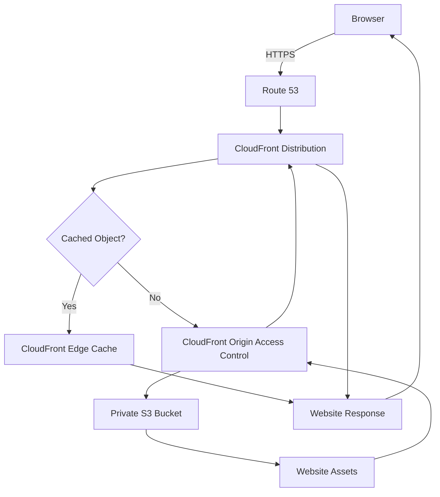
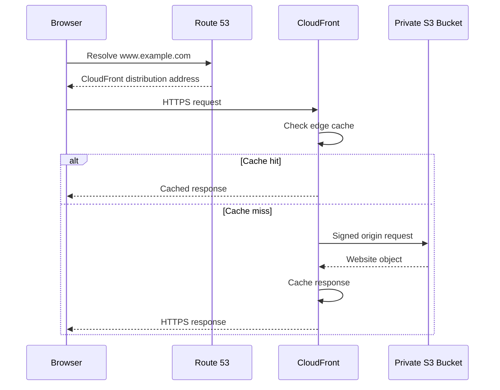

# 01- S3 Website Hosting Deployment Options

## Overview

Amazon S3 supports static website hosting by serving HTML, CSS, JavaScript, images, and other static assets directly from an S3 bucket.

It is commonly used for websites that do not require server-side application execution. Examples include:

- Documentation websites.
- Product landing pages.
- Single-page applications (SPAs).
- Portfolio websites.
- Static frontend applications built with React, Vue, or Angular.
- Documentation and developer portals.

S3 website hosting has two distinct deployment approaches:

1. **S3 Static Website Hosting** — S3 serves website content through its website endpoint.
2. **S3 with CloudFront** — CloudFront delivers website content through a CDN while S3 remains the origin.

These approaches differ significantly in security, HTTPS support, caching, routing, and production suitability.

For production websites, the recommended architecture is generally a private S3 bucket behind CloudFront using Origin Access Control (OAC).

## Static Website Hosting Options

### S3 Static Website Hosting

S3 provides a website hosting feature that allows a bucket to serve static website content.

When enabled, the bucket can serve:

- An index document.
- An error document.
- Static assets.
- Website content through an HTTP website endpoint.

Example website structure:

```text
website/
├── index.html
├── error.html
├── about.html
├── css/
│   └── styles.css
├── js/
│   └── app.js
└── images/
    └── logo.png
```

The website endpoint serves objects from the configured bucket.

**Website endpoint format:**

```text
http://BUCKET_NAME.s3-website-REGION.amazonaws.com
```

The exact endpoint format depends on the bucket's Region and endpoint type.

#### How It Works

1. A developer uploads website assets to an S3 bucket.
2. Static website hosting is enabled.
3. The index and error documents are configured.
4. The website objects are made publicly readable when using the direct website endpoint.
5. A browser requests the website through the S3 website endpoint.
6. S3 returns the requested object.



#### Enable Static Website Hosting

Using AWS CLI:

```bash
aws s3 website s3://my-static-website \
  --index-document index.html \
  --error-document error.html
```

Inspect the website hosting configuration:

```bash
aws s3api get-bucket-website \
  --bucket my-static-website
```

Example response:

```json
{
  "IndexDocument": {
    "Suffix": "index.html"
  },
  "ErrorDocument": {
    "Key": "error.html"
  }
}
```

#### Upload Website Files

```bash
aws s3 sync ./website s3://my-static-website \
  --delete
```

The `--delete` option removes destination objects that no longer exist locally.

Use it carefully because it can delete production website assets.

#### Advantages

- Simple deployment model.
- No web server administration.
- No EC2 or container infrastructure.
- Automatically scales to serve static objects.
- Low operational overhead.
- Suitable for prototypes and simple static websites.

#### Limitations

- Website endpoints support HTTP, not HTTPS directly.
- Direct website hosting generally requires public object access.
- No native application-server execution.
- No dynamic server-side rendering.
- Limited routing and request-processing capabilities.
- No native authentication or authorization layer for application users.

### S3 Website Hosting with CloudFront

CloudFront is a content delivery network (CDN) that distributes website content through its global edge locations.

In this architecture:

- S3 stores the website assets.
- CloudFront receives browser requests.
- CloudFront retrieves objects from S3 when necessary.
- CloudFront caches responses at edge locations.
- HTTPS is terminated at CloudFront.

For production deployments, use a private S3 bucket with CloudFront Origin Access Control (OAC).

This avoids exposing the S3 bucket directly to the public.

#### Architecture



#### Request Lifecycle

1. A user accesses the website using its custom domain.
2. Route 53 resolves the domain to the CloudFront distribution.
3. The browser establishes an HTTPS connection to CloudFront.
4. CloudFront checks its cache for the requested object.
5. If the object is cached and valid, CloudFront returns it.
6. Otherwise, CloudFront requests the object from S3.
7. OAC signs the origin request using the configured authentication mechanism.
8. S3 evaluates the bucket policy and returns the object if authorized.
9. CloudFront caches the response according to its cache policy.
10. The browser receives the website content.

#### Why Use OAC?

Origin Access Control allows CloudFront to access a private S3 bucket without making the bucket publicly accessible.

The bucket policy grants the CloudFront service principal permission to retrieve objects only through the intended distribution.

Example bucket policy:

```json
{
  "Version": "2012-10-17",
  "Statement": [
    {
      "Sid": "AllowCloudFrontReadOnly",
      "Effect": "Allow",
      "Principal": {
        "Service": "cloudfront.amazonaws.com"
      },
      "Action": "s3:GetObject",
      "Resource": "arn:aws:s3:::my-static-website/*",
      "Condition": {
        "StringEquals": {
          "AWS:SourceArn": "arn:aws:cloudfront::123456789012:distribution/EXAMPLE123"
        }
      }
    }
  ]
}
```

Replace the account ID and distribution ID with the actual deployment values.

The policy grants read access to objects through the specified CloudFront distribution. It does not grant public bucket access.

Keep S3 Block Public Access enabled and use S3 Object Ownership with bucket-owner-enforced settings where appropriate.

#### Advantages

- HTTPS support.
- Private S3 origin.
- Global content delivery.
- Edge caching.
- Custom domain support.
- Improved latency for geographically distributed users.
- Better control over cache behavior.
- Integration with AWS WAF and other CloudFront capabilities.
- No need to operate web servers.

#### Limitations

- Additional infrastructure configuration.
- CloudFront distribution deployment takes time.
- Cache invalidation may be required after releases.
- Additional AWS charges.
- More complex troubleshooting than direct S3 website hosting.

## Comparison: Direct S3 vs CloudFront

| Feature | S3 Website Endpoint | S3 with CloudFront |
|---|---|---|
| Hosting | S3 | S3 origin behind CloudFront |
| HTTPS | Not directly supported | Supported |
| Custom domain | Requires additional DNS considerations; HTTPS is unavailable directly | Supported |
| Private S3 origin | Not supported for direct website endpoint access | Supported with OAC |
| Public bucket access | Generally required | Not required |
| Global CDN | No | Yes |
| Edge caching | No | Yes |
| Cache control | S3 object metadata | CloudFront cache policies and origin headers |
| SPA routing | Limited; error-document configuration can be used | Configurable error responses or edge routing |
| WAF integration | Not directly available | Supported |
| Production suitability | Limited use cases | Recommended for most public production static websites |
| Operational complexity | Low | Moderate |

## S3 Website Endpoint vs S3 REST Endpoint

S3 exposes different endpoint types for object access and static website hosting.

These endpoints are not interchangeable.

| Endpoint | Purpose | HTTPS | Private bucket with OAC |
|---|---|---|---|
| S3 Website Endpoint | Serves static website content | No | No |
| S3 REST Endpoint | Provides authenticated S3 object API access | Yes | Yes |

Example website endpoint:

```text
http://my-static-website.s3-website.ap-south-1.amazonaws.com
```

Example REST endpoint:

```text
https://my-static-website.s3.ap-south-1.amazonaws.com
```

The REST endpoint is the appropriate S3 origin for a private S3 bucket behind CloudFront OAC.

**Important:** CloudFront OAC does not support S3 website endpoints. OAC requires a regular S3 bucket origin using the S3 REST API endpoint.

When using OAC, configure the CloudFront origin as the S3 bucket origin rather than the website endpoint.

## SPA Hosting Considerations

Single-page applications commonly use client-side routing.

For example:

```text
/
├── /
├── /dashboard
├── /users
└── /settings
```

A frontend router may handle these paths after loading `index.html`.

However, a direct browser request to:

```text
https://example.com/dashboard
```

may cause CloudFront or S3 to request an object named `dashboard`.

If that object does not exist, the request can return a 403 or 404 response.

### Handling SPA Routing

With CloudFront, configure custom error responses to return the SPA entry point for appropriate missing-page responses.

Example configuration:

| Error code | Response page | Response code |
|---|---|---|
| 403 | `/index.html` | 200 |
| 404 | `/index.html` | 200 |

This allows the frontend router to process the requested path.

However, applying these mappings globally can hide genuine missing assets and authorization failures.

A more robust approach is to use CloudFront Functions or another routing mechanism when the application requires different behavior for:

- Frontend routes.
- Static assets.
- API paths.
- Missing files.
- Unauthorized requests.

For example, a request for `/dashboard` may be routed to `/index.html`, while `/assets/missing.js` should return a genuine 404.

## Custom Domain and HTTPS

A production website commonly uses a custom domain:

```text
www.example.com
```

The typical architecture includes:

- Route 53 for DNS.
- CloudFront for content delivery.
- AWS Certificate Manager (ACM) for TLS certificates.
- S3 for static content.

### Request Flow



### ACM Certificate Requirements

For CloudFront distributions, the ACM certificate must be provisioned in:

```text
us-east-1
```

This Region requirement applies even when the S3 bucket is deployed in another AWS Region.

The certificate must cover the configured alternate domain names.

### DNS Configuration

Create an appropriate Route 53 alias record pointing to the CloudFront distribution.

Typical configuration:

| Record | Purpose |
|---|---|
| A Alias | IPv4 resolution to CloudFront |
| AAAA Alias | IPv6 resolution to CloudFront |

Configure the CloudFront distribution with the same domain names covered by the certificate.

## Deployment Decision Matrix

Choose the deployment architecture according to the website's requirements.

| Requirement | Recommended Option |
|---|---|
| Temporary static website | S3 website hosting |
| Internal development demonstration | S3 website hosting, subject to access requirements |
| Public production website | Private S3 + CloudFront OAC |
| HTTPS and custom domain | CloudFront + ACM + DNS |
| Globally distributed users | CloudFront |
| React, Vue, or Angular SPA | CloudFront + private S3 origin |
| Private static assets | CloudFront with controlled access |
| Dynamic backend APIs | CloudFront with separate API origin or API Gateway |
| Server-side rendering | Compute-based application architecture |

## Production Recommendations

### Prefer a Private S3 Origin

For production websites, avoid making the S3 bucket publicly readable simply to serve static content.

Recommended configuration:

- Enable S3 Block Public Access.
- Use bucket-owner-enforced Object Ownership.
- Keep the bucket private.
- Configure CloudFront OAC.
- Grant the distribution only the required `s3:GetObject` permission.
- Use HTTPS for viewer connections.
- Restrict CloudFront origin access to the intended distribution.

### Separate Static Assets and API Requests

A static website should not be treated as a replacement for a backend application.

For example:

```text
https://example.com/          -> CloudFront -> S3
https://example.com/assets/*  -> CloudFront -> S3
https://api.example.com/*     -> API Gateway or backend service
```

Alternatively, CloudFront can route different path patterns to separate origins.

This separation keeps frontend asset delivery independent of backend application scaling.

### Use Appropriate Cache Policies

Different content types require different caching strategies.

| Content | Recommended caching approach |
|---|---|
| Hashed JavaScript bundles | Long-lived cache |
| Hashed CSS bundles | Long-lived cache |
| Versioned images | Long-lived cache |
| `index.html` | Short TTL or controlled revalidation |
| Configuration files | Short TTL or explicit invalidation |
| Frequently changing content | Short TTL |

For content-hashed assets, a release can publish new object names rather than replacing existing objects.

For example:

```text
assets/app.8f31a2.js
assets/styles.4b92d1.css
```

This reduces cache invalidation requirements and prevents clients from receiving stale asset versions.

### Deployment and Rollback

A production release should follow a controlled deployment sequence:

1. Build the frontend application.
2. Run automated tests.
3. Upload versioned assets to S3.
4. Upload the updated entry document.
5. Apply required CloudFront invalidations.
6. Verify the deployed website.
7. Monitor error rates and origin behavior.
8. Roll back to the previous release if necessary.

For safer releases, maintain versioned build artifacts and publish immutable asset names.

Do not rely exclusively on deleting and re-uploading files to perform rollback.

## Common Mistakes

| Mistake | Why It Happens | Recommended Approach |
|---|---|---|
| Expecting HTTPS from an S3 website endpoint | Website hosting endpoint supports HTTP only | Use CloudFront with ACM |
| Configuring OAC with a website endpoint | Website endpoints are not supported by OAC | Use the S3 REST origin |
| Making a production bucket public | Direct website hosting is confused with private-origin hosting | Use CloudFront OAC |
| Disabling Block Public Access | Public access is used as a shortcut | Keep the bucket private |
| Returning `index.html` for every error | SPA routing is configured without considering static assets | Apply routing selectively |
| Using long cache TTLs for `index.html` | HTML and immutable assets are treated identically | Use separate cache policies |
| Forgetting CloudFront invalidation | Old objects remain cached | Use versioned assets and targeted invalidation |
| Provisioning the CloudFront certificate in the bucket Region | ACM Region requirements are overlooked | Provision the CloudFront certificate in `us-east-1` |
| Using S3 as a dynamic application server | Static hosting capabilities are misunderstood | Use a backend compute service for dynamic execution |

## Key Takeaways

- S3 supports direct static website hosting, but its website endpoint does not provide HTTPS.
- CloudFront with a private S3 REST origin and OAC is the preferred architecture for most production static websites.
- S3 website endpoints and REST endpoints have different capabilities and cannot be substituted indiscriminately.
- SPA routing, cache policies, custom domains, and TLS certificates must be configured deliberately.
- Production deployments should use immutable assets, controlled invalidation, deployment verification, and a tested rollback strategy.