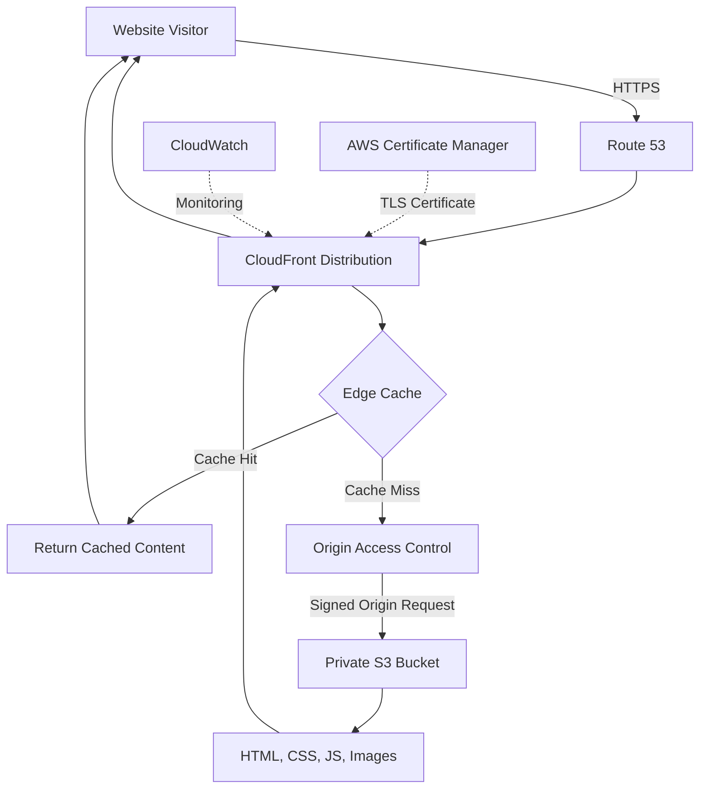
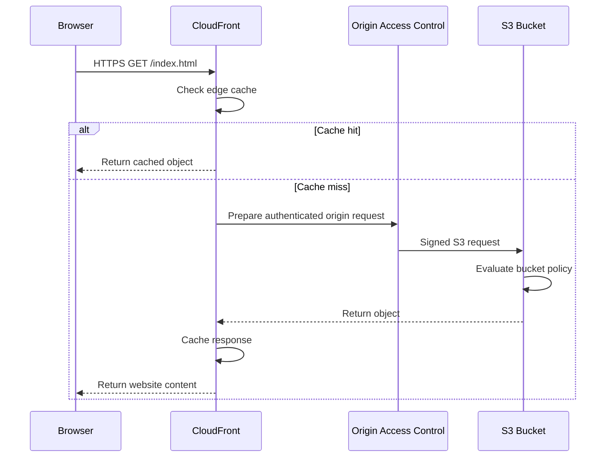
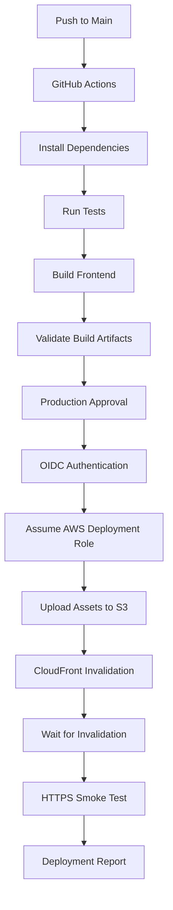

# 02- Private S3 Origin with CloudFront

## Overview

A private Amazon S3 bucket behind Amazon CloudFront is a production architecture for delivering static website content without exposing the S3 bucket directly to the public internet.

CloudFront acts as the public-facing content delivery layer, while S3 remains the private origin responsible for storing website assets.

The architecture uses **Origin Access Control (OAC)** to authorize CloudFront requests to S3.

This approach is suitable for:

- Production static websites.
- React, Angular, and Vue applications.
- Documentation portals.
- Public frontend applications.
- Static content distribution.
- Websites requiring HTTPS and custom domains.
- Globally distributed frontend applications.

The main security objective is to allow public users to access website content through CloudFront while preventing direct public access to the S3 bucket.

## Architecture Components

The architecture consists of several AWS services with separate responsibilities.

| Component | Responsibility |
|---|---|
| Amazon S3 | Stores website files and static assets |
| CloudFront | Delivers content through edge locations |
| Origin Access Control | Authenticates CloudFront requests to S3 |
| AWS Certificate Manager | Provides TLS certificates |
| Route 53 | Resolves the custom domain to CloudFront |
| AWS IAM | Controls access to AWS resources |
| CloudWatch | Provides operational monitoring |

### High-Level Architecture



### Component Responsibilities

**Amazon S3**

- Stores the static website build output.
- Keeps website objects private.
- Uses encryption at rest.
- Does not require public object ACLs.
- Allows CloudFront to retrieve authorized objects.

**CloudFront**

- Accepts viewer requests.
- Terminates HTTPS connections.
- Caches static content.
- Retrieves objects from S3 when required.
- Supports custom domains and cache policies.
- Can integrate with AWS WAF and CloudFront Functions.

**Origin Access Control**

- Signs CloudFront origin requests.
- Uses AWS Signature Version 4 for supported S3 origin authentication.
- Allows S3 to authorize requests from the intended distribution.
- Eliminates the need for public bucket access.

## Origin Access Control

### What Is OAC?

Origin Access Control is a CloudFront security mechanism that controls how CloudFront accesses supported origins, including private S3 buckets.

OAC is the recommended approach for securing an S3 origin behind CloudFront.

It replaces the older Origin Access Identity (OAI) approach for new deployments.

### Why OAC Exists

Without origin-level access control, a public S3 bucket can be accessed directly through its S3 object endpoint.

This creates an unnecessary public access path that bypasses CloudFront.

OAC solves this by allowing the S3 bucket to authorize requests from a specific CloudFront distribution.

The resulting access model is:

```text
Public Browser
      |
      v
CloudFront Distribution
      |
      | Authorized origin request
      v
Private S3 Bucket
```

Users access website content through CloudFront. They do not receive direct S3 access.

### OAC Request Flow



### OAC Signing Behavior

When configured to sign origin requests, CloudFront signs requests to S3 using AWS Signature Version 4.

The bucket policy authorizes the CloudFront service principal while restricting access to the intended distribution.

The origin request signing configuration should normally use:

```text
Signing behavior: Sign requests
Signing protocol: SigV4
```

This ensures that CloudFront authenticates its requests to the S3 origin.

### OAC vs OAI

| Feature | Origin Access Identity | Origin Access Control |
|---|---|---|
| Purpose | Restricts S3 access through CloudFront | Controls authenticated CloudFront origin access |
| Authentication | Legacy CloudFront identity mechanism | SigV4-signed requests |
| SSE-KMS integration | More limited | Supports SSE-KMS with appropriate KMS permissions |
| Dynamic S3 requests | Limited support | Supports additional S3 request methods when configured |
| Recommended for new deployments | No | Yes |
| Modern AWS recommendation | Legacy compatibility | Preferred |

Use OAC for new CloudFront and S3 architectures unless a specific compatibility requirement requires an existing OAI configuration.

## Private S3 Bucket Configuration

### Security Requirements

The S3 bucket should remain private.

Recommended settings:

| Setting | Recommended configuration |
|---|---|
| Block Public Access | Enabled |
| Object Ownership | Bucket owner enforced |
| ACLs | Disabled |
| Default encryption | Enabled |
| Versioning | Enabled where release recovery is required |
| Bucket policy | Allow only the intended CloudFront distribution |
| Public object access | Disabled |

For a typical static website, CloudFront needs read access to the website objects. It does not need permission to upload or delete objects.

### Bucket Policy

The bucket policy is the resource-based authorization mechanism that allows CloudFront to retrieve objects.

Example:

```json
{
  "Version": "2012-10-17",
  "Statement": [
    {
      "Sid": "AllowCloudFrontReadOnly",
      "Effect": "Allow",
      "Principal": {
        "Service": "cloudfront.amazonaws.com"
      },
      "Action": "s3:GetObject",
      "Resource": "arn:aws:s3:::my-private-website/*",
      "Condition": {
        "StringEquals": {
          "AWS:SourceArn": "arn:aws:cloudfront::123456789012:distribution/EXAMPLE123"
        }
      }
    }
  ]
}
```

Replace:

- `my-private-website` with the actual bucket name.
- `123456789012` with the AWS account ID.
- `EXAMPLE123` with the CloudFront distribution ID.

The `AWS:SourceArn` condition restricts access to the specified distribution.

For a read-only website origin, `s3:GetObject` is sufficient for retrieving objects.

Do not grant `s3:*` or bucket administration permissions to CloudFront.

### Enable Block Public Access

Using AWS CLI:

```bash
aws s3api put-public-access-block \
  --bucket my-private-website \
  --public-access-block-configuration \
  BlockPublicAcls=true,IgnorePublicAcls=true,BlockPublicPolicy=true,RestrictPublicBuckets=true
```

Inspect the configuration:

```bash
aws s3api get-public-access-block \
  --bucket my-private-website
```

### Verify Bucket Policy

```bash
aws s3api get-bucket-policy \
  --bucket my-private-website
```

Verify that the policy:

- Uses the CloudFront service principal.
- Grants only required object permissions.
- Restricts access using the intended distribution ARN.
- Does not contain unintended public access statements.

## CloudFront S3 Origin Configuration

### Use the S3 REST Endpoint

When using OAC, configure CloudFront with the S3 bucket origin rather than the S3 static website endpoint.

Example REST endpoint:

```text
my-private-website.s3.ap-south-1.amazonaws.com
```

Do not use:

```text
my-private-website.s3-website.ap-south-1.amazonaws.com
```

OAC does not support S3 website endpoints.

The REST origin allows CloudFront to authenticate using SigV4 and retrieve objects from a private bucket.

### Origin Configuration

Typical CloudFront origin settings:

| Configuration | Value |
|---|---|
| Origin domain | S3 regional REST endpoint |
| Origin type | Amazon S3 |
| Origin access | Origin Access Control |
| Signing behavior | Sign requests |
| Signing protocol | SigV4 |
| Origin path | Empty unless using a specific prefix |
| S3 bucket access | Private |

### Default Root Object

Configure the CloudFront distribution's default root object:

```text
index.html
```

This allows a request to the distribution root:

```text
https://www.example.com/
```

to retrieve:

```text
index.html
```

The default root object applies to the distribution root. It does not automatically resolve every nested path in a single-page application.

## HTTPS and Custom Domain

### CloudFront TLS Configuration

CloudFront supports HTTPS for viewer connections using an ACM certificate.

For CloudFront distributions, the ACM certificate must be provisioned in:

```text
us-east-1
```

This requirement applies even when the S3 bucket and other infrastructure resources are deployed in another Region.

### Custom Domain Configuration

Example:

```text
www.example.com
```

The configuration involves:

1. Requesting or importing an ACM certificate in `us-east-1`.
2. Validating domain ownership.
3. Adding the domain to CloudFront alternate domain names.
4. Associating the ACM certificate with the distribution.
5. Configuring the viewer protocol policy.
6. Creating Route 53 alias records.

Recommended viewer protocol policy:

```text
Redirect HTTP to HTTPS
```

This redirects HTTP requests to HTTPS instead of serving website content over an unencrypted connection.

### Route 53 Alias Records

Configure DNS records pointing to the CloudFront distribution.

| Record type | Purpose |
|---|---|
| A Alias | IPv4 resolution |
| AAAA Alias | IPv6 resolution |

For example:

```text
www.example.com -> CloudFront Distribution
```

The DNS record and CloudFront alternate domain name must be consistent.

## CloudFront Cache Configuration

Caching is a major performance and cost consideration for static websites.

CloudFront caches objects at edge locations according to the applicable cache policy and response metadata.

### Cache Behavior

A typical request follows this process:

1. Browser requests a static asset.
2. CloudFront checks the edge cache.
3. If the object is cached and valid, CloudFront returns it.
4. If the object is missing or expired, CloudFront retrieves it from S3.
5. CloudFront caches the response according to its caching configuration.

### Recommended Cache Strategy

| Content | Cache strategy |
|---|---|
| `index.html` | Short TTL or revalidation |
| Hashed JavaScript bundles | Long TTL |
| Hashed CSS bundles | Long TTL |
| Versioned images | Long TTL |
| Static fonts | Long TTL |
| Frequently updated configuration | Short TTL |
| API responses | Separate behavior and cache policy |

For immutable assets, a long-lived cache header is appropriate:

```http
Cache-Control: public, max-age=31536000, immutable
```

For the main HTML document, use a shorter cache policy:

```http
Cache-Control: public, max-age=60, s-maxage=300, must-revalidate
```

These values are examples. Select TTLs according to release frequency and consistency requirements.

### Why Hashed Asset Names Matter

Modern frontend build systems generate content-hashed filenames.

Example:

```text
assets/
├── app.8f31a2.js
├── styles.4b92d1.css
└── logo.12ab90.svg
```

When file content changes, the generated filename changes.

This provides several advantages:

- Old cached assets remain valid for existing clients.
- New releases reference new asset names.
- Cache invalidation requirements decrease.
- Rollback becomes easier when previous build artifacts are retained.

Avoid assigning immutable cache headers to files that are overwritten under the same key.

## Single-Page Application Routing

React, Vue, and Angular applications commonly use client-side routing.

For example:

```text
/
├── /dashboard
├── /users
├── /settings
└── /reports
```

The frontend router handles these paths after loading `index.html`.

However, a direct request to:

```text
https://www.example.com/dashboard
```

can cause CloudFront to request an S3 object named `dashboard`.

If that object does not exist, the request can return an error.

### CloudFront Custom Error Responses

A simple SPA configuration can map missing-page responses to the application entry point.

| Origin error | Response page | Viewer response code |
|---|---|---|
| 403 | `/index.html` | 200 |
| 404 | `/index.html` | 200 |

This allows the frontend router to handle the requested route.

However, globally mapping all 403 and 404 responses can hide genuine missing assets or authorization failures.

For example:

```text
/assets/missing.js
```

should not silently return the application's HTML document.

For more precise routing, use CloudFront Functions or another request-routing mechanism to distinguish application routes from static asset requests.

Do not treat every S3 403 response as proof that an object is missing. A 403 can also indicate an authorization problem.

## Infrastructure Provisioning with Terraform

Terraform can provision the S3 bucket, CloudFront distribution, OAC, and bucket policy.

The following example demonstrates the core infrastructure relationship.

It assumes:

- Terraform is installed.
- AWS credentials are configured through an appropriate identity.
- The target AWS account and Region are selected.
- Website assets are available locally.
- An ACM certificate already exists in `us-east-1`.

### Terraform Configuration

Example structure:

```text
terraform/
├── versions.tf
├── variables.tf
├── main.tf
├── outputs.tf
└── terraform.tfvars
```

### Provider and Version Constraints

`versions.tf`

```hcl
terraform {
  required_version = ">= 1.9.0, < 2.0.0"

  required_providers {
    aws = {
      source  = "hashicorp/aws"
      version = "~> 5.0"
    }
  }
}

provider "aws" {
  region = var.aws_region
}

provider "aws" {
  alias  = "us_east_1"
  region = "us-east-1"
}
```

The second provider is useful when Terraform also manages the ACM certificate required by CloudFront.

The example below references an existing certificate instead of creating one.

### Variables

`variables.tf`

```hcl
variable "aws_region" {
  description = "AWS Region for the S3 bucket."
  type        = string
  default     = "ap-south-1"
}

variable "bucket_name" {
  description = "Globally unique S3 bucket name."
  type        = string
}

variable "domain_name" {
  description = "Website custom domain."
  type        = string
}

variable "acm_certificate_arn" {
  description = "ACM certificate ARN in us-east-1."
  type        = string
}

variable "tags" {
  description = "Common resource tags."
  type        = map(string)
  default = {
    ManagedBy   = "Terraform"
    Application = "StaticWebsite"
  }
}
```

### S3 Bucket and CloudFront Distribution

`main.tf`

```hcl
resource "aws_s3_bucket" "website" {
  bucket = var.bucket_name

  tags = var.tags
}

resource "aws_s3_bucket_ownership_controls" "website" {
  bucket = aws_s3_bucket.website.id

  rule {
    object_ownership = "BucketOwnerEnforced"
  }
}

resource "aws_s3_bucket_public_access_block" "website" {
  bucket = aws_s3_bucket.website.id

  block_public_acls       = true
  block_public_policy     = true
  ignore_public_acls      = true
  restrict_public_buckets = true
}

resource "aws_s3_bucket_versioning" "website" {
  bucket = aws_s3_bucket.website.id

  versioning_configuration {
    status = "Enabled"
  }
}

resource "aws_s3_bucket_server_side_encryption_configuration" "website" {
  bucket = aws_s3_bucket.website.id

  rule {
    apply_server_side_encryption_by_default {
      sse_algorithm = "AES256"
    }
  }
}

resource "aws_cloudfront_origin_access_control" "website" {
  name                              = "${var.bucket_name}-oac"
  description                       = "OAC for private S3 website origin"
  origin_access_control_origin_type = "s3"
  signing_behavior                  = "always"
  signing_protocol                  = "sigv4"
}

resource "aws_cloudfront_distribution" "website" {
  enabled             = true
  default_root_object = "index.html"
  aliases             = [var.domain_name]

  origin {
    domain_name              = aws_s3_bucket.website.bucket_regional_domain_name
    origin_id                = "private-s3-origin"
    origin_access_control_id = aws_cloudfront_origin_access_control.website.id
  }

  default_cache_behavior {
    target_origin_id       = "private-s3-origin"
    viewer_protocol_policy = "redirect-to-https"

    allowed_methods = ["GET", "HEAD", "OPTIONS"]
    cached_methods  = ["GET", "HEAD", "OPTIONS"]

    compress = true

    forwarded_values {
      query_string = false

      cookies {
        forward = "none"
      }
    }
  }

  custom_error_response {
    error_code            = 403
    response_code         = 200
    response_page_path    = "/index.html"
    error_caching_min_ttl = 0
  }

  custom_error_response {
    error_code            = 404
    response_code         = 200
    response_page_path    = "/index.html"
    error_caching_min_ttl = 0
  }

  restrictions {
    geo_restriction {
      restriction_type = "none"
    }
  }

  viewer_certificate {
    acm_certificate_arn      = var.acm_certificate_arn
    ssl_support_method       = "sni-only"
    minimum_protocol_version = "TLSv1.2_2021"
  }

  tags = var.tags
}

data "aws_iam_policy_document" "cloudfront_access" {
  statement {
    sid    = "AllowCloudFrontReadOnly"
    effect = "Allow"

    principals {
      type        = "Service"
      identifiers = ["cloudfront.amazonaws.com"]
    }

    actions = [
      "s3:GetObject"
    ]

    resources = [
      "${aws_s3_bucket.website.arn}/*"
    ]

    condition {
      test     = "StringEquals"
      variable = "AWS:SourceArn"

      values = [
        aws_cloudfront_distribution.website.arn
      ]
    }
  }
}

resource "aws_s3_bucket_policy" "website" {
  bucket = aws_s3_bucket.website.id
  policy = data.aws_iam_policy_document.cloudfront_access.json
}
```

**Important implementation notes:**

- The bucket is private.
- OAC signs CloudFront origin requests.
- The bucket policy restricts access to the intended distribution.
- The distribution uses the S3 REST origin.
- The ACM certificate must exist in `us-east-1`.
- The SPA error mappings are a simple example and may need more precise routing.
- The `forwarded_values` configuration is shown for a straightforward example. Production implementations should prefer explicit CloudFront cache and origin request policies.

For a production deployment, define separate cache behaviors and policies for HTML, immutable assets, and any API origins.

### Terraform Outputs

`outputs.tf`

```hcl
output "bucket_name" {
  description = "Private S3 website bucket."
  value       = aws_s3_bucket.website.bucket
}

output "cloudfront_distribution_id" {
  description = "CloudFront distribution ID."
  value       = aws_cloudfront_distribution.website.id
}

output "cloudfront_domain_name" {
  description = "CloudFront distribution domain."
  value       = aws_cloudfront_distribution.website.domain_name
}

output "website_url" {
  description = "Custom website URL."
  value       = "https://${var.domain_name}"
}
```

### Terraform Variables

`terraform.tfvars`

```hcl
aws_region          = "ap-south-1"
bucket_name         = "my-company-static-website"
domain_name         = "www.example.com"
acm_certificate_arn = "arn:aws:acm:us-east-1:123456789012:certificate/EXAMPLE-CERTIFICATE-ID"
```

Do not commit sensitive values or environment-specific secrets into version control.

### Deploy Infrastructure

Initialize Terraform:

```bash
terraform init
```

Format configuration:

```bash
terraform fmt -recursive
```

Validate:

```bash
terraform validate
```

Review the infrastructure plan:

```bash
terraform plan -out=tfplan
```

Apply the reviewed plan:

```bash
terraform apply tfplan
```

CloudFront distribution deployment is asynchronous. Wait until the distribution reaches the `Deployed` state before relying on it for production traffic.

## Uploading Website Assets

After infrastructure provisioning, upload the frontend build output to S3.

For example, a React application may produce:

```text
dist/
├── index.html
└── assets/
    ├── app.8f31a2.js
    └── styles.4b92d1.css
```

Upload the assets:

```bash
aws s3 sync ./dist s3://my-company-static-website \
  --delete \
  --cache-control "public,max-age=31536000,immutable"
```

The command above applies the same cache-control metadata to every uploaded object. That is not appropriate for a typical frontend release because `index.html` should generally have a shorter cache lifetime.

A safer deployment separates HTML and immutable assets.

Upload assets:

```bash
aws s3 sync ./dist/assets \
  s3://my-company-static-website/assets \
  --delete \
  --cache-control "public,max-age=31536000,immutable"
```

Upload the entry document separately:

```bash
aws s3 cp ./dist/index.html \
  s3://my-company-static-website/index.html \
  --content-type "text/html; charset=utf-8" \
  --cache-control "public,max-age=60,s-maxage=300,must-revalidate"
```

Upload other static files using content-type and cache metadata appropriate to their purpose.

Do not assume that a single recursive upload command produces correct metadata for every file type.

## CloudFront Cache Invalidation

CloudFront may continue serving cached objects after an S3 object is replaced.

Create an invalidation when an object must be refreshed before its TTL expires.

Example:

```bash
aws cloudfront create-invalidation \
  --distribution-id EXAMPLE123 \
  --paths "/index.html"
```

For a broader invalidation:

```bash
aws cloudfront create-invalidation \
  --distribution-id EXAMPLE123 \
  --paths "/*"
```

Invalidating every object is operationally simple but may be unnecessary and can increase deployment costs.

Prefer immutable asset names and invalidate only mutable entry documents or configuration files.

Check invalidation status:

```bash
aws cloudfront list-invalidations \
  --distribution-id EXAMPLE123
```

For a specific invalidation:

```bash
aws cloudfront get-invalidation \
  --distribution-id EXAMPLE123 \
  --id INVALIDATION_ID
```

## Deployment Verification

A deployment is not complete merely because Terraform reports success or the asset upload command exits successfully.

Verify the infrastructure and the viewer-facing application.

### Verify S3 Bucket Security

Check public access configuration:

```bash
aws s3api get-public-access-block \
  --bucket my-company-static-website
```

Check ownership controls:

```bash
aws s3api get-bucket-ownership-controls \
  --bucket my-company-static-website
```

Check encryption:

```bash
aws s3api get-bucket-encryption \
  --bucket my-company-static-website
```

Check versioning:

```bash
aws s3api get-bucket-versioning \
  --bucket my-company-static-website
```

### Verify CloudFront Configuration

Inspect the distribution:

```bash
aws cloudfront get-distribution \
  --id EXAMPLE123
```

Inspect its deployment status:

```bash
aws cloudfront get-distribution \
  --id EXAMPLE123 \
  --query 'Distribution.Status' \
  --output text
```

Expected final status:

```text
Deployed
```

Inspect the origin configuration:

```bash
aws cloudfront get-distribution-config \
  --id EXAMPLE123
```

Verify:

- The origin references the S3 REST endpoint.
- OAC is associated with the origin.
- The default root object is configured.
- HTTPS redirection is enabled.
- The intended certificate is associated.
- The distribution uses the expected domain names.

### Verify Website Access

Test the public website:

```bash
curl -I https://www.example.com/
```

Expected response:

```http
HTTP/2 200
content-type: text/html
```

Test a static asset:

```bash
curl -I https://www.example.com/assets/app.8f31a2.js
```

Check that the asset is served successfully with the expected cache headers.

Test direct S3 access:

```bash
curl -I https://my-company-static-website.s3.ap-south-1.amazonaws.com/index.html
```

For an unauthenticated public request, direct object access should not be granted.

Depending on the bucket policy and S3 error behavior, the response may be `403 Forbidden` or another authorization-related error. Do not expose the bucket merely to make this request succeed.

### Verify Cache Behavior

Inspect response headers:

```bash
curl -I https://www.example.com/
```

Useful headers include:

- `Cache-Control`
- `Age`
- `ETag`
- `Last-Modified`
- `Via`
- `X-Cache`

`X-Cache` commonly indicates whether CloudFront served a cached response or fetched it from the origin.

## Deployment Automation with GitHub Actions

A production static website deployment should automate:

- Frontend dependency installation.
- Build and test execution.
- Artifact validation.
- AWS authentication using OIDC.
- S3 asset upload.
- CloudFront invalidation.
- Deployment smoke tests.

### Deployment Flow



### Example GitHub Actions Workflow

The following example assumes:

- A Node.js frontend project.
- `npm ci` installs dependencies.
- `npm run build` creates `dist/`.
- A GitHub Environment named `production` is configured.
- AWS OIDC federation is configured.
- The deployment role has narrowly scoped S3 and CloudFront permissions.

```yaml
name: Deploy Static Website

on:
  push:
    branches:
      - main

  workflow_dispatch:

permissions:
  contents: read

concurrency:
  group: static-website-production
  cancel-in-progress: false

jobs:
  build:
    name: Build and Test Website
    runs-on: ubuntu-latest

    steps:
      - name: Checkout repository
        uses: actions/checkout@v4

      - name: Set up Node.js
        uses: actions/setup-node@v4
        with:
          node-version: "22"
          cache: npm

      - name: Install dependencies
        run: npm ci

      - name: Run tests
        run: npm test -- --run

      - name: Build website
        run: npm run build

      - name: Validate build output
        run: |
          set -euo pipefail

          test -f dist/index.html
          test -d dist/assets

      - name: Upload build artifact
        uses: actions/upload-artifact@v4
        with:
          name: website-build-${{ github.sha }}
          path: dist/
          if-no-files-found: error
          retention-days: 3

  deploy:
    name: Deploy Production Website
    runs-on: ubuntu-latest
    needs: build

    environment: production

    permissions:
      contents: read
      id-token: write

    env:
      AWS_REGION: ${{ vars.AWS_REGION }}
      AWS_ACCOUNT_ID: ${{ vars.AWS_ACCOUNT_ID }}
      S3_BUCKET_NAME: ${{ vars.S3_BUCKET_NAME }}
      CLOUDFRONT_DISTRIBUTION_ID: ${{ vars.CLOUDFRONT_DISTRIBUTION_ID }}
      WEBSITE_URL: ${{ vars.WEBSITE_URL }}

    steps:
      - name: Checkout repository
        uses: actions/checkout@v4

      - name: Download build artifact
        uses: actions/download-artifact@v4
        with:
          name: website-build-${{ github.sha }}
          path: dist/

      - name: Configure AWS credentials using OIDC
        uses: aws-actions/configure-aws-credentials@v4
        with:
          role-to-assume: ${{ vars.AWS_DEPLOY_ROLE_ARN }}
          aws-region: ${{ env.AWS_REGION }}
          role-session-name: website-deploy-${{ github.run_id }}

      - name: Verify AWS identity
        run: |
          set -euo pipefail

          actual_account="$(aws sts get-caller-identity \
            --query Account \
            --output text)"

          if [[ "$actual_account" != "$AWS_ACCOUNT_ID" ]]; then
            echo "Unexpected AWS account."
            exit 1
          fi

      - name: Validate deployment configuration
        run: |
          set -euo pipefail

          for value in \
            "$AWS_REGION" \
            "$AWS_ACCOUNT_ID" \
            "$S3_BUCKET_NAME" \
            "$CLOUDFRONT_DISTRIBUTION_ID" \
            "$WEBSITE_URL"; do
            if [[ -z "$value" ]]; then
              echo "Required deployment configuration is missing."
              exit 1
            fi
          done

      - name: Upload immutable assets
        run: |
          set -euo pipefail

          aws s3 sync ./dist/assets \
            "s3://${S3_BUCKET_NAME}/assets/" \
            --delete \
            --cache-control "public,max-age=31536000,immutable"

      - name: Upload website entry document
        run: |
          set -euo pipefail

          aws s3 cp ./dist/index.html \
            "s3://${S3_BUCKET_NAME}/index.html" \
            --content-type "text/html; charset=utf-8" \
            --cache-control "public,max-age=60,s-maxage=300,must-revalidate"

      - name: Invalidate CloudFront HTML document
        run: |
          set -euo pipefail

          invalidation_id="$(aws cloudfront create-invalidation \
            --distribution-id "$CLOUDFRONT_DISTRIBUTION_ID" \
            --paths "/index.html" \
            --query 'Invalidation.Id' \
            --output text)"

          echo "Invalidation ID: $invalidation_id"

          aws cloudfront wait invalidation-completed \
            --distribution-id "$CLOUDFRONT_DISTRIBUTION_ID" \
            --id "$invalidation_id"

      - name: Run website smoke test
        run: |
          set -euo pipefail

          for attempt in $(seq 1 10); do
            if curl --fail --silent --show-error \
              --output /dev/null \
              "$WEBSITE_URL/"; then
              echo "Website smoke test passed."
              exit 0
            fi

            sleep 10
          done

          echo "Website smoke test failed."
          exit 1
```

The workflow is an example deployment pipeline, not a complete infrastructure provisioning workflow.

For a hardened production pipeline:

- Pin third-party actions to verified full commit SHAs.
- Restrict the OIDC trust policy to the intended repository and production environment.
- Configure required reviewers for the production environment.
- Restrict deployment to the protected `main` branch.
- Validate every deployment variable before performing changes.
- Scope IAM permissions to the target bucket and distribution.
- Ensure asset synchronization cannot remove files needed by an active release.
- Retain previous build artifacts for rollback.

The deployment role should not receive broad S3 administration permissions.

## IAM Permissions for Deployment

The deployment workflow needs permissions different from the CloudFront origin-access policy.

CloudFront requires read access to website objects. The deployment role requires permission to upload and manage release assets.

A simplified deployment permission set may include:

```json
{
  "Version": "2012-10-17",
  "Statement": [
    {
      "Sid": "ListWebsiteBucket",
      "Effect": "Allow",
      "Action": [
        "s3:ListBucket"
      ],
      "Resource": "arn:aws:s3:::my-company-static-website"
    },
    {
      "Sid": "ManageWebsiteObjects",
      "Effect": "Allow",
      "Action": [
        "s3:PutObject",
        "s3:GetObject",
        "s3:DeleteObject"
      ],
      "Resource": "arn:aws:s3:::my-company-static-website/*"
    },
    {
      "Sid": "InvalidateCloudFront",
      "Effect": "Allow",
      "Action": [
        "cloudfront:CreateInvalidation",
        "cloudfront:GetInvalidation"
      ],
      "Resource": "arn:aws:cloudfront::123456789012:distribution/EXAMPLE123"
    }
  ]
}
```

This is an illustrative policy. Refine permissions according to the deployment commands, release strategy, and resource ownership model.

The deployment role should not be confused with the CloudFront service principal.

## Rollback and Recovery

Static website deployment failures can occur after assets have been uploaded but before the new release is fully available.

A reliable release strategy should preserve the ability to restore the previous version.

### Common Failure Scenarios

| Failure | Possible impact | Recovery |
|---|---|---|
| Build failure | No valid release artifact | Fix build and rerun pipeline |
| Partial asset upload | Mixed release assets | Re-deploy the complete release |
| Incorrect `index.html` | Broken application entry point | Restore previous entry document |
| CloudFront invalidation failure | Cached old content remains | Retry invalidation |
| Incorrect bucket policy | CloudFront receives authorization errors | Restore the correct origin policy |
| Certificate mismatch | HTTPS or custom domain failure | Correct certificate and distribution configuration |
| Incorrect cache headers | Stale or unexpectedly uncached assets | Correct object metadata and cache policies |

### Release Versioning

A robust approach is to retain release artifacts and use immutable asset filenames.

For example:

```text
releases/
├── release-2026-10-31/
│   ├── index.html
│   └── assets/
└── release-2026-11-01/
    ├── index.html
    └── assets/
```

The website's active entry document can reference assets from a specific release.

For example:

```html
<script src="/releases/release-2026-11-01/assets/app.js"></script>
```

When rolling back, restore the previous entry document and invalidate its CloudFront cache.

Retain previous release assets until no active HTML document or client session depends on them.

### S3 Versioning Recovery

When bucket versioning is enabled, previous object versions can be restored.

Inspect versions:

```bash
aws s3api list-object-versions \
  --bucket my-company-static-website \
  --prefix index.html
```

Copy a previous version back to the current object:

```bash
aws s3api copy-object \
  --bucket my-company-static-website \
  --key index.html \
  --copy-source my-company-static-website/index.html?versionId=VERSION_ID
```

After restoring the object, invalidate the relevant CloudFront path if cached content must be refreshed immediately.

Versioning is useful for object-level recovery, but it is not a complete release management strategy.

## Monitoring and Cost Considerations

### Monitoring

Monitor the CloudFront distribution and S3 origin behavior.

Useful CloudFront metrics include:

| Metric | Operational purpose |
|---|---|
| Requests | Measures viewer traffic |
| BytesDownloaded | Measures delivered data |
| BytesUploaded | Measures viewer upload traffic where applicable |
| 4xxErrorRate | Identifies client and authorization errors |
| 5xxErrorRate | Identifies origin and service failures |
| CacheHitRate | Measures cache effectiveness |
| OriginLatency | Helps identify origin response delays |

Use CloudFront standard or real-time logs when request-level analysis is required.

Use CloudTrail for relevant S3 control-plane and data events according to the auditing configuration.

### Cost Components

The architecture can incur charges for:

- S3 storage.
- S3 requests.
- CloudFront requests.
- CloudFront data transfer.
- Cache invalidations beyond applicable allowances.
- CloudWatch metrics and logs.
- CloudTrail data events when enabled.
- Route 53 hosted zones and queries.
- AWS WAF if configured.

### Cost Optimization

- Use content-hashed assets and long-lived caching.
- Avoid unnecessary full-distribution invalidations.
- Compress eligible content.
- Choose an appropriate CloudFront price class.
- Review request and data-transfer patterns.
- Avoid excessive logging retention.
- Remove unused distributions and resources after testing.

## Common Mistakes

| Mistake | Why It Happens | Prevention |
|---|---|---|
| Using an S3 website endpoint with OAC | Website and REST endpoints are confused | Use the S3 REST origin |
| Making the bucket public | Direct website access is used as a shortcut | Keep Block Public Access enabled |
| Missing the `AWS:SourceArn` condition | Bucket policy is not restricted to a distribution | Scope the policy to the intended distribution ARN |
| Granting CloudFront write permissions | Origin and deployment permissions are mixed | Give CloudFront read-only object access |
| Using the wrong ACM Region | CloudFront certificate requirements are overlooked | Provision the certificate in `us-east-1` |
| Applying immutable caching to HTML | All assets are uploaded with identical metadata | Use separate cache headers for HTML and hashed assets |
| Invalidating every deployment path | Cache strategy is not designed around immutable assets | Invalidate only mutable objects |
| Treating every 403 as a missing SPA route | Authorization failures are hidden by error mapping | Distinguish routing failures from access failures |
| Deleting old assets immediately | Active clients may still reference previous assets | Retain previous release assets |
| Using one IAM role for everything | Infrastructure and application deployment responsibilities are mixed | Separate provisioning, deployment, and origin access permissions |

## Production Readiness Checklist

### S3

- [ ] Bucket is private.
- [ ] Block Public Access is enabled.
- [ ] Object Ownership is bucket-owner-enforced.
- [ ] Default encryption is enabled.
- [ ] Versioning is enabled when release recovery requires it.
- [ ] Bucket policy grants only the intended CloudFront distribution access.
- [ ] No unnecessary public ACLs or policies exist.

### CloudFront

- [ ] S3 REST endpoint is configured as the origin.
- [ ] OAC is associated with the origin.
- [ ] Signing behavior is configured to sign requests.
- [ ] Default root object is configured.
- [ ] HTTPS is enforced.
- [ ] Custom domain names are configured.
- [ ] ACM certificate is in `us-east-1`.
- [ ] Cache policies match asset behavior.
- [ ] SPA routing does not hide genuine missing assets.

### CI/CD

- [ ] Build and tests run before deployment.
- [ ] AWS authentication uses OIDC.
- [ ] Production deployment uses a protected GitHub Environment.
- [ ] Deployment role follows least privilege.
- [ ] AWS account identity is verified.
- [ ] Assets and HTML use appropriate cache metadata.
- [ ] CloudFront invalidation is controlled.
- [ ] Smoke tests verify the public website.
- [ ] Previous release artifacts are retained.

## Key Takeaways

- A private S3 bucket behind CloudFront OAC provides controlled public website delivery without exposing the bucket directly.
- OAC requires an S3 REST origin and uses signed requests; it does not support S3 website endpoints.
- CloudFront, ACM, Route 53, and S3 have separate responsibilities in a production static website architecture.
- Immutable asset names, deliberate cache policies, and controlled invalidation improve deployment reliability and performance.
- Production deployments should use OIDC, least-privilege IAM, protected environments, deployment verification, and a tested rollback strategy.