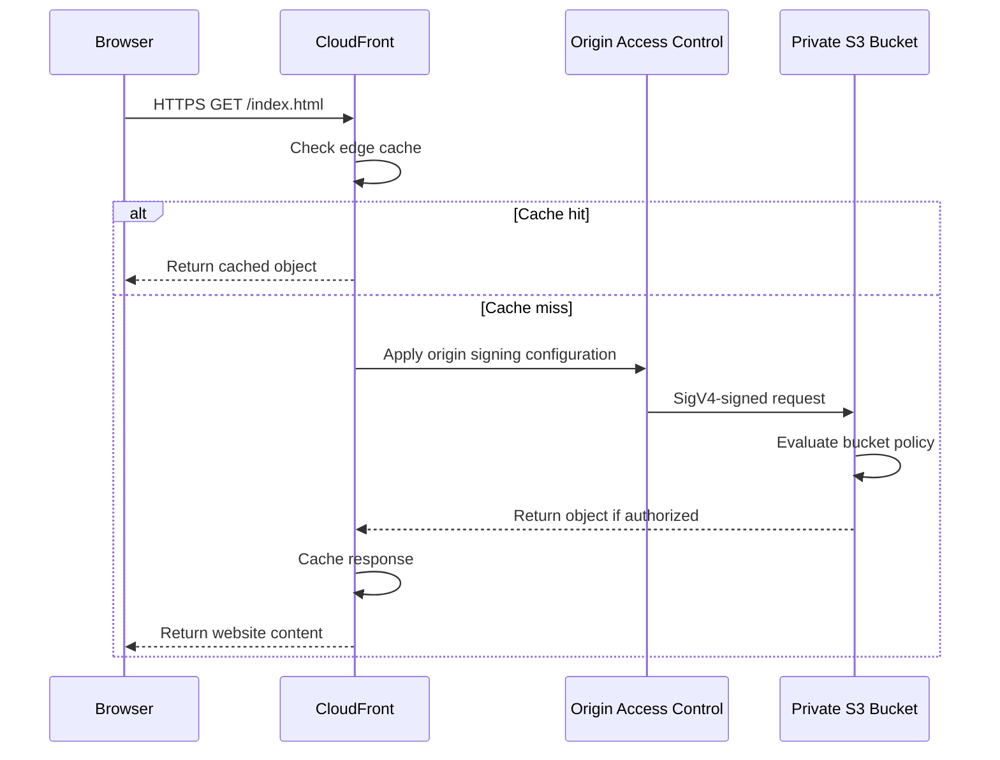
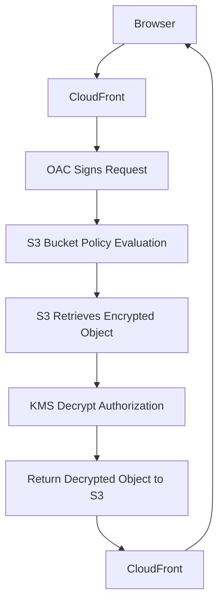

# 03- Origin Access Control Configuration

## Overview

Origin Access Control (OAC) is a CloudFront security mechanism that allows a CloudFront distribution to access a private Amazon S3 bucket without making the bucket publicly accessible.

OAC authenticates requests sent from CloudFront to S3 using AWS Signature Version 4 (SigV4). The S3 bucket policy determines whether the authenticated CloudFront request is authorized to retrieve the requested objects.

For production static website hosting, OAC provides a controlled trust relationship between CloudFront and S3:

- CloudFront is the public-facing content delivery layer.
- S3 remains a private storage origin.
- OAC signs requests from CloudFront to S3.
- The bucket policy restricts access to the intended CloudFront distribution.
- Public users retrieve content through CloudFront rather than accessing S3 directly.

OAC is the recommended approach for new CloudFront distributions using private S3 bucket origins.

## OAC Architecture

### Core Components

| Component | Responsibility |
|---|---|
| CloudFront distribution | Receives viewer requests and delivers cached content |
| S3 origin | Stores website objects |
| Origin Access Control | Configures authenticated requests from CloudFront to S3 |
| AWS Signature Version 4 | Signs origin requests |
| S3 bucket policy | Authorizes the CloudFront distribution to retrieve objects |
| AWS IAM | Provides the service principal and resource-policy authorization model |

### Request Flow



OAC does not independently grant access to the bucket. It configures how CloudFront authenticates origin requests. The S3 bucket policy must explicitly authorize the intended distribution.

## OAC Configuration Options

When creating an OAC, configure its origin type, signing behavior, and signing protocol.

### Origin Type

For a private S3 bucket origin, use:

```text
s3
```

OAC supports specific AWS origin types. For this architecture, the relevant origin is an S3 bucket REST endpoint.

### Signing Protocol

Use:

```text
sigv4
```

CloudFront signs supported origin requests using AWS Signature Version 4.

### Signing Behavior

| Behavior | Description | Typical use |
|---|---|---|
| `always` | CloudFront always signs origin requests | Recommended for private S3 origins |
| `no-override` | CloudFront signs requests unless the viewer request contains an `Authorization` header that is forwarded to the origin | Specific authorization-forwarding designs |
| `never` | CloudFront does not sign origin requests | Origins that do not require OAC signing |

For a private S3 website origin, use `always`.

This avoids relying on viewer-provided authorization headers and ensures that CloudFront authenticates its origin requests.

### Recommended OAC Configuration

```text
Origin type:       S3
Signing behavior:  Sign requests (always)
Signing protocol:  SigV4
```

## Create OAC Using AWS Console

### Prerequisites

Before creating OAC, ensure that:

- The S3 bucket exists.
- The bucket is configured as a private bucket.
- Block Public Access is enabled.
- Object Ownership is configured as bucket-owner-enforced.
- A CloudFront distribution is available or being created.
- The S3 REST endpoint is used as the origin.

### Configuration Steps

1. Open the AWS Management Console.
2. Navigate to Amazon CloudFront.
3. Open **Origin access**.
4. Select **Origin access controls**.
5. Choose **Create control setting**.
6. Enter a descriptive name.
7. Select `S3` as the origin type.
8. Select **Sign requests**.
9. Select **Sign requests using SigV4**.
10. Create the OAC.

Example configuration:

| Field | Value |
|---|---|
| Name | `private-website-oac` |
| Description | OAC for private S3 website origin |
| Origin type | S3 |
| Signing behavior | Sign requests |
| Signing protocol | SigV4 |

After creating the OAC, associate it with the S3 origin in the CloudFront distribution.

## Create OAC Using AWS CLI

OAC can also be created using the CloudFront API through AWS CLI.

### Create the OAC Configuration

Create a file named `oac-config.json`:

```json
{
  "Name": "private-website-oac",
  "Description": "OAC for private S3 website origin",
  "SigningProtocol": "sigv4",
  "SigningBehavior": "always",
  "OriginAccessControlOriginType": "s3"
}
```

Create the OAC:

```bash
aws cloudfront create-origin-access-control \
  --origin-access-control-config file://oac-config.json
```

The response includes the OAC ID.

Example response structure:

```json
{
  "OriginAccessControl": {
    "Id": "EXAMPLEOAC123",
    "OriginAccessControlConfig": {
      "Name": "private-website-oac",
      "Description": "OAC for private S3 website origin",
      "SigningProtocol": "sigv4",
      "SigningBehavior": "always",
      "OriginAccessControlOriginType": "s3"
    }
  },
  "Location": "https://cloudfront.amazonaws.com/2020-05-31/origin-access-control/EXAMPLEOAC123",
  "ETag": "EXAMPLEETAG"
}
```

The identifiers above are illustrative.

### List OAC Configurations

```bash
aws cloudfront list-origin-access-controls
```

### Inspect a Specific OAC

```bash
aws cloudfront get-origin-access-control \
  --id EXAMPLEOAC123
```

### Delete an OAC

An OAC cannot be deleted while it is associated with a CloudFront distribution.

The safe sequence is:

1. Update the distribution to remove the OAC association.
2. Wait until the distribution update is deployed.
3. Retrieve the OAC's current ETag.
4. Delete the OAC.

```bash
aws cloudfront delete-origin-access-control \
  --id EXAMPLEOAC123 \
  --if-match EXAMPLEETAG
```

Do not delete an OAC that is still referenced by an active distribution.

## Associate OAC with a CloudFront Origin

Creating an OAC does not automatically connect it to an S3 bucket.

The CloudFront distribution's origin configuration must reference the OAC ID.

### Origin Configuration

The relevant CloudFront origin configuration contains:

```json
{
  "Id": "private-s3-origin",
  "DomainName": "my-private-website.s3.ap-south-1.amazonaws.com",
  "OriginAccessControlId": "EXAMPLEOAC123",
  "S3OriginConfig": {
    "OriginAccessIdentity": ""
  }
}
```

The empty `OriginAccessIdentity` field indicates that the origin is not using an OAI.

For an OAC-based origin:

- Use the S3 regional REST endpoint.
- Set `OriginAccessControlId` to the OAC ID.
- Keep `OriginAccessIdentity` empty.
- Configure the bucket policy to authorize the distribution.

### Update a CloudFront Distribution

CloudFront distribution updates require the current distribution configuration and its ETag.

Retrieve the current configuration:

```bash
aws cloudfront get-distribution-config \
  --id EXAMPLEDIST
```

The response contains:

- `DistributionConfig`
- `ETag`

Update the `DistributionConfig` JSON to associate the OAC with the intended S3 origin.

Apply the update:

```bash
aws cloudfront update-distribution \
  --id EXAMPLEDIST \
  --if-match EXAMPLEETAG \
  --distribution-config file://distribution-config.json
```

Use the complete distribution configuration returned by AWS as the starting point. Do not construct a partial configuration and submit it as a complete distribution update.

CloudFront distribution updates are asynchronous. Wait until the distribution status becomes `Deployed`.

## Configure the S3 Bucket Policy

### Why the Bucket Policy Is Required

OAC authenticates CloudFront origin requests, but S3 still evaluates authorization.

The bucket policy must grant the CloudFront service principal permission to retrieve objects from the bucket.

The policy should restrict access to the intended distribution using the `AWS:SourceArn` condition.

### Recommended Read-Only Policy

```json
{
  "Version": "2012-10-17",
  "Statement": [
    {
      "Sid": "AllowCloudFrontReadOnly",
      "Effect": "Allow",
      "Principal": {
        "Service": "cloudfront.amazonaws.com"
      },
      "Action": "s3:GetObject",
      "Resource": "arn:aws:s3:::my-private-website/*",
      "Condition": {
        "StringEquals": {
          "AWS:SourceArn": "arn:aws:cloudfront::123456789012:distribution/EXAMPLEDIST"
        }
      }
    }
  ]
}
```

Replace the example bucket name, account ID, and distribution ID with the actual resource identifiers.

### Policy Components

| Element | Purpose |
|---|---|
| `Principal` | Identifies CloudFront as the requesting AWS service |
| `Action` | Grants permission to retrieve objects |
| `Resource` | Restricts access to objects in the bucket |
| `AWS:SourceArn` | Restricts access to the specified CloudFront distribution |
| `Effect` | Allows the matching request |

The policy does not grant CloudFront permission to upload, delete, or modify website objects.

### Apply the Bucket Policy

Save the policy as:

```text
cloudfront-bucket-policy.json
```

Apply it:

```bash
aws s3api put-bucket-policy \
  --bucket my-private-website \
  --policy file://cloudfront-bucket-policy.json
```

Inspect the policy:

```bash
aws s3api get-bucket-policy \
  --bucket my-private-website
```

### Keep Block Public Access Enabled

OAC does not require public bucket access.

Configure all four S3 Block Public Access settings:

```bash
aws s3api put-public-access-block \
  --bucket my-private-website \
  --public-access-block-configuration \
  BlockPublicAcls=true,IgnorePublicAcls=true,BlockPublicPolicy=true,RestrictPublicBuckets=true
```

Verify:

```bash
aws s3api get-public-access-block \
  --bucket my-private-website
```

A bucket policy that grants access to the CloudFront service principal under a restricted `AWS:SourceArn` condition is not the same as granting public access.

## OAC with SSE-KMS Encryption

When S3 objects use SSE-KMS, authorization involves both S3 and AWS KMS.

CloudFront must be permitted to retrieve the encrypted object from S3, and the KMS key policy or applicable IAM permissions must allow the required decryption operation.

### Request Flow



### KMS Key Policy

A customer-managed KMS key requires an appropriate key policy.

An example statement allowing the intended CloudFront distribution to use the key for decryption is:

```json
{
  "Sid": "AllowCloudFrontDistributionDecrypt",
  "Effect": "Allow",
  "Principal": {
    "Service": "cloudfront.amazonaws.com"
  },
  "Action": [
    "kms:Decrypt"
  ],
  "Resource": "*",
  "Condition": {
    "StringEquals": {
      "AWS:SourceArn": "arn:aws:cloudfront::123456789012:distribution/EXAMPLEDIST"
    }
  }
}
```

This statement is an illustrative key-policy statement. Integrate it into the complete KMS key policy without removing required administrative and recovery permissions.

The KMS key policy must also be compatible with the bucket's encryption configuration and the CloudFront origin access design.

### Important Authorization Distinction

| Failure | Authorization layer to investigate |
|---|---|
| S3 `AccessDenied` | Bucket policy, CloudFront distribution ARN, S3 permissions |
| KMS `AccessDenied` | KMS key policy, grants, and applicable IAM permissions |
| CloudFront 403 | Origin configuration, S3 authorization, KMS authorization, or object availability |

Do not troubleshoot an SSE-KMS failure by changing the S3 bucket policy alone.

## OAC with Terraform

Terraform supports OAC through the `aws_cloudfront_origin_access_control` resource.

The following example demonstrates the core configuration and bucket policy.

### Create the OAC

```hcl
resource "aws_cloudfront_origin_access_control" "website" {
  name                              = "private-website-oac"
  description                       = "OAC for private S3 website origin"
  origin_access_control_origin_type = "s3"
  signing_behavior                  = "always"
  signing_protocol                  = "sigv4"
}
```

### Configure the CloudFront Origin

```hcl
resource "aws_cloudfront_distribution" "website" {
  enabled             = true
  default_root_object = "index.html"

  origin {
    domain_name              = aws_s3_bucket.website.bucket_regional_domain_name
    origin_id                = "private-s3-origin"
    origin_access_control_id = aws_cloudfront_origin_access_control.website.id
  }

  default_cache_behavior {
    target_origin_id       = "private-s3-origin"
    viewer_protocol_policy = "redirect-to-https"

    allowed_methods = ["GET", "HEAD"]
    cached_methods  = ["GET", "HEAD"]

    cache_policy_id = data.aws_cloudfront_cache_policy.caching_optimized.id
  }

  restrictions {
    geo_restriction {
      restriction_type = "none"
    }
  }

  viewer_certificate {
    cloudfront_default_certificate = true
  }
}
```

This example uses the default CloudFront certificate to keep the OAC configuration focused. A custom domain requires an ACM certificate in `us-east-1` and the appropriate alternate domain names.

### Configure the Bucket Policy

```hcl
data "aws_iam_policy_document" "cloudfront_access" {
  statement {
    sid    = "AllowCloudFrontReadOnly"
    effect = "Allow"

    principals {
      type        = "Service"
      identifiers = ["cloudfront.amazonaws.com"]
    }

    actions = [
      "s3:GetObject"
    ]

    resources = [
      "${aws_s3_bucket.website.arn}/*"
    ]

    condition {
      test     = "StringEquals"
      variable = "AWS:SourceArn"

      values = [
        aws_cloudfront_distribution.website.arn
      ]
    }
  }
}

resource "aws_s3_bucket_policy" "website" {
  bucket = aws_s3_bucket.website.id
  policy = data.aws_iam_policy_document.cloudfront_access.json
}
```

Terraform references establish dependencies between the distribution and bucket policy.

The bucket policy is applied using the distribution ARN, restricting access to the intended distribution.

### Terraform Deployment

```bash
terraform init
terraform fmt -recursive
terraform validate
terraform plan -out=tfplan
terraform apply tfplan
```

After deployment, wait for CloudFront to reach the `Deployed` state before testing viewer access.

## OAC with CloudFormation

CloudFormation provides the `AWS::CloudFront::OriginAccessControl` resource.

### OAC Resource

```yaml
Resources:
  WebsiteOAC:
    Type: AWS::CloudFront::OriginAccessControl
    Properties:
      OriginAccessControlConfig:
        Name: private-website-oac
        Description: OAC for private S3 website origin
        OriginAccessControlOriginType: s3
        SigningBehavior: always
        SigningProtocol: sigv4
```

### CloudFront Origin Reference

The distribution origin references the OAC:

```yaml
Resources:
  WebsiteDistribution:
    Type: AWS::CloudFront::Distribution
    Properties:
      DistributionConfig:
        Enabled: true
        DefaultRootObject: index.html

        Origins:
          - Id: private-s3-origin
            DomainName: !GetAtt WebsiteBucket.RegionalDomainName
            OriginAccessControlId: !GetAtt WebsiteOAC.Id
            S3OriginConfig:
              OriginAccessIdentity: ""

        DefaultCacheBehavior:
          TargetOriginId: private-s3-origin
          ViewerProtocolPolicy: redirect-to-https
          AllowedMethods:
            - GET
            - HEAD
          CachedMethods:
            - GET
            - HEAD
          ForwardedValues:
            QueryString: false
            Cookies:
              Forward: none

        ViewerCertificate:
          CloudFrontDefaultCertificate: true
```

The example illustrates the OAC association. A complete stack must also define the S3 bucket, bucket policy, and any required website, DNS, certificate, and security configuration.

### Deployment Considerations

CloudFormation resource dependencies must ensure that:

- The OAC exists before the distribution references it.
- The S3 bucket exists before the bucket policy is applied.
- The distribution ARN is available when constructing the bucket policy.
- The bucket policy is applied before relying on CloudFront origin access.

CloudFormation can infer many dependencies through resource references. Use explicit `DependsOn` only when a dependency is not already represented by a reference.

## Verify OAC Configuration

Verification should cover the CloudFront origin, OAC, bucket policy, and actual viewer behavior.

### Inspect OAC

```bash
aws cloudfront get-origin-access-control \
  --id EXAMPLEOAC123
```

Verify:

- Origin type is `s3`.
- Signing behavior is `always`.
- Signing protocol is `sigv4`.

### Inspect CloudFront Distribution

```bash
aws cloudfront get-distribution \
  --id EXAMPLEDIST
```

Verify:

- The distribution is enabled.
- The origin uses the S3 REST endpoint.
- The origin references the expected OAC ID.
- The default root object is configured.
- The distribution is deployed.

### Inspect Bucket Policy

```bash
aws s3api get-bucket-policy \
  --bucket my-private-website
```

Verify that the policy grants `s3:GetObject` to the CloudFront service principal and restricts access to the expected distribution ARN.

### Test Viewer Access

```bash
curl -I https://www.example.com/
```

Expected result for an available website:

```http
HTTP/2 200
```

### Test Direct S3 Access

```bash
curl -I https://my-private-website.s3.ap-south-1.amazonaws.com/index.html
```

An unauthenticated request should not receive public object access.

A successful CloudFront request combined with denied direct S3 access is the expected security model.

### Verify Public Access Block

```bash
aws s3api get-public-access-block \
  --bucket my-private-website
```

All four public-access-block settings should remain enabled.

## Troubleshooting OAC

### CloudFront Returns 403 Forbidden

**Symptoms**

- CloudFront distribution is deployed.
- Viewer requests return `403 Forbidden`.
- Website files exist in S3.

**Likely causes**

- OAC is not associated with the S3 origin.
- Bucket policy references the wrong distribution ARN.
- Bucket policy does not grant `s3:GetObject`.
- CloudFront uses an S3 website endpoint instead of a REST endpoint.
- The requested object key does not exist.
- SSE-KMS permissions are missing.

**Diagnostic steps**

Inspect the distribution:

```bash
aws cloudfront get-distribution \
  --id EXAMPLEDIST
```

Inspect the bucket policy:

```bash
aws s3api get-bucket-policy \
  --bucket my-private-website
```

Check object existence using an identity with appropriate permissions:

```bash
aws s3api head-object \
  --bucket my-private-website \
  --key index.html
```

Verify the OAC configuration:

```bash
aws cloudfront get-origin-access-control \
  --id EXAMPLEOAC123
```

**Corrective actions**

- Associate the intended OAC with the S3 origin.
- Correct the distribution ARN in the bucket policy.
- Grant the required object-read permission.
- Use the S3 REST endpoint.
- Verify the requested object key.
- Check KMS authorization when SSE-KMS is enabled.

### OAC Exists but CloudFront Cannot Access S3

**Likely causes**

- OAC was created but not associated with the origin.
- The distribution update has not completed.
- The bucket policy was not updated.
- The wrong OAC ID was configured.

**Corrective actions**

Inspect the distribution origin configuration and verify that `OriginAccessControlId` contains the intended OAC ID.

Wait until CloudFront reports `Deployed` before repeating the viewer request.

### SSE-KMS Object Returns Access Denied

**Likely causes**

- The KMS key policy does not authorize the intended CloudFront distribution.
- The required KMS decryption permission is missing.
- The object is encrypted with a key that CloudFront cannot use.

**Corrective actions**

- Inspect the bucket's encryption configuration.
- Identify the KMS key used by the object.
- Inspect the KMS key policy and applicable grants.
- Authorize the intended CloudFront distribution for the required decryption operation.
- Retest using the CloudFront URL.

Do not grant broad KMS permissions to resolve an isolated origin-access problem.

### CloudFront Serves Old Content

**Likely causes**

- The object is still cached at CloudFront.
- Cache TTLs are longer than expected.
- The browser has cached the response.
- The deployment overwrote an object without changing its key.

**Corrective actions**

- Inspect response cache headers.
- Use content-hashed filenames for immutable assets.
- Invalidate mutable paths when necessary.
- Verify the origin object contents and metadata.

## Security and Production Best Practices

### Restrict Origin Access

- Keep the S3 bucket private.
- Enable all four Block Public Access settings.
- Use OAC for new S3 origins.
- Use `always` signing behavior with SigV4.
- Restrict the bucket policy using the CloudFront distribution ARN.
- Grant only the required S3 actions.
- Avoid public ACLs and unnecessary bucket-policy statements.

### Separate Origin and Deployment Permissions

CloudFront and the CI/CD deployment role have different responsibilities.

| Identity | Required responsibility |
|---|---|
| CloudFront service principal | Retrieve authorized website objects |
| Deployment IAM role | Upload and manage website release artifacts |
| Infrastructure provisioning role | Create and update AWS infrastructure |
| Application or backend role | Access only the S3 resources required by the application |

Do not grant the CloudFront service principal deployment permissions.

Do not grant the deployment role unrestricted bucket administration permissions unless required by a specific infrastructure operation.

### Protect Distribution Configuration

CloudFront distribution configuration controls public access behavior and origin security.

Use:

- Infrastructure as Code.
- Protected production deployment environments.
- Reviewed configuration changes.
- Least-privilege IAM permissions.
- Deployment verification.
- CloudTrail auditing for relevant API activity.

Avoid manually changing production origin access settings without updating the corresponding IaC configuration.

### Monitor Origin Failures

Monitor:

- CloudFront 4xx error rate.
- CloudFront 5xx error rate.
- Origin latency.
- Cache hit ratio.
- S3 access-denied events where the relevant CloudTrail data events are enabled.
- KMS authorization failures where applicable.

A sudden increase in CloudFront 403 responses after deployment often indicates an origin authorization or configuration problem.

## Common Mistakes

| Mistake | Why It Happens | Prevention |
|---|---|---|
| Creating OAC without associating it with the origin | OAC creation and distribution configuration are separate operations | Verify `OriginAccessControlId` in the distribution |
| Using an S3 website endpoint | Website hosting and REST origins are confused | Use the regional S3 REST endpoint |
| Missing the bucket policy | OAC signing is mistaken for automatic authorization | Explicitly authorize the CloudFront service principal |
| Using the wrong distribution ARN | Policy references another distribution or account | Verify the exact distribution ARN |
| Granting public S3 access | Direct S3 access is used to troubleshoot CloudFront | Keep the bucket private and diagnose the origin policy |
| Granting `s3:*` to CloudFront | Origin access and administration permissions are mixed | Grant only `s3:GetObject` for read-only website delivery |
| Ignoring KMS authorization | S3 and KMS permissions are treated as one layer | Diagnose bucket and key policies separately |
| Deleting an OAC before detaching it | Distribution dependencies are overlooked | Remove the association and wait for deployment |
| Assuming distribution updates are immediate | CloudFront configuration changes are asynchronous | Wait for `Deployed` status |
| Using `no-override` without understanding viewer authorization forwarding | Authorization headers can change origin signing behavior | Use `always` unless a specific design requires otherwise |

## Key Takeaways

- OAC configures authenticated CloudFront requests to private S3 origins using SigV4; the S3 bucket policy still controls authorization.
- Use an S3 regional REST endpoint, `always` signing behavior, and SigV4 for a standard private website origin.
- Restrict the bucket policy to the intended CloudFront distribution using `AWS:SourceArn` and grant only required object-read permissions.
- SSE-KMS introduces a separate authorization layer that must be configured in the KMS key policy or applicable permissions.
- Verify OAC association, bucket policy, Block Public Access, distribution deployment status, and viewer behavior before releasing a production website.