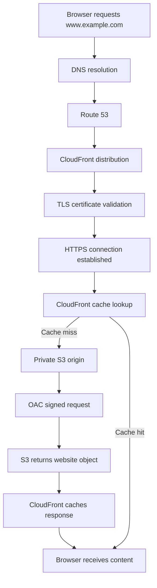
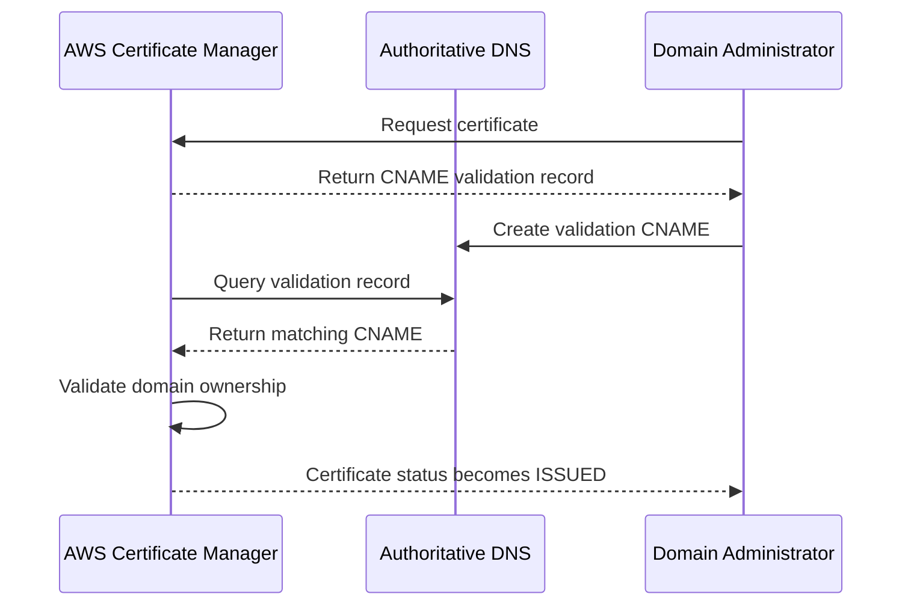
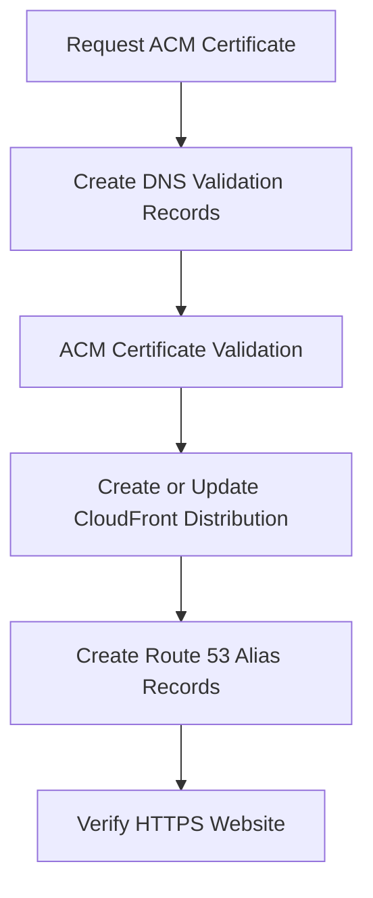

# 04- ACM Certificates and DNS Configuration

## Overview

Amazon CloudFront supports HTTPS delivery through SSL/TLS certificates. When a static website uses a custom domain, such as `www.example.com`, the CloudFront distribution must have a valid certificate covering that domain, and DNS records must route the domain to the distribution.

AWS Certificate Manager (ACM) provides managed SSL/TLS certificates that integrate with CloudFront. Amazon Route 53 can manage the DNS records that direct users to CloudFront.

For a production S3 static website architecture, the recommended configuration is:

- A private S3 bucket stores website assets.
- CloudFront delivers content using Origin Access Control (OAC).
- ACM provides the TLS certificate for the custom domain.
- Route 53 maps the domain to the CloudFront distribution.
- CloudFront redirects HTTP viewer requests to HTTPS.

The certificate, DNS records, and CloudFront distribution must be configured consistently. A certificate can be valid while the website remains inaccessible because of incorrect DNS records, missing alternate domain names, or incomplete distribution deployment.

## Architecture

### Components

| Component | Responsibility |
|---|---|
| Amazon S3 | Stores website files in a private bucket |
| CloudFront | Delivers website content over HTTPS |
| AWS Certificate Manager | Issues and manages TLS certificates |
| Route 53 | Hosts DNS records for the custom domain |
| Domain registrar | Registers the domain and delegates DNS to the authoritative name servers |
| Origin Access Control | Allows CloudFront to access the private S3 origin |

### Request Flow



DNS resolution identifies the CloudFront distribution. TLS negotiation establishes a secure connection between the browser and CloudFront. CloudFront then serves cached content or retrieves the requested object from S3.

## ACM Certificates for CloudFront

### What Is ACM?

AWS Certificate Manager provisions and manages public and private SSL/TLS certificates.

For a public website delivered through CloudFront, ACM provides a public certificate that can be attached to the distribution.

The certificate establishes the identity of the website domain and enables encrypted communication between the browser and CloudFront.

### Why ACM Is Required

Without a valid certificate covering the custom domain:

- Browsers cannot establish trusted HTTPS connections to the domain.
- Users may see certificate-name or trust errors.
- CloudFront cannot serve the custom domain using the expected HTTPS configuration.

ACM integrates certificate lifecycle management with CloudFront, reducing manual certificate renewal work.

### CloudFront Certificate Region Requirement

<badge color="warning">Important</badge>

**CloudFront requires its ACM viewer certificate to be issued or imported in `us-east-1` (N. Virginia).**

This requirement applies even when:

- The S3 bucket is in `ap-south-1`.
- The application infrastructure is in another AWS Region.
- The Route 53 hosted zone is associated with a different Region.

Example:

| Resource | Region |
|---|---|
| S3 bucket | `ap-south-1` |
| ACM certificate for CloudFront | `us-east-1` |
| CloudFront distribution | Global service |
| Route 53 hosted zone | Global DNS service |

A certificate issued in `ap-south-1` cannot be selected as the viewer certificate for a CloudFront distribution.

### Certificate Domain Names

A certificate can cover one or more domain names through Subject Alternative Names (SANs).

For example:

```text
example.com
www.example.com
```

A wildcard certificate can cover subdomains:

```text
*.example.com
```

A wildcard certificate for `*.example.com` covers:

```text
www.example.com
api.example.com
static.example.com
```

It does not cover the apex domain:

```text
example.com
```

If both the apex domain and subdomains are required, include both explicitly:

```text
example.com
*.example.com
```

### Certificate Validation Methods

ACM supports DNS validation and email validation for public certificates.

| Validation method | Description | Recommendation |
|---|---|---|
| DNS validation | Adds a CNAME record to prove domain ownership | Recommended |
| Email validation | Requires approval through domain-associated email addresses | Less suitable for automated deployments |

DNS validation is preferable for production because it supports automated renewal when the validation record remains available.

## Request an ACM Certificate

### Prerequisites

Before requesting the certificate:

- Own or control the domain.
- Have access to the authoritative DNS configuration.
- Identify every domain name the certificate must cover.
- Use the `us-east-1` Region for the CloudFront viewer certificate.

### Request Through AWS Console

1. Open AWS Certificate Manager.
2. Switch the AWS Region to `us-east-1`.
3. Select **Request a certificate**.
4. Select **Request a public certificate**.
5. Enter the required domain names.
6. Select DNS validation.
7. Submit the request.

Example domain configuration:

```text
example.com
www.example.com
```

ACM creates a DNS validation CNAME record for each requested domain.

The certificate remains in a pending validation state until ACM verifies the DNS records.

### Request Through AWS CLI

Set the Region explicitly:

```bash
aws acm request-certificate \
  --region us-east-1 \
  --domain-name example.com \
  --subject-alternative-names www.example.com \
  --validation-method DNS
```

The response contains a certificate ARN.

Example:

```text
arn:aws:acm:us-east-1:123456789012:certificate/EXAMPLE-CERTIFICATE-ID
```

Store the ARN as an infrastructure configuration value rather than hardcoding it across deployment scripts.

### Inspect Certificate Status

```bash
aws acm describe-certificate \
  --region us-east-1 \
  --certificate-arn arn:aws:acm:us-east-1:123456789012:certificate/EXAMPLE-CERTIFICATE-ID
```

Important fields include:

| Field | Meaning |
|---|---|
| `Status` | Certificate lifecycle status |
| `DomainName` | Primary certificate domain |
| `SubjectAlternativeNames` | Additional covered domain names |
| `ValidationMethod` | Domain ownership validation method |
| `NotAfter` | Certificate expiration date |
| `DomainValidationOptions` | DNS validation information |

A certificate must reach `ISSUED` before it can be attached to CloudFront.

## DNS Validation

### Why DNS Validation Is Required

ACM must verify that the requester controls the domain before issuing a public certificate.

DNS validation uses a CNAME record containing a unique validation token.

ACM checks the authoritative DNS records to confirm ownership.

### DNS Validation Flow



### Retrieve Validation Records

```bash
aws acm describe-certificate \
  --region us-east-1 \
  --certificate-arn CERTIFICATE_ARN \
  --query "Certificate.DomainValidationOptions"
```

The output contains values similar to:

```json
[
  {
    "DomainName": "example.com",
    "ValidationDomain": "example.com",
    "ValidationStatus": "PENDING_VALIDATION",
    "ResourceRecord": {
      "Name": "_abc123.example.com.",
      "Type": "CNAME",
      "Value": "_xyz789.acm-validations.aws."
    }
  }
]
```

The record values are illustrative. Use the exact values returned by ACM.

### Create the Validation CNAME

If Route 53 hosts the domain, the validation record can be created in the hosted zone.

Example record:

| Field | Value |
|---|---|
| Record name | `_abc123.example.com` |
| Record type | `CNAME` |
| Record value | `_xyz789.acm-validations.aws` |
| Routing policy | Simple |

Do not replace the validation record with the website's CloudFront alias record. They serve different purposes.

### Verify DNS Propagation

Use `dig`:

```bash
dig CNAME _abc123.example.com
```

Or:

```bash
nslookup -type=CNAME _abc123.example.com
```

Verify that the returned target matches the ACM-provided validation value.

Check certificate status:

```bash
aws acm describe-certificate \
  --region us-east-1 \
  --certificate-arn CERTIFICATE_ARN \
  --query "Certificate.Status" \
  --output text
```

Expected result:

```text
ISSUED
```

### Keep Validation Records

Do not remove ACM DNS validation CNAME records after issuance.

ACM uses the validation records to support managed certificate renewal. Removing them can prevent successful renewal.

For production infrastructure, manage these records through Route 53 or the authoritative DNS provider using Infrastructure as Code.

## Route 53 DNS Configuration

### What Is Route 53?

Amazon Route 53 is an AWS DNS service used to manage domain records and route traffic to AWS resources.

For a CloudFront-hosted website, Route 53 maps the custom domain to the CloudFront distribution.

Example:

```text
www.example.com -> CloudFront distribution
```

Route 53 does not host website content. It only provides DNS resolution and routing.

### Hosted Zones

A hosted zone contains DNS records for a domain.

| Hosted zone type | Purpose |
|---|---|
| Public hosted zone | Resolves DNS queries from the public internet |
| Private hosted zone | Resolves DNS queries within associated VPCs |

A public static website requires a public hosted zone or equivalent DNS configuration at the domain's authoritative DNS provider.

### Domain Registration and DNS Delegation

Registering a domain and managing its DNS are separate concerns.

A domain can be registered through one provider while its DNS records are managed by Route 53.

For Route 53 to become authoritative:

1. Create a public hosted zone.
2. Retrieve its assigned name servers.
3. Update the domain registrar's name-server configuration.
4. Wait for delegation changes to propagate.

Inspect the hosted zone:

```bash
aws route53 list-hosted-zones
```

Retrieve its name servers:

```bash
aws route53 get-hosted-zone \
  --id Z123456789EXAMPLE
```

The hosted zone's NS records must match the name servers configured at the registrar.

### DNS Records for CloudFront

The primary records are:

| Record | Purpose |
|---|---|
| ACM validation CNAME | Proves domain ownership |
| A Alias | Routes the apex domain or IPv4 hostname to CloudFront |
| AAAA Alias | Supports IPv6 traffic |
| CNAME | Maps a subdomain to another hostname when appropriate |

Route 53 Alias records are generally recommended for CloudFront.

Unlike a standard CNAME, an Alias record can be created at the zone apex, such as `example.com`.

### Apex Domain and Subdomain

Apex domain:

```text
example.com
```

Subdomain:

```text
www.example.com
```

For a CloudFront distribution, configure Alias records for both if both names should serve the website.

Example:

```text
example.com      A Alias -> CloudFront
example.com      AAAA Alias -> CloudFront

www.example.com  A Alias -> CloudFront
www.example.com  AAAA Alias -> CloudFront
```

The certificate must cover both names, and both must be configured as CloudFront alternate domain names.

## Configure CloudFront for a Custom Domain

### Alternate Domain Names

CloudFront uses Alternate Domain Names (CNAMEs) to associate custom hostnames with a distribution.

For example:

```text
example.com
www.example.com
```

The distribution must include every hostname that should serve content.

A certificate covering the domain does not automatically configure the CloudFront distribution to accept requests for it.

### Viewer Certificate Configuration

The CloudFront distribution must reference the ACM certificate ARN from `us-east-1`.

The relevant settings are:

| Setting | Value |
|---|---|
| Alternate domain names | `example.com`, `www.example.com` |
| Custom SSL certificate | ACM certificate ARN |
| Minimum TLS protocol | A supported modern TLS security policy |
| Viewer protocol policy | Redirect HTTP to HTTPS |

Use a modern TLS security policy supported by CloudFront and compatible with the application's client requirements.

### Configure Through AWS CLI

CloudFront distribution updates require the complete distribution configuration and its current ETag.

Retrieve the configuration:

```bash
aws cloudfront get-distribution-config \
  --id EXAMPLEDIST
```

Update the returned configuration:

```json
{
  "Aliases": {
    "Quantity": 2,
    "Items": [
      "example.com",
      "www.example.com"
    ]
  },
  "ViewerCertificate": {
    "ACMCertificateArn": "arn:aws:acm:us-east-1:123456789012:certificate/EXAMPLE-CERTIFICATE-ID",
    "SSLSupportMethod": "sni-only",
    "MinimumProtocolVersion": "TLSv1.2_2021",
    "Certificate": "arn:aws:acm:us-east-1:123456789012:certificate/EXAMPLE-CERTIFICATE-ID",
    "CertificateSource": "acm"
  }
}
```

The JSON above illustrates the relevant configuration fields. Merge them into the complete distribution configuration returned by AWS rather than submitting this fragment as a standalone distribution configuration.

Apply the update:

```bash
aws cloudfront update-distribution \
  --id EXAMPLEDIST \
  --if-match EXAMPLEETAG \
  --distribution-config file://distribution-config.json
```

Wait for deployment:

```bash
aws cloudfront wait distribution-deployed \
  --id EXAMPLEDIST
```

### Redirect HTTP to HTTPS

Set the viewer protocol policy to:

```text
redirect-to-https
```

This allows HTTP requests to be redirected to HTTPS rather than serving website content over an unencrypted connection.

For static website delivery, this is generally the preferred configuration.

## Configure Route 53 Alias Records

### Create an Alias Record Through the Console

1. Open Route 53.
2. Select the public hosted zone.
3. Choose **Create record**.
4. Enter the record name, such as `www`.
5. Select record type `A`.
6. Enable Alias.
7. Choose CloudFront distribution as the target.
8. Create the record.

Repeat for the apex domain if required.

Create an `AAAA` Alias record when IPv6 support is enabled and intended.

### Create Alias Records Using AWS CLI

Route 53 uses `change-resource-record-sets` to create or update records.

Example `route53-records.json`:

```json
{
  "Comment": "Route website domain to CloudFront",
  "Changes": [
    {
      "Action": "UPSERT",
      "ResourceRecordSet": {
        "Name": "www.example.com",
        "Type": "A",
        "AliasTarget": {
          "HostedZoneId": "Z2FDTNDATAQYW2",
          "DNSName": "d123456789.cloudfront.net",
          "EvaluateTargetHealth": false
        }
      }
    },
    {
      "Action": "UPSERT",
      "ResourceRecordSet": {
        "Name": "www.example.com",
        "Type": "AAAA",
        "AliasTarget": {
          "HostedZoneId": "Z2FDTNDATAQYW2",
          "DNSName": "d123456789.cloudfront.net",
          "EvaluateTargetHealth": false
        }
      }
    }
  ]
}
```

`Z2FDTNDATAQYW2` is the CloudFront hosted zone ID used for Route 53 Alias records.

Apply the changes:

```bash
aws route53 change-resource-record-sets \
  --hosted-zone-id Z123456789EXAMPLE \
  --change-batch file://route53-records.json
```

Inspect the change status:

```bash
aws route53 get-change \
  --id /change/C123456789EXAMPLE
```

A status of `INSYNC` indicates that Route 53 has propagated the change across its authoritative DNS infrastructure.

### Verify DNS Records

```bash
dig A www.example.com
```

For IPv6:

```bash
dig AAAA www.example.com
```

For the apex domain:

```bash
dig A example.com
```

DNS responses may vary depending on caching, resolver location, and propagation state.

## Terraform Implementation

Terraform is suitable for managing ACM certificates, DNS validation records, CloudFront configuration, and Route 53 Alias records.

The following example demonstrates the main resource relationships. It assumes that the S3 bucket and OAC already exist.

### Provider Configuration

The ACM certificate for CloudFront must be managed in `us-east-1`.

```hcl
terraform {
  required_version = ">= 1.5.0"

  required_providers {
    aws = {
      source  = "hashicorp/aws"
      version = "~> 6.0"
    }
  }
}

provider "aws" {
  region = "ap-south-1"
}

provider "aws" {
  alias  = "us_east_1"
  region = "us-east-1"
}
```

Pin and test the provider version used by the project. Commit the dependency lock file.

### Variables

```hcl
variable "domain_name" {
  description = "Apex domain name"
  type        = string
}

variable "subdomain_name" {
  description = "Website subdomain"
  type        = string
}

variable "hosted_zone_id" {
  description = "Route 53 public hosted zone ID"
  type        = string
}

variable "s3_bucket_domain_name" {
  description = "Regional S3 REST endpoint"
  type        = string
}

variable "oac_id" {
  description = "CloudFront Origin Access Control ID"
  type        = string
}
```

### Request ACM Certificate

```hcl
resource "aws_acm_certificate" "website" {
  provider = aws.us_east_1

  domain_name = var.domain_name

  subject_alternative_names = [
    var.subdomain_name
  ]

  validation_method = "DNS"

  lifecycle {
    create_before_destroy = true
  }
}
```

`create_before_destroy` helps prevent unnecessary certificate replacement gaps during supported certificate changes.

### Create DNS Validation Records

```hcl
resource "aws_route53_record" "certificate_validation" {
  for_each = {
    for dvo in aws_acm_certificate.website.domain_validation_options :
    dvo.domain_name => {
      name   = dvo.resource_record_name
      type   = dvo.resource_record_type
      record = dvo.resource_record_value
    }
  }

  zone_id = var.hosted_zone_id
  name    = each.value.name
  type    = each.value.type
  ttl     = 60

  records = [
    each.value.record
  ]

  allow_overwrite = true
}
```

### Validate the Certificate

```hcl
resource "aws_acm_certificate_validation" "website" {
  provider = aws.us_east_1

  certificate_arn = aws_acm_certificate.website.arn

  validation_record_fqdns = [
    for record in aws_route53_record.certificate_validation :
    record.fqdn
  ]
}
```

Terraform waits for ACM validation to complete before treating the certificate validation resource as created.

### Configure CloudFront

```hcl
data "aws_cloudfront_cache_policy" "caching_optimized" {
  name = "Managed-CachingOptimized"
}

resource "aws_cloudfront_distribution" "website" {
  enabled             = true
  default_root_object = "index.html"

  aliases = [
    var.domain_name,
    var.subdomain_name
  ]

  origin {
    domain_name              = var.s3_bucket_domain_name
    origin_id                = "private-s3-origin"
    origin_access_control_id = var.oac_id
  }

  default_cache_behavior {
    target_origin_id       = "private-s3-origin"
    viewer_protocol_policy = "redirect-to-https"

    allowed_methods = [
      "GET",
      "HEAD"
    ]

    cached_methods = [
      "GET",
      "HEAD"
    ]

    cache_policy_id = data.aws_cloudfront_cache_policy.caching_optimized.id
  }

  restrictions {
    geo_restriction {
      restriction_type = "none"
    }
  }

  viewer_certificate {
    acm_certificate_arn      = aws_acm_certificate_validation.website.certificate_arn
    ssl_support_method       = "sni-only"
    minimum_protocol_version = "TLSv1.2_2021"
  }
}
```

The S3 origin must use the bucket's regional REST endpoint, not its website endpoint.

### Configure Route 53 Alias Records

```hcl
resource "aws_route53_record" "website_ipv4" {
  for_each = toset([
    var.domain_name,
    var.subdomain_name
  ])

  zone_id = var.hosted_zone_id
  name    = each.value
  type    = "A"

  alias {
    name                   = aws_cloudfront_distribution.website.domain_name
    zone_id                = aws_cloudfront_distribution.website.hosted_zone_id
    evaluate_target_health = false
  }
}

resource "aws_route53_record" "website_ipv6" {
  for_each = toset([
    var.domain_name,
    var.subdomain_name
  ])

  zone_id = var.hosted_zone_id
  name    = each.value
  type    = "AAAA"

  alias {
    name                   = aws_cloudfront_distribution.website.domain_name
    zone_id                = aws_cloudfront_distribution.website.hosted_zone_id
    evaluate_target_health = false
  }
}
```

### Terraform Outputs

```hcl
output "certificate_arn" {
  value = aws_acm_certificate.website.arn
}

output "cloudfront_distribution_id" {
  value = aws_cloudfront_distribution.website.id
}

output "cloudfront_domain_name" {
  value = aws_cloudfront_distribution.website.domain_name
}

output "website_url" {
  value = "https://${var.subdomain_name}"
}
```

### Deploy Infrastructure

```bash
terraform init
terraform fmt -recursive
terraform validate
terraform plan -out=tfplan
terraform apply tfplan
```

The certificate validation resource can take time because ACM must verify DNS ownership.

After deployment, wait for the CloudFront distribution to become fully deployed.

### Terraform Dependency Considerations

The resource dependencies are important:



The CloudFront distribution must not reference an unissued certificate.

The Route 53 Alias records should point to the actual CloudFront distribution created by the deployment.

If the hosted zone is managed outside Terraform, configure the appropriate DNS provider or create the required records through the external DNS management process.

## DNS and TLS Verification

Production verification should independently test DNS resolution, certificate validity, TLS negotiation, and application delivery.

### Verify DNS Resolution

```bash
dig example.com
dig www.example.com
```

Check IPv6 when configured:

```bash
dig AAAA www.example.com
```

### Verify HTTPS Response

```bash
curl -I https://www.example.com
```

Expected response:

```http
HTTP/2 200
```

A successful response confirms that the request reached a functioning endpoint, but it does not independently prove that every DNS and certificate configuration is correct.

### Inspect the TLS Certificate

```bash
openssl s_client \
  -connect www.example.com:443 \
  -servername www.example.com
```

Inspect:

- Certificate subject.
- Subject Alternative Names.
- Issuer.
- Validity period.
- Certificate chain.
- Negotiated TLS protocol.

To inspect the certificate details more clearly:

```bash
openssl s_client \
  -connect www.example.com:443 \
  -servername www.example.com \
  </dev/null 2>/dev/null |
openssl x509 -noout -subject -issuer -dates -ext subjectAltName
```

Verify that the requested hostname is covered by the certificate.

### Verify HTTP Redirect

```bash
curl -I http://www.example.com
```

Expected behavior:

```http
HTTP/1.1 301 Moved Permanently
Location: https://www.example.com/
```

CloudFront may use a different redirect status depending on the request and configuration. The important requirement is that HTTP requests are redirected to HTTPS.

### Verify CloudFront Distribution

```bash
aws cloudfront get-distribution \
  --id EXAMPLEDIST
```

Verify:

- Distribution status is `Deployed`.
- Alternate domain names contain the intended hostnames.
- Viewer certificate ARN references the expected ACM certificate.
- Viewer protocol policy redirects HTTP to HTTPS.
- The origin references the intended private S3 bucket and OAC.

### Verify Certificate Status

```bash
aws acm describe-certificate \
  --region us-east-1 \
  --certificate-arn CERTIFICATE_ARN \
  --query "Certificate.{Status:Status,NotAfter:NotAfter,Domains:SubjectAlternativeNames}"
```

Confirm that the certificate is `ISSUED` and covers all required hostnames.

## Troubleshooting

### ACM Certificate Remains Pending Validation

**Symptoms**

- Certificate status remains `PENDING_VALIDATION`.
- CloudFront cannot use the certificate.
- ACM does not complete certificate issuance.

**Likely causes**

- DNS validation record is missing.
- Record name or value is incorrect.
- DNS changes have not propagated.
- The validation record was created in a non-authoritative hosted zone.
- The domain's registrar still delegates to different name servers.

**Diagnostic steps**

Inspect ACM validation details:

```bash
aws acm describe-certificate \
  --region us-east-1 \
  --certificate-arn CERTIFICATE_ARN \
  --query "Certificate.DomainValidationOptions"
```

Query the validation record:

```bash
dig CNAME _abc123.example.com
```

Check authoritative name servers:

```bash
dig NS example.com
```

Compare the returned name servers with the Route 53 hosted zone's NS records and the registrar configuration.

**Corrective actions**

- Create the exact CNAME record returned by ACM.
- Create it in the authoritative DNS zone.
- Correct any registrar delegation mismatch.
- Keep validation records available for renewal.

### CloudFront Rejects the ACM Certificate

**Symptoms**

- The certificate is issued.
- CloudFront does not allow the certificate to be selected or attached.
- Distribution updates fail.

**Likely causes**

- The certificate is not in `us-east-1`.
- The certificate does not cover all configured alternate domain names.
- The certificate is not issued.
- The certificate ARN is incorrect.

**Corrective actions**

Inspect the certificate in the required Region:

```bash
aws acm describe-certificate \
  --region us-east-1 \
  --certificate-arn CERTIFICATE_ARN
```

Verify its status and SAN entries.

Request a replacement certificate in `us-east-1` if the existing certificate is in another Region.

### Domain Resolves but Website Is Inaccessible

**Symptoms**

- DNS resolves to CloudFront.
- Browser requests fail.
- The CloudFront domain may work while the custom domain does not.

**Likely causes**

- The custom hostname is missing from CloudFront aliases.
- The certificate does not cover the hostname.
- CloudFront distribution deployment is incomplete.
- The Route 53 record points to the wrong distribution.
- The origin is returning an authorization or object-not-found error.

**Diagnostic steps**

Check DNS:

```bash
dig A www.example.com
```

Inspect CloudFront aliases:

```bash
aws cloudfront get-distribution \
  --id EXAMPLEDIST \
  --query "Distribution.DistributionConfig.Aliases"
```

Inspect the viewer certificate:

```bash
aws cloudfront get-distribution \
  --id EXAMPLEDIST \
  --query "Distribution.DistributionConfig.ViewerCertificate"
```

**Corrective actions**

- Add the hostname to CloudFront aliases.
- Attach a certificate covering that hostname.
- Correct the Alias record target.
- Wait for distribution deployment.
- Investigate origin errors separately from DNS and TLS errors.

### Browser Reports a Certificate Name Mismatch

**Symptoms**

- HTTPS connection fails.
- Browser reports that the certificate is not valid for the requested hostname.

**Likely causes**

- The hostname is not included in the certificate SAN list.
- The wrong certificate is attached to CloudFront.
- DNS points to a different distribution.
- A stale or incorrect CloudFront configuration is still deployed.

**Corrective actions**

Inspect the certificate SAN entries:

```bash
openssl s_client \
  -connect www.example.com:443 \
  -servername www.example.com \
  </dev/null 2>/dev/null |
openssl x509 -noout -ext subjectAltName
```

Verify that the hostname is covered by the certificate and that the expected distribution is serving it.

### DNS Changes Are Not Visible

**Symptoms**

- Route 53 record changes are complete.
- Some DNS resolvers return old results.
- The website resolves differently across networks.

**Likely causes**

- DNS resolver caching.
- Incorrect authoritative DNS delegation.
- Changes made in the wrong hosted zone.
- Existing records conflict with the intended Alias configuration.

**Diagnostic steps**

Inspect the hosted zone records:

```bash
aws route53 list-resource-record-sets \
  --hosted-zone-id Z123456789EXAMPLE
```

Inspect delegation:

```bash
dig NS example.com
```

Query a public resolver:

```bash
dig @8.8.8.8 www.example.com
```

**Corrective actions**

- Update the authoritative hosted zone.
- Correct registrar name-server delegation.
- Remove conflicting records when appropriate.
- Allow resolver caches to expire.

### HTTP Works but HTTPS Fails

**Likely causes**

- Missing ACM certificate.
- Incorrect certificate Region.
- Invalid viewer certificate configuration.
- Certificate does not cover the requested hostname.
- CloudFront distribution has not completed deployment.

**Corrective actions**

Verify certificate issuance, CloudFront viewer certificate configuration, alternate domain names, and distribution status.

For a production website, HTTPS should be the expected access path.

## Production Best Practices

### Certificate Management

- Request CloudFront viewer certificates in `us-east-1`.
- Use DNS validation.
- Include every required hostname in the certificate.
- Keep ACM validation CNAME records permanently.
- Monitor certificate status and expiration.
- Avoid manually replacing certificates without a controlled deployment.
- Use Terraform or CloudFormation to manage certificate resources.

### DNS Management

- Use a public hosted zone for public website DNS.
- Verify registrar name-server delegation.
- Prefer Route 53 Alias records for CloudFront.
- Create both A and AAAA Alias records when IPv6 is enabled.
- Avoid conflicting A, AAAA, and CNAME records.
- Keep DNS validation records separate from website routing records.
- Manage DNS changes through reviewed infrastructure changes.

### CloudFront Security

- Require HTTPS using `redirect-to-https`.
- Use a modern TLS security policy.
- Keep the S3 bucket private.
- Use OAC rather than public S3 access.
- Restrict the bucket policy to the intended CloudFront distribution.
- Do not assume that certificate validation grants access to the S3 origin.

### CI/CD and Infrastructure Management

- Use separate deployment environments for development, staging, and production.
- Store certificate ARNs and hosted zone IDs in environment-specific configuration.
- Use IAM OIDC federation for GitHub Actions rather than long-lived AWS access keys.
- Validate Terraform changes before applying them.
- Require approval for production infrastructure changes.
- Verify DNS, TLS, and website responses after deployment.
- Keep infrastructure configuration consistent with actual AWS resources.

### Availability and Operational Considerations

DNS and certificate configuration should be treated as production infrastructure.

Monitor:

- ACM certificate status.
- Certificate expiration and renewal failures.
- CloudFront 4xx and 5xx response rates.
- CloudFront origin latency.
- DNS resolution from representative locations.
- HTTPS availability and TLS handshake failures.

Use external synthetic monitoring to detect failures that internal AWS metrics may not reveal, particularly DNS delegation and client-side TLS problems.

### Cost Considerations

| Component | Cost consideration |
|---|---|
| ACM public certificates | Public certificates integrated with AWS services such as CloudFront are generally available without an additional certificate charge |
| Route 53 hosted zones | Monthly hosted-zone charges apply |
| Route 53 DNS queries | Query charges depend on query volume and routing configuration |
| CloudFront | Data transfer, HTTP requests, and optional features can incur charges |
| Domain registration | Registrar-specific registration and renewal fees apply |

Review current AWS pricing before production deployment. DNS queries, CloudFront traffic, and optional security services can contribute to ongoing costs.

## Common Mistakes

| Mistake | Why It Happens | Prevention |
|---|---|---|
| Creating ACM certificate in the S3 bucket's Region | Certificate Region requirements are overlooked | Use `us-east-1` for CloudFront viewer certificates |
| Requesting only `www.example.com` | Apex and subdomain requirements are confused | Include every required hostname |
| Assuming wildcard certificates cover the apex domain | Wildcard matching does not include the base domain | Request both `example.com` and `*.example.com` when needed |
| Removing ACM validation CNAME records | Records are mistaken for temporary setup artifacts | Retain validation records for managed renewal |
| Creating Alias records before distribution configuration is ready | DNS and CloudFront dependencies are not coordinated | Deploy and verify the distribution before routing production traffic |
| Forgetting CloudFront alternate domain names | Certificate and distribution configuration are treated as the same thing | Configure both certificate SANs and CloudFront aliases |
| Updating DNS in a non-authoritative hosted zone | Registrar delegation is incorrect | Verify NS records and registrar configuration |
| Creating only an A record | IPv6 requirements are overlooked | Configure AAAA Alias records when IPv6 is enabled |
| Using a CNAME at the apex domain | DNS zone-apex restrictions are overlooked | Use Route 53 Alias records |
| Treating DNS propagation as immediate | Resolver caching is ignored | Verify authoritative records and allow caches to expire |
| Replacing certificates manually | Infrastructure changes are not controlled | Manage certificates through IaC and controlled deployments |
| Assuming HTTPS proves the origin is private | Viewer TLS and origin authorization are different security layers | Verify OAC and S3 bucket policy independently |

## Key Takeaways

- CloudFront viewer certificates must be issued or imported in `us-east-1`, regardless of the S3 bucket's Region.
- Use ACM DNS validation and retain its CNAME records to support managed certificate renewal.
- Configure every required hostname in both the certificate SAN list and CloudFront alternate domain names.
- Use Route 53 Alias records to route apex and subdomain traffic to CloudFront, including AAAA records when IPv6 is enabled.
- Verify DNS delegation, certificate validity, TLS negotiation, CloudFront deployment, and website delivery independently before production release.