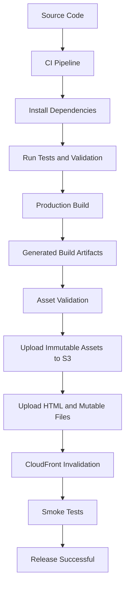
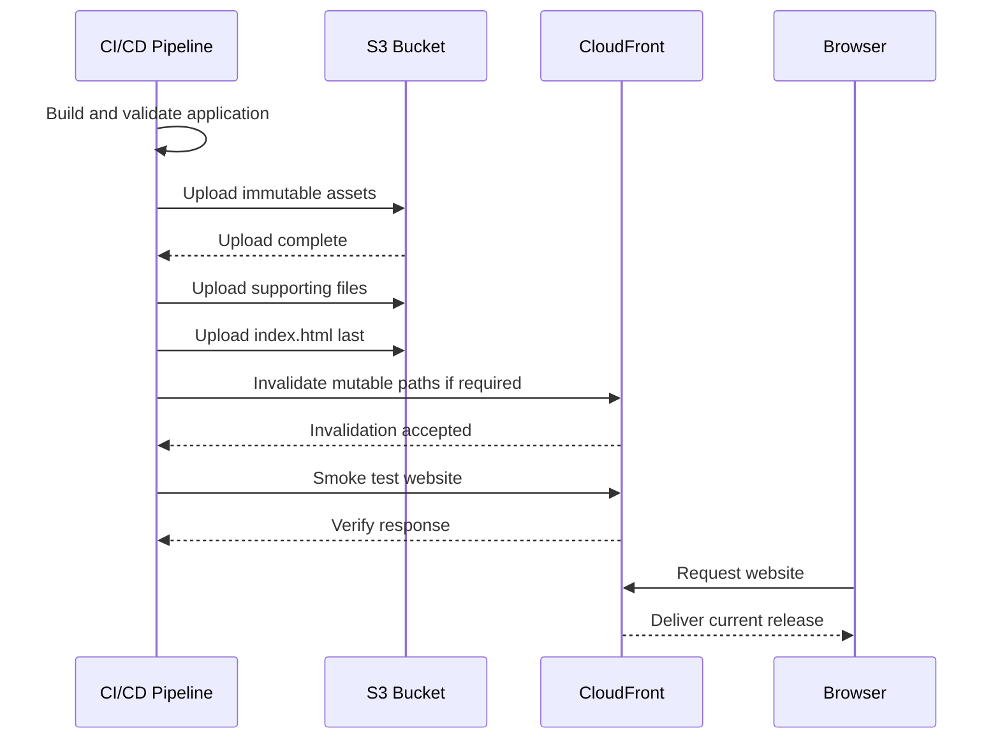
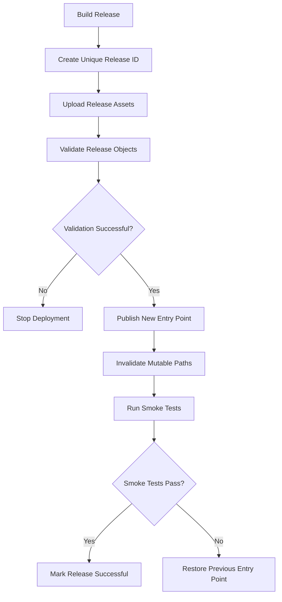

# 05- Asset Build and Upload Strategies

## Overview

A static website deployment consists of two distinct workflows:

1. **Build:** Transform source code and assets into optimized, deployable files.
2. **Upload:** Transfer the generated files to an Amazon S3 bucket and make them available through CloudFront.

A reliable deployment strategy must preserve the relationship between the application build, S3 object keys, HTTP cache behavior, and CloudFront distribution configuration.

For production static website hosting, the recommended architecture is:

- Build the website in a controlled CI/CD environment.
- Generate optimized assets with content-hashed filenames.
- Upload assets to a private S3 bucket.
- Use CloudFront with Origin Access Control (OAC) to retrieve objects.
- Apply different caching policies to immutable assets and mutable entry-point files.
- Validate the deployment before considering the release successful.
- Retain previous release artifacts to support rollback.

The objective is not simply to copy files to S3. It is to publish a consistent, cache-efficient release without exposing incomplete or incompatible application versions.

## Static Website Build Architecture

### Build and Deployment Flow



### Component Responsibilities

| Component | Responsibility |
|---|---|
| Source repository | Stores application source code and build configuration |
| Build tool | Generates optimized HTML, CSS, JavaScript, and other assets |
| CI/CD pipeline | Executes tests, builds artifacts, and deploys releases |
| Amazon S3 | Stores generated static website files |
| CloudFront | Delivers content globally and caches responses |
| OAC | Provides authenticated CloudFront access to the private S3 origin |
| Route 53 | Routes the custom domain to CloudFront |

### Build Output Structure

A typical frontend application may generate:

```text
dist/
├── index.html
├── assets/
│   ├── app.a81f92d3.js
│   ├── app.91b7c4e2.css
│   ├── logo.8a31f2c1.svg
│   └── vendor.7d91a3e2.js
├── favicon.ico
├── robots.txt
└── manifest.webmanifest
```

The build directory depends on the framework and build tool.

| Framework or tool | Common output directory |
|---|---|
| Vite | `dist/` |
| Create React App | `build/` |
| Angular CLI | Configurable, commonly under `dist/` |
| Vue CLI | `dist/` |
| Next.js static export | `out/` |

The deployment pipeline must use the actual output directory configured by the project rather than assuming every framework produces `dist/`.

## Production Build Configuration

### Why Production Builds Matter

Development builds prioritize debugging and fast iteration. Production builds prioritize performance, predictable output, and efficient delivery.

A production build typically performs:

- JavaScript and CSS minification.
- Dead-code elimination.
- Tree shaking.
- Asset optimization.
- Code splitting.
- Content hashing.
- Environment-specific configuration.
- Source map generation according to the project's security policy.

The generated output should be deterministic enough that the same source revision and build configuration produce a reproducible release.

### Vite Example

Install dependencies using the lock file:

```bash
npm ci
```

Run tests:

```bash
npm test
```

Generate the production build:

```bash
npm run build
```

Vite commonly writes production output to `dist/`.

Inspect the generated files:

```bash
find dist -type f
```

Check the build size:

```bash
du -sh dist
```

For larger applications, inspect individual bundle sizes and configure bundle analysis as part of the build process.

### Build-Time Environment Variables

Frontend build tools commonly inject environment variables during compilation.

For Vite:

```env
VITE_API_BASE_URL=https://api.example.com
```

Access the value:

```javascript
const apiBaseUrl = import.meta.env.VITE_API_BASE_URL;
```

Important security consideration:

**Frontend environment variables are not secrets.**

Values included in browser-delivered JavaScript can be inspected by users. Never place AWS access keys, database credentials, private API tokens, or other confidential values in frontend build variables.

Use backend services for operations requiring privileged credentials.

### Separate Environment Builds

Use explicit environment configuration for development, staging, and production.

Example:

```text
.env.development
.env.staging
.env.production
```

Build the appropriate environment:

```bash
npm run build -- --mode production
```

For Vite, the selected mode determines which environment files are loaded.

Keep environment-specific values controlled by the CI/CD environment. Avoid committing sensitive configuration.

## Asset Optimization

### Content Hashing

Content hashing creates filenames based on the contents of an asset.

Example:

```text
app.js
```

becomes:

```text
app.a81f92d3.js
```

When the file changes, its hash changes and a new object key is generated.

This allows CloudFront and browsers to cache immutable assets for long periods without serving outdated versions after a new release.

### Why Content Hashing Matters

Without content hashing:

- A browser may continue using an old JavaScript file.
- CloudFront may serve stale CSS after deployment.
- Frequent invalidations may be necessary.
- Cache behavior becomes harder to reason about.

With content hashing:

- Changed assets receive new object keys.
- Existing cached objects remain valid for older releases.
- New HTML references the new asset filenames.
- Most static assets can use long cache lifetimes.

### Recommended Cache Strategy

| File type | Cache-Control strategy | Reason |
|---|---|---|
| Content-hashed JavaScript | `public, max-age=31536000, immutable` | Filename changes when content changes |
| Content-hashed CSS | `public, max-age=31536000, immutable` | Safe long-term caching |
| Content-hashed images and fonts | `public, max-age=31536000, immutable` | Immutable asset versions |
| `index.html` | `no-cache` or short TTL | Must revalidate to discover new asset references |
| `service-worker.js` | `no-cache` | Controls application update behavior |
| `manifest.webmanifest` | Short TTL or revalidation | May change between releases |
| `robots.txt` | Short TTL or revalidation | Changes should become visible reasonably quickly |

The exact policy depends on the application's update requirements and CloudFront cache policy.

### Cache-Control Example

For immutable assets:

```http
Cache-Control: public, max-age=31536000, immutable
```

For HTML:

```http
Cache-Control: no-cache
```

`no-cache` permits storage but requires revalidation before reuse. Use `no-store` only when the response should not be stored by caches.

## S3 Object Key Strategy

### Organize Build Artifacts

A deployment can publish assets using a stable directory structure:

```text
s3://my-private-website/
├── index.html
├── assets/
│   ├── app.a81f92d3.js
│   ├── app.91b7c4e2.css
│   └── logo.8a31f2c1.svg
├── favicon.ico
└── robots.txt
```

For more controlled release management, versioned release prefixes can also be used:

```text
releases/
├── 2026-11-01-a1b2c3/
│   ├── index.html
│   └── assets/
└── 2026-11-02-d4e5f6/
    ├── index.html
    └── assets/
```

The release-prefix approach requires deliberate CloudFront origin path or routing design. It should not be introduced without accounting for how the application resolves asset URLs.

### Recommended Naming Practices

- Use content-hashed filenames for immutable assets.
- Keep the website entry point at a predictable key such as `index.html`.
- Avoid user-controlled object keys.
- Keep build artifacts separate from unrelated application data.
- Avoid mixing staging and production objects in the same unstructured prefix.
- Retain previous release artifacts when rollback is required.

## Upload Strategies

Different upload strategies provide different levels of control over synchronization, release consistency, and rollback.

### AWS CLI `s3 sync`

The `sync` command compares source and destination and transfers files that require synchronization.

Example:

```bash
aws s3 sync dist/ s3://my-private-website/ \
  --delete
```

This uploads changed or missing files and deletes destination objects that are not present in the local build directory.

**Important:** `--delete` is destructive. It removes destination objects under the synchronized scope that are absent from the source.

Use it only when the destination prefix is dedicated to the website build and the source represents the complete intended deployment.

Advantages:

- Simple deployment command.
- Handles recursive file synchronization.
- Avoids transferring unchanged files in normal synchronization scenarios.
- Suitable for straightforward static website deployments.

Limitations:

- Does not provide an atomic release.
- Can remove files required by older cached HTML.
- Requires careful handling of object metadata.
- A partially completed deployment can expose inconsistent files.

### Upload with Explicit Cache Headers

A basic synchronization command applies the same metadata configuration to every uploaded object.

For production, HTML and immutable assets generally need different cache headers.

Upload immutable assets:

```bash
aws s3 sync dist/assets/ s3://my-private-website/assets/ \
  --cache-control "public,max-age=31536000,immutable"
```

Upload HTML separately:

```bash
aws s3 cp dist/index.html s3://my-private-website/index.html \
  --cache-control "no-cache" \
  --content-type "text/html"
```

Upload other root-level files with appropriate metadata:

```bash
aws s3 cp dist/ s3://my-private-website/ \
  --recursive \
  --exclude "assets/*" \
  --exclude "index.html" \
  --cache-control "public,max-age=300"
```

The root-level command should be adapted to the actual application output. Do not assume every non-HTML file should receive the same cache policy.

### `aws s3 cp`

The `cp` command copies files or directories to S3.

Upload a single file:

```bash
aws s3 cp dist/index.html s3://my-private-website/index.html
```

Upload a directory recursively:

```bash
aws s3 cp dist/ s3://my-private-website/ \
  --recursive
```

Use `cp` when:

- Uploading a specific file.
- Publishing a controlled subset of artifacts.
- Implementing a custom deployment script.
- Applying explicit metadata to individual files or groups.

Unlike `sync`, recursive `cp` is not designed to reconcile destination contents with the source.

### `aws s3 sync` vs `aws s3 cp`

| Feature | `sync` | `cp --recursive` |
|---|---|---|
| Recursive upload | Yes | Yes |
| Skips unchanged files | Yes, based on synchronization comparisons | No equivalent synchronization behavior |
| Deletes destination-only files | With `--delete` | No |
| Selective include/exclude | Yes | Yes |
| Suitable for repeated deployment | Yes | Yes, but transfers may be less efficient |
| Release consistency | Not atomic | Not atomic |

Neither command provides an atomic website release by itself.

## Recommended Production Upload Order

For a conventional root-based static website, publish immutable assets before publishing the new HTML entry point.

The recommended order is:

1. Upload new content-hashed assets.
2. Upload other required static files.
3. Upload the new `index.html` last.
4. Invalidate mutable CloudFront paths when required.
5. Run smoke tests.

This order ensures that the HTML entry point does not reference assets that have not yet been uploaded.

### Deployment Sequence



Uploading HTML last reduces the risk of referencing missing assets, but it does not make the entire release atomic. Existing HTML and cached content can still be served during deployment.

## Python-Based Upload Automation

For more control over metadata, validation, and deployment logging, use Boto3.

### Installation

```bash
pip install boto3
```

Configure AWS credentials through an IAM role or the standard AWS credential provider chain.

Do not hardcode access keys in application source code.

### Upload Build Artifacts

The following example uploads files from a build directory and applies different cache policies to HTML and immutable assets.

```python
from __future__ import annotations

import mimetypes
from pathlib import Path

import boto3
from botocore.exceptions import BotoCoreError, ClientError


def content_type_for(path: Path) -> str:
    content_type, _ = mimetypes.guess_type(path.name)
    return content_type or "application/octet-stream"


def cache_control_for(relative_path: Path) -> str:
    if relative_path.name == "index.html":
        return "no-cache"

    if relative_path.parts and relative_path.parts[0] == "assets":
        return "public, max-age=31536000, immutable"

    return "public, max-age=300"


def upload_build(
    build_directory: str,
    bucket_name: str,
) -> None:
    build_path = Path(build_directory).resolve()

    if not build_path.is_dir():
        raise ValueError(f"Build directory does not exist: {build_path}")

    s3 = boto3.client("s3")

    files = sorted(
        path for path in build_path.rglob("*")
        if path.is_file()
    )

    if not files:
        raise ValueError("Build directory contains no files")

    try:
        for file_path in files:
            relative_path = file_path.relative_to(build_path)
            object_key = relative_path.as_posix()

            s3.upload_file(
                str(file_path),
                bucket_name,
                object_key,
                ExtraArgs={
                    "ContentType": content_type_for(file_path),
                    "CacheControl": cache_control_for(relative_path),
                },
            )

            print(f"Uploaded: {object_key}")

    except (BotoCoreError, ClientError) as exc:
        raise RuntimeError(
            f"Failed to upload website build to {bucket_name}"
        ) from exc


if __name__ == "__main__":
    upload_build(
        build_directory="dist",
        bucket_name="my-private-website",
    )
```

### Production Considerations

This implementation demonstrates metadata-aware uploads. A production deployment tool should additionally provide:

- Structured logging instead of relying on `print`.
- Retry and failure reporting.
- Build artifact integrity verification.
- Explicit release identifiers.
- Controlled concurrency for large builds.
- A deployment manifest.
- Safe handling of stale destination objects.
- A separate release validation stage.

Do not delete destination files simply because they are absent from a local build unless the destination scope is known to be exclusively managed by that deployment.

## Cache Management

### Why Cache Invalidation Is Needed

CloudFront caches objects according to the configured cache policy and object metadata.

When a file changes but retains the same object key, CloudFront may continue serving the previous cached response until its cache expires or is invalidated.

For example:

```text
/index.html
```

is a stable key. A new deployment may overwrite its contents while CloudFront still has an older cached copy.

Content-hashed assets avoid most of this problem because changed content receives a new key.

### Recommended Invalidation Strategy

For a conventional website:

```bash
aws cloudfront create-invalidation \
  --distribution-id EXAMPLEDIST \
  --paths "/" "/index.html"
```

For an application that uses additional mutable entry points:

```bash
aws cloudfront create-invalidation \
  --distribution-id EXAMPLEDIST \
  --paths "/" "/index.html" "/service-worker.js" "/manifest.webmanifest"
```

Use invalidations selectively.

Avoid invalidating every asset after every deployment when content-hashed filenames already provide cache correctness.

### Invalidation Considerations

| Path | Typical approach |
|---|---|
| `/index.html` | Invalidate or use a short/revalidation cache policy |
| `/assets/*` | Avoid routine invalidation when filenames are content-hashed |
| `/service-worker.js` | Revalidate or invalidate |
| `/manifest.webmanifest` | Short TTL or invalidate |
| `/robots.txt` | Short TTL or invalidate when changed |

CloudFront invalidation requests are asynchronous. An accepted invalidation request does not mean every edge location has completed processing it.

Inspect invalidation status:

```bash
aws cloudfront get-invalidation \
  --distribution-id EXAMPLEDIST \
  --id INVALIDATION_ID
```

Wait for completion:

```bash
aws cloudfront wait invalidation-completed \
  --distribution-id EXAMPLEDIST \
  --id INVALIDATION_ID
```

## Release-Based Deployment Strategy

### Why Release-Based Deployment Matters

A direct synchronization deployment modifies the live website in place.

If a deployment fails halfway through, users can receive a mixture of old and new assets.

A release-based deployment stores each release separately and switches the website entry point only after the release is uploaded and validated.

Example:

```text
s3://my-private-website/
├── releases/
│   ├── release-a1b2c3/
│   │   ├── index.html
│   │   └── assets/
│   └── release-d4e5f6/
│       ├── index.html
│       └── assets/
└── index.html
```

The root `index.html` references assets from a specific release prefix.

Example:

```html
<script
  type="module"
  src="/releases/release-d4e5f6/assets/app.a81f92d3.js">
</script>
```

The new release can be uploaded and validated before the root HTML is switched.

### Release Deployment Flow



### Advantages

- Previous releases remain available.
- New assets can be validated before publication.
- Rollback can restore a previous entry point.
- Content-hashed assets can be retained across releases.
- Deployment failures are easier to diagnose.

### Limitations

- Requires release retention and cleanup policies.
- Consumes additional storage.
- Requires consistent asset URL generation.
- Does not automatically provide atomic switching across all cached CloudFront responses.
- Requires careful handling of service workers and long-lived browser sessions.

### Important Release Consistency Consideration

When a browser loads `index.html`, it may retain references to assets from that release for a long time.

Do not delete previous release assets immediately after switching the entry point.

Retain old assets for a period that accounts for:

- Browser cache lifetimes.
- CloudFront cache lifetimes.
- Long-lived browser tabs.
- Delayed client requests.
- Rollback requirements.

A release cleanup process should remove only releases that are no longer required.

## Deployment with GitHub Actions

GitHub Actions can automate build, test, upload, invalidation, and verification.

Use AWS IAM OIDC federation to obtain short-lived credentials rather than storing long-lived AWS access keys.

### Required GitHub Configuration

Configure:

- An AWS IAM role with an OIDC trust policy.
- The repository and branch or environment restrictions.
- GitHub environment protection rules for production.
- Repository variables for the S3 bucket and CloudFront distribution ID.
- A build command appropriate for the frontend application.

Example repository variables:

```text
AWS_REGION=ap-south-1
S3_BUCKET=my-private-website
CLOUDFRONT_DISTRIBUTION_ID=EXAMPLEDIST
```

### GitHub Actions Workflow

Create:

```text
.github/workflows/deploy-static-website.yml
```

```yaml
name: Deploy Static Website

on:
  push:
    branches:
      - main

permissions:
  contents: read
  id-token: write

concurrency:
  group: production-static-website
  cancel-in-progress: false

jobs:
  build-and-deploy:
    runs-on: ubuntu-latest

    environment: production

    steps:
      - name: Checkout source
        uses: actions/checkout@v4

      - name: Configure Node.js
        uses: actions/setup-node@v4
        with:
          node-version: "22"
          cache: npm

      - name: Install dependencies
        run: npm ci

      - name: Run tests
        run: npm test

      - name: Build website
        run: npm run build

      - name: Validate build output
        run: |
          test -s dist/index.html
          test -d dist/assets

      - name: Configure AWS credentials
        uses: aws-actions/configure-aws-credentials@v4
        with:
          role-to-assume: ${{ secrets.AWS_DEPLOY_ROLE_ARN }}
          aws-region: ${{ vars.AWS_REGION }}

      - name: Upload immutable assets
        run: |
          aws s3 sync dist/assets/ \
            s3://${{ vars.S3_BUCKET }}/assets/ \
            --cache-control "public,max-age=31536000,immutable"

      - name: Upload supporting files
        run: |
          aws s3 cp dist/ \
            s3://${{ vars.S3_BUCKET }}/ \
            --recursive \
            --exclude "assets/*" \
            --exclude "index.html"

      - name: Publish HTML entry point
        run: |
          aws s3 cp dist/index.html \
            s3://${{ vars.S3_BUCKET }}/index.html \
            --cache-control "no-cache" \
            --content-type "text/html"

      - name: Invalidate CloudFront entry point
        id: invalidate
        run: |
          INVALIDATION_ID=$(aws cloudfront create-invalidation \
            --distribution-id "${{ vars.CLOUDFRONT_DISTRIBUTION_ID }}" \
            --paths "/" "/index.html" \
            --query "Invalidation.Id" \
            --output text)

          echo "invalidation_id=$INVALIDATION_ID" >> "$GITHUB_OUTPUT"

      - name: Wait for invalidation
        run: |
          aws cloudfront wait invalidation-completed \
            --distribution-id "${{ vars.CLOUDFRONT_DISTRIBUTION_ID }}" \
            --id "${{ steps.invalidate.outputs.invalidation_id }}"

      - name: Smoke test
        run: |
          curl --fail --silent --show-error \
            https://www.example.com/
```

This workflow assumes:

- The frontend build output is `dist/`.
- `dist/assets/` contains content-hashed immutable assets.
- The website uses a root-level `index.html`.
- The application has an appropriate test script.
- The production environment and AWS IAM role are configured.
- The CloudFront distribution already exists.

Pin GitHub Actions to reviewed commit SHAs in production workflows. The version tags above are shown for readability.

### Deployment Role Permissions

The deployment role should have only the permissions required for website deployment.

A simplified example:

```json
{
  "Version": "2012-10-17",
  "Statement": [
    {
      "Sid": "ListWebsiteBucket",
      "Effect": "Allow",
      "Action": [
        "s3:ListBucket"
      ],
      "Resource": "arn:aws:s3:::my-private-website"
    },
    {
      "Sid": "ManageWebsiteObjects",
      "Effect": "Allow",
      "Action": [
        "s3:PutObject",
        "s3:DeleteObject"
      ],
      "Resource": "arn:aws:s3:::my-private-website/*"
    },
    {
      "Sid": "InvalidateCloudFront",
      "Effect": "Allow",
      "Action": [
        "cloudfront:CreateInvalidation"
      ],
      "Resource": "arn:aws:cloudfront::123456789012:distribution/EXAMPLEDIST"
    }
  ]
}
```

Add `s3:GetObject` only if the deployment process requires reading existing objects.

The example does not include OIDC trust configuration. The IAM role trust policy must separately restrict the GitHub OIDC provider to the intended repository and branch or GitHub environment.

For a production release pipeline:

- Separate infrastructure provisioning permissions from website deployment permissions.
- Restrict production deployment to approved GitHub environments.
- Avoid wildcard resource permissions where narrower permissions are supported.
- Do not grant bucket administration permissions to the website deployment role.
- Review the effects of `s3:DeleteObject` before enabling destructive synchronization.

## Deployment Verification

A successful upload command does not prove that the website is functioning correctly.

Verify the deployment at multiple layers.

### Verify S3 Objects

Check the entry point:

```bash
aws s3api head-object \
  --bucket my-private-website \
  --key index.html
```

Check an asset:

```bash
aws s3api head-object \
  --bucket my-private-website \
  --key assets/app.a81f92d3.js
```

Inspect:

- Content type.
- Cache-Control.
- Last modified timestamp.
- Content length.
- Encryption metadata where applicable.

### Verify CloudFront

```bash
curl -I https://www.example.com/
```

Check the response headers:

```http
HTTP/2 200
content-type: text/html
cache-control: no-cache
```

Inspect a JavaScript asset:

```bash
curl -I https://www.example.com/assets/app.a81f92d3.js
```

Expected cache behavior:

```http
cache-control: public, max-age=31536000, immutable
```

The exact response headers depend on the CloudFront cache policy and origin response configuration.

### Verify Asset References

Inspect the generated HTML and confirm that every referenced JavaScript, CSS, font, and image object exists.

A deployment smoke test should verify more than the HTML response. A page can return HTTP 200 while its JavaScript bundles fail to load.

### Verify CloudFront Cache Behavior

Inspect response headers such as:

```http
x-cache: Hit from cloudfront
age: 120
```

A cache hit indicates that CloudFront served the response from its cache. A miss or refresh indicates that CloudFront retrieved or revalidated the content.

Do not use a cache hit as the only deployment success criterion. Verify that the returned content corresponds to the expected release.

## Rollback Strategy

### Direct Synchronization Rollback

Direct synchronization can overwrite existing objects and delete destination-only files.

A reliable rollback requires a known-good build artifact or a versioned backup of the previous release.

Do not assume that running `aws s3 sync` with the previous local directory will always restore the complete production state.

### Release-Based Rollback

With release-based deployment, rollback can restore the previous entry point.

For example:

```bash
aws s3 cp previous-index.html \
  s3://my-private-website/index.html \
  --cache-control "no-cache" \
  --content-type "text/html"
```

Then invalidate mutable paths:

```bash
aws cloudfront create-invalidation \
  --distribution-id EXAMPLEDIST \
  --paths "/" "/index.html"
```

Wait for invalidation completion and run smoke tests.

### Rollback Considerations

- Retain the previous entry point and its referenced assets.
- Do not delete old release assets immediately.
- Record the deployed Git commit and release identifier.
- Keep release artifacts available independently of the build runner.
- Verify the rollback through CloudFront.
- Ensure database or backend API changes remain compatible with the restored frontend.

Frontend rollback is not necessarily a complete application rollback. API contracts and backend deployments must support the restored frontend version.

## Reliability and Security Considerations

### Avoid Partial Deployment Exposure

Uploading files directly into the live website prefix can expose a partially updated release.

Reduce the risk by:

- Building before deployment.
- Validating all generated artifacts.
- Uploading immutable assets first.
- Publishing the HTML entry point last.
- Using release-specific prefixes for larger applications.
- Running smoke tests after publication.

For strict release consistency, use a deployment architecture that explicitly controls which release CloudFront serves. A sequence of S3 object uploads alone is not an atomic deployment.

### Keep S3 Private

For the CloudFront architecture:

- Enable S3 Block Public Access.
- Use bucket-owner-enforced Object Ownership.
- Use OAC for the S3 REST origin.
- Restrict the bucket policy to the intended CloudFront distribution.
- Give CI/CD only the permissions needed to publish website artifacts.

The deployment role and CloudFront service principal have separate responsibilities.

### Validate Uploaded Content

Build output should be treated as a deployable artifact.

Before publishing:

- Confirm that the expected entry point exists.
- Reject unexpected empty build output.
- Validate required asset directories.
- Check that referenced assets exist.
- Verify MIME types for important file categories.
- Ensure environment-specific API endpoints are correct.
- Prevent source maps or debugging artifacts from being published unintentionally.

### Cost and Performance

| Concern | Engineering approach |
|---|---|
| S3 request volume | Upload only required artifacts and avoid unnecessary repeated operations |
| CloudFront data transfer | Use caching and content-hashed assets |
| Invalidation usage | Invalidate mutable entry points rather than every asset |
| Storage growth | Retain only the releases required for rollback and cache compatibility |
| Build duration | Cache package dependencies and optimize build steps |
| Large assets | Optimize images, fonts, and bundles before upload |

## Common Mistakes

| Mistake | Why It Happens | Prevention |
|---|---|---|
| Uploading source files instead of build output | Build and deployment responsibilities are confused | Upload only the generated production directory |
| Uploading HTML before its assets | Deployment order is not controlled | Upload assets first and HTML last |
| Applying one cache policy to every file | Upload commands treat all objects uniformly | Apply separate metadata policies |
| Using long-lived caching for `index.html` | HTML is treated like immutable content | Use revalidation or a short TTL |
| Invalidating every asset after each release | Content hashing is not used effectively | Use content-hashed filenames |
| Using `--delete` against an uncontrolled prefix | Destination contents are assumed to belong entirely to the build | Restrict synchronization to a dedicated deployment prefix |
| Treating `sync` as atomic | Synchronization is mistaken for transactional publication | Use release-based deployment when consistency requirements justify it |
| Removing previous release assets immediately | Only the current HTML is considered | Retain assets for cached clients and rollback |
| Publishing secrets in frontend environment variables | Build-time variables are mistaken for private configuration | Keep secrets on the backend |
| Skipping smoke tests | Successful uploads are treated as successful releases | Test HTML and referenced assets through CloudFront |
| Running deployment without a release record | The deployed version cannot be reliably identified | Record commit SHA and release identifier |
| Allowing concurrent production deployments | Multiple pipelines can overwrite each other's files | Use deployment concurrency controls |

## Key Takeaways

- Treat static website deployment as a controlled build-and-release process, not merely an S3 file-copy operation.
- Use content-hashed filenames and long cache lifetimes for immutable assets; keep HTML and other mutable entry points revalidatable.
- Upload assets before publishing the new HTML entry point, and use release-specific prefixes when stronger rollback and release isolation are required.
- Use least-privilege CI/CD roles with OIDC, private S3 origins, OAC, and carefully scoped synchronization operations.
- Verify the complete website through CloudFront, retain previous release assets, and make rollback an explicit part of the deployment strategy.