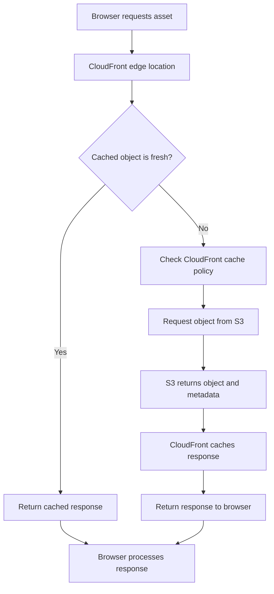

# 06- Cache Headers and Content Versioning

## Overview

Amazon S3 and CloudFront are commonly used together to deliver static website content. Efficient delivery depends on two related mechanisms:

- **Cache headers:** Control how browsers and CloudFront store and reuse responses.
- **Content versioning:** Ensures that clients receive the correct asset after a deployment changes its contents.

A production static website typically contains files with different caching requirements:

- HTML entry points change frequently and must expose new releases quickly.
- JavaScript and CSS bundles should be cached for long periods when their filenames contain content hashes.
- Images, fonts, and other static assets may be immutable or mutable depending on how they are named and updated.
- Service workers require special handling because they influence browser-side application caching and update behavior.

Applying one cache policy to every object creates deployment problems. Long-lived caching for mutable HTML can keep users on outdated application versions, while short-lived caching for immutable assets increases unnecessary requests and reduces CDN efficiency.

A reliable strategy combines:

1. Content-hashed filenames for immutable assets.
2. Appropriate `Cache-Control` metadata on S3 objects.
3. CloudFront cache policies aligned with object behavior.
4. Controlled invalidation of mutable paths.
5. Release retention to support cached clients and rollback.

## How Caching Works

### Request Flow

When a browser requests a static asset, CloudFront checks its cache before contacting S3.



There are two separate caching layers:

| Layer | Responsibility |
|---|---|
| Browser cache | Stores responses on the user's device |
| CloudFront cache | Stores responses at CloudFront edge locations |

A browser can continue using a cached object even after CloudFront has received a new version. Similarly, CloudFront can continue serving an older object while its cached response remains valid.

Both layers must be considered when designing deployment and cache behavior.

### Cache-Control Header

`Cache-Control` is an HTTP response header that defines caching behavior.

Example:

```http
Cache-Control: public, max-age=31536000, immutable
```

Important directives:

| Directive | Meaning |
|---|---|
| `public` | Allows shared caches to store the response |
| `private` | Restricts storage to private caches |
| `max-age` | Defines the freshness lifetime in seconds |
| `s-maxage` | Defines freshness lifetime for shared caches |
| `no-cache` | Allows storage but requires revalidation before reuse |
| `no-store` | Prevents caches from storing the response |
| `must-revalidate` | Requires revalidation once the response becomes stale |
| `immutable` | Indicates that the resource will not change during its freshness lifetime |

For public static assets, `public` is generally appropriate. Do not use it indiscriminately for authenticated or user-specific responses.

### max-age vs s-maxage

Both directives control freshness, but they target different cache types.

| Directive | Browser cache | Shared cache such as CloudFront |
|---|---|---|
| `max-age` | Yes | Yes, unless overridden by applicable shared-cache directives |
| `s-maxage` | No | Yes |

Example:

```http
Cache-Control: public, max-age=300, s-maxage=3600
```

This allows:

- Browser caches to consider the response fresh for 5 minutes.
- Shared caches to consider the response fresh for 1 hour.

The effective CloudFront behavior also depends on the distribution's cache policy, including its minimum, default, and maximum TTL settings.

### no-cache vs no-store

These directives are frequently confused.

| Directive | Behavior | Suitable use |
|---|---|---|
| `no-cache` | May store the response but must revalidate before reuse | HTML entry points |
| `no-store` | Must not store the response | Sensitive or highly dynamic responses |

For a public static website, `no-cache` is often appropriate for `index.html`.

Using `no-store` for every static file unnecessarily prevents useful browser caching.

## Cache Metadata in Amazon S3

### How S3 Stores Cache Headers

S3 stores HTTP-related metadata as object metadata.

When an object is requested through CloudFront, S3 returns the object's metadata with the response. CloudFront can use the relevant headers when determining caching behavior, subject to its cache policy and response header configuration.

For example, an S3 object can have:

```text
Key: assets/app.a81f92d3.js
Content-Type: application/javascript
Cache-Control: public, max-age=31536000, immutable
```

The `Cache-Control` value is associated with the object, not with the bucket as a universal default.

Different objects can therefore use different cache policies.

### Set Cache-Control During Upload

Using AWS CLI:

```bash
aws s3 cp dist/assets/app.a81f92d3.js \
  s3://my-private-website/assets/app.a81f92d3.js \
  --cache-control "public,max-age=31536000,immutable" \
  --content-type "application/javascript"
```

Upload HTML with a different policy:

```bash
aws s3 cp dist/index.html \
  s3://my-private-website/index.html \
  --cache-control "no-cache" \
  --content-type "text/html"
```

### Inspect Object Metadata

Use `head-object`:

```bash
aws s3api head-object \
  --bucket my-private-website \
  --key index.html
```

Example response:

```json
{
  "ContentType": "text/html",
  "CacheControl": "no-cache",
  "ContentLength": 2048,
  "LastModified": "2026-11-01T10:30:00+00:00"
}
```

Inspect a content-hashed asset:

```bash
aws s3api head-object \
  --bucket my-private-website \
  --key assets/app.a81f92d3.js \
  --query "{ContentType:ContentType,CacheControl:CacheControl,Size:ContentLength}"
```

Verify the metadata of important objects after deployment rather than assuming upload commands applied the intended values.

### Update Existing Object Metadata

Changing the local file does not automatically guarantee that the intended metadata is applied to an existing S3 object.

Use an object copy with metadata replacement:

```bash
aws s3api copy-object \
  --bucket my-private-website \
  --key index.html \
  --copy-source my-private-website/index.html \
  --metadata-directive REPLACE \
  --content-type "text/html" \
  --cache-control "no-cache"
```

The copy operation replaces metadata with the supplied values. Preserve any existing user-defined metadata, tags, or other required object attributes when performing a metadata replacement.

For large deployments, prefer applying correct metadata during upload rather than issuing separate metadata updates afterward.

## Recommended Cache Strategy

Different file types have different change frequencies and consistency requirements.

### Static Asset Caching

| File | Recommended Cache-Control | Reason |
|---|---|---|
| Content-hashed JavaScript | `public, max-age=31536000, immutable` | New content gets a new filename |
| Content-hashed CSS | `public, max-age=31536000, immutable` | Safe long-term caching |
| Content-hashed images | `public, max-age=31536000, immutable` | Filename changes when content changes |
| Content-hashed fonts | `public, max-age=31536000, immutable` | Avoid repeated downloads |
| `index.html` | `no-cache` | Must revalidate to discover new assets |
| `service-worker.js` | `no-cache` | Supports timely update checks |
| `manifest.webmanifest` | Short TTL or `no-cache` | May change between releases |
| `robots.txt` | Short TTL or `no-cache` | Changes should become visible reasonably quickly |
| Favicon | Depends on naming strategy | Mutable stable filenames need revalidation |

These are common starting points, not universal values. Adjust them according to application behavior and release requirements.

### Example Website Cache Configuration

```text
index.html
    Cache-Control: no-cache

assets/app.a81f92d3.js
    Cache-Control: public, max-age=31536000, immutable

assets/app.91b7c4e2.css
    Cache-Control: public, max-age=31536000, immutable

assets/logo.8a31f2c1.svg
    Cache-Control: public, max-age=31536000, immutable

service-worker.js
    Cache-Control: no-cache

robots.txt
    Cache-Control: public, max-age=300
```

The central principle is that long-lived caching is safe when the URL identifies a specific immutable version.

## Content Versioning

### What Is Content Versioning?

Content versioning is the practice of changing an asset's identifier when its contents change.

Instead of repeatedly replacing:

```text
assets/app.js
```

the build process generates:

```text
assets/app.a81f92d3.js
```

When the application changes, the build produces another filename:

```text
assets/app.c42d81f7.js
```

The URL itself now identifies the asset version.

This makes caching predictable because a changed resource has a different URL.

### Content Hashing

Build tools commonly calculate a hash from an asset's content.

Simplified example:

```text
Original content:
console.log("Version A");

Generated filename:
app.a81f92d3.js
```

After modification:

```text
Updated content:
console.log("Version B");

Generated filename:
app.c42d81f7.js
```

The exact hashing algorithm and filename format depend on the build tool.

Content hashing is particularly useful for:

- JavaScript bundles.
- CSS bundles.
- Images.
- Fonts.
- Static libraries.
- Other assets whose contents are expected to remain unchanged after publication.

### Content Versioning vs Query String Versioning

An alternative is to retain a stable filename and append a version query parameter.

Example:

```text
app.js?v=1
app.js?v=2
```

Comparison:

| Approach | Example | Characteristics |
|---|---|---|
| Content-hashed filename | `app.a81f92d3.js` | Version is part of the object key |
| Query string versioning | `app.js?v=2` | Version is part of the URL query string |
| Manual version suffix | `app-v2.js` | Version must be maintained manually |

Content-hashed filenames are generally preferable for modern frontend build pipelines.

Query-string caching depends on CloudFront cache key configuration. If query strings are excluded from the cache key, different query versions may resolve to the same cached object.

### Why Content Versioning Works with Long TTLs

Consider two deployments.

<text weight="semibold" color="default">Release A</text>

```text
index.html
    -> app.a81f92d3.js
```

<text weight="semibold" color="default">Release B</text>

```text
index.html
    -> app.c42d81f7.js
```

The new HTML references a different object key.

CloudFront does not need to replace the cached old JavaScript object. It retrieves the new asset under its new key.

This avoids invalidating every JavaScript and CSS file after every release.

## CloudFront Cache Policies

### Why CloudFront Cache Policies Matter

CloudFront cache policies define how CloudFront constructs cache keys and determines object freshness.

A cache policy can control:

- Minimum TTL.
- Default TTL.
- Maximum TTL.
- Query strings included in the cache key.
- Cookies included in the cache key.
- Headers included in the cache key.

A poorly configured cache policy can reduce cache efficiency or serve incorrect content.

### TTL Configuration

| Setting | Responsibility |
|---|---|
| Minimum TTL | Lowest allowed cache lifetime |
| Default TTL | Used when origin caching directives do not determine a TTL |
| Maximum TTL | Upper limit for the cache lifetime |

The effective TTL is constrained by CloudFront's cache policy and the origin's caching headers.

A positive minimum TTL can cause CloudFront to cache content for at least that duration even when the origin sends `no-cache`, `no-store`, or `private`.

For content that must respect origin revalidation directives, use a minimum TTL of zero.

### Separate Cache Behaviors

Different paths can use different cache policies.

Example:

| Path pattern | Cache behavior |
|---|---|
| `/assets/*` | Long-lived caching |
| `/index.html` | Revalidation or short TTL |
| `/service-worker.js` | Revalidation or short TTL |
| Default behavior | Application-specific caching |

A CloudFront distribution can associate different cache policies with different cache behaviors.

This is useful when object groups have distinct caching requirements.

### Managed Cache Policies

CloudFront provides managed cache policies that can be associated with cache behaviors.

Examples include:

- `Managed-CachingOptimized`
- `Managed-CachingDisabled`

The optimized policy is suitable for many static asset workloads. The caching-disabled policy is useful for paths that must not be cached by CloudFront.

However, managed policies should not be selected without reviewing their TTL and cache-key behavior.

For a website requiring different caching behavior for HTML and assets, use separate behaviors or carefully configured custom policies.

### Terraform Example

```hcl
data "aws_cloudfront_cache_policy" "caching_optimized" {
  name = "Managed-CachingOptimized"
}

data "aws_cloudfront_cache_policy" "caching_disabled" {
  name = "Managed-CachingDisabled"
}
```

Example asset behavior:

```hcl
ordered_cache_behavior {
  path_pattern           = "/assets/*"
  target_origin_id       = "private-s3-origin"
  viewer_protocol_policy = "redirect-to-https"

  allowed_methods = [
    "GET",
    "HEAD"
  ]

  cached_methods = [
    "GET",
    "HEAD"
  ]

  cache_policy_id = data.aws_cloudfront_cache_policy.caching_optimized.id
}
```

Example HTML entry-point behavior:

```hcl
ordered_cache_behavior {
  path_pattern           = "/index.html"
  target_origin_id       = "private-s3-origin"
  viewer_protocol_policy = "redirect-to-https"

  allowed_methods = [
    "GET",
    "HEAD"
  ]

  cached_methods = [
    "GET",
    "HEAD"
  ]

  cache_policy_id = data.aws_cloudfront_cache_policy.caching_disabled.id
}
```

The default cache behavior must also be configured. Add behaviors for other mutable files when required.

CloudFront cache behavior selection is based on path patterns. Ensure that the intended behavior takes precedence over broader patterns.

## Browser Caching and CloudFront Caching

### Two Independent Cache Lifecycles

Consider this deployment:

1. CloudFront caches `index.html`.
2. A user loads the website.
3. A new release is deployed to S3.
4. CloudFront receives an invalidation request.
5. The browser still has its own cached HTML.

Invalidating CloudFront does not directly clear every browser's local cache.

This is why HTML should normally use revalidation or a short cache lifetime.

### Example

Suppose:

```http
Cache-Control: public, max-age=3600
```

The browser can reuse the HTML for one hour without revalidation.

Even if CloudFront is invalidated immediately after deployment, a browser that already cached the HTML may continue referencing the previous asset filenames.

With:

```http
Cache-Control: no-cache
```

the browser can store the HTML but must revalidate it before reuse.

This allows the browser to discover a newer version while preserving the ability to use cached data when the origin confirms it is still valid.

### ETag and Last-Modified

S3 can return validators such as:

- `ETag`
- `Last-Modified`

These can participate in HTTP conditional requests.

Example:

```http
If-None-Match: "etag-value"
```

If the object has not changed, the origin may return:

```http
HTTP/1.1 304 Not Modified
```

This allows clients to reuse their stored representation without downloading the entire object again.

An ETag is not universally a cryptographic content hash. Multipart uploads and encryption-related behavior can affect its interpretation.

Do not use ETag as a guaranteed SHA-256 checksum. Use explicit checksums when integrity verification is required.

## Cache Invalidation

### What Is CloudFront Invalidation?

Invalidation removes selected objects from CloudFront edge caches so subsequent requests retrieve or revalidate content from the origin.

For example:

```bash
aws cloudfront create-invalidation \
  --distribution-id EXAMPLEDIST \
  --paths "/index.html"
```

### When to Invalidate

Invalidation is useful when:

- A stable object key has been overwritten.
- A cached HTML entry point must expose a new release.
- A service worker must be updated promptly.
- A mutable configuration file has changed.
- Incorrect content must be removed from the CDN cache.

### When Not to Invalidate

Routine invalidation is generally unnecessary for content-hashed assets.

Example:

```text
/assets/app.a81f92d3.js
/assets/app.c42d81f7.js
```

The second URL is a new cache key. CloudFront can fetch it independently.

### Invalidation Scope

| Path | Typical action |
|---|---|
| `/` | Invalidate when the root entry point changes |
| `/index.html` | Invalidate or rely on revalidation |
| `/assets/*` | Avoid routine invalidation for hashed assets |
| `/service-worker.js` | Invalidate or use revalidation |
| `/manifest.webmanifest` | Invalidate when immediate update is required |

Invalidation requests are asynchronous.

Check status:

```bash
aws cloudfront get-invalidation \
  --distribution-id EXAMPLEDIST \
  --id INVALIDATION_ID
```

Wait for completion:

```bash
aws cloudfront wait invalidation-completed \
  --distribution-id EXAMPLEDIST \
  --id INVALIDATION_ID
```

## Static Website Deployment Example

### Build Output

Assume a Vite application produces:

```text
dist/
├── index.html
├── assets/
│   ├── app.a81f92d3.js
│   ├── app.91b7c4e2.css
│   └── logo.8a31f2c1.svg
├── service-worker.js
└── robots.txt
```

### Upload Immutable Assets

```bash
aws s3 sync dist/assets/ \
  s3://my-private-website/assets/ \
  --cache-control "public,max-age=31536000,immutable"
```

### Upload Supporting Files

```bash
aws s3 cp dist/ \
  s3://my-private-website/ \
  --recursive \
  --exclude "assets/*" \
  --exclude "index.html" \
  --exclude "service-worker.js" \
  --exclude "robots.txt"
```

This command is appropriate only for the supporting files that should receive the same metadata. If the application contains other mutable or specially configured files, upload them separately.

### Upload Service Worker

```bash
aws s3 cp dist/service-worker.js \
  s3://my-private-website/service-worker.js \
  --cache-control "no-cache" \
  --content-type "application/javascript"
```

### Upload robots.txt

```bash
aws s3 cp dist/robots.txt \
  s3://my-private-website/robots.txt \
  --cache-control "public,max-age=300" \
  --content-type "text/plain"
```

### Publish HTML Last

```bash
aws s3 cp dist/index.html \
  s3://my-private-website/index.html \
  --cache-control "no-cache" \
  --content-type "text/html"
```

### Invalidate Mutable Paths

```bash
aws cloudfront create-invalidation \
  --distribution-id EXAMPLEDIST \
  --paths "/" "/index.html" "/service-worker.js" "/robots.txt"
```

### Verify Object Metadata

```bash
aws s3api head-object \
  --bucket my-private-website \
  --key index.html \
  --query "{ContentType:ContentType,CacheControl:CacheControl}"
```

```bash
aws s3api head-object \
  --bucket my-private-website \
  --key assets/app.a81f92d3.js \
  --query "{ContentType:ContentType,CacheControl:CacheControl}"
```

### Verify CloudFront Responses

```bash
curl -I https://www.example.com/
```

```bash
curl -I https://www.example.com/assets/app.a81f92d3.js
```

Check:

- HTTP status.
- Content type.
- Cache-Control.
- CloudFront cache status.
- Expected asset version.

## Python and Boto3 Cache Metadata Management

Boto3 supports setting object metadata during upload.

Example:

```python
from pathlib import Path
import mimetypes

import boto3
from botocore.exceptions import BotoCoreError, ClientError


def get_cache_control(relative_path: Path) -> str:
    if relative_path.name == "index.html":
        return "no-cache"

    if relative_path.parts[0] == "assets":
        return "public, max-age=31536000, immutable"

    if relative_path.name == "service-worker.js":
        return "no-cache"

    return "public, max-age=300"


def upload_build(build_dir: str, bucket: str) -> None:
    root = Path(build_dir).resolve()

    if not root.is_dir():
        raise ValueError(f"Build directory does not exist: {root}")

    s3 = boto3.client("s3")

    for file_path in sorted(root.rglob("*")):
        if not file_path.is_file():
            continue

        relative_path = file_path.relative_to(root)
        key = relative_path.as_posix()

        content_type, _ = mimetypes.guess_type(file_path.name)

        try:
            s3.upload_file(
                str(file_path),
                bucket,
                key,
                ExtraArgs={
                    "ContentType": content_type or "application/octet-stream",
                    "CacheControl": get_cache_control(relative_path),
                },
            )
        except (BotoCoreError, ClientError) as exc:
            raise RuntimeError(
                f"Failed to upload {key} to s3://{bucket}"
            ) from exc


if __name__ == "__main__":
    upload_build("dist", "my-private-website")
```

This example assumes the build directory contains an `assets/` directory and uses a root-level `index.html`.

For production deployment automation, extend the implementation with:

- Structured logging.
- Retry configuration.
- Build manifest validation.
- Release identifiers.
- Upload concurrency controls.
- Deployment status reporting.
- Post-upload metadata verification.
- Safe stale-object cleanup.

Use IAM roles or the standard AWS credential provider chain. Never embed AWS credentials in the script.

## Content Versioning and Release Management

### Immutable Asset Strategy

A content-hashed asset should never be overwritten with different content under the same key.

For example:

```text
assets/app.a81f92d3.js
```

should always represent the same application bundle.

If the contents change, the build should produce a new key.

This allows:

- Long browser cache lifetimes.
- Long CloudFront cache lifetimes.
- Predictable deployment behavior.
- Reduced invalidation requirements.
- Safer rollback.

### Release-Specific Prefixes

For applications requiring stronger release isolation, store complete builds under unique prefixes.

Example:

```text
releases/
├── 2026-11-01-a1b2c3/
│   ├── index.html
│   └── assets/
└── 2026-11-02-d4e5f6/
    ├── index.html
    └── assets/
```

The root entry point can reference assets from a specific release.

Example:

```html
<script
  type="module"
  src="/releases/2026-11-02-d4e5f6/assets/app.a81f92d3.js">
</script>
```

The release prefix must be incorporated into the build's asset URL configuration.

### Rollback

A release-based deployment can restore a previously published entry point.

Example:

```bash
aws s3 cp previous-index.html \
  s3://my-private-website/index.html \
  --cache-control "no-cache" \
  --content-type "text/html"
```

Then invalidate the mutable entry point:

```bash
aws cloudfront create-invalidation \
  --distribution-id EXAMPLEDIST \
  --paths "/" "/index.html"
```

Keep previous release assets available because browsers and CloudFront may still reference them.

### S3 Versioning vs Content Versioning

These are different mechanisms.

| Feature | S3 Versioning | Content Versioning |
|---|---|---|
| Purpose | Retains multiple versions of an S3 object | Creates new asset identifiers when content changes |
| Scope | S3 object storage | Application asset naming |
| Example | Multiple versions of `index.html` | `app.a81f92d3.js`, `app.c42d81f7.js` |
| Primary benefit | Object recovery and historical versions | Cache correctness |
| Rollback | Can restore an earlier S3 object version | Can publish an earlier release or asset reference |

S3 Versioning is useful for recovery, but it does not automatically solve browser or CloudFront caching.

Content versioning is useful for cache correctness, but it does not automatically preserve deleted S3 objects.

Production systems may use both.

## Service Workers and Application Caching

### Why Service Workers Need Special Handling

A service worker can intercept browser requests and manage a client-side cache independently of CloudFront.

This introduces another caching layer:

```text
Browser
  |
  +-- Service Worker Cache
  |
  +-- Browser HTTP Cache
  |
CloudFront
  |
S3
```

Even when CloudFront serves the latest HTML, a service worker may continue returning previously cached resources.

### Recommended Strategy

- Keep the service worker URL stable so browsers can discover updates.
- Use `Cache-Control: no-cache` for the service worker script.
- Use versioned cache names inside the service worker.
- Remove obsolete cache entries during activation.
- Avoid caching mutable HTML indefinitely.
- Test application updates with existing browser sessions.

Example:

```javascript
const CACHE_NAME = "website-assets-v2";

const ASSETS_TO_CACHE = [
  "/",
  "/index.html"
];

self.addEventListener("install", (event) => {
  event.waitUntil(
    caches.open(CACHE_NAME).then((cache) => {
      return cache.addAll(ASSETS_TO_CACHE);
    })
  );
});

self.addEventListener("activate", (event) => {
  event.waitUntil(
    caches.keys().then((cacheNames) => {
      return Promise.all(
        cacheNames
          .filter((name) => name !== CACHE_NAME)
          .map((name) => caches.delete(name))
      );
    })
  );
});
```

This is a simplified cache lifecycle example. Production service workers should use an explicit asset strategy, handle failed requests, and avoid caching authenticated or sensitive responses.

## Monitoring and Verification

Cache configuration should be validated at both the S3 and CloudFront layers.

### S3 Metadata Verification

Inspect important objects:

```bash
aws s3api head-object \
  --bucket my-private-website \
  --key index.html
```

```bash
aws s3api head-object \
  --bucket my-private-website \
  --key assets/app.a81f92d3.js
```

Verify that the expected cache metadata is stored.

### CloudFront Response Verification

```bash
curl -I https://www.example.com/index.html
```

```bash
curl -I https://www.example.com/assets/app.a81f92d3.js
```

Inspect:

| Header | Purpose |
|---|---|
| `Cache-Control` | Advertises caching directives |
| `ETag` | Provides a representation validator |
| `Last-Modified` | Indicates the object's modification time |
| `Age` | Indicates how long a response has been cached by a shared cache |
| `X-Cache` | Indicates CloudFront cache behavior |

The exact headers depend on the distribution configuration and response.

### Operational Indicators

Monitor:

- CloudFront cache hit ratio.
- Origin request volume.
- CloudFront 4xx and 5xx response rates.
- Origin latency.
- Invalidation completion.
- Deployment smoke-test failures.
- Missing asset responses.
- Unexpected changes in asset download volume.

A low cache hit ratio may indicate short TTLs, ineffective cache keys, frequent content changes, or requests that cannot be cached.

Investigate the cause before increasing TTLs. Longer caching is not a safe solution for incorrectly versioned mutable content.

## Common Mistakes

| Mistake | Why It Happens | Prevention |
|---|---|---|
| Applying one cache policy to every object | Upload automation does not distinguish file types | Assign cache metadata according to asset behavior |
| Caching `index.html` for one year | HTML is treated like a content-hashed asset | Use revalidation or a short TTL |
| Using `immutable` on mutable filenames | Cache directives do not match the naming strategy | Apply immutable caching only to versioned assets |
| Invalidating every asset after every deployment | Content hashing is not used effectively | Publish new hashed asset keys |
| Assuming CloudFront invalidation clears browser caches | CDN and browser caches are treated as one layer | Design browser caching independently |
| Excluding query strings from the cache key when using query-based versioning | Cache policy does not include the version parameter | Prefer hashed filenames or configure the cache key correctly |
| Assuming S3 Versioning fixes CDN staleness | Storage history is confused with HTTP caching | Use content versioning and appropriate cache policies |
| Overwriting content under an immutable key | Build output is published with stable filenames | Never reuse an immutable key for different content |
| Using a positive minimum CloudFront TTL with `no-cache` expectations | CloudFront minimum TTL overrides origin freshness requirements | Use a minimum TTL of zero where origin revalidation must be respected |
| Deleting previous release assets immediately | Only the current HTML is considered | Retain assets for cached clients and rollback |
| Treating ETag as a guaranteed content checksum | ETag behavior is assumed to be identical for every upload | Use explicit checksum mechanisms for integrity verification |
| Ignoring service worker caching | Browser-managed caches are overlooked | Version service-worker caches and test update behavior |

## Key Takeaways

- Treat browser caching and CloudFront caching as separate layers, and align both with the application's release strategy.
- Use content-hashed filenames with long-lived immutable caching for static assets, while keeping HTML and service workers revalidatable.
- Set S3 object metadata deliberately and configure CloudFront cache policies with appropriate TTLs and cache keys.
- Use invalidations for mutable paths rather than routinely invalidating content-hashed assets.
- Understand that S3 Versioning, content versioning, and HTTP cache invalidation solve different problems; combine them when recovery and cache correctness are both required.