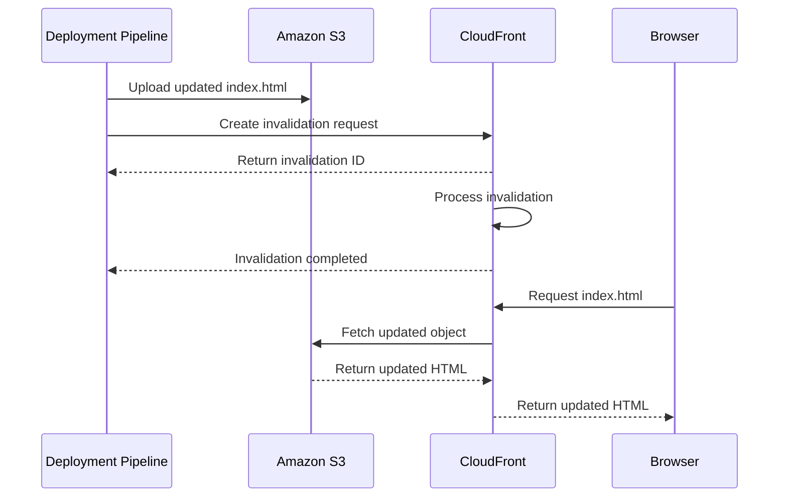
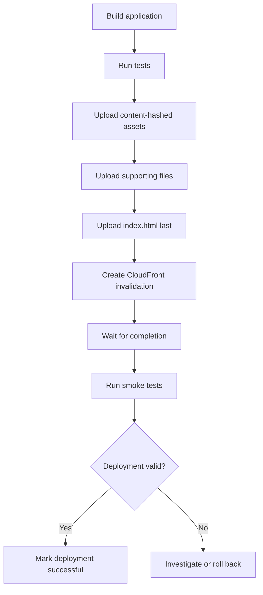

# 07- CloudFront Cache Invalidation

## Overview

Amazon CloudFront caches content at edge locations to reduce latency, decrease requests to the origin, and improve application performance. When content stored in an Amazon S3 origin changes, CloudFront may continue serving a previously cached response until its configured cache lifetime expires or the object is invalidated.

CloudFront cache invalidation provides a mechanism to remove selected cached objects before their normal expiration time.

For static website deployments, invalidation is particularly important for mutable resources such as:

- `index.html`
- `service-worker.js`
- `manifest.webmanifest`
- `robots.txt`
- Stable filenames that are overwritten during deployment

Content-hashed assets generally do not require invalidation because every content change produces a new object key.

A production deployment strategy should combine cache invalidation with content versioning rather than relying on invalidation for every published object.

## How CloudFront Cache Invalidation Works

### Request Lifecycle

CloudFront maintains cached responses across its edge infrastructure. When an invalidation request is submitted, CloudFront processes the requested paths and removes matching cached objects.

Subsequent requests for invalidated objects are served by fetching the current representation from the origin or another applicable cache layer.



An invalidation request is asynchronous. Receiving an invalidation ID does not mean that all requested objects have already been removed from CloudFront caches.

Wait for the invalidation status to become `Completed` before treating the operation as finished.

### Invalidation Scope

An invalidation path identifies the cached objects that CloudFront should remove.

Examples:

```text
/index.html
/
/assets/*
/service-worker.js
```

The path determines the scope of invalidation.

| Path | Scope |
|---|---|
| `/index.html` | The root HTML object |
| `/` | The default root object path |
| `/assets/*` | Objects under the assets path |
| `/service-worker.js` | The service worker script |
| `/*` | All objects in the distribution |

Invalidating `/index.html` does not automatically invalidate every object referenced by that HTML document.

For example, if the HTML references:

```text
/assets/app.a81f92d3.js
/assets/app.91b7c4e2.css
```

those assets remain separate cache objects.

### Wildcard Invalidation

CloudFront supports wildcard invalidation paths.

Example:

```bash
aws cloudfront create-invalidation \
  --distribution-id EXAMPLEDIST \
  --paths "/assets/*"
```

Important considerations:

- The wildcard must be the final character in the path.
- A wildcard path can invalidate multiple matching objects.
- Wildcard invalidations should be used carefully because they can remove a large number of cached objects.
- Invalidation paths are case-sensitive.
- URL query strings require consideration when defining the invalidation path and cache key.

For example:

```text
/assets/*
```

invalidates matching asset paths, while:

```text
/assets/app.js
```

targets a specific object path.

## When to Use Cache Invalidation

### Mutable Website Files

Some website files use stable object keys and are overwritten during deployment.

Example:

```text
index.html
service-worker.js
manifest.webmanifest
```

When these objects change, CloudFront may continue serving their previously cached representations.

Invalidating the relevant paths makes updated content available without waiting for the existing cache lifetime to expire.

### Emergency Content Replacement

Invalidation is useful when incorrect or outdated content must be removed from the CDN cache.

Examples:

- A broken JavaScript bundle reference.
- Incorrect website configuration.
- A faulty HTML deployment.
- An outdated service worker.
- Content that must be replaced before its normal TTL expires.

Invalidation only affects CloudFront's cached responses. It does not repair the underlying S3 object. Correct the origin object before invalidating its cached representation.

### Content-Hashed Assets

Content-hashed assets generally should not require invalidation.

Example:

```text
assets/app.a81f92d3.js
assets/app.c42d81f7.js
```

The second deployment produces a new object key. CloudFront treats it as a different cache entry.

The previous object can remain cached without affecting requests for the new version.

| Resource | Invalidation requirement |
|---|---|
| `index.html` | Usually required or handled through revalidation |
| Content-hashed JavaScript | Normally unnecessary |
| Content-hashed CSS | Normally unnecessary |
| Content-hashed images | Normally unnecessary |
| Stable service worker | Usually required or handled through revalidation |
| Mutable configuration file | Depends on its cache policy and deployment requirements |

## AWS CLI Operations

### Create an Invalidation

Use `create-invalidation` to submit an invalidation request.

```bash
aws cloudfront create-invalidation \
  --distribution-id EXAMPLEDIST \
  --paths "/index.html"
```

Example with multiple paths:

```bash
aws cloudfront create-invalidation \
  --distribution-id EXAMPLEDIST \
  --paths "/" "/index.html" "/service-worker.js"
```

Example response:

```json
{
  "Location": "https://cloudfront.amazonaws.com/2020-05-31/distribution/EXAMPLEDIST/invalidation/INV123456",
  "Invalidation": {
    "Id": "INV123456",
    "Status": "InProgress",
    "CreateTime": "2026-11-01T10:30:00Z"
  }
}
```

The returned invalidation ID is used to inspect or wait for the operation.

### Invalidate All Objects

```bash
aws cloudfront create-invalidation \
  --distribution-id EXAMPLEDIST \
  --paths "/*"
```

This removes all matching cached objects from the distribution.

Use it for exceptional cases rather than routine deployments.

Invalidating everything can increase origin requests because CloudFront must repopulate its cache as users request content again.

### Get Invalidation Status

```bash
aws cloudfront get-invalidation \
  --distribution-id EXAMPLEDIST \
  --id INV123456
```

Example response:

```json
{
  "Invalidation": {
    "Id": "INV123456",
    "Status": "Completed"
  }
}
```

Possible lifecycle statuses include:

| Status | Meaning |
|---|---|
| `InProgress` | CloudFront is processing the invalidation |
| `Completed` | CloudFront has completed the invalidation |

### Wait for Completion

The AWS CLI provides a waiter:

```bash
aws cloudfront wait invalidation-completed \
  --distribution-id EXAMPLEDIST \
  --id INV123456
```

The command waits until the invalidation reaches its completed state or the waiter reaches its configured polling limit.

This is useful in deployment pipelines where verification should happen after invalidation completes.

### List Invalidations

```bash
aws cloudfront list-invalidations \
  --distribution-id EXAMPLEDIST
```

For automated inspection:

```bash
aws cloudfront list-invalidations \
  --distribution-id EXAMPLEDIST \
  --query "InvalidationList.Items[].{Id:Id,Status:Status,Created:CreateTime}"
```

This is useful for operational investigation and deployment auditing.

## Invalidation Paths and Query Strings

CloudFront cache keys may include query strings depending on the associated cache policy.

Consider:

```text
/app.js?v=1
/app.js?v=2
```

If query strings are included in the cache key, these requests can represent separate cached objects.

If query strings are excluded, both requests may use the same cached object.

Invalidation behavior must be designed consistently with the cache key configuration.

For example:

```bash
aws cloudfront create-invalidation \
  --distribution-id EXAMPLEDIST \
  --paths "/app.js"
```

When query strings are part of the cache key, use the appropriate invalidation path syntax to target the intended cached variants. CloudFront supports wildcard query-string invalidation patterns, but the path must follow CloudFront's invalidation syntax.

For most modern static website deployments, content-hashed filenames are simpler and more predictable than query-string-based asset versioning.

## Invalidation Cost and Quotas

CloudFront invalidation has usage limits and pricing considerations.

The important operational distinction is between:

- The number of invalidation paths submitted.
- The number of objects affected by those paths.
- The invalidation request volume over the applicable billing period.

A wildcard path can affect many objects while remaining a single invalidation path.

AWS pricing and quotas can change. Check the current CloudFront pricing and quotas documentation before designing high-volume invalidation workflows.

Production recommendations:

- Avoid invalidating every asset after every deployment.
- Prefer content-hashed filenames.
- Group related mutable paths into a single invalidation request.
- Avoid repeatedly submitting identical invalidation requests.
- Monitor invalidation activity and associated deployment costs.
- Use short TTLs or revalidation for frequently changing objects when appropriate.

## Cache Invalidation vs Cache Expiration

Invalidation and TTL expiration solve different problems.

| Characteristic | Cache invalidation | TTL expiration |
|---|---|---|
| Trigger | Explicit API request | Cache policy and response freshness |
| Timing | Asynchronous processing | Based on configured freshness |
| Scope | Selected paths | Cached objects according to TTL |
| Operational control | Deployment or operator initiated | Policy driven |
| Use case | Immediate cache removal after a change | Normal cache lifecycle |

### Example

Suppose an object has:

```http
Cache-Control: public, max-age=3600
```

CloudFront may cache the object for up to one hour, subject to its cache policy.

If the origin object changes after five minutes, CloudFront may continue serving the previous cached response.

Submitting an invalidation requests removal of the cached object before its normal expiration.

An alternative is to configure an appropriate TTL or use revalidation for mutable content.

The correct choice depends on how quickly the application must expose updates and how much origin traffic is acceptable.

## Cache Invalidation in CI/CD

A deployment pipeline should upload the new website content before invalidating mutable cached paths.

The recommended sequence is:

1. Build and validate the application.
2. Upload immutable assets.
3. Upload supporting files with their appropriate metadata.
4. Upload the updated HTML entry point last.
5. Submit CloudFront invalidation for mutable paths.
6. Wait for invalidation completion.
7. Execute deployment smoke tests.



This ordering reduces the chance that users receive new HTML referencing assets that have not yet been uploaded.

It does not make an S3 deployment atomic. Use release-specific prefixes and controlled publication of the entry point when stronger release isolation is required.

### GitHub Actions Example

The following workflow deploys a static website to a private S3 origin served through CloudFront.

It assumes:

- The frontend build produces a `dist/` directory.
- Asset files under `dist/assets/` have content-hashed filenames.
- GitHub Actions has an AWS OIDC role configured.
- The role has narrowly scoped S3 deployment permissions and CloudFront invalidation permissions.
- The distribution and bucket identifiers are configured as GitHub variables.

```yaml
name: Deploy Static Website

on:
  push:
    branches:
      - main

permissions:
  contents: read
  id-token: write

jobs:
  deploy:
    runs-on: ubuntu-latest

    steps:
      - name: Checkout repository
        uses: actions/checkout@v4

      - name: Configure Node.js
        uses: actions/setup-node@v4
        with:
          node-version: "22"
          cache: npm

      - name: Install dependencies
        run: npm ci

      - name: Run tests
        run: npm test

      - name: Build website
        run: npm run build

      - name: Configure AWS credentials
        uses: aws-actions/configure-aws-credentials@v4
        with:
          role-to-assume: ${{ secrets.AWS_DEPLOYMENT_ROLE_ARN }}
          aws-region: ${{ vars.AWS_REGION }}

      - name: Upload immutable assets
        run: |
          aws s3 sync dist/assets/ \
            s3://${{ vars.S3_BUCKET }}/assets/ \
            --cache-control "public,max-age=31536000,immutable"

      - name: Upload supporting files
        run: |
          aws s3 cp dist/ \
            s3://${{ vars.S3_BUCKET }}/ \
            --recursive \
            --exclude "assets/*" \
            --exclude "index.html" \
            --exclude "service-worker.js" \
            --exclude "robots.txt"

      - name: Upload service worker
        run: |
          if [ -f dist/service-worker.js ]; then
            aws s3 cp dist/service-worker.js \
              s3://${{ vars.S3_BUCKET }}/service-worker.js \
              --cache-control "no-cache" \
              --content-type "application/javascript"
          fi

      - name: Upload robots.txt
        run: |
          if [ -f dist/robots.txt ]; then
            aws s3 cp dist/robots.txt \
              s3://${{ vars.S3_BUCKET }}/robots.txt \
              --cache-control "public,max-age=300" \
              --content-type "text/plain"
          fi

      - name: Upload HTML entry point
        run: |
          aws s3 cp dist/index.html \
            s3://${{ vars.S3_BUCKET }}/index.html \
            --cache-control "no-cache" \
            --content-type "text/html"

      - name: Invalidate CloudFront
        id: invalidation
        run: |
          INVALIDATION_ID=$(aws cloudfront create-invalidation \
            --distribution-id "${{ vars.CLOUDFRONT_DISTRIBUTION_ID }}" \
            --paths "/" "/index.html" "/service-worker.js" "/robots.txt" \
            --query "Invalidation.Id" \
            --output text)

          echo "invalidation_id=$INVALIDATION_ID" >> "$GITHUB_OUTPUT"

      - name: Wait for invalidation
        run: |
          aws cloudfront wait invalidation-completed \
            --distribution-id "${{ vars.CLOUDFRONT_DISTRIBUTION_ID }}" \
            --id "${{ steps.invalidation.outputs.invalidation_id }}"

      - name: Verify deployment
        run: |
          curl --fail --silent --show-error \
            https://${{ vars.WEBSITE_DOMAIN }}/index.html \
            -o /dev/null
```

This workflow is an implementation example, not a complete production pipeline.

Before adopting it:

- Pin GitHub Actions to reviewed commit SHAs.
- Ensure the test command exists in the project.
- Validate that the build output matches the upload assumptions.
- Restrict the OIDC role to the intended repository, branch, and deployment environment.
- Scope S3 permissions to the required bucket and object prefixes.
- Scope invalidation permissions to the intended CloudFront distribution.
- Add asset-reference smoke tests, not just an HTML response check.
- Use GitHub environment approval gates for production deployments where required.
- Avoid exposing sensitive Terraform or deployment artifacts in workflow logs.

## IAM Permissions for Invalidation

The deployment identity requires permission to create and inspect invalidations.

Example IAM policy:

```json
{
  "Version": "2012-10-17",
  "Statement": [
    {
      "Sid": "CreateCloudFrontInvalidation",
      "Effect": "Allow",
      "Action": [
        "cloudfront:CreateInvalidation"
      ],
      "Resource": "arn:aws:cloudfront::123456789012:distribution/EXAMPLEDIST"
    },
    {
      "Sid": "InspectCloudFrontInvalidations",
      "Effect": "Allow",
      "Action": [
        "cloudfront:GetInvalidation",
        "cloudfront:ListInvalidations"
      ],
      "Resource": "arn:aws:cloudfront::123456789012:distribution/EXAMPLEDIST"
    }
  ]
}
```

Replace the account ID and distribution ID with the actual resource identifiers.

The policy separates invalidation creation from inspection. Remove inspection permissions if the deployment workflow does not require them.

The complete deployment role also needs the appropriate S3 upload permissions. Keep those permissions separate from CloudFront permissions when defining and reviewing access boundaries.

For GitHub Actions, use OIDC federation and short-lived credentials rather than static AWS access keys.

## Boto3 Cache Invalidation

Boto3 exposes CloudFront invalidation through the `create_invalidation` API.

Example:

```python
import boto3
from botocore.exceptions import BotoCoreError, ClientError


def invalidate_cloudfront(
    distribution_id: str,
    paths: list[str],
    caller_reference: str,
) -> str:
    if not paths:
        raise ValueError("At least one invalidation path is required")

    cloudfront = boto3.client("cloudfront")

    try:
        response = cloudfront.create_invalidation(
            DistributionId=distribution_id,
            InvalidationBatch={
                "Paths": {
                    "Quantity": len(paths),
                    "Items": paths,
                },
                "CallerReference": caller_reference,
            },
        )

        return response["Invalidation"]["Id"]

    except (BotoCoreError, ClientError) as exc:
        raise RuntimeError(
            f"CloudFront invalidation failed for {distribution_id}"
        ) from exc


if __name__ == "__main__":
    invalidation_id = invalidate_cloudfront(
        distribution_id="EXAMPLEDIST",
        paths=[
            "/",
            "/index.html",
            "/service-worker.js",
        ],
        caller_reference="website-release-2026-11-01-a1b2c3",
    )

    print(f"Invalidation submitted: {invalidation_id}")
```

The `CallerReference` identifies an invalidation request. Use a unique value for each distinct invalidation batch. Reusing the same caller reference with different invalidation paths causes CloudFront to reject the request.

For production automation, avoid using a fixed caller reference across deployments.

### Wait for Invalidation Completion with Boto3

```python
import boto3
from botocore.exceptions import BotoCoreError, ClientError


def wait_for_invalidation(
    distribution_id: str,
    invalidation_id: str,
) -> None:
    cloudfront = boto3.client("cloudfront")

    try:
        waiter = cloudfront.get_waiter("invalidation_completed")

        waiter.wait(
            DistributionId=distribution_id,
            Id=invalidation_id,
            WaiterConfig={
                "Delay": 15,
                "MaxAttempts": 40,
            },
        )

    except (BotoCoreError, ClientError) as exc:
        raise RuntimeError(
            f"Invalidation did not complete successfully: {invalidation_id}"
        ) from exc
```

A waiter timeout does not necessarily mean the invalidation failed. The request may still be processing.

If a timeout occurs, inspect the invalidation status before submitting another request.

## Invalidation and Rollback

### Why Rollback Requires More Than Invalidation

Invalidation removes cached objects. It does not restore a previous version of the website.

Suppose a deployment publishes:

```text
index.html -> app.release-b.js
```

But the new application contains a production defect.

Invalidating CloudFront will cause CloudFront to retrieve the current S3 content. If the current S3 content is defective, invalidation simply makes that defective content available again.

Rollback requires restoring a valid release.

### Rollback with a Previous Entry Point

If previous release assets are retained, restore the previous HTML entry point:

```bash
aws s3 cp previous-index.html \
  s3://my-private-website/index.html \
  --cache-control "no-cache" \
  --content-type "text/html"
```

Then invalidate the mutable entry point:

```bash
aws cloudfront create-invalidation \
  --distribution-id EXAMPLEDIST \
  --paths "/" "/index.html"
```

Wait for completion:

```bash
aws cloudfront wait invalidation-completed \
  --distribution-id EXAMPLEDIST \
  --id INVALIDATION_ID
```

This approach depends on retaining the previous HTML and all assets it references.

### Rollback with S3 Versioning

If S3 Versioning is enabled, previous object versions may be available.

Inspect versions:

```bash
aws s3api list-object-versions \
  --bucket my-private-website \
  --prefix index.html
```

A previous version can be copied back as the current object:

```bash
aws s3api copy-object \
  --bucket my-private-website \
  --key index.html \
  --copy-source "my-private-website/index.html?versionId=VERSION_ID" \
  --metadata-directive REPLACE \
  --content-type "text/html" \
  --cache-control "no-cache"
```

Then invalidate the affected CloudFront path.

S3 Versioning and CloudFront invalidation serve different purposes:

- S3 Versioning provides object recovery.
- Invalidation removes selected cached responses.
- Content versioning provides immutable asset identifiers.

A reliable rollback strategy must account for all three where applicable.

## Cache Invalidation with Release-Based Deployment

For larger applications, release-specific prefixes provide better isolation between deployments.

Example:

```text
releases/
├── release-a/
│   ├── index.html
│   └── assets/
├── release-b/
│   ├── index.html
│   └── assets/
└── release-c/
    ├── index.html
    └── assets/
```

Each release contains its own assets. The active website entry point references a specific release.

Deployment can then follow this process:

1. Upload the complete new release.
2. Verify that all referenced assets exist.
3. Publish the new root entry point.
4. Invalidate mutable paths.
5. Verify the new release.
6. Retain previous releases for rollback.

This reduces the risk of mixing assets from different deployments.

However, CloudFront invalidation is not a globally atomic release switch. Requests may still be in flight, and browser caches and service workers have independent lifecycles.

For systems requiring stronger release isolation, design the application around immutable release paths and a carefully controlled entry-point publication process.

## Monitoring and Troubleshooting

### Verify Invalidation Status

```bash
aws cloudfront get-invalidation \
  --distribution-id EXAMPLEDIST \
  --id INV123456
```

If the status is `InProgress`, wait for completion.

If the status is `Completed` but users still see old content, investigate other caching layers.

### Verify the Origin Object

Inspect S3 metadata:

```bash
aws s3api head-object \
  --bucket my-private-website \
  --key index.html
```

Confirm that:

- The expected object exists.
- The object was updated.
- The content type is correct.
- The cache-control metadata is correct.

### Verify CloudFront Response

```bash
curl -I https://www.example.com/index.html
```

Inspect:

| Header | Purpose |
|---|---|
| `Cache-Control` | Indicates response caching directives |
| `Age` | Indicates the age of a shared-cache response |
| `X-Cache` | Indicates CloudFront cache behavior |
| `ETag` | Provides a representation validator |
| `Last-Modified` | Indicates the object's modification time |

A response header alone does not prove that every client has received the new version.

### Common Failure Scenarios

| Symptom | Possible cause | Diagnostic action |
|---|---|---|
| Old content remains visible | Invalidation is still in progress | Check invalidation status |
| Old content remains visible after completion | Browser cache or service worker cache | Test with a fresh browser session and inspect service worker behavior |
| Invalidation request fails | IAM permissions are insufficient | Inspect the deployment role's CloudFront permissions |
| Wrong content appears after invalidation | S3 origin contains incorrect content | Inspect the origin object directly |
| Some URLs remain outdated | Invalidation path does not match the requested object | Review exact paths and URL encoding |
| New HTML references missing assets | Assets were not uploaded before HTML publication | Verify asset upload ordering |
| Different query variants behave unexpectedly | Query-string cache key configuration differs from expectations | Inspect the CloudFront cache policy |
| Rollback does not restore the previous website | Previous assets or HTML were removed | Retain complete releases |
| Invalidation waiter times out | Processing exceeds the waiter's configured limit | Inspect the invalidation status before retrying |

### Production Diagnostic Sequence

Use a consistent sequence when investigating stale content:

1. Confirm that the correct object exists in S3.
2. Inspect its metadata and modification time.
3. Confirm that the CloudFront invalidation targets the correct distribution.
4. Check that the invalidation status is `Completed`.
5. Request the object through CloudFront and inspect response headers.
6. Test with browser caching disabled or a clean browser profile.
7. Inspect service worker caches and application-level caching.
8. Verify that the deployed HTML references the expected asset filenames.

This separates origin problems, CDN cache problems, and browser-side caching problems.

## Production Best Practices

### Prefer Versioned Assets Over Broad Invalidation

Use content-hashed filenames for JavaScript, CSS, fonts, and images.

This allows long-lived caching without requiring routine invalidation.

### Keep Mutable Files Revalidatable

For example:

```http
Cache-Control: no-cache
```

is appropriate for many HTML entry points.

This reduces dependence on broad invalidation requests and helps browsers discover updated application versions.

### Upload Assets Before HTML

Always ensure that the assets referenced by a new HTML entry point are available before publishing that entry point.

This avoids deployment windows where clients receive HTML referencing missing files.

### Avoid Unnecessary Wildcard Invalidations

Avoid routinely using:

```bash
--paths "/*"
```

Broad invalidations:

- Increase cache misses.
- Increase origin request volume.
- Can increase latency while caches are repopulated.
- May add unnecessary invalidation cost.
- Can conceal poor asset-versioning practices.

Invalidate only the paths that require immediate replacement.

### Retain Previous Releases

Keep previous release assets available for:

- Rollback.
- Browser sessions using older HTML.
- Service worker update transitions.
- Delayed client requests.
- Recovery from failed deployments.

Define a retention policy that balances recovery requirements and storage costs.

### Separate Deployment and Recovery Permissions

The CI/CD role should have only the permissions required to publish the website and invalidate the intended distribution.

For higher-risk environments, separate routine deployment permissions from privileged recovery operations.

Use audit logs and deployment records to identify who initiated changes and which release was published.

### Validate After Invalidation

Do not mark a deployment successful merely because an invalidation request was accepted.

A successful deployment should include:

- Invalidation completion.
- HTTP response validation.
- Asset-reference verification.
- Expected release identifier verification where available.
- Application-level smoke tests.

## Key Takeaways

- CloudFront invalidation removes selected cached objects before their normal TTL expires; it does not modify or repair the S3 origin.
- Use invalidation primarily for mutable resources such as HTML entry points and service workers, not routinely for content-hashed assets.
- Invalidation is asynchronous; wait for `Completed` before treating the operation as finished.
- Publish assets before HTML, invalidate only necessary paths, and retain previous releases to support rollback.
- Diagnose stale content across S3, CloudFront, browser caches, and service workers rather than assuming invalidation alone resolves every caching issue.