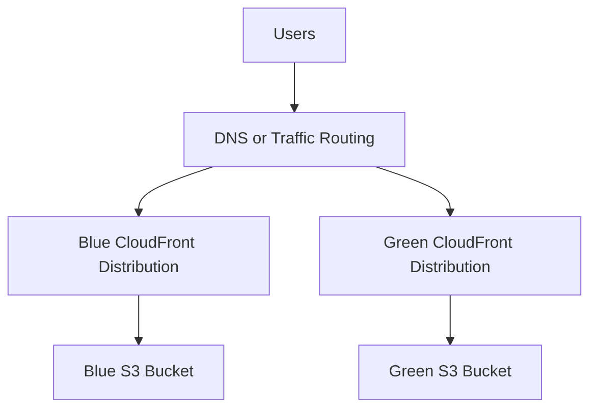
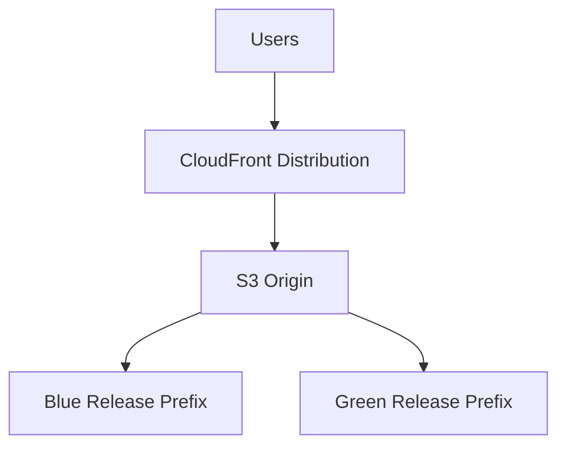
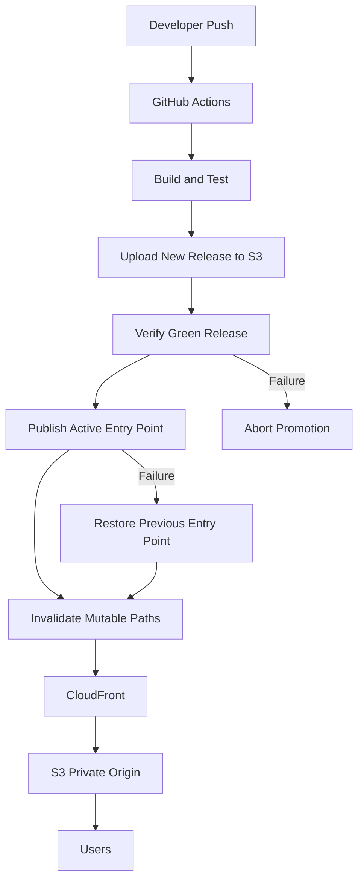
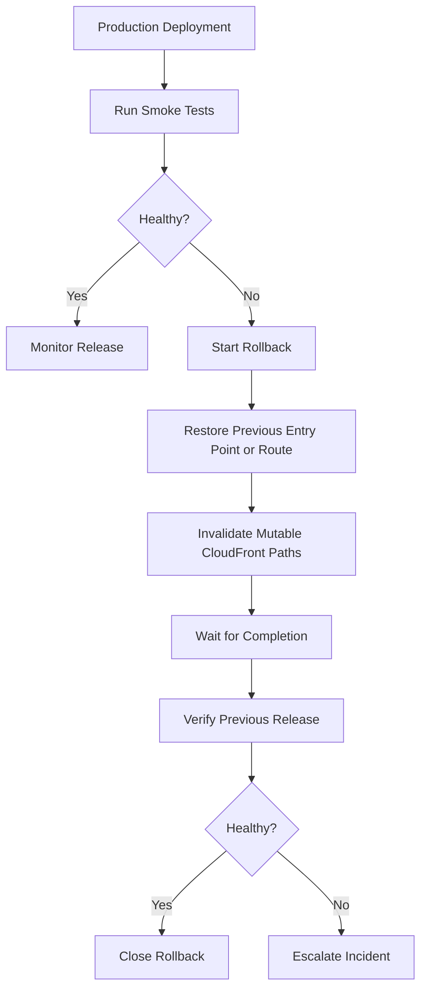

# 08- Blue-Green Website Releases

## Overview

Blue-green deployment is a release strategy that maintains two independently deployable versions of an application:

- **Blue:** The currently active production release.
- **Green:** The new release being prepared and validated.

Instead of replacing the live website in place, the deployment pipeline publishes the new release separately, validates it, and then switches production traffic to it.

For an Amazon S3 static website delivered through CloudFront, blue-green deployment can use separate S3 release prefixes or separate S3 buckets. CloudFront, DNS, or a stable entry point controls which release users receive.

The primary objective is to reduce deployment risk while preserving a known-good release for recovery.

A production implementation must account for more than switching an S3 prefix. It must handle CloudFront caching, browser caching, service workers, release consistency, deployment concurrency, security, and rollback behavior.

## Blue-Green Deployment Architecture

### Core Components

| Component | Responsibility |
|---|---|
| Blue release | Current production website |
| Green release | New website version |
| Amazon S3 | Stores release artifacts |
| CloudFront | Delivers website content |
| Deployment pipeline | Builds, uploads, validates, and promotes releases |
| Routing mechanism | Controls which release receives production traffic |
| Monitoring and smoke tests | Validate release behavior |
| Rollback mechanism | Restores the previous production release |

### S3 Release Layout

A single S3 bucket can store multiple immutable releases:

```text
s3://my-static-website/
├── releases/
│   ├── release-20261028-f7e8d9c/
│   │   ├── index.html
│   │   └── assets/
│   │       ├── app.a81f92d3.js
│   │       └── app.91b7c4e2.css
│   │
│   └── release-20261101-a1b2c3d/
│       ├── index.html
│       └── assets/
│           ├── app.c42d81f7.js
│           └── app.72f4b1e9.css
│
├── index.html
└── deployment-metadata/
    └── active-release.json
```

Each release has an independent object namespace. The root `index.html` acts as the stable entry point and references assets from the active release.

This provides several advantages:

- Previous releases remain available.
- New releases can be validated before promotion.
- Asset names do not conflict across releases.
- Rollback does not require rebuilding the previous application.
- Deployment artifacts can be retained for audit and recovery.

Prefer unique release identifiers over repeatedly overwriting fixed `blue/` and `green/` prefixes. Unique prefixes simplify concurrent deployment management, auditability, and rollback.

## Traffic Switching Strategies

There are multiple ways to implement blue-green deployment with S3 and CloudFront. The appropriate approach depends on isolation requirements, operational complexity, and the desired promotion mechanism.

### Separate CloudFront Distributions

Blue and green environments can have separate CloudFront distributions.



The routing layer determines which distribution receives production traffic.

Possible routing mechanisms include:

- Route 53 DNS changes.
- An application-level routing layer.
- A controlled frontend endpoint that selects the active distribution.

**Advantages**

- Strong separation between environments.
- Independent CloudFront configurations.
- Green can be tested without modifying blue.
- Rollback can restore routing to blue.

**Limitations**

- Two distributions increase infrastructure and operational costs.
- Both environments require certificate, security, and monitoring configuration.
- DNS-based switching is affected by DNS and resolver caching.
- A routing change does not guarantee that every client immediately stops using the previous distribution.

Use this architecture when independent CDN configuration or stronger environment isolation is important.

### Single CloudFront Distribution with Release Prefixes

A single CloudFront distribution can serve content from one S3 bucket containing separate release prefixes.

For example:

```text
s3://my-static-website/releases/blue/
s3://my-static-website/releases/green/
```

CloudFront can use an origin path to select the active release.



The active origin path determines which release CloudFront retrieves from S3.

Example origin paths:

```text
Blue origin path:
    /releases/blue

Green origin path:
    /releases/green
```

Promoting green requires updating the CloudFront origin configuration and deploying the distribution configuration.

Important considerations:

- CloudFront configuration updates are asynchronous.
- Distribution deployment must complete before treating the switch as finished.
- Cached objects may continue to be served independently of the origin configuration.
- Browser caches and service workers can retain older content.
- Origin-path switching is configuration-level routing, not dynamic per-request routing.

This approach reduces the number of distributions but makes promotion dependent on CloudFront configuration changes.

### Stable Entry-Point Switching

A simpler approach is to maintain a stable root entry point that references immutable release-specific assets.

Example:

```text
/releases/release-a/index.html
/releases/release-a/assets/app.js

/releases/release-b/index.html
/releases/release-b/assets/app.js
```

A controlled publication step updates the root entry point to reference the new release.

For example:

```html
<!doctype html>
<html lang="en">
<head>
    <meta charset="UTF-8">
    <meta name="viewport" content="width=device-width, initial-scale=1">
    <title>Application</title>
    <script
        type="module"
        src="/releases/release-b/assets/app.js">
    </script>
</head>
<body>
    <div id="root"></div>
</body>
</html>
```

The root entry point becomes the promotion mechanism.

**Advantages**

- No CloudFront distribution configuration update is required.
- Release assets remain immutable.
- Rollback can restore the previous entry point.
- Content-hashed assets can be cached for long periods.

**Limitations**

- The root entry point must be published carefully.
- HTML and service worker caching must be configured correctly.
- Previous release assets must remain available for clients using older HTML.
- The switch is not globally atomic across all browser and CDN caches.

For many static websites, this approach offers a simpler release model than changing CloudFront origin paths.

## Recommended Architecture

For a static website backed by a private S3 origin and CloudFront, a practical architecture is:

- One private S3 bucket.
- Unique release prefixes.
- One CloudFront distribution using Origin Access Control.
- Immutable, content-hashed assets.
- A stable HTML entry point that references the active release.
- A deployment pipeline that validates green before promotion.
- A retained previous release for rollback.



This design avoids changing the CloudFront distribution configuration during every deployment. It also keeps the previous release available for rollback.

## Release Lifecycle

A blue-green deployment should follow a controlled lifecycle.

### Prepare

The pipeline builds a new application release.

Use a unique release identifier, such as:

```text
release-20261101-a1b2c3d
```

The identifier can incorporate:

- Deployment timestamp.
- Git commit SHA.
- CI/CD run identifier.
- Application version.

Avoid relying only on `blue` and `green` as permanent artifact identifiers. Unique identifiers make it easier to identify exactly which build is active.

### Upload

Upload the complete release into its own prefix.

```text
releases/release-20261101-a1b2c3d/
```

Do not overwrite the currently active release.

### Validate

Before promotion, verify:

- The release entry point exists.
- All referenced assets exist.
- Expected content types are set.
- Cache-control metadata is correct.
- The release is accessible through the intended CloudFront path.
- Application smoke tests pass.
- Required configuration is correct.

### Promote

After validation, publish the new active entry point or switch the traffic-routing configuration.

The promotion mechanism depends on the selected architecture.

### Verify Production

After promotion:

- Verify the production URL.
- Confirm the expected release identifier.
- Validate important application routes.
- Check asset loading.
- Inspect CloudFront response headers.
- Monitor application errors and user-facing failures.

### Retain Previous Release

Keep the previous release available until the new deployment has passed its observation period.

Do not immediately delete the old release after promotion.

## Implementing Blue-Green Releases with S3

The following implementation uses unique S3 release prefixes and a stable root `index.html`.

### Prerequisites

- AWS CLI configured through an IAM role or another approved credential provider.
- A private S3 bucket.
- CloudFront configured with an S3 REST origin and Origin Access Control.
- A frontend build producing `dist/`.
- Content-hashed assets under `dist/assets/`.
- A website domain pointing to CloudFront.

Example environment:

```bash
export AWS_REGION="ap-south-1"
export S3_BUCKET="my-static-website"
export CLOUDFRONT_DISTRIBUTION_ID="EXAMPLEDIST"
export WEBSITE_DOMAIN="www.example.com"
export RELEASE_ID="release-20261101-a1b2c3d"
```

Use actual deployment environment values. Do not store AWS credentials in these variables or in source code.

### Upload a New Release

Upload the complete build into the unique release prefix:

```bash
aws s3 sync dist/ \
  "s3://${S3_BUCKET}/releases/${RELEASE_ID}/" \
  --cache-control "public,max-age=31536000,immutable"
```

This command applies immutable caching to every uploaded object. It is appropriate only when the release prefix is never overwritten and the objects are immutable.

For a typical frontend build, upload assets separately:

```bash
aws s3 sync dist/assets/ \
  "s3://${S3_BUCKET}/releases/${RELEASE_ID}/assets/" \
  --cache-control "public,max-age=31536000,immutable"
```

Upload the release HTML separately:

```bash
aws s3 cp dist/index.html \
  "s3://${S3_BUCKET}/releases/${RELEASE_ID}/index.html" \
  --cache-control "public,max-age=31536000,immutable" \
  --content-type "text/html"
```

The release HTML can be immutable because its object key is unique and will not be overwritten.

### Verify Release Objects

Inspect the uploaded entry point:

```bash
aws s3api head-object \
  --bucket "${S3_BUCKET}" \
  --key "releases/${RELEASE_ID}/index.html"
```

Inspect assets:

```bash
aws s3 ls \
  "s3://${S3_BUCKET}/releases/${RELEASE_ID}/assets/" \
  --recursive
```

Verify that every expected file exists before promotion.

For stronger validation, parse the generated HTML and check every referenced local asset against the release prefix.

### Publish the Active Entry Point

The root entry point must reference the selected release.

In a real build, use the frontend bundler's generated asset manifest rather than hardcoding filenames.

For example, the generated root HTML might contain:

```html
<!doctype html>
<html lang="en">
<head>
    <meta charset="UTF-8">
    <meta name="viewport" content="width=device-width, initial-scale=1">
    <title>Production Application</title>
    <script
        type="module"
        src="/releases/release-20261101-a1b2c3d/assets/app.js">
    </script>
</head>
<body>
    <div id="root"></div>
</body>
</html>
```

Publish the generated entry point:

```bash
aws s3 cp active-index.html \
  "s3://${S3_BUCKET}/index.html" \
  --cache-control "no-cache" \
  --content-type "text/html"
```

The root entry point now references the new release.

### Invalidate Mutable Paths

Submit a CloudFront invalidation:

```bash
INVALIDATION_ID=$(aws cloudfront create-invalidation \
  --distribution-id "${CLOUDFRONT_DISTRIBUTION_ID}" \
  --paths "/" "/index.html" \
  --query "Invalidation.Id" \
  --output text)

echo "Invalidation ID: ${INVALIDATION_ID}"
```

Wait for completion:

```bash
aws cloudfront wait invalidation-completed \
  --distribution-id "${CLOUDFRONT_DISTRIBUTION_ID}" \
  --id "${INVALIDATION_ID}"
```

Content-hashed assets do not need routine invalidation because their object keys are unique.

### Verify Production

```bash
curl --fail --silent --show-error \
  "https://${WEBSITE_DOMAIN}/index.html"
```

Verify that the returned HTML references the expected release prefix.

Also check important application routes and asset requests. A successful HTML response alone does not prove that the complete application is working.

## Automating Blue-Green Deployment with GitHub Actions

The following workflow demonstrates a release-based deployment using a unique release prefix and a stable entry point.

It assumes:

- The repository contains a frontend application.
- `npm run build` generates `dist/`.
- Build output contains content-hashed assets under `dist/assets/`.
- `dist/index.html` references those assets.
- The AWS deployment role uses GitHub OIDC.
- The S3 bucket is private and CloudFront uses OAC.
- Production environment approval is configured in GitHub.

```yaml
name: Blue-Green Static Website Deployment

on:
  push:
    branches:
      - main

permissions:
  contents: read
  id-token: write

concurrency:
  group: production-static-website
  cancel-in-progress: false

jobs:
  deploy:
    runs-on: ubuntu-latest
    environment: production

    steps:
      - name: Checkout repository
        uses: actions/checkout@v4

      - name: Configure Node.js
        uses: actions/setup-node@v4
        with:
          node-version: "22"
          cache: npm

      - name: Install dependencies
        run: npm ci

      - name: Run tests
        run: npm test

      - name: Build frontend
        run: npm run build

      - name: Configure AWS credentials
        uses: aws-actions/configure-aws-credentials@v4
        with:
          role-to-assume: ${{ secrets.AWS_DEPLOYMENT_ROLE_ARN }}
          aws-region: ${{ vars.AWS_REGION }}

      - name: Generate release identifier
        id: release
        shell: bash
        run: |
          RELEASE_ID="release-${GITHUB_SHA::12}-${GITHUB_RUN_ID}"
          echo "release_id=${RELEASE_ID}" >> "$GITHUB_OUTPUT"

      - name: Upload immutable assets
        env:
          S3_BUCKET: ${{ vars.S3_BUCKET }}
          RELEASE_ID: ${{ steps.release.outputs.release_id }}
        run: |
          aws s3 sync dist/assets/ \
            "s3://${S3_BUCKET}/releases/${RELEASE_ID}/assets/" \
            --cache-control "public,max-age=31536000,immutable"

      - name: Upload release HTML
        env:
          S3_BUCKET: ${{ vars.S3_BUCKET }}
          RELEASE_ID: ${{ steps.release.outputs.release_id }}
        run: |
          aws s3 cp dist/index.html \
            "s3://${S3_BUCKET}/releases/${RELEASE_ID}/index.html" \
            --cache-control "public,max-age=31536000,immutable" \
            --content-type "text/html"

      - name: Verify release entry point
        env:
          S3_BUCKET: ${{ vars.S3_BUCKET }}
          RELEASE_ID: ${{ steps.release.outputs.release_id }}
        run: |
          aws s3api head-object \
            --bucket "${S3_BUCKET}" \
            --key "releases/${RELEASE_ID}/index.html"

      - name: Generate active entry point
        env:
          RELEASE_ID: ${{ steps.release.outputs.release_id }}
        run: |
          python scripts/generate_active_index.py \
            --release-id "${RELEASE_ID}" \
            --input dist/index.html \
            --output active-index.html

      - name: Publish active entry point
        env:
          S3_BUCKET: ${{ vars.S3_BUCKET }}
        run: |
          aws s3 cp active-index.html \
            "s3://${S3_BUCKET}/index.html" \
            --cache-control "no-cache" \
            --content-type "text/html"

      - name: Invalidate CloudFront
        id: invalidation
        env:
          DISTRIBUTION_ID: ${{ vars.CLOUDFRONT_DISTRIBUTION_ID }}
        run: |
          INVALIDATION_ID=$(aws cloudfront create-invalidation \
            --distribution-id "${DISTRIBUTION_ID}" \
            --paths "/" "/index.html" \
            --query "Invalidation.Id" \
            --output text)

          echo "invalidation_id=${INVALIDATION_ID}" >> "$GITHUB_OUTPUT"

      - name: Wait for CloudFront invalidation
        env:
          DISTRIBUTION_ID: ${{ vars.CLOUDFRONT_DISTRIBUTION_ID }}
          INVALIDATION_ID: ${{ steps.invalidation.outputs.invalidation_id }}
        run: |
          aws cloudfront wait invalidation-completed \
            --distribution-id "${DISTRIBUTION_ID}" \
            --id "${INVALIDATION_ID}"

      - name: Verify production endpoint
        env:
          WEBSITE_DOMAIN: ${{ vars.WEBSITE_DOMAIN }}
          RELEASE_ID: ${{ steps.release.outputs.release_id }}
        run: |
          curl --fail --silent --show-error \
            "https://${WEBSITE_DOMAIN}/index.html" \
            -o deployed-index.html

          grep -q "${RELEASE_ID}" deployed-index.html
```

This workflow illustrates the deployment sequence. It is not a complete production implementation without the referenced release-generation script, asset validation, and recovery logic.

Before using it:

- Implement and test `scripts/generate_active_index.py`.
- Ensure it rewrites all relevant asset references, not only one JavaScript file.
- Validate the build manifest and every referenced asset before publishing.
- Pin GitHub Actions to reviewed commit SHAs.
- Ensure the OIDC trust policy restricts access to the intended repository and production environment.
- Use least-privilege S3 and CloudFront permissions.
- Add a rollback workflow and deployment metadata.
- Validate the production release with application-level smoke tests.

The `concurrency` group prevents overlapping executions of this workflow from modifying the active entry point simultaneously. It does not replace release-level locking or coordination with other deployment systems.

## Implementing a Release Entry-Point Generator

A release entry-point generator should use the build output as its source of truth.

The following example rewrites root-relative `src` and `href` references in HTML to include a release prefix.

```python
import argparse
from html.parser import HTMLParser
from pathlib import Path


class AssetReferenceRewriter(HTMLParser):
    def __init__(self, release_prefix: str):
        super().__init__(convert_charrefs=False)
        self.release_prefix = release_prefix.rstrip("/")
        self.output: list[str] = []

    def rewrite_reference(self, value: str) -> str:
        if not value.startswith("/") or value.startswith("//"):
            return value

        if value.startswith("/releases/"):
            return value

        return f"{self.release_prefix}{value}"

    def handle_starttag(self, tag, attrs):
        rewritten = []

        for name, value in attrs:
            if value is not None and name in {"src", "href"}:
                value = self.rewrite_reference(value)

            rewritten.append((name, value))

        attributes = "".join(
            f' {name}="{value}"' if value is not None else f" {name}"
            for name, value in rewritten
        )

        self.output.append(f"<{tag}{attributes}>")

    def handle_startendtag(self, tag, attrs):
        self.handle_starttag(tag, attrs)
        self.output[-1] = self.output[-1][:-1] + " />"

    def handle_endtag(self, tag):
        self.output.append(f"</{tag}>")

    def handle_data(self, data):
        self.output.append(data)

    def handle_entityref(self, name):
        self.output.append(f"&{name};")

    def handle_charref(self, name):
        self.output.append(f"&#{name};")

    def handle_comment(self, data):
        self.output.append(f"<!--{data}-->")

    def handle_decl(self, decl):
        self.output.append(f"<!{decl}>")

    def get_html(self) -> str:
        return "".join(self.output)


def main():
    parser = argparse.ArgumentParser()

    parser.add_argument("--release-id", required=True)
    parser.add_argument("--input", required=True)
    parser.add_argument("--output", required=True)

    args = parser.parse_args()

    source = Path(args.input)
    destination = Path(args.output)

    if not source.is_file():
        raise FileNotFoundError(source)

    release_prefix = f"/releases/{args.release_id}"

    rewriter = AssetReferenceRewriter(release_prefix)
    rewriter.feed(source.read_text(encoding="utf-8"))

    destination.write_text(
        rewriter.get_html(),
        encoding="utf-8",
    )


if __name__ == "__main__":
    main()
```

This is a focused example, not a general-purpose HTML build system.

For production use:

- Prefer the frontend bundler's manifest or asset-base configuration.
- Validate script, stylesheet, image, font, preload, and module references.
- Handle `srcset`, CSS `url()`, dynamic imports, and other build-specific references.
- Avoid rewriting arbitrary application content.
- Add tests for nested paths, query strings, fragments, external URLs, and malformed HTML.
- Verify that the generated entry point references only the intended release.

For Vite, configuring the build base path using the release prefix is generally more reliable than rewriting HTML after the build.

## Rollback Strategy

Rollback should restore the previous known-good release without requiring a new application build.

### Preserve Active Release Metadata

Maintain a deployment record containing:

```json
{
  "active_release": "release-20261101-a1b2c3d",
  "previous_release": "release-20261028-f7e8d9c",
  "deployment_time": "2026-11-01T10:30:00Z",
  "git_commit": "a1b2c3d4e5f6"
}
```

This record should be maintained by the deployment system or another controlled metadata store.

S3 object writes are strongly consistent, but an S3 metadata object should not be treated as a transactional deployment lock. Multiple deployment writers still require explicit concurrency control.

### Restore Previous Entry Point

If the previous release entry point is retained, regenerate the root HTML using the previous release identifier.

```bash
python scripts/generate_active_index.py \
  --release-id "release-20261028-f7e8d9c" \
  --input previous-release-index.html \
  --output rollback-index.html
```

Publish the restored entry point:

```bash
aws s3 cp rollback-index.html \
  "s3://${S3_BUCKET}/index.html" \
  --cache-control "no-cache" \
  --content-type "text/html"
```

Invalidate mutable paths:

```bash
INVALIDATION_ID=$(aws cloudfront create-invalidation \
  --distribution-id "${CLOUDFRONT_DISTRIBUTION_ID}" \
  --paths "/" "/index.html" \
  --query "Invalidation.Id" \
  --output text)

aws cloudfront wait invalidation-completed \
  --distribution-id "${CLOUDFRONT_DISTRIBUTION_ID}" \
  --id "${INVALIDATION_ID}"
```

Verify that the restored entry point references the expected release and that the application works.

### Rollback with Separate Distributions

When blue and green use separate CloudFront distributions, rollback means switching the routing configuration back to the blue distribution.

For a Route 53-based design, update the relevant DNS record to point to the previous distribution.

Consider:

- DNS TTL.
- Resolver caching.
- Existing browser connections.
- CloudFront cache behavior.
- Certificate coverage.
- Health checks and routing policies.

DNS switching is not an instantaneous global rollback. Clients may continue using cached DNS responses until their TTL expires.

### Rollback Decision Flow



A rollback should be treated as a deployment operation with its own verification and audit trail.

## Blue-Green vs Rolling Deployment

Blue-green deployment is different from rolling deployment.

| Characteristic | Blue-green deployment | Rolling deployment |
|---|---|---|
| Release environments | Two independently prepared releases | Instances or components updated progressively |
| Traffic switching | Controlled promotion between releases | Gradual replacement of old instances |
| Rollback | Restore previous release or route | Reintroduce or redeploy previous instances |
| Resource requirements | Often requires additional release capacity | Depends on rolling update strategy |
| Static S3 website suitability | High | Less relevant for immutable static assets |
| Validation before promotion | Can validate inactive release | Usually validates during rollout |
| Operational complexity | Release and routing management | Progressive rollout and compatibility management |

For static websites, immutable release prefixes and a controlled entry-point switch provide many benefits of blue-green deployment without requiring two complete CloudFront distributions.

## CloudFront and Browser Cache Considerations

Blue-green deployment does not eliminate caching problems. A successful promotion must account for multiple caching layers.

### CloudFront Cache

CloudFront can continue serving cached objects according to its cache policy.

For mutable entry points, this header is often appropriate:

```http
Cache-Control: no-cache
```

For immutable release assets:

```http
Cache-Control: public, max-age=31536000, immutable
```

Use long-lived caching only when the object key is guaranteed never to change.

### Browser Cache

Browsers retain cached HTML and assets independently of CloudFront.

Use appropriate cache-control headers for mutable and immutable objects. CloudFront invalidation does not clear a browser's local cache.

### Service Workers

Service workers can cache HTML, JavaScript, CSS, and API responses using application-defined caching strategies.

A new CloudFront release does not automatically invalidate a service worker's Cache Storage.

Production service worker implementations should include:

- Versioned cache names.
- Controlled activation behavior.
- Cleanup of obsolete caches.
- Compatibility handling for clients using older releases.
- A tested update and rollback strategy.

### Release Retention

Do not delete the previous release immediately after promotion.

Older browser tabs may still request assets referenced by the previous HTML.

Retain old release assets for an appropriate period based on:

- Browser session duration.
- Cache policies.
- Service worker behavior.
- Rollback requirements.
- Release frequency.

## Security and IAM Considerations

Blue-green deployment introduces additional release-management operations but should not weaken the private S3 origin architecture.

### S3 Bucket Configuration

Recommended configuration:

- Keep S3 Block Public Access enabled.
- Use Bucket Owner Enforced Object Ownership.
- Use CloudFront Origin Access Control.
- Restrict CloudFront access to the intended distribution.
- Enable appropriate encryption.
- Enable versioning where recovery requirements justify it.

Do not make release prefixes public to simplify testing. Validate green through the intended private-origin access path.

### Deployment Role Permissions

The deployment role needs only the operations required to:

- Upload release artifacts.
- Publish the active entry point.
- Read objects for verification where required.
- Create CloudFront invalidations.
- Inspect invalidation status.

Restrict S3 permissions to the relevant bucket and prefixes.

Do not grant unrestricted access to unrelated buckets or production data.

### OIDC Federation

GitHub Actions should use OIDC federation to obtain short-lived AWS credentials.

The trust policy should restrict:

- AWS account and role.
- GitHub organization and repository.
- Intended branch or environment.
- Deployment workflow context where supported by the trust conditions.

Do not store long-lived AWS access keys in GitHub repository secrets.

### Separate Deployment and Recovery Roles

For higher-risk environments, separate routine deployment from privileged recovery operations.

| Role | Responsibility |
|---|---|
| CI deployment role | Upload and validate new releases |
| Promotion role | Publish the active entry point and invalidate CloudFront |
| Recovery role | Restore a previous release during an incident |

This separation reduces the impact of compromised deployment credentials and makes production recovery more controlled.

## Reliability and Operational Considerations

### Deployment Concurrency

Two deployment pipelines must not publish competing active entry points simultaneously.

Use:

- CI/CD concurrency controls.
- A deployment lock where multiple deployment systems exist.
- Unique release identifiers.
- Deployment metadata.
- Explicit promotion authorization.

Unique S3 prefixes alone do not prevent concurrent promotion conflicts.

### Partial Deployment Failure

A deployment can fail after uploading the release but before promotion.

This is generally safe because the active entry point still references the previous release.

A deployment can also fail after promotion but before invalidation completes.

The pipeline must distinguish between:

- Release upload failure.
- Release validation failure.
- Entry-point publication failure.
- Invalidation failure.
- Production smoke-test failure.

Do not automatically delete the newly uploaded release when a later stage fails. It may be needed for diagnosis or recovery.

### Observability

Record the following for each deployment:

| Signal | Purpose |
|---|---|
| Release identifier | Identify the deployed version |
| Git commit SHA | Trace release to source |
| Build identifier | Correlate deployment with CI/CD |
| Upload result | Confirm artifact publication |
| Promotion timestamp | Identify when production changed |
| Invalidation ID | Track CloudFront cache operations |
| Smoke-test result | Validate production behavior |
| Rollback identifier | Identify the recovery target |

Useful operational measurements include:

- Deployment duration.
- Time from upload to promotion.
- Invalidation completion time.
- Failed deployment count.
- Rollback frequency.
- HTTP error rates after promotion.
- Missing asset responses.
- Application-specific error rates.

CloudFront access logs, CloudWatch metrics, and application monitoring can help identify release-related failures.

### Cost Considerations

Blue-green deployment may increase costs through:

- Retention of multiple release artifacts.
- Additional S3 storage.
- Additional CloudFront distributions when using separate distributions.
- CloudFront invalidation requests.
- CI/CD build and execution time.
- Logging and monitoring.

For a single-distribution, release-prefix architecture, the primary additional cost is generally retained S3 objects and deployment activity.

Define a release-retention policy rather than allowing old releases to accumulate indefinitely.

Before deleting old releases, verify that they are not needed for rollback or referenced by active browser sessions.

## Testing Strategy

A production blue-green deployment should be tested at multiple levels.

### Build Validation

Verify that:

- The frontend build succeeds.
- Content-hashed assets are generated.
- The release identifier is unique.
- The generated entry point references the intended release.
- No unexpected absolute URLs or environment-specific values are embedded.

### Artifact Validation

Before promotion:

- Confirm that the release HTML exists.
- Verify all referenced assets.
- Confirm content types.
- Confirm expected cache-control metadata.
- Check that no unexpected files were uploaded.

### Integration Testing

Test the release through CloudFront before production promotion where the architecture supports a separate test path or distribution.

Validate:

- HTML delivery.
- JavaScript and CSS loading.
- API integration.
- Authentication flows.
- Important application routes.
- Browser console errors.
- Service worker update behavior.

### Rollback Testing

A rollback strategy should be tested, not merely documented.

Verify that:

- The previous release is retained.
- The previous entry point can be restored.
- CloudFront invalidation can be submitted.
- The rollback role has the required permissions.
- The restored website passes smoke tests.
- Deployment metadata accurately reflects the active release.

Do not claim rollback readiness based only on the existence of old S3 objects.

## Common Mistakes and Pitfalls

| Mistake | Why it happens | Recommended approach |
|---|---|---|
| Overwriting the active release | Deployment uses a shared S3 prefix | Upload every release to a unique prefix |
| Switching traffic before validation | Promotion is coupled to upload completion | Validate the complete release before promotion |
| Invalidating every asset | Cache behavior is not designed around immutable assets | Invalidate mutable paths only |
| Deleting the old release immediately | Storage cost is prioritized over recovery | Retain releases according to a recovery policy |
| Assuming DNS switching is immediate | DNS caching is overlooked | Account for TTL and resolver behavior |
| Ignoring browser caching | Only CloudFront is considered | Set appropriate browser cache headers |
| Ignoring service workers | CDN cache is treated as the only cache | Implement service worker versioning and cleanup |
| Allowing concurrent promotions | Multiple pipelines can publish independently | Serialize production promotion |
| Treating invalidation as rollback | Cache removal is confused with release restoration | Restore a known-good entry point or routing configuration |
| Using public S3 access for green testing | Testing architecture is simplified unsafely | Validate through CloudFront and OAC |
| Retaining release names but not metadata | Active version cannot be reliably identified | Store deployment records and commit identifiers |

## Production Readiness Checklist

### Architecture

- [ ] Blue and green releases use independent object prefixes or buckets.
- [ ] CloudFront uses a private S3 origin with OAC.
- [ ] Release assets use immutable, versioned filenames.
- [ ] Mutable entry points have appropriate cache policies.
- [ ] The traffic-switching mechanism is explicitly defined.

### Deployment

- [ ] Each release has a unique identifier.
- [ ] Build and test stages complete before upload.
- [ ] All release assets are uploaded before promotion.
- [ ] Referenced assets are verified.
- [ ] Production promotion is serialized.
- [ ] CloudFront invalidation is limited to mutable paths.
- [ ] Deployment metadata is recorded.

### Reliability

- [ ] Previous releases are retained.
- [ ] Rollback procedures are tested.
- [ ] Smoke tests run after promotion.
- [ ] Browser and service worker caching are considered.
- [ ] Partial deployment failures have defined recovery behavior.

### Security

- [ ] S3 Block Public Access is enabled.
- [ ] CloudFront OAC is configured.
- [ ] IAM permissions follow least privilege.
- [ ] GitHub Actions uses OIDC.
- [ ] Recovery permissions are appropriately restricted.
- [ ] Deployment activity is auditable.

### Operations

- [ ] Deployment duration and failures are monitored.
- [ ] Release identifiers can be traced to Git commits.
- [ ] Invalidation status is recorded.
- [ ] Rollback targets are identifiable.
- [ ] Old release cleanup follows a documented retention policy.

## Key Takeaways

- Blue-green deployment publishes a new release independently, validates it, and promotes it without overwriting the active release.
- Unique S3 release prefixes, immutable assets, and a stable entry point provide a practical architecture for CloudFront-backed static websites.
- CloudFront invalidation, browser caching, and service worker behavior must all be considered when promoting or rolling back a release.
- Reliable rollback requires retaining complete previous releases and testing the restoration process, not merely invalidating CloudFront.
- Serialize production promotion, use OIDC and least-privilege IAM, and record release metadata to make deployments auditable and recoverable.