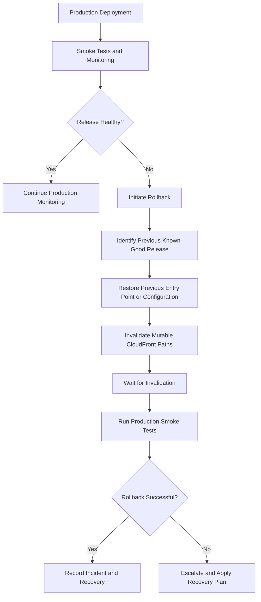
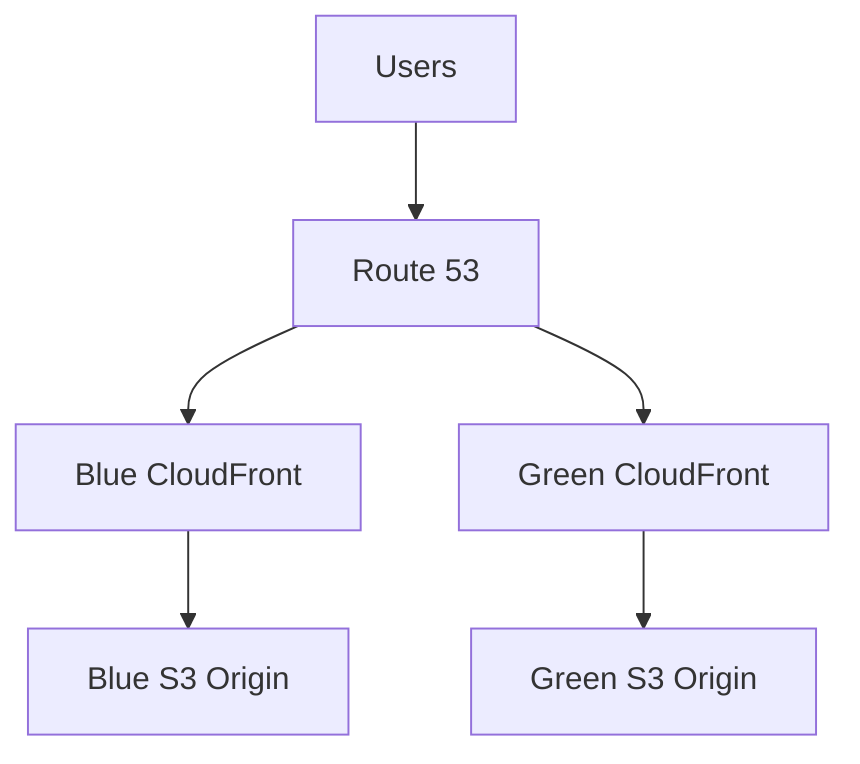
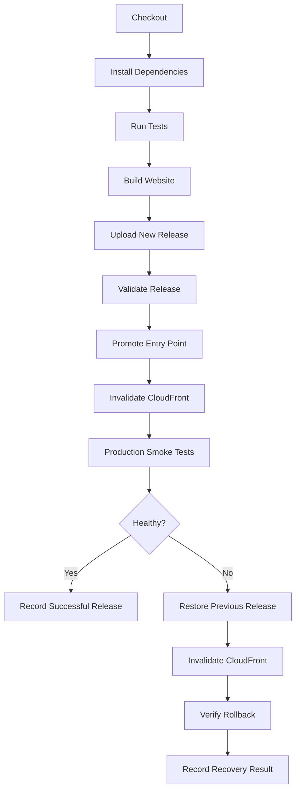

# 09- Website Deployment Rollback

## Overview

Website deployment rollback is the process of restoring a previously working website release after a deployment introduces defects, configuration errors, broken assets, or unexpected production behavior.

For an Amazon S3 static website delivered through CloudFront, rollback typically involves restoring a previous HTML entry point, switching to an earlier release, or reverting the infrastructure or routing configuration.

A reliable rollback strategy must restore more than the HTML file. It must account for:

- JavaScript, CSS, images, fonts, and other static assets.
- CloudFront caching and invalidation.
- Browser caching and service workers.
- S3 object versions and release retention.
- DNS and CloudFront configuration changes.
- Deployment pipeline failures.
- Monitoring and post-rollback verification.

Rollback is part of the deployment lifecycle, not an emergency procedure that should be designed during an incident.

## Rollback Architecture

### Core Components

| Component | Responsibility |
|---|---|
| Amazon S3 | Stores current and previous website artifacts |
| S3 Versioning | Retains previous versions of overwritten objects |
| CloudFront | Delivers website content and caches responses |
| Release prefixes | Store independently deployable application releases |
| Deployment pipeline | Publishes releases and records deployment metadata |
| CloudFront invalidation | Removes selected cached objects |
| Monitoring | Detects release-related failures |
| Rollback workflow | Restores a known-good release |

### Typical Rollback Flow



The rollback process should be automated where possible but retain appropriate production authorization.

## Rollback Strategies

Different deployment architectures require different rollback mechanisms.

### S3 Versioning-Based Rollback

S3 Versioning preserves previous versions of objects when they are overwritten or deleted.

For example, when the deployment pipeline replaces:

```text
s3://my-static-website/index.html
```

S3 retains the previous object version if versioning is enabled.

This makes it possible to restore an earlier entry point without rebuilding the application.

**Advantages**

- Previous object versions are retained automatically.
- Recovery does not require the original build pipeline.
- Useful for accidental overwrites and configuration mistakes.
- Version history supports investigation and recovery.

**Limitations**

- Versioning does not automatically restore an entire website release.
- Each object must be restored or copied independently when multiple objects changed.
- Noncurrent versions consume storage.
- Versioning does not remove cached CloudFront content.
- Lifecycle policies can eventually expire versions.

Use S3 Versioning as an additional recovery mechanism, not as the only release-management strategy.

### Release-Prefix-Based Rollback

A release-prefix architecture stores each deployment independently.

Example:

```text
s3://my-static-website/
├── releases/
│   ├── release-20261028-f7e8d9c/
│   │   ├── index.html
│   │   └── assets/
│   │
│   ├── release-20261101-a1b2c3d/
│   │   ├── index.html
│   │   └── assets/
│   │
│   └── release-20261101-d4e5f6a/
│       ├── index.html
│       └── assets/
│
└── index.html
```

The root entry point references the active release.

Rollback means publishing an entry point that references the previous release.

**Advantages**

- Previous releases remain independently available.
- Rollback does not require rebuilding or re-uploading all assets.
- Release artifacts are easier to audit.
- New deployments do not overwrite existing release objects.
- Recovery is generally faster and less error-prone than restoring individual objects.

**Limitations**

- Old releases consume storage.
- Release cleanup must respect retention requirements.
- Browser tabs and service workers may continue referencing older releases.
- The entry-point update and CDN cache behavior still require careful handling.

For most CloudFront-backed static websites, this is the recommended primary rollback strategy.

### CloudFront Configuration Rollback

If deployment changes CloudFront configuration, recovery may require restoring the previous distribution configuration.

Examples include:

- Origin path changes.
- Cache behavior changes.
- Origin changes.
- Custom error response changes.
- Viewer request or response function associations.

CloudFront configuration changes are asynchronous. A rollback must wait for the distribution update to finish before treating the previous configuration as active.

This strategy is relevant when the deployment architecture uses CloudFront origin-path switching or other distribution-level release changes.

### DNS-Based Rollback

When blue and green environments use separate CloudFront distributions, DNS can switch production traffic back to the previous distribution.

For example:

```text
www.example.com
    |
    v
Route 53
    |
    +---- Blue CloudFront Distribution
    |
    +---- Green CloudFront Distribution
```

Rollback changes the DNS record to point to the blue distribution.

Consider:

- DNS TTL.
- Resolver caching.
- Existing browser connections.
- CloudFront distribution deployment status.
- TLS certificate coverage.
- Health-check and routing configuration.

DNS-based rollback is not instantaneous because clients and resolvers may retain cached DNS answers.

## Choosing the Appropriate Rollback Strategy

| Deployment architecture | Recommended rollback mechanism | Main consideration |
|---|---|---|
| Single S3 prefix with versioning | Restore previous object versions | Multiple objects may need restoration |
| Unique S3 release prefixes | Republish previous release entry point | Keep previous release artifacts |
| Separate CloudFront distributions | Switch routing to previous distribution | DNS and routing propagation |
| CloudFront origin-path switching | Restore previous distribution configuration | Wait for CloudFront deployment |
| Infrastructure changes | Revert or restore infrastructure configuration | Avoid uncontrolled manual drift |

A production system can combine multiple strategies.

For example, unique release prefixes can provide fast application rollback while S3 Versioning provides an additional recovery mechanism for accidentally overwritten objects.

## Implementing Rollback with S3 Versioning

### Enable Versioning

Check the bucket versioning configuration:

```bash
aws s3api get-bucket-versioning \
  --bucket "${S3_BUCKET}"
```

Enable versioning if it is not already enabled:

```bash
aws s3api put-bucket-versioning \
  --bucket "${S3_BUCKET}" \
  --versioning-configuration Status=Enabled
```

Versioning protects against accidental overwrites and deletions, but it does not replace a backup or release-retention strategy.

### List Object Versions

Inspect versions of the root entry point:

```bash
aws s3api list-object-versions \
  --bucket "${S3_BUCKET}" \
  --prefix "index.html"
```

The response includes:

- Object versions.
- Version IDs.
- Last-modified timestamps.
- Delete markers.

Identify the previous known-good version before performing recovery.

### Restore a Previous Object Version

Use `copy-object` to copy a specific historical version back to the current object key.

```bash
aws s3api copy-object \
  --bucket "${S3_BUCKET}" \
  --key "index.html" \
  --copy-source "${S3_BUCKET}/index.html?versionId=${PREVIOUS_VERSION_ID}"
```

This creates a new current version containing the selected historical content.

It does not remove the existing version history.

For keys containing special characters, URL-encode the copy-source components as required by the S3 API.

### Invalidate CloudFront

After restoring the object, invalidate the mutable paths:

```bash
INVALIDATION_ID=$(aws cloudfront create-invalidation \
  --distribution-id "${CLOUDFRONT_DISTRIBUTION_ID}" \
  --paths "/" "/index.html" \
  --query "Invalidation.Id" \
  --output text)

echo "Invalidation ID: ${INVALIDATION_ID}"
```

Wait for completion:

```bash
aws cloudfront wait invalidation-completed \
  --distribution-id "${CLOUDFRONT_DISTRIBUTION_ID}" \
  --id "${INVALIDATION_ID}"
```

### Verify Recovery

```bash
curl --fail --silent --show-error \
  "https://${WEBSITE_DOMAIN}/index.html"
```

Confirm that the returned HTML references the expected application release.

Also verify the JavaScript, CSS, images, and important application routes.

## Implementing Rollback with Release Prefixes

Release-prefix-based rollback is generally simpler than restoring individual S3 object versions.

Assume the following releases:

```bash
export S3_BUCKET="my-static-website"
export CLOUDFRONT_DISTRIBUTION_ID="EXAMPLEDIST"
export WEBSITE_DOMAIN="www.example.com"

export CURRENT_RELEASE="release-20261101-d4e5f6a"
export PREVIOUS_RELEASE="release-20261028-f7e8d9c"
```

### Verify the Previous Release

Confirm that its entry point exists:

```bash
aws s3api head-object \
  --bucket "${S3_BUCKET}" \
  --key "releases/${PREVIOUS_RELEASE}/index.html"
```

Inspect its assets:

```bash
aws s3 ls \
  "s3://${S3_BUCKET}/releases/${PREVIOUS_RELEASE}/assets/" \
  --recursive
```

Confirm that all referenced assets are still available.

### Restore the Previous Entry Point

If the previous release HTML already references its release-specific assets, copy it to the root entry point:

```bash
aws s3 cp \
  "s3://${S3_BUCKET}/releases/${PREVIOUS_RELEASE}/index.html" \
  "s3://${S3_BUCKET}/index.html" \
  --cache-control "no-cache" \
  --content-type "text/html"
```

This assumes the previous release HTML uses paths that remain valid from the root URL.

For example:

```html
<script
    type="module"
    src="/releases/release-20261028-f7e8d9c/assets/app.js">
</script>
```

If the HTML contains relative paths or environment-specific configuration, generate the correct root entry point from the retained release manifest instead of copying it directly.

### Invalidate CloudFront

```bash
INVALIDATION_ID=$(aws cloudfront create-invalidation \
  --distribution-id "${CLOUDFRONT_DISTRIBUTION_ID}" \
  --paths "/" "/index.html" \
  --query "Invalidation.Id" \
  --output text)
```

Wait for completion:

```bash
aws cloudfront wait invalidation-completed \
  --distribution-id "${CLOUDFRONT_DISTRIBUTION_ID}" \
  --id "${INVALIDATION_ID}"
```

### Verify the Previous Release

```bash
curl --fail --silent --show-error \
  "https://${WEBSITE_DOMAIN}/index.html" \
  -o rollback-index.html

grep -q "${PREVIOUS_RELEASE}" rollback-index.html
```

This verifies that the returned HTML references the expected release.

It does not verify that every application feature works. Run application-specific smoke tests as well.

## Automating Rollback with Python and Boto3

A reusable rollback operation should validate its inputs, verify that the target release exists, publish the entry point, invalidate CloudFront, and wait for invalidation completion.

The following implementation assumes the retained release HTML is already generated with root-relative paths to its immutable assets.

```python
import os
import re
import time

import boto3
from botocore.exceptions import ClientError


AWS_REGION = os.environ.get("AWS_REGION", "ap-south-1")
S3_BUCKET = os.environ["S3_BUCKET"]
DISTRIBUTION_ID = os.environ["CLOUDFRONT_DISTRIBUTION_ID"]

s3 = boto3.client("s3", region_name=AWS_REGION)
cloudfront = boto3.client("cloudfront")


def validate_release_id(release_id: str) -> None:
    if not re.fullmatch(r"release-[a-zA-Z0-9-]+", release_id):
        raise ValueError("Invalid release identifier")


def verify_release(release_id: str) -> str:
    validate_release_id(release_id)

    key = f"releases/{release_id}/index.html"

    try:
        s3.head_object(
            Bucket=S3_BUCKET,
            Key=key,
        )
    except ClientError as exc:
        status = exc.response.get("ResponseMetadata", {}).get(
            "HTTPStatusCode"
        )

        if status == 404:
            raise FileNotFoundError(
                f"Release entry point does not exist: {release_id}"
            ) from exc

        raise

    return key


def publish_entry_point(source_key: str) -> None:
    s3.copy_object(
        Bucket=S3_BUCKET,
        Key="index.html",
        CopySource={
            "Bucket": S3_BUCKET,
            "Key": source_key,
        },
        ContentType="text/html",
        CacheControl="no-cache",
        MetadataDirective="REPLACE",
    )


def invalidate_cloudfront() -> str:
    response = cloudfront.create_invalidation(
        DistributionId=DISTRIBUTION_ID,
        InvalidationBatch={
            "Paths": {
                "Quantity": 2,
                "Items": [
                    "/",
                    "/index.html",
                ],
            },
            "CallerReference": (
                f"rollback-{time.time_ns()}"
            ),
        },
    )

    return response["Invalidation"]["Id"]


def wait_for_invalidation(invalidation_id: str) -> None:
    waiter = cloudfront.get_waiter("invalidation_completed")

    waiter.wait(
        DistributionId=DISTRIBUTION_ID,
        Id=invalidation_id,
    )


def rollback(release_id: str) -> None:
    source_key = verify_release(release_id)

    publish_entry_point(source_key)

    invalidation_id = invalidate_cloudfront()

    wait_for_invalidation(invalidation_id)

    print(
        f"Rollback entry point restored to release: {release_id}"
    )


if __name__ == "__main__":
    rollback(os.environ["PREVIOUS_RELEASE"])
```

The example performs the entry-point restoration and waits for CloudFront invalidation.

For production use, add:

- Application-level authorization for rollback execution.
- Structured logging and audit records.
- A deployment lock to prevent concurrent promotions.
- Validation of all referenced assets before publishing.
- Explicit handling of S3 and CloudFront errors.
- Post-rollback HTTP and application smoke tests.
- A recovery procedure if publication succeeds but invalidation fails.

The deployment role must have the required S3 object permissions and CloudFront invalidation permissions. Use IAM roles and temporary credentials rather than hardcoded access keys.

## CloudFront Cache Invalidation During Rollback

Restoring an S3 object does not automatically remove the old content from CloudFront caches.

CloudFront may continue serving cached objects according to the configured cache policy and object TTL.

### Mutable and Immutable Content

Use different cache strategies for different object types.

| Content | Recommended cache behavior | Rollback consideration |
|---|---|---|
| Root `index.html` | `no-cache` or short TTL | Invalidate after restoration |
| Release-specific JavaScript | Long-lived immutable | Keep old release assets available |
| Release-specific CSS | Long-lived immutable | Keep old release assets available |
| Images and fonts | Depends on whether keys are versioned | Avoid overwriting shared keys |
| Service worker script | Revalidate frequently | Handle browser-side cache updates |

### Invalidation Scope

For a release-prefix architecture, invalidating the root entry point is usually sufficient when the entry point references immutable, release-specific assets.

Example:

```bash
aws cloudfront create-invalidation \
  --distribution-id "${CLOUDFRONT_DISTRIBUTION_ID}" \
  --paths "/" "/index.html"
```

Do not invalidate every release asset by default.

Invalidation removes selected cached representations from CloudFront. It does not clear browser caches or service worker Cache Storage.

### Invalidation Failure

If the S3 entry point has been restored but invalidation fails:

1. Record the S3 publication result.
2. Inspect the CloudFront invalidation request and error.
3. Confirm that the previous entry point is present in S3.
4. Retry the invalidation using a new request.
5. Verify the production endpoint after completion.

Do not repeatedly overwrite the entry point with different versions while an incident is being diagnosed.

## Rollback with CloudFront Origin-Path Switching

Some deployments use one CloudFront distribution and change its origin path to select the active release.

For example:

```text
Current origin path:
    /releases/green

Previous origin path:
    /releases/blue
```

Rollback requires restoring the previous CloudFront distribution configuration.

### Retrieve Current Configuration

```bash
aws cloudfront get-distribution-config \
  --id "${CLOUDFRONT_DISTRIBUTION_ID}" \
  > distribution-config.json
```

The response contains the distribution configuration and its ETag.

### Restore Previous Configuration

Maintain a previously approved distribution configuration as a deployment artifact.

Use the CloudFront update API with the correct configuration and ETag:

```bash
aws cloudfront update-distribution \
  --id "${CLOUDFRONT_DISTRIBUTION_ID}" \
  --if-match "${ETAG}" \
  --distribution-config file://previous-distribution-config.json
```

The previous configuration must be a complete valid CloudFront distribution configuration, not a partial origin-path fragment.

Wait for deployment to finish:

```bash
aws cloudfront wait distribution-deployed \
  --id "${CLOUDFRONT_DISTRIBUTION_ID}"
```

Verify the origin path and production website after deployment.

CloudFront configuration updates can take time. Do not treat a successful update API response as proof that the distribution has finished deploying.

## Rollback with Separate CloudFront Distributions

When blue and green use separate CloudFront distributions, rollback is performed by restoring the routing configuration to the previous distribution.

A typical architecture is:



For a DNS-based deployment:

1. Confirm that the blue distribution is healthy.
2. Restore the DNS record to the blue distribution.
3. Allow DNS caches to expire according to the configured TTL.
4. Verify requests against the production domain.
5. Monitor traffic and error rates.

This approach is useful when the two releases have independent infrastructure or CloudFront configuration.

It is less suitable when an immediate, globally consistent switch is required because DNS caching can delay the transition.

## Deployment Pipeline Rollback Design

A deployment pipeline should record enough information to identify and restore the last known-good release.

### Deployment Metadata

Maintain a record such as:

```json
{
  "active_release": "release-20261101-d4e5f6a",
  "previous_release": "release-20261028-f7e8d9c",
  "git_commit": "d4e5f6a7b8c9",
  "deployment_status": "succeeded",
  "deployment_time": "2026-11-01T12:00:00Z"
}
```

A production deployment should record:

- Release identifier.
- Git commit SHA.
- Build identifier.
- Deployment timestamp.
- Previous known-good release.
- Deployment status.
- CloudFront invalidation ID.
- Smoke-test result.
- Rollback status, if applicable.

For environments with multiple deployment writers, use a controlled deployment lock or release-management service. Do not rely on a mutable metadata object alone to coordinate concurrent deployments.

### Pipeline Stages



### GitHub Actions Rollback Workflow

A separate manually triggered workflow can restore a known-good release.

The following example assumes the release identifier is supplied as a workflow input and the previous release HTML is already available in S3.

```yaml
name: Rollback Static Website

on:
  workflow_dispatch:
    inputs:
      release_id:
        description: "Previously validated release identifier"
        required: true
        type: string

permissions:
  contents: read
  id-token: write

concurrency:
  group: production-static-website
  cancel-in-progress: false

jobs:
  rollback:
    runs-on: ubuntu-latest
    environment: production

    steps:
      - name: Configure AWS credentials
        uses: aws-actions/configure-aws-credentials@v4
        with:
          role-to-assume: ${{ secrets.AWS_RECOVERY_ROLE_ARN }}
          aws-region: ${{ vars.AWS_REGION }}

      - name: Validate release identifier
        env:
          RELEASE_ID: ${{ inputs.release_id }}
        run: |
          if [[ ! "$RELEASE_ID" =~ ^release-[a-zA-Z0-9-]+$ ]]; then
            echo "Invalid release identifier"
            exit 1
          fi

      - name: Verify previous release
        env:
          S3_BUCKET: ${{ vars.S3_BUCKET }}
          RELEASE_ID: ${{ inputs.release_id }}
        run: |
          aws s3api head-object \
            --bucket "${S3_BUCKET}" \
            --key "releases/${RELEASE_ID}/index.html"

      - name: Restore previous entry point
        env:
          S3_BUCKET: ${{ vars.S3_BUCKET }}
          RELEASE_ID: ${{ inputs.release_id }}
        run: |
          aws s3 cp \
            "s3://${S3_BUCKET}/releases/${RELEASE_ID}/index.html" \
            "s3://${S3_BUCKET}/index.html" \
            --cache-control "no-cache" \
            --content-type "text/html"

      - name: Invalidate CloudFront
        id: invalidation
        env:
          DISTRIBUTION_ID: ${{ vars.CLOUDFRONT_DISTRIBUTION_ID }}
        run: |
          INVALIDATION_ID=$(aws cloudfront create-invalidation \
            --distribution-id "${DISTRIBUTION_ID}" \
            --paths "/" "/index.html" \
            --query "Invalidation.Id" \
            --output text)

          echo "invalidation_id=${INVALIDATION_ID}" >> "$GITHUB_OUTPUT"

      - name: Wait for CloudFront invalidation
        env:
          DISTRIBUTION_ID: ${{ vars.CLOUDFRONT_DISTRIBUTION_ID }}
          INVALIDATION_ID: ${{ steps.invalidation.outputs.invalidation_id }}
        run: |
          aws cloudfront wait invalidation-completed \
            --distribution-id "${DISTRIBUTION_ID}" \
            --id "${INVALIDATION_ID}"

      - name: Verify production endpoint
        env:
          WEBSITE_DOMAIN: ${{ vars.WEBSITE_DOMAIN }}
          RELEASE_ID: ${{ inputs.release_id }}
        run: |
          curl --fail --silent --show-error \
            "https://${WEBSITE_DOMAIN}/index.html" \
            -o rollback-index.html

          grep -q "${RELEASE_ID}" rollback-index.html
```

This workflow demonstrates the recovery sequence. A production implementation should additionally:

- Pin GitHub Actions to reviewed commit SHAs.
- Restrict the OIDC trust policy to the intended repository and environment.
- Require production approval.
- Verify all release assets before restoring the entry point.
- Run application-specific smoke tests.
- Record the rollback result and invalidation ID.
- Update deployment metadata only after successful verification.

The workflow assumes that the retained release HTML references release-specific assets correctly.

## Database and Backend Compatibility

Static website rollback can be straightforward, but a frontend release may depend on backend APIs and database schema changes.

Rolling back the frontend does not automatically roll back backend services or database migrations.

Consider a deployment involving:

```text
Frontend Release B
    |
    v
Backend API v2
    |
    v
Database Schema v2
```

If the frontend is rolled back to Release A, it may no longer work with API v2 or the updated database schema.

### Use Backward-Compatible Changes

Prefer an expand-and-contract migration strategy.

| Stage | Database | Backend | Frontend |
|---|---|---|---|
| Initial | Schema v1 | API v1 | Release A |
| Expand | Schema v1 + v2 fields | API v1 and v2 compatible | Release A |
| Deploy | Schema v2 available | API v2 | Release B |
| Stabilize | Both schema paths supported | API v2 | Release B |
| Contract | Remove obsolete schema | API v2 only | Release B |

This allows the previous frontend to remain compatible during the rollback window.

For backend-dependent static websites:

- Maintain API compatibility across frontend releases.
- Avoid destructive schema migrations during frontend deployment.
- Version API contracts where necessary.
- Test the previous frontend against the current backend.
- Define independent rollback procedures for frontend, backend, and database components.

A frontend rollback is not a complete system rollback if the backend has incompatible changes.

## Monitoring and Rollback Triggers

Rollback decisions should be based on measurable production signals rather than assumptions.

### Useful Signals

| Signal | Possible failure |
|---|---|
| HTTP 5xx increase | Origin, backend, or application failure |
| HTTP 404 increase | Missing assets or incorrect paths |
| JavaScript loading errors | Broken frontend build |
| Authentication failures | Configuration or integration regression |
| API error-rate increase | Frontend/backend incompatibility |
| Elevated latency | Performance regression |
| Smoke-test failure | Critical user journey unavailable |
| CloudFront origin errors | Origin configuration or access problem |

CloudFront standard metrics, access logs, CloudWatch alarms, synthetic monitoring, and application telemetry can help detect deployment regressions.

### Automatic vs Manual Rollback

| Approach | Suitable situation | Risk |
|---|---|---|
| Automatic rollback | Clearly defined health checks and deterministic failure conditions | False positives can trigger unnecessary rollback |
| Manual rollback | Complex application behavior or business-critical decisions | Recovery may take longer |
| Approval-based rollback | Production systems requiring controlled authorization | Requires an available operator |

For critical production systems, automatic rollback should use multiple independent signals and a stabilization window.

A single transient error should not necessarily trigger a rollback.

## Security Considerations

Rollback permissions should be treated as privileged production capabilities.

Recommended controls:

- Use a dedicated recovery IAM role.
- Restrict access to the production bucket and required release prefixes.
- Limit CloudFront permissions to the intended distribution.
- Use OIDC federation for CI/CD.
- Require approval for manual production recovery.
- Record rollback requests and execution results.
- Protect deployment metadata from unauthorized modification.
- Keep S3 Block Public Access enabled.
- Use CloudFront OAC for private S3 origins.

Do not grant broad S3 bucket administration permissions merely to simplify rollback.

A recovery role should have only the permissions needed to verify retained releases, restore the active entry point, and invalidate the relevant CloudFront paths.

## Common Rollback Failures

| Failure | Likely cause | Diagnostic approach | Corrective action |
|---|---|---|---|
| Previous release is missing | Release cleanup removed required objects | Inspect S3 prefixes and version history | Restore from an approved backup or retained artifact |
| Restored HTML loads but assets fail | Asset paths are incorrect or objects were deleted | Inspect browser network requests and S3 keys | Restore assets or regenerate the correct entry point |
| CloudFront still serves new HTML | Cached entry point remains | Inspect response headers and invalidation status | Complete a targeted invalidation |
| Website remains broken after rollback | Backend or database incompatibility | Check API responses and deployment history | Restore compatible backend behavior or apply a forward fix |
| S3 restore returns AccessDenied | Recovery role lacks permissions | Inspect IAM and bucket policy evaluation | Grant the minimum required permissions |
| KMS-encrypted object cannot be restored | KMS permissions are missing | Inspect KMS key policy and role permissions | Grant required KMS access |
| CloudFront invalidation fails | Incorrect distribution ID or IAM permissions | Inspect API response and CloudTrail | Correct configuration and retry |
| DNS still points to green | DNS caches have not expired | Inspect authoritative and resolver responses | Wait for TTL or use a routing mechanism with suitable propagation characteristics |
| CloudFront configuration rollback fails | Stale ETag or invalid distribution configuration | Retrieve current configuration and ETag | Reconcile changes and submit a valid complete configuration |
| Previous version is hidden by a delete marker | A delete operation created a current delete marker | Inspect object versions | Restore the intended version as the current object |

## Production Rollback Checklist

### Before Deployment

- [ ] Previous known-good release is identified.
- [ ] Release artifacts are retained in S3.
- [ ] S3 Versioning is enabled where required.
- [ ] Release metadata is recorded.
- [ ] Rollback permissions are tested.
- [ ] CloudFront invalidation permissions are verified.
- [ ] Backend and database compatibility is reviewed.
- [ ] Recovery workflow is available.

### During Rollback

- [ ] Confirm the target release identifier.
- [ ] Verify the release entry point exists.
- [ ] Verify all referenced assets exist.
- [ ] Restore the previous entry point or routing configuration.
- [ ] Invalidate mutable CloudFront paths.
- [ ] Wait for invalidation or distribution deployment.
- [ ] Verify production HTTP responses.
- [ ] Run application smoke tests.
- [ ] Record recovery status and timestamps.

### After Rollback

- [ ] Confirm the previous release is serving production traffic.
- [ ] Monitor HTTP errors and application behavior.
- [ ] Verify API compatibility.
- [ ] Preserve failed release artifacts for investigation.
- [ ] Record the incident and root cause.
- [ ] Identify the corrective action before attempting another deployment.
- [ ] Update deployment and rollback procedures where necessary.

## Key Takeaways

- Use unique S3 release prefixes as the primary rollback mechanism for CloudFront-backed static websites; retain previous release artifacts.
- S3 Versioning provides additional recovery protection for overwritten or deleted objects but does not automatically restore a complete website release.
- Restore the previous entry point or routing configuration, then invalidate mutable CloudFront paths and verify production behavior.
- Browser caches, service workers, backend API compatibility, and database migrations can prevent an apparently successful frontend rollback from restoring the complete application.
- Treat rollback as a controlled, auditable production operation with least-privilege permissions, tested recovery workflows, and measurable verification criteria.