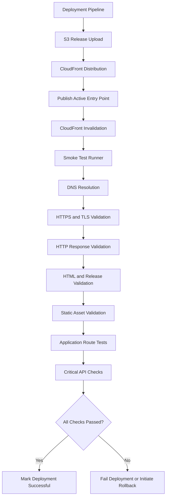
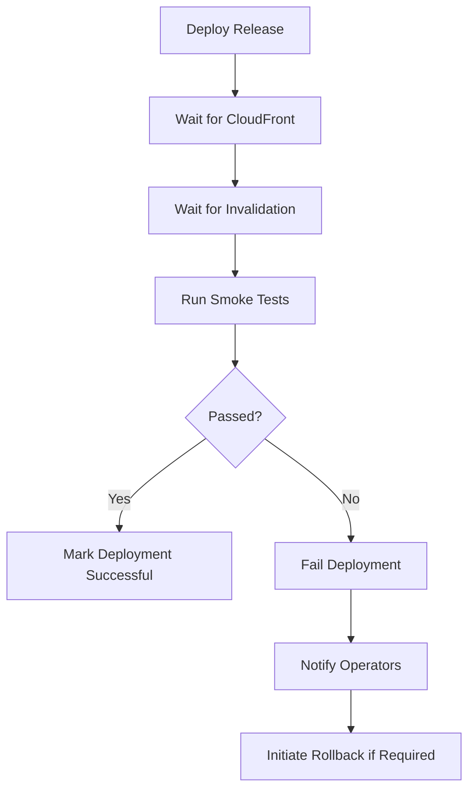

# 10- Smoke Testing and Availability Validation

## Overview

Smoke testing and availability validation are essential deployment checks for an Amazon S3 static website delivered through CloudFront.

A successful deployment command does not prove that the website is usable. Files may have uploaded successfully while the website remains unavailable because of incorrect CloudFront configuration, missing assets, invalid permissions, DNS problems, certificate errors, or application-level failures.

Smoke testing verifies that the most important website functions work after deployment. Availability validation checks whether users can reach the website reliably through its production delivery path.

For an S3 and CloudFront deployment, validation should cover:

- DNS resolution and domain routing.
- HTTPS and TLS certificate validity.
- CloudFront distribution deployment status.
- S3 origin connectivity and authorization.
- HTML delivery and cache behavior.
- JavaScript, CSS, images, and other static assets.
- SPA routing and application entry points.
- API connectivity and critical user journeys.
- Response status codes, latency, and availability.
- Monitoring and alerting after deployment.

Smoke tests should run automatically after deployment and before a release is considered successful.

## Smoke Testing vs Availability Validation

These activities are related but serve different purposes.

| Aspect | Smoke Testing | Availability Validation |
|---|---|---|
| Purpose | Confirm critical functionality works | Confirm users can reach the website |
| Scope | Application and deployment behavior | Network, DNS, TLS, CDN, and origin |
| Execution | Usually after deployment | Continuously and after deployment |
| Examples | Load homepage, verify assets, test routes | Check DNS, HTTPS, response codes, latency |
| Frequency | Every deployment | Continuous or scheduled |
| Failure response | Block promotion or initiate rollback | Alert, investigate, or initiate recovery |

### Smoke Testing

Smoke testing performs a small set of high-value checks to determine whether the deployed application is fundamentally working.

For a static website, typical checks include:

- Homepage returns HTTP 200.
- HTML contains the expected release identifier.
- Referenced JavaScript and CSS files load successfully.
- Important application routes return expected responses.
- Critical API endpoints respond correctly.
- No essential resources are missing.

Smoke tests are intentionally limited. They do not replace comprehensive functional, integration, accessibility, or performance testing.

### Availability Validation

Availability validation determines whether the website is reachable through the same delivery path used by production users.

It checks the infrastructure and network layers, including:

- DNS resolution.
- TLS certificate validity.
- CloudFront distribution status.
- HTTP response codes.
- Response latency.
- Origin accessibility.
- Regional or edge-location behavior where monitoring supports it.

A website can pass an application smoke test from an internal test environment while remaining unavailable to external users because of DNS or TLS configuration problems.

## Validation Architecture

A production validation workflow should test the complete delivery path.



### Component Responsibilities

| Component | Responsibility |
|---|---|
| Deployment pipeline | Coordinates release and validation |
| S3 | Stores website files and release artifacts |
| CloudFront | Serves cached content and forwards requests to S3 |
| DNS | Resolves the production hostname |
| TLS certificate | Secures HTTPS connections |
| Smoke test runner | Executes post-deployment checks |
| Monitoring system | Tracks availability and latency |
| Alerting system | Notifies operators about failures |

The validation runner should access the public production hostname, not only the S3 bucket or an internal deployment endpoint.

Testing the S3 origin directly does not prove that CloudFront, DNS, TLS, and browser-facing routing work correctly.

## Validation Layers

### DNS Resolution

DNS validation confirms that the website hostname resolves to the intended delivery endpoint.

For a CloudFront-backed website, Route 53 commonly uses an Alias record pointing to the CloudFront distribution.

Inspect DNS resolution:

```bash
dig www.example.com
```

For a concise answer:

```bash
dig +short www.example.com
```

On systems using `nslookup`:

```bash
nslookup www.example.com
```

Check the authoritative DNS configuration where necessary:

```bash
dig NS example.com
```

Validate:

- The hostname exists.
- The expected DNS record is configured.
- The domain resolves successfully.
- The domain points to the intended CloudFront distribution.
- No stale or conflicting records remain.

DNS resolution alone does not prove that the website is available. Continue with HTTPS and application checks.

### TLS and HTTPS Validation

A production static website should use HTTPS.

Check the response:

```bash
curl -I https://www.example.com
```

Inspect the TLS handshake and certificate:

```bash
openssl s_client \
  -connect www.example.com:443 \
  -servername www.example.com \
  </dev/null
```

Validate the certificate:

- Certificate is trusted.
- Certificate is not expired.
- Hostname matches the requested domain.
- Certificate chain is valid.
- HTTPS connections succeed.
- HTTP requests redirect to HTTPS when configured.

For CloudFront, the viewer certificate used by the distribution must be configured correctly. ACM certificates associated with CloudFront must be issued in `us-east-1`.

A successful connection to the CloudFront distribution domain does not prove that the custom domain certificate is correct. Test the actual production hostname.

### CloudFront Distribution Status

Before validating the application, verify that the CloudFront distribution has finished deploying.

Inspect the distribution:

```bash
aws cloudfront get-distribution \
  --id "${CLOUDFRONT_DISTRIBUTION_ID}" \
  --query 'Distribution.Status' \
  --output text
```

Expected deployed status:

```text
Deployed
```

Inspect the distribution configuration and domain:

```bash
aws cloudfront get-distribution \
  --id "${CLOUDFRONT_DISTRIBUTION_ID}" \
  --query 'Distribution.{Status:Status,DomainName:DomainName,Enabled:DistributionConfig.Enabled}'
```

A configuration update can take time to propagate. Do not assume that a successful update API response means the distribution is already serving the new configuration globally.

### CloudFront Invalidation Status

If deployment invalidates mutable paths, verify that the invalidation has completed.

```bash
aws cloudfront list-invalidations \
  --distribution-id "${CLOUDFRONT_DISTRIBUTION_ID}"
```

Inspect a specific invalidation:

```bash
aws cloudfront get-invalidation \
  --distribution-id "${CLOUDFRONT_DISTRIBUTION_ID}" \
  --id "${INVALIDATION_ID}" \
  --query 'Invalidation.Status' \
  --output text
```

Expected status:

```text
Completed
```

An invalidation request being accepted does not mean it has completed.

For release-prefix deployments, invalidate mutable entry points such as `/` and `/index.html`. Immutable, content-hashed assets generally do not require invalidation.

## HTTP Availability Checks

### Homepage Response

Check the production homepage:

```bash
curl --fail --silent --show-error \
  --output /dev/null \
  --write-out 'HTTP %{http_code}\nTotal: %{time_total}s\n' \
  https://www.example.com/
```

Expected response:

```text
HTTP 200
```

The `--fail` option makes curl return a failure status for HTTP responses indicating an error.

For more detailed diagnostics:

```bash
curl -v https://www.example.com/
```

Inspect:

- HTTP response status.
- Response headers.
- Redirect behavior.
- Connection errors.
- TLS failures.
- Response latency.

### Redirect Validation

If the website redirects HTTP to HTTPS:

```bash
curl -I http://www.example.com
```

Follow redirects:

```bash
curl -IL http://www.example.com
```

Confirm that:

- HTTP redirects to the expected HTTPS hostname.
- Redirects do not create loops.
- The final response is successful.
- The final URL uses the intended domain.

### Response Header Validation

Inspect CloudFront and caching headers:

```bash
curl -I https://www.example.com/
```

Useful headers include:

| Header | Purpose |
|---|---|
| `HTTP status` | Indicates request result |
| `Content-Type` | Identifies response content type |
| `Cache-Control` | Controls caching behavior |
| `Age` | Indicates cached response age when supplied |
| `ETag` | Identifies an object representation |
| `X-Cache` | Indicates CloudFront cache behavior |
| `Via` | Shows intermediary proxy information |
| `X-Amz-Cf-Pop` | Identifies the CloudFront edge location |
| `X-Amz-Cf-Id` | Helps correlate CloudFront requests |

Example:

```http
HTTP/2 200
content-type: text/html
cache-control: no-cache
x-cache: Hit from cloudfront
via: 1.1 example.cloudfront.net
```

Header values depend on the distribution configuration and response path. Do not assume that every response contains every header.

## Static Asset Validation

A homepage returning HTTP 200 is not sufficient.

The HTML may reference missing JavaScript, CSS, image, or font files.

For example:

```html
<script
    type="module"
    src="/releases/release-20261101-a1b2c3d/assets/app.js">
</script>

<link
    rel="stylesheet"
    href="/releases/release-20261101-a1b2c3d/assets/app.css">
```

Validate the referenced assets:

```bash
curl --fail --silent --show-error \
  -I \
  https://www.example.com/releases/release-20261101-a1b2c3d/assets/app.js
```

Check the CSS:

```bash
curl --fail --silent --show-error \
  -I \
  https://www.example.com/releases/release-20261101-a1b2c3d/assets/app.css
```

Expected behavior:

- JavaScript and CSS return successful responses.
- Content types are correct.
- Release-specific object paths exist.
- Assets are not accidentally served as HTML.
- No unexpected authorization errors occur.

### Validate Assets Automatically

A deployment pipeline can extract local asset references from generated HTML and check that they are reachable.

The following Python example validates common `src` and `href` references.

```python
import argparse
from html.parser import HTMLParser
from urllib.parse import urljoin, urlparse

import requests


class AssetExtractor(HTMLParser):
    def __init__(self):
        super().__init__()
        self.references = []

    def handle_starttag(self, tag, attrs):
        for name, value in attrs:
            if name in {"src", "href"} and value:
                self.references.append(value)


def extract_assets(html: str) -> list[str]:
    parser = AssetExtractor()
    parser.feed(html)
    return parser.references


def validate_asset(base_url: str, reference: str) -> bool:
    asset_url = urljoin(base_url, reference)
    parsed = urlparse(asset_url)

    if parsed.scheme not in {"http", "https"}:
        return True

    try:
        response = requests.head(
            asset_url,
            timeout=(5, 15),
            allow_redirects=True,
        )

        if response.status_code == 405:
            response = requests.get(
                asset_url,
                headers={"Range": "bytes=0-0"},
                timeout=(5, 15),
                allow_redirects=True,
                stream=True,
            )

        response.raise_for_status()

        print(f"OK  {asset_url}")
        return True

    except requests.RequestException as exc:
        print(f"FAIL {asset_url}: {exc}")
        return False


def main():
    parser = argparse.ArgumentParser()

    parser.add_argument(
        "--url",
        required=True,
        help="Production website URL",
    )

    args = parser.parse_args()

    response = requests.get(
        args.url,
        timeout=(5, 20),
    )
    response.raise_for_status()

    references = extract_assets(response.text)

    if not references:
        raise RuntimeError("No asset references found")

    results = [
        validate_asset(args.url, reference)
        for reference in references
    ]

    if not all(results):
        raise SystemExit(1)

    print("All extracted assets are available.")


if __name__ == "__main__":
    main()
```

Install the dependency:

```bash
pip install requests
```

Run:

```bash
python smoke_test_assets.py \
  --url https://www.example.com/
```

This is a basic validator. Production build pipelines should extend it to cover:

- `srcset` references.
- CSS `url()` references.
- Dynamic imports.
- Preload and module-preload references.
- Web fonts.
- Application-specific asset manifests.
- Expected content types.
- Asset integrity where required.

Some servers do not support `HEAD` consistently. The fallback uses a small range request, but the endpoint must support the expected range behavior.

## SPA Route Validation

Single-page applications often rely on frontend routing.

For example:

```text
https://www.example.com/
https://www.example.com/dashboard
https://www.example.com/settings
```

CloudFront and the S3 origin must be configured to serve the application entry point for supported frontend routes.

Test important routes directly:

```bash
curl -I https://www.example.com/dashboard
```

```bash
curl -I https://www.example.com/settings
```

Validate that:

- Expected application routes return the intended response.
- Deep links load correctly when opened directly.
- Missing assets do not incorrectly return the SPA HTML.
- API routes are not rewritten to the frontend entry point.
- Authorization failures are not hidden by broad custom error responses.

A common configuration mistake is mapping every S3 `403` response to `/index.html` with an HTTP 200 response.

This can hide genuine missing-object and access-control failures. Configure SPA fallback behavior carefully and validate static assets and API paths independently.

## Application-Level Smoke Testing

Static asset validation does not guarantee that the application itself works.

A production smoke test should validate critical user journeys.

Examples:

| Test | Expected behavior |
|---|---|
| Homepage | Application loads |
| Login page | Authentication interface loads |
| Dashboard | Main application route is available |
| API health endpoint | Backend returns healthy response |
| User profile | Required user data loads |
| Search | Search request succeeds |
| File upload | Upload flow completes when included in scope |

For a frontend backed by a FastAPI or Django REST Framework API, validate the API separately.

Example:

```bash
curl --fail --silent --show-error \
  https://api.example.com/health
```

Expected response:

```json
{
  "status": "ok"
}
```

The response structure should match the actual application's health-check contract.

Avoid treating a successful frontend response as proof that dependent backend services are healthy.

## Python-Based Website Smoke Testing

A reusable Python smoke test can validate the homepage, expected release identifier, and selected critical routes.

```python
import argparse
import sys

import requests


def check_endpoint(
    session: requests.Session,
    url: str,
    expected_status: int = 200,
) -> requests.Response:
    response = session.get(
        url,
        timeout=(5, 20),
        allow_redirects=True,
    )

    if response.status_code != expected_status:
        raise RuntimeError(
            f"{url} returned {response.status_code}; "
            f"expected {expected_status}"
        )

    return response


def run_smoke_tests(
    base_url: str,
    expected_release: str,
) -> None:
    session = requests.Session()

    homepage = check_endpoint(
        session,
        f"{base_url}/",
    )

    if expected_release not in homepage.text:
        raise RuntimeError(
            "Homepage does not contain the expected release identifier"
        )

    check_endpoint(
        session,
        f"{base_url}/dashboard",
    )

    print("Website smoke tests passed.")


def main():
    parser = argparse.ArgumentParser()

    parser.add_argument("--base-url", required=True)
    parser.add_argument("--expected-release", required=True)

    args = parser.parse_args()

    try:
        run_smoke_tests(
            args.base_url.rstrip("/"),
            args.expected_release,
        )
    except (requests.RequestException, RuntimeError) as exc:
        print(f"Smoke tests failed: {exc}", file=sys.stderr)
        raise SystemExit(1)


if __name__ == "__main__":
    main()
```

Install dependencies:

```bash
pip install requests
```

Run:

```bash
python smoke_test.py \
  --base-url https://www.example.com \
  --expected-release release-20261101-a1b2c3d
```

The example assumes the production HTML contains the release identifier and `/dashboard` is a valid route.

For production use:

- Validate the actual route behavior rather than checking only HTTP 200.
- Add critical API checks.
- Verify required response content.
- Use bounded timeouts.
- Avoid exposing sensitive response bodies in logs.
- Keep credentials out of test source code.
- Separate deployment smoke tests from full end-to-end browser tests.

## Browser-Based End-to-End Validation

Some failures cannot be detected with HTTP requests alone.

Examples include:

- JavaScript runtime errors.
- Broken frontend initialization.
- Failed dynamic imports.
- Authentication redirects.
- Browser storage problems.
- Service worker update failures.
- Incorrect rendering or navigation.

Browser automation tools such as Playwright can validate these behaviors.

Example using Playwright with Python:

```python
import asyncio

from playwright.async_api import async_playwright


async def main():
    async with async_playwright() as playwright:
        browser = await playwright.chromium.launch()

        page = await browser.new_page()

        page_errors = []

        page.on(
            "pageerror",
            lambda error: page_errors.append(str(error)),
        )

        response = await page.goto(
            "https://www.example.com/",
            wait_until="networkidle",
            timeout=30000,
        )

        if response is None or response.status != 200:
            raise RuntimeError("Homepage did not return HTTP 200")

        await page.get_by_role(
            "heading",
            name="Dashboard",
        ).wait_for(timeout=10000)

        if page_errors:
            raise RuntimeError(
                f"Browser JavaScript errors: {page_errors}"
            )

        await browser.close()


if __name__ == "__main__":
    asyncio.run(main())
```

Install:

```bash
pip install playwright
playwright install chromium
```

Adapt the expected heading and navigation behavior to the actual website.

Browser-based tests are more expensive than lightweight HTTP checks. Use them for important user journeys rather than every static asset.

## Post-Deployment Validation with AWS CLI

A deployment pipeline can validate AWS infrastructure before running external HTTP checks.

### Verify S3 Entry Point

```bash
aws s3api head-object \
  --bucket "${S3_BUCKET}" \
  --key "index.html"
```

Inspect relevant metadata:

```bash
aws s3api head-object \
  --bucket "${S3_BUCKET}" \
  --key "index.html" \
  --query '{ContentType:ContentType,CacheControl:CacheControl,LastModified:LastModified,ETag:ETag}'
```

### Verify Release Assets

```bash
aws s3 ls \
  "s3://${S3_BUCKET}/releases/${RELEASE_ID}/" \
  --recursive
```

### Verify CloudFront Deployment

```bash
aws cloudfront get-distribution \
  --id "${CLOUDFRONT_DISTRIBUTION_ID}" \
  --query 'Distribution.Status' \
  --output text
```

### Verify CloudFront Invalidation

```bash
aws cloudfront get-invalidation \
  --distribution-id "${CLOUDFRONT_DISTRIBUTION_ID}" \
  --id "${INVALIDATION_ID}" \
  --query 'Invalidation.Status' \
  --output text
```

### Verify the Production Endpoint

```bash
curl --fail --silent --show-error \
  --output /dev/null \
  --write-out '%{http_code} %{time_total}\n' \
  "https://${WEBSITE_DOMAIN}/"
```

These checks validate different layers. A successful S3 `head-object` request does not prove that CloudFront can retrieve the object through OAC.

## GitHub Actions Post-Deployment Smoke Tests

Smoke tests should execute after deployment and CloudFront invalidation have completed.

Example workflow:

```yaml
name: Static Website Deployment Validation

on:
  workflow_dispatch:

permissions:
  contents: read
  id-token: write

jobs:
  validate:
    runs-on: ubuntu-latest

    environment: production

    steps:
      - name: Checkout repository
        uses: actions/checkout@v4

      - name: Configure Python
        uses: actions/setup-python@v5
        with:
          python-version: "3.12"

      - name: Install smoke test dependencies
        run: |
          python -m pip install --upgrade pip
          pip install requests

      - name: Verify CloudFront distribution
        env:
          DISTRIBUTION_ID: ${{ vars.CLOUDFRONT_DISTRIBUTION_ID }}
        run: |
          STATUS=$(aws cloudfront get-distribution \
            --id "${DISTRIBUTION_ID}" \
            --query 'Distribution.Status' \
            --output text)

          test "${STATUS}" = "Deployed"

      - name: Run website smoke tests
        env:
          WEBSITE_DOMAIN: ${{ vars.WEBSITE_DOMAIN }}
          RELEASE_ID: ${{ vars.EXPECTED_RELEASE_ID }}
        run: |
          python scripts/smoke_test.py \
            --base-url "https://${WEBSITE_DOMAIN}" \
            --expected-release "${RELEASE_ID}"
```

This is a validation-job example, not a complete deployment pipeline. It assumes AWS credentials have already been configured in the runner. In a production workflow, use OIDC federation and configure AWS credentials before AWS CLI operations.

For an integrated pipeline, pass the release identifier directly from the deployment job rather than relying on a manually maintained expected-release variable.

### Deployment Gate

The deployment should not be marked successful until validation passes.



A failed smoke test should prevent the pipeline from reporting a successful release.

Whether it automatically triggers rollback depends on the production recovery policy.

## Continuous Availability Monitoring

Post-deployment smoke tests validate a release at a particular point in time. They do not provide continuous availability monitoring.

Production websites should have ongoing checks from outside the deployment pipeline.

### CloudWatch Monitoring

CloudFront publishes metrics to CloudWatch.

Useful metrics include:

| Metric | Purpose |
|---|---|
| `Requests` | Request volume |
| `TotalErrorRate` | Overall error rate |
| `4xxErrorRate` | Client and request-related errors |
| `5xxErrorRate` | Server and origin-related errors |
| `OriginLatency` | Time spent waiting for origin responses |

Metric dimensions and availability depend on the CloudFront monitoring configuration.

Use CloudWatch alarms to detect sustained increases in errors or abnormal traffic behavior.

Do not treat every 4xx response as an availability incident. Some 4xx responses are expected application behavior. Define thresholds based on the website's actual traffic and error patterns.

### External Synthetic Monitoring

External monitoring checks the website from outside the AWS account or deployment environment.

Useful checks include:

- Homepage availability.
- HTTPS certificate validity.
- Critical application route availability.
- API health.
- Asset availability.
- Response latency.

Synthetic monitoring can detect failures that CloudFront infrastructure metrics alone may not reveal.

### Availability and Error-Rate Targets

Define service-level indicators and objectives based on actual application requirements.

Example:

| Indicator | Example target |
|---|---|
| Homepage availability | 99.9% over the measurement window |
| Homepage response time | p95 below 1 second |
| Critical API availability | 99.9% |
| Smoke-test success | All required checks pass |
| TLS validity | Certificate remains valid and trusted |

These are illustrative targets, not AWS service guarantees.

A useful availability calculation is:

\[
Availability =
\frac{Successful\ Requests}{Total\ Valid\ Requests}
\times 100
\]

Define how expected client errors, monitoring failures, and planned maintenance are treated before using this calculation for an SLO.

## Failure Diagnosis

A failed validation should be isolated by layer rather than treated as a generic website outage.

| Symptom | Likely cause | Verification |
|---|---|---|
| DNS lookup fails | Missing or incorrect DNS record | `dig` and Route 53 record inspection |
| TLS handshake fails | Certificate or hostname configuration | `openssl s_client` |
| CloudFront returns 403 | OAC, bucket policy, or missing object behavior | CloudFront response and S3 policy inspection |
| CloudFront returns 404 | Missing object or incorrect path | Inspect S3 object key and URL |
| Homepage returns old HTML | Cached entry point | Inspect `Age`, `X-Cache`, and invalidation status |
| HTML loads but JavaScript fails | Missing asset or incorrect content path | Browser network logs and asset requests |
| SPA route returns 403 or 404 | Incorrect fallback configuration | Test direct route access |
| API requests fail | Backend outage, CORS, or authentication problem | API health checks and browser network logs |
| High response latency | Origin latency, network, or application issue | CloudFront metrics and request timing |
| Browser displays old application | Browser cache or service worker | Inspect browser cache and service worker state |

### Diagnostic Sequence

Use this order to reduce unnecessary investigation:

1. Check DNS resolution.
2. Validate TLS and HTTPS.
3. Confirm CloudFront distribution status.
4. Inspect CloudFront invalidation status.
5. Check homepage response and headers.
6. Verify S3 object existence and metadata.
7. Validate referenced assets.
8. Test SPA routes and backend APIs.
9. Inspect CloudFront metrics, access logs, and application logs.
10. Determine whether rollback or a forward fix is appropriate.

Do not immediately modify S3 bucket policies when a request fails. First determine whether the problem is DNS, TLS, CloudFront configuration, object existence, or authorization.

## Security Considerations

Smoke tests must validate the production delivery path without weakening production security.

Recommended practices:

- Keep the S3 origin private when using CloudFront OAC.
- Do not disable Block Public Access to make tests pass.
- Use least-privilege IAM permissions for AWS CLI validation.
- Avoid exposing sensitive response content in CI logs.
- Store test credentials in an approved secrets-management system.
- Use short-lived AWS credentials through OIDC for GitHub Actions.
- Restrict internal or administrative health endpoints.
- Avoid including sensitive user data in synthetic test requests.
- Validate HTTPS using the actual production hostname.

For private application routes, use dedicated test identities with limited permissions rather than production administrator accounts.

## Performance and Reliability Considerations

### Avoid Excessive Validation Requests

A smoke test should be small and deterministic.

Avoid:

- Downloading every large image.
- Running full browser suites after every minor deployment.
- Sending excessive requests to production APIs.
- Triggering expensive application workflows.
- Running concurrent synthetic checks that create artificial load.

Use a layered validation strategy:

| Validation level | Frequency | Scope |
|---|---|---|
| Build checks | Every build | Compilation and unit tests |
| Infrastructure checks | Every deployment | S3 and CloudFront configuration |
| HTTP smoke tests | Every deployment | Homepage and critical assets |
| Browser tests | Important deployments | Critical user journeys |
| Synthetic monitoring | Continuous | External availability |
| Performance tests | Scheduled or before major releases | Capacity and latency |

### Timeouts and Retries

Every smoke test should use bounded connection and response timeouts.

Retries are useful for transient failures but can hide genuine deployment problems if used indiscriminately.

A reasonable policy is:

- Retry transient network errors a small number of times.
- Use bounded exponential backoff.
- Do not repeatedly retry deterministic 403 or 404 responses.
- Record the first failure and final outcome.
- Keep the overall deployment validation deadline bounded.

### Multi-Region and Multi-Location Checks

A successful check from one location does not guarantee availability everywhere.

For globally distributed websites, use synthetic monitoring from multiple geographic locations when regional visibility matters.

CloudFront distributes content across edge locations, but DNS resolution, routing, client networks, and cache state can differ.

Avoid interpreting one monitoring location's failure as proof of a global outage without corroborating evidence.

## Common Mistakes and Pitfalls

| Mistake | Why it happens | Recommended approach |
|---|---|---|
| Checking only HTTP 200 | Homepage status is treated as complete validation | Verify assets and critical application behavior |
| Testing the S3 endpoint only | CloudFront and DNS are not tested | Test through the production domain |
| Running smoke tests before invalidation completes | Cached HTML may reference the previous release | Wait for required invalidations |
| Ignoring TLS | Infrastructure checks focus only on HTTP | Validate certificate and HTTPS |
| Checking only the homepage | Deep links and SPA routing remain untested | Validate important application routes |
| Treating 403 as a generic outage | S3 and CloudFront authorization are not isolated | Inspect object paths and access configuration |
| Using unlimited retries | Real deployment failures are hidden | Use bounded retries and timeouts |
| Running expensive browser tests for every asset | Validation becomes slow and costly | Use layered testing |
| Ignoring backend dependencies | Static assets work while API calls fail | Validate critical API health and user journeys |
| Marking deployment successful before validation | Pipeline checks are not a release gate | Require smoke-test completion |
| Ignoring service workers | Browser continues serving stale application content | Test update and cache behavior |
| Logging sensitive test responses | Debugging captures credentials or personal data | Log status and safe diagnostic metadata only |

## Production Readiness Checklist

### Infrastructure

- [ ] DNS resolves to the intended CloudFront distribution.
- [ ] HTTPS works using the production hostname.
- [ ] TLS certificate is valid and trusted.
- [ ] CloudFront distribution status is `Deployed`.
- [ ] Required invalidations have completed.
- [ ] S3 objects exist with expected metadata.
- [ ] CloudFront can access the private S3 origin through OAC.

### Application

- [ ] Homepage returns the expected response.
- [ ] Expected release identifier is present.
- [ ] JavaScript and CSS assets load.
- [ ] Images and fonts load.
- [ ] Important SPA routes work directly.
- [ ] Critical API endpoints are healthy.
- [ ] Browser console has no critical JavaScript errors.
- [ ] Service worker behavior is validated where applicable.

### Automation

- [ ] Smoke tests run automatically after deployment.
- [ ] AWS CLI validation uses approved credentials.
- [ ] Test timeouts and retries are bounded.
- [ ] Failed checks block deployment success.
- [ ] Rollback or incident notification behavior is defined.
- [ ] Test results and release identifiers are recorded.

### Operations

- [ ] CloudFront error metrics are monitored.
- [ ] External synthetic monitoring is configured.
- [ ] Availability and latency targets are defined.
- [ ] Alerts have clear ownership and escalation paths.
- [ ] Smoke tests are reviewed when application routes change.
- [ ] Monitoring does not expose sensitive information.

## Key Takeaways

- Smoke testing verifies critical website behavior after deployment, while availability validation checks the complete production delivery path.
- Validate DNS, TLS, CloudFront status, invalidations, HTML, static assets, SPA routes, and backend dependencies independently.
- A successful S3 upload or homepage HTTP 200 response does not prove that the website is fully functional.
- Automate bounded post-deployment checks and make successful validation a requirement for marking a release complete.
- Combine deployment smoke tests with continuous CloudWatch and external synthetic monitoring to detect failures after release promotion.