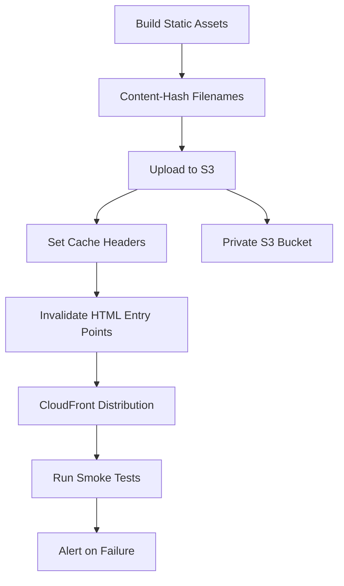

# README

## Overview

Static website deployment for Amazon S3 covers the hosting options, CloudFront integration, origin access control, certificate and DNS configuration, asset build and upload strategies, cache control, cache invalidation, blue-green release patterns, rollback procedures, and smoke testing workflows required to deploy and operate static websites reliably on S3 and CloudFront. It addresses the full static website deployment lifecycle from initial hosting configuration through content delivery, release management, and post-deployment validation.

This section of the Backend Engineering Playbook provides a structured reference for backend engineers, frontend engineers, and platform teams who deploy and operate static websites, single-page applications, and statically generated sites on Amazon S3 with CloudFront distribution.

The focus is on practical static website deployment engineering: designing secure private-origin architectures, managing cache behavior and content versioning, releasing updates without downtime, and validating availability and correctness after each deployment.

## Navigation

| # | File | Description |
|---|---|---|
| 01 | [01- S3 Website Hosting Deployment Options](./01-%20S3%20Website%20Hosting%20Deployment%20Options.md) | S3 static website hosting modes, private bucket with CloudFront versus public website endpoint, and configuration trade-offs |
| 02 | [02- Private S3 Origin with CloudFront](./02-%20Private%20S3%20Origin%20with%20CloudFront.md) | Configuring CloudFront with a private S3 origin, OAC-based access, and keeping the bucket private |
| 03 | [03- Origin Access Control Configuration](./03-%20Origin%20Access%20Control%20Configuration.md) | Configuring Origin Access Control to restrict S3 object access to CloudFront only |
| 04 | [04- ACM Certificates and DNS Configuration](./04-%20ACM%20Certificates%20and%20DNS%20Configuration.md) | Provisioning ACM certificates, custom domain configuration, Route 53 DNS records, and HTTPS validation |
| 05 | [05- Asset Build and Upload Strategies](./05-%20Asset%20Build%20and%20Upload%20Strategies.md) | Building static assets, uploading to S3, setting content types and cache headers, and managing upload atomicity |
| 06 | [06- Cache Headers and Content Versioning](./06-%20Cache%20Headers%20and%20Content%20Versioning.md) | Configuring cache control headers, content-hash filename versioning, and serving updated assets after deployment |
| 07 | [07- CloudFront Cache Invalidation](./07-%20CloudFront%20Cache%20Invalidation.md) | Invalidating cached content after deployment, invalidation cost and timing, and versioning as an alternative |
| 08 | [08- Blue-Green Website Releases](./08-%20Blue-Green%20Website%20Releases.md) | Maintaining two deployable versions, switching CloudFront traffic between them, and rollback by origin switch |
| 09 | [09- Website Deployment Rollback](./09-%20Website%20Deployment%20Rollback.md) | Rollback strategies using S3 versioning, previous deployment artifacts, or blue-green origin switching |
| 10 | [10- Smoke Testing and Availability Validation](./10-%20Smoke%20Testing%20and%20Availability%20Validation.md) | Validating website availability, content correctness, cache behavior, and HTTPS configuration after deployment |

## Why Static Website Deployment on S3 Matters

S3 and CloudFront provide a scalable, low-operational-overhead platform for static website hosting. Without deliberate deployment engineering, static websites accumulate configuration debt, serve stale content after updates, expose S3 bucket origins directly, and lack the rollback capability needed for safe releases.

Common static website deployment risks include:

- S3 bucket configured as a public website endpoint, bypassing CloudFront access controls and exposing the origin directly.
- Cache headers not set correctly, causing CloudFront to cache HTML files indefinitely so users do not receive updated content after deployment.
- Cache invalidation triggered for every file on every deployment, incurring unnecessary cost and delay; content versioning addresses this more efficiently.
- No rollback capability because previous deployment artifacts are not retained or versioned.
- ACM certificate not provisioned in `us-east-1`, causing CloudFront distribution creation to fail.
- Post-deployment smoke tests not run, leaving deployment failures undiscovered until users report them.

Effective static website deployment combines a private S3 origin with Origin Access Control, correct cache header configuration, content versioning for static assets, targeted cache invalidation for HTML entry points, and automated post-deployment validation.

## Documentation Structure

This section is organized into focused documents progressing from hosting architecture through content delivery configuration, release management, and validation.

| Area | Primary focus |
|---|---|
| Hosting options | S3 hosting modes, CloudFront integration, and architecture trade-offs |
| Origin security | Private origin configuration and OAC-based access restriction |
| Domain and TLS | ACM certificates, custom domains, and HTTPS validation |
| Asset management | Build, upload, content type, and cache header configuration |
| Cache control | Cache headers, content versioning, and invalidation strategies |
| Release management | Blue-green releases and rollback procedures |
| Post-deployment validation | Smoke tests and availability checks |

## Core Static Website Deployment Principles

### Use a Private S3 Origin with Origin Access Control

Do not enable S3 static website hosting or make the bucket publicly accessible. Configure CloudFront with a private S3 origin and Origin Access Control. This restricts S3 object access to CloudFront only, keeps the bucket private, and avoids the security complexity of a public bucket policy.

### Version Static Assets, Not HTML Entry Points

Configure long-duration cache headers (`Cache-Control: max-age=31536000, immutable`) for content-hash-named static assets such as JavaScript bundles, CSS files, and images. Configure short or no-cache headers for HTML entry points. This allows CDN caches to serve static assets efficiently while ensuring browsers receive updated HTML that references the new asset filenames after deployment.

### Retain Previous Deployment Artifacts

Store previous deployment artifacts in a versioning-enabled S3 bucket or retain them in the CI/CD artifact store. Rollback by redeploying a previous artifact is faster and more reliable than attempting to reverse a failed deployment in place.

### Validate After Every Deployment

Run automated smoke tests after every deployment. Verify that the expected status codes, content, and cache headers are returned for key URL paths. Validate HTTPS, custom domain resolution, and CloudFront cache behavior. Alert immediately on validation failure rather than waiting for user reports.

### Invalidate Entry Points After Deployment

After uploading new assets, invalidate the CloudFront cache for HTML entry points such as `index.html`. Static assets with content-hash filenames do not need invalidation because each deployment produces new filenames. Limiting invalidations to entry points reduces invalidation cost and CloudFront propagation delay.

## Recommended Static Website Deployment Workflow

## Operational Standards

- **Origin security:** Use a private S3 origin with Origin Access Control. Do not enable public bucket access for CloudFront origins.
- **ACM certificates:** Provision ACM certificates in `us-east-1` for CloudFront distributions. Use DNS validation for automated renewal.
- **Cache headers:** Apply long-duration immutable cache headers to content-hash-named assets. Apply short or no-cache headers to HTML entry points.
- **Content versioning:** Use content-hash filenames for static assets. Do not rely on CloudFront invalidation for asset updates.
- **Invalidation scope:** Invalidate only HTML entry points after deployment. Do not invalidate the entire distribution for every deployment.
- **Artifact retention:** Retain at least the previous deployment artifact to support immediate rollback.
- **Smoke tests:** Run automated smoke tests after every deployment. Fail the pipeline if smoke tests do not pass.
- **Rollback readiness:** Document and test the rollback procedure before the first production deployment.

## Key Takeaways

- A private S3 origin with Origin Access Control is the correct architecture for CloudFront-served static websites; public bucket endpoints bypass CloudFront access controls.
- Content-hash filename versioning for static assets eliminates the need for broad CloudFront invalidations and ensures consistent cache behavior.
- Cache headers must be configured correctly at upload time; incorrect headers cause stale content to be served or CDN caches to perform poorly.
- ACM certificates for CloudFront must be provisioned in `us-east-1` regardless of the distribution's origin region.
- Post-deployment smoke tests are the only reliable way to detect deployment failures before users report them.
