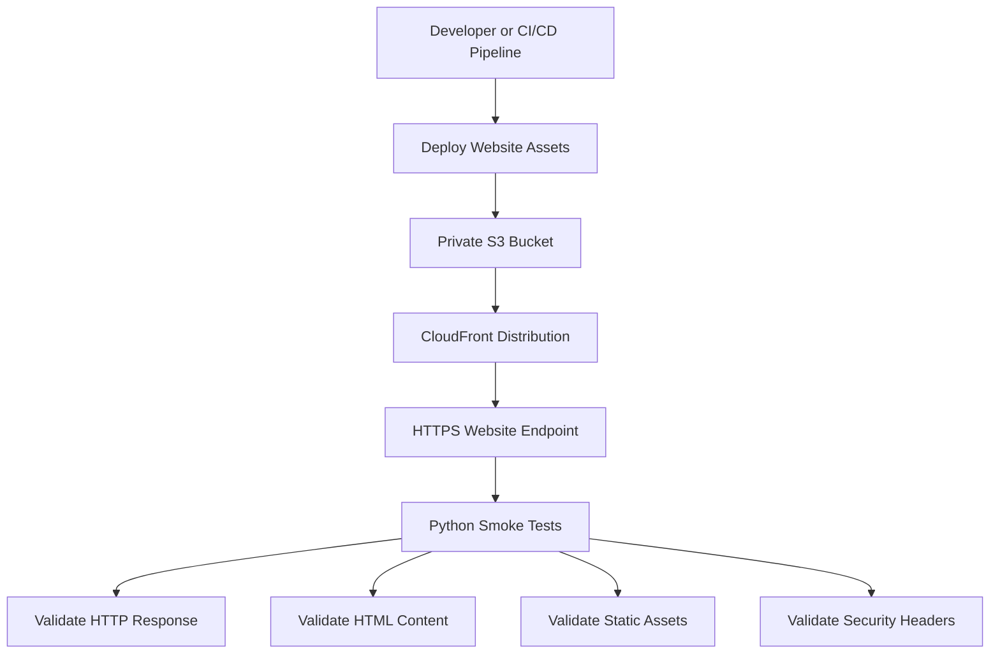

# README

## Overview

This directory contains automated smoke tests for the S3-backed static website deployed through Amazon CloudFront.

The tests validate the externally observable behavior of the deployed website rather than inspecting AWS infrastructure directly. They are intended to run after the deployment workflow has uploaded website assets to S3 and completed CloudFront cache invalidation.

The test suite uses Python, `pytest`, and `requests` to verify:

- Website endpoint availability.
- Successful HTTPS access.
- HTML document delivery.
- Expected page title, when configured.
- Referenced CSS and JavaScript asset availability.
- Security response headers.
- Use of the CloudFront delivery endpoint rather than an S3 website endpoint.

The tests do not provision infrastructure, modify S3 objects, or require AWS credentials. They validate the public delivery path.

## Project Structure

```text
tests/
├── README.md
└── smoke_test.py
```

| File | Responsibility |
|---|---|
| `smoke_test.py` | Contains endpoint, HTML, asset, and response-header smoke tests. |
| `README.md` | Documents prerequisites, configuration, execution, and troubleshooting. |

## Architecture

The static website uses a private S3 bucket as its origin and CloudFront as the public content delivery layer.



The smoke tests exercise the same public endpoint used by website visitors. This helps detect deployment failures that may not be visible from a successful S3 upload alone.

## Prerequisites

- Python 3.10 or later.
- `pip`.
- Access to the deployed website's HTTPS endpoint.
- A successfully deployed CloudFront distribution.
- Website assets uploaded to the configured S3 bucket.
- CloudFront cache invalidation completed before running the tests.

Install the test dependencies:

```bash
python -m pip install pytest requests
```

For reproducible environments, install dependencies inside a virtual environment:

```bash
python -m venv .venv
```

Activate the environment on Windows:

```powershell
.venv\Scripts\Activate.ps1
```

Activate the environment on Linux or macOS:

```bash
source .venv/bin/activate
```

Install dependencies:

```bash
python -m pip install pytest requests
```

## Configuration

The test suite reads its configuration from environment variables.

| Variable | Required | Default | Description |
|---|---|---|---|
| `WEBSITE_URL` | Yes for meaningful deployment testing | `https://localhost` | Public CloudFront or custom-domain URL. |
| `REQUEST_TIMEOUT` | No | `15` | Maximum HTTP request duration in seconds. |
| `MAX_REDIRECTS` | No | `5` | Maximum permitted redirect count. |
| `EXPECTED_TITLE` | No | Not configured | Expected substring in the HTML title. |
| `VERIFY_ASSETS` | No | `true` | Enables CSS and JavaScript asset checks. |
| `VERIFY_SECURITY_HEADERS` | No | `true` | Enables security response-header checks. |
| `ALLOW_HTTP` | No | `false` | Allows an intentional local HTTP endpoint. |

The default `WEBSITE_URL` is intended only as a safe configuration fallback. Set it to the actual deployed endpoint before executing meaningful smoke tests.

### Linux and macOS

```bash
export WEBSITE_URL="https://d123456789.cloudfront.net"
export EXPECTED_TITLE="Static Website"
export REQUEST_TIMEOUT=20
export MAX_REDIRECTS=5

python -m pytest tests/smoke_test.py -v
```

### Windows PowerShell

```powershell
$env:WEBSITE_URL = "https://d123456789.cloudfront.net"
$env:EXPECTED_TITLE = "Static Website"
$env:REQUEST_TIMEOUT = "20"
$env:MAX_REDIRECTS = "5"

python -m pytest tests/smoke_test.py -v
```

For a custom domain, configure the corresponding HTTPS URL:

```bash
export WEBSITE_URL="https://www.example.com"
```

## Running the Smoke Tests

Run the complete test suite from the project root:

```bash
python -m pytest tests/smoke_test.py -v
```

Run a specific test:

```bash
python -m pytest tests/smoke_test.py::test_website_endpoint_is_reachable -v
```

Run HTML validation:

```bash
python -m pytest tests/smoke_test.py::test_website_returns_html -v
```

Run static asset validation:

```bash
python -m pytest tests/smoke_test.py::test_static_assets_are_available -v
```

Run security-header validation:

```bash
python -m pytest tests/smoke_test.py::test_security_response_headers -v
```

Disable optional asset checks:

```bash
VERIFY_ASSETS=false python -m pytest tests/smoke_test.py -v
```

Disable security-header checks:

```bash
VERIFY_SECURITY_HEADERS=false python -m pytest tests/smoke_test.py -v
```

On Windows PowerShell:

```powershell
$env:VERIFY_ASSETS = "false"
python -m pytest tests/smoke_test.py -v
```

## Test Coverage

| Test | Validation | Failure indicates |
|---|---|---|
| `test_website_endpoint_is_reachable` | Endpoint returns HTTP 200 and uses HTTPS unless explicitly overridden. | DNS, connectivity, CloudFront, or origin availability issue. |
| `test_website_returns_html` | Root endpoint returns a non-empty HTML document. | Incorrect content type, missing index document, or deployment issue. |
| `test_expected_page_title` | Configured expected title appears in the HTML title element. | Incorrect website content or stale deployment. |
| `test_static_assets_are_available` | Referenced local CSS and JavaScript assets return successful responses with expected content types. | Missing objects, incorrect asset paths, or incorrect metadata. |
| `test_security_response_headers` | Expected security headers are present and `X-Content-Type-Options` is `nosniff`. | Missing or incorrectly configured CloudFront response headers policy. |
| `test_website_does_not_expose_s3_website_endpoint` | Configured public endpoint is not an S3 website endpoint. | Incorrect public delivery architecture. |

The asset test checks same-origin assets. Assets served from separate origins, such as a dedicated static asset domain, are not validated by this test.

## Integration with GitHub Actions

The deployment workflow should run smoke tests after:

1. Website assets have been synchronized to S3.
2. CloudFront invalidation has been created.
3. CloudFront invalidation has completed.

The deployment workflow can install the test dependencies and execute the suite against the configured website endpoint.

Example workflow step:

```yaml
- name: Install smoke test dependencies
  run: |
    python -m pip install --upgrade pip
    python -m pip install pytest requests

- name: Run website smoke tests
  env:
    WEBSITE_URL: ${{ vars.WEBSITE_URL }}
    EXPECTED_TITLE: ${{ vars.EXPECTED_TITLE }}
    REQUEST_TIMEOUT: "20"
    MAX_REDIRECTS: "5"
  run: |
    python -m pytest tests/smoke_test.py -v
```

Configure `WEBSITE_URL` and `EXPECTED_TITLE` as GitHub repository or environment variables.

Do not store AWS access keys or other credentials in workflow files. These smoke tests only need public endpoint access and do not require AWS authentication.

The deployment workflow should fail when smoke tests fail. This prevents a deployment from being reported as successful when the website cannot be served correctly.

## Manual Verification

Before investigating test failures, verify the endpoint independently.

Check the HTTP response:

```bash
curl -I https://d123456789.cloudfront.net
```

Inspect the returned HTML:

```bash
curl -fsS https://d123456789.cloudfront.net
```

Inspect security headers:

```bash
curl -sSI https://d123456789.cloudfront.net
```

Verify a known stylesheet:

```bash
curl -I https://d123456789.cloudfront.net/assets/styles.css
```

Verify a known JavaScript asset:

```bash
curl -I https://d123456789.cloudfront.net/assets/app.js
```

Check CloudFront distribution deployment status:

```bash
aws cloudfront get-distribution \
  --id DISTRIBUTION_ID \
  --query 'Distribution.Status' \
  --output text
```

A distribution status of `Deployed` indicates that the distribution configuration has been deployed to CloudFront edge locations. It does not independently prove that the website origin or every asset is healthy.

## Troubleshooting

| Symptom | Possible cause | Diagnostic action |
|---|---|---|
| Connection timeout | CloudFront endpoint unavailable or network connectivity issue. | Check endpoint DNS resolution, connectivity, and distribution status. |
| HTTP 403 | S3 bucket policy, CloudFront origin access, or object permissions are incorrect. | Inspect the CloudFront origin configuration and S3 bucket policy. |
| HTTP 404 | Missing object or incorrect URL path. | Inspect uploaded S3 object keys and the HTML asset references. |
| HTTP 502 or 503 | Origin or distribution configuration problem. | Inspect CloudFront configuration and AWS service health. |
| HTML content-type assertion fails | Incorrect object metadata or unexpected response. | Inspect the S3 object's `Content-Type` metadata. |
| CSS or JavaScript returns 404 | Asset was not uploaded or the referenced path is incorrect. | Compare HTML references with uploaded S3 object keys. |
| Security-header assertion fails | CloudFront response headers policy is missing or incomplete. | Inspect the attached response headers policy. |
| Expected title assertion fails | Incorrect page content or stale cached HTML. | Inspect the deployed HTML and CloudFront cache state. |
| Redirect limit exceeded | Redirect loop or excessive redirect chain. | Inspect HTTP-to-HTTPS and custom-domain redirect configuration. |

### Inspect S3 Objects

List deployed objects:

```bash
aws s3 ls s3://YOUR_WEBSITE_BUCKET/ --recursive
```

Inspect the root HTML object:

```bash
aws s3api head-object \
  --bucket YOUR_WEBSITE_BUCKET \
  --key index.html
```

Inspect the stylesheet:

```bash
aws s3api head-object \
  --bucket YOUR_WEBSITE_BUCKET \
  --key assets/styles.css
```

Inspect the JavaScript asset:

```bash
aws s3api head-object \
  --bucket YOUR_WEBSITE_BUCKET \
  --key assets/app.js
```

### Inspect CloudFront Distribution

```bash
aws cloudfront get-distribution \
  --id DISTRIBUTION_ID \
  --query 'Distribution.{Status:Status,DomainName:DomainName,Enabled:DistributionConfig.Enabled,Origins:DistributionConfig.Origins.Items}'
```

Verify that:

- The distribution is enabled.
- The origin points to the intended S3 regional domain.
- Origin Access Control is configured.
- The S3 bucket remains private.
- The correct response headers policy is attached.
- The configured default root object is `index.html`.

### Inspect Cache Invalidation

List invalidations:

```bash
aws cloudfront list-invalidations \
  --distribution-id DISTRIBUTION_ID
```

Inspect a specific invalidation:

```bash
aws cloudfront get-invalidation \
  --distribution-id DISTRIBUTION_ID \
  --id INVALIDATION_ID
```

A completed invalidation does not correct missing assets, incorrect object metadata, or authorization failures. Diagnose the origin and deployment contents independently.

## Production Considerations

### Run Tests Against the Public Delivery Path

The tests should target the CloudFront distribution domain or configured custom domain rather than the S3 bucket endpoint.

This validates the actual request path used by website visitors:

```text
Client
  |
  v
HTTPS / CloudFront
  |
  v
Origin Access Control
  |
  v
Private S3 Bucket
```

### Keep Smoke Tests Read-Only

Smoke tests should not:

- Upload or delete production objects.
- Change CloudFront configuration.
- Create cache invalidations.
- Modify bucket policies.
- Require permanent AWS credentials.

Infrastructure changes and deployment operations belong in the deployment workflow, not in the smoke test suite.

### Use Deployment-Aware Verification

Run smoke tests after the CloudFront invalidation completes. Otherwise, cached content may cause tests to observe an earlier website version.

For stronger release validation, consider adding a deployment version identifier to the website and checking it after deployment. This helps distinguish the newly deployed release from previously cached content.

### Avoid Overly Strict Header Assertions

Security headers should be configured centrally through the CloudFront response headers policy where possible.

The test suite expects specific headers. If the security policy intentionally changes, update the tests and policy together.

A Content Security Policy should be designed around the website's actual resource requirements. Do not introduce a restrictive policy without validating the scripts, stylesheets, fonts, and external resources required by the application.

### Keep CI/CD Configuration Environment-Specific

Use separate GitHub environments for development, staging, and production when the deployment process supports multiple environments.

Configure the following values independently:

- Website endpoint.
- AWS Region.
- S3 bucket name.
- CloudFront distribution ID.
- Expected page title.

Use GitHub environment protection rules and approval gates for production deployments.

### Understand Test Limitations

These smoke tests validate basic HTTP delivery, not complete application behavior.

They do not independently validate:

- CloudFront origin access permissions.
- S3 bucket encryption configuration.
- TLS certificate issuance and renewal.
- DNS propagation across all resolvers.
- Browser rendering or JavaScript execution.
- Accessibility and responsive behavior.
- End-to-end user workflows.
- Regional disaster recovery.
- CloudFront cache correctness for every object.
- Availability from multiple geographic locations.

Use browser-based end-to-end tests, infrastructure tests, and monitoring systems for those requirements.

## Key Takeaways

- Smoke tests validate the public CloudFront delivery path, not merely successful S3 uploads.
- Keep endpoint tests read-only and independent of AWS credentials.
- Validate HTML, static assets, HTTPS behavior, and security response headers after cache invalidation.
- Run deployment verification after CloudFront invalidation completes and fail the pipeline when critical checks fail.
- Treat smoke tests as one layer of production validation, complemented by infrastructure, browser, security, and monitoring tests.