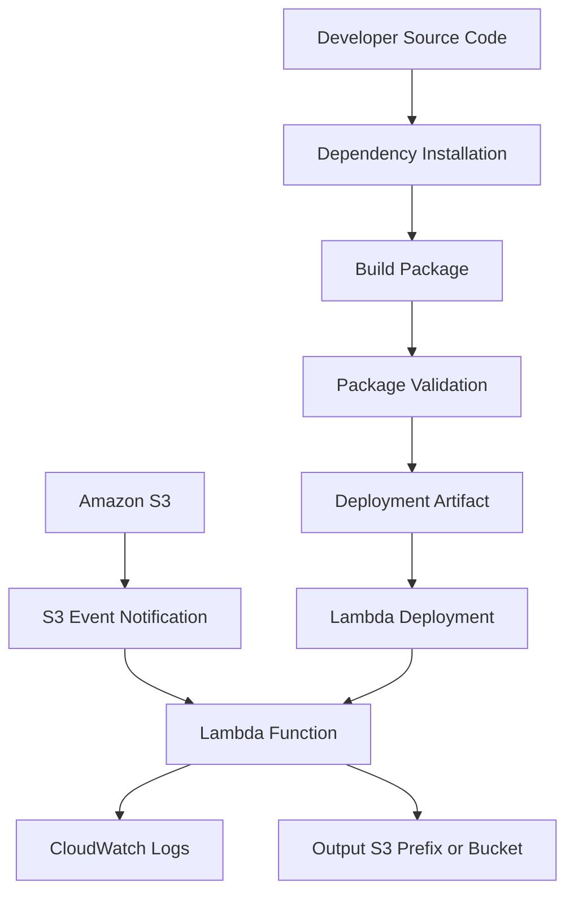

# 01- Packaging Lambda Functions for S3 Workflows

## Overview

AWS Lambda functions commonly process objects uploaded to Amazon S3. Typical workloads include image transformation, document processing, metadata extraction, file validation, data ingestion, and event-driven integrations.

Lambda deployment requires packaging application code and its dependencies into an artifact that the Lambda execution environment can load.

Packaging is not simply compressing Python files into a ZIP archive. The artifact must contain:

- Application source code.
- Required third-party dependencies.
- Correct directory structure.
- Compatible Python runtime and architecture.
- Native libraries compiled for the Lambda execution environment, when applicable.
- Configuration and deployment metadata.

Incorrect packaging can cause deployment failures, import errors, missing shared libraries, or runtime failures that occur only after an S3 event triggers the function.

This document covers packaging Python-based Lambda functions for S3 workflows, including ZIP deployments, dependency management, container images, validation, CI/CD integration, and production considerations.

## Lambda Packaging Architecture

A typical S3 event-driven Lambda deployment contains the following components:



The deployment artifact is created independently of the S3 event notification configuration. Packaging and event routing are separate deployment concerns.

## Lambda Deployment Package Types

AWS Lambda supports ZIP deployment packages and container image deployments.

| Characteristic | ZIP package | Container image |
|---|---|---|
| Artifact format | ZIP archive | OCI-compatible container image |
| Maximum deployment size | 50 MB compressed through direct API or console upload; larger packages can be uploaded through S3 | Up to 10 GB uncompressed image size |
| Dependency management | Installed into the deployment package or supplied through layers | Installed in the container image |
| Runtime | Managed Lambda runtime | Lambda container runtime interface |
| Native dependencies | Must be compatible with Lambda execution environment | Must be compatible with Lambda container runtime and architecture |
| Build complexity | Usually lower | Requires Docker or another image builder |
| Best suited for | Small and medium Python functions | Large dependencies, specialized system libraries, custom runtime environments |

Choose the deployment format based on dependency size, native library requirements, build complexity, and operational needs.

For most Python-based S3 event processors, ZIP packaging is sufficient.

## ZIP Deployment Package Structure

A ZIP deployment package must place the Lambda handler module and its importable dependencies at the appropriate locations.

Consider this project:

```text
s3-image-processor/
├── src/
│   ├── handler.py
│   ├── image_processor.py
│   └── storage.py
├── requirements.txt
├── tests/
│   └── test_image_processor.py
└── infrastructure/
    └── main.tf
```

The deployment package should contain:

```text
lambda-deployment.zip
├── handler.py
├── image_processor.py
├── storage.py
├── boto3/
├── botocore/
└── other-installed-dependencies/
```

The handler module must be importable from the package root when configured as:

```text
handler.lambda_handler
```

The test directory, infrastructure files, local virtual environment, Git metadata, and development-only tools should not be included unless the application explicitly requires them.

## Python Lambda Handler

A typical S3-triggered Lambda handler receives an event containing one or more S3 object records.

Example:

```python
import json
import logging
from urllib.parse import unquote_plus

logger = logging.getLogger()
logger.setLevel(logging.INFO)


def lambda_handler(event, context):
    processed_objects = []

    for record in event.get("Records", []):
        bucket = record["s3"]["bucket"]["name"]
        object_key = unquote_plus(record["s3"]["object"]["key"])

        logger.info(
            "Received S3 object event",
            extra={
                "bucket": bucket,
                "object_key": object_key,
                "request_id": context.aws_request_id,
            },
        )

        processed_objects.append(
            {
                "bucket": bucket,
                "key": object_key,
            }
        )

    return {
        "statusCode": 200,
        "processed": processed_objects,
    }
```

The `unquote_plus()` call handles URL-encoded S3 object keys. This is important when object names contain spaces or special characters.

S3 notifications can be delivered more than once. Production handlers must therefore be designed for duplicate events and safe retries.

## Dependency Management

Python dependencies must be installed into the deployment package or supplied through Lambda layers.

Maintain dependencies in a dedicated `requirements.txt` file.

Example:

```text
Pillow>=10.4,<13
```

Avoid installing every package used during local development into the production artifact.

Separate runtime dependencies from development dependencies.

For example:

```text
requirements.txt
requirements-dev.txt
```

`requirements.txt` should contain only packages required by the deployed Lambda function.

`requirements-dev.txt` can contain testing, formatting, linting, and local development tools.

### Install Dependencies into the Package Directory

Create a clean build directory:

```bash
mkdir -p build/package
```

Install dependencies directly into it:

```bash
python -m pip install \
  --target build/package \
  --requirement requirements.txt
```

Copy application source files:

```bash
cp src/*.py build/package/
```

Create the ZIP archive:

```bash
cd build/package
zip -r ../lambda-deployment.zip .
cd ../..
```

The resulting artifact is:

```text
build/lambda-deployment.zip
```

The package root contains the handler and its dependencies.

### Why `--target` Matters

Installing dependencies into the local virtual environment does not automatically include them in the Lambda deployment package.

For example:

```bash
pip install pillow
```

installs Pillow into the active Python environment.

It does not place Pillow inside the ZIP archive unless that environment's contents are explicitly packaged.

Using `--target` makes the destination of dependency installation explicit.

## Runtime and Architecture Compatibility

Lambda functions execute in an AWS-managed environment. Dependencies must be compatible with the configured runtime and processor architecture.

Important compatibility dimensions include:

- Python runtime version.
- Linux operating system environment.
- CPU architecture: `x86_64` or `arm64`.
- Native shared libraries.
- Python ABI compatibility.

Pure Python packages are generally portable across compatible Python versions. Packages containing native extensions require additional care.

Examples include:

- Pillow.
- NumPy.
- Pandas.
- Cryptography.
- Database drivers.
- Packages depending on native system libraries.

### Avoid Building Native Dependencies on Windows

A package installed on Windows may contain Windows-specific compiled extensions.

Those binaries cannot generally be loaded by Lambda's Linux execution environment.

Similarly, packages built for one Linux architecture may not work on another architecture.

For native dependencies, build in an environment compatible with the Lambda runtime and architecture.

### Build Using the Lambda-Compatible Container Image

AWS provides Lambda base images that can be used to build compatible deployment artifacts.

Example using a Python Lambda base image:

```bash
docker run --rm \
  --platform linux/amd64 \
  --entrypoint /bin/bash \
  -v "$PWD":/var/task \
  public.ecr.aws/lambda/python:3.12 \
  -c "python -m pip install \
      --target /var/task/build/package \
      -r /var/task/requirements.txt"
```

This example targets the Python 3.12 Lambda runtime on `x86_64`.

For an ARM64 Lambda function, use a compatible ARM64 build environment and configure the function architecture accordingly.

Do not assume that a package built for `x86_64` will work on `arm64`.

## Reproducible Packaging

Production builds should be deterministic and repeatable.

A reproducible build should use:

- Explicit Python runtime versions.
- Pinned or constrained dependency versions.
- A clean build directory.
- A controlled build environment.
- Consistent architecture.
- Artifact validation.
- Build logs and artifact checksums.

For stronger dependency reproducibility, use a lock file or fully pinned requirements.

Example:

```text
Pillow==11.3.0
```

A pinned version reduces unexpected dependency changes between builds.

It does not, by itself, guarantee reproducibility of native binaries across different operating systems or architectures.

### Clean Build Script

A reusable packaging script can automate the process.

```bash
#!/usr/bin/env bash

set -euo pipefail

PROJECT_ROOT="$(cd "$(dirname "${BASH_SOURCE[0]}")/.." && pwd)"
BUILD_DIR="${PROJECT_ROOT}/build"
PACKAGE_DIR="${BUILD_DIR}/package"
ARTIFACT="${BUILD_DIR}/lambda-deployment.zip"

cd "$PROJECT_ROOT"

rm -rf "$BUILD_DIR"
mkdir -p "$PACKAGE_DIR"

python -m pip install \
    --disable-pip-version-check \
    --no-cache-dir \
    --target "$PACKAGE_DIR" \
    -r requirements.txt

cp src/*.py "$PACKAGE_DIR/"

(
    cd "$PACKAGE_DIR"
    zip -qr "$ARTIFACT" .
)

echo "Lambda package created: $ARTIFACT"
```

This script assumes that the required Python and ZIP utilities are installed in the build environment.

For projects containing nested application packages, copy the package directories while preserving their Python import structure.

## Packaging with Lambda Layers

Lambda layers allow dependencies to be shared across multiple functions.

A Python layer ZIP commonly uses this structure:

```text
python-dependencies.zip
└── python/
    ├── pillow/
    ├── PIL/
    └── other-dependencies/
```

The top-level directory must be named `python` for Python dependencies.

Install dependencies into the layer directory:

```bash
mkdir -p build/layer/python

python -m pip install \
  --target build/layer/python \
  --requirement requirements.txt
```

Package the layer:

```bash
cd build/layer
zip -qr ../python-dependencies.zip python
cd ../..
```

The layer can then be published and attached to compatible Lambda functions.

### When to Use Layers

Use layers when:

- Several Lambda functions share the same dependency set.
- A dependency package is maintained independently of function code.
- Separating application code from shared libraries improves release management.

Avoid layers when they introduce unnecessary version coordination or deployment complexity.

A layer is versioned independently. Updating a layer does not automatically update every function using an earlier layer version.

### Layer Limitations

Consider the following:

- A function can use a limited number of layers.
- The combined unzipped size of the function package and attached layers must remain within Lambda's deployment size limit.
- Layer dependencies must match the function's runtime and architecture.
- Layer versions must be explicitly updated in function configuration.

## Packaging for Image Processing Workloads

S3 image-processing functions commonly use Pillow or other image-processing libraries.

A representative dependency file:

```text
Pillow==11.3.0
```

The application may use separate input and output prefixes:

```text
s3://example-image-bucket/
├── uploads/
│   └── original-image.jpg
└── processed/
    └── original-image-thumbnail.jpg
```

The Lambda function should process objects under `uploads/` and write results under `processed/`.

Do not configure the same event notification to recursively trigger on the output prefix.

### Native Library Considerations

Image-processing dependencies may require native libraries.

For example, Pillow can include compiled components for image codecs and other image operations.

Validate the package in an environment matching the target Lambda runtime and architecture.

A successful local import on Windows does not prove that the package will work in Lambda.

## Container Image Packaging

Container image deployments are useful when the function has substantial dependencies or requires a controlled operating environment.

A minimal Dockerfile:

```dockerfile
FROM public.ecr.aws/lambda/python:3.12

COPY requirements.txt ${LAMBDA_TASK_ROOT}/

RUN python -m pip install \
    --no-cache-dir \
    -r ${LAMBDA_TASK_ROOT}/requirements.txt

COPY src/ ${LAMBDA_TASK_ROOT}/

CMD ["handler.lambda_handler"]
```

Build the image:

```bash
docker build \
  --platform linux/amd64 \
  -t s3-image-processor:latest .
```

Run the image locally using the Lambda Runtime Interface Emulator included in the AWS base image:

```bash
docker run --rm \
  -p 9000:8080 \
  s3-image-processor:latest
```

Invoke the local runtime endpoint:

```bash
curl -X POST \
  http://localhost:9000/2015-03-31/functions/function/invocations \
  -H "Content-Type: application/json" \
  -d '{"Records": []}'
```

For deployment, push the image to Amazon ECR and configure the Lambda function to use the image URI.

Container images are immutable deployment artifacts when referenced by a specific image digest. Prefer digest-based release references when strict artifact traceability is required.

## Artifact Validation

Packaging should be followed by validation before deployment.

At minimum, verify:

- The ZIP archive is readable.
- The handler module exists at the package root.
- Required dependencies are present.
- The package does not contain development-only files.
- Python imports work in a compatible environment.
- Native libraries match the target architecture.
- The artifact size is within Lambda limits.

### Inspect the ZIP Archive

```bash
unzip -l build/lambda-deployment.zip
```

Verify that the handler exists at the root:

```bash
unzip -l build/lambda-deployment.zip | grep '^.*handler.py$'
```

Inspect the compressed archive size:

```bash
ls -lh build/lambda-deployment.zip
```

Inspect the extracted size:

```bash
du -sh build/package
```

For ZIP deployments, the extracted package and attached layers must fit within the applicable Lambda uncompressed deployment size limit.

### Test Imports

Run import checks in an environment compatible with the Lambda runtime:

```bash
PYTHONPATH=build/package python -c \
  "import handler; print('Handler import successful')"
```

This checks whether the handler and its imports can be loaded in the current environment. It does not guarantee compatibility with the Lambda runtime if the current environment differs from the deployment target.

### Run Automated Tests

Execute unit tests before packaging:

```bash
python -m pytest tests/ -v
```

For stronger validation, execute tests against the packaged code rather than only the source directory.

For example:

```bash
PYTHONPATH=build/package python -m pytest tests/ -v
```

The test suite should cover:

- Valid S3 event payloads.
- URL-encoded object keys.
- Missing or malformed event records.
- S3 client failures.
- Unsupported file types.
- Processing errors.
- Duplicate event handling.
- Output object key generation.

## Deploying ZIP Packages

Lambda ZIP artifacts can be deployed directly through AWS CLI.

For smaller artifacts:

```bash
aws lambda update-function-code \
  --function-name s3-image-processor \
  --zip-file fileb://build/lambda-deployment.zip
```

For artifacts uploaded to S3:

```bash
aws s3 cp \
  build/lambda-deployment.zip \
  s3://deployment-artifacts/lambda/s3-image-processor.zip
```

Deploy the artifact from S3:

```bash
aws lambda update-function-code \
  --function-name s3-image-processor \
  --s3-bucket deployment-artifacts \
  --s3-key lambda/s3-image-processor.zip
```

The deployment bucket must be accessible to the deployment principal.

For production releases, use immutable artifact names or versioned object keys rather than repeatedly overwriting a shared artifact key.

Example:

```text
lambda/
├── s3-image-processor/
│   ├── release-2026-11-01-a1b2c3.zip
│   └── release-2026-11-02-d4e5f6.zip
```

## Terraform Integration

Terraform can deploy a ZIP package using `aws_lambda_function`.

Example:

```hcl
resource "aws_lambda_function" "image_processor" {
  function_name = "s3-image-processor"

  role          = aws_iam_role.lambda_execution.arn
  runtime       = "python3.12"
  handler       = "handler.lambda_handler"

  filename         = "${path.module}/../build/lambda-deployment.zip"
  source_code_hash = filebase64sha256(
    "${path.module}/../build/lambda-deployment.zip"
  )

  timeout     = 30
  memory_size = 512

  architectures = ["x86_64"]

  environment {
    variables = {
      INPUT_PREFIX  = "uploads/"
      OUTPUT_PREFIX = "processed/"
    }
  }
}
```

The referenced IAM role and other required infrastructure must be defined separately.

### Why `source_code_hash` Matters

Terraform uses `source_code_hash` to detect changes in the deployment artifact.

Without a changing artifact hash, Terraform may not recognize that the Lambda package has changed.

The hash should be calculated from the actual ZIP file used by the deployment resource.

For production environments, keep build and infrastructure deployment stages coordinated so that Terraform always references an artifact produced by the current validated build.

## GitHub Actions Packaging Pipeline

A CI/CD workflow should separate testing, packaging, artifact storage, and deployment.

Example:

```yaml
name: Package and Deploy S3 Lambda

on:
  push:
    branches:
      - main
    paths:
      - "src/**"
      - "tests/**"
      - "requirements.txt"
      - "infrastructure/**"
      - ".github/workflows/lambda-deploy.yml"

permissions:
  contents: read
  id-token: write

jobs:
  build:
    runs-on: ubuntu-latest

    steps:
      - name: Checkout repository
        uses: actions/checkout@v4

      - name: Set up Python
        uses: actions/setup-python@v5
        with:
          python-version: "3.12"

      - name: Install test dependencies
        run: |
          python -m pip install --upgrade pip
          python -m pip install pytest
          python -m pip install -r requirements.txt

      - name: Run tests
        run: python -m pytest tests/ -v

      - name: Build Lambda package
        run: |
          mkdir -p build/package

          python -m pip install \
            --target build/package \
            --requirement requirements.txt

          cp src/*.py build/package/

          cd build/package
          zip -qr ../lambda-deployment.zip .
          cd ../..

      - name: Validate package
        run: |
          unzip -t build/lambda-deployment.zip
          unzip -l build/lambda-deployment.zip

      - name: Upload deployment artifact
        uses: actions/upload-artifact@v4
        with:
          name: lambda-deployment
          path: build/lambda-deployment.zip
          if-no-files-found: error

  deploy:
    runs-on: ubuntu-latest
    needs: build
    environment: production

    steps:
      - name: Checkout repository
        uses: actions/checkout@v4

      - name: Download deployment artifact
        uses: actions/download-artifact@v4
        with:
          name: lambda-deployment
          path: build

      - name: Configure AWS credentials
        uses: aws-actions/configure-aws-credentials@v4
        with:
          role-to-assume: ${{ vars.AWS_DEPLOY_ROLE_ARN }}
          aws-region: ${{ vars.AWS_REGION }}

      - name: Deploy Lambda package
        run: |
          aws lambda update-function-code \
            --function-name "${{ vars.LAMBDA_FUNCTION_NAME }}" \
            --zip-file fileb://build/lambda-deployment.zip

      - name: Wait for Lambda update
        run: |
          aws lambda wait function-updated \
            --function-name "${{ vars.LAMBDA_FUNCTION_NAME }}"

      - name: Verify deployed configuration
        run: |
          aws lambda get-function-configuration \
            --function-name "${{ vars.LAMBDA_FUNCTION_NAME }}"
```

This workflow illustrates the packaging and deployment stages. A production pipeline should additionally validate runtime configuration, deployment permissions, event source configuration, and post-deployment behavior.

The deployment role should use GitHub Actions OIDC federation and least-privilege IAM permissions. Do not store long-lived AWS access keys in repository secrets.

## S3 Event Configuration Is Separate from Packaging

A valid deployment ZIP does not automatically configure S3 to invoke the Lambda function.

The event integration requires:

- An S3 event notification configuration.
- Permission for the S3 service to invoke the Lambda function.
- Correct bucket and function Region relationships.
- Appropriate event filters.
- A handler that can process the event payload.

Example Lambda resource-based permission:

```bash
aws lambda add-permission \
  --function-name s3-image-processor \
  --statement-id allow-s3-invocation \
  --action lambda:InvokeFunction \
  --principal s3.amazonaws.com \
  --source-arn arn:aws:s3:::example-image-bucket \
  --source-account 123456789012
```

The account ID and bucket ARN must be replaced with the actual deployment values.

Do not grant broad invocation permissions to all S3 buckets when a specific source bucket is sufficient.

## Production Packaging Considerations

### Dependency Security

Third-party dependencies are part of the deployed application and should be treated as production code.

Recommended practices:

- Pin dependency versions.
- Review dependency vulnerabilities.
- Remove unused packages.
- Generate and retain dependency manifests.
- Scan deployment artifacts where supported.
- Rebuild artifacts when security updates are required.

### Artifact Integrity

A deployment artifact should be traceable to a specific source revision.

Record:

- Git commit SHA.
- Python runtime version.
- Dependency lock or manifest.
- Build environment.
- Target architecture.
- Artifact checksum.
- Deployment timestamp.

Example checksum:

```bash
sha256sum build/lambda-deployment.zip
```

Use the checksum to verify that the artifact deployed is the same artifact produced by the build stage.

### Deployment Size and Cold Starts

Large deployment packages can increase:

- Artifact upload time.
- Deployment time.
- Initialization work.
- Dependency loading overhead.
- Operational complexity.

Keep runtime dependencies minimal.

For functions with large libraries, evaluate Lambda layers or container images. These options improve packaging organization but do not eliminate runtime initialization costs.

### Memory and Temporary Storage

Packaging decisions should account for the function's runtime workload.

Image-processing functions may need more memory and temporary storage than simple metadata processors.

Lambda memory allocation also affects available CPU resources.

Use measured workload behavior to choose memory, timeout, and ephemeral storage settings rather than relying on arbitrary defaults.

### Secrets and Configuration

Do not package:

- AWS access keys.
- Database passwords.
- API tokens.
- Private certificates.
- Environment-specific secrets.

Use IAM execution roles for AWS service access and appropriate managed secret or parameter services for application secrets.

## Common Packaging Failures

| Failure | Likely cause | Corrective action |
|---|---|---|
| `No module named ...` | Dependency missing from ZIP or incorrect directory structure | Inspect ZIP contents and install dependencies into the package directory |
| `Unable to import module` | Incorrect handler configuration or missing application module | Verify handler name and package root |
| `invalid ELF header` | Native dependency built for an incompatible operating system | Rebuild in a Lambda-compatible Linux environment |
| `Exec format error` | Architecture mismatch | Build for the configured Lambda architecture |
| Missing shared library | Native dependency requires an unavailable system library | Use a compatible Lambda build environment or container image |
| Package exceeds size limit | Too many dependencies or oversized artifacts | Remove unnecessary dependencies, use layers, or consider container images |
| Lambda deployment does not update | Artifact hash or deployment pipeline did not detect a change | Verify artifact generation and Terraform `source_code_hash` |
| Works locally but fails in Lambda | Runtime, architecture, permissions, or environment differences | Test in a compatible runtime environment and inspect CloudWatch logs |

## Packaging Checklist

### Build Validation

- [ ] Python runtime matches the Lambda configuration.
- [ ] Target architecture matches the Lambda configuration.
- [ ] Runtime dependencies are installed into the package.
- [ ] Native dependencies are Lambda-compatible.
- [ ] Handler module is at the expected package location.
- [ ] ZIP archive integrity is verified.
- [ ] Package size is within applicable limits.
- [ ] Development-only files are excluded.

### Deployment Validation

- [ ] Artifact is traceable to a source revision.
- [ ] Artifact checksum is recorded.
- [ ] Deployment uses short-lived AWS credentials.
- [ ] Lambda execution role follows least privilege.
- [ ] Function runtime and handler are configured correctly.
- [ ] S3 invocation permission is scoped to the intended bucket.
- [ ] Event notification filters prevent recursive processing.
- [ ] CloudWatch logging and failure monitoring are configured.
- [ ] A rollback strategy is available.

## Key Takeaways

- Lambda packaging must include the handler, runtime dependencies, and compatible native binaries in the correct directory structure.
- Build native dependencies for the target Lambda runtime and architecture rather than packaging binaries from an incompatible local environment.
- Use ZIP packages for straightforward deployments and layers or container images when dependency management justifies the additional complexity.
- Validate the deployment artifact before publishing it, and preserve artifact integrity through checksums and source revision tracking.
- Treat Lambda packaging, infrastructure deployment, and S3 event notification configuration as separate but coordinated deployment stages.