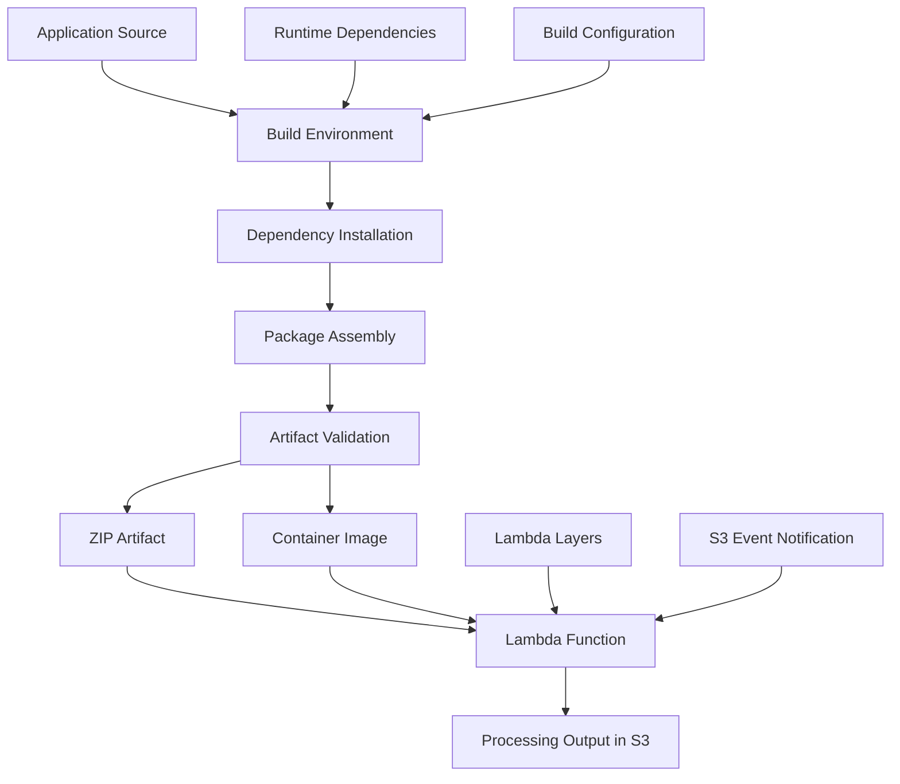
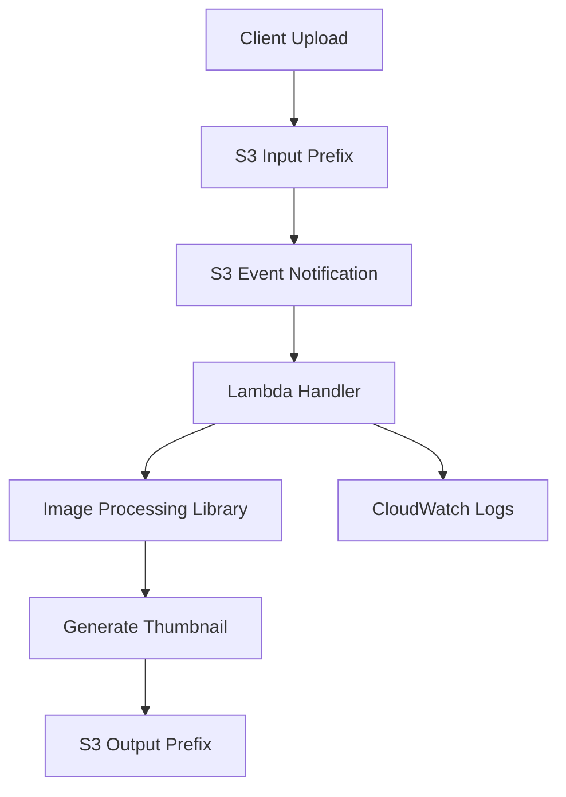
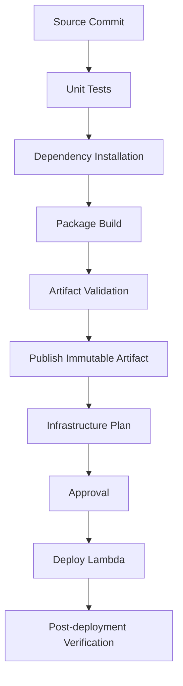

# 02- Dependency Bundling and Deployment Packages

## Overview

AWS Lambda functions depend on application code, third-party libraries, runtime components, and sometimes native system libraries. These dependencies must be available inside the Lambda execution environment when the function is initialized or invoked.

Dependency bundling is the process of assembling application code and required libraries into a deployable artifact. The artifact must be compatible with the Lambda runtime, operating system, and CPU architecture.

For S3-triggered workloads, packaging quality directly affects deployment reliability and event-processing availability. A function that deploys successfully can still fail when an S3 event arrives because a dependency is missing, a native library cannot load, or the package contains incompatible binaries.

This document focuses on dependency organization, bundling strategies, deployment artifact design, and production release practices for Python-based Lambda functions.

## Dependency Bundling Architecture

A Lambda deployment artifact can contain application code and dependencies directly, or rely on separately deployed Lambda layers.



The build environment should be controlled and reproducible. It should produce an artifact compatible with the Lambda function's configured runtime and architecture.

## Dependency Categories

Not every dependency used during development belongs in a Lambda deployment package.

| Dependency category | Examples | Deployment requirement |
|---|---|---|
| Application code | Handler modules, service classes, utility modules | Required |
| Runtime dependencies | Pillow, requests, Pydantic | Required when imported by application code |
| Native dependencies | NumPy, Pillow native extensions, cryptography | Required when used; must be runtime-compatible |
| AWS SDK dependencies | Boto3, Botocore | Usually available in the managed Python runtime, but version management may justify bundling |
| Development dependencies | pytest, Ruff, mypy | Normally excluded |
| Build dependencies | setuptools, wheel, build tools | Excluded unless required at runtime |
| Test fixtures | Sample S3 events, test images | Normally excluded |

A useful dependency strategy separates runtime and development requirements.

Example project structure:

```text
s3-lambda-processor/
├── src/
│   ├── handler.py
│   ├── services/
│   │   ├── image_processor.py
│   │   └── s3_service.py
│   └── utils/
│       └── validation.py
├── tests/
│   ├── unit/
│   └── fixtures/
├── requirements.txt
├── requirements-dev.txt
├── pyproject.toml
└── build/
```

Runtime dependencies belong in `requirements.txt`.

Development tools belong in `requirements-dev.txt` or the development dependency group in `pyproject.toml`.

## Dependency Installation Strategies

Python dependencies can be bundled using several approaches.

| Strategy | Description | Suitable use case |
|---|---|---|
| Direct ZIP bundling | Install dependencies into the deployment directory | Small and medium functions |
| Lambda layers | Deploy reusable dependencies separately | Multiple functions sharing dependencies |
| Container images | Package dependencies and application code in an image | Large dependency sets or specialized system requirements |
| AWS-managed runtime libraries | Use libraries supplied by the runtime | Dependencies where runtime-provided versions are acceptable |

The deployment format should be selected based on dependency size, compatibility requirements, release frequency, and operational complexity.

## Direct ZIP Bundling

Direct ZIP bundling places the application code and runtime dependencies in a single deployment archive.

This approach is straightforward and keeps the deployed application self-contained.

### Install Dependencies into a Build Directory

Create a clean package directory:

```bash
mkdir -p build/package
```

Install runtime dependencies:

```bash
python -m pip install \
  --target build/package \
  --requirement requirements.txt
```

Copy application code:

```bash
cp -r src/* build/package/
```

Create the archive:

```bash
cd build/package
zip -qr ../lambda-deployment.zip .
cd ../..
```

The resulting package should resemble:

```text
lambda-deployment.zip
├── handler.py
├── services/
│   ├── image_processor.py
│   └── s3_service.py
├── utils/
│   └── validation.py
└── installed-dependencies/
```

The exact dependency directory names depend on the packages installed.

### Why the Package Root Matters

For a Lambda handler configured as:

```text
handler.lambda_handler
```

the `handler.py` module must be importable from the deployment package root.

An incorrect archive structure such as:

```text
lambda-deployment.zip
└── package/
    └── handler.py
```

will not satisfy that handler configuration unless the handler module is otherwise made importable.

Avoid accidentally adding an extra project directory level when creating ZIP archives.

## Dependency Version Management

Uncontrolled dependency versions can make deployments unpredictable.

For example, installing dependencies without constraints may produce different artifacts on different build dates.

Use explicit versions or a generated lock file.

Example `requirements.txt`:

```text
Pillow==11.3.0
requests==2.32.5
```

For larger projects, maintain a lock file containing resolved transitive dependencies and hashes.

A fully pinned dependency set improves repeatability and makes security updates easier to review.

### Dependency Compatibility

A dependency must be compatible with:

- The Lambda Python runtime.
- The target operating system.
- The configured CPU architecture.
- The Python ABI, where native extensions are involved.
- Other installed package versions.

A package that installs successfully does not necessarily work inside Lambda.

## Native Dependency Bundling

Native Python packages contain compiled extensions or rely on shared system libraries.

Examples include:

- Pillow.
- NumPy.
- Pandas.
- Cryptography.
- Database drivers.

These dependencies require particular attention because compiled binaries are platform-specific.

### Why Local Installation Can Fail

Consider installing a native package on Windows:

```bash
python -m pip install Pillow
```

The resulting installation may contain Windows-specific binary extensions.

Lambda Python execution environments run on Linux. Windows binaries cannot generally be loaded by the Lambda runtime.

The same problem can occur when building on Linux for the wrong CPU architecture.

### Build in a Compatible Environment

Use a Lambda-compatible build environment for dependencies containing native extensions.

Example:

```bash
docker run --rm \
  --platform linux/amd64 \
  --entrypoint /bin/bash \
  -v "$PWD":/var/task \
  public.ecr.aws/lambda/python:3.12 \
  -c "python -m pip install \
      --target /var/task/build/package \
      -r /var/task/requirements.txt"
```

This example targets Python 3.12 and `x86_64`.

For ARM64 functions, use a compatible ARM64 build environment and configure the Lambda function to use the same architecture.

Do not assume that a package built for one architecture can run on another.

### Verify Native Dependencies

Run import checks inside a compatible environment:

```bash
docker run --rm \
  --platform linux/amd64 \
  -v "$PWD/build/package":/var/task \
  --entrypoint /bin/bash \
  public.ecr.aws/lambda/python:3.12 \
  -c "cd /var/task && python -c 'import PIL; print(PIL.__version__)'"
```

This verifies that Pillow can be imported in the selected container environment. It does not replace testing inside the deployed Lambda function.

## Dependency Isolation and Import Resolution

Python resolves imports using its module search path.

For Lambda ZIP deployments, application code and dependencies placed at the package root are available to the handler through the runtime's import mechanism.

Avoid packaging conflicting versions of the same library in multiple locations.

For example, bundling one Boto3 version in the function ZIP and another in a layer can create confusing import behavior depending on the runtime's search path.

Choose one dependency ownership strategy and maintain it consistently.

### Boto3 and Botocore

The managed Python Lambda runtime includes AWS SDK components, but the exact versions can change as AWS updates the runtime.

There are two common approaches:

**Use the runtime-provided SDK**

- Reduces deployment artifact size.
- Avoids bundling another SDK copy.
- Requires accepting the SDK version supplied by the runtime.

**Bundle the SDK**

- Gives the application control over the SDK version.
- Makes dependency behavior more predictable.
- Increases artifact size.
- Requires regular updates and security maintenance.

If application behavior depends on a specific Boto3 or Botocore version, bundle compatible versions together rather than relying on an unspecified runtime-provided version.

## Lambda Layers for Shared Dependencies

A Lambda layer is a separately published deployment artifact that can provide libraries or other runtime resources to Lambda functions.

Layers are useful when several functions share the same dependencies.

Example:

```text
python-layer/
└── python/
    ├── PIL/
    ├── pillow-11.3.0.dist-info/
    └── other-dependencies/
```

For Python, dependencies must be placed under the `python/` directory in the layer archive.

### Build a Python Layer

Create the directory:

```bash
mkdir -p build/layer/python
```

Install dependencies:

```bash
python -m pip install \
  --target build/layer/python \
  --requirement requirements.txt
```

Create the layer archive:

```bash
cd build/layer
zip -qr ../python-dependencies.zip python
cd ../..
```

Publish the layer:

```bash
aws lambda publish-layer-version \
  --layer-name s3-processing-dependencies \
  --zip-file fileb://build/python-dependencies.zip \
  --compatible-runtimes python3.12 \
  --compatible-architectures x86_64
```

The returned layer version ARN can be attached to compatible Lambda functions.

### Attach a Layer

```bash
aws lambda update-function-configuration \
  --function-name s3-image-processor \
  --layers arn:aws:lambda:ap-south-1:123456789012:layer:s3-processing-dependencies:1
```

Replace the ARN with the actual published layer version.

### Layer Versioning

Layer versions are immutable deployment references.

Publishing a new layer version does not automatically update functions using an older version.

A controlled release should:

1. Build the new layer.
2. Validate its dependencies.
3. Publish a new version.
4. Update the intended Lambda functions.
5. Verify imports and function behavior.
6. Retain older versions according to the release and rollback policy.

### Layer Trade-offs

| Advantage | Limitation |
|---|---|
| Shared dependency management | Additional deployment coordination |
| Smaller function-specific packages | Function and layer compatibility must be maintained |
| Independent dependency releases | Updating a layer does not update existing consumers |
| Reusable across functions | Combined uncompressed deployment size still matters |

Do not create layers merely to avoid a small ZIP package. Additional deployment artifacts increase release coordination and troubleshooting effort.

## Container Image Dependency Bundling

Container images provide a controlled environment for application code and dependencies.

They are useful when:

- Dependencies are large.
- Native system libraries are required.
- The application needs custom operating-system packages.
- A container-based build and release process is already established.

Example Dockerfile:

```dockerfile
FROM public.ecr.aws/lambda/python:3.12

COPY requirements.txt ${LAMBDA_TASK_ROOT}/

RUN python -m pip install \
    --no-cache-dir \
    -r ${LAMBDA_TASK_ROOT}/requirements.txt

COPY src/ ${LAMBDA_TASK_ROOT}/

CMD ["handler.lambda_handler"]
```

Build the image:

```bash
docker build \
  --platform linux/amd64 \
  -t s3-lambda-processor:latest .
```

Test locally:

```bash
docker run --rm \
  -p 9000:8080 \
  s3-lambda-processor:latest
```

Invoke the local runtime endpoint:

```bash
curl -X POST \
  http://localhost:9000/2015-03-31/functions/function/invocations \
  -H "Content-Type: application/json" \
  -d '{"Records": []}'
```

The Lambda container image must implement the Lambda Runtime API contract. AWS Lambda base images provide the necessary runtime components.

For deployment, push the image to Amazon ECR and configure the Lambda function with the image URI.

### Container Image Considerations

- Build for the Lambda function's configured architecture.
- Use a supported Lambda base image or a correctly implemented custom runtime.
- Keep the image lean.
- Avoid embedding credentials or environment-specific secrets.
- Scan images for vulnerabilities.
- Deploy using immutable image digests where release traceability matters.

Container images support a larger deployment size than ZIP packages, but larger images can increase image transfer and initialization overhead.

## Packaging Dependencies for S3 Image Processing

Image-processing workloads are a common example of native dependency requirements.

A typical pipeline looks like this:



The Lambda artifact may need:

- Handler code.
- Image-processing service code.
- Pillow or another image-processing library.
- Validation utilities.
- Any required native libraries.

Keep the application dependencies separate from development and test tooling.

### Example Dependency File

```text
Pillow==11.3.0
```

### Example Application Imports

```python
from io import BytesIO

from PIL import Image


def create_thumbnail(image_bytes: bytes) -> bytes:
    with Image.open(BytesIO(image_bytes)) as image:
        image.thumbnail((300, 300))

        output = BytesIO()
        image.convert("RGB").save(output, format="JPEG")

        return output.getvalue()
```

The example demonstrates the dependency requirement. A production S3 processor must additionally validate input formats, enforce file-size limits, handle decompression risks, and manage temporary storage and memory consumption.

## Package Size and Lambda Limits

Deployment package size affects deployment strategy and runtime initialization.

The principal Lambda deployment limits include:

| Limit | ZIP deployment | Container image |
|---|---:|---:|
| Maximum compressed deployment package | 50 MB for direct upload; larger ZIPs can be uploaded through S3 | Not applicable |
| Maximum combined uncompressed function package and layers | 250 MB | Not applicable |
| Maximum container image size | Not applicable | 10 GB uncompressed |

These limits are service-level constraints, not recommended target sizes.

The function's uncompressed deployment package and attached layers must fit within the applicable ZIP deployment limit.

### Reducing Package Size

Use the following practices:

- Remove unused dependencies.
- Exclude test directories and development tooling.
- Avoid copying an entire virtual environment.
- Avoid bundling duplicate libraries.
- Use layers only when shared dependency management provides a clear benefit.
- Consider container images for large dependency sets.
- Inspect package contents before deployment.

Do not remove files from a dependency package blindly. Native extensions, package metadata, and runtime resources may be required even when they appear unnecessary.

## Reproducible Build Environments

A production packaging pipeline should produce consistent artifacts from the same source revision and dependency specification.

Control the following:

| Build input | Why it matters |
|---|---|
| Python runtime | Determines interpreter and ABI compatibility |
| Dependency versions | Prevents unexpected library changes |
| Operating system environment | Affects native binaries |
| CPU architecture | Determines binary compatibility |
| Build tools | Can affect compiled artifacts |
| Source revision | Establishes application provenance |
| Build configuration | Makes packaging repeatable |

A lock file should capture resolved dependency versions and, where practical, package hashes.

Example installation using a hash-checked requirements file:

```bash
python -m pip install \
  --require-hashes \
  --target build/package \
  --requirement requirements.lock
```

Every dependency in a hash-checked requirements file must have an accepted hash, including transitive dependencies.

### Build Artifact Metadata

Record build information alongside the artifact.

Example:

```json
{
  "service": "s3-image-processor",
  "runtime": "python3.12",
  "architecture": "x86_64",
  "source_revision": "a1b2c3d4",
  "artifact": "lambda-deployment.zip"
}
```

The source revision shown is illustrative.

Store metadata in the CI/CD artifact system or deployment record. Do not place secrets in build metadata.

## Package Validation

A successful dependency installation is not sufficient validation.

Validate the complete deployment artifact.

### Inspect ZIP Contents

```bash
unzip -t build/lambda-deployment.zip
```

List archive contents:

```bash
unzip -l build/lambda-deployment.zip
```

Inspect compressed size:

```bash
ls -lh build/lambda-deployment.zip
```

Inspect extracted size:

```bash
du -sh build/package
```

### Verify Handler Imports

```bash
PYTHONPATH=build/package python -c \
  "import handler; print('Handler import successful')"
```

Run this check in an environment compatible with the target Lambda runtime when native dependencies are involved.

### Validate Dependencies

```bash
PYTHONPATH=build/package python -c \
  "import PIL; print(PIL.__version__)"
```

Use imports corresponding to the actual dependencies used by the application.

### Test Packaged Code

Run tests against the packaged application code:

```bash
PYTHONPATH=build/package python -m pytest tests/ -v
```

The test environment must have the required test tooling installed separately.

Tests should cover:

- Dependency imports.
- Handler initialization.
- Valid S3 event payloads.
- URL-encoded S3 object keys.
- Invalid event records.
- Unsupported file types.
- S3 client failures.
- Processing failures.
- Duplicate event delivery.
- Output object generation.

## Deployment Artifact Storage

For production pipelines, deployment artifacts should be stored separately from application data.

A dedicated artifact bucket can provide controlled storage for release packages.

Example layout:

```text
s3://deployment-artifacts/
└── lambda/
    └── s3-image-processor/
        ├── release-a1b2c3d4.zip
        ├── release-d4e5f6a7.zip
        └── release-f8a9b0c1.zip
```

Use immutable, revision-specific artifact keys.

Avoid overwriting a shared deployment key when reproducibility and rollback are important.

### Upload an Artifact

```bash
aws s3 cp \
  build/lambda-deployment.zip \
  s3://deployment-artifacts/lambda/s3-image-processor/release-a1b2c3d4.zip
```

### Deploy from S3

```bash
aws lambda update-function-code \
  --function-name s3-image-processor \
  --s3-bucket deployment-artifacts \
  --s3-key lambda/s3-image-processor/release-a1b2c3d4.zip
```

The deployment principal must have permission to access the artifact and update the Lambda function.

For cross-account deployment, configure the required artifact access and deployment permissions explicitly.

## Terraform Dependency Packaging

Terraform can manage Lambda code deployment alongside the supporting infrastructure.

Example:

```hcl
resource "aws_lambda_function" "image_processor" {
  function_name = "s3-image-processor"

  role    = aws_iam_role.lambda_execution.arn
  runtime = "python3.12"
  handler = "handler.lambda_handler"

  filename = "${path.module}/../build/lambda-deployment.zip"

  source_code_hash = filebase64sha256(
    "${path.module}/../build/lambda-deployment.zip"
  )

  architectures = ["x86_64"]

  memory_size = 512
  timeout     = 30
}
```

The Lambda execution role must be defined separately with the permissions required by the application.

### Artifact Hashing

The `source_code_hash` attribute helps Terraform detect changes to the deployment package.

When the ZIP archive changes, its hash changes, allowing Terraform to recognize the updated artifact.

Build the package before running Terraform plan or apply.

Do not reference a package path that does not exist or reuse a stale build directory.

### Separate Build and Infrastructure Stages

A reliable pipeline separates application packaging from infrastructure provisioning.



This separation makes it easier to identify whether a failure originates from application code, dependency resolution, packaging, or infrastructure configuration.

## CI/CD Dependency Bundling

A CI/CD workflow should install dependencies in a clean environment and produce the artifact once.

The same artifact should be promoted across environments rather than rebuilt independently for each environment.

Example GitHub Actions build job:

```yaml
name: Build Lambda Deployment Package

on:
  pull_request:
    paths:
      - "src/**"
      - "tests/**"
      - "requirements.txt"
      - "requirements.lock"
      - ".github/workflows/lambda-build.yml"
  push:
    branches:
      - main

permissions:
  contents: read

jobs:
  build:
    runs-on: ubuntu-latest

    steps:
      - name: Checkout source
        uses: actions/checkout@v4

      - name: Set up Python
        uses: actions/setup-python@v5
        with:
          python-version: "3.12"

      - name: Install test dependencies
        run: |
          python -m pip install --upgrade pip
          python -m pip install pytest

      - name: Run tests
        run: python -m pytest tests/ -v

      - name: Build deployment package
        run: |
          rm -rf build
          mkdir -p build/package

          python -m pip install \
            --require-hashes \
            --target build/package \
            --requirement requirements.lock

          cp -r src/* build/package/

          cd build/package
          zip -qr ../lambda-deployment.zip .
          cd ../..

      - name: Validate ZIP archive
        run: |
          unzip -t build/lambda-deployment.zip
          unzip -l build/lambda-deployment.zip

      - name: Calculate artifact checksum
        run: |
          sha256sum build/lambda-deployment.zip

      - name: Upload deployment artifact
        uses: actions/upload-artifact@v4
        with:
          name: lambda-deployment
          path: build/lambda-deployment.zip
          if-no-files-found: error
```

This workflow assumes that `requirements.lock` exists and contains complete hash-checked dependency entries.

For native dependencies, build and validate in a Lambda-compatible environment rather than relying on the runner's default environment.

A separate deployment job should retrieve the exact artifact, authenticate to AWS using OIDC, and deploy it using an appropriately scoped role.

## Security and Supply Chain Considerations

Dependencies are part of the Lambda application's attack surface.

A vulnerable dependency can affect every function that includes it.

Apply the following controls:

- Pin dependency versions.
- Review dependency changes.
- Scan dependencies for known vulnerabilities.
- Use trusted package indexes.
- Avoid installing packages from unverified sources.
- Keep build tooling updated.
- Exclude credentials and secrets from artifacts.
- Restrict access to deployment artifact storage.
- Record artifact checksums and source revisions.
- Use immutable release artifacts.

Do not assume that a private artifact bucket alone guarantees deployment integrity. Access control, artifact provenance, build permissions, and release approvals are also important.

## Common Dependency Bundling Mistakes

| Mistake | Why it causes problems | Prevention |
|---|---|---|
| Installing dependencies into a local virtual environment only | Dependencies are absent from the ZIP archive | Install into the deployment directory |
| Packaging Windows native binaries | Lambda cannot load incompatible binaries | Build in a compatible Linux environment |
| Building for the wrong architecture | Native extensions fail to load | Match the configured Lambda architecture |
| Including the entire development environment | Increases package size and deployment complexity | Bundle runtime dependencies only |
| Incorrect ZIP directory structure | Handler or dependencies cannot be imported | Keep the handler and importable modules at the expected package paths |
| Using unpinned dependencies | Builds can produce different dependency versions | Use pinned requirements or a lock file |
| Bundling conflicting SDK versions | Import behavior and runtime compatibility become unpredictable | Maintain a single dependency ownership strategy |
| Treating a new layer as an automatic update | Functions continue using their previous layer version | Explicitly update function configuration |
| Rebuilding separately for each environment | Different environments may receive different artifacts | Promote the same validated artifact |
| Skipping runtime compatibility tests | Deployment succeeds but invocation fails | Validate in a compatible runtime environment |

## Production Readiness Checklist

### Dependency Management

- [ ] Runtime and development dependencies are separated.
- [ ] Dependency versions are pinned or locked.
- [ ] Transitive dependencies are controlled.
- [ ] Native dependencies are built for the target runtime.
- [ ] CPU architecture is consistent across build and deployment.
- [ ] AWS SDK version ownership is explicit.

### Package Validation

- [ ] Handler module is present at the expected location.
- [ ] ZIP archive integrity is verified.
- [ ] Package contents are inspected.
- [ ] Compressed and uncompressed sizes are checked.
- [ ] Application imports succeed in a compatible environment.
- [ ] Tests run against packaged code.
- [ ] No secrets or unnecessary development files are included.

### Release Management

- [ ] Artifact is associated with a source revision.
- [ ] Artifact checksum is recorded.
- [ ] Deployment artifacts use immutable identifiers.
- [ ] CI/CD promotes the same artifact across environments.
- [ ] Deployment permissions follow least privilege.
- [ ] Rollback artifacts remain available.
- [ ] Post-deployment verification is performed.

## Key Takeaways

- Dependency bundling must account for the Lambda runtime, operating system, Python ABI, and CPU architecture.
- Direct ZIP bundling, Lambda layers, and container images solve different dependency-management requirements; choose based on actual workload complexity.
- Native dependencies must be built and tested in an environment compatible with the target Lambda execution environment.
- Reproducible builds require controlled dependency versions, clean build environments, artifact validation, and traceable release metadata.
- Production pipelines should promote the same validated immutable artifact across environments and retain previous artifacts for rollback.