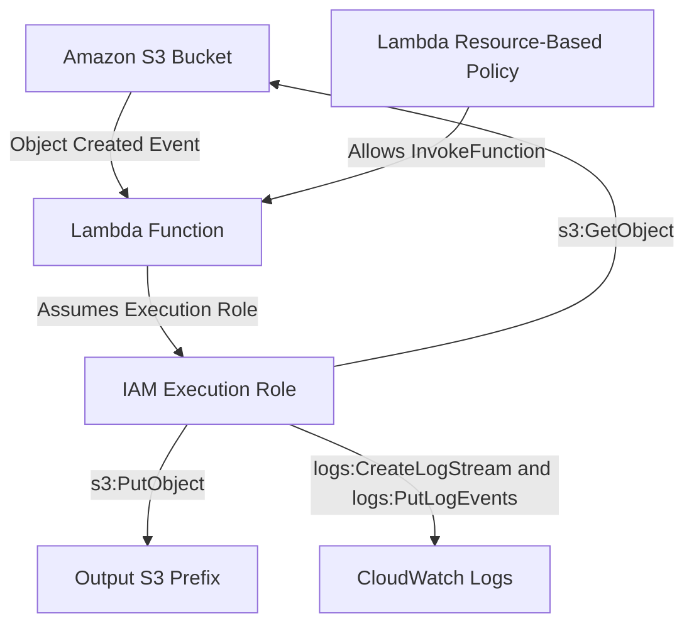
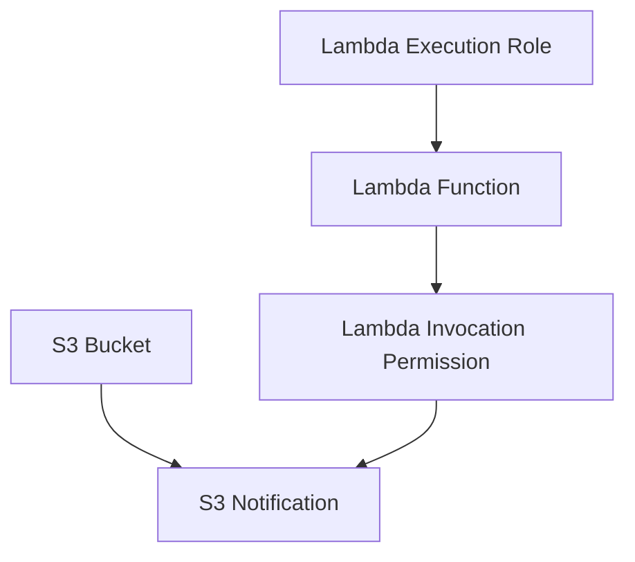

# 03- Lambda Permissions and S3 Event Configuration

## Overview

Amazon S3 can invoke AWS Lambda functions when objects are created, deleted, or modified. This integration enables event-driven processing without requiring an application to continuously poll S3 for changes.

A working integration requires more than configuring an S3 notification. The Lambda function must have an execution role for accessing AWS resources, and S3 must have permission to invoke the function.

These are separate authorization paths:

- **Lambda execution role:** Defines what the function can do after invocation, such as reading an S3 object, writing a processed object, or publishing a message.
- **Lambda resource-based permission:** Allows S3 to invoke the Lambda function.
- **S3 event notification:** Defines which bucket events trigger the function and any configured filters.

Incorrect permissions can produce deployment failures, `AccessDenied` errors, or events that never reach the intended processing workflow.

This document covers the permission model, S3 event configuration, event filters, deployment dependencies, failure handling, and production practices.

## Architecture and Permission Flow

A typical S3-triggered Lambda workflow contains two independent permission relationships.



The resource-based policy authorizes the invocation. The execution role authorizes operations performed by the function.

These permissions are not interchangeable.

## Lambda Execution Role

A Lambda execution role is an IAM role assumed by the Lambda service when the function runs.

The role provides temporary credentials that the function uses to access AWS services.

For an S3 image-processing function, the role may need:

- Read access to source objects.
- Write access to processed objects.
- CloudWatch Logs permissions.
- Optional permissions for SQS, SNS, DynamoDB, or other services.

### Trust Policy

The role's trust policy allows the Lambda service to assume it.

Example:

```json
{
  "Version": "2012-10-17",
  "Statement": [
    {
      "Sid": "AllowLambdaAssumeRole",
      "Effect": "Allow",
      "Principal": {
        "Service": "lambda.amazonaws.com"
      },
      "Action": "sts:AssumeRole"
    }
  ]
}
```

The trust policy answers:

> Which principal can assume this role?

It does not grant access to S3 objects or other application resources.

### Permissions Policy

A permissions policy defines which AWS actions the assumed role can perform.

For an image processor, a scoped policy could look like this:

```json
{
  "Version": "2012-10-17",
  "Statement": [
    {
      "Sid": "ReadUploadedImages",
      "Effect": "Allow",
      "Action": [
        "s3:GetObject"
      ],
      "Resource": [
        "arn:aws:s3:::example-image-bucket/uploads/*"
      ]
    },
    {
      "Sid": "WriteProcessedImages",
      "Effect": "Allow",
      "Action": [
        "s3:PutObject"
      ],
      "Resource": [
        "arn:aws:s3:::example-image-bucket/processed/*"
      ]
    },
    {
      "Sid": "WriteLambdaLogs",
      "Effect": "Allow",
      "Action": [
        "logs:CreateLogGroup",
        "logs:CreateLogStream",
        "logs:PutLogEvents"
      ],
      "Resource": "*"
    }
  ]
}
```

Replace the bucket name and prefixes with the actual resources.

The policy deliberately separates input and output permissions.

The function can read uploaded objects and write processed objects without receiving unrestricted access to every object in the bucket.

### Resource-Level Permission Scope

| Action | Typical resource scope |
|---|---|
| `s3:GetObject` | Object ARN |
| `s3:PutObject` | Object ARN |
| `s3:DeleteObject` | Object ARN |
| `s3:ListBucket` | Bucket ARN |
| `s3:GetBucketLocation` | Bucket ARN |

Do not use an object ARN for `s3:ListBucket`. Bucket-level operations and object-level operations require different resource scopes.

## Lambda Resource-Based Policy

S3 needs permission to invoke the Lambda function.

Lambda supports resource-based policies that grant specific principals permission to invoke a function.

For an S3-triggered function, the principal is:

```text
s3.amazonaws.com
```

The permission should be restricted to the intended source bucket and AWS account.

### Add Invocation Permission

Example:

```bash
aws lambda add-permission \
  --function-name s3-image-processor \
  --statement-id allow-image-bucket-invocation \
  --action lambda:InvokeFunction \
  --principal s3.amazonaws.com \
  --source-arn arn:aws:s3:::example-image-bucket \
  --source-account 123456789012
```

Important parameters:

| Parameter | Purpose |
|---|---|
| `--function-name` | Target Lambda function |
| `--statement-id` | Unique identifier for the permission statement |
| `--action` | Lambda action being granted |
| `--principal` | AWS service or account receiving permission |
| `--source-arn` | Restricts the invoking source |
| `--source-account` | Restricts the source account |

The `source-arn` and `source-account` conditions help prevent unintended cross-account invocation.

### Inspect Lambda Permissions

```bash
aws lambda get-policy \
  --function-name s3-image-processor
```

The response contains the function's resource-based policy.

Check that:

- The S3 service principal is present.
- The source bucket ARN is correct.
- The source account condition matches the expected account.
- The statement ID is the expected one.

### Remove an Invocation Permission

```bash
aws lambda remove-permission \
  --function-name s3-image-processor \
  --statement-id allow-image-bucket-invocation
```

Removing the permission prevents S3 from invoking the function through that statement.

Do not remove permissions without checking whether another event source depends on them.

## S3 Event Notifications

An S3 event notification configuration defines which bucket events should be delivered to an event destination.

Supported destination types include:

- AWS Lambda.
- Amazon SQS.
- Amazon SNS.
- Amazon EventBridge.

For direct S3-to-Lambda integration, S3 invokes the configured Lambda function when a matching event occurs.

### Common S3 Event Types

| Event type | Description | Typical use case |
|---|---|---|
| `s3:ObjectCreated:*` | Object creation events | Image processing, document ingestion |
| `s3:ObjectCreated:Put` | Object created through a PUT operation | Upload workflows |
| `s3:ObjectCreated:CompleteMultipartUpload` | Multipart upload completed | Large-file processing |
| `s3:ObjectRemoved:*` | Object removal events | Cleanup and metadata synchronization |
| `s3:ObjectRemoved:Delete` | Object deletion events | Deletion workflows |
| `s3:ObjectRestore:Completed` | Object restoration completed | Archive retrieval workflows |

Choose event types based on the actual application behavior.

For example, listening only for `s3:ObjectCreated:Put` will not cover every object creation mechanism. Multipart uploads complete through a different event type.

## S3 Event Notification Configuration

A notification configuration connects a bucket event to a destination.

Conceptually, an image-processing notification might be:

```json
{
  "LambdaFunctionConfigurations": [
    {
      "Id": "process-uploaded-images",
      "LambdaFunctionArn": "arn:aws:lambda:ap-south-1:123456789012:function:s3-image-processor",
      "Events": [
        "s3:ObjectCreated:*"
      ],
      "Filter": {
        "Key": {
          "FilterRules": [
            {
              "Name": "prefix",
              "Value": "uploads/"
            },
            {
              "Name": "suffix",
              "Value": ".jpg"
            }
          ]
        }
      }
    }
  ]
}
```

This configuration targets JPEG objects uploaded under the `uploads/` prefix.

The bucket and Lambda function must be in the same AWS Region for direct S3 event notification integration.

### Configure Notifications Using AWS CLI

S3 notification configuration is managed as a complete bucket notification configuration.

Create a file named `notification.json`:

```json
{
  "LambdaFunctionConfigurations": [
    {
      "Id": "process-uploaded-images",
      "LambdaFunctionArn": "arn:aws:lambda:ap-south-1:123456789012:function:s3-image-processor",
      "Events": [
        "s3:ObjectCreated:*"
      ],
      "Filter": {
        "Key": {
          "FilterRules": [
            {
              "Name": "prefix",
              "Value": "uploads/"
            },
            {
              "Name": "suffix",
              "Value": ".jpg"
            }
          ]
        }
      }
    }
  ]
}
```

Apply the configuration:

```bash
aws s3api put-bucket-notification-configuration \
  --bucket example-image-bucket \
  --notification-configuration file://notification.json
```

Inspect the configuration:

```bash
aws s3api get-bucket-notification-configuration \
  --bucket example-image-bucket
```

**Important:** `put-bucket-notification-configuration` replaces the bucket's existing notification configuration. Before applying changes, retrieve and preserve existing Lambda, SQS, SNS, and EventBridge configurations. Do not unintentionally remove notifications owned by other applications.

## Event Filtering

S3 notification filters reduce unnecessary Lambda invocations.

They are particularly useful when a bucket contains multiple object categories.

For example:

```text
example-image-bucket/
├── uploads/
│   ├── image-001.jpg
│   └── image-002.jpg
├── documents/
│   └── report.pdf
└── processed/
    ├── image-001-thumbnail.jpg
    └── image-002-thumbnail.jpg
```

A Lambda function processing images should not receive events for unrelated documents or its own output objects.

### Prefix Filtering

A prefix filter matches object keys beginning with a specified value.

Example:

```json
{
  "Name": "prefix",
  "Value": "uploads/"
}
```

This matches:

```text
uploads/image-001.jpg
uploads/archive/image-002.jpg
```

It does not match:

```text
processed/image-001.jpg
documents/report.pdf
```

### Suffix Filtering

A suffix filter matches object keys ending with a specified value.

Example:

```json
{
  "Name": "suffix",
  "Value": ".jpg"
}
```

This filters objects based on their key suffix.

S3 notification filters do not support arbitrary regular expressions or general wildcard patterns.

### Prefix and Suffix Together

A notification can combine prefix and suffix filters.

For example:

```json
{
  "Filter": {
    "Key": {
      "FilterRules": [
        {
          "Name": "prefix",
          "Value": "uploads/"
        },
        {
          "Name": "suffix",
          "Value": ".jpg"
        }
      ]
    }
  }
}
```

The event is delivered only when both filter conditions match.

S3 notification filter configurations also have restrictions on overlapping prefix and suffix filters for the same event types. Design filters so that their intended event scopes do not conflict.

## Preventing Recursive Lambda Invocation

A common S3 event-processing failure occurs when a Lambda function writes an output object into the same bucket and that write triggers the same function again.

For example:

```text
uploads/image.jpg
    |
    v
Lambda Function
    |
    v
processed/image-thumbnail.jpg
    |
    v
Lambda Function
    |
    v
processed/processed-image-thumbnail.jpg
    |
    v
...
```

This can create repeated invocations, unexpected costs, and excessive object creation.

### Use Separate Input and Output Prefixes

A practical solution is to configure the notification to listen only to the input prefix.

```text
Bucket: example-image-bucket

uploads/
    original.jpg

processed/
    original-thumbnail.jpg
```

Configure the event filter with:

```json
{
  "Name": "prefix",
  "Value": "uploads/"
}
```

The function can write to `processed/` without matching the notification filter.

### Use Separate Buckets

For stronger isolation, use separate buckets:

```text
s3-image-input
    |
    v
Lambda
    |
    v
s3-image-output
```

This separates event sources and processing outputs at the resource level.

The trade-off is additional infrastructure and bucket management.

### Do Not Rely Only on Handler-Level Checks

The handler should still validate the incoming object key.

However, handler-level filtering alone does not prevent unnecessary Lambda invocations. Configure S3 filters to avoid invoking the function for irrelevant objects.

## S3 Event Payload Structure

S3 sends an event payload containing one or more records.

A simplified example:

```json
{
  "Records": [
    {
      "eventSource": "aws:s3",
      "eventName": "ObjectCreated:Put",
      "awsRegion": "ap-south-1",
      "s3": {
        "bucket": {
          "name": "example-image-bucket"
        },
        "object": {
          "key": "uploads/image-001.jpg",
          "size": 102400,
          "eTag": "example-etag"
        }
      }
    }
  ]
}
```

The actual payload contains additional fields, including event time and request metadata.

### URL-Encoded Object Keys

S3 event object keys are URL encoded.

A key containing a space may appear as:

```text
uploads/customer%20image.jpg
```

Decode the key before using it in application logic.

Python example:

```python
from urllib.parse import unquote_plus


def extract_s3_object(record: dict) -> tuple[str, str]:
    bucket = record["s3"]["bucket"]["name"]
    key = unquote_plus(record["s3"]["object"]["key"])

    return bucket, key
```

Failing to decode the key can result in `NoSuchKey` when the application tries to retrieve the object.

## Lambda Handler for S3 Events

A handler should validate event records and isolate processing failures.

Example:

```python
import logging
from urllib.parse import unquote_plus

logger = logging.getLogger()
logger.setLevel(logging.INFO)


def lambda_handler(event, context):
    records = event.get("Records", [])

    if not records:
        logger.warning("Received event without S3 records")
        return {"processed": 0}

    processed = 0

    for record in records:
        if record.get("eventSource") != "aws:s3":
            logger.warning("Ignoring unsupported event source")
            continue

        bucket = record["s3"]["bucket"]["name"]
        key = unquote_plus(record["s3"]["object"]["key"])
        event_name = record["eventName"]

        logger.info(
            "Processing S3 event",
            extra={
                "bucket": bucket,
                "object_key": key,
                "event_name": event_name,
                "request_id": context.aws_request_id,
            },
        )

        if not key.startswith("uploads/"):
            logger.info("Ignoring object outside uploads prefix")
            continue

        if not event_name.startswith("ObjectCreated:"):
            logger.info("Ignoring unsupported event type")
            continue

        process_uploaded_object(bucket, key)
        processed += 1

    return {"processed": processed}


def process_uploaded_object(bucket: str, key: str) -> None:
    logger.info(
        "Object processing completed",
        extra={"bucket": bucket, "object_key": key},
    )
```

The `process_uploaded_object()` function represents the application processing layer and must be implemented with actual S3 operations.

For production systems, distinguish between invalid events that can safely be ignored and processing failures that must be retried or recovered.

Do not catch every exception and return success. Doing so can cause failed records to be acknowledged without successful processing.

## Event Delivery and Reliability

S3 event notifications are designed for at-least-once delivery.

This means:

- An event can be delivered more than once.
- Events can arrive out of order.
- Applications should not assume exactly-once processing.
- Processing must tolerate duplicate and delayed events.

### Idempotent Processing

An idempotent operation produces the same logical result when the same event is processed repeatedly.

For S3 workflows, possible idempotency identifiers include:

- Bucket name.
- Object key.
- Object version ID, when versioning is enabled.
- Event identity or sequencer, depending on the workflow.

For versioned buckets, using the object version ID helps distinguish separate versions of the same key.

For unversioned buckets, key-based idempotency alone may be insufficient when an object is overwritten.

A durable idempotency record can be maintained in DynamoDB or another state store.

Example conceptual key:

```text
bucket#object-key#version-id
```

The processing workflow should record completion only after the required output and state updates are successful.

### Retry Behavior

Lambda retries failed asynchronous invocations according to its asynchronous invocation configuration.

S3 event notifications and Lambda invocation retries should be understood as separate parts of the delivery path.

For production workloads, configure and monitor:

- Lambda asynchronous retry behavior.
- Maximum event age.
- Dead-letter queue or on-failure destination where appropriate.
- CloudWatch error metrics.
- Processing idempotency.
- Recovery procedures for failed events.

Do not assume that every event will be retried indefinitely.

## S3 Event Notification Configuration with Terraform

Terraform can manage the Lambda execution role, function, invocation permission, and S3 notification.

A simplified configuration follows.

### Lambda Execution Role

```hcl
resource "aws_iam_role" "lambda_execution" {
  name = "s3-image-processor-execution-role"

  assume_role_policy = jsonencode({
    Version = "2012-10-17"
    Statement = [
      {
        Effect = "Allow"
        Principal = {
          Service = "lambda.amazonaws.com"
        }
        Action = "sts:AssumeRole"
      }
    ]
  })
}
```

### Lambda Permissions Policy

```hcl
resource "aws_iam_role_policy" "lambda_s3_access" {
  name = "s3-image-processor-access"
  role = aws_iam_role.lambda_execution.id

  policy = jsonencode({
    Version = "2012-10-17"
    Statement = [
      {
        Sid    = "ReadInputObjects"
        Effect = "Allow"
        Action = [
          "s3:GetObject"
        ]
        Resource = [
          "${aws_s3_bucket.images.arn}/uploads/*"
        ]
      },
      {
        Sid    = "WriteProcessedObjects"
        Effect = "Allow"
        Action = [
          "s3:PutObject"
        ]
        Resource = [
          "${aws_s3_bucket.images.arn}/processed/*"
        ]
      },
      {
        Sid    = "WriteLogs"
        Effect = "Allow"
        Action = [
          "logs:CreateLogGroup",
          "logs:CreateLogStream",
          "logs:PutLogEvents"
        ]
        Resource = "*"
      }
    ]
  })
}
```

The `aws_s3_bucket.images` resource must be defined in the same Terraform configuration or supplied by an appropriate module.

### Lambda Function

```hcl
resource "aws_lambda_function" "image_processor" {
  function_name = "s3-image-processor"

  role    = aws_iam_role.lambda_execution.arn
  runtime = "python3.12"
  handler = "handler.lambda_handler"

  filename = "${path.module}/build/lambda-deployment.zip"

  source_code_hash = filebase64sha256(
    "${path.module}/build/lambda-deployment.zip"
  )

  timeout     = 30
  memory_size = 512
}
```

### Allow S3 to Invoke Lambda

```hcl
resource "aws_lambda_permission" "allow_s3" {
  statement_id  = "AllowS3Invocation"
  action        = "lambda:InvokeFunction"
  function_name = aws_lambda_function.image_processor.function_name
  principal     = "s3.amazonaws.com"

  source_arn     = aws_s3_bucket.images.arn
  source_account = data.aws_caller_identity.current.account_id
}
```

The caller identity data source:

```hcl
data "aws_caller_identity" "current" {}
```

### Configure the S3 Notification

```hcl
resource "aws_s3_bucket_notification" "image_events" {
  bucket = aws_s3_bucket.images.id

  lambda_function {
    lambda_function_arn = aws_lambda_function.image_processor.arn
    events              = ["s3:ObjectCreated:*"]

    filter_prefix = "uploads/"
    filter_suffix = ".jpg"
  }

  depends_on = [
    aws_lambda_permission.allow_s3
  ]
}
```

The explicit dependency ensures that the invocation permission exists before Terraform configures the notification.

Without the permission, S3 can reject the notification configuration because it cannot verify that it is authorized to invoke the function.

### Deployment Ordering

The intended dependency sequence is:



Terraform can infer many dependencies through resource references. The explicit `depends_on` on the notification ensures that the Lambda invocation permission is established first.

The Lambda function package must also exist before Terraform attempts to deploy the function.

### Terraform Configuration Ownership

An S3 bucket should have a single authoritative notification configuration.

Avoid managing the same bucket notification through multiple independent Terraform resources or mixing Terraform management with manual CLI updates without a reconciliation strategy.

Multiple configurations can overwrite or remove each other's settings.

## Encryption and KMS Permissions

S3 object access and KMS key access are separate authorization checks.

If the source object uses SSE-KMS, the Lambda execution role may require:

```json
{
  "Effect": "Allow",
  "Action": [
    "kms:Decrypt"
  ],
  "Resource": "arn:aws:kms:ap-south-1:123456789012:key/example-key-id"
}
```

If the function writes objects using SSE-KMS, it may also require:

```json
{
  "Effect": "Allow",
  "Action": [
    "kms:GenerateDataKey"
  ],
  "Resource": "arn:aws:kms:ap-south-1:123456789012:key/example-key-id"
}
```

The KMS key policy or applicable grants must also allow the required access.

An S3 `AccessDenied` or KMS authorization failure should not automatically be diagnosed as the same permission problem.

Detailed encryption and KMS authorization design belongs in the dedicated S3 security documentation.

## Event Configuration and Deployment Dependencies

S3 event notification deployment has ordering constraints.

The following resources should be ready before the notification is configured:

- S3 bucket.
- Lambda function.
- Lambda resource-based invocation permission.
- Correct Region and account configuration.
- Valid event filter configuration.

The notification configuration should be deployed only after the target is invocable by S3.

### Common Deployment Ordering Failure

A common failure occurs when Terraform attempts to create the S3 notification before the Lambda permission exists.

The notification operation can fail because S3 cannot validate the destination's invocation permission.

Use explicit dependencies and inspect the resulting Terraform plan.

Do not solve ordering problems by repeatedly applying the same configuration without understanding the dependency graph.

## Monitoring and Operational Verification

A deployed notification configuration should be verified at both the infrastructure and application levels.

### Inspect S3 Notification Configuration

```bash
aws s3api get-bucket-notification-configuration \
  --bucket example-image-bucket
```

### Inspect Lambda Resource Policy

```bash
aws lambda get-policy \
  --function-name s3-image-processor
```

### Inspect Lambda Configuration

```bash
aws lambda get-function-configuration \
  --function-name s3-image-processor
```

### Inspect CloudWatch Logs

```bash
aws logs tail \
  /aws/lambda/s3-image-processor \
  --since 1h
```

### Monitor Important Metrics

| Metric | Operational significance |
|---|---|
| `Invocations` | Number of function invocations |
| `Errors` | Failed function executions |
| `Throttles` | Invocations rejected because of concurrency limits |
| `Duration` | Processing latency |
| `ConcurrentExecutions` | Active execution pressure |
| `AsyncEventsDropped` | Asynchronous events discarded after delivery or retry limits |
| `DeadLetterErrors` | Failures delivering events to a configured dead-letter destination |

Use CloudWatch alarms for error rates, throttling, and other workload-specific thresholds.

For event-driven pipelines, also monitor application-level indicators such as:

- Objects received.
- Objects successfully processed.
- Processing failures.
- Duplicate events.
- Processing duration per object.
- Failed records awaiting recovery.

## Testing S3 Event Configuration

Testing should cover both permission relationships and actual event delivery.

### Test the Handler with a Sample Event

Store a representative S3 event in `event.json`.

Invoke the function:

```bash
aws lambda invoke \
  --function-name s3-image-processor \
  --payload fileb://event.json \
  response.json
```

This validates the handler's event-processing behavior but does not validate S3's permission to invoke the function.

### Test Actual S3 Invocation

Upload a test object matching the configured notification filter:

```bash
aws s3 cp \
  sample.jpg \
  s3://example-image-bucket/uploads/sample.jpg
```

Inspect Lambda logs:

```bash
aws logs tail \
  /aws/lambda/s3-image-processor \
  --since 10m
```

Verify that the expected output object exists:

```bash
aws s3api head-object \
  --bucket example-image-bucket \
  --key processed/sample-thumbnail.jpg
```

The output key must match the application's actual processing logic.

### Test Negative Filters

Upload an object that should not trigger the function:

```bash
aws s3 cp \
  report.pdf \
  s3://example-image-bucket/documents/report.pdf
```

Verify that the function is not invoked for that object.

Also test output-prefix behavior to confirm that processing does not recursively trigger itself.

## Common Permission and Event Configuration Failures

| Symptom | Likely cause | Verification |
|---|---|---|
| S3 notification configuration fails | Lambda invocation permission is missing | Inspect Lambda resource policy |
| Lambda cannot read an uploaded object | Execution role lacks `s3:GetObject` | Inspect role permissions |
| Lambda cannot write processed objects | Execution role lacks `s3:PutObject` | Inspect output-prefix resource scope |
| KMS-encrypted object cannot be read | Missing KMS authorization | Inspect IAM policy and KMS key policy |
| Lambda is never invoked | Incorrect event configuration or filter | Inspect bucket notification configuration |
| Some uploads do not trigger processing | Event type does not cover the upload mechanism | Verify event type, including multipart completion |
| Function processes its own output | Input and output prefixes overlap | Inspect notification filters |
| Lambda receives an invalid object key | Event key was not URL decoded | Check `unquote_plus()` usage |
| Function processes the same object multiple times | At-least-once event delivery | Inspect idempotency implementation |
| Terraform notification creation fails | Missing resource dependency | Inspect Terraform dependency graph |
| Existing notifications disappear | Bucket notification configuration was replaced | Inspect the full notification configuration and IaC ownership |

## Production Best Practices

### IAM and Permission Management

- Use a dedicated execution role for each Lambda function or security boundary.
- Separate the role trust policy from its permissions policy.
- Scope S3 object permissions to the required prefixes.
- Scope Lambda invocation permission to the intended source bucket and account.
- Avoid wildcard resource access when narrower permissions are possible.
- Review KMS permissions independently from S3 permissions.

### Event Configuration

- Select event types that cover the actual upload mechanisms.
- Use prefix and suffix filters to reduce unnecessary invocations.
- Keep input and output locations separate.
- Maintain one authoritative owner for bucket notification configuration.
- Validate notification configuration after deployment.

### Reliability

- Design handlers for duplicate event delivery.
- Do not assume event ordering.
- Implement durable idempotency where repeated processing has side effects.
- Configure retry and failure-recovery behavior.
- Monitor dropped asynchronous events and failed processing.
- Provide a controlled recovery mechanism for failed objects.

### Deployment

- Deploy Lambda invocation permission before the S3 notification.
- Use Terraform or another IaC tool as the authoritative configuration source.
- Avoid mixing manual notification changes with IaC-managed resources.
- Validate the complete event flow after deployment.
- Retain deployment and infrastructure change records.

## Production Readiness Checklist

### IAM Permissions

- [ ] Lambda execution role trusts the Lambda service.
- [ ] S3 read permissions are scoped to the input location.
- [ ] S3 write permissions are scoped to the output location.
- [ ] Required CloudWatch Logs permissions exist.
- [ ] KMS permissions are configured when required.
- [ ] Lambda resource policy allows the intended S3 bucket.
- [ ] Invocation permission includes source ARN and account restrictions.

### S3 Event Configuration

- [ ] Event types cover all required upload operations.
- [ ] Prefix and suffix filters match the intended object keys.
- [ ] Input and output prefixes prevent recursive invocation.
- [ ] Existing bucket notifications are preserved.
- [ ] Lambda function and S3 bucket are in the same Region.
- [ ] Notification configuration is managed consistently through IaC.

### Reliability and Monitoring

- [ ] Handler supports duplicate event delivery.
- [ ] Event keys are URL decoded.
- [ ] Processing failures are observable.
- [ ] Retry and failure-recovery behavior is configured.
- [ ] CloudWatch alarms cover important failure indicators.
- [ ] End-to-end S3 upload testing has been performed.
- [ ] Negative filter and recursive-trigger tests have been performed.

## Key Takeaways

- Lambda execution roles authorize actions performed by the function, while Lambda resource-based policies authorize S3 to invoke it.
- S3 event notifications must be configured with appropriate event types, filters, and invocation permissions.
- Separate input and output prefixes or buckets to prevent recursive Lambda invocation.
- S3 notifications provide at-least-once delivery, so handlers must tolerate duplicate and out-of-order events.
- Use explicit infrastructure dependencies, least-privilege IAM policies, and end-to-end event tests to make deployments reliable.