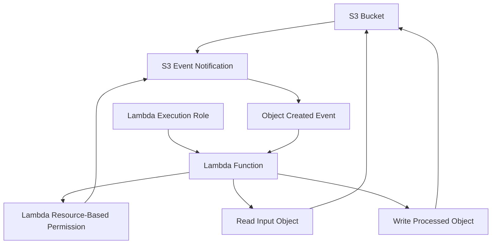
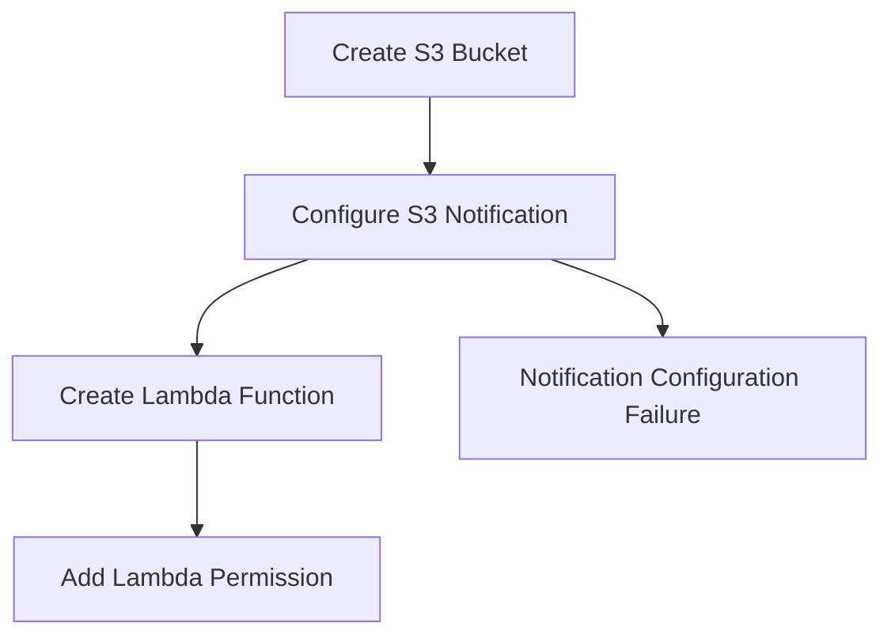
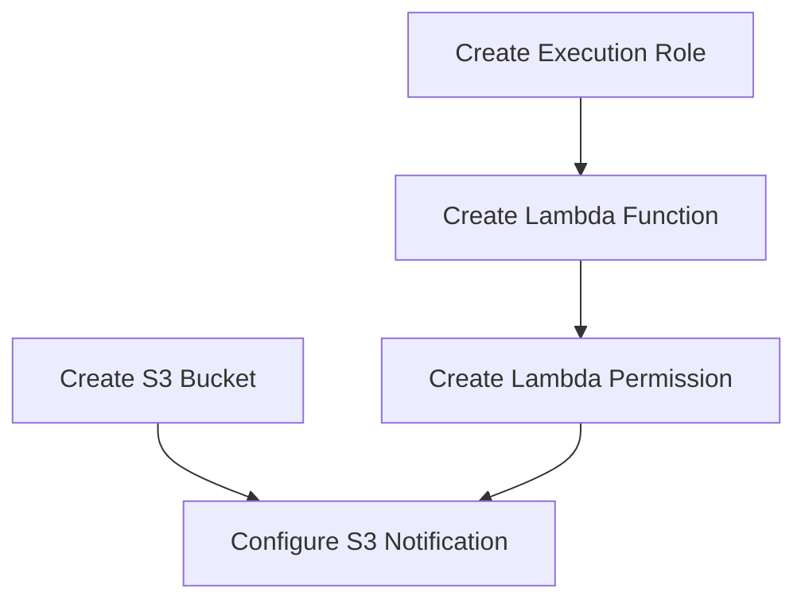
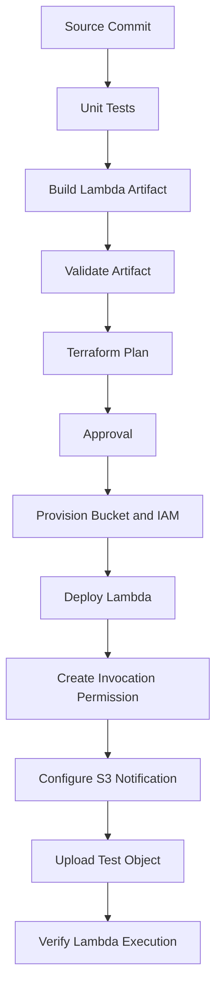
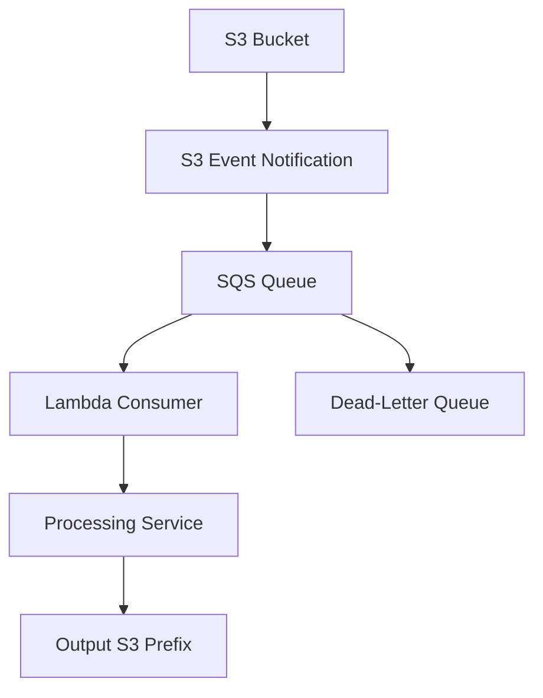

# 04- Event Source and Notification Deployment Ordering

## Overview

Amazon S3 event-driven applications depend on multiple AWS resources being configured in the correct order. A typical workflow includes an S3 bucket, a Lambda function, an execution role, a Lambda resource-based permission, and an S3 event notification.

Although these resources are independently manageable, their deployment has dependencies. In particular, S3 must be authorized to invoke the target Lambda function before the bucket notification can be configured successfully.

Incorrect deployment ordering can cause:

- S3 notification configuration failures.
- Lambda invocation permission errors.
- Terraform dependency-cycle errors.
- Event notifications targeting unavailable resources.
- Deployment pipelines that repeatedly fail during initial provisioning.
- Inconsistent infrastructure after partial deployment failures.

This document explains resource dependencies, deployment ordering, Terraform implementation, CloudFormation considerations, CI/CD sequencing, validation, and recovery strategies.

## Event-Driven Deployment Architecture

Consider an image-processing workflow in which objects uploaded to an S3 input prefix trigger a Lambda function.



The deployment relationships are different from the runtime event flow.

During deployment:

1. Create the S3 bucket.
2. Create the Lambda execution role and its permissions.
3. Deploy the Lambda function.
4. Grant the S3 service permission to invoke the function.
5. Configure the S3 event notification.

During runtime:

1. A client uploads an object.
2. S3 evaluates the notification configuration.
3. S3 invokes the configured Lambda function.
4. Lambda assumes its execution role.
5. The function reads and processes the object.
6. The function writes the result to the configured output location.

The notification should not be configured before its destination and required invocation permission are ready.

## Resource Dependencies

The deployment contains several distinct dependencies.

| Resource | Depends on | Reason |
|---|---|---|
| Lambda execution role | IAM trust policy and permissions | Lambda needs an assumable role |
| Lambda function | Execution role and deployment artifact | The function requires runtime configuration and executable code |
| Lambda resource-based permission | Lambda function | Permission must reference an existing function |
| S3 notification | S3 bucket, Lambda function, invocation permission | S3 must be able to validate and invoke the destination |
| End-to-end processing | All infrastructure resources | The complete event workflow must be available |

### Execution Role Dependency

The Lambda function requires an execution role.

The role's trust policy allows the Lambda service to assume it:

```json
{
  "Version": "2012-10-17",
  "Statement": [
    {
      "Effect": "Allow",
      "Principal": {
        "Service": "lambda.amazonaws.com"
      },
      "Action": "sts:AssumeRole"
    }
  ]
}
```

Its permissions policy separately grants access to the resources used by the function.

For example, an image processor may require:

- `s3:GetObject` on the input prefix.
- `s3:PutObject` on the output prefix.
- CloudWatch Logs permissions.
- KMS permissions when using customer-managed encryption keys.

The execution role does not grant S3 permission to invoke the function.

### Lambda Function Dependency

The Lambda function references the execution role ARN and its deployment package.

Example:

```hcl
resource "aws_lambda_function" "image_processor" {
  function_name = "s3-image-processor"

  role    = aws_iam_role.lambda_execution.arn
  runtime = "python3.12"
  handler = "handler.lambda_handler"

  filename = "${path.module}/build/lambda-deployment.zip"

  source_code_hash = filebase64sha256(
    "${path.module}/build/lambda-deployment.zip"
  )

  timeout     = 30
  memory_size = 512
}
```

Terraform infers a dependency on the role because the function references its ARN.

The deployment artifact must exist before Terraform creates or updates the function.

### Lambda Invocation Permission Dependency

S3 invokes Lambda through the Lambda service API.

The Lambda function therefore needs a resource-based policy statement that allows the S3 service principal to invoke it.

Example:

```hcl
resource "aws_lambda_permission" "allow_s3" {
  statement_id  = "AllowS3Invocation"
  action        = "lambda:InvokeFunction"
  function_name = aws_lambda_function.image_processor.function_name
  principal     = "s3.amazonaws.com"

  source_arn     = aws_s3_bucket.images.arn
  source_account = data.aws_caller_identity.current.account_id
}
```

This permission is separate from the Lambda execution role.

The source ARN restricts invocation to the intended bucket. The source account condition further restricts the allowed source account.

### S3 Notification Dependency

The notification connects a bucket event to the Lambda function.

Example:

```hcl
resource "aws_s3_bucket_notification" "image_events" {
  bucket = aws_s3_bucket.images.id

  lambda_function {
    lambda_function_arn = aws_lambda_function.image_processor.arn
    events              = ["s3:ObjectCreated:*"]

    filter_prefix = "uploads/"
    filter_suffix = ".jpg"
  }

  depends_on = [
    aws_lambda_permission.allow_s3
  ]
}
```

The explicit dependency ensures that Terraform creates the Lambda invocation permission before configuring the S3 notification.

Without this dependency, Terraform may attempt to configure the notification while the required permission is not yet available.

## Why Deployment Ordering Matters

When an S3 notification is configured, S3 validates whether it can use the destination.

For a Lambda destination, the required invocation permission must exist.

The following sequence is unsafe:



The notification operation can fail because the target Lambda function is not yet authorized for invocation.

The correct sequence is:



The dependency graph is the important part. Terraform can create independent resources in parallel, but it must respect dependencies between related resources.

## Terraform Dependency Management

Terraform builds a dependency graph from resource references and explicit dependency declarations.

There are two primary mechanisms:

- Implicit dependencies through resource references.
- Explicit dependencies through `depends_on`.

### Implicit Dependencies

Consider:

```hcl
resource "aws_lambda_function" "processor" {
  function_name = "s3-processor"
  role          = aws_iam_role.lambda_execution.arn

  # Other function configuration
}
```

Terraform sees the reference to `aws_iam_role.lambda_execution.arn`.

It therefore creates the IAM role before the Lambda function.

Similarly:

```hcl
resource "aws_lambda_permission" "allow_s3" {
  function_name = aws_lambda_function.processor.function_name
  principal     = "s3.amazonaws.com"
  action        = "lambda:InvokeFunction"

  source_arn = aws_s3_bucket.images.arn
}
```

Terraform infers dependencies on both the Lambda function and S3 bucket.

### Explicit Dependencies

Some dependencies are behavioral rather than obvious from an attribute reference.

The S3 notification must wait for the Lambda invocation permission.

The notification resource references the Lambda function ARN, but that reference alone does not necessarily establish a dependency on the separate permission resource.

Add:

```hcl
depends_on = [
  aws_lambda_permission.allow_s3
]
```

This makes the deployment ordering explicit.

### Complete Terraform Example

The following configuration demonstrates the core dependency relationships.

```hcl
terraform {
  required_version = ">= 1.6.0"

  required_providers {
    aws = {
      source  = "hashicorp/aws"
      version = ">= 5.0, < 7.0"
    }
  }
}

provider "aws" {
  region = var.aws_region
}

variable "aws_region" {
  description = "AWS Region for the S3 bucket and Lambda function."
  type        = string
  default     = "ap-south-1"
}

variable "bucket_name" {
  description = "Globally unique S3 bucket name."
  type        = string
}

data "aws_caller_identity" "current" {}

resource "aws_s3_bucket" "images" {
  bucket = var.bucket_name
}

resource "aws_iam_role" "lambda_execution" {
  name = "s3-image-processor-execution-role"

  assume_role_policy = jsonencode({
    Version = "2012-10-17"

    Statement = [
      {
        Effect = "Allow"

        Principal = {
          Service = "lambda.amazonaws.com"
        }

        Action = "sts:AssumeRole"
      }
    ]
  })
}

resource "aws_iam_role_policy" "lambda_permissions" {
  name = "s3-image-processor-permissions"
  role = aws_iam_role.lambda_execution.id

  policy = jsonencode({
    Version = "2012-10-17"

    Statement = [
      {
        Sid    = "ReadInputObjects"
        Effect = "Allow"

        Action = [
          "s3:GetObject"
        ]

        Resource = [
          "${aws_s3_bucket.images.arn}/uploads/*"
        ]
      },
      {
        Sid    = "WriteProcessedObjects"
        Effect = "Allow"

        Action = [
          "s3:PutObject"
        ]

        Resource = [
          "${aws_s3_bucket.images.arn}/processed/*"
        ]
      },
      {
        Sid    = "WriteCloudWatchLogs"
        Effect = "Allow"

        Action = [
          "logs:CreateLogGroup",
          "logs:CreateLogStream",
          "logs:PutLogEvents"
        ]

        Resource = "*"
      }
    ]
  })
}

resource "aws_lambda_function" "image_processor" {
  function_name = "s3-image-processor"

  role    = aws_iam_role.lambda_execution.arn
  runtime = "python3.12"
  handler = "handler.lambda_handler"

  filename = "${path.module}/build/lambda-deployment.zip"

  source_code_hash = filebase64sha256(
    "${path.module}/build/lambda-deployment.zip"
  )

  timeout     = 30
  memory_size = 512

  architectures = ["x86_64"]
}

resource "aws_lambda_permission" "allow_s3" {
  statement_id  = "AllowS3Invocation"
  action        = "lambda:InvokeFunction"
  function_name = aws_lambda_function.image_processor.function_name
  principal     = "s3.amazonaws.com"

  source_arn     = aws_s3_bucket.images.arn
  source_account = data.aws_caller_identity.current.account_id
}

resource "aws_s3_bucket_notification" "image_events" {
  bucket = aws_s3_bucket.images.id

  lambda_function {
    lambda_function_arn = aws_lambda_function.image_processor.arn

    events = [
      "s3:ObjectCreated:*"
    ]

    filter_prefix = "uploads/"
    filter_suffix = ".jpg"
  }

  depends_on = [
    aws_lambda_permission.allow_s3
  ]
}
```

This is a focused dependency example. A production configuration should additionally define bucket security controls, versioning, encryption, environment configuration, monitoring, and deployment artifact management.

### Why the Explicit Dependency Is Necessary

The notification references:

```hcl
lambda_function_arn = aws_lambda_function.image_processor.arn
```

This guarantees that Terraform knows the Lambda function must exist.

It does not automatically guarantee that the separate resource:

```hcl
aws_lambda_permission.allow_s3
```

has been created.

The explicit dependency establishes the required order:

```text
Lambda Function
      |
      v
Lambda Permission
      |
      v
S3 Notification
```

### Avoid Unnecessary Dependencies

Do not add `depends_on` to every resource.

Excessive explicit dependencies can:

- Reduce deployment parallelism.
- Make the dependency graph harder to understand.
- Increase deployment time.
- Hide missing resource references.
- Complicate future infrastructure changes.

Use implicit references wherever possible and explicit dependencies only when Terraform cannot infer a required behavioral ordering.

## Terraform Dependency Cycles

A dependency cycle occurs when Terraform cannot determine a valid resource creation order.

Consider a design in which the Lambda function requires the S3 bucket ARN, while the bucket notification references the Lambda function.

This relationship alone is not necessarily a cycle:

```text
S3 Bucket -----------+
                     |
                     v
               Lambda Function
                     |
                     v
              Lambda Permission
                     |
                     v
               S3 Notification
```

The bucket exists independently of its notification configuration.

The problem arises when resource references or explicit dependencies create a circular relationship.

For example, adding a dependency from the Lambda function back to the notification creates an invalid graph:

```text
Lambda Function
      |
      v
S3 Notification
      |
      v
Lambda Permission
      |
      v
Lambda Function
```

Terraform cannot satisfy this ordering.

### Diagnose a Dependency Cycle

Run:

```bash
terraform validate
```

Then:

```bash
terraform plan
```

Terraform reports dependency-cycle errors when it cannot construct a valid graph.

Inspect the dependency graph:

```bash
terraform graph -type=plan > dependency-graph.dot
```

Render it using Graphviz:

```bash
dot -Tsvg dependency-graph.dot -o dependency-graph.svg
```

Use the graph to identify circular resource relationships.

### Corrective Actions

- Remove unnecessary `depends_on` declarations.
- Avoid making the Lambda function depend on the notification.
- Keep bucket creation separate from notification configuration.
- Use resource references for actual dependencies.
- Add explicit ordering only where required.
- Separate infrastructure stages when the architecture genuinely requires independent deployment phases.

Do not use `-target` as a permanent workaround for a broken dependency graph.

## Notification Configuration Ownership

S3 bucket notifications are managed as a complete notification configuration.

This has important implications for Terraform and multi-team infrastructure management.

### Single Notification Resource per Bucket

Use one authoritative `aws_s3_bucket_notification` resource for each bucket.

For example, a bucket may route events to multiple destinations:

```hcl
resource "aws_s3_bucket_notification" "all_events" {
  bucket = aws_s3_bucket.images.id

  lambda_function {
    lambda_function_arn = aws_lambda_function.image_processor.arn
    events              = ["s3:ObjectCreated:*"]
    filter_prefix       = "uploads/"
  }

  queue {
    queue_arn     = aws_sqs_queue.document_events.arn
    events        = ["s3:ObjectCreated:*"]
    filter_prefix = "documents/"
  }

  topic {
    topic_arn     = aws_sns_topic.audit_events.arn
    events        = ["s3:ObjectRemoved:*"]
    filter_prefix = "archive/"
  }

  depends_on = [
    aws_lambda_permission.allow_s3,
    aws_s3_bucket_policy.allow_s3_to_publish,
    aws_sqs_queue_policy.allow_s3_to_send
  ]
}
```

The referenced SQS queue, SNS topic, permissions, and bucket resources must be defined separately.

This configuration illustrates why a bucket notification resource should be managed centrally.

### Why Multiple Notification Resources Are Dangerous

Do not create independent notification resources for the same bucket in separate Terraform modules or state files without a deliberate ownership strategy.

Each resource manages the bucket's notification configuration. Independent resources can overwrite one another's settings or produce persistent drift.

For a shared bucket:

- Centralize notification configuration.
- Define module interfaces for destinations and filters.
- Coordinate ownership across teams.
- Review the complete notification plan before deployment.
- Avoid manual CLI changes that conflict with IaC.

## CloudFormation Deployment Ordering

CloudFormation also manages resource dependencies.

Resources referenced through intrinsic functions such as `Ref` and `Fn::GetAtt` normally establish implicit dependencies.

However, an explicit dependency may still be needed when the ordering relationship is not represented by a direct reference.

### Lambda Permission and Notification

A simplified CloudFormation configuration:

```yaml
Resources:
  ImageBucket:
    Type: AWS::S3::Bucket

  LambdaExecutionRole:
    Type: AWS::IAM::Role
    Properties:
      AssumeRolePolicyDocument:
        Version: "2012-10-17"
        Statement:
          - Effect: Allow
            Principal:
              Service: lambda.amazonaws.com
            Action:
              - sts:AssumeRole

  ImageProcessor:
    Type: AWS::Lambda::Function
    Properties:
      FunctionName: s3-image-processor
      Runtime: python3.12
      Handler: handler.lambda_handler
      Role: !GetAtt LambdaExecutionRole.Arn
      Code:
        S3Bucket: deployment-artifacts
        S3Key: lambda/image-processor.zip

  AllowS3Invocation:
    Type: AWS::Lambda::Permission
    Properties:
      FunctionName: !GetAtt ImageProcessor.Arn
      Action: lambda:InvokeFunction
      Principal: s3.amazonaws.com
      SourceArn: !GetAtt ImageBucket.Arn
      SourceAccount: !Ref AWS::AccountId

  ImageBucketNotification:
    Type: Custom::S3NotificationConfiguration
    DependsOn:
      - AllowS3Invocation
    Properties:
      ServiceToken: !GetAtt NotificationConfigurationFunction.Arn
```

This example illustrates the dependency relationship, not a complete deployable notification implementation.

`Custom::S3NotificationConfiguration` is a custom resource type. It requires a separately implemented custom-resource provider, represented here by `NotificationConfigurationFunction`.

For a normal S3 bucket notification configuration, use the bucket's `NotificationConfiguration` property where the deployment design permits it. Ensure that the notification configuration depends on the Lambda permission.

A direct CloudFormation resource relationship can be represented using an S3 bucket notification configuration and an explicit dependency:

```yaml
Resources:
  ImageBucket:
    Type: AWS::S3::Bucket
    DependsOn:
      - AllowS3Invocation
    Properties:
      NotificationConfiguration:
        LambdaConfigurations:
          - Event: s3:ObjectCreated:*
            Function: !GetAtt ImageProcessor.Arn
            Filter:
              S3Key:
                Rules:
                  - Name: prefix
                    Value: uploads/
                  - Name: suffix
                    Value: .jpg
```

In this pattern, the bucket explicitly depends on the Lambda permission. The permission itself references the bucket ARN, which can create a circular dependency when both are declared in the same stack.

For this reason, a direct same-stack configuration may require a staged deployment or a different resource arrangement. Do not assume that adding `DependsOn` alone resolves a circular dependency.

### CloudFormation Deployment Strategies

When a circular dependency exists between the bucket notification and Lambda permission, use one of these approaches:

- Create the bucket and Lambda function first, then add the permission and notification in a subsequent stack update.
- Separate the bucket and notification into different stacks with carefully defined exports and imports.
- Use a custom resource to manage notification configuration after the required resources exist.

Choose the approach that keeps resource ownership and lifecycle management clear.

## CI/CD Deployment Sequencing

A production deployment pipeline should separate build validation, infrastructure provisioning, and event activation.

A typical workflow:



### Recommended Deployment Stages

| Stage | Responsibility | Verification |
|---|---|---|
| Build | Package application and dependencies | ZIP integrity and import checks |
| Test | Execute unit and integration tests | Test results |
| Infrastructure planning | Evaluate resource changes | Terraform plan review |
| Core infrastructure | Create bucket, IAM role, and Lambda function | Resource existence and configuration |
| Invocation permission | Authorize S3 invocation | Lambda resource policy |
| Event activation | Configure S3 notification | Bucket notification configuration |
| Post-deployment | Verify actual event delivery | CloudWatch logs and output object |

### Why Separate Event Activation?

The S3 notification is the point where the bucket starts routing matching events to the function.

Activating it only after the target is ready reduces the chance of events reaching an incomplete deployment.

For workflows where uploads can occur during deployment, consider how events are handled during the activation window.

If event loss is unacceptable, design the application with a durable reconciliation mechanism rather than relying solely on the timing of notification creation.

## Safe Deployment and Rollback

Infrastructure deployment is not always atomic across all resources.

A Terraform apply can create the bucket and Lambda function successfully, then fail while configuring the notification.

The infrastructure may therefore be partially deployed.

### Partial Deployment Example

```text
S3 Bucket                 CREATED
IAM Execution Role        CREATED
Lambda Function           CREATED
Lambda Permission         CREATED
S3 Notification           FAILED
```

This is not necessarily a reason to destroy the successfully created resources.

Terraform records successfully created resources in its state. Correct the underlying issue and apply the configuration again.

### Recovery Procedure

1. Inspect the Terraform error and identify the failed resource.
2. Check the actual AWS resources.
3. Inspect the Lambda resource-based policy.
4. Verify the source bucket ARN and account.
5. Confirm that the bucket and Lambda function are in the same Region.
6. Check whether another notification configuration already exists.
7. Correct the configuration.
8. Run `terraform plan`.
9. Apply the corrected configuration.
10. Verify the complete event flow.

Inspect the Lambda policy:

```bash
aws lambda get-policy \
  --function-name s3-image-processor
```

Inspect the bucket notification:

```bash
aws s3api get-bucket-notification-configuration \
  --bucket example-image-bucket
```

Inspect the function:

```bash
aws lambda get-function-configuration \
  --function-name s3-image-processor
```

### Avoid Unnecessary Destruction

Do not run:

```bash
terraform destroy
```

merely because notification creation failed.

Destroying the stack may remove resources that were created successfully and may also affect existing application data.

Prefer targeted diagnosis and a normal reconciliation through `terraform plan` and `terraform apply`.

Use `terraform destroy` only when the intention is to remove the infrastructure and the data-retention implications have been reviewed.

## Event Delivery During Deployment

A deployment can create a temporary period when the application is not fully ready.

For example:

- The bucket exists, but the notification is not configured.
- The Lambda function exists, but its invocation permission is missing.
- The notification is updated while objects are being uploaded.
- The function is deployed with a new artifact while events are arriving.

Consider the effect of these states on the business workflow.

### Event Loss and Reconciliation

Do not assume that S3 automatically replays every object event that occurred before the notification was configured.

If uploads can occur during deployment, design a reconciliation mechanism.

Possible approaches include:

- A scheduled S3 object inventory or prefix scan.
- A database-backed upload state machine.
- A durable ingestion queue.
- A periodic reconciliation job.
- A workflow that records expected processing status before upload completion.

For critical pipelines, the system should be able to identify uploaded objects that have not reached a completed processing state.

### Prefer Durable Event Processing for Complex Workloads

Direct S3-to-Lambda invocation is suitable for straightforward processing.

For workloads that require stronger buffering and controlled retries, consider:



An SQS-based architecture provides:

- Durable buffering.
- Configurable visibility timeout.
- Consumer concurrency control.
- Redrive policy and dead-letter handling.
- Better separation between event production and processing.

The S3-to-SQS integration has its own resource policy and deployment dependencies. The queue policy must allow the S3 service to send messages from the intended bucket.

## Deployment Validation

A successful Terraform apply does not prove that the event-processing workflow works correctly.

Validate infrastructure configuration and runtime behavior separately.

### Inspect the Bucket Notification

```bash
aws s3api get-bucket-notification-configuration \
  --bucket example-image-bucket
```

Verify:

- The expected Lambda ARN is configured.
- The event types are correct.
- Prefix and suffix filters match the intended object keys.
- Existing destinations have not been removed.

### Inspect the Lambda Resource Policy

```bash
aws lambda get-policy \
  --function-name s3-image-processor
```

Verify that the permission contains:

- Principal `s3.amazonaws.com`.
- Action `lambda:InvokeFunction`.
- The expected bucket source ARN.
- The expected source account.

### Test an Actual Upload

Upload a matching test object:

```bash
aws s3 cp \
  sample.jpg \
  s3://example-image-bucket/uploads/sample.jpg
```

Inspect the function logs:

```bash
aws logs tail \
  /aws/lambda/s3-image-processor \
  --since 10m
```

Verify the expected output:

```bash
aws s3api head-object \
  --bucket example-image-bucket \
  --key processed/sample-thumbnail.jpg
```

The output key must match the actual application implementation.

### Test Filter Boundaries

Upload an object outside the configured prefix:

```bash
aws s3 cp \
  report.pdf \
  s3://example-image-bucket/documents/report.pdf
```

Verify that it does not invoke the image-processing function.

Also verify that output objects do not recursively trigger the same notification.

## Common Deployment Ordering Problems

| Symptom | Likely cause | Diagnostic action |
|---|---|---|
| S3 notification creation fails | Lambda invocation permission does not exist | Inspect `aws lambda get-policy` |
| Terraform creates notification too early | Missing explicit dependency | Inspect resource references and add `depends_on` |
| Terraform reports a dependency cycle | Circular resource references or unnecessary dependencies | Inspect `terraform graph` |
| Notification configuration disappears after apply | Multiple resources or state files manage the same bucket notifications | Identify the authoritative notification owner |
| Lambda function is created but events do not arrive | Incorrect event type, filter, or invocation permission | Inspect bucket notification and Lambda policy |
| Terraform apply fails after some resources are created | Partial deployment | Inspect state and reconcile with a new plan |
| CloudFormation reports circular dependency | Bucket notification and Lambda permission reference each other | Use staged deployment or separate resource ownership |
| New objects are missed during deployment | Notification was not active during uploads | Implement reconciliation or durable ingestion |
| Lambda is invoked repeatedly | Output objects match the input notification filter | Separate input and output prefixes |

## Production Best Practices

### Infrastructure Design

- Model dependencies explicitly.
- Prefer implicit Terraform dependencies where references already express the relationship.
- Add explicit dependencies for invocation permission ordering.
- Keep bucket creation independent from notification configuration.
- Maintain one authoritative notification configuration per bucket.
- Avoid unnecessary resource dependencies.

### Permission Management

- Use a dedicated Lambda execution role.
- Scope the execution role to the required S3 prefixes.
- Restrict Lambda invocation permission to the intended bucket and account.
- Do not confuse the Lambda execution role with its resource-based policy.
- Review KMS permissions separately when encryption is involved.

### Release Management

- Build and validate the Lambda artifact before infrastructure deployment.
- Deploy the function before activating the notification.
- Use controlled production approval gates.
- Retain previous deployment artifacts.
- Verify actual event delivery after deployment.
- Avoid destructive recovery commands for partial failures.

### Reliability

- Design for duplicate event delivery.
- Do not depend on event ordering.
- Keep input and output locations separate.
- Use durable queues when buffering and controlled retries are required.
- Implement reconciliation for critical uploads.
- Monitor failures, throttling, and processing delays.

## Production Readiness Checklist

### Resource Ordering

- [ ] S3 bucket exists before notification configuration.
- [ ] Lambda execution role is created before the function.
- [ ] Lambda deployment artifact is available.
- [ ] Lambda function is deployed successfully.
- [ ] Lambda invocation permission is created.
- [ ] S3 notification depends on the invocation permission.
- [ ] Bucket notification configuration has a single authoritative owner.

### Infrastructure Validation

- [ ] Terraform dependency graph contains no cycles.
- [ ] Resource references express actual dependencies.
- [ ] Explicit dependencies are limited to necessary ordering requirements.
- [ ] CloudFormation dependency constraints have been reviewed.
- [ ] Partial deployment recovery has been considered.
- [ ] Existing notification configurations are preserved.

### Runtime Verification

- [ ] S3 notification configuration is correct.
- [ ] Lambda resource policy is correct.
- [ ] Matching uploads invoke the function.
- [ ] Nonmatching uploads do not invoke the function.
- [ ] Output objects do not recursively trigger processing.
- [ ] Processing failures are observable.
- [ ] Critical uploads can be reconciled after deployment interruptions.

## Key Takeaways

- S3 notification deployment must wait until the target Lambda function and its resource-based invocation permission are available.
- Terraform infers dependencies from resource references, but the notification needs an explicit dependency on the Lambda permission.
- Maintain one authoritative notification configuration per bucket to avoid configuration overwrites and infrastructure drift.
- Partial infrastructure deployment should be diagnosed and reconciled rather than automatically destroyed.
- Production event pipelines need post-deployment verification and reconciliation strategies for uploads that occur during deployment interruptions.