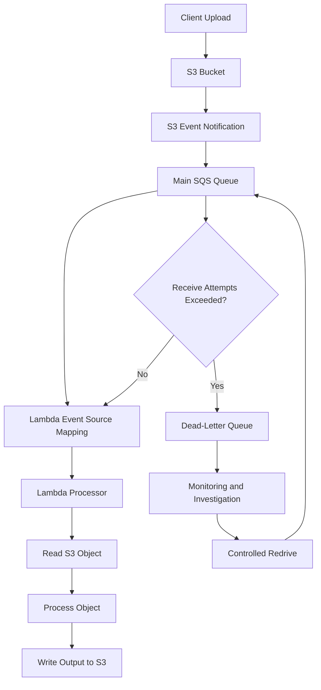
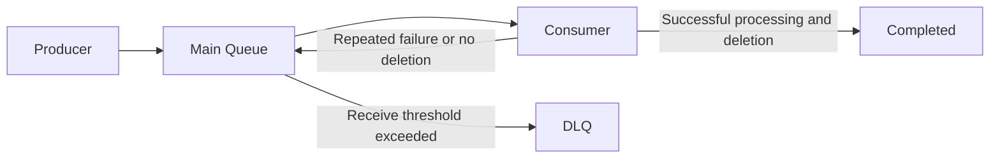

# 05- SQS Dead-Letter Queue Deployment

## Overview

Amazon SQS dead-letter queues (DLQs) provide a failure-isolation mechanism for message-driven applications. They capture messages that cannot be processed successfully after a configured number of delivery attempts, allowing engineers to investigate failures without indefinitely blocking normal processing.

In an Amazon S3 event-driven architecture, a common pattern is:

1. An object is uploaded to an S3 bucket.
2. S3 sends an event notification to an SQS queue.
3. A Lambda function consumes messages from the queue.
4. The function processes the referenced S3 object.
5. Messages that repeatedly fail processing are moved to a dead-letter queue.

A DLQ is not an automatic error-correction mechanism. It is a controlled failure destination that preserves messages for investigation, recovery, and possible redrive.

This document focuses on deploying an SQS DLQ for an S3 event-processing workflow, including queue configuration, IAM permissions, Terraform dependencies, Lambda event source mappings, monitoring, testing, and recovery.

## Architecture

A production-oriented S3-to-SQS-to-Lambda workflow separates event production, buffering, processing, and failure handling.



### Component Responsibilities

| Component | Responsibility |
|---|---|
| S3 bucket | Stores uploaded objects and produces object events |
| S3 notification | Routes matching events to SQS |
| Main SQS queue | Buffers events for asynchronous processing |
| Lambda event source mapping | Polls SQS and invokes the Lambda function |
| Lambda processor | Processes the referenced S3 object |
| Dead-letter queue | Stores messages that exceed the main queue's receive threshold |
| CloudWatch | Monitors queue depth, message age, Lambda failures, and processing behavior |
| Operator or recovery workflow | Investigates and redrives failed messages |

### Why Use SQS Between S3 and Lambda?

S3 can invoke Lambda directly, but an SQS-based architecture provides an additional buffering layer.

| Direct S3-to-Lambda | S3-to-SQS-to-Lambda |
|---|---|
| Direct asynchronous invocation | Durable queue-based buffering |
| No application-controlled queue backlog | Queue depth exposes pending workload |
| Less infrastructure | More control over consumption |
| Limited buffering control | Visibility timeout and redrive policy |
| Less suitable for controlled backpressure | Consumer concurrency can be managed |
| Failure handling relies on asynchronous invocation behavior | SQS retry and DLQ policies provide message-level failure isolation |

Use SQS when processing needs buffering, controlled concurrency, independent producers and consumers, or explicit failure recovery.

## SQS Dead-Letter Queue Fundamentals

### What Is a Dead-Letter Queue?

A dead-letter queue is a separate SQS queue that receives messages that cannot be successfully processed by the source queue's consumer within the configured receive-attempt threshold.

The source queue defines a redrive policy containing:

- The DLQ ARN.
- `maxReceiveCount`, which determines the permitted receive attempts before a message is moved.

Example:

```json
{
  "deadLetterTargetArn": "arn:aws:sqs:ap-south-1:123456789012:s3-processing-dlq",
  "maxReceiveCount": 5
}
```

The value `5` means a message becomes eligible for movement to the DLQ after it has been received five times without successful deletion from the source queue.

The actual processing behavior depends on the consumer's acknowledgement and deletion behavior.

### Why a DLQ Exists

Without a DLQ, a message that repeatedly fails can continue cycling through the source queue.

This creates several problems:

- Repeated execution of permanently failing work.
- Increased Lambda invocation and SQS request costs.
- Delayed processing of other messages.
- Difficulty identifying poison messages.
- Reduced visibility into recurring application failures.

A DLQ isolates repeatedly failing messages so that the main processing queue can continue handling other work.

### Source Queue and DLQ Relationship



The DLQ does not process messages automatically. A separate investigation or recovery process is required.

### Standard and FIFO Queues

The source queue and its DLQ must use compatible queue types.

| Source queue | DLQ type |
|---|---|
| Standard | Standard |
| FIFO | FIFO |

For S3 event notifications routed to SQS, standard queues are commonly used. S3 event notifications do not directly support FIFO SQS queues as destinations.

Do not configure a FIFO DLQ for a standard SQS source queue.

## Queue Configuration

A reliable SQS configuration requires more than creating two queues.

Important settings include:

| Setting | Purpose | Engineering consideration |
|---|---|---|
| Visibility timeout | Hides a received message from other consumers temporarily | Must accommodate processing and retry behavior |
| Message retention | Determines how long messages remain in a queue | Defines the recovery window |
| Receive wait time | Enables long polling | Reduces empty polling requests |
| Maximum message size | Limits individual message payload size | S3 events are small references, not file contents |
| Redrive policy | Moves repeatedly received messages to a DLQ | Controls poison-message isolation |
| Redrive allow policy | Controls which source queues can use a DLQ | Restricts DLQ association |
| Encryption | Protects message data at rest | Consider SQS-managed encryption or KMS |

### Visibility Timeout

When a consumer receives a message, SQS temporarily hides it from other consumers.

If the consumer does not delete the message before the visibility timeout expires, the message becomes visible again.

For Lambda event source mappings, the visibility timeout should be configured with the Lambda timeout and retry behavior in mind.

AWS recommends configuring the source queue visibility timeout to at least six times the Lambda function timeout, plus the maximum batching window when one is configured.

For example:

```text
Lambda timeout:       30 seconds
Batching window:       5 seconds

Minimum recommended visibility timeout:
6 × 30 + 5 = 185 seconds
```

Configure a value above the calculated minimum when processing duration varies significantly.

A short visibility timeout can cause the same message to become available while an earlier invocation is still processing it.

### Message Retention Period

SQS retains messages until they are deleted or the retention period expires.

For standard queues, the retention period can be configured from 60 seconds to 14 days.

The DLQ retention period should be selected based on the investigation and recovery requirements.

For standard queues, the original enqueue timestamp is retained when a message moves to a DLQ. Its expiration continues to be based on the original enqueue time.

Therefore, a DLQ's retention period should generally be longer than the source queue's retention period.

### Long Polling

Enable long polling to reduce empty receive requests.

```hcl
receive_wait_time_seconds = 20
```

Long polling allows SQS to wait for messages before returning an empty response.

This is particularly useful for low-volume workloads where consumers would otherwise make frequent empty requests.

For Lambda event source mappings, AWS manages polling behavior. Queue configuration should still be selected deliberately.

## Terraform Deployment

Terraform should manage the main queue, DLQ, redrive policy, queue policies, and Lambda event source mapping as a coherent infrastructure unit.