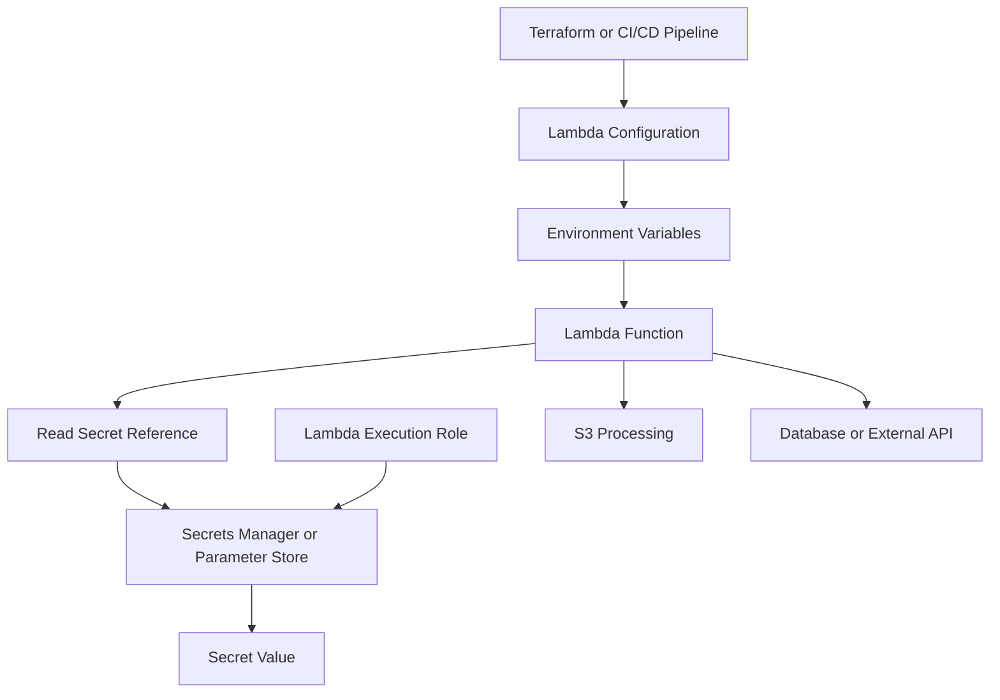
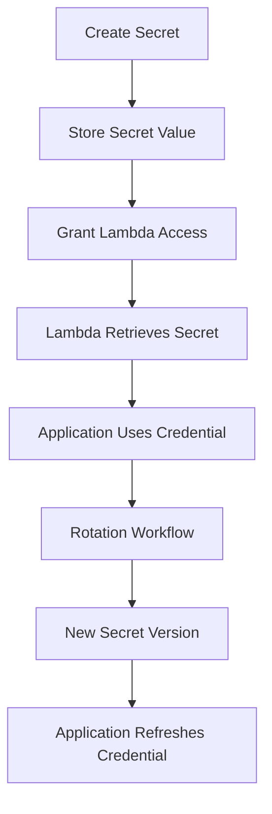
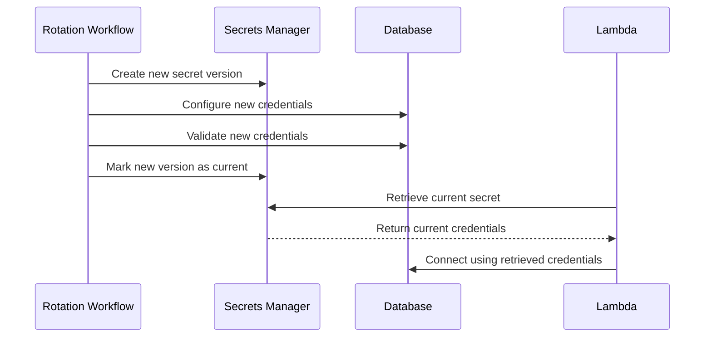
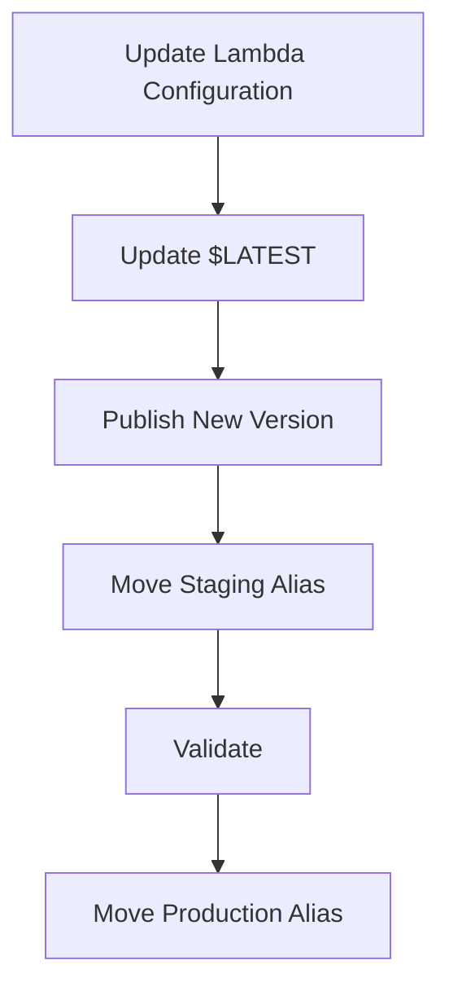

# 06- Lambda Environment Variables and Secrets

## Overview

AWS Lambda environment variables provide runtime configuration without requiring application code or deployment packages to contain environment-specific values. They allow the same Lambda artifact to run across development, staging, and production environments.

Secrets require separate handling. Database passwords, API tokens, private credentials, and other sensitive values should be stored in a dedicated secrets-management service rather than embedded in source code or deployment configuration.

A production S3 event-processing Lambda might require:

- Input and output S3 bucket names.
- S3 prefixes for source and processed objects.
- An SQS queue URL.
- Application environment and logging configuration.
- A database secret ARN.
- External API credentials.
- Feature flags controlling processing behavior.

The recommended approach is to separate ordinary configuration from secret values, use IAM execution roles for runtime access, and retrieve secrets from AWS Systems Manager Parameter Store or AWS Secrets Manager when required.

## Lambda Environment Variables

### What Are Environment Variables?

Lambda environment variables are key-value pairs configured for a function and made available to its runtime.

Python functions can access them through `os.environ` or `os.getenv()`.

```python
import os

INPUT_BUCKET = os.environ["INPUT_BUCKET"]
OUTPUT_PREFIX = os.getenv("OUTPUT_PREFIX", "processed/")
ENVIRONMENT = os.getenv("ENVIRONMENT", "development")
LOG_LEVEL = os.getenv("LOG_LEVEL", "INFO")
```

Environment variables are appropriate for small configuration values that influence application behavior.

### Common Configuration Values

| Variable | Example | Purpose |
|---|---|---|
| `INPUT_BUCKET` | `company-image-input` | Source S3 bucket |
| `OUTPUT_BUCKET` | `company-image-output` | Destination S3 bucket |
| `OUTPUT_PREFIX` | `processed/` | Output object prefix |
| `AWS_REGION` | `ap-south-1` | AWS Region |
| `ENVIRONMENT` | `production` | Deployment environment |
| `LOG_LEVEL` | `INFO` | Application logging level |
| `DATABASE_SECRET_ARN` | Secrets Manager ARN | Database secret reference |
| `API_TOKEN` | Sensitive value | External API credential |

A secret ARN is not the secret itself. Storing a reference in an environment variable is generally preferable to storing the credential directly.

### Why Use Environment Variables?

Environment variables separate deployment-specific configuration from application code.

For example:

| Environment | Input bucket | Output prefix |
|---|---|---|
| Development | `dev-image-input` | `processed/` |
| Staging | `staging-image-input` | `processed/` |
| Production | `prod-image-input` | `processed/` |

The same application package can be deployed into each environment with different configuration.

Advantages include:

- No environment-specific values hardcoded in application code.
- Consistent deployment artifacts.
- Straightforward infrastructure automation.
- Easier configuration management.
- Compatibility with Lambda versions and aliases.

### Environment Variable Limits and Security

Lambda environment variables have a combined size limit of 4 KB for all keys and values.

Important considerations:

- Keep environment variables small.
- Avoid storing large JSON configuration documents.
- Do not use environment variables as a replacement for a configuration database.
- Do not embed long-lived AWS access keys.
- Avoid storing plaintext credentials.
- Treat access to Lambda configuration as security-sensitive.

Lambda encrypts environment variables at rest using an AWS-managed key by default. A customer-managed KMS key can be configured when additional control is required.

Encryption at rest does not eliminate the risk of exposing values through deployment tools, application logs, or users with permission to inspect function configuration.

## Configuration and Secrets Architecture

A production Lambda application should separate ordinary configuration from sensitive values.



### Configuration Storage Options

| Mechanism | Suitable data | Characteristics |
|---|---|---|
| Lambda environment variables | Small runtime settings | Directly available to the function |
| Systems Manager Parameter Store | Application configuration and secure parameters | Hierarchical naming and parameter management |
| AWS Secrets Manager | Passwords, API tokens, credentials | Secret versioning and rotation support |
| AWS AppConfig | Dynamic settings and feature flags | Controlled configuration deployment |

Choose the service according to the configuration's sensitivity, lifecycle, and update frequency.

Avoid storing every application setting in Secrets Manager. It introduces unnecessary cost and runtime dependencies.

## AWS Systems Manager Parameter Store

### Overview

AWS Systems Manager Parameter Store provides centralized storage for application configuration and sensitive parameters.

Parameters can be organized using hierarchical names.

Example:

```text
/company/s3-processor/dev/input-bucket
/company/s3-processor/dev/log-level
/company/s3-processor/prod/input-bucket
/company/s3-processor/prod/database-password
```

Parameter Store supports three parameter types:

- `String`
- `StringList`
- `SecureString`

`SecureString` values are encrypted using AWS KMS.

### When to Use Parameter Store

Parameter Store is suitable when:

- Multiple services share configuration.
- Configuration requires centralized management.
- Hierarchical naming is useful.
- Encrypted parameter storage is required.
- A dedicated secret rotation workflow is unnecessary.

### Standard and Advanced Parameters

| Feature | Standard | Advanced |
|---|---|---|
| Maximum value size | 4 KB | 8 KB |
| Parameter policies | Not supported | Supported |
| Higher throughput | Available through throughput configuration | Supported |
| Storage pricing | Generally no parameter storage charge within applicable limits | Additional charges |

Check current AWS pricing and quotas before selecting a tier for production.

### Creating Parameters

Create a normal configuration parameter:

```bash
aws ssm put-parameter \
  --name "/company/s3-processor/prod/input-bucket" \
  --type "String" \
  --value "company-prod-image-input" \
  --overwrite
```

Create an encrypted parameter:

```bash
aws ssm put-parameter \
  --name "/company/s3-processor/prod/database-password" \
  --type "SecureString" \
  --value "REPLACE_WITH_SECRET_VALUE" \
  --overwrite
```

For production, avoid passing secret values directly through command-line arguments or shell history. Use a controlled provisioning process.

### Retrieving Parameters

Retrieve a normal parameter:

```bash
aws ssm get-parameter \
  --name "/company/s3-processor/prod/input-bucket"
```

Retrieve a decrypted SecureString:

```bash
aws ssm get-parameter \
  --name "/company/s3-processor/prod/database-password" \
  --with-decryption
```

The caller needs the appropriate SSM permissions. Decrypting a customer-key-encrypted SecureString also requires authorization to use the relevant KMS key.

### Parameter Naming Convention

Use a consistent hierarchy:

```text
/application/environment/component/setting
```

Example:

```text
/company/production/image-processor/input-bucket
/company/production/image-processor/output-prefix
/company/production/image-processor/database-secret-arn
```

This structure improves:

- Environment separation.
- IAM resource scoping.
- Configuration discovery.
- Operational consistency.

## AWS Secrets Manager

### Overview

AWS Secrets Manager is designed to store and manage sensitive values such as:

- Database credentials.
- Third-party API tokens.
- Service credentials.
- Application passwords.
- Other credentials requiring controlled lifecycle management.

Secrets Manager supports secret versioning, staging labels, and rotation workflows.

A secret can contain a string or structured JSON value.

Example:

```json
{
  "username": "application_user",
  "password": "REPLACE_WITH_SECRET_VALUE",
  "host": "database.internal.example",
  "port": 5432,
  "dbname": "application"
}
```

### When to Use Secrets Manager

Use Secrets Manager when secrets require:

- Centralized secure storage.
- Controlled access through IAM.
- Rotation workflows.
- Version management.
- Integration with supported AWS services.
- Auditable retrieval.

For database credentials that require regular rotation, Secrets Manager is generally more suitable than manually updating Lambda environment variables.

### Secret Lifecycle



Secrets Manager supports rotation through configured workflows, including Lambda-based rotation for supported database configurations.

The rotation workflow must coordinate the secret value with the credential accepted by the target service.

Updating a secret value alone does not change the database password.

### Creating a Secret

Example:

```bash
aws secretsmanager create-secret \
  --name "production/s3-processor/database" \
  --description "Database credentials for the S3 processing Lambda" \
  --secret-string file://database-secret.json
```

The JSON file should be handled securely and must not be committed to source control.

### Retrieving a Secret

```bash
aws secretsmanager get-secret-value \
  --secret-id "production/s3-processor/database"
```

The caller requires `secretsmanager:GetSecretValue`.

If the secret uses a customer-managed KMS key, the caller also requires the appropriate KMS authorization.

## IAM Permissions for Configuration and Secrets

Lambda uses its execution role to access AWS services at runtime.

The deployment identity and Lambda execution role have different responsibilities.

| Identity | Responsibility |
|---|---|
| CI/CD deployment role | Creates or updates Lambda configuration and infrastructure |
| Lambda execution role | Reads application configuration and secrets at runtime |
| Secret rotation role | Performs the configured rotation workflow |
| Human operator role | Performs approved administrative operations |

Do not grant the Lambda execution role permission to create, update, or delete secrets unless the application has a specific operational requirement.

### Parameter Store Permissions

A Lambda function reading a parameter can use a narrowly scoped policy:

```json
{
  "Version": "2012-10-17",
  "Statement": [
    {
      "Sid": "ReadApplicationParameters",
      "Effect": "Allow",
      "Action": [
        "ssm:GetParameter",
        "ssm:GetParameters"
      ],
      "Resource": [
        "arn:aws:ssm:ap-south-1:123456789012:parameter/company/production/image-processor/*"
      ]
    }
  ]
}
```

For a `SecureString` encrypted with a customer-managed KMS key, add the necessary KMS permissions and ensure the key policy permits the operation.

```json
{
  "Sid": "DecryptApplicationParameters",
  "Effect": "Allow",
  "Action": [
    "kms:Decrypt"
  ],
  "Resource": "arn:aws:kms:ap-south-1:123456789012:key/11111111-2222-3333-4444-555555555555"
}
```

The KMS key policy must also authorize the relevant principal or delegate authorization appropriately.

### Secrets Manager Permissions

A Lambda function retrieving one secret can use a narrowly scoped policy:

```json
{
  "Version": "2012-10-17",
  "Statement": [
    {
      "Sid": "ReadDatabaseSecret",
      "Effect": "Allow",
      "Action": [
        "secretsmanager:GetSecretValue"
      ],
      "Resource": "arn:aws:secretsmanager:ap-south-1:123456789012:secret:production/s3-processor/database-*"
    }
  ]
}
```

For a customer-managed KMS key:

```json
{
  "Sid": "DecryptDatabaseSecret",
  "Effect": "Allow",
  "Action": [
    "kms:Decrypt"
  ],
  "Resource": "arn:aws:kms:ap-south-1:123456789012:key/11111111-2222-3333-4444-555555555555"
}
```

Use the exact secret ARN and KMS key ARN for the deployed environment.

Avoid broad permissions such as:

```json
{
  "Effect": "Allow",
  "Action": [
    "secretsmanager:*",
    "kms:*"
  ],
  "Resource": "*"
}
```

These permissions unnecessarily expand the application's access.

## Terraform Configuration

Terraform can manage Lambda environment variables, secret references, IAM permissions, and secret resources.

The important design rule is to avoid exposing secret values through Terraform configuration, plans, outputs, or state unless the workflow explicitly accepts that risk.

### Lambda Environment Variables

```hcl
resource "aws_lambda_function" "processor" {
  function_name = "s3-image-processor"

  role    = aws_iam_role.lambda_execution.arn
  runtime = "python3.12"
  handler = "handler.lambda_handler"

  filename = "${path.module}/build/lambda-deployment.zip"

  source_code_hash = filebase64sha256(
    "${path.module}/build/lambda-deployment.zip"
  )

  timeout     = 30
  memory_size = 512

  environment {
    variables = {
      INPUT_BUCKET        = aws_s3_bucket.images.bucket
      OUTPUT_PREFIX       = "processed/"
      ENVIRONMENT         = var.environment
      DATABASE_SECRET_ARN = aws_secretsmanager_secret.database.arn
      LOG_LEVEL           = "INFO"
    }
  }
}
```

The function receives the secret ARN, not the secret value.

The application retrieves the value at runtime using its execution role.

### Secrets Manager Secret Resource

```hcl
resource "aws_secretsmanager_secret" "database" {
  name                    = "${var.environment}/s3-processor/database"
  description             = "Database credentials for the S3 processing application"
  recovery_window_in_days = 30
}
```

This creates the secret container but does not define its secret value.

Populate the secret through a controlled provisioning workflow.

Avoid defining sensitive values directly in Terraform:

```hcl
resource "aws_secretsmanager_secret_version" "database" {
  secret_id = aws_secretsmanager_secret.database.id

  secret_string = jsonencode({
    username = "application_user"
    password = "hardcoded-password"
  })
}
```

Even when marked sensitive, values can be stored in Terraform state. Terraform's `sensitive` marking controls display behavior; it does not remove values from state.

If Terraform must manage secret values, use an appropriately protected remote backend, strict state access controls, encryption, and a carefully reviewed CI/CD process.

### IAM Policy for Secret Retrieval

```hcl
resource "aws_iam_role_policy" "read_database_secret" {
  name = "read-database-secret"
  role = aws_iam_role.lambda_execution.id

  policy = jsonencode({
    Version = "2012-10-17"

    Statement = [
      {
        Effect = "Allow"

        Action = [
          "secretsmanager:GetSecretValue"
        ]

        Resource = aws_secretsmanager_secret.database.arn
      }
    ]
  })
}
```

If the secret uses a customer-managed KMS key, add the required `kms:Decrypt` permission and configure the key policy accordingly.

### Environment Separation

Use separate configuration for development, staging, and production.

```hcl
variable "environment" {
  description = "Deployment environment."
  type        = string

  validation {
    condition = contains(
      ["dev", "staging", "production"],
      var.environment
    )

    error_message = "Environment must be dev, staging, or production."
  }
}
```

Example environment-specific values:

```hcl
# dev.tfvars
environment = "dev"
```

```hcl
# staging.tfvars
environment = "staging"
```

```hcl
# production.tfvars
environment = "production"
```

Use separate state and deployment boundaries for production and non-production environments.

## Reading Secrets in Python

A Lambda function can retrieve a secret using Boto3.

### Basic Secrets Manager Client

```python
import json
import os

import boto3
from botocore.exceptions import BotoCoreError, ClientError


def get_database_credentials():
    secret_arn = os.environ["DATABASE_SECRET_ARN"]

    client = boto3.client(
        "secretsmanager",
        region_name=os.environ["AWS_REGION"],
    )

    try:
        response = client.get_secret_value(
            SecretId=secret_arn
        )

        secret_string = response.get("SecretString")

        if not secret_string:
            raise ValueError(
                "Database secret does not contain SecretString"
            )

        return json.loads(secret_string)

    except (ClientError, BotoCoreError, json.JSONDecodeError):
        raise RuntimeError(
            "Unable to retrieve database credentials"
        ) from None
```

The Lambda execution role supplies credentials automatically through the AWS SDK credential provider chain.

Do not configure long-lived access keys in the function environment.

### Parameter Store Retrieval

```python
import os

import boto3


def get_secure_parameter(parameter_name):
    client = boto3.client(
        "ssm",
        region_name=os.environ["AWS_REGION"],
    )

    response = client.get_parameter(
        Name=parameter_name,
        WithDecryption=True,
    )

    return response["Parameter"]["Value"]
```

The execution role requires `ssm:GetParameter` and, when applicable, permission to decrypt the SecureString.

### Reusable Secret Retrieval Service

For larger applications, isolate AWS access in a service module.

```python
import json
import logging
import os
from functools import lru_cache

import boto3
from botocore.exceptions import BotoCoreError, ClientError


logger = logging.getLogger(__name__)


class SecretRetrievalError(Exception):
    pass


class SecretsService:
    def __init__(self, region_name=None):
        self.client = boto3.client(
            "secretsmanager",
            region_name=region_name or os.environ["AWS_REGION"],
        )

    @lru_cache(maxsize=32)
    def get_secret(self, secret_arn):
        try:
            response = self.client.get_secret_value(
                SecretId=secret_arn
            )

            value = response.get("SecretString")

            if value is None:
                raise SecretRetrievalError(
                    "Secret does not contain a string value"
                )

            return json.loads(value)

        except (ClientError, BotoCoreError, json.JSONDecodeError):
            logger.exception(
                "Secret retrieval failed",
                extra={"secret_arn": secret_arn},
            )

            raise SecretRetrievalError(
                "Unable to retrieve application secret"
            ) from None
```

The example uses process-local caching to avoid repeated retrieval calls during the lifetime of a Lambda execution environment.

The cache is not distributed and is not guaranteed to survive execution-environment replacement.

For production use, define an explicit cache lifetime or refresh strategy, especially when secrets rotate.

Avoid logging secret values or exception payloads that could contain sensitive information.

## Secret Caching and Lambda Execution Environments

Lambda execution environments can be reused across multiple invocations.

This makes in-memory caching useful for reducing repeated Secrets Manager or Parameter Store requests.

However, caching introduces a consistency trade-off.

Consider:

1. Lambda retrieves a database password.
2. The execution environment caches the value.
3. The database password rotates.
4. The Lambda environment continues using the old value.
5. Database authentication fails until the cache refreshes or the environment is replaced.

### Caching Strategies

| Strategy | Advantage | Limitation |
|---|---|---|
| Retrieve on every invocation | Requests the latest available value | Additional latency and API cost |
| Process-level cache | Reduces repeated API requests | May retain stale values |
| Time-based cache | Balances performance and freshness | Requires refresh and error handling |
| Parameters and Secrets Lambda Extension | Provides local HTTP access to cached values | Requires extension configuration and cache tuning |
| Secrets Manager caching library | Provides client-side caching behavior | Adds dependency and cache configuration |

### Time-Based Cache

A simple time-based cache can be implemented with a timestamp.

```python
import json
import os
import time

import boto3


class SecretCache:
    def __init__(self, ttl_seconds=300):
        self.ttl_seconds = ttl_seconds
        self.cached_value = None
        self.cached_at = 0

        self.client = boto3.client(
            "secretsmanager",
            region_name=os.environ["AWS_REGION"],
        )

    def get(self, secret_arn):
        now = time.monotonic()

        if (
            self.cached_value is not None
            and now - self.cached_at < self.ttl_seconds
        ):
            return self.cached_value

        response = self.client.get_secret_value(
            SecretId=secret_arn
        )

        value = json.loads(response["SecretString"])

        self.cached_value = value
        self.cached_at = now

        return value
```

This implementation illustrates process-local time-based caching. A production cache should also consider:

- Thread safety when concurrent execution is used.
- Secret version changes.
- Refresh failures.
- Cache invalidation.
- Credential rotation timing.
- Whether stale credentials can safely be used temporarily.

Do not cache secrets indefinitely.

## Secret Rotation

### Why Rotation Matters

Long-lived credentials increase the impact of credential exposure.

Rotation periodically replaces credentials so compromised or outdated values do not remain valid indefinitely.

Secrets Manager supports rotation workflows for supported services.

A typical database rotation process:



The actual rotation sequence depends on the rotation strategy and target service.

### Rotation Considerations

- Coordinate application connection pools with credential rotation.
- Ensure old and new credentials overlap when the database rotation strategy requires it.
- Refresh cached credentials.
- Test rotation before enabling it in production.
- Monitor rotation failures.
- Avoid deployments that overwrite the current secret version unexpectedly.
- Ensure the rotation function has the required permissions to update the target service and secret.

A successful rotation does not guarantee that every application instance has immediately refreshed its cached credentials.

### Lambda Connection Pool Considerations

A Lambda function using PostgreSQL may reuse database connections between invocations.

After credential rotation, an existing connection may continue working while new connections using cached credentials fail.

Design the database client to handle:

- Connection expiration.
- Authentication failures.
- Reconnection.
- Credential refresh.
- Connection pool lifecycle.

For high-concurrency applications, consider RDS Proxy where appropriate. It can reduce connection pressure and provide managed connection pooling, but it does not remove the need for correct secret and IAM configuration.

## Lambda Environment Variable Encryption

Lambda encrypts environment variables at rest.

By default, Lambda uses an AWS-managed key. A customer-managed KMS key can be selected for additional control.

### Customer-Managed KMS Key

Example:

```hcl
resource "aws_lambda_function" "processor" {
  function_name = "s3-image-processor"

  role    = aws_iam_role.lambda_execution.arn
  runtime = "python3.12"
  handler = "handler.lambda_handler"

  filename = "${path.module}/build/lambda-deployment.zip"

  source_code_hash = filebase64sha256(
    "${path.module}/build/lambda-deployment.zip"
  )

  kms_key_arn = aws_kms_key.lambda_environment.arn

  environment {
    variables = {
      INPUT_BUCKET = aws_s3_bucket.images.bucket
      LOG_LEVEL    = "INFO"
    }
  }
}
```

The deployment identity and Lambda service may require appropriate KMS permissions depending on the operation and key configuration.

When configuring customer-managed encryption, review:

- KMS key policy.
- Deployment role permissions.
- Lambda execution role permissions where applicable.
- Key lifecycle and rotation.
- Key deletion protection.
- Cross-account access requirements.

Environment variable encryption should not be confused with application-level secret retrieval.

A secret stored in Secrets Manager remains governed by Secrets Manager and KMS authorization independently of Lambda environment-variable encryption.

## Environment Variable Updates and Lambda Versions

Lambda environment variables are part of function configuration.

Updating them changes the function configuration and can affect published versions and aliases.

### Versioning Considerations

Published Lambda versions are immutable snapshots of code and configuration.

If an environment variable changes:

- The `$LATEST` configuration is updated.
- An already published version does not change.
- An alias pointing to an existing published version continues using that version.
- A new version must be published to capture the updated configuration.

Use aliases to control which published version receives production traffic.



Do not assume that changing an environment variable automatically updates an already published Lambda version.

### Terraform Version Publishing

```hcl
resource "aws_lambda_function" "processor" {
  function_name = "s3-image-processor"

  role    = aws_iam_role.lambda_execution.arn
  runtime = "python3.12"
  handler = "handler.lambda_handler"

  filename = "${path.module}/build/lambda-deployment.zip"

  source_code_hash = filebase64sha256(
    "${path.module}/build/lambda-deployment.zip"
  )

  publish = true

  environment {
    variables = {
      INPUT_BUCKET = aws_s3_bucket.images.bucket
      LOG_LEVEL    = "INFO"
    }
  }
}

resource "aws_lambda_alias" "production" {
  name             = "production"
  description      = "Production release"
  function_name    = aws_lambda_function.processor.function_name
  function_version = aws_lambda_function.processor.version
}
```

A production release process should control alias movement separately from configuration updates.

## Local Development and Testing

Local development should not require real production secrets.

Use environment-specific test configuration.

Example `.env.example`:

```dotenv
AWS_REGION=ap-south-1
ENVIRONMENT=development

INPUT_BUCKET=local-image-input
OUTPUT_PREFIX=processed/

DATABASE_SECRET_ARN=
LOG_LEVEL=DEBUG
```

Do not commit actual `.env` files containing credentials.

### Local AWS Configuration

For local development, use an approved AWS profile or a local AWS-compatible service where suitable.

```bash
export AWS_PROFILE=development
export AWS_REGION=ap-south-1
```

The application should use the AWS SDK credential provider chain rather than hardcoded access keys.

### Unit Testing Secret Retrieval

Mock the Secrets Manager client instead of retrieving real secrets in unit tests.

```python
import json

from botocore.stub import Stubber

from secret_service import SecretsService


def test_get_secret():
    service = SecretsService(region_name="ap-south-1")

    expected_secret = {
        "username": "test_user",
        "password": "test_password",
    }

    with Stubber(service.client) as stubber:
        stubber.add_response(
            "get_secret_value",
            {
                "ARN": "arn:aws:secretsmanager:ap-south-1:123456789012:secret:test",
                "Name": "test-secret",
                "VersionId": "test-version",
                "SecretString": json.dumps(expected_secret),
            },
            {
                "SecretId": "test-secret"
            },
        )

        result = service.get_secret("test-secret")

    assert result == expected_secret
```

This test validates SDK interaction without requiring AWS credentials or a real secret.

### Integration Testing

Integration tests should use a dedicated non-production AWS environment.

Validate:

- Lambda can retrieve the intended secret.
- IAM permissions are correctly scoped.
- KMS decryption works where applicable.
- Secret JSON structure matches application expectations.
- Rotation does not break application connections.
- Missing or malformed configuration produces a controlled failure.

Never use production credentials in local test environments.

## Operational Monitoring

Secret retrieval and configuration failures should be observable without exposing sensitive values.

Monitor:

- Secrets Manager retrieval errors.
- Parameter Store retrieval errors.
- KMS authorization failures.
- Lambda initialization failures.
- Database authentication failures.
- Secret rotation failures.
- Lambda invocation errors and duration.

CloudTrail can provide an audit trail for supported management and data events. Review the relevant event sources and configuration when designing secret-access auditing.

Do not log secret values, access tokens, database passwords, or complete secret responses.

### Useful Diagnostic Commands

Inspect Lambda configuration:

```bash
aws lambda get-function-configuration \
  --function-name s3-image-processor
```

Inspect a secret's metadata without retrieving its value:

```bash
aws secretsmanager describe-secret \
  --secret-id production/s3-processor/database
```

Inspect Parameter Store metadata:

```bash
aws ssm describe-parameters \
  --parameter-filters \
  "Key=Name,Option=BeginsWith,Values=/company/production/image-processor/"
```

Inspect a Lambda execution role:

```bash
aws iam get-role \
  --role-name s3-image-processor-execution-role
```

Use these commands with an authorized operational identity. Avoid retrieving and printing secret values during routine troubleshooting.

## Troubleshooting

### Missing Environment Variable

**Symptoms**

- Lambda raises `KeyError`.
- Function initialization fails.
- Configuration values are empty.

**Likely causes**

- Variable was not included in deployment configuration.
- Incorrect variable name.
- Environment-specific Terraform values were not supplied.
- The function alias points to an older published version.

**Verification**

```bash
aws lambda get-function-configuration \
  --function-name s3-image-processor
```

Check the deployed environment configuration and the version or alias receiving traffic.

**Corrective action**

Update the correct function configuration, publish a new version if required, and move the intended alias after validation.

### Secrets Manager Access Denied

**Symptoms**

- `AccessDeniedException`.
- Lambda cannot retrieve a secret.

**Likely causes**

- Missing `secretsmanager:GetSecretValue`.
- Resource ARN mismatch.
- Secret resource policy denies access.
- Cross-account permissions are incomplete.

**Verification**

Inspect the Lambda execution role and relevant secret resource policy.

```bash
aws secretsmanager describe-secret \
  --secret-id production/s3-processor/database
```

**Corrective action**

Grant the narrowly scoped permission and verify that the secret's resource policy and account boundaries permit retrieval.

### KMS Decryption Failure

**Symptoms**

- `AccessDeniedException` involving KMS.
- SecureString retrieval fails with decryption enabled.
- Secrets Manager retrieval fails for a customer-key-encrypted secret.

**Likely causes**

- Missing `kms:Decrypt`.
- KMS key policy does not authorize the principal.
- Incorrect KMS key ARN.
- Cross-account key access is incomplete.

**Corrective action**

Review the KMS key policy and IAM permissions independently of the SSM or Secrets Manager permissions.

### Secret Rotation Causes Database Failures

**Symptoms**

- Database authentication fails after rotation.
- Existing connections work but new connections fail.
- Lambda failures appear intermittently.

**Likely causes**

- Cached credentials are stale.
- Connection pools retain invalid connections.
- Rotation did not complete successfully.
- Application and database credential states are inconsistent.

**Corrective action**

Inspect rotation status, refresh cached values, and recreate database connections using the current secret version.

### Terraform State Exposure

**Symptoms**

- Secret values appear in Terraform state.
- CI logs or plan artifacts contain sensitive configuration.

**Likely causes**

- Secret values were passed directly into Terraform resources.
- State files or plan files are stored without appropriate controls.
- Sensitive values were exposed through outputs or pipeline logs.

**Corrective action**

Remove unnecessary secret-value management from Terraform, protect existing state and artifacts, rotate exposed credentials, and review access logs. Marking a Terraform value as sensitive does not remove it from state.

## Production Best Practices

### Configuration Management

- Use environment variables for small, non-sensitive runtime configuration.
- Keep configuration names consistent across environments.
- Use separate configuration namespaces for development, staging, and production.
- Store large or frequently changing configuration outside Lambda environment variables.
- Validate required configuration during initialization.

### Secret Management

- Use Secrets Manager for secrets requiring rotation or managed lifecycle.
- Use Parameter Store SecureString for suitable encrypted parameters.
- Store secret references rather than secret values in Lambda environment variables.
- Grant runtime access through the Lambda execution role.
- Restrict secret access to exact resources.
- Avoid logging secret values.
- Define cache expiration and refresh behavior.

### Deployment

- Keep secret values out of source control.
- Avoid exposing secrets through Terraform state and CI/CD logs.
- Use separate deployment and runtime identities.
- Review environment-variable changes as application configuration changes.
- Publish and promote Lambda versions deliberately.
- Test secret rotation before enabling it in production.

### Reliability

- Handle secret retrieval failures explicitly.
- Use bounded retries for transient AWS API failures.
- Avoid retrying authorization failures indefinitely.
- Account for secret-cache staleness.
- Ensure database clients can reconnect after credential rotation.
- Monitor secret retrieval and rotation failures.

## Production Readiness Checklist

### Lambda Configuration

- [ ] Required environment variables are defined.
- [ ] Configuration values are validated.
- [ ] Environment-specific settings are isolated.
- [ ] Environment variables remain within Lambda limits.
- [ ] Secret values are not embedded in deployment packages.
- [ ] Lambda aliases and published versions are managed deliberately.

### Secret Management

- [ ] Secrets are stored in Secrets Manager or Parameter Store as appropriate.
- [ ] Lambda receives secret references rather than plaintext values.
- [ ] Execution role has least-privilege access.
- [ ] KMS permissions are configured separately where required.
- [ ] Secret rotation is tested.
- [ ] Cache expiration and refresh behavior are defined.
- [ ] Secret values are excluded from logs and error responses.

### Deployment and Operations

- [ ] Terraform state and plan artifacts are protected.
- [ ] CI/CD uses short-lived AWS credentials.
- [ ] Local development uses non-production credentials.
- [ ] Unit tests mock secret retrieval.
- [ ] Integration tests validate actual IAM and KMS behavior.
- [ ] Secret retrieval failures are monitored.
- [ ] Credential rotation and recovery procedures are documented.

## Key Takeaways

- Use Lambda environment variables for small runtime configuration and store references rather than plaintext secrets whenever possible.
- Use Parameter Store for centralized configuration and suitable encrypted parameters; use Secrets Manager when secret lifecycle and rotation are important.
- Lambda retrieves secrets through its execution role, with KMS authorization handled as a separate permission layer when customer-managed keys are used.
- Secret caching reduces API calls and latency but introduces staleness; define explicit refresh behavior that accounts for credential rotation.
- Protect Terraform state, deployment artifacts, logs, and CI/CD identities because sensitive values can be exposed outside the secret-management service itself.