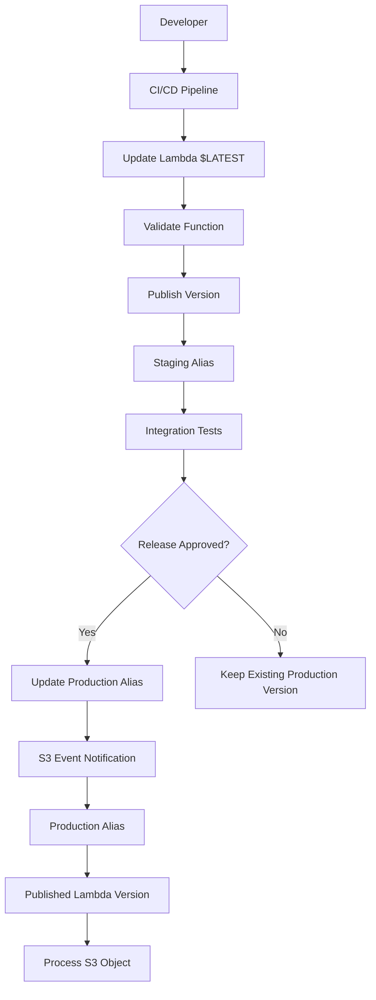
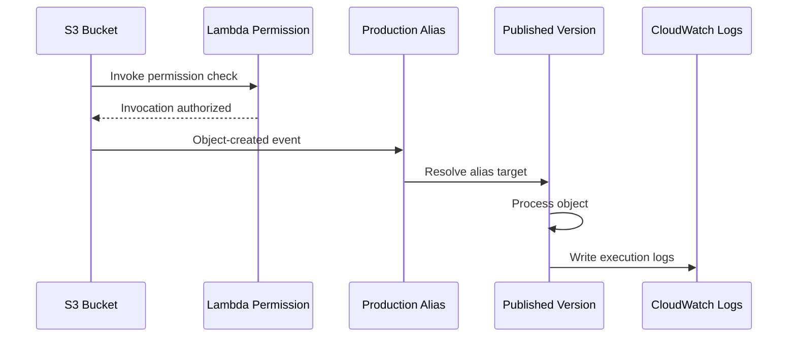
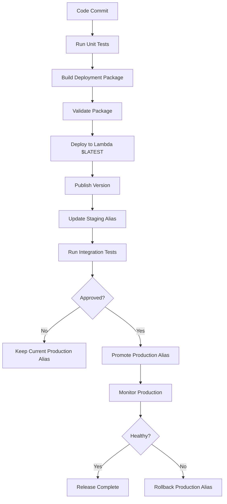

# 07- Lambda Versioning and Aliases

## Overview

AWS Lambda versioning and aliases provide a controlled mechanism for releasing application changes, managing environments, and routing production traffic between different function versions.

As Lambda functions evolve, deploying new code directly into production introduces risks:

- A new release may contain defects.
- Environment variable changes may affect runtime behavior.
- A dependency update may introduce compatibility issues.
- A deployment may interrupt an S3 event-processing workflow.
- A rollback may be difficult if the previous artifact is not preserved.

Lambda versions and aliases address these concerns by separating deployment from release promotion.

A published Lambda version is an immutable snapshot of a function's code and configuration. An alias is a named pointer to a published version that can be updated without changing the application integration.

For an S3 event-driven application, an alias can provide a stable invocation target while the underlying Lambda implementation evolves.

## Lambda Versioning

### What Is a Lambda Version?

A Lambda version is an immutable snapshot of a function's code and configuration at the time it is published.

Each published version receives a unique version number.

For example:

```text
Function: s3-image-processor

$LATEST
Version 1
Version 2
Version 3
```

`$LATEST` represents the mutable development version. Published versions represent immutable deployment snapshots.

A published version captures important configuration, including:

- Function code.
- Runtime configuration.
- Handler.
- Environment variables.
- Memory allocation.
- Timeout.
- Execution role configuration reference.
- Layers and other versioned function settings.
- Architecture configuration.

The execution role ARN is captured as part of the version configuration, but the IAM role and its policies remain independently managed resources. Changing permissions on the referenced role can therefore affect an existing published version.

### Why Versioning Exists

Without versioning, production integrations commonly invoke `$LATEST`.

Every deployment changes the code or configuration behind that target. This makes it difficult to guarantee which implementation is receiving traffic.

Versioning provides:

- Immutable release references.
- Repeatable deployment promotion.
- Controlled rollback.
- Compatibility between code and configuration.
- Integration stability.
- A foundation for traffic shifting.

### `$LATEST` Versus Published Versions

| Feature | `$LATEST` | Published version |
|---|---|---|
| Mutable | Yes | No |
| Receives code updates | Yes | No |
| Receives configuration updates | Yes | No |
| Has a version number | No fixed published number | Yes |
| Can be referenced by an alias | Not as an alias target | Yes |
| Suitable for controlled production releases | Usually not directly | Yes |

A function can be updated repeatedly while `$LATEST` changes. Publishing creates a separate snapshot.

### Publishing a Version

Publish a version using AWS CLI:

```bash
aws lambda publish-version \
  --function-name s3-image-processor \
  --description "Initial production release"
```

Example response:

```json
{
  "FunctionName": "s3-image-processor",
  "FunctionArn": "arn:aws:lambda:ap-south-1:123456789012:function:s3-image-processor",
  "Version": "1",
  "Description": "Initial production release"
}
```

The published function can be invoked using its qualified ARN:

```text
arn:aws:lambda:ap-south-1:123456789012:function:s3-image-processor:1
```

The final `:1` identifies the published version.

### Updating and Publishing Subsequent Versions

Update the function code:

```bash
aws lambda update-function-code \
  --function-name s3-image-processor \
  --zip-file fileb://build/lambda-deployment.zip
```

Wait for the update to finish:

```bash
aws lambda wait function-updated \
  --function-name s3-image-processor
```

Publish a new version:

```bash
aws lambda publish-version \
  --function-name s3-image-processor \
  --description "Image processing release 2"
```

The new version receives the next available version number.

A deployment pipeline should wait for function updates to complete before publishing. Publishing while configuration or code updates are still in progress can result in deployment failures or an unintended release snapshot.

### Version Immutability

Published versions cannot be modified.

For example, if version `2` contains:

```text
OUTPUT_PREFIX=processed-v2/
```

Changing `$LATEST` to:

```text
OUTPUT_PREFIX=processed-v3/
```

does not change version `2`.

To deploy the new configuration:

1. Update `$LATEST`.
2. Validate the configuration.
3. Publish another version.
4. Move the appropriate alias to the new version.

This ensures that the code and configuration associated with a release remain identifiable.

## Lambda Aliases

### What Is a Lambda Alias?

A Lambda alias is a named reference to a published Lambda version.

Instead of integrating applications with version numbers directly, consumers invoke a stable alias.

Example:

```text
s3-image-processor
    |
    +-- Version 1
    +-- Version 2
    +-- Version 3

Aliases:
    development -> Version 3
    staging     -> Version 2
    production  -> Version 1
```

An alias can be updated to point to another published version without changing the alias ARN.

This makes aliases useful for release promotion and rollback.

### Why Use Aliases?

Consider an S3 notification configuration that invokes a Lambda function.

If the notification targets an unqualified function ARN, it invokes the unqualified function target rather than a specific published release.

Deploying new code can therefore change production processing behavior immediately.

An alias provides a stable integration target:

```text
S3 Bucket
    |
    v
Lambda Alias: production
    |
    v
Published Lambda Version
```

The application can continue invoking the same alias while deployment automation changes its target.

### Creating an Alias

Create an alias pointing to version `1`:

```bash
aws lambda create-alias \
  --function-name s3-image-processor \
  --name production \
  --function-version 1 \
  --description "Production release"
```

The alias ARN is:

```text
arn:aws:lambda:ap-south-1:123456789012:function:s3-image-processor:production
```

### Updating an Alias

After publishing version `2`, update the production alias:

```bash
aws lambda update-alias \
  --function-name s3-image-processor \
  --name production \
  --function-version 2 \
  --description "Production release 2"
```

The alias ARN remains unchanged.

Only its target version changes.

### Invoking an Alias

Invoke the production alias:

```bash
aws lambda invoke \
  --function-name s3-image-processor:production \
  response.json
```

Invoke a specific published version:

```bash
aws lambda invoke \
  --function-name s3-image-processor:2 \
  response.json
```

For production integrations, aliases are generally preferable to hardcoding version numbers in every consumer configuration.

## Lambda Version and Alias Architecture

Consider an S3 image-processing application.

New application releases should be tested before they receive production events.



The production alias separates release deployment from production traffic promotion.

### Component Responsibilities

| Component | Responsibility |
|---|---|
| `$LATEST` | Mutable deployment target |
| Published version | Immutable release snapshot |
| Staging alias | Identifies the release under validation |
| Production alias | Identifies the release serving production traffic |
| CI/CD pipeline | Builds, publishes, validates, and promotes releases |
| S3 notification | Invokes the configured Lambda target |

### Release Lifecycle

A typical release lifecycle is:

1. Build the Lambda deployment package.
2. Update `$LATEST`.
3. Wait for the function update to complete.
4. Run configuration and deployment validation.
5. Publish a version.
6. Move the staging alias to that version.
7. Execute integration tests.
8. Promote the production alias.
9. Monitor production behavior.
10. Roll back the alias if necessary.

The same deployment artifact should be used throughout the release process. Avoid rebuilding different packages for staging and production because that weakens release reproducibility.

## S3 Event Notifications with Lambda Aliases

### Why Use an Alias for S3 Integration?

An S3 bucket can invoke a Lambda function when an object is created or another supported event occurs.

For production systems, the S3 notification should target a stable Lambda alias.

This allows application releases to change independently of the S3 notification configuration.

### Event Flow



### Configure S3 to Invoke an Alias

Use the alias ARN as the Lambda destination.

Example notification configuration:

```json
{
  "LambdaFunctionConfigurations": [
    {
      "Id": "ProductionImageProcessor",
      "LambdaFunctionArn": "arn:aws:lambda:ap-south-1:123456789012:function:s3-image-processor:production",
      "Events": [
        "s3:ObjectCreated:*"
      ],
      "Filter": {
        "Key": {
          "FilterRules": [
            {
              "Name": "prefix",
              "Value": "uploads/"
            }
          ]
        }
      }
    }
  ]
}
```

The prefix filter restricts notifications to objects created under `uploads/`.

This is useful when the same bucket contains input objects, processed objects, and unrelated application files.

### Grant S3 Permission to Invoke the Alias

The Lambda resource-based permission must authorize S3 to invoke the alias.

```bash
aws lambda add-permission \
  --function-name s3-image-processor \
  --qualifier production \
  --statement-id allow-s3-production-invoke \
  --action lambda:InvokeFunction \
  --principal s3.amazonaws.com \
  --source-arn arn:aws:s3:::company-image-input \
  --source-account 123456789012
```

Important details:

- `--qualifier production` scopes the permission to the alias.
- The source ARN identifies the permitted bucket.
- The source account limits the invocation source to the expected account.
- The S3 bucket and Lambda function must be in the same AWS Region for direct S3 event notification integration.

Inspect the permission:

```bash
aws lambda get-policy \
  --function-name s3-image-processor \
  --qualifier production
```

The permission for an alias is distinct from permission on the unqualified function.

### Configure the Bucket Notification

A complete notification configuration can be applied using:

```bash
aws s3api put-bucket-notification-configuration \
  --bucket company-image-input \
  --notification-configuration file://notification.json
```

`put-bucket-notification-configuration` replaces the bucket's existing notification configuration.

Before applying it in production:

- Retrieve and inspect the current configuration.
- Preserve existing Lambda, SNS, and SQS notifications.
- Confirm the Lambda alias exists.
- Confirm the alias permission is configured.
- Validate notification filters.
- Check for recursive invocation paths.

Inspect the current configuration:

```bash
aws s3api get-bucket-notification-configuration \
  --bucket company-image-input
```

Do not overwrite existing notification destinations unintentionally.

### Prevent Recursive Invocation

An S3-triggered Lambda should avoid writing output objects into the same prefix that triggers the function.

Example:

```text
company-image-input/
    uploads/
        image-001.jpg
        image-002.jpg
    processed/
        image-001-thumbnail.jpg
```

Configure the event notification with the `uploads/` prefix.

The Lambda should write generated objects under `processed/`.

This prevents the output from repeatedly triggering the same processing workflow.

## Lambda Alias Traffic Shifting

### Weighted Aliases

Lambda aliases support weighted routing between two published versions of the same function.

This enables controlled traffic shifting without changing the consumer's invocation ARN.

For example:

```text
production alias

Version 2: 90%
Version 3: 10%
```

A small percentage of traffic is routed to version `3`, while most traffic continues to use version `2`.

Weighted routing is useful for canary-style deployments.

### Configure Weighted Routing

Create or update an alias with a primary version and a secondary version.

```bash
aws lambda update-alias \
  --function-name s3-image-processor \
  --name production \
  --function-version 2 \
  --routing-config '{"AdditionalVersionWeights":{"3":0.1}}'
```

This configures:

- Primary version: `2`
- Additional version: `3`
- Weight assigned to version `3`: `0.1`

The remaining traffic is routed to the primary version.

Inspect the alias:

```bash
aws lambda get-alias \
  --function-name s3-image-processor \
  --name production
```

Example response:

```json
{
  "Name": "production",
  "FunctionVersion": "2",
  "RoutingConfig": {
    "AdditionalVersionWeights": {
      "3": 0.1
    }
  }
}
```

### Traffic Shifting Considerations

Weighted routing has important limitations.

- Both versions must belong to the same Lambda function.
- Both versions must be published versions.
- The alias must be configured with a primary version and an additional version weight.
- Routing is probabilistic, not a guarantee of an exact request count.
- Low-volume workloads may not distribute traffic evenly.
- The two versions should be compatible with shared dependencies and external data contracts.

For S3 event-driven workloads, weighted routing can distribute processing between versions, but it does not guarantee that exactly 10% of objects will be processed by the secondary version over a short interval.

S3 event notifications are delivered at least once and can arrive out of order. Both versions must therefore support safe retries and idempotent processing.

### Canary Deployment Strategy

A practical canary deployment can gradually increase the traffic weight assigned to a new version.

```text
Stage 1: Version 2 = 100%, Version 3 =   0%
Stage 2: Version 2 =  95%, Version 3 =   5%
Stage 3: Version 2 =  90%, Version 3 =  10%
Stage 4: Version 2 =  50%, Version 3 =  50%
Stage 5: Version 2 =   0%, Version 3 = 100%
```

At each stage, evaluate:

- Lambda errors.
- Duration and timeout frequency.
- Throttles.
- Application-specific processing failures.
- S3 object processing success rate.
- Downstream service failures.
- Duplicate processing behavior.

Do not promote based only on successful Lambda invocation counts. A function can return successfully while producing incorrect output.

## Blue/Green Deployment with Lambda Aliases

Blue/green deployment maintains two independently deployable application versions.

One version serves production traffic while another is prepared and validated.

Example:

```text
Blue: Version 4
Green: Version 5

Production alias -> Version 4

After validation:

Production alias -> Version 5
```

The alias update switches the production target.

### Advantages

- Simple release promotion.
- Fast rollback.
- No need to modify S3 notification configuration.
- Stable invocation ARN.
- Clear separation between deployed and active releases.

### Limitations

- Both versions may depend on shared external resources.
- Database schema changes must remain backward-compatible during transitions.
- Existing asynchronous events may still be processed by an older version.
- A rollback cannot automatically reverse external side effects.
- Old versions must remain available for as long as rollback or integration requirements demand them.

### Database Compatibility

Consider a release that changes a database column from:

```text
image_path
```

to:

```text
object_key
```

If version `4` expects `image_path` and version `5` expects `object_key`, switching the alias back and forth can cause runtime failures unless the database migration supports both versions.

Use an expand-and-contract migration strategy:

1. Add the new database column or schema without removing the old one.
2. Deploy application code compatible with both representations.
3. Backfill existing data.
4. Promote the new application version.
5. Remove the old schema only after old application versions and consumers are no longer required.

Alias rollback changes the Lambda target. It does not roll back database migrations or other external state changes.

## Terraform Deployment

Terraform can manage Lambda versions, aliases, and invocation permissions.

### Publish Lambda Versions

```hcl
resource "aws_lambda_function" "processor" {
  function_name = "s3-image-processor"

  role    = aws_iam_role.lambda_execution.arn
  runtime = "python3.12"
  handler = "handler.lambda_handler"

  filename = "${path.module}/build/lambda-deployment.zip"

  source_code_hash = filebase64sha256(
    "${path.module}/build/lambda-deployment.zip"
  )

  timeout     = 30
  memory_size = 512

  publish = true

  environment {
    variables = {
      INPUT_BUCKET  = aws_s3_bucket.images.bucket
      OUTPUT_PREFIX = "processed/"
      LOG_LEVEL     = "INFO"
    }
  }
}
```

With `publish = true`, Terraform publishes a new version when the function configuration or code changes in a way that requires publication.

`source_code_hash` allows Terraform to detect changes in the deployment package.

The package should be built before Terraform applies the function resource.

### Create Environment Aliases

```hcl
resource "aws_lambda_alias" "staging" {
  name             = "staging"
  description      = "Staging release"
  function_name    = aws_lambda_function.processor.function_name
  function_version = aws_lambda_function.processor.version
}

resource "aws_lambda_alias" "production" {
  name             = "production"
  description      = "Production release"
  function_name    = aws_lambda_function.processor.function_name
  function_version = aws_lambda_function.processor.version
}
```

This basic example points both aliases to the version currently published by Terraform.

For a controlled promotion workflow, separate version publication from production alias movement. Do not automatically promote every newly published version to production.

A deployment pipeline can update the alias after approval:

```bash
aws lambda update-alias \
  --function-name s3-image-processor \
  --name production \
  --function-version 5
```

### Weighted Alias with Terraform

```hcl
resource "aws_lambda_alias" "production" {
  name             = "production"
  description      = "Production traffic alias"
  function_name    = aws_lambda_function.processor.function_name
  function_version = "4"

  routing_config {
    additional_version_weights = {
      "5" = 0.10
    }
  }
}
```

The example assumes versions `4` and `5` have already been published.

In an automated pipeline, manage the primary version and routing weights as explicit release inputs rather than relying on hardcoded version numbers.

### Lambda Permission for an Alias

```hcl
resource "aws_lambda_permission" "allow_s3_production" {
  statement_id  = "AllowS3ProductionInvoke"
  action        = "lambda:InvokeFunction"
  function_name = aws_lambda_function.processor.function_name
  qualifier     = aws_lambda_alias.production.name

  principal      = "s3.amazonaws.com"
  source_arn     = aws_s3_bucket.images.arn
  source_account = data.aws_caller_identity.current.account_id
}
```

The permission is scoped to the production alias.

### S3 Notification Targeting the Alias

```hcl
resource "aws_s3_bucket_notification" "image_uploads" {
  bucket = aws_s3_bucket.images.id

  lambda_function {
    lambda_function_arn = aws_lambda_alias.production.arn
    events              = ["s3:ObjectCreated:*"]

    filter_prefix = "uploads/"
  }

  depends_on = [
    aws_lambda_permission.allow_s3_production
  ]
}
```

The explicit dependency ensures that the Lambda invocation permission is created before Terraform configures the S3 notification.

Important deployment considerations:

- Manage all notifications for a bucket in one authoritative `aws_s3_bucket_notification` resource.
- Preserve existing notification destinations when modifying configuration.
- Ensure the permission references the intended alias.
- Avoid creating a dependency cycle between the bucket and its notification.
- Keep the bucket and Lambda in the same Region.

## CI/CD Pipeline for Versioned Lambda Releases

A production deployment pipeline should separate package creation, version publication, validation, and production promotion.

### Recommended Pipeline



### GitHub Actions Example

The following workflow illustrates a controlled release using AWS OIDC federation.

It assumes:

- An AWS IAM role is configured to trust the GitHub Actions OIDC provider.
- The role has narrowly scoped Lambda deployment permissions.
- The Lambda function already exists.
- The production environment is configured with an approval requirement.
- The build and test commands match the repository structure.

```yaml
name: Deploy S3 Image Processor

on:
  push:
    branches:
      - main

permissions:
  contents: read
  id-token: write

env:
  AWS_REGION: ap-south-1
  FUNCTION_NAME: s3-image-processor

jobs:
  build-and-publish:
    runs-on: ubuntu-latest

    outputs:
      version: ${{ steps.publish.outputs.version }}

    steps:
      - name: Checkout
        uses: actions/checkout@v4

      - name: Configure Python
        uses: actions/setup-python@v5
        with:
          python-version: "3.12"

      - name: Install dependencies
        run: |
          python -m pip install --upgrade pip
          pip install -r requirements.txt
          pip install -r requirements-dev.txt

      - name: Run tests
        run: |
          pytest -q

      - name: Build Lambda package
        run: |
          mkdir -p build/package

          pip install \
            -r requirements.txt \
            --target build/package

          cp handler.py build/package/

          cd build/package
          zip -r ../lambda-deployment.zip .

      - name: Configure AWS credentials
        uses: aws-actions/configure-aws-credentials@v4
        with:
          role-to-assume: ${{ secrets.AWS_DEPLOY_ROLE_ARN }}
          aws-region: ${{ env.AWS_REGION }}

      - name: Deploy Lambda code
        run: |
          aws lambda update-function-code \
            --function-name "$FUNCTION_NAME" \
            --zip-file fileb://build/lambda-deployment.zip

          aws lambda wait function-updated \
            --function-name "$FUNCTION_NAME"

      - name: Publish Lambda version
        id: publish
        run: |
          VERSION=$(aws lambda publish-version \
            --function-name "$FUNCTION_NAME" \
            --description "GitHub release $GITHUB_SHA" \
            --query Version \
            --output text)

          echo "version=$VERSION" >> "$GITHUB_OUTPUT"

  promote-staging:
    needs: build-and-publish
    runs-on: ubuntu-latest

    steps:
      - name: Configure AWS credentials
        uses: aws-actions/configure-aws-credentials@v4
        with:
          role-to-assume: ${{ secrets.AWS_DEPLOY_ROLE_ARN }}
          aws-region: ${{ env.AWS_REGION }}

      - name: Update staging alias
        run: |
          aws lambda update-alias \
            --function-name "$FUNCTION_NAME" \
            --name staging \
            --function-version "${{ needs.build-and-publish.outputs.version }}"

      - name: Verify staging alias
        run: |
          aws lambda get-alias \
            --function-name "$FUNCTION_NAME" \
            --name staging

  promote-production:
    needs:
      - build-and-publish
      - promote-staging

    runs-on: ubuntu-latest

    environment: production

    steps:
      - name: Configure AWS credentials
        uses: aws-actions/configure-aws-credentials@v4
        with:
          role-to-assume: ${{ secrets.AWS_DEPLOY_ROLE_ARN }}
          aws-region: ${{ env.AWS_REGION }}

      - name: Promote production alias
        run: |
          aws lambda update-alias \
            --function-name "$FUNCTION_NAME" \
            --name production \
            --function-version "${{ needs.build-and-publish.outputs.version }}"
```

This is a release workflow foundation, not a complete production deployment pipeline.

Before production use, add:

- Integration tests against the staging alias.
- Deployment concurrency controls.
- Production approval configuration.
- Explicit artifact retention.
- OIDC trust restrictions for the repository and deployment environment.
- Automated health checks and rollback criteria.
- Controlled promotion of the same published version.
- Dependency and package security validation.

Also ensure that the Lambda function's configuration is managed consistently. If Terraform owns the function code or configuration, direct CLI updates can create infrastructure drift.

## Rollback Strategy

### Why Alias Rollback Is Useful

A rollback can often be performed by moving the production alias to a previously published version.

This avoids rebuilding and redeploying the previous application package.

Example:

```text
Current state:

production -> Version 5

After detecting a production defect:

production -> Version 4
```

### Rollback Command

```bash
aws lambda update-alias \
  --function-name s3-image-processor \
  --name production \
  --function-version 4
```

Verify the target:

```bash
aws lambda get-alias \
  --function-name s3-image-processor \
  --name production
```

### Rollback with Weighted Routing

If a canary deployment is in progress, remove the additional version weight and return all traffic to the previous version.

```bash
aws lambda update-alias \
  --function-name s3-image-processor \
  --name production \
  --function-version 4 \
  --routing-config '{"AdditionalVersionWeights":{}}'
```

### Rollback Limitations

Alias rollback changes future invocation routing. It does not:

- Reverse objects already written to S3.
- Undo database updates.
- Restore deleted data.
- Cancel already-running Lambda invocations.
- Reverse messages already published to downstream services.
- Guarantee that an event previously processed by the new version will be processed again.

For S3 workflows, design processing operations to be idempotent and maintain enough state to identify completed, failed, and retried work.

### Release Metadata

Maintain release metadata for every published version.

Useful fields include:

| Field | Purpose |
|---|---|
| Version number | Identifies the published Lambda version |
| Git commit SHA | Links the release to source control |
| Artifact checksum | Identifies the deployment package |
| Build timestamp | Establishes release timing |
| Dependency lock version | Identifies runtime dependencies |
| Deployment environment | Identifies the intended environment |
| Release status | Tracks validation and promotion |

This improves incident investigation and makes rollback decisions more reliable.

## Monitoring and Observability

Versioning and aliases improve deployment control, but they also introduce additional dimensions for monitoring.

Track:

- Lambda invocation count.
- Errors and timeouts.
- Duration and throttles.
- Concurrent executions.
- S3 event processing success rate.
- Application-level failures.
- Version-specific behavior.
- Alias routing configuration.
- Release and rollback events.

### Inspect Published Versions

```bash
aws lambda list-versions-by-function \
  --function-name s3-image-processor
```

### Inspect Aliases

```bash
aws lambda list-aliases \
  --function-name s3-image-processor
```

### Inspect a Specific Alias

```bash
aws lambda get-alias \
  --function-name s3-image-processor \
  --name production
```

### CloudWatch Monitoring

Lambda metrics can be monitored through CloudWatch.

For release validation, compare metrics before and after promotion.

A useful operational approach is to monitor:

| Metric or indicator | What it reveals |
|---|---|
| `Invocations` | Function execution volume |
| `Errors` | Invocation failures |
| `Duration` | Processing latency |
| `Throttles` | Capacity or concurrency restrictions |
| `ConcurrentExecutions` | Active execution demand |
| Application success metric | Actual processing outcome |
| S3 output count | Whether expected objects were produced |

Lambda's standard metrics are not automatically a complete per-version business success indicator. Add application-level metrics and structured logs containing the release version where useful.

Avoid assuming that a successful invocation means an S3 object was processed correctly.

## Security Considerations

Versioning and aliases affect how Lambda permissions and integrations are managed.

Important considerations:

- Scope invocation permissions to the intended alias when appropriate.
- Avoid granting broad invocation permissions to untrusted principals.
- Restrict deployment roles to approved function resources and operations.
- Separate deployment permissions from runtime permissions.
- Protect production alias updates through CI/CD approval controls.
- Restrict access to function configuration and deployment artifacts.
- Avoid embedding secrets in versioned environment variables when a managed secret reference is more appropriate.

A published version is immutable, but its execution role and referenced external resources are not frozen. Changes to IAM policies, secret values, database schemas, or S3 permissions can affect an existing version's runtime behavior.

Therefore, version immutability does not mean the entire application environment is immutable.

## Common Mistakes and Pitfalls

### Invoking `$LATEST` in Production

**Problem:** Production integrations invoke the unqualified Lambda function ARN.

**Impact:** Every deployment can change production behavior immediately.

**Prevention:** Use a published version behind a stable alias for controlled release management.

### Updating an Environment Variable but Expecting a Published Version to Change

**Problem:** A developer updates `$LATEST` and assumes an existing published version contains the new configuration.

**Impact:** Production continues using the old environment variable value.

**Prevention:** Publish a new version after configuration changes and promote the appropriate alias.

### Granting Permission to the Wrong Lambda Target

**Problem:** S3 has permission to invoke the unqualified function, but the bucket notification targets an alias.

**Impact:** Invocation can fail because the alias-specific permission is missing.

**Prevention:** Configure and verify resource-based permissions for the exact qualified alias ARN.

### Rebuilding the Artifact Between Environments

**Problem:** Different deployment packages are built for staging and production.

**Impact:** Production may receive code that was never tested in staging.

**Prevention:** Promote the same published version through the release lifecycle.

### Assuming Weighted Routing Guarantees Exact Percentages

**Problem:** A 10% routing weight is interpreted as exactly 10 out of every 100 S3 events.

**Impact:** Low-volume workloads may show uneven distribution.

**Prevention:** Treat weighted routing as probabilistic and evaluate behavior over an appropriate observation period.

### Rolling Back Code Without Considering External State

**Problem:** The alias is moved to an older version after a database or data-format change.

**Impact:** The old version may be incompatible with the current database or processed objects.

**Prevention:** Use backward-compatible schema migrations and explicit data compatibility strategies.

### Deleting Old Versions Too Early

**Problem:** Published versions are deleted immediately after a successful deployment.

**Impact:** Rollback and investigation options are reduced.

**Prevention:** Define a retention policy based on rollback requirements, audit needs, and Lambda version quotas.

### Allowing Terraform and CLI to Compete

**Problem:** Terraform manages aliases while a deployment pipeline independently updates them through AWS CLI.

**Impact:** Terraform plans may attempt to revert an intentional release promotion.

**Prevention:** Define a single ownership model for alias updates or explicitly reconcile release state with Terraform.

## Cost and Resource Management

Published versions do not create separate Lambda functions, but they remain managed Lambda resources and are subject to service quotas.

Operational considerations include:

- Number of retained published versions.
- Storage and deployment artifact retention.
- CI/CD build and deployment activity.
- Monitoring and logging costs.
- Additional traffic generated during canary releases.
- Cost of downstream resources used by multiple versions.

Old versions should be removed only after confirming that they are no longer referenced by aliases, integrations, or rollback procedures.

Inspect versions before cleanup:

```bash
aws lambda list-versions-by-function \
  --function-name s3-image-processor \
  --query 'Versions[].Version'
```

Inspect aliases:

```bash
aws lambda list-aliases \
  --function-name s3-image-processor
```

Do not delete a published version that is still referenced by an alias.

## Production Readiness Checklist

### Version Management

- [ ] Function code is deployed before publishing.
- [ ] Deployment waits for function updates to complete.
- [ ] Published versions are used for controlled releases.
- [ ] Release metadata identifies the source commit and artifact.
- [ ] Previous production versions are retained according to rollback requirements.
- [ ] Version cleanup accounts for aliases and integrations.

### Alias Management

- [ ] Staging and production aliases are configured.
- [ ] Production integrations use the intended alias.
- [ ] Alias permissions are correctly scoped.
- [ ] Alias updates are controlled through CI/CD.
- [ ] Weighted routing is used only with appropriate validation.
- [ ] Rollback procedures are documented and tested.

### S3 Integration

- [ ] S3 notifications target the intended alias.
- [ ] Lambda resource-based permissions reference the alias.
- [ ] Bucket and function are in the same Region.
- [ ] Existing bucket notifications are preserved.
- [ ] Prefix and suffix filters are validated.
- [ ] Recursive event processing is prevented.
- [ ] Processing is idempotent.

### Reliability and Operations

- [ ] Application-level processing metrics are available.
- [ ] Version-specific errors can be investigated.
- [ ] Canary release criteria are documented.
- [ ] Database changes remain compatible during promotion and rollback.
- [ ] External side effects are considered during rollback.
- [ ] Terraform and CI/CD have a consistent alias ownership model.

## Key Takeaways

- `$LATEST` is mutable, while a published Lambda version is an immutable snapshot of function code and configuration.
- Lambda aliases provide stable invocation targets and allow controlled release promotion without changing consumer integrations.
- S3 event notifications should target a qualified production alias when controlled Lambda releases are required, with invocation permissions scoped to that alias.
- Weighted aliases support probabilistic traffic shifting, but S3 event processing must remain idempotent and safe under retries and out-of-order delivery.
- Alias rollback changes future invocation routing; it does not reverse database changes, S3 writes, or other external side effects.