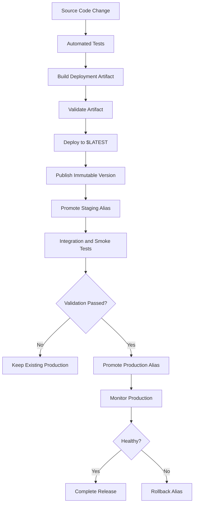
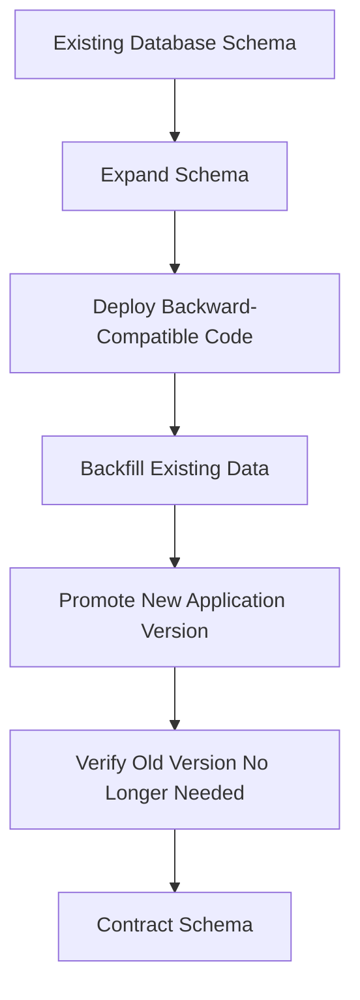

# 08- Safe Function Updates and Rollback

## Overview

Updating an AWS Lambda function in production requires more than deploying a new ZIP package or container image. A safe release process must control which code receives traffic, validate the new implementation, preserve rollback options, and account for external side effects.

For S3 event-driven applications, an unsafe deployment can affect thousands of object-processing events before a defect is detected. A new Lambda release might introduce:

- Incorrect image transformations.
- Incompatible database changes.
- Unexpected S3 object naming behavior.
- Increased execution duration or memory consumption.
- Duplicate processing or incorrect retry behavior.
- Failures when communicating with downstream services.

A production deployment strategy should separate **deployment**, **validation**, and **release promotion**.

AWS Lambda versions and aliases provide the foundation:

- `$LATEST` is the mutable deployment target.
- Published versions are immutable snapshots of function code and configuration.
- Aliases provide stable invocation targets.
- Weighted aliases support controlled traffic shifting.
- Alias updates provide a straightforward mechanism for routing future invocations back to a previous version.

The objective is to minimize deployment risk while preserving application availability and data correctness.

## Safe Lambda Deployment Principles

### Separate Deployment from Release Promotion

A deployment makes a new implementation available. A release makes that implementation responsible for production traffic.

These operations should not necessarily happen simultaneously.

Consider the following release:

```text
Current production:
    production alias -> Version 4

New deployment:
    $LATEST -> New code

After validation:
    Published Version 5

Staging:
    staging alias -> Version 5

After approval:
    production alias -> Version 5
```

Version `4` remains available for rollback.

This approach allows the team to deploy and validate new code without immediately changing production behavior.

### Core Deployment Principles

| Principle | Engineering reason |
|---|---|
| Immutable releases | Makes deployments identifiable and reproducible |
| Stable aliases | Separates consumers from version numbers |
| Artifact consistency | Ensures tested code is the code promoted |
| Controlled promotion | Prevents unvalidated releases from receiving production traffic |
| Backward compatibility | Allows old and new versions to coexist safely |
| Automated verification | Detects defects before and after promotion |
| Rollback readiness | Reduces recovery time |
| Idempotent processing | Prevents retries and overlapping releases from corrupting data |

### Deployment Lifecycle



The previous production version should remain available until the new release has passed its defined observation period.

## Deployment Strategies

Different deployment strategies provide different levels of release isolation and traffic control.

### All-at-Once Deployment

An all-at-once deployment immediately changes the production target to the new version.

Example:

```text
Before:
production -> Version 4

After:
production -> Version 5
```

The alias can be updated using:

```bash
aws lambda update-alias \
  --function-name s3-image-processor \
  --name production \
  --function-version 5
```

**Advantages**

- Simple deployment workflow.
- Fast promotion.
- Minimal deployment configuration.

**Limitations**

- All new invocations use the new version after the alias update.
- Defects can affect the entire workload immediately.
- Monitoring must detect failures quickly.
- Rollback does not reverse side effects already performed.

Use this approach for low-risk releases with strong automated testing and a reliable rollback procedure.

### Canary Deployment

A canary deployment sends a small proportion of traffic to a new version before increasing its share.

Example:

```text
Initial:
Version 4 = 100%
Version 5 =   0%

Canary:
Version 4 =  90%
Version 5 =  10%

Final:
Version 4 =   0%
Version 5 = 100%
```

Configure weighted routing:

```bash
aws lambda update-alias \
  --function-name s3-image-processor \
  --name production \
  --function-version 4 \
  --routing-config '{"AdditionalVersionWeights":{"5":0.1}}'
```

This routes a configured weight of traffic to version `5`, with the remaining traffic routed to version `4`.

**Advantages**

- Limits initial exposure to the new version.
- Allows production behavior to be evaluated gradually.
- Supports rollback by removing the additional version weight.

**Limitations**

- Routing is probabilistic, not an exact request-count allocation.
- Low-volume workloads may not provide enough observations.
- Both versions must safely operate against shared dependencies.
- Side effects from the new version cannot be automatically reversed.

For S3 event processing, a 10% routing weight does not guarantee exactly 10% of uploaded objects will be processed by the new version over a short period.

S3 event notifications are delivered at least once and can arrive out of order. Both versions must therefore handle retries and duplicate events safely.

### Linear Traffic Shifting

Linear deployment gradually increases the traffic assigned to a new version.

Example:

```text
Stage 1:  10% new version
Stage 2:  25% new version
Stage 3:  50% new version
Stage 4:  75% new version
Stage 5: 100% new version
```

At each stage, evaluate application and infrastructure metrics before proceeding.

This approach is useful when:

- The application receives sufficient traffic.
- Failures can be detected through measurable signals.
- Both versions can coexist.
- The release has a meaningful observation period.

### Blue/Green Deployment

Blue/green deployment maintains two independently deployable application versions.

```text
Blue:
Version 4
Production traffic

Green:
Version 5
Validation traffic
```

After validation, production traffic moves to the green version.

With Lambda aliases:

```text
Before:
production -> Version 4

After:
production -> Version 5
```

The alias provides a stable invocation target while its underlying version changes.

**Advantages**

- Clear separation between existing and new releases.
- Fast promotion and rollback.
- Previous version remains available.
- Consumers do not need to change their invocation ARN.

**Limitations**

- Shared databases and external services can still introduce compatibility risks.
- Both versions may process events concurrently during transition.
- External side effects require separate recovery procedures.
- Maintaining multiple versions increases operational complexity.

## Preparing a Lambda Function for Safe Updates

A safe deployment starts with a release-ready application.

### Application Compatibility

New code should remain compatible with the external resources used by the previous release whenever practical.

For example, an image-processing Lambda might read an S3 object and write a transformed image.

Version `4` writes:

```text
processed/image-001.jpg
```

Version `5` changes the output convention:

```text
processed/v2/image-001.jpg
```

If both versions receive production events during a canary deployment, downstream consumers must understand both output conventions or the application must provide a compatible transition.

Before deployment, evaluate:

- S3 object key compatibility.
- Database schema compatibility.
- Message payload compatibility.
- API contract compatibility.
- Environment variable changes.
- Secret version and credential compatibility.
- IAM permissions.
- Downstream service expectations.

### Backward-Compatible Database Migrations

A Lambda rollback does not roll back a database migration.

Use an expand-and-contract strategy.



Example:

A previous application version uses:

```sql
SELECT image_path
FROM processed_images;
```

A new version uses:

```sql
SELECT object_key
FROM processed_images;
```

A safe migration sequence is:

1. Add `object_key` without removing `image_path`.
2. Deploy code capable of handling both fields.
3. Backfill existing records.
4. Promote the new application version.
5. Confirm no older application instances require `image_path`.
6. Remove the old field in a later migration.

This prevents a Lambda alias rollback from returning to code that cannot work with the current database schema.

### Idempotent Processing

S3 notifications can be delivered more than once. A deployment can also cause old and new versions to process events during the same release window.

Processing must therefore be idempotent.

A useful processing identity can include:

- Bucket name.
- Object key.
- Object version ID when versioning is enabled.
- Processing operation or transformation version.

Example:

```python
import hashlib


def build_processing_id(
    bucket: str,
    object_key: str,
    version_id: str | None,
    processor_version: str,
) -> str:
    identity = (
        f"{bucket}:{object_key}:"
        f"{version_id or 'null'}:{processor_version}"
    )

    return hashlib.sha256(
        identity.encode("utf-8")
    ).hexdigest()
```

Persist the processing identity in a durable store such as DynamoDB or a relational database when processing requires coordination.

Do not rely only on Lambda execution-environment memory to prevent duplicate processing.

Also distinguish between:

- **Event identity:** Identifies a particular event delivery.
- **Object identity:** Identifies a particular S3 object or object version.
- **Processing identity:** Identifies a particular transformation of that object.

The correct identity depends on whether a new processing version should intentionally reprocess existing objects.

## Safe Deployment Using AWS CLI

The following workflow demonstrates deploying a new Lambda release while keeping the existing production alias unchanged until validation succeeds.

### Inspect the Current Production Version

```bash
aws lambda get-alias \
  --function-name s3-image-processor \
  --name production
```

Record the current version.

Example:

```json
{
  "Name": "production",
  "FunctionVersion": "4"
}
```

### Deploy the New Code

```bash
aws lambda update-function-code \
  --function-name s3-image-processor \
  --zip-file fileb://build/lambda-deployment.zip
```

Wait for the update to finish:

```bash
aws lambda wait function-updated \
  --function-name s3-image-processor
```

If configuration changes are required, update them before publishing the version.

Example:

```bash
aws lambda update-function-configuration \
  --function-name s3-image-processor \
  --timeout 45 \
  --memory-size 1024
```

Wait again after configuration updates:

```bash
aws lambda wait function-updated \
  --function-name s3-image-processor
```

### Publish the New Version

```bash
aws lambda publish-version \
  --function-name s3-image-processor \
  --description "Release 5"
```

Capture the returned version number instead of assuming it will always be a particular number.

### Promote the Staging Alias

```bash
aws lambda update-alias \
  --function-name s3-image-processor \
  --name staging \
  --function-version 5
```

### Validate the Staging Version

Invoke the staging alias:

```bash
aws lambda invoke \
  --function-name s3-image-processor:staging \
  --payload fileb://tests/sample-event.json \
  --cli-binary-format raw-in-base64-out \
  response.json
```

Inspect the response:

```bash
cat response.json
```

Validate the output against expected behavior, not just the invocation status.

For an S3 processing function, verify:

- The source object can be retrieved.
- The transformation succeeds.
- The output object exists.
- The output content is correct.
- Metadata and content type are correct.
- Duplicate events do not create incorrect side effects.
- Failure handling behaves as expected.

### Promote Production

After staging validation and required approval:

```bash
aws lambda update-alias \
  --function-name s3-image-processor \
  --name production \
  --function-version 5
```

Verify:

```bash
aws lambda get-alias \
  --function-name s3-image-processor \
  --name production
```

The S3 notification continues targeting the same production alias ARN.

Only the alias target changes.

## Lambda Code and Configuration Deployment

A Lambda release includes more than the deployment package.

The following configuration can influence runtime behavior:

- Runtime and handler.
- Environment variables.
- Execution role reference.
- Memory allocation.
- Timeout.
- Layers.
- Architecture.
- VPC configuration.
- Ephemeral storage.
- Dead-letter configuration.
- Logging configuration.

### Code-Only Updates

Use a code-only deployment when runtime configuration does not need to change.

```bash
aws lambda update-function-code \
  --function-name s3-image-processor \
  --zip-file fileb://build/lambda-deployment.zip
```

### Configuration Updates

Use configuration updates when the runtime settings must change.

```bash
aws lambda update-function-configuration \
  --function-name s3-image-processor \
  --environment 'Variables={INPUT_BUCKET=company-image-input,OUTPUT_PREFIX=processed/,LOG_LEVEL=INFO}'
```

Be careful when updating environment variables: the supplied environment variable map replaces the existing map rather than merging arbitrary omitted entries.

For complex configuration, use a deployment tool that manages the complete desired configuration consistently.

### Configuration and Release Consistency

A published version captures its function configuration at publication time.

Therefore:

1. Complete code updates.
2. Complete configuration updates.
3. Wait for the function to become active.
4. Validate the final configuration.
5. Publish the version.

Publishing before the intended configuration is applied can produce a release with mismatched code and settings.

## Terraform-Based Safe Deployment

Terraform can manage Lambda functions, published versions, aliases, and permissions.

The main design concern is ownership of release promotion.

Terraform should not continuously overwrite an alias that an independent CI/CD process also manages.

### Lambda Function

```hcl
resource "aws_lambda_function" "processor" {
  function_name = "s3-image-processor"

  role    = aws_iam_role.lambda_execution.arn
  runtime = "python3.12"
  handler = "handler.lambda_handler"

  filename = "${path.module}/build/lambda-deployment.zip"

  source_code_hash = filebase64sha256(
    "${path.module}/build/lambda-deployment.zip"
  )

  timeout     = 30
  memory_size = 512

  publish = true

  environment {
    variables = {
      INPUT_BUCKET  = aws_s3_bucket.images.bucket
      OUTPUT_PREFIX = "processed/"
      LOG_LEVEL     = "INFO"
    }
  }
}
```

The `publish = true` setting instructs Terraform to publish a new Lambda version when it updates the function.

### Production Alias

```hcl
resource "aws_lambda_alias" "production" {
  name             = "production"
  description      = "Production release"
  function_name    = aws_lambda_function.processor.function_name
  function_version = aws_lambda_function.processor.version
}
```

This configuration automatically points the alias to the version produced by the Terraform-managed function update.

It is suitable when applying Terraform is intentionally the production promotion operation.

For a separate approval-based release process, use an explicit promotion mechanism and avoid having Terraform continuously reset the alias to the latest published version.

### Terraform Ownership Considerations

| Ownership model | Behavior | Suitable use |
|---|---|---|
| Terraform owns function and alias | Infrastructure apply promotes the release | Infrastructure-led release process |
| Terraform owns function; CI/CD owns alias | Pipeline promotes a published version | Independent release approval |
| CI/CD owns function and alias | Pipeline manages deployment and promotion | Application-led release process |

Use one authoritative owner for each resource.

If Terraform and CI/CD both modify the same alias, drift and unexpected rollback behavior can occur.

## CI/CD Deployment Pipeline

A production pipeline should validate code and infrastructure before changing the production alias.

### Recommended Pipeline Stages

| Stage | Responsibility |
|---|---|
| Source validation | Linting and static checks |
| Unit testing | Validate application logic |
| Package creation | Build the deployment artifact |
| Artifact validation | Check dependencies and package structure |
| Deployment | Update Lambda `$LATEST` |
| Version publication | Create immutable release |
| Staging promotion | Point staging alias to the new version |
| Integration testing | Validate real service interactions |
| Production approval | Authorize release promotion |
| Production promotion | Update production alias |
| Post-deployment verification | Validate runtime behavior |
| Rollback | Restore previous alias target if required |

### GitHub Actions Example

This workflow demonstrates a staged release using GitHub Actions and AWS OIDC federation.

Assumptions:

- The Lambda function and aliases already exist.
- The AWS deployment role trusts the appropriate GitHub repository and branch.
- The role has narrowly scoped Lambda deployment permissions.
- The production GitHub environment requires approval.
- The deployment artifact is built once and promoted as the same published version.

```yaml
name: Safe Lambda Deployment

on:
  push:
    branches:
      - main

permissions:
  contents: read
  id-token: write

env:
  AWS_REGION: ap-south-1
  FUNCTION_NAME: s3-image-processor

jobs:
  test-and-build:
    runs-on: ubuntu-latest

    steps:
      - name: Checkout
        uses: actions/checkout@v4

      - name: Configure Python
        uses: actions/setup-python@v5
        with:
          python-version: "3.12"

      - name: Install dependencies
        run: |
          python -m pip install --upgrade pip
          pip install -r requirements.txt
          pip install -r requirements-dev.txt

      - name: Run tests
        run: pytest -q

      - name: Build package
        run: |
          mkdir -p build/package

          pip install \
            -r requirements.txt \
            --target build/package

          cp handler.py build/package/

          cd build/package
          zip -r ../lambda-deployment.zip .

      - name: Upload deployment artifact
        uses: actions/upload-artifact@v4
        with:
          name: lambda-deployment
          path: build/lambda-deployment.zip
          retention-days: 14

  deploy-and-publish:
    needs: test-and-build
    runs-on: ubuntu-latest

    outputs:
      version: ${{ steps.publish.outputs.version }}

    steps:
      - name: Download deployment artifact
        uses: actions/download-artifact@v4
        with:
          name: lambda-deployment
          path: build

      - name: Configure AWS credentials
        uses: aws-actions/configure-aws-credentials@v4
        with:
          role-to-assume: ${{ secrets.AWS_DEPLOY_ROLE_ARN }}
          aws-region: ${{ env.AWS_REGION }}

      - name: Deploy Lambda
        run: |
          aws lambda update-function-code \
            --function-name "$FUNCTION_NAME" \
            --zip-file fileb://build/lambda-deployment.zip

          aws lambda wait function-updated \
            --function-name "$FUNCTION_NAME"

      - name: Publish version
        id: publish
        run: |
          VERSION=$(aws lambda publish-version \
            --function-name "$FUNCTION_NAME" \
            --description "GitHub commit $GITHUB_SHA" \
            --query Version \
            --output text)

          echo "version=$VERSION" >> "$GITHUB_OUTPUT"

  staging-validation:
    needs: deploy-and-publish
    runs-on: ubuntu-latest

    steps:
      - name: Configure AWS credentials
        uses: aws-actions/configure-aws-credentials@v4
        with:
          role-to-assume: ${{ secrets.AWS_DEPLOY_ROLE_ARN }}
          aws-region: ${{ env.AWS_REGION }}

      - name: Promote staging
        run: |
          aws lambda update-alias \
            --function-name "$FUNCTION_NAME" \
            --name staging \
            --function-version "${{ needs.deploy-and-publish.outputs.version }}"

      - name: Verify staging alias
        run: |
          aws lambda get-alias \
            --function-name "$FUNCTION_NAME" \
            --name staging

      - name: Run integration tests
        run: |
          python tests/integration_test.py

  production-release:
    needs:
      - deploy-and-publish
      - staging-validation

    runs-on: ubuntu-latest

    environment: production

    steps:
      - name: Configure AWS credentials
        uses: aws-actions/configure-aws-credentials@v4
        with:
          role-to-assume: ${{ secrets.AWS_DEPLOY_ROLE_ARN }}
          aws-region: ${{ env.AWS_REGION }}

      - name: Promote production
        run: |
          aws lambda update-alias \
            --function-name "$FUNCTION_NAME" \
            --name production \
            --function-version "${{ needs.deploy-and-publish.outputs.version }}"

      - name: Verify production alias
        run: |
          aws lambda get-alias \
            --function-name "$FUNCTION_NAME" \
            --name production
```

This example is a pipeline foundation. A complete production implementation should also include:

- Artifact checksum verification.
- Integration test credentials and configuration.
- Deployment concurrency controls.
- Production approval configuration.
- Alias rollback automation.
- CloudWatch alarm evaluation.
- Release metadata retention.
- OIDC trust restrictions.
- A consistent resource ownership model.

The integration test script must actually invoke the staging alias and validate the expected output. Merely executing a local test suite does not validate the deployed Lambda function.

## Automated Deployment Verification

A successful deployment command does not prove that an application is healthy.

Verification should cover infrastructure, runtime, and business behavior.

### Infrastructure Verification

Inspect function configuration:

```bash
aws lambda get-function-configuration \
  --function-name s3-image-processor
```

Inspect published versions:

```bash
aws lambda list-versions-by-function \
  --function-name s3-image-processor
```

Inspect the production alias:

```bash
aws lambda get-alias \
  --function-name s3-image-processor \
  --name production
```

Verify the alias points to the intended version.

### Runtime Verification

Invoke the staging alias with a representative test event:

```bash
aws lambda invoke \
  --function-name s3-image-processor:staging \
  --payload fileb://tests/sample-event.json \
  --cli-binary-format raw-in-base64-out \
  response.json
```

Validate:

- Invocation response.
- Function logs.
- Output object.
- Output metadata.
- Processing status.
- Error handling.

### S3 Verification

Inspect the expected output object:

```bash
aws s3api head-object \
  --bucket company-image-output \
  --key processed/sample-image.jpg
```

This confirms that the object exists and returns its metadata.

For stronger validation, download the object and compare its content or checksum with the expected result.

### CloudWatch Verification

Inspect the Lambda log group:

```bash
aws logs describe-log-streams \
  --log-group-name /aws/lambda/s3-image-processor \
  --order-by LastEventTime \
  --descending
```

Review application errors and execution behavior during the validation period.

Do not rely only on Lambda invocation success. Application-level validation should confirm that the intended processing outcome occurred.

## Rollback Strategy

### What Is a Lambda Rollback?

A Lambda rollback restores production invocation routing to a previously published version.

With aliases, rollback usually requires changing the alias target rather than rebuilding or redeploying old application code.

Example:

```text
Before release:
production -> Version 4

After release:
production -> Version 5

After rollback:
production -> Version 4
```

The old version remains available as long as it has not been deleted.

### Identify the Previous Version

Inspect the production alias:

```bash
aws lambda get-alias \
  --function-name s3-image-processor \
  --name production
```

Inspect available versions:

```bash
aws lambda list-versions-by-function \
  --function-name s3-image-processor
```

The deployment system should record the previous production version before promotion.

Do not assume the immediately preceding version is always the correct rollback target. There may have been a staging release, an experimental version, or a separate deployment.

### Roll Back the Production Alias

```bash
aws lambda update-alias \
  --function-name s3-image-processor \
  --name production \
  --function-version 4
```

Verify:

```bash
aws lambda get-alias \
  --function-name s3-image-processor \
  --name production
```

The production alias now routes new invocations to version `4`.

### Roll Back a Weighted Deployment

If a canary release is in progress, restore all traffic to the previous version.

```bash
aws lambda update-alias \
  --function-name s3-image-processor \
  --name production \
  --function-version 4 \
  --routing-config '{"AdditionalVersionWeights":{}}'
```

This removes the additional version weight.

### Rollback Limitations

Alias rollback changes future invocation routing. It does not automatically:

- Cancel invocations already running.
- Reverse S3 object writes.
- Undo database transactions.
- Restore deleted objects.
- Reverse messages published to SQS or SNS.
- Undo external API requests.
- Reprocess events that were previously acknowledged.
- Restore an old secret value.
- Reverse infrastructure changes outside Lambda.

A complete recovery strategy must account for these external effects.

## Rollback for S3 Event-Driven Applications

S3 event-processing applications have distributed-system behavior that makes rollback more complex than changing an HTTP API deployment target.

### Duplicate Events

S3 notifications are delivered at least once.

A single object operation can result in multiple event deliveries.

Both the old and new Lambda versions must tolerate duplicate processing.

Use durable idempotency records and deterministic output keys where appropriate.

### Out-of-Order Events

S3 notifications can arrive out of order.

For versioned buckets, use the S3 object version ID when processing must distinguish different versions of the same key.

Do not assume that the last event received represents the latest object state.

### Partial Processing

Consider the following execution:

1. Lambda reads an object.
2. Lambda generates a thumbnail.
3. Lambda writes the thumbnail to S3.
4. Lambda fails before updating the database status.

A retry may attempt the transformation again.

A rollback does not automatically resolve this partial state.

Use a processing state machine or durable workflow record where the business process requires it.

Example states:

```text
PENDING
    |
    v
PROCESSING
    |
    +----> COMPLETED
    |
    +----> FAILED
```

For more complex processing, use an explicit recovery or reconciliation process.

### SQS-Based Processing

For workloads using SQS between S3 and Lambda:

- Preserve message visibility and retry behavior.
- Monitor queue depth and age of oldest message.
- Inspect dead-letter queues.
- Ensure both application versions understand the message schema.
- Redrive messages only after the root cause is corrected.

A rollback should not be considered complete until the event backlog and failed-message recovery path are understood.

## Automated Rollback

A deployment pipeline can automatically restore the previous alias target when defined health conditions fail.

### Example Rollback Script

The script below restores a previously recorded production version.

```bash
#!/usr/bin/env bash

set -euo pipefail

FUNCTION_NAME="${FUNCTION_NAME:?FUNCTION_NAME is required}"
ALIAS_NAME="${ALIAS_NAME:-production}"
PREVIOUS_VERSION="${PREVIOUS_VERSION:?PREVIOUS_VERSION is required}"

if [[ ! "$PREVIOUS_VERSION" =~ ^[0-9]+$ ]]; then
  echo "PREVIOUS_VERSION must be a published numeric version."
  exit 1
fi

aws lambda update-alias \
  --function-name "$FUNCTION_NAME" \
  --name "$ALIAS_NAME" \
  --function-version "$PREVIOUS_VERSION" \
  --routing-config '{"AdditionalVersionWeights":{}}'

aws lambda get-alias \
  --function-name "$FUNCTION_NAME" \
  --name "$ALIAS_NAME"
```

The script deliberately requires the previous version as an explicit input.

It does not guess which version should receive production traffic.

### Rollback Decision Criteria

Define rollback conditions before deployment.

Examples:

| Signal | Possible action |
|---|---|
| Sustained Lambda error increase | Investigate and potentially roll back |
| Increased timeout frequency | Check runtime and downstream dependencies |
| Unexpected output corruption | Stop promotion and roll back |
| Database authentication failures | Investigate credentials and connection handling |
| Increased SQS backlog | Evaluate processing throughput and failures |
| Missing expected S3 outputs | Stop promotion and investigate |
| Security or data-integrity defect | Initiate immediate incident response |

Use application-specific thresholds rather than arbitrary universal values.

A rollback should be triggered by meaningful evidence, not by one isolated transient failure.

## Monitoring During and After Deployment

Monitor both infrastructure metrics and application outcomes.

### Lambda Metrics

| Metric | Operational purpose |
|---|---|
| `Invocations` | Measures execution volume |
| `Errors` | Identifies failed invocations |
| `Duration` | Tracks execution latency |
| `Throttles` | Identifies concurrency or capacity pressure |
| `ConcurrentExecutions` | Tracks active execution demand |
| `IteratorAge` | Relevant to stream-based event sources, not direct S3 notifications |

For S3 event-driven workloads using SQS, also monitor queue-level metrics.

### SQS Metrics

| Metric | Operational purpose |
|---|---|
| `ApproximateNumberOfMessagesVisible` | Measures available backlog |
| `ApproximateAgeOfOldestMessage` | Indicates processing delay |
| `ApproximateNumberOfMessagesNotVisible` | Measures in-flight messages |
| `NumberOfMessagesSent` | Tracks incoming messages |
| `NumberOfMessagesDeleted` | Tracks successfully acknowledged messages |

### Application Metrics

Lambda's standard metrics do not explain whether the business operation succeeded.

Emit application-level metrics such as:

- Images processed successfully.
- Images rejected by validation.
- Transformation failures.
- Duplicate events detected.
- Output objects written.
- Processing duration.
- Database update failures.
- Recovery attempts.

Include release metadata in structured logs where appropriate.

Example:

```json
{
  "event": "image_processing_completed",
  "function_version": "5",
  "object_key": "uploads/image-001.jpg",
  "output_key": "processed/image-001.jpg",
  "duration_ms": 842,
  "status": "success"
}
```

Do not log sensitive object contents, credentials, or personal data unnecessarily.

## Deployment Concurrency and Race Conditions

Concurrent deployment pipelines can create unexpected release behavior.

Consider:

```text
Pipeline A:
Deploy Version 5
Publish Version 5
Promote production to Version 5

Pipeline B:
Deploy Version 6
Publish Version 6
Promote production to Version 6
```

If these pipelines overlap, the order of updates may not match the intended release order.

Potential consequences include:

- Unexpected production version.
- Staging alias pointing to the wrong release.
- Deployment artifact mismatch.
- Terraform drift.
- Rollback using stale version metadata.

### Recommended Controls

- Serialize production deployments.
- Use CI/CD concurrency groups.
- Record the previous production version before promotion.
- Promote an explicit published version.
- Use conditional release checks where supported.
- Avoid simultaneous Terraform and CLI alias management.
- Prevent older pipelines from promoting after newer releases.

Example GitHub Actions concurrency configuration:

```yaml
concurrency:
  group: s3-image-processor-production
  cancel-in-progress: false
```

This serializes jobs using the same concurrency group within the repository and workflow scope.

For stronger release protection, use a deployment lock or release coordination mechanism that covers every system capable of modifying the Lambda alias.

## Deployment Security

A safe deployment process must protect both runtime execution and release control.

### Separate IAM Responsibilities

| Identity | Responsibility |
|---|---|
| CI/CD deployment role | Updates Lambda code and configuration |
| Lambda execution role | Accesses S3 and other runtime dependencies |
| Release approval identity | Authorizes production promotion |
| Operational role | Performs incident response and controlled rollback |

Do not grant the Lambda execution role deployment permissions.

Likewise, do not grant the CI/CD role unrestricted access to application data unless required.

### OIDC Federation

GitHub Actions should use OIDC federation to obtain short-lived AWS credentials.

The trust policy should restrict access to the expected:

- GitHub organization.
- Repository.
- Branch or deployment environment.
- OIDC audience.

Avoid long-lived AWS access keys in repository secrets.

### Production Promotion Controls

Production alias updates should be restricted to approved deployment identities.

Consider:

- GitHub environment protection rules.
- Required reviewers.
- Restricted deployment branches.
- Auditable release metadata.
- CloudTrail monitoring.
- Separate staging and production roles.

The ability to update a production alias is effectively the ability to change production application behavior.

## Common Mistakes and Pitfalls

### Deploying Directly to `$LATEST`

**Problem:** Production invokes the unqualified function ARN.

**Impact:** New code becomes active immediately after deployment.

**Prevention:** Use published versions and a production alias for controlled releases.

### Assuming Rollback Reverses Application Side Effects

**Problem:** The team moves the alias to an older version and assumes the system is restored.

**Impact:** Previously written S3 objects, database updates, and published messages remain.

**Prevention:** Define recovery procedures for external state and data consistency.

### Rebuilding During Production Promotion

**Problem:** The production artifact is rebuilt instead of promoting the artifact tested in staging.

**Impact:** The production release may differ from the validated release.

**Prevention:** Build once, publish once, and promote the same version.

### Ignoring Database Compatibility

**Problem:** A new deployment changes the schema and an alias rollback restores old application code.

**Impact:** The previous version fails against the new schema.

**Prevention:** Use backward-compatible migrations and expand-and-contract deployment strategies.

### Using Weighted Routing Without Enough Traffic

**Problem:** A canary deployment uses a small percentage of traffic on a low-volume workload.

**Impact:** There may be insufficient evidence to identify defects.

**Prevention:** Use targeted integration tests and application-level validation in addition to traffic-based observation.

### Assuming S3 Events Are Processed Exactly Once

**Problem:** The application assumes every object-created event is delivered once and in order.

**Impact:** Duplicate or delayed events can cause incorrect processing.

**Prevention:** Implement durable idempotency and object-version-aware processing.

### Running Concurrent Production Deployments

**Problem:** Multiple pipelines update the same Lambda function or alias.

**Impact:** Releases can overwrite each other or promote unexpected versions.

**Prevention:** Serialize production releases and define clear resource ownership.

### Deleting the Previous Version Immediately

**Problem:** The previous published version is removed after deployment.

**Impact:** Fast rollback is no longer possible.

**Prevention:** Retain known-good versions according to the recovery and audit requirements.

## Production Readiness Checklist

### Before Deployment

- [ ] Unit tests and static checks pass.
- [ ] Deployment package is built successfully.
- [ ] Package dependencies and runtime compatibility are validated.
- [ ] Artifact checksum is recorded.
- [ ] Current production version is recorded.
- [ ] Database and message schema compatibility is reviewed.
- [ ] IAM and environment configuration changes are reviewed.
- [ ] Rollback conditions are defined.
- [ ] Previous published version remains available.

### During Deployment

- [ ] Production traffic remains on the existing version.
- [ ] `$LATEST` update completes successfully.
- [ ] New published version is created.
- [ ] Staging alias is updated.
- [ ] Integration tests run against the deployed staging version.
- [ ] S3 processing behavior is validated.
- [ ] Application-level success metrics are checked.
- [ ] Production promotion is approved.
- [ ] Production alias points to the intended version.

### After Deployment

- [ ] Lambda errors and duration are monitored.
- [ ] S3 output objects are verified.
- [ ] Duplicate event handling is checked.
- [ ] SQS backlog and DLQ metrics are reviewed where applicable.
- [ ] Database and downstream integrations are healthy.
- [ ] Release metadata is retained.
- [ ] Rollback procedure remains available.
- [ ] Previous versions are retained according to policy.

### Rollback Readiness

- [ ] Previous production version is known.
- [ ] Rollback permissions are available.
- [ ] Alias rollback command or automation is tested.
- [ ] External side effects are understood.
- [ ] Database compatibility is maintained.
- [ ] Failed events and messages can be recovered.
- [ ] Post-rollback verification is documented.

## Key Takeaways

- Safe Lambda deployments separate artifact creation, version publication, validation, and production promotion.
- Published versions and aliases provide controlled release management, while canary and blue/green strategies reduce deployment exposure.
- Rollback through an alias restores future invocation routing but does not reverse S3 writes, database changes, or downstream side effects.
- S3 event-driven applications must handle duplicate and out-of-order events through durable idempotency and backward-compatible processing.
- Serialize production deployments, retain known-good versions, and define measurable rollback criteria before releasing changes.