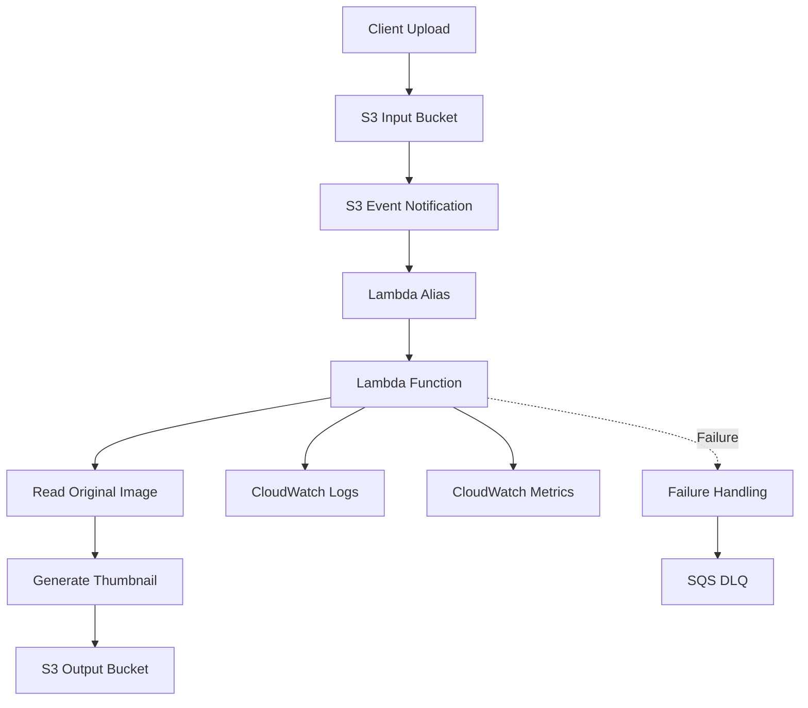
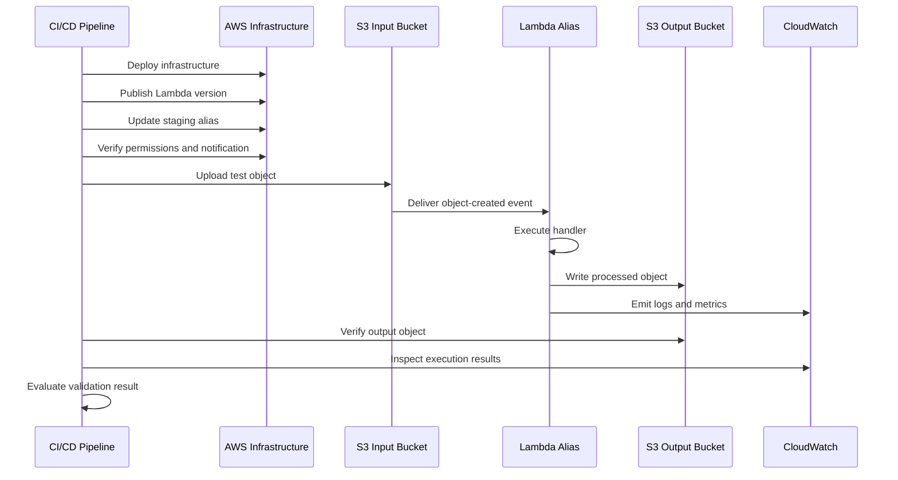
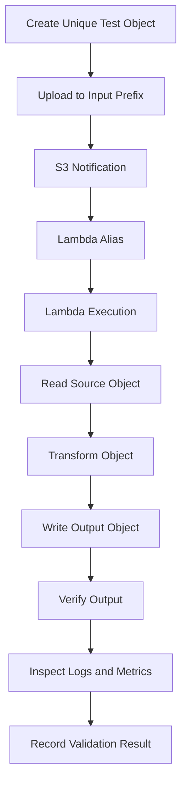
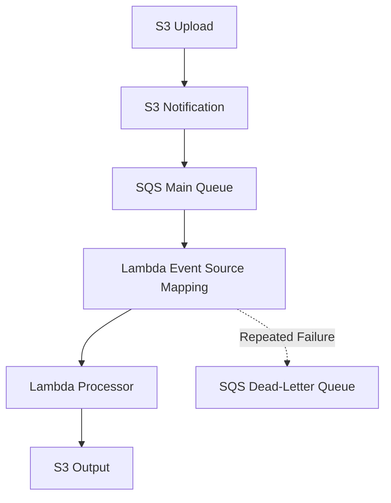
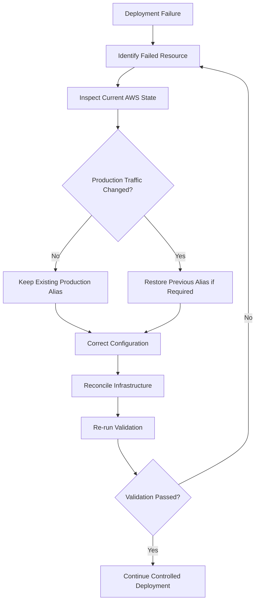

# 09- Event-Driven Deployment Validation

## Overview

Event-driven deployment validation verifies that an application deployed across multiple AWS services is correctly configured, integrated, and operational.

A successful infrastructure deployment does not necessarily mean that the complete event-processing workflow works. An S3 bucket may exist, a Lambda function may be active, and an IAM role may be attached while the actual event-processing path remains broken.

For example, an S3-triggered image-processing application depends on several independent components:

- S3 bucket and event notification configuration.
- Lambda function, published version, and alias.
- Lambda execution role and resource-based invocation policy.
- S3 object read and write permissions.
- KMS permissions when customer-managed encryption keys are used.
- SQS queues and dead-letter queues when buffering is required.
- CloudWatch logs, metrics, and alarms.
- Downstream services such as databases or external APIs.

A production deployment should validate the entire workflow rather than checking only whether individual resources exist.

### Validation Objectives

| Validation area | Objective |
|---|---|
| Infrastructure | Confirm resources exist with the intended configuration |
| Permissions | Verify service identities can perform required actions |
| Event routing | Confirm events reach the intended destination |
| Runtime | Verify application code processes events correctly |
| Reliability | Validate retries, duplicate handling, and failure recovery |
| Observability | Confirm logs, metrics, and alarms are available |
| Release safety | Confirm the intended version is deployed and rollback is possible |

## Event-Driven Application Architecture

Consider an image-processing application that receives images through S3 and generates resized versions using Lambda.



### Component Responsibilities

| Component | Responsibility | Validation requirement |
|---|---|---|
| S3 input bucket | Stores original objects | Bucket exists and accepts intended uploads |
| S3 notification | Routes object events | Correct destination, event types, and filters |
| Lambda alias | Provides a stable invocation target | Points to the intended published version |
| Lambda function | Executes processing logic | Code, runtime, and dependencies are valid |
| Execution role | Grants runtime permissions | Required permissions are available |
| Lambda resource policy | Authorizes invocation | Correct principal and source bucket |
| S3 output bucket | Stores processed objects | Lambda can write expected outputs |
| SQS DLQ | Preserves failed messages where configured | Failure destination is correctly configured |
| CloudWatch | Provides operational visibility | Logs, metrics, and alarms are available |

### End-to-End Validation Flow



The important distinction is that the validation pipeline uploads an actual object to S3. This exercises the event notification and invocation path rather than testing only the Lambda handler.

## Validation Strategy

A reliable deployment process should validate the system progressively.

### Infrastructure Validation

Verify that the required AWS resources exist and have the intended configuration.

Typical checks include:

- S3 bucket existence and Region.
- Bucket versioning and encryption settings.
- Lambda runtime, handler, memory, and timeout.
- Published Lambda version.
- Alias target version.
- IAM execution role.
- Lambda resource-based invocation policy.
- S3 notification configuration.
- SQS queue and DLQ configuration where applicable.
- KMS key configuration.
- CloudWatch log group and alarms.

### Integration Validation

Verify that AWS services can communicate.

Examples:

- S3 can invoke the intended Lambda alias.
- Lambda can retrieve objects from the input bucket.
- Lambda can write objects to the output bucket.
- Lambda can retrieve required secrets.
- Lambda can publish messages to downstream queues.
- SQS can invoke Lambda through its event source mapping.
- KMS authorizes the required encryption and decryption operations.

A resource existing does not prove that its integration is functional.

### Runtime Validation

Verify actual application behavior.

For an image-processing function:

- The event payload is parsed correctly.
- The source object is retrieved.
- The image is transformed successfully.
- The output object is written.
- Output metadata is correct.
- Duplicate events are handled safely.
- Invalid input produces a controlled failure.

### Operational Validation

Verify that the deployed application can be monitored and recovered.

Check:

- CloudWatch logs are generated.
- Lambda errors and duration are observable.
- DLQ messages can be inspected where configured.
- Failure alerts are configured.
- Processing status can be reconciled.
- Rollback procedures are available.

## Pre-Deployment Validation

Pre-deployment validation catches configuration and packaging problems before infrastructure changes are applied.

### Validate Application Code

Run compilation checks and unit tests.

```bash
python -m compileall src/
pytest -q
```

Include the repository's configured linting and type-checking commands.

### Validate Lambda Package

Inspect the deployment archive:

```bash
unzip -l build/lambda-deployment.zip
```

Check that the archive contains the expected handler and dependencies:

```bash
unzip -l build/lambda-deployment.zip | grep handler.py
```

Verify imports in an environment compatible with the Lambda runtime and architecture.

A package built successfully on a developer workstation may still fail in Lambda. Native dependencies must match the target runtime and architecture.

### Validate Terraform

For Terraform-managed infrastructure:

```bash
terraform fmt -check -recursive
terraform init -backend=false
terraform validate
terraform plan -out=tfplan
```

Review the plan before applying it.

Pay particular attention to:

- Bucket replacement or deletion.
- Notification configuration changes.
- IAM policy changes.
- Lambda alias changes.
- KMS key modifications.
- Queue replacement.
- Resource dependency changes.

A valid Terraform configuration does not prove that the deployed AWS integration will work.

### Validate Configuration Inputs

Check that required deployment variables are supplied.

```bash
: "${AWS_REGION:?AWS_REGION is required}"
: "${AWS_DEPLOY_ROLE_ARN:?AWS_DEPLOY_ROLE_ARN is required}"
: "${LAMBDA_FUNCTION_NAME:?LAMBDA_FUNCTION_NAME is required}"
: "${INPUT_BUCKET:?INPUT_BUCKET is required}"
```

Avoid printing secret values during validation.

### Validate Deployment Identity

Confirm that CI/CD is operating in the intended AWS account.

```bash
aws sts get-caller-identity
```

Verify:

- Expected AWS account ID.
- Expected deployment role.
- Correct Region.
- Required deployment permissions.

Using the wrong AWS account or Region is a common deployment failure.

## Post-Deployment Infrastructure Verification

After deployment, inspect the actual AWS configuration rather than relying exclusively on Terraform outputs or deployment logs.

### Verify the S3 Bucket

```bash
aws s3api head-bucket \
  --bucket company-image-input
```

Inspect the bucket Region:

```bash
aws s3api get-bucket-location \
  --bucket company-image-input
```

Inspect versioning:

```bash
aws s3api get-bucket-versioning \
  --bucket company-image-input
```

Inspect encryption:

```bash
aws s3api get-bucket-encryption \
  --bucket company-image-input
```

Compare the returned configuration with the environment's deployment requirements.

### Verify the Lambda Function

```bash
aws lambda get-function-configuration \
  --function-name s3-image-processor
```

Check:

- Function state.
- Runtime.
- Handler.
- Execution role ARN.
- Timeout.
- Memory allocation.
- Architecture.
- Environment configuration.
- Last update status.

### Verify Published Versions

```bash
aws lambda list-versions-by-function \
  --function-name s3-image-processor
```

Confirm that the expected release version exists.

### Verify the Lambda Alias

```bash
aws lambda get-alias \
  --function-name s3-image-processor \
  --name staging
```

Validate the alias target against the release metadata.

For production promotion, inspect the production alias separately.

### Verify Lambda Invocation Permission

```bash
aws lambda get-policy \
  --function-name s3-image-processor \
  --qualifier staging
```

Inspect the policy for:

- `s3.amazonaws.com` as the principal.
- `lambda:InvokeFunction` as the action.
- Expected bucket ARN as the source.
- Expected source account.
- Correct alias qualifier.

A permission attached to an unqualified function does not automatically establish the required permission for an alias-qualified integration.

## S3 Event Notification Validation

### Inspect the Notification Configuration

```bash
aws s3api get-bucket-notification-configuration \
  --bucket company-image-input
```

Verify:

- Correct Lambda destination ARN.
- Correct event types.
- Correct prefix and suffix filters.
- Existing notifications are preserved.
- No unintended duplicate notification rules exist.

Example expected configuration:

```json
{
  "LambdaFunctionConfigurations": [
    {
      "Id": "ImageProcessorStaging",
      "LambdaFunctionArn": "arn:aws:lambda:ap-south-1:123456789012:function:s3-image-processor:staging",
      "Events": [
        "s3:ObjectCreated:*"
      ],
      "Filter": {
        "Key": {
          "FilterRules": [
            {
              "Name": "prefix",
              "Value": "uploads/"
            }
          ]
        }
      }
    }
  ]
}
```

### Validate Notification Filters

Suppose the notification is configured for the prefix:

```text
uploads/
```

The following objects should behave differently:

| Object key | Expected notification |
|---|---|
| `uploads/image-001.jpg` | Yes |
| `uploads/users/image-002.jpg` | Yes |
| `processed/image-001.jpg` | No |
| `archive/image-001.jpg` | No |

Test both matching and non-matching keys.

This catches incorrect prefix and suffix configuration before production traffic is introduced.

### Notification Configuration Replacement Risk

The following command replaces the bucket's complete notification configuration:

```bash
aws s3api put-bucket-notification-configuration \
  --bucket company-image-input \
  --notification-configuration file://notification.json
```

Before applying it:

1. Retrieve the existing configuration.
2. Compare the desired configuration with the current configuration.
3. Preserve existing Lambda, SQS, and SNS destinations.
4. Apply the complete intended configuration.
5. Retrieve it again and verify the result.

Do not assume that adding one notification through this API preserves every existing notification.

### Validate S3-to-Lambda Permissions

S3 event notifications require permission to invoke the destination Lambda.

For a staging alias:

```bash
aws lambda add-permission \
  --function-name s3-image-processor \
  --qualifier staging \
  --statement-id allow-s3-staging-invoke \
  --action lambda:InvokeFunction \
  --principal s3.amazonaws.com \
  --source-arn arn:aws:s3:::company-image-input \
  --source-account 123456789012
```

The bucket and Lambda function must be in the same Region for direct S3 event notification integration.

If permission is missing or scoped incorrectly, notification configuration or event delivery can fail.

## IAM and KMS Validation

### Validate the Lambda Execution Role

Inspect the execution role:

```bash
aws iam get-role \
  --role-name s3-image-processor-execution-role
```

List attached managed policies:

```bash
aws iam list-attached-role-policies \
  --role-name s3-image-processor-execution-role
```

List inline policies:

```bash
aws iam list-role-policies \
  --role-name s3-image-processor-execution-role
```

For an S3 image-processing workflow, required permissions may include:

| Action | Purpose |
|---|---|
| `s3:GetObject` | Read original objects |
| `s3:PutObject` | Write processed objects |
| `s3:GetObjectVersion` | Read a specific object version when required |
| `sqs:ReceiveMessage` | Receive messages from SQS |
| `sqs:DeleteMessage` | Acknowledge processed messages |
| `sqs:GetQueueAttributes` | Read queue configuration |
| `secretsmanager:GetSecretValue` | Retrieve application secrets |
| `kms:Decrypt` | Decrypt data or secrets using an authorized customer-managed key |

Grant only the actions required by the deployed architecture.

### Validate Resource-Based Permissions Separately

Lambda execution permissions and Lambda invocation permissions serve different purposes.

| Permission layer | Controls |
|---|---|
| Lambda execution role | What the function can access |
| Lambda resource-based policy | Which principals can invoke the function |
| S3 bucket policy | Which principals can access bucket resources |
| KMS key policy | Which principals can use the encryption key |

A function can have permission to read an S3 object but still reject invocation from S3 because its resource-based policy is incorrect.

### Validate KMS Access

For SSE-KMS objects, verify both S3 access and KMS authorization.

```bash
aws kms describe-key \
  --key-id arn:aws:kms:ap-south-1:123456789012:key/11111111-2222-3333-4444-555555555555
```

Check the relevant key policy and IAM permissions.

Reading encrypted objects commonly requires `kms:Decrypt`; writing encrypted objects can require `kms:GenerateDataKey`.

The KMS key policy must authorize the relevant principal or delegate authorization appropriately.

A successful S3 authorization check does not guarantee that the caller can decrypt an object.

## End-to-End Event Validation

The most important deployment test is an actual event flowing through the deployed AWS infrastructure.

A direct Lambda invocation validates the handler, but it does not validate the S3 notification configuration or S3 invocation permission.

Use a real test object upload to validate the complete integration.

### End-to-End Validation Flow



### Upload a Test Object

Use a unique object key for every test run.

```bash
TEST_ID="$(date -u +%Y%m%dT%H%M%SZ)-$RANDOM"
TEST_KEY="uploads/validation/${TEST_ID}.jpg"

aws s3 cp \
  tests/sample-image.jpg \
  "s3://company-image-input/${TEST_KEY}"
```

A unique key prevents previous test results from being mistaken for the current deployment's output.

### Verify the Output Object

Assume the Lambda writes the processed object to:

```text
processed/validation/<test-id>.jpg
```

Check that the output exists:

```bash
aws s3api head-object \
  --bucket company-image-output \
  --key "processed/validation/${TEST_ID}.jpg"
```

For stronger validation, download the object and inspect its contents.

```bash
aws s3 cp \
  "s3://company-image-output/processed/validation/${TEST_ID}.jpg" \
  "/tmp/${TEST_ID}-processed.jpg"
```

Use an image-processing library or checksum comparison appropriate to the expected transformation.

A successful `head-object` call proves that the object exists, not that its content is correct.

### Validate Processing Metadata

If the application writes useful metadata:

```bash
aws s3api head-object \
  --bucket company-image-output \
  --key "processed/validation/${TEST_ID}.jpg" \
  --query '{ContentType:ContentType,ContentLength:ContentLength,Metadata:Metadata}'
```

Check:

- Expected content type.
- Non-zero content length.
- Expected application metadata.
- Expected encryption configuration.
- Expected object key.

### Validate Non-Matching Events

Upload an object outside the configured prefix:

```bash
aws s3 cp \
  tests/sample-image.jpg \
  "s3://company-image-input/archive/${TEST_ID}.jpg"
```

Verify that no processing output is created for this object.

This confirms that notification filters behave as expected.

### Validate Duplicate Event Handling

S3 notifications are delivered at least once and can be duplicated or arrive out of order.

The application must tolerate duplicate event delivery.

A deployment validation test should exercise the processing logic with the same logical event more than once and verify that duplicate delivery does not produce incorrect side effects.

For workflows requiring durable deduplication, use an idempotency record in a persistent store.

Do not rely on an in-memory flag inside Lambda because execution environments are reused opportunistically and are not shared across instances.

## Direct Lambda Invocation Versus Real Event Testing

Both test types are useful, but they validate different parts of the system.

| Test type | What it validates | What it does not validate |
|---|---|---|
| Unit test | Application logic in isolation | AWS integration |
| Mocked event test | Handler behavior against a simulated event | Actual S3 notification |
| Direct Lambda invocation | Deployed Lambda code and runtime | S3 notification delivery and permission |
| S3 upload test | End-to-end S3-to-Lambda path | Every production failure mode |
| Production smoke test | Actual production integration | Full correctness for every input |

A reliable deployment pipeline should use multiple levels of testing.

Do not replace an end-to-end S3 upload test with a direct Lambda invocation and assume the event integration is verified.

## SQS-Based Event Validation

Some applications use SQS between S3 and Lambda to improve buffering, retry handling, and failure isolation.



### Validate the Queue

Inspect the main queue:

```bash
aws sqs get-queue-attributes \
  --queue-url "$MAIN_QUEUE_URL" \
  --attribute-names All
```

Verify:

- Queue exists.
- Visibility timeout is appropriate.
- Message retention is configured.
- Redrive policy references the intended DLQ.
- Encryption configuration is correct where required.

Inspect the DLQ:

```bash
aws sqs get-queue-attributes \
  --queue-url "$DLQ_URL" \
  --attribute-names All
```

### Validate S3-to-SQS Permission

The queue policy must allow S3 to send messages.

Inspect the queue policy:

```bash
aws sqs get-queue-attributes \
  --queue-url "$MAIN_QUEUE_URL" \
  --attribute-names Policy
```

Check that the policy:

- Allows `sqs:SendMessage`.
- Uses `s3.amazonaws.com` as the principal.
- Restricts the source bucket ARN.
- Restricts the source account where appropriate.

### Validate the Lambda Event Source Mapping

```bash
aws lambda list-event-source-mappings \
  --function-name s3-image-processor
```

Inspect a specific mapping:

```bash
aws lambda get-event-source-mapping \
  --uuid "$EVENT_SOURCE_MAPPING_UUID"
```

Verify:

- Correct queue ARN.
- Mapping state is `Enabled`.
- No unexpected state transition is in progress.
- Batch size is appropriate.
- Maximum batching window is configured as intended.
- Partial batch response behavior matches the handler implementation.

### Validate Message Processing

Upload a test object and verify that:

1. S3 sends a message to the main queue.
2. Lambda receives the message.
3. The event payload is parsed correctly.
4. The object is processed.
5. The output is created.
6. The message is acknowledged after successful processing.

Inspect queue metrics to determine whether messages remain visible or in flight.

### Validate DLQ Behavior

Do not deliberately break production processing to test the DLQ.

Use an isolated test environment with a controlled failure scenario.

Verify that:

- A failing message is retried.
- The receive count increases as expected.
- The message eventually moves to the configured DLQ according to the redrive policy.
- The original message can be inspected.
- The recovery process works after the root cause is corrected.

A DLQ does not automatically resolve failed processing. Messages require investigation and controlled redrive.

## Event Payload Validation

S3 event payloads have a defined structure, but application code must still handle missing, malformed, or unexpected values.

### Sample S3 Event

```json
{
  "Records": [
    {
      "eventSource": "aws:s3",
      "eventName": "ObjectCreated:Put",
      "awsRegion": "ap-south-1",
      "s3": {
        "bucket": {
          "name": "company-image-input"
        },
        "object": {
          "key": "uploads/image-001.jpg",
          "size": 204800,
          "eTag": "example-etag"
        }
      }
    }
  ]
}
```

The actual S3 event object key is URL-encoded.

### Validate Event Parsing

```python
from urllib.parse import unquote_plus


def extract_s3_records(event: dict) -> list[dict]:
    records = event.get("Records")

    if not isinstance(records, list) or not records:
        raise ValueError("S3 event must contain Records")

    extracted = []

    for record in records:
        if record.get("eventSource") != "aws:s3":
            raise ValueError("Unsupported event source")

        bucket = record.get("s3", {}).get("bucket", {}).get("name")
        encoded_key = record.get("s3", {}).get("object", {}).get("key")

        if not bucket or not encoded_key:
            raise ValueError("Missing S3 bucket or object key")

        object_key = unquote_plus(encoded_key)

        extracted.append(
            {
                "bucket": bucket,
                "key": object_key,
                "event_name": record.get("eventName"),
                "region": record.get("awsRegion"),
            }
        )

    return extracted
```

### Event Validation Considerations

- Reject unsupported event sources.
- Validate required fields.
- Decode URL-encoded object keys.
- Avoid trusting user-controlled object metadata.
- Handle multiple records where the event source supports them.
- Avoid assuming events arrive in order.
- Use object version IDs when processing must distinguish object versions.

S3 notification events and SQS event source mapping payloads have different structures. If Lambda receives S3 events through SQS, the application must first parse the SQS message body and then parse the embedded S3 event.

## Lambda Runtime and Application Validation

### Validate Function State

```bash
aws lambda get-function-configuration \
  --function-name s3-image-processor \
  --query '{State:State,LastUpdateStatus:LastUpdateStatus,Runtime:Runtime,Handler:Handler,Timeout:Timeout,MemorySize:MemorySize}'
```

Check that:

- Function state is `Active`.
- Last update status is `Successful`.
- Runtime and handler match the deployment.
- Timeout and memory settings meet application requirements.

### Validate Logs

Inspect the Lambda log group:

```bash
aws logs describe-log-streams \
  --log-group-name /aws/lambda/s3-image-processor \
  --order-by LastEventTime \
  --descending
```

Retrieve recent log events:

```bash
aws logs tail \
  /aws/lambda/s3-image-processor \
  --since 10m
```

Check for:

- Initialization failures.
- Import errors.
- Access-denied errors.
- Missing environment variables.
- S3 object retrieval failures.
- Transformation errors.
- Downstream service failures.
- Timeout or memory exhaustion.

### Validate Application Outcomes

A Lambda invocation returning successfully does not necessarily mean the business operation succeeded.

Use application-level indicators such as:

- Processed object count.
- Failed transformation count.
- Invalid input count.
- Duplicate event count.
- Processing duration.
- Output object verification.
- Database status updates.

For critical processing systems, persist processing outcomes so incomplete work can be reconciled independently of CloudWatch logs.

## Performance and Capacity Validation

Deployment validation should confirm that the new release meets expected performance requirements.

### Lambda Configuration

Inspect:

- Memory allocation.
- Timeout.
- Architecture.
- Ephemeral storage.
- Reserved concurrency.
- Provisioned concurrency where configured.
- VPC networking and downstream connection behavior.

### Measure Execution Duration

Use CloudWatch metrics to compare the new release against the previous release.

| Indicator | Validation objective |
|---|---|
| Duration | Processing remains within the expected latency range |
| Errors | No unexpected increase in failures |
| Throttles | Invocation demand remains within capacity |
| Concurrent executions | Concurrency remains within operational limits |
| Memory usage | Function has sufficient memory |
| SQS backlog | Queue processing keeps pace with incoming events |

### Test Representative Workloads

A single small test image is insufficient for a production image-processing workload.

Include:

- Small images.
- Large images.
- Supported image formats.
- Invalid image content.
- Zero-byte objects.
- Objects with unusual filenames.
- Objects with spaces or URL-sensitive characters.
- Objects near the application's configured size limit.

For large files, validate the application's memory and temporary storage behavior.

Do not assume that an object can be processed safely just because S3 can store it.

## Failure Injection and Recovery Validation

Testing only successful execution paths leaves important operational risks undiscovered.

Use a dedicated test environment to validate failure handling.

### Failure Scenarios

| Scenario | Expected behavior |
|---|---|
| Invalid image | Controlled rejection or failure |
| Missing source object | Error is logged and handled |
| Missing S3 read permission | Authorization failure is observable |
| Missing S3 write permission | Processing fails without falsely reporting success |
| KMS denial | Encryption authorization failure is identifiable |
| Downstream timeout | Retry or failure strategy is applied |
| Duplicate event | No incorrect duplicate side effect |
| Lambda timeout | Failed processing is recoverable |
| SQS processing failure | Message is retried and eventually handled or moved to DLQ |
| Invalid environment variable | Function fails clearly rather than silently using incorrect configuration |

### Failure Injection Principles

- Use isolated resources.
- Avoid modifying production IAM policies to simulate failures.
- Keep test inputs identifiable.
- Record the expected outcome for each scenario.
- Verify that failure alerts are generated.
- Confirm that failed work can be recovered.
- Remove test resources and restore temporary configuration afterward.

### Example: Validate Missing Object Handling

Use a synthetic event referencing a non-existent object.

```json
{
  "Records": [
    {
      "eventSource": "aws:s3",
      "eventName": "ObjectCreated:Put",
      "awsRegion": "ap-south-1",
      "s3": {
        "bucket": {
          "name": "company-image-input"
        },
        "object": {
          "key": "uploads/validation/missing-object.jpg"
        }
      }
    }
  ]
}
```

Invoke the staging alias:

```bash
aws lambda invoke \
  --function-name s3-image-processor:staging \
  --payload fileb://tests/events/missing-object.json \
  --cli-binary-format raw-in-base64-out \
  response.json
```

Inspect the response and CloudWatch logs.

The expected result depends on the handler's error contract and whether the event is processed directly or through SQS. Direct asynchronous invocation and SQS event source mapping have different retry and failure-handling behavior.

## Deployment Validation with Python and Boto3

A verification utility can automate infrastructure checks before running an end-to-end test.

### Example Validation Utility

```python
import sys

import boto3
from botocore.exceptions import BotoCoreError, ClientError


def validate_lambda_alias(
    function_name: str,
    alias_name: str,
    expected_version: str,
    region_name: str,
) -> None:
    client = boto3.client(
        "lambda",
        region_name=region_name,
    )

    try:
        response = client.get_alias(
            FunctionName=function_name,
            Name=alias_name,
        )

    except (ClientError, BotoCoreError) as exc:
        raise RuntimeError(
            f"Unable to inspect Lambda alias: {function_name}:{alias_name}"
        ) from exc

    actual_version = response["FunctionVersion"]

    if actual_version != expected_version:
        raise RuntimeError(
            f"Alias version mismatch: expected {expected_version}, "
            f"received {actual_version}"
        )

    if response.get("RoutingConfig", {}).get("AdditionalVersionWeights"):
        raise RuntimeError(
            "Unexpected weighted routing configuration"
        )


def validate_s3_bucket(
    bucket_name: str,
    region_name: str,
) -> None:
    client = boto3.client(
        "s3",
        region_name=region_name,
    )

    try:
        client.head_bucket(
            Bucket=bucket_name,
        )

    except (ClientError, BotoCoreError) as exc:
        raise RuntimeError(
            f"Unable to access S3 bucket: {bucket_name}"
        ) from exc


def main() -> int:
    region = "ap-south-1"

    try:
        validate_s3_bucket(
            bucket_name="company-image-input",
            region_name=region,
        )

        validate_lambda_alias(
            function_name="s3-image-processor",
            alias_name="staging",
            expected_version="5",
            region_name=region,
        )

    except RuntimeError as exc:
        print(f"VALIDATION FAILED: {exc}")
        return 1

    print("Infrastructure validation passed.")
    return 0


if __name__ == "__main__":
    sys.exit(main())
```

This utility checks bucket accessibility and alias configuration.

It does not prove that S3 can invoke Lambda or that the application can process an object. An end-to-end upload test is still required.

In production, obtain expected values from controlled deployment configuration rather than hardcoding account-specific resource names and version numbers.

## GitHub Actions Deployment Validation

A deployment workflow should perform infrastructure checks and an actual S3 event test before production promotion.

The following example assumes:

- A staging Lambda alias exists.
- The staging input and output buckets exist.
- The S3 notification targets the staging alias.
- The repository contains a valid sample image.
- The AWS deployment role uses OIDC federation.
- The test object key and expected output convention are known.
- The deployment artifact has already been built and published.

```yaml
name: Validate S3 Event-Driven Deployment

on:
  workflow_dispatch:
    inputs:
      expected_version:
        description: Published Lambda version to validate
        required: true
        type: string

permissions:
  contents: read
  id-token: write

env:
  AWS_REGION: ap-south-1
  FUNCTION_NAME: s3-image-processor
  INPUT_BUCKET: company-image-input
  OUTPUT_BUCKET: company-image-output
  ALIAS_NAME: staging

jobs:
  validate:
    runs-on: ubuntu-latest

    steps:
      - name: Checkout
        uses: actions/checkout@v4

      - name: Configure AWS credentials
        uses: aws-actions/configure-aws-credentials@v4
        with:
          role-to-assume: ${{ secrets.AWS_DEPLOY_ROLE_ARN }}
          aws-region: ${{ env.AWS_REGION }}

      - name: Verify AWS identity
        run: |
          aws sts get-caller-identity

      - name: Verify Lambda alias
        env:
          EXPECTED_VERSION: ${{ inputs.expected_version }}
        run: |
          ACTUAL_VERSION=$(aws lambda get-alias \
            --function-name "$FUNCTION_NAME" \
            --name "$ALIAS_NAME" \
            --query FunctionVersion \
            --output text)

          test "$ACTUAL_VERSION" = "$EXPECTED_VERSION"

      - name: Verify S3 notification configuration
        run: |
          aws s3api get-bucket-notification-configuration \
            --bucket "$INPUT_BUCKET" \
            > notification.json

          python tests/validate_notification.py notification.json

      - name: Upload end-to-end test object
        run: |
          TEST_ID="${GITHUB_RUN_ID}-${GITHUB_RUN_ATTEMPT}"
          TEST_KEY="uploads/validation/${TEST_ID}.jpg"

          echo "TEST_ID=$TEST_ID" >> "$GITHUB_ENV"
          echo "TEST_KEY=$TEST_KEY" >> "$GITHUB_ENV"

          aws s3 cp \
            tests/sample-image.jpg \
            "s3://${INPUT_BUCKET}/${TEST_KEY}"

      - name: Wait for processed object
        run: |
          OUTPUT_KEY="processed/validation/${TEST_ID}.jpg"

          for attempt in $(seq 1 30); do
            if aws s3api head-object \
              --bucket "$OUTPUT_BUCKET" \
              --key "$OUTPUT_KEY" >/dev/null 2>&1; then

              echo "Output object found: $OUTPUT_KEY"
              exit 0
            fi

            sleep 5
          done

          echo "Processed object was not created."
          exit 1

      - name: Validate output metadata
        run: |
          aws s3api head-object \
            --bucket "$OUTPUT_BUCKET" \
            --key "processed/validation/${TEST_ID}.jpg" \
            --query '{ContentType:ContentType,ContentLength:ContentLength}'

      - name: Verify staging execution logs
        run: |
          aws logs tail \
            "/aws/lambda/${FUNCTION_NAME}" \
            --since 10m
```

The workflow is a validation foundation. It must be adapted to the actual application output convention and deployment configuration.

The referenced `tests/validate_notification.py` must inspect the notification JSON and verify the expected alias ARN, event types, and filters. It is not supplied by this workflow.

For production use, add:

- Output-content validation.
- Test-object cleanup.
- Unique test identifiers.
- A maximum validation duration.
- Structured validation results.
- Explicit production approval.
- A production-specific smoke test after promotion.
- Concurrency controls.
- Failure diagnostics.

Do not use staging validation as a substitute for production verification. Production has different permissions, resource policies, configuration, and downstream dependencies.

## Production Promotion Validation

After staging validation succeeds, promote the intended published version.

Before promotion, record the existing production version:

```bash
aws lambda get-alias \
  --function-name s3-image-processor \
  --name production \
  --query FunctionVersion \
  --output text
```

Promote the validated version:

```bash
aws lambda update-alias \
  --function-name s3-image-processor \
  --name production \
  --function-version 5
```

Verify the new target:

```bash
aws lambda get-alias \
  --function-name s3-image-processor \
  --name production
```

Then execute a controlled production smoke test using an approved test object and production-specific validation rules.

Monitor the new release for:

- Lambda errors.
- Duration changes.
- Throttling.
- S3 processing failures.
- Downstream service errors.
- Unexpected DLQ growth.
- Application-level success rate.

Keep the previous published version available during the observation period.

## Partial Deployment Failure Recovery

Event-driven deployments can fail after some resources have been updated.

For example:

| Resource | Deployment result |
|---|---|
| S3 bucket | Created |
| Lambda function | Updated |
| Lambda version | Published |
| Lambda permission | Created |
| S3 notification | Failed |

The system is partially deployed.

Do not assume that a failed deployment automatically restores every resource to its previous state.

### Recovery Workflow



### Recovery Principles

- Identify which resources changed successfully.
- Preserve the previous production alias target.
- Inspect current bucket notification configuration.
- Avoid blindly reapplying notification configuration.
- Check for partially created IAM policies and permissions.
- Reconcile Terraform state with actual infrastructure.
- Restore the intended notification and permission configuration.
- Re-run end-to-end validation.

### Terraform Recovery

Inspect the current plan:

```bash
terraform plan
```

If state and actual infrastructure differ, investigate before applying changes.

Do not delete and recreate production buckets or queues simply to resolve a deployment error.

For resources created outside Terraform, use controlled import or state reconciliation where appropriate.

## Security Validation

Deployment validation must verify security controls as well as functionality.

### S3 Bucket Security

Inspect public-access block settings:

```bash
aws s3api get-public-access-block \
  --bucket company-image-input
```

Inspect bucket ownership controls:

```bash
aws s3api get-bucket-ownership-controls \
  --bucket company-image-input
```

Inspect the bucket policy:

```bash
aws s3api get-bucket-policy \
  --bucket company-image-input
```

Validate that:

- Public access is blocked unless explicitly required.
- Bucket ownership configuration is intentional.
- Access is restricted to approved principals.
- The Lambda role has only the required object permissions.
- Encryption settings match the environment requirements.

### Lambda Security

Verify:

- Execution role is correct.
- Resource-based invocation policy is scoped.
- Environment variables contain no unnecessary plaintext secrets.
- Runtime credentials are supplied through IAM.
- Secret references point to the correct environment.
- Deployment role permissions are restricted.
- CloudWatch logs do not expose sensitive values.

### Event Source Security

For SQS-based workflows:

- Queue policy restricts the S3 source bucket.
- Lambda can consume only the intended queue.
- DLQ access is restricted.
- KMS key permissions are scoped.
- Queue encryption is configured where required.

Keep detailed IAM and encryption design in the dedicated security documentation. This document focuses on verifying the deployed controls.

## Cost and Operational Considerations

Validation itself can generate AWS charges.

Potential costs include:

- Lambda invocations.
- S3 PUT, GET, and HEAD requests.
- S3 storage for test objects.
- SQS requests and message retention.
- CloudWatch log ingestion and retention.
- KMS API requests.
- Data transfer.
- Temporary infrastructure created for integration tests.

### Cost-Control Practices

- Use small, representative test files.
- Keep validation environments isolated.
- Use unique test prefixes.
- Remove temporary objects after validation.
- Avoid generating large event volumes unnecessarily.
- Set CloudWatch log retention deliberately.
- Clean up temporary queues and resources safely.
- Avoid repeated integration tests against production without a clear reason.

Do not use aggressive cleanup commands against shared buckets. Restrict test cleanup to a dedicated validation prefix.

## Common Mistakes and Pitfalls

### Testing Lambda Directly and Assuming S3 Integration Works

**Problem:** The deployment pipeline invokes Lambda directly and reports success.

**Impact:** S3 notification configuration or invocation permissions may still be incorrect.

**Prevention:** Upload a test object through the real S3 event path.

### Validating Resource Existence Only

**Problem:** The pipeline checks that the Lambda function and S3 bucket exist.

**Impact:** The function may lack the permissions or configuration required to process events.

**Prevention:** Validate resource configuration, service integration, and runtime behavior separately.

### Ignoring Notification Filters

**Problem:** The notification points to the correct Lambda but has an incorrect prefix or suffix.

**Impact:** Expected objects are not processed, or unrelated objects trigger the function.

**Prevention:** Test both matching and non-matching object keys.

### Overwriting Existing Notification Configuration

**Problem:** A deployment applies a new notification document containing only the latest Lambda destination.

**Impact:** Existing SQS, SNS, or Lambda notifications may be removed.

**Prevention:** Retrieve, reconcile, and apply the complete intended notification configuration.

### Confusing Execution and Invocation Permissions

**Problem:** The Lambda role has S3 access, but the function resource policy does not allow S3 invocation.

**Impact:** S3 cannot invoke the Lambda target.

**Prevention:** Validate execution-role permissions and resource-based invocation permissions independently.

### Ignoring KMS Permissions

**Problem:** S3 permissions are correct, but the object is encrypted with a customer-managed KMS key.

**Impact:** Lambda receives an authorization failure when reading or writing encrypted data.

**Prevention:** Validate both S3 authorization and KMS key authorization.

### Treating Direct Invocation as an End-to-End Test

**Problem:** A successful `aws lambda invoke` is treated as proof of S3 notification delivery.

**Impact:** The event source configuration remains untested.

**Prevention:** Perform an actual S3 upload test.

### Checking Only for Output Object Existence

**Problem:** The pipeline checks that an output object exists.

**Impact:** The object may contain incorrect data, metadata, or transformation results.

**Prevention:** Validate content, size, metadata, and application-specific correctness.

### Leaving Test Objects Behind

**Problem:** Validation creates many objects without cleanup.

**Impact:** Storage costs increase and test data can trigger future processing.

**Prevention:** Use dedicated test prefixes and controlled cleanup.

### Promoting Before Validation Completes

**Problem:** The production alias is updated immediately after publishing a version.

**Impact:** Production traffic reaches unvalidated code.

**Prevention:** Require staging integration tests and production approval before promotion.

## Production Readiness Checklist

### Pre-Deployment

- [ ] Unit tests and static checks pass.
- [ ] Lambda package structure is validated.
- [ ] Runtime and architecture compatibility are verified.
- [ ] Terraform formatting and validation pass.
- [ ] Deployment account and Region are correct.
- [ ] Required configuration values are present.
- [ ] Infrastructure changes have been reviewed.
- [ ] Current production version is recorded.

### Infrastructure

- [ ] S3 buckets exist in the intended Region.
- [ ] Bucket versioning and encryption match requirements.
- [ ] Lambda function is active.
- [ ] Published version exists.
- [ ] Staging alias points to the intended version.
- [ ] Execution role is correct.
- [ ] Lambda invocation permission is configured.
- [ ] S3 notification targets the intended alias.
- [ ] Event filters are correct.
- [ ] Existing notifications are preserved.
- [ ] SQS and DLQ resources are configured where applicable.

### Integration and Runtime

- [ ] Direct Lambda invocation test passes.
- [ ] Actual S3 upload test passes.
- [ ] Expected output object is created.
- [ ] Output content and metadata are validated.
- [ ] Non-matching event test behaves correctly.
- [ ] Duplicate event handling is validated.
- [ ] S3 read and write permissions work.
- [ ] KMS permissions work where applicable.
- [ ] Downstream dependencies are reachable.
- [ ] Failure handling is tested.

### Observability and Recovery

- [ ] CloudWatch logs are available.
- [ ] Lambda errors and duration are monitored.
- [ ] Application-level success metrics are available.
- [ ] DLQ behavior is verified where applicable.
- [ ] Failure alerts are configured.
- [ ] Rollback version is recorded.
- [ ] Partial deployment recovery is documented.
- [ ] Test objects and temporary resources can be cleaned up safely.

### Production Promotion

- [ ] Staging validation has passed.
- [ ] The exact validated version is identified.
- [ ] Production approval is obtained.
- [ ] Production alias is updated deliberately.
- [ ] Production smoke test passes.
- [ ] Post-deployment monitoring is active.
- [ ] Previous production version remains available.

## Key Takeaways

- Event-driven deployment validation must verify infrastructure, service permissions, event routing, application behavior, and operational recovery independently.
- A direct Lambda invocation validates the deployed handler but does not prove that S3 notifications, alias permissions, or event filters work.
- End-to-end validation should upload a real test object, verify the resulting output, inspect application behavior, and test non-matching events.
- SQS-based workflows require additional validation of queue policies, event source mappings, retries, visibility timeout, and DLQ recovery.
- Promote production only after the exact published version passes staging validation, and preserve a known-good version for rollback.