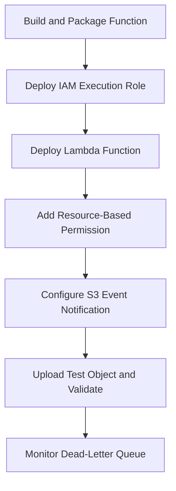

# README

## Overview

Lambda and event-driven application deployment for Amazon S3 covers the packaging, permission configuration, deployment ordering, dead-letter queue setup, environment variable management, versioning and aliasing, safe update procedures, and post-deployment validation required to deploy and operate Lambda functions that process S3 events reliably in production. It addresses the full event-driven deployment lifecycle from function packaging through S3 event notification configuration, dependency ordering, and validation that the end-to-end workflow operates correctly.

This section of the Backend Engineering Playbook provides a structured reference for backend engineers and platform teams who deploy Lambda functions triggered by S3 object events for workflows such as image transformation, document processing, metadata extraction, file validation, and data ingestion.

The focus is on practical event-driven deployment engineering: packaging functions correctly for S3 workflows, configuring permissions and notifications in the correct order, managing function updates safely with aliases, and validating the complete event pipeline after each deployment.

## Navigation

| # | File | Description |
|---|---|---|
| 01 | [01- Packaging Lambda Functions for S3 Workflows](./01-%20Packaging%20Lambda%20Functions%20for%20S3%20Workflows.md) | Building and packaging Lambda functions that process S3 events, including dependencies and deployment packages |
| 02 | [02- Dependency Bundling and Deployment Packages](./02-%20Dependency%20Bundling%20and%20Deployment%20Packages.md) | Bundling Python dependencies, managing package size, layers, and container image packaging for S3 functions |
| 03 | [03- Lambda Permissions and S3 Event Configuration](./03-%20Lambda%20Permissions%20and%20S3%20Event%20Configuration.md) | IAM execution roles, S3 read permissions, resource-based Lambda policies, and S3 event notification configuration |
| 04 | [04- Event Source and Notification Deployment Ordering](./04-%20Event%20Source%20and%20Notification%20Deployment%20Ordering.md) | Correct deployment ordering for S3 buckets, Lambda functions, execution roles, resource permissions, and notifications |
| 05 | [05- SQS Dead-Letter Queue Deployment](./05-%20SQS%20Dead-Letter%20Queue%20Deployment.md) | Deploying SQS dead-letter queues for Lambda, configuring retry behavior, and handling event processing failures |
| 06 | [06- Lambda Environment Variables and Secrets](./06-%20Lambda%20Environment%20Variables%20and%20Secrets.md) | Configuring environment variables, retrieving secrets from Secrets Manager, and managing sensitive configuration |
| 07 | [07- Lambda Versioning and Aliases](./07-%20Lambda%20Versioning%20and%20Aliases.md) | Publishing Lambda versions, managing aliases, and using aliases to control which version receives S3 events |
| 08 | [08- Safe Function Updates and Rollback](./08-%20Safe%20Function%20Updates%20and%20Rollback.md) | Deploying updated Lambda functions safely using aliases, weighted routing, and rollback by alias pointer update |
| 09 | [09- Event-Driven Deployment Validation](./09-%20Event-Driven%20Deployment%20Validation.md) | Validating the complete S3-to-Lambda event pipeline after deployment through end-to-end testing |

## Why Event-Driven Deployment Engineering Matters

S3-triggered Lambda deployments involve multiple interdependent resources that must be created and configured in the correct order. A deployment that omits the resource-based permission, configures the notification before the function exists, or deploys without a dead-letter queue creates a pipeline that fails silently or loses events.

Common event-driven deployment risks include:

- S3 event notification configured before the Lambda function resource permission exists, causing all event deliveries to fail with `AccessDenied`.
- Missing dead-letter queue configuration, causing failed event processing to be silently discarded without any alerting or investigation capability.
- Function updates deployed directly to the production alias without validation, causing all S3 events to be processed by broken code immediately.
- Environment variables containing plaintext secrets that are exposed in deployment logs or Lambda configuration API responses.
- Deployment packages exceeding the Lambda size limit because dependencies were not managed correctly, causing deployment failures.
- Post-deployment validation not performed, leaving a broken event pipeline undiscovered until application behavior reveals it.

Effective event-driven S3 deployment combines correct dependency ordering, resource-based permission configuration, dead-letter queue setup, alias-based release management, and end-to-end pipeline validation after every deployment.

## Documentation Structure

This section is organized into focused documents progressing from function packaging through permission and notification configuration, deployment ordering, failure handling, safe release management, and validation.

| Area | Primary focus |
|---|---|
| Packaging | Building and bundling Lambda functions and dependencies for deployment |
| Permissions and notifications | IAM roles, resource-based policies, and S3 event notification configuration |
| Deployment ordering | Correct sequencing of S3, Lambda, IAM, and notification resource creation |
| Failure handling | Dead-letter queues, retry configuration, and failed event management |
| Configuration | Environment variables, secrets management, and sensitive value handling |
| Release management | Lambda versioning, aliases, and safe function update workflows |
| Validation | End-to-end event pipeline validation after deployment |

## Core Event-Driven Deployment Principles

### Configure Resources in the Correct Order

S3 event notification configuration must reference a Lambda function that already exists and has a resource-based permission granting S3 the right to invoke it. Create the IAM execution role, deploy the Lambda function, add the resource-based permission, and configure the S3 event notification in that order. IaC tools that declare these dependencies explicitly will enforce this ordering automatically.

### Always Deploy a Dead-Letter Queue

Configure a dead-letter queue (DLQ) for every Lambda function that processes S3 events. Without a DLQ, failed invocations after the retry limit are silently discarded. A DLQ preserves failed events for investigation, replay, and alerting, which is essential for any production data processing pipeline.

### Use Aliases for Production Traffic Management

Configure S3 event notifications to point to a Lambda alias rather than the `$LATEST` version or an unqualified ARN. This allows function updates to be deployed and validated on a new version before the alias pointer is updated to route production traffic to the new code. Rollback is an alias pointer update, not a code redeployment.

### Retrieve Secrets at Runtime

Do not embed secrets or sensitive configuration in Lambda environment variables in plaintext. Retrieve secrets from AWS Secrets Manager or Parameter Store at function startup or per invocation as appropriate. Encrypt Lambda environment variables with a KMS key for the environment variables layer.

### Validate the End-to-End Pipeline

After every deployment, upload a test object to the S3 bucket and verify that the Lambda function is invoked, processes the event correctly, and produces the expected result. Do not rely on the absence of errors as evidence that the pipeline is working.

## Recommended Event-Driven Deployment Workflow

## Operational Standards

- **Deployment ordering:** Declare IAM role, Lambda function, resource-based permission, and S3 notification dependencies explicitly in IaC to enforce correct creation order.
- **Dead-letter queue:** Deploy a DLQ for every Lambda function that processes S3 events. Alert on DLQ message arrival.
- **Aliases:** Point S3 event notifications to Lambda aliases. Update the alias pointer to release a new function version to production traffic.
- **Secrets:** Retrieve secrets from Secrets Manager or Parameter Store at runtime. Encrypt Lambda environment variables with KMS.
- **Package size:** Manage dependency size using layers or container images when the deployment package approaches the Lambda size limit.
- **Validation:** Upload a test object and verify end-to-end event processing after every deployment. Do not rely on the absence of deployment errors as validation.
- **Retry and timeout:** Configure appropriate Lambda timeout and retry settings for the expected S3 event processing time and acceptable failure behavior.

## Key Takeaways

- S3 event notification, Lambda resource-based permission, and IAM execution role must be deployed in the correct order; incorrect ordering causes all event deliveries to fail.
- Dead-letter queues are essential for production event-driven pipelines; without one, failed processing is silently discarded.
- Lambda aliases enable safe function updates and instant rollback by alias pointer update rather than code redeployment.
- Secrets must not be stored as plaintext Lambda environment variables; retrieve them from Secrets Manager or Parameter Store at runtime.
- End-to-end pipeline validation by uploading a test object is the only reliable way to confirm that the complete S3-to-Lambda event workflow is operational after deployment.
