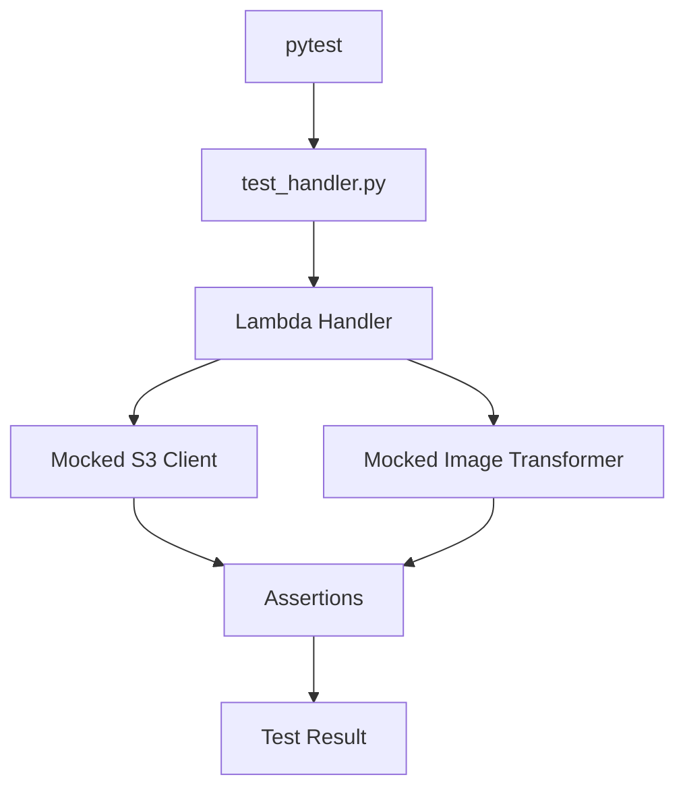

# README

## Overview

This directory contains automated tests for the S3-triggered image-processing Lambda application.

The tests validate the Lambda handler's event-processing behavior, S3 interactions, input validation, output generation, and failure handling. They are designed to run locally without accessing real AWS resources.

The test suite focuses on the handler boundary:

- Accepting direct S3 event notifications.
- Processing S3 events wrapped in SQS messages.
- Validating bucket names, object keys, event types, and object sizes.
- Downloading source objects and uploading transformed images.
- Handling malformed events and AWS operation failures.
- Returning partial batch failure responses for SQS invocation.
- Preserving deterministic output keys for duplicate notifications.

Image transformation logic is tested separately in `image_transformer` tests. This separation keeps handler tests focused on orchestration and AWS integration behavior.

## Directory Structure

```text
tests/
├── README.md
└── test_handler.py
```

| File | Responsibility |
|---|---|
| `test_handler.py` | Tests Lambda event handling, S3 operations, validation, and failure behavior |
| `README.md` | Documents test setup, execution, coverage, and troubleshooting |

## Test Scope

### Event Handling

The handler supports two event shapes:

| Invocation type | Event structure | Expected behavior |
|---|---|---|
| Direct S3 invocation | S3 event with `Records` | Process eligible object-created records |
| SQS-wrapped S3 event | SQS records containing serialized S3 events | Parse and process each message independently |

The tests verify that valid events are processed and irrelevant events are ignored.

### Input Validation

The handler tests cover:

- Missing or empty event records.
- Unexpected source buckets.
- Objects outside the configured input prefix.
- Non-object-created S3 events.
- Missing object size information.
- Zero-byte objects.
- Objects exceeding the configured size limit.
- URL-encoded object keys.
- Missing required output bucket configuration.

Validation must happen before unnecessary S3 downloads or image transformation.

### S3 Operations

The test suite verifies the expected interactions with the S3 client.

| Operation | Expected behavior |
|---|---|
| `get_object` | Downloads the source image from the configured input bucket |
| `put_object` | Uploads the transformed image to the output bucket |
| Object key handling | Maps the input prefix to the output prefix |
| Metadata handling | Preserves source bucket and key information in output metadata |

The tests use a mocked S3 client. They do not create buckets, upload real objects, or require AWS credentials.

### Failure Handling

Failure scenarios include:

- S3 download failures.
- Image transformation failures.
- S3 upload failures.
- Invalid JSON in SQS message bodies.
- Individual message failures in a multi-message SQS batch.
- Malformed SQS records.

The expected behavior depends on the invocation mechanism.

**Direct S3 asynchronous invocation**

An unhandled processing exception must propagate to the Lambda runtime. Lambda can then apply the configured asynchronous retry policy and failure destination.

**SQS invocation**

The handler must return failed message identifiers using the partial batch response format:

```json
{
  "batchItemFailures": [
    {
      "itemIdentifier": "message-001"
    }
  ]
}
```

The Lambda event source mapping must have `ReportBatchItemFailures` enabled for this response to control message retries.

A successful message must not be retried merely because another message in the same batch failed.

## Test Architecture

The tests isolate the Lambda handler from AWS and the image transformation implementation.



### Mocking Strategy

| Dependency | Test implementation | Reason |
|---|---|---|
| S3 client | `unittest.mock.MagicMock` | Prevents real AWS API calls |
| Image transformer | `MagicMock` | Isolates handler orchestration |
| Environment variables | `monkeypatch` | Provides deterministic configuration |
| S3 response body | `io.BytesIO` | Simulates an S3 streaming response |
| SQS message body | Serialized JSON | Reproduces the actual event payload format |

The S3 mock is configured to return a response containing a streaming body, content length, and content type.

The image transformer mock returns deterministic output bytes and a MIME type. This makes it possible to assert the exact arguments passed to `put_object`.

## Prerequisites

Run the tests from the image-processing project root.

Required software:

- Python 3.10 or later, matching the project's supported runtime.
- `pip`.
- `pytest`.
- `boto3` and the application's runtime dependencies.

The tests do not require:

- An AWS account.
- AWS access keys.
- An S3 bucket.
- A deployed Lambda function.
- Terraform deployment.
- Network connectivity to AWS.

Install the project's dependencies using its existing dependency configuration:

```bash
python -m pip install -r src/requirements.txt
python -m pip install pytest
```

If the project has a separate development requirements file, install that file instead of installing test dependencies independently.

## Running Tests

Execute all handler tests:

```bash
python -m pytest tests/test_handler.py -v
```

Run the complete project test suite from the project root:

```bash
python -m pytest -v
```

Run a specific test:

```bash
python -m pytest tests/test_handler.py::test_direct_s3_event_downloads_and_processes_image -v
```

Run tests matching a keyword:

```bash
python -m pytest tests/test_handler.py -k "sqs" -v
```

Run with short tracebacks:

```bash
python -m pytest tests/test_handler.py -v --tb=short
```

Generate a coverage report when `pytest-cov` is installed:

```bash
python -m pip install pytest-cov

python -m pytest tests/test_handler.py \
    --cov=src.handler \
    --cov-report=term-missing
```

Coverage is useful for identifying untested branches, but a high percentage does not guarantee correct retry, authorization, or event-processing behavior.

## Expected Test Behavior

The tests should verify the following outcomes:

| Scenario | Expected result |
|---|---|
| Valid direct S3 event | Source object is downloaded, transformed, and uploaded |
| URL-encoded object key | Key is decoded before S3 access |
| Unexpected bucket | Event is ignored |
| Object outside input prefix | Event is ignored |
| Non-creation event | Event is ignored |
| Zero-byte object | No download or transformation |
| Object exceeding size limit | No download or transformation |
| Valid SQS-wrapped event | Message is processed and no batch failure is returned |
| Multiple SQS messages | Each message is processed independently |
| Failed SQS message | Its message ID is returned in `batchItemFailures` |
| Invalid SQS JSON | Message is reported as failed |
| Transformation failure | Output upload does not occur |
| Direct invocation upload failure | Exception propagates |
| Duplicate notification | Deterministic output key is reused |

The test suite uses mocks and therefore verifies application-level behavior rather than actual AWS service behavior.

## Configuration Used by Tests

The test fixture configures the following environment variables:

| Variable | Test value | Purpose |
|---|---|---|
| `INPUT_BUCKET` | `image-processing-input-test` | Source bucket |
| `OUTPUT_BUCKET` | `image-processing-output-test` | Destination bucket |
| `INPUT_PREFIX` | `uploads/` | Accepted input object prefix |
| `OUTPUT_PREFIX` | `processed/` | Destination object prefix |
| `MAX_INPUT_SIZE_MB` | `10` | Maximum accepted source object size |
| `LOG_LEVEL` | `DEBUG` | Test logging level |

These values are isolated using pytest's `monkeypatch` fixture. They do not modify the developer's shell environment.

## Important Testing Considerations

### Direct S3 Events and SQS Events Are Different

The project's Terraform configuration uses S3 event notifications to invoke Lambda directly. The SQS failure queue is configured as an asynchronous invocation destination.

This means the SQS-wrapped event tests validate the handler's supported SQS event-processing path, but they do not prove that the configured Terraform architecture uses SQS as its primary event source.

Do not confuse an asynchronous Lambda failure destination with an SQS event source mapping.

### Partial Batch Failure Configuration

Returning `batchItemFailures` is not sufficient by itself to enable partial retries.

For an SQS event source mapping, configure:

```hcl
function_response_types = ["ReportBatchItemFailures"]
```

Without this configuration, Lambda may treat the batch response differently from the intended per-message retry behavior.

### Duplicate Event Delivery

S3 event notifications provide at-least-once delivery semantics. Duplicate notifications are possible.

The tests verify deterministic output keys, which prevent duplicate events from generating different output object names.

However, deterministic keys alone do not guarantee complete idempotency. Concurrent duplicate processing can still perform repeated downloads, transformations, and writes.

For workloads requiring stronger processing guarantees, consider:

- Version-aware object identity.
- ETag-based processing records.
- DynamoDB-backed idempotency records.
- Conditional writes.
- Explicit processing states and recovery rules.

### Mocked Tests Versus AWS Integration Tests

Mocked tests validate application behavior but cannot verify:

- Actual IAM authorization.
- S3 notification delivery.
- Lambda asynchronous retry behavior.
- SQS failure destination delivery.
- Bucket notification configuration.
- CloudWatch log delivery.
- Terraform resource dependencies.

These behaviors require separate integration or deployment verification.

## Troubleshooting

| Problem | Likely cause | Diagnostic action |
|---|---|---|
| `ModuleNotFoundError` for `handler` | Incorrect import path or test working directory | Run pytest from the project root and verify the package structure |
| `ModuleNotFoundError` for `boto3` | Runtime dependencies are not installed | Install `src/requirements.txt` |
| Mock assertions fail | Handler implementation or expected arguments have changed | Inspect the actual mock call arguments |
| Environment variable tests fail | Environment values are not isolated correctly | Check fixture setup and `monkeypatch` usage |
| SQS failure response differs | Handler response contract has changed | Inspect `batchItemFailures` construction |
| Tests unexpectedly access AWS | A real client or dependency was not mocked | Verify the handler uses the patched client |
| Image transformation tests fail | Transformation behavior differs from the mocked contract | Run the dedicated image transformer tests |

When a test fails, inspect the traceback and the actual mocked calls before changing assertions. Assertions should represent the intended application contract rather than merely accommodating an implementation defect.

## Production Verification Boundaries

A successful local test run does not establish that the deployed pipeline is production-ready.

Validate the following separately in an AWS test environment:

- The Lambda execution role can read only the intended input objects.
- The execution role can write only to the intended output prefix.
- The S3 bucket notification targets the correct Lambda function.
- The Lambda resource policy permits invocation by the intended S3 bucket.
- The input and output buckets are separate or otherwise protected against recursive invocation.
- The asynchronous invocation configuration has the intended retry and failure destination behavior.
- The failure destination has the required permissions.
- CloudWatch logs contain sufficient diagnostic information.
- Duplicate and failed event processing can be investigated and recovered.

Integration tests should use isolated test buckets, non-production credentials, and deterministic cleanup procedures. Avoid using production data for automated test execution.

## Key Takeaways

- Handler tests validate event parsing, input validation, S3 orchestration, and failure behavior without making real AWS calls.
- Direct S3 asynchronous invocation and SQS event-source invocation have different retry and failure-response contracts.
- SQS partial batch failure handling requires `ReportBatchItemFailures` on the event source mapping.
- Deterministic output keys help tolerate duplicate notifications, but stronger idempotency may require persistent processing state.
- Mocked tests must be complemented by AWS integration and deployment verification for IAM, notifications, retries, and failure destinations.