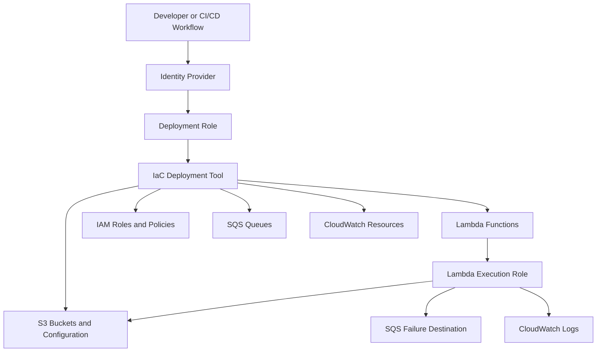
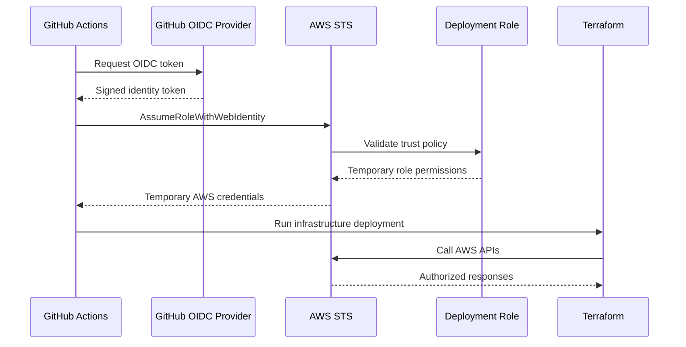

# 01- Least-Privilege Deployment Roles

## Overview

Deploying Amazon S3 infrastructure requires permissions across multiple AWS services. A deployment workflow may create buckets, configure encryption, manage IAM policies, deploy Lambda functions, configure event notifications, create SQS queues, and provision CloudWatch resources.

Using broad permissions such as `AdministratorAccess` for routine deployments increases the impact of compromised credentials, malicious workflow changes, and accidental infrastructure modifications.

A least-privilege deployment role grants only the permissions required for a defined deployment responsibility. It separates infrastructure provisioning from application runtime access and operational administration.

This document focuses on deployment roles used by Terraform, CloudFormation, CDK, and CI/CD workflows that provision S3-based systems.

## Deployment Role Architecture

A production deployment architecture should separate the identity that initiates a deployment from the permissions used to provision AWS resources.



The identities have different responsibilities:

| Identity | Responsibility | Typical permissions |
|---|---|---|
| CI/CD identity | Authenticate and assume deployment role | `sts:AssumeRole` |
| Deployment role | Provision and update infrastructure | Scoped S3, Lambda, IAM, SQS, and CloudWatch management actions |
| Lambda execution role | Run image-processing code | Read input objects, write output objects, publish logs and failure records |
| Operations role | Investigate and recover production resources | Read-only inspection and explicitly approved recovery actions |

The deployment role should not be reused as the Lambda execution role. Infrastructure provisioning and application execution have different trust boundaries and permission requirements.

## Deployment Role Responsibilities

### Infrastructure provisioning

The deployment role is responsible for creating and managing the resources declared by the infrastructure-as-code configuration.

For the image-processing project, this may include:

- Input and output S3 buckets.
- Bucket encryption, versioning, lifecycle, and public-access configuration.
- Lambda functions and invocation permissions.
- Lambda execution roles and their policies.
- SQS failure destination queues.
- CloudWatch log groups and alarms.
- S3 event notification configuration.

The exact permissions depend on the resources managed by the deployment.

### Application execution

The Lambda execution role is assumed by the Lambda service when the function runs.

It should not have infrastructure-management permissions such as:

- `s3:CreateBucket`
- `s3:PutBucketPolicy`
- `iam:CreateRole`
- `iam:AttachRolePolicy`
- `lambda:CreateFunction`

Instead, it should receive only the data-plane and runtime permissions required by the application.

For example:

| Runtime operation | Required permission |
|---|---|
| Read source object | `s3:GetObject` |
| Write processed object | `s3:PutObject` |
| Publish failed invocation record | `sqs:SendMessage` |
| Create log stream | `logs:CreateLogStream` |
| Write log events | `logs:PutLogEvents` |

This separation prevents application code from modifying the infrastructure that executes it.

## Trust Relationships

An IAM role has a trust policy that determines which principals can assume it.

The deployment role should trust only the intended deployment identity, such as:

- A specific GitHub Actions OIDC identity.
- A designated AWS account deployment principal.
- A controlled organizational identity provider.
- A dedicated automation role.

The trust policy and the role's permissions policy solve different problems.

| Policy type | Purpose |
|---|---|
| Trust policy | Determines who can assume the role |
| Identity-based permissions policy | Determines what the assumed role can do |
| Resource-based policy | Controls access to a resource, such as an S3 bucket |
| Permissions boundary | Sets the maximum permissions available to a role or user |
| Service control policy | Establishes organization-level permission guardrails |

A restrictive permissions policy does not compensate for an overly broad trust policy. Both must be reviewed.

## GitHub Actions OIDC Deployment

For GitHub Actions, use OpenID Connect federation instead of storing long-lived AWS access keys as repository secrets.

The workflow requests an OIDC token from GitHub and exchanges it through AWS STS for temporary role credentials.



### OIDC provider configuration

The AWS account must have an IAM OIDC identity provider configured for GitHub Actions.

Typical provider settings:

| Setting | Value |
|---|---|
| Provider URL | `https://token.actions.githubusercontent.com` |
| Audience | `sts.amazonaws.com` |
| Identity protocol | OpenID Connect |

The provider should be created once per AWS account and reused by deployment roles that trust the same identity provider.

### Deployment role trust policy

The following example trusts one GitHub repository and one deployment branch.

Replace the repository owner, repository name, and branch with the actual deployment identity.

```json
{
  "Version": "2012-10-17",
  "Statement": [
    {
      "Sid": "AllowGitHubActionsDeployment",
      "Effect": "Allow",
      "Principal": {
        "Federated": "arn:aws:iam::123456789012:oidc-provider/token.actions.githubusercontent.com"
      },
      "Action": "sts:AssumeRoleWithWebIdentity",
      "Condition": {
        "StringEquals": {
          "token.actions.githubusercontent.com:aud": "sts.amazonaws.com",
          "token.actions.githubusercontent.com:sub": "repo:example-org/s3-image-processing:ref:refs/heads/main"
        }
      }
    }
  ]
}
```

The `sub` condition restricts assumption to the specified repository and branch.

For GitHub Actions environments, the subject claim has a different format. For example, a workflow using the `production` environment may use:

```text
repo:example-org/s3-image-processing:environment:production
```

The trust policy must match the actual token subject. Do not use a wildcard subject unless the deployment design explicitly requires it and additional restrictions are in place.

### GitHub Actions workflow permissions

The workflow needs permission to request an OIDC token.

```yaml
permissions:
  contents: read
  id-token: write
```

A deployment step can use the AWS credentials action:

```yaml
- name: Configure AWS credentials
  uses: aws-actions/configure-aws-credentials@v4
  with:
    role-to-assume: arn:aws:iam::123456789012:role/s3-image-processing-deployment
    aws-region: ap-south-1
    role-session-name: github-actions-s3-deployment
```

Pin third-party actions to reviewed commit SHAs in production workflows rather than relying solely on mutable version tags.

Use GitHub environment protection rules for production deployments, including required reviewers where appropriate.

## Deployment Permissions for the Image-Processing Project

The deployment role needs permissions for the resources managed by the Terraform configuration.

A typical permission inventory is:

| AWS service | Example actions | Purpose |
|---|---|---|
| S3 | `s3:CreateBucket`, `s3:PutBucketVersioning`, `s3:PutEncryptionConfiguration`, `s3:PutLifecycleConfiguration` | Provision and configure buckets |
| Lambda | `lambda:CreateFunction`, `lambda:UpdateFunctionCode`, `lambda:UpdateFunctionConfiguration`, `lambda:AddPermission` | Deploy and configure functions |
| IAM | `iam:CreateRole`, `iam:PutRolePolicy`, `iam:PassRole` | Create execution roles and attach permissions |
| SQS | `sqs:CreateQueue`, `sqs:SetQueueAttributes`, `sqs:DeleteQueue` | Provision failure queues |
| CloudWatch Logs | `logs:CreateLogGroup`, `logs:PutRetentionPolicy`, `logs:DeleteLogGroup` | Manage Lambda log groups |
| CloudWatch | `cloudwatch:PutMetricAlarm`, `cloudwatch:DeleteAlarms` | Manage alarms |
| STS | `sts:GetCallerIdentity` | Verify the deployment identity |

This table is an action inventory, not a complete production policy. Exact API permissions must be derived from the Terraform resources and provider behavior.

Some AWS APIs require additional read permissions for Terraform refresh and planning. For example, Terraform may need to inspect existing resources before deciding whether to create, update, or delete them.

### Restrict IAM role creation

IAM permissions are particularly sensitive because a deployment role that can create arbitrary roles or attach arbitrary policies may be able to escalate privileges.

Avoid granting unrestricted permissions such as:

```json
{
  "Effect": "Allow",
  "Action": [
    "iam:*"
  ],
  "Resource": "*"
}
```

Instead:

- Restrict role creation to a dedicated naming convention.
- Restrict policy attachment to approved policies.
- Limit `iam:PassRole` to the specific Lambda execution role.
- Require approved permissions boundaries where appropriate.
- Prevent the deployment role from modifying its own trust policy or permissions.
- Separate IAM administration from routine application deployment when possible.

## Restricting iam:PassRole

`iam:PassRole` allows a principal to pass an IAM role to an AWS service.

When deploying Lambda, the deployment role needs to pass the Lambda execution role to the Lambda service.

A scoped example:

```json
{
  "Version": "2012-10-17",
  "Statement": [
    {
      "Sid": "PassImageProcessorExecutionRole",
      "Effect": "Allow",
      "Action": "iam:PassRole",
      "Resource": "arn:aws:iam::123456789012:role/s3-image-processing-image-processor",
      "Condition": {
        "StringEquals": {
          "iam:PassedToService": "lambda.amazonaws.com"
        }
      }
    }
  ]
}
```

This restricts role passing to one execution role and the Lambda service.

Do not grant `iam:PassRole` on `*` without a specific, justified requirement. A principal that can pass a highly privileged role to a service may indirectly gain access to that role's permissions.

## Example Deployment Policy Structure

For maintainability, separate deployment permissions into logical statements rather than using one broad wildcard statement.

The following example illustrates the structure of a deployment policy. It is intentionally a baseline template, not a drop-in policy for every Terraform configuration.

```json
{
  "Version": "2012-10-17",
  "Statement": [
    {
      "Sid": "InspectAccount",
      "Effect": "Allow",
      "Action": [
        "sts:GetCallerIdentity"
      ],
      "Resource": "*"
    },
    {
      "Sid": "ManageImageProcessingBuckets",
      "Effect": "Allow",
      "Action": [
        "s3:CreateBucket",
        "s3:DeleteBucket",
        "s3:GetBucketLocation",
        "s3:GetBucketVersioning",
        "s3:PutBucketVersioning",
        "s3:GetEncryptionConfiguration",
        "s3:PutEncryptionConfiguration",
        "s3:GetLifecycleConfiguration",
        "s3:PutLifecycleConfiguration",
        "s3:GetBucketPublicAccessBlock",
        "s3:PutBucketPublicAccessBlock",
        "s3:GetBucketOwnershipControls",
        "s3:PutBucketOwnershipControls",
        "s3:GetBucketNotification",
        "s3:PutBucketNotification"
      ],
      "Resource": [
        "arn:aws:s3:::example-image-processing-input",
        "arn:aws:s3:::example-image-processing-output"
      ]
    },
    {
      "Sid": "ManageImageProcessingObjects",
      "Effect": "Allow",
      "Action": [
        "s3:ListBucket"
      ],
      "Resource": [
        "arn:aws:s3:::example-image-processing-input",
        "arn:aws:s3:::example-image-processing-output"
      ]
    },
    {
      "Sid": "ManageImageProcessingLambda",
      "Effect": "Allow",
      "Action": [
        "lambda:CreateFunction",
        "lambda:DeleteFunction",
        "lambda:GetFunction",
        "lambda:GetFunctionConfiguration",
        "lambda:UpdateFunctionCode",
        "lambda:UpdateFunctionConfiguration",
        "lambda:AddPermission",
        "lambda:RemovePermission",
        "lambda:GetPolicy",
        "lambda:PutFunctionEventInvokeConfig",
        "lambda:GetFunctionEventInvokeConfig",
        "lambda:DeleteFunctionEventInvokeConfig"
      ],
      "Resource": "arn:aws:lambda:ap-south-1:123456789012:function:example-image-processing-*"
    },
    {
      "Sid": "PassImageProcessorRole",
      "Effect": "Allow",
      "Action": "iam:PassRole",
      "Resource": "arn:aws:iam::123456789012:role/example-image-processing-execution",
      "Condition": {
        "StringEquals": {
          "iam:PassedToService": "lambda.amazonaws.com"
        }
      }
    }
  ]
}
```

Important limitations of this example:

- S3 bucket creation and deletion authorization may require resource-level handling that differs from permissions on an existing bucket ARN. Validate the policy against the exact AWS API calls.
- Lambda resource ARNs must match the function naming convention and Region.
- IAM role and policy management, SQS, CloudWatch, and other Terraform resources need their own scoped statements.
- Terraform data sources and refresh operations may require additional read permissions.
- Some IAM and account-level operations do not support resource-level restrictions and require `"Resource": "*"`.
- If Terraform creates randomly named buckets, static bucket ARNs will not match. Prefer deterministic names or tightly controlled naming conditions.

Use IAM Access Analyzer and CloudTrail evidence to refine the policy rather than granting broad permissions whenever an operation fails.

## Terraform Deployment Role

Terraform uses the credentials available in its execution environment. In CI/CD, these should be temporary credentials obtained by assuming the deployment role.

A provider configuration should not contain access keys:

```hcl
terraform {
  required_version = ">= 1.6.0"

  required_providers {
    aws = {
      source  = "hashicorp/aws"
      version = "~> 6.0"
    }
  }
}

provider "aws" {
  region = var.aws_region
}
```

The AWS provider uses the standard AWS credential chain. In GitHub Actions, the credentials action configures temporary credentials for the workflow.

### Verify the deployment identity

Before running Terraform, verify which identity is active:

```bash
aws sts get-caller-identity
```

Expected output includes:

```json
{
  "Account": "123456789012",
  "Arn": "arn:aws:sts::123456789012:assumed-role/s3-image-processing-deployment/github-actions-s3-deployment",
  "UserId": "..."
}
```

The ARN should identify the intended deployment role, not a developer's personal IAM user or an administrator role.

### Run Terraform safely

```bash
terraform fmt -check
terraform init
terraform validate
terraform plan -out=tfplan
terraform apply tfplan
```

Protect the plan artifact and Terraform state because they may contain infrastructure details and sensitive values.

A plan should be reviewed before production application. Automated approval should not be treated as a substitute for controlling the identity and permissions that execute the plan.

## Separate Deployment Roles by Environment

Development, staging, and production should not share unrestricted deployment credentials.

A practical structure:

| Environment | Role | Trust boundary |
|---|---|---|
| Development | `s3-development-deployment` | Development branch or environment |
| Staging | `s3-staging-deployment` | Staging branch or protected environment |
| Production | `s3-production-deployment` | Protected production environment and approval |

Benefits include:

- Reduced blast radius.
- Environment-specific resource access.
- Independent approval controls.
- Easier auditing.
- Safer testing of infrastructure changes.

For stronger isolation, use separate AWS accounts for development, staging, and production.

## Permissions Boundaries and Organization Guardrails

A permissions boundary defines the maximum permissions an IAM identity can receive through identity-based policies.

It does not grant permissions by itself. The identity still needs an applicable allow policy.

For deployment roles, a permissions boundary can prevent accidental privilege escalation even if a policy is attached too broadly.

Service control policies can impose organization-wide restrictions, such as preventing member accounts from disabling required security controls.

Use these controls to enforce guardrails such as:

- Preventing public S3 access.
- Restricting deployment to approved Regions.
- Preventing changes to organization security roles.
- Requiring encryption for supported resources.
- Preventing unauthorized changes to audit infrastructure.

An explicit deny in an applicable policy overrides an allow. Diagnose deployment failures by checking identity policies, resource policies, permissions boundaries, session policies, and organization-level controls.

## Deployment Role Operational Controls

### Credential lifetime

Use temporary STS credentials rather than long-lived access keys.

Set the role's maximum session duration according to the deployment workload. Do not increase it unnecessarily to accommodate inefficient pipelines.

### Session names

Use meaningful role session names that identify the workflow or deployment execution.

Examples:

```text
github-actions-production
terraform-staging-apply
manual-approved-recovery
```

Session names improve auditability in CloudTrail and AWS security investigations.

### Production approvals

Require explicit approval before production infrastructure changes are applied.

A practical deployment sequence is:

1. Validate Terraform formatting and syntax.
2. Run static security and policy checks.
3. Generate a Terraform plan.
4. Review the plan.
5. Obtain production approval.
6. Assume the production deployment role.
7. Apply the approved plan.
8. Verify deployed resources.
9. Record the deployment result.

### Emergency access

Use a separate, controlled break-glass process for emergency operations.

Emergency access should be:

- Restricted to authorized operators.
- Protected by strong authentication.
- Logged and monitored.
- Time-limited where possible.
- Reviewed after use.

Do not make the routine CI/CD role an administrator merely to simplify incident recovery.

## Monitoring and Auditing

Use CloudTrail to investigate deployment activity.

Important events include:

- `AssumeRoleWithWebIdentity`
- `AssumeRole`
- `CreateBucket`
- `PutBucketPolicy`
- `PutBucketEncryption`
- `CreateFunction`
- `UpdateFunctionCode`
- `CreateRole`
- `PutRolePolicy`
- `PassRole`
- `CreateQueue`

Review:

- Which identity initiated the deployment.
- Which role was assumed.
- Which resources were changed.
- Whether unexpected permissions were granted.
- Whether public-access protections were modified.
- Whether a deployment role attempted actions outside its intended scope.

IAM Access Analyzer can identify unintended external access and help validate policy exposure.

For high-assurance environments, integrate policy validation into CI/CD before applying infrastructure changes.

## Common Mistakes

| Mistake | Risk | Recommended approach |
|---|---|---|
| Using `AdministratorAccess` for CI/CD | Compromised workflow can control the account | Create scoped deployment roles |
| Reusing the Lambda execution role for Terraform | Runtime code gains infrastructure-management access | Separate deployment and runtime identities |
| Trusting an entire GitHub organization | Unintended repositories may assume the role | Restrict OIDC subject claims |
| Using wildcard `iam:PassRole` | Privilege escalation through service role passing | Scope role ARN and target service |
| Storing AWS access keys in GitHub secrets | Long-lived credential exposure | Use OIDC federation |
| Allowing deployment roles to modify themselves | Weakens the deployment security boundary | Restrict IAM policy and trust-policy management |
| Granting only create permissions | Terraform refresh or update operations fail | Include required read and update actions |
| Using `"Resource": "*"` everywhere | Excessive access across the account | Apply resource-level restrictions where supported |
| Sharing one role across all environments | Increases cross-environment blast radius | Use environment-specific roles and accounts |
| Treating a successful Terraform plan as proof of authorization safety | A plan does not establish that the role is appropriately constrained | Review policies and validate actual deployment behavior |

## Deployment Security Checklist

### Identity and trust

- [ ] Deployment uses temporary credentials.
- [ ] CI/CD authenticates through OIDC or an approved federation mechanism.
- [ ] Trust policy restricts repository, branch, or protected environment.
- [ ] Production deployment requires appropriate approval.
- [ ] Role session names identify deployment executions.

### Permissions

- [ ] Deployment permissions are scoped to required services and resources.
- [ ] `iam:PassRole` is restricted to specific execution roles.
- [ ] Deployment role cannot modify its own trust policy or elevate its permissions.
- [ ] Runtime roles do not have infrastructure-management permissions.
- [ ] Permissions boundaries or organization guardrails are applied where required.
- [ ] Terraform refresh and planning permissions are included without unnecessary broad access.

### Operations

- [ ] Deployment identity is verified with `aws sts get-caller-identity`.
- [ ] Terraform plans are reviewed before production application.
- [ ] CloudTrail records deployment activity.
- [ ] IAM policy changes are reviewed.
- [ ] Emergency access is separate from routine deployment access.
- [ ] Role permissions are periodically reviewed and reduced when no longer needed.

## Key Takeaways

- Separate deployment, runtime, and operational identities according to their responsibilities.
- Use OIDC federation and temporary credentials for CI/CD instead of long-lived AWS access keys.
- Restrict `iam:PassRole`, IAM administration, and resource-management permissions carefully.
- Use environment-specific deployment roles, protected production approvals, and auditable sessions.
- Validate deployment permissions against actual Terraform operations and enforce organization-level security guardrails.