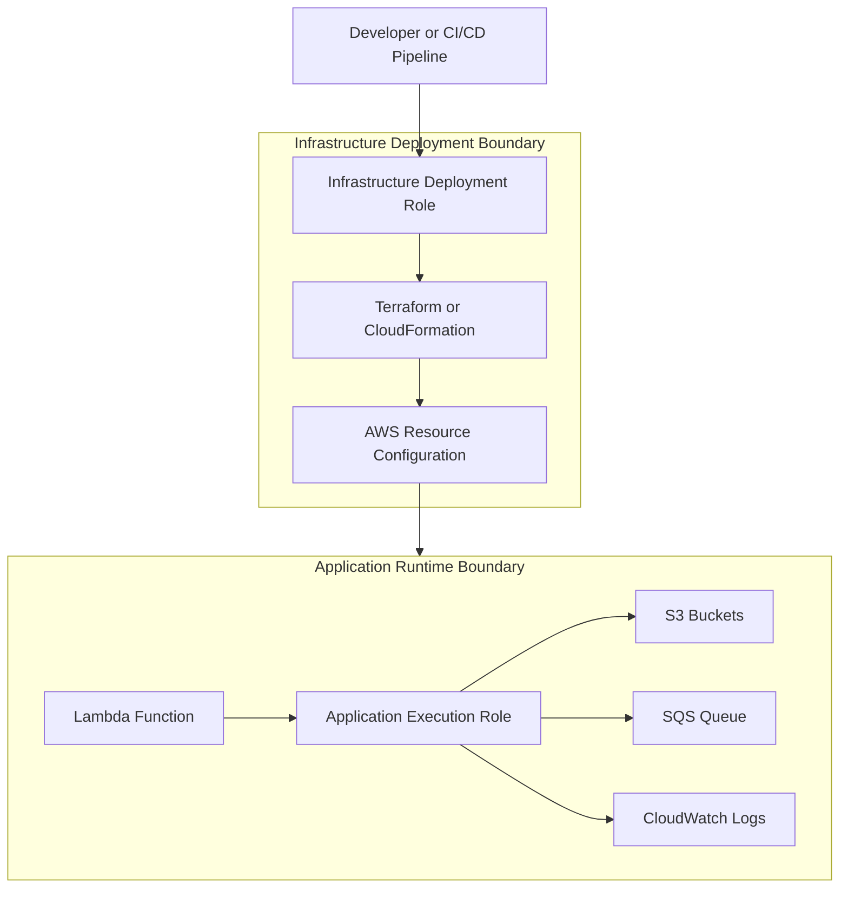

# 02- Separating Infrastructure and Application Permissions

## Overview

Amazon S3 applications require permissions to access buckets, upload objects, download files, process events, and manage related resources. Infrastructure deployment workflows require a different set of permissions to create and modify those resources.

Combining infrastructure and application permissions into a single IAM role creates an unnecessary security boundary. A compromised application could potentially modify bucket policies, change encryption settings, delete infrastructure, or weaken access controls.

A production architecture should separate these responsibilities through distinct IAM identities:

- **Infrastructure deployment identity:** Creates and manages AWS resources.
- **Application execution identity:** Performs runtime operations against existing resources.
- **CI/CD deployment identity:** Authenticates deployment pipelines and assumes narrowly scoped deployment roles.
- **Administrative identity:** Performs controlled security and infrastructure administration.

This separation follows least-privilege principles and reduces the impact of compromised application credentials.

## Why Separate Infrastructure and Application Permissions?

Infrastructure deployment and application execution have different operational requirements.

Consider a document-processing platform using:

- An S3 bucket for uploaded documents.
- A Lambda function for document processing.
- SQS for failed-message handling.
- CloudWatch for application logs.
- KMS for encryption.

The infrastructure deployment workflow must create these resources and configure their relationships.

The Lambda function only needs permission to read input documents, write processed documents, and publish logs.

Granting the Lambda execution role infrastructure-management permissions would unnecessarily increase its privileges.

### Permission responsibilities

| Responsibility | Infrastructure identity | Application identity |
|---|---|---|
| Create S3 buckets | Yes | No |
| Configure bucket encryption | Yes | No |
| Configure bucket policies | Yes | No |
| Configure lifecycle rules | Yes | No |
| Create IAM roles and policies | Yes, subject to deployment boundaries | No |
| Deploy Lambda functions | Yes | No |
| Read S3 objects | Only when required by deployment operations | Yes, when required |
| Upload application objects | Usually not required | Yes, when required |
| Delete application objects | Only when required by infrastructure operations | Only when required |
| Send messages to application queues | Not normally required | Only when required |
| Write application logs | Not normally required | Yes |
| Modify KMS key policies | Controlled infrastructure or security role | No |

The infrastructure identity manages the environment. The application identity operates within the environment.

## Recommended IAM Architecture

A practical architecture uses separate roles for deployment and runtime execution.



The deployment role creates and configures the resources. The runtime role receives only the permissions needed by the deployed application.

### Component responsibilities

| Component | Responsibility |
|---|---|
| Developer or CI/CD pipeline | Initiates infrastructure deployment |
| Deployment role | Authorizes infrastructure changes |
| Terraform or CloudFormation | Creates and updates AWS resources |
| Application execution role | Authorizes application runtime operations |
| S3 bucket | Stores application data |
| SQS queue | Receives messages or failed processing notifications |
| CloudWatch Logs | Stores application logs |

### Trust boundaries

The two roles should have different trust relationships.

For example:

- A GitHub Actions OIDC identity can assume the deployment role.
- A Lambda service principal can assume the application execution role.
- The application must not be able to assume the infrastructure deployment role.
- The deployment pipeline should not reuse application runtime credentials.

This prevents runtime workloads from inheriting infrastructure-management privileges.

## Infrastructure Deployment Identity

### Responsibilities

The infrastructure deployment identity manages AWS resources through infrastructure-as-code tools.

Typical responsibilities include:

- Creating S3 buckets.
- Configuring bucket versioning.
- Configuring default encryption.
- Applying bucket policies.
- Creating IAM roles and policies.
- Configuring Lambda functions.
- Creating SQS queues.
- Configuring event notifications.
- Creating CloudWatch log groups and alarms.
- Managing KMS keys and policies when authorized.

The deployment role should not automatically receive unrestricted administrator access.

### Deployment permission categories

| AWS service | Example actions | Purpose |
|---|---|---|
| S3 | `s3:CreateBucket`, `s3:PutBucketPolicy`, `s3:PutEncryptionConfiguration` | Configure storage infrastructure |
| IAM | `iam:CreateRole`, `iam:PutRolePolicy`, `iam:AttachRolePolicy` | Create execution identities |
| Lambda | `lambda:CreateFunction`, `lambda:UpdateFunctionCode` | Deploy functions |
| SQS | `sqs:CreateQueue`, `sqs:SetQueueAttributes` | Configure queues |
| CloudWatch | `logs:CreateLogGroup`, `cloudwatch:PutMetricAlarm` | Configure observability |
| KMS | `kms:CreateKey`, `kms:PutKeyPolicy` | Manage encryption infrastructure |

This is an illustrative action inventory, not a complete deployable policy. Exact permissions depend on the infrastructure resources and operations managed by the deployment pipeline.

### Deployment role trust policy

A deployment role can trust a GitHub Actions OIDC identity.

Example trust policy:

```json
{
  "Version": "2012-10-17",
  "Statement": [
    {
      "Sid": "AllowGitHubActionsOIDC",
      "Effect": "Allow",
      "Principal": {
        "Federated": "arn:aws:iam::123456789012:oidc-provider/token.actions.githubusercontent.com"
      },
      "Action": "sts:AssumeRoleWithWebIdentity",
      "Condition": {
        "StringEquals": {
          "token.actions.githubusercontent.com:aud": "sts.amazonaws.com",
          "token.actions.githubusercontent.com:sub": "repo:company/s3-platform:ref:refs/heads/main"
        }
      }
    }
  ]
}
```

Important controls:

- Restrict the trusted repository.
- Restrict the trusted branch or protected environment.
- Use short-lived credentials.
- Avoid wildcard trust conditions unless explicitly justified.
- Protect production deployment branches and environments.

The OIDC provider must exist in the AWS account before the role can reference it.

### GitHub Actions permissions

The workflow needs permission to request an OIDC token.

```yaml
name: Deploy S3 Infrastructure

on:
  push:
    branches:
      - main

permissions:
  contents: read
  id-token: write

jobs:
  deploy:
    runs-on: ubuntu-latest

    steps:
      - name: Checkout repository
        uses: actions/checkout@v4

      - name: Configure AWS credentials
        uses: aws-actions/configure-aws-credentials@v4
        with:
          role-to-assume: arn:aws:iam::123456789012:role/s3-infrastructure-deployment
          aws-region: ap-south-1

      - name: Verify AWS identity
        run: aws sts get-caller-identity

      - name: Initialize Terraform
        run: terraform init

      - name: Validate Terraform
        run: terraform validate

      - name: Generate Terraform plan
        run: terraform plan
```

The workflow should use a reviewed and approved deployment process before applying production changes.

Pin third-party GitHub Actions to verified commit SHAs in production workflows rather than relying indefinitely on mutable version tags.

### Restrict IAM PassRole

Infrastructure deployment often requires passing an IAM role to a service such as Lambda.

The deployment identity may need `iam:PassRole`, but this permission should be restricted to specific execution roles and service principals.

Example:

```json
{
  "Version": "2012-10-17",
  "Statement": [
    {
      "Sid": "PassApplicationExecutionRoleToLambda",
      "Effect": "Allow",
      "Action": "iam:PassRole",
      "Resource": "arn:aws:iam::123456789012:role/s3-application-execution",
      "Condition": {
        "StringEquals": {
          "iam:PassedToService": "lambda.amazonaws.com"
        }
      }
    }
  ]
}
```

Unrestricted `iam:PassRole` can allow a deployment identity to attach highly privileged roles to services it controls.

Use narrowly scoped role ARNs and service conditions.

## Application Execution Identity

### Responsibilities

The application execution identity is used by the running workload.

For example, a Lambda function processing S3 uploads may need to:

- Read original objects.
- Write processed objects.
- Send messages to an SQS failure queue.
- Write logs to CloudWatch.
- Decrypt objects when SSE-KMS is used.

It should not need permissions to create buckets, modify bucket policies, or create IAM roles.

### Lambda execution role trust policy

The Lambda service must be allowed to assume the execution role.

```json
{
  "Version": "2012-10-17",
  "Statement": [
    {
      "Sid": "AllowLambdaAssumeRole",
      "Effect": "Allow",
      "Principal": {
        "Service": "lambda.amazonaws.com"
      },
      "Action": "sts:AssumeRole"
    }
  ]
}
```

### Application runtime permissions

Example runtime policy:

```json
{
  "Version": "2012-10-17",
  "Statement": [
    {
      "Sid": "ReadInputObjects",
      "Effect": "Allow",
      "Action": [
        "s3:GetObject"
      ],
      "Resource": "arn:aws:s3:::company-s3-input/*"
    },
    {
      "Sid": "WriteProcessedObjects",
      "Effect": "Allow",
      "Action": [
        "s3:PutObject"
      ],
      "Resource": "arn:aws:s3:::company-s3-output/processed/*"
    },
    {
      "Sid": "SendFailureMessages",
      "Effect": "Allow",
      "Action": [
        "sqs:SendMessage"
      ],
      "Resource": "arn:aws:sqs:ap-south-1:123456789012:s3-processing-failures"
    }
  ]
}
```

The policy grants access only to the required object locations.

For a workload that processes objects from one bucket and writes results to another, separate bucket resources make the permission boundary explicit.

### CloudWatch logging permissions

A Lambda function also needs permission to write logs.

A typical logging policy is:

```json
{
  "Version": "2012-10-17",
  "Statement": [
    {
      "Sid": "WriteApplicationLogs",
      "Effect": "Allow",
      "Action": [
        "logs:CreateLogStream",
        "logs:PutLogEvents"
      ],
      "Resource": "arn:aws:logs:ap-south-1:123456789012:log-group:/aws/lambda/s3-image-processor:*"
    }
  ]
}
```

Create the log group through infrastructure deployment when you want controlled retention, encryption, and tagging.

If the application is responsible for creating its own log group, it may also require `logs:CreateLogGroup`. Prefer infrastructure-managed log groups when practical.

### KMS permissions

For SSE-KMS encrypted objects, application access may require additional KMS permissions.

| Operation | Typical KMS permission |
|---|---|
| Read encrypted object | `kms:Decrypt` |
| Upload encrypted object | `kms:GenerateDataKey` |
| Multipart upload | May require both `kms:GenerateDataKey` and `kms:Decrypt` |
| Copy encrypted object | Depends on source and destination encryption keys |

KMS key policies must also authorize the application identity or enable the appropriate IAM delegation.

Do not assume that granting `s3:GetObject` automatically grants permission to decrypt an SSE-KMS object.

## Separating Permissions in Terraform

Terraform can define separate IAM roles and policies for deployment and application execution.

A practical project structure is:

```text
infrastructure/
├── main.tf
├── variables.tf
├── outputs.tf
├── iam/
│   ├── deployment-role.tf
│   └── application-role.tf
├── s3/
│   └── buckets.tf
└── lambda/
    └── function.tf
```

### Application execution role

```hcl
resource "aws_iam_role" "application_execution" {
  name = "s3-application-execution"

  assume_role_policy = jsonencode({
    Version = "2012-10-17"
    Statement = [
      {
        Effect = "Allow"
        Principal = {
          Service = "lambda.amazonaws.com"
        }
        Action = "sts:AssumeRole"
      }
    ]
  })
}
```

### Application S3 permissions

```hcl
resource "aws_iam_role_policy" "application_s3_access" {
  name = "s3-application-access"
  role = aws_iam_role.application_execution.id

  policy = jsonencode({
    Version = "2012-10-17"
    Statement = [
      {
        Effect = "Allow"
        Action = [
          "s3:GetObject"
        ]
        Resource = "${aws_s3_bucket.input.arn}/*"
      },
      {
        Effect = "Allow"
        Action = [
          "s3:PutObject"
        ]
        Resource = "${aws_s3_bucket.output.arn}/processed/*"
      }
    ]
  })
}
```

### Application logging permissions

```hcl
resource "aws_iam_role_policy" "application_logging" {
  name = "s3-application-logging"
  role = aws_iam_role.application_execution.id

  policy = jsonencode({
    Version = "2012-10-17"
    Statement = [
      {
        Effect = "Allow"
        Action = [
          "logs:CreateLogStream",
          "logs:PutLogEvents"
        ]
        Resource = "${aws_cloudwatch_log_group.application.arn}:*"
      }
    ]
  })
}
```

### Lambda function

```hcl
resource "aws_lambda_function" "processor" {
  function_name = "s3-image-processor"
  role          = aws_iam_role.application_execution.arn

  runtime = "python3.12"
  handler = "handler.lambda_handler"

  filename         = "build/function.zip"
  source_code_hash = filebase64sha256("build/function.zip")

  timeout     = 60
  memory_size = 512

  environment {
    variables = {
      INPUT_BUCKET  = aws_s3_bucket.input.bucket
      OUTPUT_BUCKET = aws_s3_bucket.output.bucket
    }
  }

  depends_on = [
    aws_iam_role_policy.application_s3_access,
    aws_iam_role_policy.application_logging
  ]
}
```

Build the deployment package before running Terraform because `filebase64sha256` requires the referenced file to exist.

The example demonstrates the application role and its runtime permissions. The deployment role used to execute Terraform should be configured separately and should not be attached to the Lambda function.

## Backend Application Permissions

The same separation applies to Django, FastAPI, Flask, and other backend services.

A backend service that uploads files to S3 needs runtime object permissions, not infrastructure-management permissions.

For example:

```text
FastAPI Service
      |
      | IAM role credentials
      v
Application Execution Role
      |
      | s3:PutObject
      | s3:GetObject
      v
Private S3 Bucket
```

### Example Boto3 client

```python
import boto3
from botocore.config import Config


def create_s3_client():
    return boto3.client(
        "s3",
        region_name="ap-south-1",
        config=Config(
            retries={
                "mode": "standard",
                "max_attempts": 5,
            }
        ),
    )
```

The SDK obtains credentials from the configured AWS credential provider chain.

In production:

- Use an EC2 instance profile, ECS task role, EKS workload identity, or Lambda execution role as appropriate.
- Avoid long-lived access keys in application environment variables.
- Do not embed infrastructure deployment credentials in application containers.
- Restrict access to the application's required buckets and prefixes.

### Runtime role versus deployment role

| Scenario | Required identity |
|---|---|
| Terraform creates an S3 bucket | Infrastructure deployment role |
| Terraform configures bucket encryption | Infrastructure deployment role |
| FastAPI uploads a document | Application execution role |
| Lambda reads an uploaded image | Lambda execution role |
| GitHub Actions deploys infrastructure | CI/CD deployment role |
| Application generates a presigned URL | Application execution role with the required S3 permission |
| Security administrator changes a KMS key policy | Authorized security or key administration role |

Generating a presigned URL does not require the application to receive infrastructure-management permissions. The URL grants the recipient temporary access based on the signing principal's permissions and the applicable resource policies.

## Event-Driven Application Permission Boundaries

Consider an S3-triggered Lambda image-processing architecture.

```mermaid
flowchart TD
    Upload[Client Upload]
    Input[S3 Input Bucket]
    Lambda[Image Processor Lambda]
    Output[S3 Output Bucket]
    Queue[SQS Failure Queue]
    Logs[CloudWatch Logs]

    Upload --> Input
    Input --> Lambda
    Lambda --> Output
    Lambda --> Queue
    Lambda --> Logs
```



Each component has a distinct responsibility.

| Component | Required authorization |
|---|---|
| Client upload identity | Permission to upload to the approved input location |
| S3 notification configuration | Permission for S3 to invoke the Lambda function through the Lambda resource policy |
| Lambda execution role | Permission to read input objects |
| Lambda execution role | Permission to write output objects |
| Lambda execution role | Permission to send failure messages when using an SQS failure destination |
| Lambda execution role | Permission to write CloudWatch logs |

The S3 notification integration and Lambda execution role are separate authorization mechanisms.

The Lambda resource policy allows S3 to invoke the function. The execution role allows the function code to access AWS resources after invocation.

Do not confuse these permissions.

### Avoid recursive invocation

Use separate input and output buckets or prefixes.

For example:

```text
s3://company-assets/input/
s3://company-assets/processed/
```

Configure the notification to trigger only for the input prefix.

This prevents the Lambda function from repeatedly processing its own output objects.

## Validation and Verification

Permission separation should be tested using the actual deployment and runtime identities.

A successful deployment does not prove that the application role has the correct permissions.

### Verify the deployment identity

```bash
aws sts get-caller-identity
```

Run this command from the CI/CD deployment environment.

Confirm that the assumed role is the expected infrastructure deployment role.

### Verify the application identity

Run the same command from the application execution environment where practical.

For Lambda, inspect the configured execution role:

```bash
aws lambda get-function-configuration \
  --function-name s3-image-processor \
  --query 'Role'
```

The returned role ARN should identify the application execution role rather than the infrastructure deployment role.

### Inspect role policies

```bash
aws iam list-attached-role-policies \
  --role-name s3-application-execution
```

Inspect inline policies:

```bash
aws iam list-role-policies \
  --role-name s3-application-execution
```

Retrieve an inline policy:

```bash
aws iam get-role-policy \
  --role-name s3-application-execution \
  --policy-name s3-application-access
```

### Validate expected permissions

Use controlled test identities and test resources.

| Test | Expected result |
|---|---|
| Deployment role creates an approved S3 bucket | Allowed |
| Deployment role configures bucket encryption | Allowed when explicitly authorized |
| Application role reads an approved input object | Allowed |
| Application role writes to the approved output prefix | Allowed |
| Application role creates a new IAM role | Denied |
| Application role modifies the bucket policy | Denied |
| Application role deletes an unrelated bucket | Denied |
| CI/CD role assumes the deployment role from an untrusted repository | Denied |

Use IAM policy simulation as an additional validation mechanism, but do not treat it as a replacement for end-to-end testing. It does not reproduce every runtime condition, resource-policy interaction, service behavior, or cross-account authorization path.

### Validate application access

For a controlled test object:

```bash
aws s3api put-object \
  --bucket company-s3-input \
  --key validation/test.txt \
  --body ./test.txt
```

Read it using the application identity:

```bash
aws s3api get-object \
  --bucket company-s3-input \
  --key validation/test.txt \
  ./downloaded-test.txt
```

Test a prohibited operation using the same application identity:

```bash
aws s3api put-bucket-policy \
  --bucket company-s3-input \
  --policy file://bucket-policy.json
```

The application identity should receive an authorization failure unless bucket-policy administration is explicitly part of its approved responsibility.

## Operational Governance

Permission separation must remain effective after the initial infrastructure deployment.

### Regular access reviews

Review:

- IAM role trust policies.
- Attached and inline IAM policies.
- Unused permissions.
- Wildcard resource permissions.
- `iam:PassRole` permissions.
- KMS key policies.
- Cross-account access.
- CI/CD role trust conditions.
- Application role changes.

Use IAM Access Analyzer and CloudTrail to identify unintended access and unexpected API activity.

### Deployment controls

Production infrastructure changes should follow a controlled workflow:

1. Developer creates an infrastructure change.
2. CI validates formatting and configuration.
3. Security and policy checks run.
4. A deployment plan is reviewed.
5. Authorized deployment identity applies the approved changes.
6. Post-deployment checks verify the resulting resources.
7. CloudTrail records the relevant API activity.

### Runtime controls

Application runtime permissions should be reviewed independently from infrastructure permissions.

Monitor:

- Unexpected S3 access patterns.
- Authorization failures.
- Unusual object deletion activity.
- Unexpected KMS usage.
- Application role changes.
- Attempts to modify infrastructure resources.

Separate runtime and deployment audit trails where possible to make investigations easier.

## Common Mistakes

| Mistake | Why it is problematic | Recommended approach |
|---|---|---|
| Using one IAM role for Terraform and Lambda | Compromised application code may gain infrastructure-management privileges | Create separate deployment and execution roles |
| Giving application roles `s3:*` | Grants unnecessary access to bucket configuration and object operations | Restrict actions and resources |
| Giving deployment roles unrestricted `iam:*` | Allows broad identity and privilege management | Restrict IAM actions and resource ARNs |
| Using wildcard `iam:PassRole` | Can enable privilege escalation through service role assignment | Restrict role ARNs and target services |
| Using permanent AWS credentials in CI/CD | Increases credential exposure and rotation risk | Use OIDC federation and temporary credentials |
| Assuming Lambda execution permissions allow S3 invocation | The invocation relationship uses a separate Lambda resource policy | Configure `aws_lambda_permission` or the equivalent resource policy |
| Giving the application permission to modify bucket policies | Runtime compromise can weaken storage security | Keep bucket administration in the deployment boundary |
| Testing only with administrator credentials | Broad privileges hide missing runtime permissions | Test with actual application and deployment identities |
| Granting KMS permissions without reviewing key policy | KMS authorization may still fail | Validate both IAM and key-policy authorization |
| Deploying without post-deployment permission tests | Incorrect role configuration may remain undetected | Run positive and negative authorization tests |

## Production Readiness Checklist

### Infrastructure deployment

- [ ] Deployment and application identities are separate.
- [ ] CI/CD uses short-lived credentials.
- [ ] OIDC trust conditions restrict approved repositories and branches or environments.
- [ ] `iam:PassRole` is restricted to approved roles and services.
- [ ] Infrastructure permissions are limited to required resources and operations.
- [ ] Production changes require an approved deployment process.

### Application runtime

- [ ] Each workload has a dedicated execution role where practical.
- [ ] S3 permissions are restricted to approved buckets and prefixes.
- [ ] Runtime roles cannot create or modify IAM identities.
- [ ] Runtime roles cannot modify bucket policies or encryption configuration.
- [ ] KMS permissions are granted only when required.
- [ ] Application credentials are obtained through an approved workload identity mechanism.

### Validation and monitoring

- [ ] Deployment identity is verified with STS.
- [ ] Application execution role is verified.
- [ ] Positive authorization tests succeed.
- [ ] Negative authorization tests fail as expected.
- [ ] CloudTrail captures relevant management activity.
- [ ] IAM and resource policies are reviewed periodically.
- [ ] Unexpected permission changes generate appropriate alerts.

## Key Takeaways

- Infrastructure deployment and application execution should use separate IAM identities with distinct trust relationships and responsibilities.
- Deployment roles manage AWS resources, while application roles receive only the runtime permissions required by their workloads.
- Restrict `iam:PassRole`, use short-lived CI/CD credentials, and prevent application identities from modifying infrastructure.
- Validate both successful and prohibited operations using the actual deployment and application identities.
- Maintain permission separation through policy reviews, CloudTrail auditing, and controlled infrastructure deployment processes.