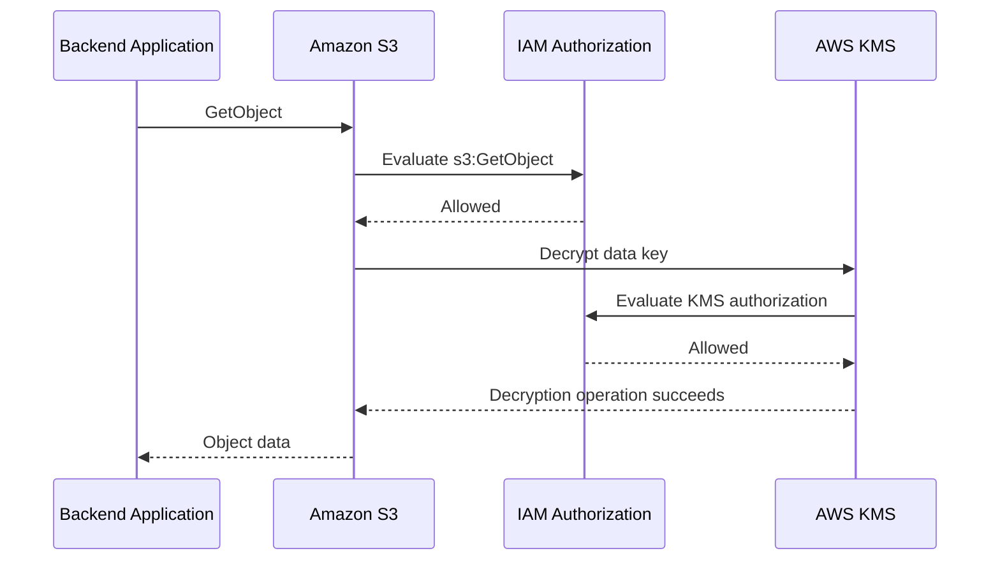
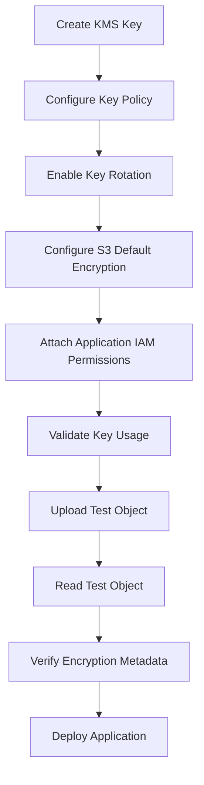
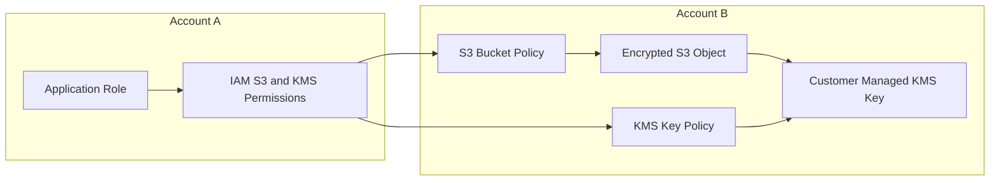

# 03- Encryption and Key Policy Validation

## Overview

Amazon S3 encryption protects objects at rest, but a production encryption design must also ensure that the correct principals can use the encryption keys and that unauthorized identities cannot access or administer them.

For SSE-KMS encrypted objects, successful access depends on multiple authorization layers:

- S3 permissions determine whether a principal can perform the requested object operation.
- IAM identity policies determine which S3 and KMS operations the principal may perform.
- KMS key policies and grants determine whether the principal is authorized to use the encryption key.
- Bucket policies, service control policies, permissions boundaries, and session policies can impose additional restrictions.
- Explicit denies override applicable allows.

Encryption validation should therefore be part of infrastructure deployment, application integration testing, and ongoing security reviews.

This document covers S3 server-side encryption, KMS key policies, IAM permissions, encryption context, and practical validation workflows.

## S3 Server-Side Encryption Options

Amazon S3 supports multiple server-side encryption approaches. The appropriate choice depends on key ownership, compliance requirements, operational complexity, and access-control needs.

| Encryption type | Key management | Application responsibility | Typical use case |
|---|---|---|---|
| SSE-S3 | Amazon S3 manages encryption keys | No direct KMS permissions required | General-purpose encrypted object storage |
| SSE-KMS | AWS KMS manages encryption keys | Requires appropriate KMS authorization | Centralized key governance and audit requirements |
| SSE-C | Customer supplies encryption key with requests | Must securely manage and provide the key | Specialized key-management requirements |

### SSE-S3

SSE-S3 uses keys managed by Amazon S3.

Advantages:

- Encryption is enabled without managing KMS keys.
- No application-level KMS permissions are required.
- Minimal operational complexity.

Limitations:

- Does not provide customer-managed KMS key policies.
- Does not provide the same customer-controlled key lifecycle and authorization model as SSE-KMS.

Use SSE-S3 when standard server-side encryption satisfies the application's requirements.

### SSE-KMS

SSE-KMS integrates S3 with AWS Key Management Service.

The encryption key is managed through KMS, allowing centralized control over key usage, access policies, rotation, and auditing.

Advantages:

- Customer-managed key policies.
- Centralized key governance.
- KMS audit events through CloudTrail.
- Ability to restrict encryption-key usage independently of S3 object access.
- Support for compliance-oriented key management.

Limitations:

- Requires correct KMS authorization.
- Introduces additional service dependencies.
- KMS request quotas and costs must be considered.
- Incorrect key policies can make objects inaccessible.

Use SSE-KMS when key-level authorization, customer-managed keys, or centralized encryption governance are required.

### SSE-C

SSE-C allows the customer to supply an encryption key with each relevant S3 request.

The customer is responsible for securely managing and transmitting the key.

Advantages:

- Customer controls the encryption key material.
- S3 does not manage the supplied key.

Limitations:

- Key distribution and storage become application responsibilities.
- Losing the key can make encrypted objects unrecoverable.
- Every relevant request must supply the correct encryption headers.
- Operational complexity is significantly higher.

SSE-C should be used only when its specific key-management model is required and the organization can reliably manage key availability and recovery.

## SSE-KMS Request and Authorization Flow

SSE-KMS involves both S3 and KMS during object operations.

For an application reading an encrypted object:

1. The application sends an authenticated request to S3.
2. S3 evaluates the application's S3 permissions.
3. S3 performs the required KMS decryption operation on behalf of the request.
4. KMS evaluates the applicable key policy, grants, and IAM authorization.
5. S3 returns the decrypted object data if authorization succeeds.

For an upload, S3 uses KMS to obtain the required data key material before storing the encrypted object.



The application does not normally call `kms:Decrypt` directly when using ordinary S3 SSE-KMS object retrieval. S3 performs the KMS operation as part of the object request.

The application identity still needs the applicable KMS authorization.

## Understanding the KMS Key Policy

### Key policy

A KMS key policy is a resource-based policy attached directly to a KMS key.

It defines which principals can administer or use the key.

A KMS key policy is a fundamental part of KMS authorization. IAM permissions alone do not automatically grant access to a customer-managed KMS key.

The key policy must either:

- Directly authorize the relevant principal; or
- Enable IAM policies in the account to delegate permissions, after which an appropriate IAM policy must grant the required operation.

### Key policy responsibilities

A production key policy should distinguish between:

- Key administrators.
- Application users.
- Infrastructure deployment identities.
- Security and audit identities.
- Cross-account principals, when applicable.

Avoid giving application workloads administrative permissions over the encryption key.

### Example key policy

The following example separates key administration from application usage.

Replace the account ID, Region, and role names with actual environment values.

```json
{
  "Version": "2012-10-17",
  "Statement": [
    {
      "Sid": "EnableAccountIAMDelegation",
      "Effect": "Allow",
      "Principal": {
        "AWS": "arn:aws:iam::123456789012:root"
      },
      "Action": "kms:*",
      "Resource": "*"
    },
    {
      "Sid": "AllowKeyAdministration",
      "Effect": "Allow",
      "Principal": {
        "AWS": "arn:aws:iam::123456789012:role/s3-key-administrator"
      },
      "Action": [
        "kms:DescribeKey",
        "kms:GetKeyPolicy",
        "kms:PutKeyPolicy",
        "kms:EnableKey",
        "kms:DisableKey",
        "kms:ScheduleKeyDeletion",
        "kms:CancelKeyDeletion",
        "kms:EnableKeyRotation",
        "kms:DisableKeyRotation",
        "kms:ListResourceTags",
        "kms:TagResource",
        "kms:UntagResource"
      ],
      "Resource": "*"
    },
    {
      "Sid": "AllowImageProcessorKeyUsage",
      "Effect": "Allow",
      "Principal": {
        "AWS": "arn:aws:iam::123456789012:role/image-processor-execution"
      },
      "Action": [
        "kms:Decrypt",
        "kms:GenerateDataKey"
      ],
      "Resource": "*"
    }
  ]
}
```

The first statement enables IAM-based delegation for the account. It does not mean every IAM identity automatically receives access to the key.

The application role is explicitly authorized for the KMS operations required by the example workload.

The key administrator can manage the key but is not automatically granted application-level object access.

### Important key policy considerations

- Keep key administration separate from application usage.
- Avoid granting `kms:*` to application roles.
- Restrict key usage to intended principals.
- Use conditions where appropriate to restrict encryption context or service usage.
- Preserve a recovery path for key administration.
- Test key policy changes before applying them to production keys.
- Avoid removing the only principal capable of administering or recovering the key.

A malformed or overly restrictive key policy can prevent further key administration and disrupt access to encrypted data.

## IAM Permissions for SSE-KMS

S3 and KMS permissions must be configured independently.

### Object read permissions

An application reading an SSE-KMS encrypted object generally requires:

| Layer | Permission | Purpose |
|---|---|---|
| S3 | `s3:GetObject` | Retrieve the object |
| KMS | `kms:Decrypt` | Decrypt the encrypted data key |
| KMS key policy | Authorization for the application principal | Permit key usage |

Example IAM policy:

```json
{
  "Version": "2012-10-17",
  "Statement": [
    {
      "Sid": "ReadEncryptedObjects",
      "Effect": "Allow",
      "Action": [
        "s3:GetObject"
      ],
      "Resource": "arn:aws:s3:::company-documents/private/*"
    },
    {
      "Sid": "DecryptDocumentObjects",
      "Effect": "Allow",
      "Action": [
        "kms:Decrypt"
      ],
      "Resource": "arn:aws:kms:ap-south-1:123456789012:key/example-key-id"
    }
  ]
}
```

### Object write permissions

An application writing an SSE-KMS encrypted object generally requires:

| Layer | Permission | Purpose |
|---|---|---|
| S3 | `s3:PutObject` | Store the object |
| KMS | `kms:GenerateDataKey` | Generate data key material |
| KMS key policy | Authorization for the application principal | Permit key usage |

Example:

```json
{
  "Version": "2012-10-17",
  "Statement": [
    {
      "Sid": "WriteEncryptedObjects",
      "Effect": "Allow",
      "Action": [
        "s3:PutObject"
      ],
      "Resource": "arn:aws:s3:::company-documents/private/*"
    },
    {
      "Sid": "GenerateEncryptionDataKeys",
      "Effect": "Allow",
      "Action": [
        "kms:GenerateDataKey"
      ],
      "Resource": "arn:aws:kms:ap-south-1:123456789012:key/example-key-id"
    }
  ]
}
```

### Additional permissions for specialized operations

The minimum KMS permissions depend on the actual S3 API operation and encryption configuration.

| Operation | Potential KMS permissions |
|---|---|
| Ordinary SSE-KMS upload | `kms:GenerateDataKey` |
| Ordinary SSE-KMS download | `kms:Decrypt` |
| Multipart SSE-KMS upload | `kms:GenerateDataKey`, `kms:Decrypt` |
| Copying an SSE-KMS encrypted object | Source-key decryption and destination-key encryption permissions |
| Direct KMS cryptographic operations | Permissions appropriate to the direct KMS API operation |

For multipart uploads, S3 may need `kms:Decrypt` in addition to `kms:GenerateDataKey`. Validate the exact API workflow rather than relying on a generic upload policy.

### Why `kms:Encrypt` is not always required

A common mistake is to grant `kms:Encrypt` automatically whenever an application uploads SSE-KMS objects.

For ordinary S3 SSE-KMS uploads, S3 generally uses `kms:GenerateDataKey` to obtain data key material. For reads, it uses `kms:Decrypt`.

Grant permissions according to the actual KMS operations rather than assuming that every encryption workflow requires the same action set.

## Encryption Context and Service Restrictions

### Encryption context

KMS encryption context is additional authenticated data associated with a cryptographic operation.

For S3 SSE-KMS, the encryption context can contain information identifying the object being encrypted.

For example, an S3 object encryption context can include:

```json
{
  "aws:s3:arn": "arn:aws:s3:::company-documents/private/report.pdf"
}
```

When S3 Bucket Keys are enabled, the encryption context used for KMS operations can instead reference the bucket ARN.

This distinction matters when writing KMS policy conditions.

### Restricting KMS usage to S3

A key policy can restrict cryptographic operations to requests originating through S3 in a particular account and Region.

Example:

```json
{
  "Sid": "AllowS3UseInApSouth1",
  "Effect": "Allow",
  "Principal": {
    "AWS": "arn:aws:iam::123456789012:role/document-api"
  },
  "Action": [
    "kms:Decrypt",
    "kms:GenerateDataKey"
  ],
  "Resource": "*",
  "Condition": {
    "StringEquals": {
      "kms:ViaService": "s3.ap-south-1.amazonaws.com",
      "kms:CallerAccount": "123456789012"
    }
  }
}
```

`kms:ViaService` restricts the use of the key to requests made through the specified AWS service endpoint.

This is useful when an application should use a key through S3 but should not perform direct cryptographic operations with that key.

### Encryption context conditions

Encryption context conditions can further restrict key usage.

For example, a policy can require a specific S3 encryption context.

```json
{
  "Sid": "RestrictToDocumentBucketContext",
  "Effect": "Allow",
  "Principal": {
    "AWS": "arn:aws:iam::123456789012:role/document-api"
  },
  "Action": [
    "kms:Decrypt",
    "kms:GenerateDataKey"
  ],
  "Resource": "*",
  "Condition": {
    "StringEquals": {
      "kms:ViaService": "s3.ap-south-1.amazonaws.com",
      "kms:CallerAccount": "123456789012",
      "kms:EncryptionContext:aws:s3:arn": "arn:aws:s3:::company-documents"
    }
  }
}
```

Use the bucket ARN condition only when the relevant requests actually use the bucket ARN as their encryption context, such as the applicable S3 Bucket Key configuration.

Without Bucket Keys, object-level encryption context may contain the object ARN instead. A condition expecting the bucket ARN can therefore deny valid requests.

Validate the actual encryption context before enforcing a restrictive condition.

## S3 Bucket Encryption Configuration

S3 bucket default encryption establishes the default encryption behavior for new objects.

Example Terraform configuration using SSE-KMS:

```hcl
resource "aws_s3_bucket_server_side_encryption_configuration" "documents" {
  bucket = aws_s3_bucket.documents.id

  rule {
    apply_server_side_encryption_by_default {
      sse_algorithm     = "aws:kms"
      kms_master_key_id = aws_kms_key.documents.arn
    }

    bucket_key_enabled = true
  }
}
```

### S3 Bucket Keys

S3 Bucket Keys reduce the number of KMS requests associated with SSE-KMS encrypted objects.

Without Bucket Keys, S3 may make a KMS request for each relevant object operation.

With Bucket Keys, S3 can use a bucket-level key hierarchy to reduce KMS request frequency.

Advantages:

- Lower KMS request volume.
- Reduced KMS request costs for workloads with many objects.
- Improved efficiency for high-volume object storage.

Trade-offs:

- The encryption context used in KMS authorization can differ.
- KMS audit events may no longer provide object-level encryption context for every operation.
- Policy conditions written for object-level context may stop matching.

Enable Bucket Keys where their cost and performance benefits are appropriate, but validate all encryption-context-dependent policies before deployment.

## Infrastructure Deployment Validation

Encryption and key policies should be validated before application deployment.

A safe deployment sequence is:



The sequence should be adjusted for dependencies in the infrastructure code.

The key policy and IAM permissions must be effective before testing application access.

### Terraform KMS key

```hcl
resource "aws_kms_key" "documents" {
  description             = "KMS key for encrypted S3 document storage"
  enable_key_rotation     = true
  deletion_window_in_days = 30

  tags = {
    Environment = var.environment
    Application = "document-storage"
  }
}
```

For a customer-managed symmetric KMS key, automatic key rotation can be enabled. Rotation does not require re-encrypting existing S3 objects manually; KMS retains the previous key material needed to decrypt data encrypted under earlier key versions.

### Validate bucket encryption

```bash
aws s3api get-bucket-encryption \
  --bucket company-documents
```

Expected configuration should identify:

- The encryption algorithm.
- The configured KMS key ARN, when applicable.
- Whether S3 Bucket Keys are enabled.

### Validate the KMS key

```bash
aws kms describe-key \
  --key-id alias/company-documents
```

Inspect:

- Key state.
- Key usage.
- Key specification.
- Key manager.
- Key ARN.
- Enabled status.

### Retrieve the key policy

```bash
aws kms get-key-policy \
  --key-id alias/company-documents \
  --policy-name default
```

Review the policy for:

- Correct principal ARNs.
- Key administration permissions.
- Application usage permissions.
- Cross-account access requirements.
- Explicit denies.
- Service and encryption-context conditions.

### Verify key rotation

```bash
aws kms get-key-rotation-status \
  --key-id alias/company-documents
```

Automatic rotation is not supported for every KMS key type. Verify the key specification and current AWS service capabilities before relying on automatic rotation.

## End-to-End Encryption Validation

A policy document can look correct while the actual application request still fails.

Validate encryption using the same IAM identity and request path used by the deployed workload.

### Upload a test object

The following command explicitly requests SSE-KMS:

```bash
aws s3api put-object \
  --bucket company-documents \
  --key validation/encryption-test.txt \
  --body ./encryption-test.txt \
  --server-side-encryption aws:kms \
  --ssekms-key-id alias/company-documents
```

Expected behavior:

- S3 accepts the upload.
- The object is stored using SSE-KMS.
- The caller has the necessary S3 and KMS permissions.

### Inspect object encryption metadata

```bash
aws s3api head-object \
  --bucket company-documents \
  --key validation/encryption-test.txt
```

Inspect:

- `ServerSideEncryption`
- `SSEKMSKeyId`
- `BucketKeyEnabled`

Do not assume that a successful upload proves that the intended KMS key was used. Verify the returned metadata.

### Download the object

```bash
aws s3api get-object \
  --bucket company-documents \
  --key validation/encryption-test.txt \
  ./downloaded-encryption-test.txt
```

Compare the downloaded file with the original.

```bash
sha256sum encryption-test.txt downloaded-encryption-test.txt
```

Matching checksums demonstrate that the retrieved content matches the uploaded test file.

### Test denied access

Use a separate test identity that intentionally lacks the required KMS permission.

Verify that:

- The identity cannot perform the protected operation.
- The denial is consistent with the intended policy boundary.
- The production application identity remains unaffected.

Perform negative tests against controlled test objects and non-production keys.

## Cross-Account KMS Validation

Cross-account access introduces additional authorization requirements.

Suppose an application in Account A needs to read an SSE-KMS encrypted object stored in Account B.

The request may require:

1. An IAM identity policy in Account A allowing the S3 operation.
2. A bucket policy in Account B allowing the external principal.
3. An IAM identity policy in Account A allowing the KMS operation.
4. A KMS key policy in Account B allowing the external principal or account delegation.
5. Any applicable conditions and organization controls to permit the request.



Cross-account key usage should be tested using the actual external role rather than an administrator identity in the key-owning account.

For cross-account SSE-KMS access, use a customer-managed KMS key. AWS-managed KMS keys are not suitable for granting arbitrary cross-account key access through customer-controlled key policies.

## Encryption Validation for Backend Applications

A backend application should use IAM roles or another approved temporary credential mechanism.

Avoid embedding KMS keys or AWS credentials in application configuration.

For a Python application using Boto3:

```python
import boto3
from botocore.config import Config


def create_s3_client(region: str):
    return boto3.client(
        "s3",
        region_name=region,
        config=Config(
            retries={
                "mode": "standard",
                "max_attempts": 5,
            },
            connect_timeout=5,
            read_timeout=30,
        ),
    )


def upload_encrypted_file(
    bucket: str,
    key: str,
    file_path: str,
    kms_key_arn: str,
) -> None:
    s3 = create_s3_client("ap-south-1")

    s3.upload_file(
        file_path,
        bucket,
        key,
        ExtraArgs={
            "ServerSideEncryption": "aws:kms",
            "SSEKMSKeyId": kms_key_arn,
            "BucketKeyEnabled": True,
        },
    )
```

The AWS SDK obtains credentials through the standard credential provider chain. In production, use the workload's IAM role.

The application's execution role must have:

- The required S3 object permissions.
- The required KMS permissions.
- Access through the KMS key policy or an applicable grant.

If the bucket enforces SSE-KMS through bucket policy, the upload must satisfy that policy's encryption requirements.

A backend should not silently fall back to SSE-S3 when an SSE-KMS upload fails. Such a fallback could violate encryption governance.

## Validation and Troubleshooting Matrix

| Symptom | Likely cause | Validation |
|---|---|---|
| S3 `AccessDenied` during upload | Missing `s3:PutObject` or restrictive bucket policy | Inspect IAM and bucket policies |
| S3 `AccessDenied` during download | Missing `s3:GetObject` or object-level restriction | Inspect object ARN permissions |
| KMS `AccessDeniedException` | Missing KMS usage permission | Inspect IAM and key policy |
| Upload succeeds but uses the wrong key | Incorrect bucket default encryption or request configuration | Inspect `head-object` metadata |
| Key policy update fails | Invalid policy or missing administration authority | Inspect current key policy and caller identity |
| Application works with SSE-S3 but fails with SSE-KMS | Missing KMS authorization | Compare the S3 and KMS permission paths |
| Cross-account read fails | Missing external key authorization or bucket policy | Inspect both accounts' policies |
| Requests fail after enabling Bucket Keys | Encryption-context policy mismatch | Inspect actual KMS encryption context |
| Objects become inaccessible after key disablement | KMS key is disabled | Inspect key state |
| Objects become inaccessible after scheduled key deletion | Key is pending deletion | Inspect deletion status and recovery window |

### Diagnostic commands

Identify the active identity:

```bash
aws sts get-caller-identity
```

Inspect bucket encryption:

```bash
aws s3api get-bucket-encryption \
  --bucket company-documents
```

Inspect the bucket policy:

```bash
aws s3api get-bucket-policy \
  --bucket company-documents
```

Inspect the KMS key:

```bash
aws kms describe-key \
  --key-id alias/company-documents
```

Inspect the key policy:

```bash
aws kms get-key-policy \
  --key-id alias/company-documents \
  --policy-name default
```

Inspect CloudTrail events for KMS operations and authorization failures.

CloudTrail event visibility depends on the configured event selectors and logging configuration. Verify that the relevant management or data events are being collected.

## Production Security Recommendations

### Separate key administration from key usage

Use different IAM roles for:

- KMS key administration.
- Infrastructure deployment.
- Application encryption and decryption.
- Security auditing.

An application should not receive permissions such as:

- `kms:PutKeyPolicy`
- `kms:ScheduleKeyDeletion`
- `kms:DisableKey`
- `kms:CreateGrant`, unless specifically required.

Key administration should be tightly controlled because a compromised key administrator can affect data availability and confidentiality.

### Protect key availability

A KMS key is a dependency for every object encrypted with that key.

If the key is disabled or scheduled for deletion, applications may lose the ability to access encrypted objects.

Operational controls should include:

- Restricted key deletion permissions.
- Key rotation configuration where supported.
- Monitoring of key state changes.
- A documented key recovery process.
- Controlled key policy updates.
- Retention of the required key for as long as encrypted data must remain accessible.

Scheduling key deletion is a destructive operation. KMS provides a waiting period before deletion, during which deletion can be cancelled. Once the key is deleted, data encrypted exclusively under that key may become permanently unrecoverable.

### Monitor encryption and key usage

Monitor:

- Changes to KMS key policies.
- Key disablement and deletion scheduling.
- Key rotation status.
- Unexpected KMS authorization failures.
- Unexpected principals using the key.
- Changes to S3 bucket encryption configuration.
- Changes to bucket policies that weaken encryption requirements.

Use CloudTrail and CloudWatch-based alerting to detect relevant changes.

### Account for KMS request costs

SSE-KMS can introduce KMS request charges and request-rate considerations.

For high-volume workloads:

- Evaluate S3 Bucket Keys.
- Avoid unnecessary object rewrites.
- Use suitable upload patterns.
- Monitor KMS request activity.
- Consider whether SSE-S3 satisfies the security requirements for less-sensitive workloads.

Do not disable SSE-KMS solely to reduce costs when customer-managed key governance is a business or compliance requirement.

## Common Mistakes

| Mistake | Why it causes problems | Recommended approach |
|---|---|---|
| Granting only `s3:GetObject` | KMS may still deny decryption | Validate S3 and KMS permissions separately |
| Granting `kms:*` to applications | Gives unnecessary key administration capabilities | Grant only required cryptographic actions |
| Assuming IAM policy alone always grants KMS access | Key policy authorization may be missing | Validate the key policy and IAM delegation |
| Using the wrong KMS key ARN | Object operations can fail authorization or key selection | Verify the configured key ARN and Region |
| Applying an object-level encryption-context condition with Bucket Keys enabled | Actual context may contain the bucket ARN | Validate the encryption context before enforcing conditions |
| Disabling or deleting a key without checking dependencies | Existing encrypted data can become inaccessible | Inventory dependent objects and workloads |
| Testing only with an administrator identity | Administrator permissions can hide application policy defects | Test using the actual workload role |
| Allowing fallback to weaker encryption | Violates encryption requirements | Fail closed when required encryption cannot be applied |
| Ignoring cross-account key policies | S3 access alone does not authorize KMS usage | Validate both resource policies and identity policies |

## Key Takeaways

- SSE-KMS access requires successful authorization at both the S3 and KMS layers.
- KMS key policies, IAM policies, and grants must be designed around separate administration and application responsibilities.
- Encryption-context conditions must account for whether S3 Bucket Keys are enabled.
- Validate encryption through actual upload, metadata inspection, download, and negative authorization tests using workload identities.
- Protect KMS key availability through restricted administration, deletion controls, monitoring, and documented recovery procedures.