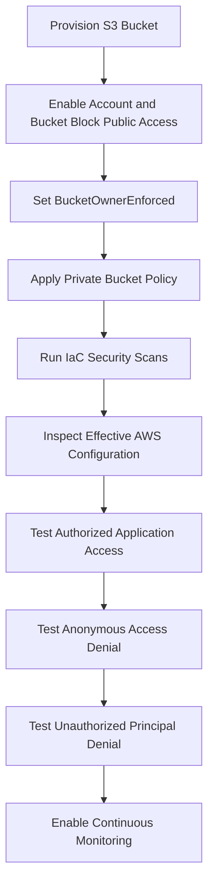
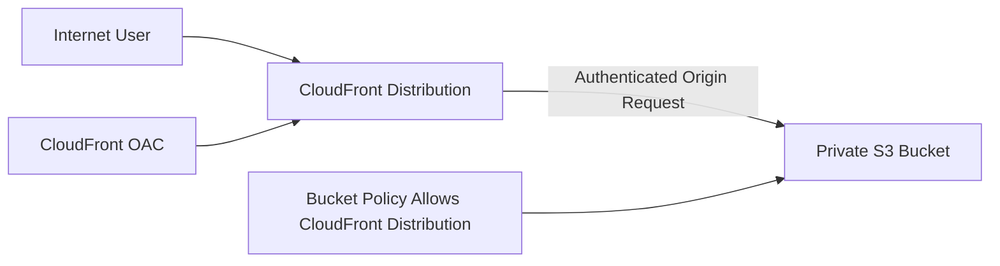

# 04- Public Access Prevention Guardrails

## Overview

Amazon S3 buckets and objects should remain private unless public access is an explicit, approved architectural requirement.

An accidentally public S3 bucket can expose customer documents, application uploads, backups, database exports, logs, and other sensitive information. Public exposure can result from permissive bucket policies, legacy ACLs, incorrect Object Ownership settings, or infrastructure changes that weaken existing controls.

Amazon S3 provides several mechanisms to prevent unintended public access:

- S3 Block Public Access.
- Bucket policies and access-point policies.
- S3 Object Ownership and ACL controls.
- AWS Organizations service control policies.
- IAM permissions and deployment-role restrictions.
- Infrastructure-as-code validation.
- Continuous security monitoring.

These controls should work together. A secure bucket configuration should not depend on developers remembering to avoid public permissions.

This document focuses on preventive guardrails, deployment validation, and operational controls for preventing unintended public S3 access.

## Understanding S3 Public Access

An S3 object can become publicly accessible through different authorization mechanisms.

Common exposure paths include:

| Exposure mechanism | Example | Risk |
|---|---|---|
| Public bucket policy | `Principal: "*"` with `s3:GetObject` | Anonymous users can read matching objects |
| Public ACL | `AllUsers` or `AuthenticatedUsers` grant | Objects or buckets may become publicly accessible |
| Public access-point policy | Public principal allowed through an access point | Access-point users may reach protected objects |
| Incorrect Object Ownership configuration | ACLs remain enabled and grant permissions | Legacy ACL permissions can expose objects |
| Infrastructure misconfiguration | Public access controls disabled during deployment | A previously private bucket can become public |
| Overly permissive IAM or resource policies | Broad access granted to external principals | Unintended identities may access data |

A bucket does not need to be configured as a public website to become publicly accessible.

For example, a bucket policy that allows anonymous `s3:GetObject` requests can expose objects even when the application never uses static website hosting.

## S3 Block Public Access

### What it is

S3 Block Public Access is a collection of controls that prevent public access through bucket policies, access-point policies, and ACLs.

It can be configured at multiple levels:

- AWS account.
- Individual bucket.
- S3 access point.

The effective configuration applies the most restrictive combination of applicable settings.

### The four Block Public Access settings

| Setting | Behavior | Security purpose |
|---|---|---|
| `BlockPublicAcls` | Rejects attempts to create new public ACLs | Prevents new public ACL grants |
| `IgnorePublicAcls` | Ignores existing public ACLs | Prevents existing public ACL grants from providing public access |
| `BlockPublicPolicy` | Rejects new bucket or access-point policies that grant public access | Prevents public policy creation |
| `RestrictPublicBuckets` | Restricts access to buckets with public policies to authorized AWS principals and qualifying AWS service principals | Limits access when a bucket policy is classified as public |

These settings protect against different exposure mechanisms. Enabling only one or two settings does not provide the same protection as enabling all four.

### Recommended production configuration

For private application buckets, enable all four settings at the account and bucket levels.

```hcl
resource "aws_s3_bucket_public_access_block" "private_documents" {
  bucket = aws_s3_bucket.private_documents.id

  block_public_acls       = true
  ignore_public_acls      = true
  block_public_policy     = true
  restrict_public_buckets = true
}
```

This configuration should be the default for:

- User-uploaded documents.
- Application-generated reports.
- Backups.
- Database exports.
- Internal media.
- Logs.
- Data lake storage.
- Private application assets.

### Account-level protection

Account-level Block Public Access establishes a broad preventive boundary.

```bash
aws s3control put-public-access-block \
  --account-id 123456789012 \
  --public-access-block-configuration \
  BlockPublicAcls=true,IgnorePublicAcls=true,BlockPublicPolicy=true,RestrictPublicBuckets=true
```

Inspect the configuration:

```bash
aws s3control get-public-access-block \
  --account-id 123456789012
```

Account-level protection is particularly useful in environments where multiple teams create and manage S3 buckets.

A bucket-level configuration should not be treated as a substitute for organization-wide guardrails.

### Bucket-level protection

Configure the same controls on each private bucket.

```bash
aws s3api put-public-access-block \
  --bucket company-private-documents \
  --public-access-block-configuration \
  BlockPublicAcls=true,IgnorePublicAcls=true,BlockPublicPolicy=true,RestrictPublicBuckets=true
```

Inspect the bucket configuration:

```bash
aws s3api get-public-access-block \
  --bucket company-private-documents
```

### Important behavior

Block Public Access does not replace IAM authorization or bucket-policy design.

It prevents specified forms of public access, but it does not automatically make every bucket secure.

For example:

- A bucket policy can still grant access to a specific external AWS account.
- An IAM role can still receive broad access through identity-based permissions.
- A compromised application role can still access objects within its authorized scope.
- A restrictive bucket policy can still deny legitimate application requests.

Use Block Public Access together with least-privilege authorization.

## S3 Object Ownership and ACL Prevention

### Why ACLs matter

Access Control Lists are an older S3 permission mechanism.

They can grant permissions independently of bucket policies and IAM identity policies. This creates additional authorization complexity.

For modern application architectures, ACLs are generally unnecessary.

### Bucket owner enforced

S3 Object Ownership supports the `BucketOwnerEnforced` setting.

With this setting:

- ACLs are disabled.
- The bucket owner owns objects.
- Access is managed through IAM and bucket policies.
- Object uploads should not depend on ACL-based ownership or permission grants.

Terraform example:

```hcl
resource "aws_s3_bucket_ownership_controls" "private_documents" {
  bucket = aws_s3_bucket.private_documents.id

  rule {
    object_ownership = "BucketOwnerEnforced"
  }
}
```

This is the recommended ownership model for most new application buckets.

### Why disabling ACLs improves security

Consider a backend service that uploads customer documents.

Without a consistent ownership model, objects uploaded by different AWS accounts or principals may have different ownership and ACL behavior.

This complicates:

- Cross-account uploads.
- Object access troubleshooting.
- Permission reviews.
- Security audits.
- Application authorization.

With `BucketOwnerEnforced`, bucket policies and IAM become the primary authorization mechanisms.

### Upload behavior

When ACLs are disabled, uploads that attempt to set unsupported ACLs can fail.

For example, an application using this request may encounter an error:

```python
s3.put_object(
    Bucket="company-private-documents",
    Key="reports/report.pdf",
    Body=file_data,
    ACL="public-read",
)
```

Remove the ACL parameter:

```python
s3.put_object(
    Bucket="company-private-documents",
    Key="reports/report.pdf",
    Body=file_data,
)
```

Do not use `public-read` as a workaround for object access problems. Use authenticated application access or controlled presigned URLs.

## Private Bucket Policy Design

A bucket policy is a resource-based policy attached to an S3 bucket.

It should define which principals can access the bucket and which operations they can perform.

For private application buckets:

- Avoid anonymous access.
- Restrict access to specific IAM roles.
- Scope object permissions to required prefixes.
- Deny insecure transport.
- Avoid broad wildcard permissions unless they are explicitly justified.

### Example private bucket policy

The following policy allows a specific application role to read and write objects under the `application/` prefix.

It also denies requests that do not use HTTPS.

```json
{
  "Version": "2012-10-17",
  "Statement": [
    {
      "Sid": "AllowApplicationObjectAccess",
      "Effect": "Allow",
      "Principal": {
        "AWS": "arn:aws:iam::123456789012:role/document-api"
      },
      "Action": [
        "s3:GetObject",
        "s3:PutObject"
      ],
      "Resource": "arn:aws:s3:::company-private-documents/application/*"
    },
    {
      "Sid": "DenyInsecureTransport",
      "Effect": "Deny",
      "Principal": "*",
      "Action": "s3:*",
      "Resource": [
        "arn:aws:s3:::company-private-documents",
        "arn:aws:s3:::company-private-documents/*"
      ],
      "Condition": {
        "Bool": {
          "aws:SecureTransport": "false"
        }
      }
    }
  ]
}
```

The application role also needs an appropriate identity-based IAM policy.

The bucket policy does not automatically grant the role every permission required by the application.

### Avoid public principals

The following policy is dangerous for a private bucket:

```json
{
  "Version": "2012-10-17",
  "Statement": [
    {
      "Effect": "Allow",
      "Principal": "*",
      "Action": "s3:GetObject",
      "Resource": "arn:aws:s3:::company-private-documents/*"
    }
  ]
}
```

It permits anonymous read access to matching objects unless another applicable control prevents it.

For a private bucket, public access should be blocked rather than relying on application developers to avoid this policy pattern.

### Explicit deny for unauthorized transport

A bucket-level deny for insecure transport is a useful defense-in-depth control.

However, test service integrations and operational workflows before enforcing policy changes.

Do not add conditions that unintentionally block required AWS service-to-service operations.

## Organization-Level Guardrails

Account and bucket configurations protect individual resources. AWS Organizations can provide broader preventive controls.

### Service Control Policies

An SCP defines the maximum permissions available to principals in accounts governed by the policy.

An SCP does not grant permissions. It establishes an organization-level permission boundary.

An organization can use SCPs to prevent account principals from disabling selected S3 public-access protections.

Example SCP statement:

```json
{
  "Version": "2012-10-17",
  "Statement": [
    {
      "Sid": "DenyDisablingS3PublicAccessProtection",
      "Effect": "Deny",
      "Action": [
        "s3:PutAccountPublicAccessBlock",
        "s3:DeleteAccountPublicAccessBlock"
      ],
      "Resource": "*"
    }
  ]
}
```

This statement prevents principals in affected accounts from changing the account-level Block Public Access configuration through the listed actions.

An organization may also protect bucket-level configurations through additional SCP statements.

Example:

```json
{
  "Version": "2012-10-17",
  "Statement": [
    {
      "Sid": "DenyDisablingBucketPublicAccessProtection",
      "Effect": "Deny",
      "Action": [
        "s3:PutBucketPublicAccessBlock",
        "s3:DeleteBucketPublicAccessBlock"
      ],
      "Resource": "*"
    }
  ]
}
```

Before applying SCPs:

- Confirm the affected accounts and organizational units.
- Identify legitimate administrative workflows.
- Test the policy in a non-production organizational unit.
- Review the impact on infrastructure deployment roles.
- Preserve an authorized governance process for policy changes.

An SCP can prevent even a highly privileged IAM principal from performing a denied action in an affected account.

## Terraform Guardrails

Public-access prevention should be part of the reusable S3 bucket module rather than an optional configuration that each application team must remember.

### Complete private bucket configuration

```hcl
resource "aws_s3_bucket" "private_documents" {
  bucket = var.bucket_name

  force_destroy = false

  tags = {
    Environment = var.environment
    Application = "document-storage"
    ManagedBy   = "terraform"
  }
}

resource "aws_s3_bucket_ownership_controls" "private_documents" {
  bucket = aws_s3_bucket.private_documents.id

  rule {
    object_ownership = "BucketOwnerEnforced"
  }
}

resource "aws_s3_bucket_public_access_block" "private_documents" {
  bucket = aws_s3_bucket.private_documents.id

  block_public_acls       = true
  ignore_public_acls      = true
  block_public_policy     = true
  restrict_public_buckets = true
}

resource "aws_s3_bucket_versioning" "private_documents" {
  bucket = aws_s3_bucket.private_documents.id

  versioning_configuration {
    status = "Enabled"
  }
}
```

For production, encryption, logging, and lifecycle configuration should also be included in the bucket module or its approved composition.

### Deployment dependency considerations

Terraform references create dependencies when one resource references another resource's attributes.

However, a successful Terraform deployment does not prove that the complete bucket authorization model is correct.

Validate the resulting AWS configuration after deployment.

### Prevent unsafe overrides

A reusable module should avoid exposing unrestricted settings such as:

```hcl
variable "allow_public_access" {
  type    = bool
  default = false
}
```

A generic public-access toggle can allow application teams to bypass security controls without a formal review.

If public delivery is a valid requirement, use a separate, explicitly approved architecture rather than weakening the default private-bucket module.

## CI/CD Policy Validation

Security validation should run before infrastructure changes reach production.

A deployment pipeline should detect:

- Public bucket policies.
- Public ACL configuration.
- Disabled Block Public Access settings.
- Missing Object Ownership controls.
- Unexpected wildcard principals.
- Insecure transport permissions.
- Changes that remove existing security controls.

### Terraform validation

Run standard Terraform checks:

```bash
terraform fmt -check -recursive
terraform init -backend=false
terraform validate
terraform plan -out=tfplan
```

These commands validate formatting, configuration syntax, and the proposed infrastructure changes. They do not independently prove that the resulting AWS resources are secure.

### Policy-as-code checks

Use a policy-as-code tool such as Checkov, Trivy, or an organization-approved Terraform policy framework.

Example using Checkov:

```bash
checkov \
  -d . \
  --framework terraform \
  --check CKV_AWS_18,CKV_AWS_19,CKV_AWS_20,CKV_AWS_21,CKV_AWS_53
```

Check identifiers and rule behavior against the installed Checkov version. Security rule catalogs can change, and individual checks may cover different S3 controls.

A production pipeline should pin scanner versions and maintain an approved policy baseline.

### Deployment review

Before applying an infrastructure plan, review:

- Any change to public-access-block resources.
- Any removal of Object Ownership controls.
- Any bucket policy containing `Principal: "*"`.
- Any ACL-related configuration.
- Any change to account-level security settings.
- Any exception or suppression in policy scanning.

Require explicit approval for security-control changes.

## Public Access Validation

Validation must inspect the effective configuration rather than relying only on Terraform source code.

### Inspect account-level Block Public Access

```bash
aws s3control get-public-access-block \
  --account-id 123456789012
```

### Inspect bucket-level Block Public Access

```bash
aws s3api get-public-access-block \
  --bucket company-private-documents
```

### Inspect Object Ownership

```bash
aws s3api get-bucket-ownership-controls \
  --bucket company-private-documents
```

For a private application bucket using the recommended model, the ownership rule should report:

```json
{
  "OwnershipControls": {
    "Rules": [
      {
        "ObjectOwnership": "BucketOwnerEnforced"
      }
    ]
  }
}
```

### Inspect the bucket policy

```bash
aws s3api get-bucket-policy \
  --bucket company-private-documents
```

A missing bucket policy can return an error indicating that no policy exists. This is not, by itself, evidence that the bucket is publicly accessible.

### Inspect bucket ACLs

```bash
aws s3api get-bucket-acl \
  --bucket company-private-documents
```

With `BucketOwnerEnforced`, ACLs are disabled for access control. Do not interpret the returned ownership information as proof that ACL-based access is enabled.

### Inspect S3 public access findings

Use IAM Access Analyzer for S3 to identify buckets that are accessible to external entities.

Access Analyzer can help identify:

- Public bucket access.
- Cross-account access.
- Access granted to external principals.

It complements Block Public Access and policy validation. It does not replace them.

## Security Validation Workflow

A repeatable validation workflow should verify both preventive controls and actual access behavior.



### Positive authorization test

Use the application role to perform an approved operation.

```bash
aws sts get-caller-identity

aws s3api put-object \
  --bucket company-private-documents \
  --key validation/private-test.txt \
  --body ./private-test.txt
```

Verify that the authorized identity can access only its intended resources.

### Anonymous access test

Use an unauthenticated HTTP request against a known private object URL.

```bash
curl -I \
  https://company-private-documents.s3.ap-south-1.amazonaws.com/validation/private-test.txt
```

The request should not return the object's content to an anonymous caller.

An HTTP `403` response is expected for a private object without anonymous authorization. A `404` response may also occur depending on object existence and authorization behavior.

Do not treat a single HTTP response as a complete security assessment.

### Unauthorized principal test

Assume a test role that should not have access.

```bash
aws sts assume-role \
  --role-arn arn:aws:iam::123456789012:role/s3-unauthorized-test \
  --role-session-name public-access-validation
```

Use the resulting temporary credentials to attempt the protected object operation.

The test should confirm that the identity cannot access the object.

### Public policy rejection test

In a non-production account, attempt to apply a deliberately public bucket policy while `BlockPublicPolicy` is enabled.

The operation should be rejected when the policy is classified as public.

Do not run this test against production buckets.

## CloudFront and Approved Public Delivery

A common requirement is to serve public website assets or media without making the underlying S3 bucket public.

Use CloudFront with Origin Access Control (OAC) and a private S3 bucket.



### Request flow

1. A user requests an asset through CloudFront.
2. CloudFront evaluates its cache.
3. If the object is not cached, CloudFront sends an authenticated request to the S3 origin using OAC.
4. S3 evaluates the bucket policy.
5. S3 returns the object to CloudFront.
6. CloudFront delivers the response to the user.

The bucket remains private. Public delivery occurs through the CloudFront distribution.

### Example bucket policy for CloudFront OAC

```json
{
  "Version": "2012-10-17",
  "Statement": [
    {
      "Sid": "AllowCloudFrontReadOnly",
      "Effect": "Allow",
      "Principal": {
        "Service": "cloudfront.amazonaws.com"
      },
      "Action": "s3:GetObject",
      "Resource": "arn:aws:s3:::company-static-assets/*",
      "Condition": {
        "StringEquals": {
          "AWS:SourceArn": "arn:aws:cloudfront::123456789012:distribution/EXAMPLE123456"
        }
      }
    }
  ]
}
```

This grants the specified CloudFront distribution read access to the bucket objects.

The policy does not grant anonymous users direct access to the S3 bucket.

For private user documents, use authenticated application access or short-lived presigned URLs instead of a public CloudFront distribution.

### Important CloudFront considerations

- Use Origin Access Control rather than legacy Origin Access Identity for new architectures.
- Keep S3 Block Public Access enabled.
- Restrict the bucket policy to the intended distribution.
- Use HTTPS for viewer connections.
- Configure cache policies based on asset sensitivity.
- Avoid caching personalized or private responses in shared caches.
- Validate origin access independently of viewer access.

CloudFront OAC is intended for supported S3 origins, not S3 static website endpoints.

## Monitoring and Continuous Governance

Public-access prevention is not a one-time configuration task.

Infrastructure changes, permission updates, and account-level modifications can introduce exposure over time.

### AWS Config

Use AWS Config managed rules to evaluate S3 public-access configuration.

Relevant rules include:

| Rule | Purpose |
|---|---|
| `s3-bucket-public-read-prohibited` | Detects buckets with public read access |
| `s3-bucket-public-write-prohibited` | Detects buckets with public write access |
| `s3-bucket-level-public-access-prohibited` | Checks bucket-level Block Public Access settings |
| `s3-account-level-public-access-blocks-periodic` | Evaluates account-level public-access protection |

Confirm rule availability and supported parameters in the target AWS Region.

AWS Config provides configuration compliance visibility. It does not necessarily prevent a configuration change from occurring.

### AWS Security Hub

Security Hub can aggregate findings from supported security checks and integrated services.

Use it to centralize visibility into S3 security posture and assign remediation ownership.

### IAM Access Analyzer

Use IAM Access Analyzer to identify resource policies that grant access outside the intended trust boundary.

Review findings regularly and investigate newly introduced external access.

### CloudTrail

Use CloudTrail to audit configuration changes.

Monitor events such as:

- `PutBucketPolicy`
- `DeleteBucketPolicy`
- `PutBucketAcl`
- `PutBucketPublicAccessBlock`
- `DeletePublicAccessBlock`
- `PutAccountPublicAccessBlock`
- `DeleteAccountPublicAccessBlock`
- `PutBucketOwnershipControls`

CloudTrail management events can provide evidence of who changed a bucket's security configuration and when.

Configure alerts for security-sensitive changes rather than relying only on periodic manual inspection.

## Operational Response to Public Access Findings

When a bucket is identified as publicly accessible, treat it as a potential security incident.

Use a controlled response process:

1. Identify the bucket, account, Region, and affected objects.
2. Determine whether the exposure is intentional and formally approved.
3. Inspect account-level and bucket-level Block Public Access settings.
4. Inspect bucket policies, access-point policies, and ACL-related configuration.
5. Identify the principal or configuration change responsible.
6. Apply the appropriate preventive control.
7. Verify that anonymous access is denied.
8. Determine whether sensitive data was accessed.
9. Preserve relevant CloudTrail and access logs.
10. Document the incident and implement preventive changes.

### Inspect the current policy

```bash
aws s3api get-bucket-policy \
  --bucket company-private-documents
```

### Apply bucket-level Block Public Access

```bash
aws s3api put-public-access-block \
  --bucket company-private-documents \
  --public-access-block-configuration \
  BlockPublicAcls=true,IgnorePublicAcls=true,BlockPublicPolicy=true,RestrictPublicBuckets=true
```

### Review access history

Use CloudTrail and configured S3 data-event logging to investigate relevant access activity.

CloudTrail management events and S3 object-level data events serve different purposes. Object-level access investigation requires appropriate data-event collection to have been enabled.

Do not assume that CloudTrail management-event history alone provides a complete record of object downloads.

## Common Mistakes and Production Pitfalls

| Mistake | Why it is dangerous | Recommended approach |
|---|---|---|
| Enabling only `BlockPublicAcls` | Public bucket policies can still be a concern | Enable all four Block Public Access settings |
| Disabling account-level protection for one application | Weakens protection for other buckets in the account | Use an approved CloudFront or authenticated access architecture |
| Treating `BlockPublicPolicy` as a replacement for IAM | It addresses public policy creation, not every authorization risk | Apply least-privilege IAM and bucket policies |
| Keeping ACLs enabled unnecessarily | Adds another authorization mechanism | Use `BucketOwnerEnforced` |
| Assuming a private bucket cannot be accessed externally | Cross-account access may still be intentionally granted | Review all applicable identity and resource policies |
| Making an S3 bucket public for static website hosting | Exposes the origin directly | Use CloudFront OAC with a private bucket |
| Testing only with administrator credentials | Can hide application authorization defects | Test using actual workload and unauthorized identities |
| Ignoring access-point policies | Alternate access paths may have separate policies | Include access points in security reviews |
| Relying only on Terraform source review | Runtime configuration can drift | Validate effective AWS configuration |
| Automatically deleting every external-access finding | May break approved integrations | Investigate ownership and business requirements before remediation |

## Production Readiness Checklist

### Preventive controls

- [ ] Account-level Block Public Access is enabled.
- [ ] Bucket-level Block Public Access is enabled.
- [ ] All four Block Public Access settings are enabled for private buckets.
- [ ] Object Ownership uses `BucketOwnerEnforced` where appropriate.
- [ ] ACLs are not used for application authorization.
- [ ] Private bucket policies use explicit trusted principals.
- [ ] Insecure transport is denied where appropriate.
- [ ] Access-point policies are included in the security design.
- [ ] Organization-level guardrails protect critical configurations.

### Deployment controls

- [ ] Terraform modules apply secure defaults.
- [ ] CI/CD scans infrastructure changes for public exposure.
- [ ] Security-control changes require appropriate approval.
- [ ] Deployment identities cannot casually disable governance controls.
- [ ] Post-deployment validation checks actual AWS configuration.
- [ ] Security exceptions have documented owners and expiry or review dates.

### Monitoring and incident response

- [ ] AWS Config evaluates S3 public-access settings.
- [ ] IAM Access Analyzer findings are reviewed.
- [ ] CloudTrail records security configuration changes.
- [ ] Relevant S3 data events are collected where required.
- [ ] Alerts exist for changes to public-access protections.
- [ ] Incident response procedures cover accidental public exposure.
- [ ] Recovery and access-denial behavior are tested.

## Key Takeaways

- Enable all four S3 Block Public Access settings at both account and private-bucket levels.
- Use `BucketOwnerEnforced` to disable ACL-based authorization for modern application buckets.
- Enforce private access through least-privilege IAM and bucket policies, supported by organization-level guardrails.
- Serve public content through CloudFront OAC while keeping the underlying S3 bucket private.
- Combine infrastructure scanning, AWS Config, IAM Access Analyzer, and CloudTrail to detect and investigate public-access risks.