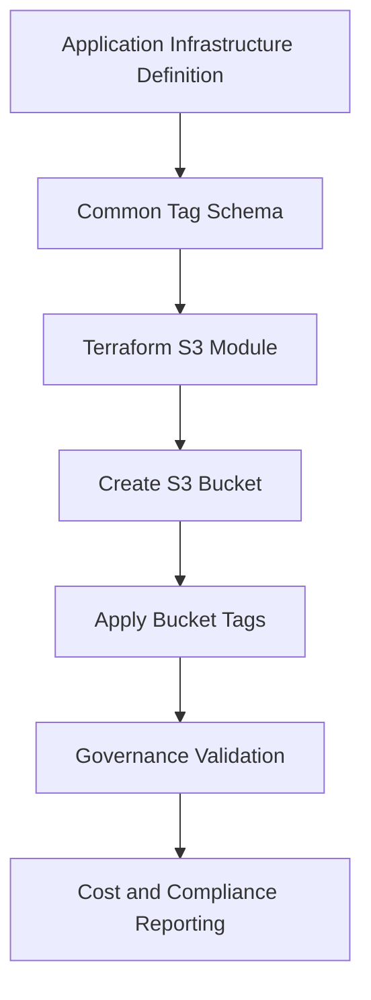
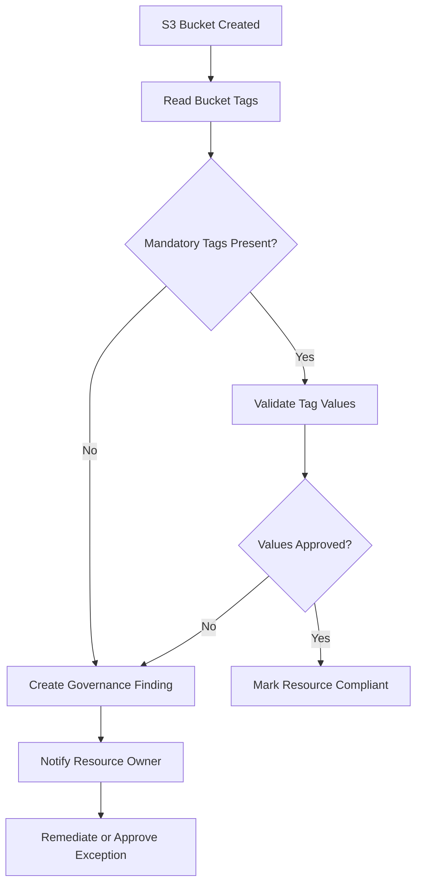

# 05- Mandatory Tags and Resource Standards

## Overview

Consistent resource tagging and naming standards are essential for managing Amazon S3 infrastructure across multiple applications, environments, teams, and AWS accounts.

Without standardized metadata, organizations struggle to identify resource ownership, allocate costs, enforce security requirements, automate operations, and investigate infrastructure changes.

S3 resource standards should be established as part of the infrastructure provisioning process rather than applied manually after deployment.

A production-ready resource governance strategy should define:

- Mandatory tags and their allowed values.
- Bucket naming conventions.
- Object key and prefix conventions.
- Environment and application identification.
- Resource ownership and operational responsibility.
- Cost allocation requirements.
- Infrastructure management standards.
- Validation and enforcement mechanisms.
- Exception handling and compliance monitoring.

This document focuses on resource metadata and governance standards for S3 infrastructure. Detailed encryption, IAM, public-access, lifecycle, and replication controls belong in their respective security and operations documents.

## Why Resource Standards Matter

A production AWS environment may contain hundreds or thousands of S3 buckets across development, staging, production, analytics, backup, and shared-service accounts.

Without consistent metadata, even basic operational questions become difficult:

- Which application owns this bucket?
- Which team should investigate an incident?
- Is this bucket production or development?
- Which cost center should receive the storage charges?
- Is the bucket managed by Terraform or another deployment system?
- Which retention requirements apply?
- Can the bucket be safely decommissioned?

Tags provide structured metadata that can be consumed by AWS services, automation, reporting systems, and governance tools.

### Operational benefits

| Area | Benefit |
|---|---|
| Cost management | Attribute storage and request costs to applications and teams |
| Ownership | Identify responsible engineering teams |
| Security governance | Classify resources and identify sensitive workloads |
| Automation | Select resources for lifecycle, backup, monitoring, and compliance workflows |
| Incident response | Identify application and operational ownership quickly |
| Infrastructure management | Distinguish Terraform-managed resources from manually created resources |
| Compliance | Support resource inventory and governance reporting |

Tags do not replace IAM authorization or resource policies. They provide metadata that supports governance and automation.

## Mandatory S3 Resource Tags

Define a standard tag schema for every managed S3 bucket.

A practical baseline is:

| Tag | Required | Example | Purpose |
|---|---|---|---|
| `Application` | Yes | `document-storage` | Identifies the application |
| `Environment` | Yes | `production` | Identifies the deployment environment |
| `Owner` | Yes | `platform-engineering` | Identifies the responsible team |
| `CostCenter` | Yes | `CC-1042` | Supports cost allocation |
| `ManagedBy` | Yes | `terraform` | Identifies the infrastructure management mechanism |
| `DataClassification` | Yes | `confidential` | Identifies the data sensitivity category |
| `Project` | Recommended | `customer-portal` | Associates resources with a project |
| `BusinessUnit` | Recommended | `finance` | Identifies the business unit |
| `BackupRequired` | Recommended | `true` | Supports backup governance |
| `ComplianceScope` | Recommended | `internal` | Identifies applicable compliance scope |

The exact tag schema should be approved by the organization's cloud governance and finance teams.

### Tag value standards

Use consistent, machine-readable values.

Recommended conventions:

- Use lowercase values for application names and environments.
- Use stable team identifiers for ownership.
- Use approved cost-center codes.
- Avoid personal names as resource owners.
- Avoid temporary values such as `test123` or `new-project`.
- Avoid storing secrets, credentials, customer identifiers, or sensitive personal information in tags.

Example:

```hcl
locals {
  common_tags = {
    Application       = "document-storage"
    Environment       = var.environment
    Owner             = "platform-engineering"
    CostCenter        = "CC-1042"
    ManagedBy         = "terraform"
    DataClassification = "confidential"
    Project           = "customer-portal"
    BackupRequired    = "true"
  }
}
```

Tags should use stable values that remain meaningful throughout the resource lifecycle.

## Data Classification Standards

Data classification helps organizations apply appropriate governance to storage resources.

A possible classification model is:

| Classification | Description | Example |
|---|---|---|
| `public` | Approved for unrestricted public distribution | Published website assets |
| `internal` | Intended for internal organizational use | Internal documentation |
| `confidential` | Sensitive business or customer information | Customer documents |
| `restricted` | Highly sensitive information requiring additional controls | Regulated records and sensitive exports |

Classification should be based on the data stored in the bucket, not merely the application name.

For example, a document-management application may store both internal templates and confidential customer documents. If these workloads require different access boundaries, separate buckets or clearly governed prefixes may be more appropriate.

### Classification considerations

- Define classification values centrally.
- Assign a data owner responsible for classification decisions.
- Review classification when the application's data usage changes.
- Align retention and access requirements with the classification.
- Avoid assuming that a tag itself enforces encryption or access restrictions.

A tag such as `DataClassification=restricted` does not automatically enable stronger encryption or prevent public access. Enforcement must be implemented through independent security controls.

## S3 Bucket Naming Standards

Bucket names are globally unique within the applicable AWS partition and namespace rules.

A consistent naming convention makes buckets easier to identify across accounts and environments.

### Recommended naming structure

```text
<organization>-<application>-<environment>-<region>-<purpose>
```

Example:

```text
acme-document-storage-production-ap-south-1
```

Other examples:

```text
acme-media-processing-development-ap-south-1
acme-data-lake-staging-ap-south-1
acme-backup-service-production-ap-southeast-1
```

### Naming components

| Component | Example | Responsibility |
|---|---|---|
| Organization | `acme` | Identifies the organization |
| Application | `document-storage` | Identifies the workload |
| Environment | `production` | Identifies the deployment stage |
| Region | `ap-south-1` | Identifies the deployment Region |
| Purpose | `uploads` | Identifies the storage function |

### Naming rules

Bucket names should:

- Follow current S3 bucket naming requirements.
- Use lowercase letters, numbers, and hyphens where appropriate.
- Avoid embedding sensitive information.
- Avoid ambiguous abbreviations.
- Avoid temporary or developer-specific names.
- Include enough context to identify the resource.
- Be generated consistently by infrastructure code.

Do not assume that a bucket name is private. Bucket names can appear in URLs, logs, deployment output, and monitoring systems.

### Avoid overly generic names

Avoid:

```text
uploads
documents
backup
mybucket
test-bucket
```

These names provide little operational context and are difficult to manage consistently across accounts.

### Account and environment isolation

For larger environments, separate AWS accounts are preferable to relying exclusively on bucket-name prefixes.

For example:

```text
Development Account
    acme-document-storage-development-ap-south-1

Staging Account
    acme-document-storage-staging-ap-south-1

Production Account
    acme-document-storage-production-ap-south-1
```

Account separation provides a stronger infrastructure and administrative boundary than naming conventions alone.

## Object Key and Prefix Standards

S3 object keys identify objects within a bucket.

Prefixes provide a logical organization mechanism and are commonly used to group application data.

A standardized key structure improves discoverability, automation, and access-policy design.

### Recommended object key structure

```text
<application>/<environment>/<tenant>/<resource-type>/<date>/<object-id>
```

Example:

```text
document-storage/production/tenant-1001/invoices/2026/11/01/invoice-8f32a1.pdf
```

For a media-processing workload:

```text
media-service/production/tenant-1001/original/2026/11/01/image-91a2.jpg
media-service/production/tenant-1001/processed/2026/11/01/image-91a2.webp
```

### Prefix design considerations

| Component | Purpose | Example |
|---|---|---|
| Application | Identifies the workload | `document-storage` |
| Environment | Identifies the environment | `production` |
| Tenant | Supports multi-tenant organization | `tenant-1001` |
| Resource type | Groups related objects | `invoices` |
| Date | Supports partitioning and lifecycle organization | `2026/11/01` |
| Object ID | Provides a unique object identifier | `invoice-8f32a1.pdf` |

### Avoid user-controlled object keys

Never use an untrusted filename directly as the complete S3 object key.

A user may submit filenames containing:

- Unexpected path separators.
- Duplicate names.
- Unicode variations.
- Very long strings.
- Misleading file extensions.
- Characters that complicate downstream processing.

Generate object identifiers in the backend and retain the original filename as metadata when necessary.

Example:

```python
from uuid import uuid4


def generate_object_key(
    tenant_id: str,
    resource_type: str,
    extension: str,
) -> str:
    object_id = uuid4().hex

    return (
        f"document-storage/production/"
        f"{tenant_id}/{resource_type}/{object_id}.{extension}"
    )
```

Validate `tenant_id`, `resource_type`, and `extension` against application-controlled values before constructing the key.

The key should be generated by a trusted service layer, not accepted directly from an API request.

## Tagging Architecture

Tags should be applied when infrastructure resources are created.

Terraform is a suitable place to define common tags and propagate them to supported resources.



This approach reduces dependence on manual tagging.

### Bucket tags versus object tags

S3 supports tags at different resource levels.

| Tag type | Scope | Typical purpose |
|---|---|---|
| Bucket tags | Entire bucket | Ownership, environment, cost allocation |
| Object tags | Individual object | Classification, retention workflows, processing state |

Bucket tags are useful for resource inventory and cost allocation.

Object tags are useful when objects within the same bucket require different processing or governance behavior.

For example:

```text
Bucket:
  Application=document-storage
  Environment=production
  Owner=platform-engineering

Object:
  DataClassification=confidential
  ProcessingStatus=completed
  RetentionCategory=customer-record
```

Do not assume bucket tags automatically propagate to objects. Object tagging must be implemented separately.

### Object tagging with Boto3

```python
import boto3


def tag_object(
    bucket: str,
    key: str,
    classification: str,
    retention_category: str,
) -> None:
    s3 = boto3.client("s3")

    s3.put_object_tagging(
        Bucket=bucket,
        Key=key,
        Tagging={
            "TagSet": [
                {
                    "Key": "DataClassification",
                    "Value": classification,
                },
                {
                    "Key": "RetentionCategory",
                    "Value": retention_category,
                },
            ]
        },
    )
```

The application role requires the relevant object-tagging permission, such as `s3:PutObjectTagging`, scoped to the intended object resources.

For versioned buckets, consider whether tagging must target a specific object version.

## Terraform Implementation

### Centralized common tags

Define shared tags in a reusable module or root configuration.

```hcl
variable "environment" {
  description = "Deployment environment"
  type        = string

  validation {
    condition = contains(
      ["development", "staging", "production"],
      var.environment
    )

    error_message = "Environment must be development, staging, or production."
  }
}

variable "bucket_name" {
  description = "Globally unique S3 bucket name"
  type        = string
}

locals {
  common_tags = {
    Application        = "document-storage"
    Environment        = var.environment
    Owner              = "platform-engineering"
    CostCenter         = "CC-1042"
    ManagedBy          = "terraform"
    DataClassification = "confidential"
    Project            = "customer-portal"
  }
}
```

### Apply tags to an S3 bucket

```hcl
resource "aws_s3_bucket" "documents" {
  bucket = var.bucket_name

  force_destroy = false

  tags = local.common_tags
}
```

### Reusable module interface

A reusable S3 module should accept tags from the calling application while enforcing mandatory values.

```hcl
variable "tags" {
  description = "Additional approved resource tags"
  type        = map(string)
  default     = {}
}

locals {
  mandatory_tags = {
    Application        = "document-storage"
    Environment        = var.environment
    Owner              = "platform-engineering"
    CostCenter         = "CC-1042"
    ManagedBy          = "terraform"
    DataClassification = "confidential"
  }

  effective_tags = merge(
    var.tags,
    local.mandatory_tags
  )
}

resource "aws_s3_bucket" "this" {
  bucket = var.bucket_name

  tags = local.effective_tags
}
```

In this example, mandatory tags override conflicting values supplied through `var.tags`.

For a multi-application module, make mandatory values explicit inputs and validate them rather than hardcoding application-specific values inside a generic module.

### Validate mandatory tag values

Terraform variable validation can enforce basic naming and value requirements.

```hcl
variable "owner" {
  description = "Responsible engineering team"
  type        = string

  validation {
    condition     = length(trimspace(var.owner)) > 0
    error_message = "Owner must not be empty."
  }
}

variable "cost_center" {
  description = "Approved finance cost center"
  type        = string

  validation {
    condition     = can(regex("^CC-[0-9]{4}$", var.cost_center))
    error_message = "CostCenter must use the format CC-NNNN."
  }
}
```

Validation should be complemented by an approved cost-center registry or governance process. A syntactically valid value is not necessarily an authorized cost center.

## AWS CLI Tag Management

### Apply bucket tags

```bash
aws s3api put-bucket-tagging \
  --bucket acme-document-storage-production-ap-south-1 \
  --tagging '{
    "TagSet": [
      {
        "Key": "Application",
        "Value": "document-storage"
      },
      {
        "Key": "Environment",
        "Value": "production"
      },
      {
        "Key": "Owner",
        "Value": "platform-engineering"
      },
      {
        "Key": "CostCenter",
        "Value": "CC-1042"
      },
      {
        "Key": "ManagedBy",
        "Value": "terraform"
      },
      {
        "Key": "DataClassification",
        "Value": "confidential"
      }
    ]
  }'
```

`put-bucket-tagging` replaces the bucket's existing tag set. It is not an additive operation.

Before using it in production, retrieve and preserve existing tags that must remain.

### Retrieve bucket tags

```bash
aws s3api get-bucket-tagging \
  --bucket acme-document-storage-production-ap-south-1
```

If the bucket has no tag set, the operation can return an error indicating that no tagging configuration exists.

### Remove bucket tags

```bash
aws s3api delete-bucket-tagging \
  --bucket acme-document-storage-production-ap-south-1
```

This removes the bucket tag set. It should not be used as a routine cleanup operation because it can remove governance metadata.

### Inspect object tags

```bash
aws s3api get-object-tagging \
  --bucket acme-document-storage-production-ap-south-1 \
  --key document-storage/production/tenant-1001/invoices/invoice-8f32a1.pdf
```

Object-tagging operations may require additional permissions beyond ordinary object read or write access.

## Cost Allocation and Tag Governance

Tags support cost allocation and financial reporting.

A useful tagging strategy allows finance and engineering teams to answer:

- How much does document storage cost?
- Which application generates the highest storage consumption?
- Which team owns the workload?
- How much does each environment cost?
- Which projects have increasing storage costs?

### Cost allocation tags

AWS Billing and Cost Management supports user-defined cost allocation tags.

To use tags in cost reports:

1. Apply standardized tags to supported resources.
2. Activate the relevant user-defined cost allocation tags in Billing and Cost Management.
3. Allow time for billing data processing.
4. Use Cost Explorer or Cost and Usage Reports to analyze costs.
5. Review resources that are missing mandatory tags.

Applying a tag to an S3 bucket does not automatically guarantee that every S3 usage charge will be allocated to that tag.

S3 storage and request charges can involve different usage dimensions. Verify the applicable cost-allocation behavior for the billing report and resource type being analyzed.

### Cost allocation example

A report might group costs by:

```text
Application
Environment
CostCenter
Owner
```

Example reporting structure:

| Application | Environment | Cost center | Cost category |
|---|---|---|---|
| `document-storage` | `production` | `CC-1042` | Application storage |
| `media-processing` | `production` | `CC-1042` | Media storage |
| `data-lake` | `staging` | `CC-2081` | Analytics storage |

Use a consistent tagging schema across related infrastructure, including Lambda functions, queues, databases, and supporting resources.

## Tag-Based Automation

Tags can drive automation workflows.

Examples include:

- Identifying buckets that require backup.
- Selecting resources for compliance reviews.
- Grouping resources for cost reporting.
- Finding resources owned by a particular team.
- Identifying production resources during incident response.
- Applying approved lifecycle or monitoring workflows.

### Example governance workflow



Automation should distinguish between missing tags, invalid values, and approved exceptions.

Avoid automatically deleting or disabling resources simply because a tag is missing. Such remediation can cause application outages.

## Enforcement and Compliance

Tag standards should be enforced at multiple stages.

### Infrastructure provisioning

Enforce tags in:

- Terraform modules.
- CloudFormation templates.
- AWS CDK constructs.
- Approved infrastructure templates.

This is the earliest and most reliable place to prevent non-compliant resources.

### CI/CD validation

Validate tag presence and allowed values before infrastructure deployment.

Example Terraform workflow:

```bash
terraform fmt -check -recursive
terraform init -backend=false
terraform validate
terraform plan -out=tfplan
```

Add a policy-as-code check that evaluates the planned resource attributes.

The policy should verify:

- Required tag keys exist.
- Required values are not empty.
- Environment values belong to the approved set.
- Cost-center values match approved formats.
- Application and owner values follow naming standards.
- Production resources contain required classification metadata.

### AWS Config

AWS Config provides managed compliance checks for supported resource types.

The `required-tags` managed rule can evaluate whether configured resources contain required tags.

Example rule configuration:

```json
{
  "ConfigRuleName": "required-s3-resource-tags",
  "Description": "Checks mandatory tags on S3 buckets",
  "Source": {
    "Owner": "AWS",
    "SourceIdentifier": "REQUIRED_TAGS"
  },
  "InputParameters": "{\"tag1Key\":\"Application\",\"tag2Key\":\"Environment\",\"tag3Key\":\"Owner\",\"tag4Key\":\"CostCenter\",\"tag5Key\":\"ManagedBy\"}",
  "Scope": {
    "ComplianceResourceTypes": [
      "AWS::S3::Bucket"
    ]
  }
}
```

Confirm the supported parameters and resource evaluation behavior for the AWS Config rule in the target account and Region.

AWS Config detects compliance state; it does not automatically prevent an untagged resource from being created.

### AWS Organizations tag policies

AWS Organizations tag policies can standardize tag keys and allowed values across member accounts.

They are useful for enforcing organizational consistency.

However, tag policies do not automatically guarantee that every resource has every required tag. Use complementary controls such as:

- Infrastructure policy validation.
- AWS Config required-tag rules.
- CI/CD enforcement.
- Resource inventory audits.

## Resource Standards Beyond Tags

Tags alone do not provide a complete resource standard.

A production S3 resource standard should define several related conventions.

| Standard | Example | Purpose |
|---|---|---|
| Bucket naming | `acme-document-storage-production-ap-south-1` | Resource identification |
| Tagging | `Application=document-storage` | Governance metadata |
| Object keys | `document-storage/production/tenant-1001/...` | Object organization |
| Ownership | `Owner=platform-engineering` | Operational responsibility |
| Environment | `Environment=production` | Deployment identification |
| Classification | `DataClassification=confidential` | Data governance |
| Infrastructure management | `ManagedBy=terraform` | Change ownership |
| Cost allocation | `CostCenter=CC-1042` | Financial reporting |

### Infrastructure management standard

Production buckets should be managed through an approved infrastructure-as-code workflow.

Avoid unmanaged manual configuration changes.

A standard deployment workflow should:

1. Define the bucket and its required metadata in infrastructure code.
2. Validate the naming convention.
3. Apply mandatory tags.
4. Deploy the resource.
5. Inspect the effective AWS configuration.
6. Record the resource in inventory and cost reporting.
7. Monitor configuration drift.

### Naming and tag consistency

The bucket name and tags should describe the same workload.

For example:

```text
Bucket:
  acme-document-storage-production-ap-south-1

Tags:
  Application=document-storage
  Environment=production
  Owner=platform-engineering
  CostCenter=CC-1042
```

Avoid contradictions such as a bucket named for production but tagged as development.

## Operational Governance

Tag governance requires recurring reviews.

### Recommended review frequency

| Activity | Suggested frequency | Purpose |
|---|---|---|
| Missing-tag review | Daily or weekly | Identify newly created non-compliant resources |
| Ownership review | Monthly or quarterly | Confirm team responsibility |
| Cost allocation review | Monthly | Validate cost attribution |
| Classification review | Based on data changes and policy | Keep sensitivity metadata accurate |
| Naming-standard review | During infrastructure changes | Prevent inconsistent resource creation |
| Exception review | At defined expiry dates | Remove temporary governance exceptions |

### Governance inventory

Maintain an inventory containing:

- AWS account ID.
- AWS Region.
- Bucket name.
- Application.
- Environment.
- Owner.
- Cost center.
- Data classification.
- Infrastructure management method.
- Compliance status.
- Exception reference, if applicable.

Use AWS Config, S3 inventory where appropriate, resource inventory tools, or an approved centralized asset-management system.

### Exception handling

Some resources may require an exception to the standard.

For example:

- A shared platform bucket may serve multiple applications.
- A migration bucket may have a temporary owner.
- A third-party integration may impose a naming constraint.
- A legacy bucket may require a controlled transition.

An exception should include:

- Resource identifier.
- Reason for the exception.
- Responsible owner.
- Approving authority.
- Compensating controls.
- Review or expiry date.

Exceptions should be explicit and auditable rather than silently weakening the standard.

## Common Mistakes and Pitfalls

| Mistake | Why it causes problems | Recommended approach |
|---|---|---|
| Using inconsistent tag keys | Reporting and automation cannot reliably group resources | Maintain a centrally approved schema |
| Allowing empty tag values | Ownership and cost attribution become meaningless | Validate required values before deployment |
| Assuming tags propagate to objects | Object-level governance metadata remains missing | Apply object tags through the application or processing workflow |
| Using personal names for ownership | Ownership becomes invalid when employees change roles | Use stable team identifiers |
| Treating tags as security controls | Tags alone do not restrict S3 access | Enforce access through IAM and resource policies |
| Using generic bucket names | Resources become difficult to identify | Adopt a consistent naming convention |
| Allowing arbitrary tag overrides | Application teams can overwrite mandatory governance values | Enforce mandatory values in reusable modules |
| Treating AWS Config as preventive enforcement | Non-compliant resources may exist before detection | Combine Config with deployment-time policy checks |
| Replacing bucket tags without reading existing tags | Existing governance metadata can be lost | Merge tag sets through controlled automation |
| Storing sensitive information in tags | Tags may be exposed through inventory and API responses | Store only non-sensitive metadata |
| Assuming bucket tags automatically classify every object | Object-level classification may differ | Define separate object-tagging requirements |
| Ignoring unmanaged resources | Manually created buckets can bypass infrastructure standards | Perform recurring inventory and compliance reviews |

## Production Readiness Checklist

### Resource metadata

- [ ] Mandatory tag keys are centrally defined.
- [ ] Allowed values are documented.
- [ ] Application and environment identifiers are standardized.
- [ ] Resource ownership uses stable team identifiers.
- [ ] Cost-center values are validated.
- [ ] Data classification is assigned by an appropriate owner.
- [ ] Tags do not contain secrets or sensitive personal information.

### Naming and organization

- [ ] Bucket names follow the approved naming convention.
- [ ] Environment and Region are identifiable.
- [ ] Object key structures are documented.
- [ ] User-controlled filenames are not used as unrestricted object keys.
- [ ] Multi-tenant prefixes are generated and validated by trusted application code.
- [ ] Shared resources have explicit ownership and governance.

### Infrastructure and enforcement

- [ ] Reusable Terraform modules apply mandatory tags.
- [ ] Infrastructure templates enforce naming conventions.
- [ ] CI/CD validates required tags and allowed values.
- [ ] AWS Config evaluates required tags.
- [ ] AWS Organizations tag policies are used where appropriate.
- [ ] Exceptions are documented and reviewed.
- [ ] Production resources are managed through approved infrastructure workflows.

### Operations and cost

- [ ] Cost allocation tags are activated where required.
- [ ] Cost reports are reviewed regularly.
- [ ] Resource inventory identifies ownership and classification.
- [ ] Missing-tag findings have assigned owners.
- [ ] Governance automation avoids unsafe automatic deletion.
- [ ] Tagging and naming standards are reviewed as the platform evolves.

## Key Takeaways

- Define mandatory tags centrally for application, environment, ownership, cost allocation, management, and data classification.
- Use consistent bucket names and object-key structures to improve resource identification and operational automation.
- Enforce mandatory metadata through reusable infrastructure modules and CI/CD policy validation rather than relying on manual tagging.
- Treat bucket tags and object tags as separate metadata scopes; bucket tags do not automatically propagate to objects.
- Combine AWS Config, Organizations tag policies, cost allocation reporting, and recurring inventory reviews to maintain resource governance.