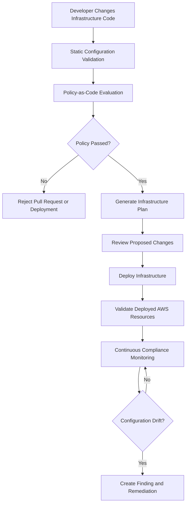
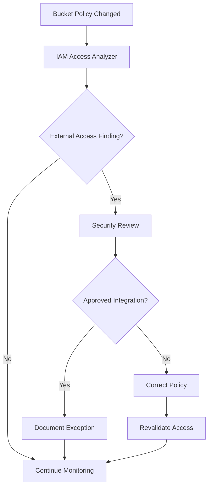

# 06- Policy-as-Code and Configuration Checks

## Overview

Amazon S3 security depends on more than correctly configuring individual buckets. Production environments need repeatable mechanisms to validate infrastructure definitions, detect insecure configurations, and prevent unauthorized changes from reaching AWS accounts.

Policy-as-code provides a way to express security and governance requirements as machine-enforceable rules.

Instead of relying exclusively on manual reviews, engineering teams can automatically validate:

- S3 Block Public Access settings.
- Object Ownership and ACL configuration.
- Bucket encryption requirements.
- Bucket versioning.
- IAM and bucket policy permissions.
- Mandatory resource tags.
- TLS enforcement.
- Lifecycle and replication configuration.
- Logging and monitoring requirements.
- Infrastructure deployment changes.

These checks should run during development, CI/CD, infrastructure deployment, and ongoing production monitoring.

A mature S3 governance strategy combines preventive controls, deployment-time validation, and continuous compliance monitoring.

## Policy-as-Code Architecture

### What is policy-as-code?

Policy-as-code represents organizational security and infrastructure requirements using machine-readable rules.

These rules evaluate infrastructure definitions or deployed resource configurations and determine whether they satisfy approved standards.

For example, an organization may require every production S3 bucket to have:

- All four Block Public Access settings enabled.
- `BucketOwnerEnforced` Object Ownership.
- Server-side encryption.
- Versioning enabled.
- Mandatory ownership and cost-allocation tags.
- A policy denying insecure transport.

These requirements can be represented as automated policies and executed against Terraform plans or infrastructure templates.

### Why it matters

Manual infrastructure reviews do not scale reliably across multiple teams and AWS accounts.

Policy-as-code provides:

- Consistent enforcement across environments.
- Earlier detection of security defects.
- Repeatable infrastructure reviews.
- Reduced dependence on manual checklists.
- Auditable security decisions.
- Consistent deployment standards.

### Policy enforcement lifecycle



Policy evaluation should happen before infrastructure deployment whenever possible. Runtime monitoring remains necessary because deployed resources can drift or be changed outside the approved pipeline.

## Policy Validation Layers

Different tools validate different aspects of S3 security.

| Validation layer | Tools | Primary responsibility |
|---|---|---|
| Configuration validation | Terraform, CloudFormation, CDK | Validate infrastructure definitions |
| Static security scanning | Checkov, Trivy | Detect insecure infrastructure patterns |
| Policy-as-code | OPA, Conftest, Sentinel | Enforce custom organizational rules |
| Cloud security posture | AWS Config, Security Hub | Evaluate deployed resource configurations |
| Access analysis | IAM Access Analyzer | Identify unintended external access |
| Audit and investigation | CloudTrail | Record infrastructure and access-related events |

No single tool provides complete S3 security enforcement.

For example, Terraform validation checks whether configuration is syntactically and structurally valid. It does not prove that a bucket is private or that an application role has appropriate permissions.

## Define an S3 Security Baseline

Before writing policies, define the minimum security requirements that infrastructure must satisfy.

### Recommended baseline

| Control | Development | Staging | Production |
|---|---|---|---|
| Block Public Access | Required | Required | Required |
| Object Ownership | BucketOwnerEnforced | BucketOwnerEnforced | BucketOwnerEnforced |
| Encryption | Required | Required | Required |
| Versioning | Workload-dependent | Required where recovery is needed | Required where recovery is needed |
| Mandatory tags | Required | Required | Required |
| TLS enforcement | Required | Required | Required |
| Access logging or audit coverage | Defined by workload | Required where applicable | Required according to audit requirements |
| Lifecycle configuration | Workload-dependent | Required where appropriate | Required where appropriate |
| Replication | Optional | Recovery-dependent | Business-continuity-dependent |

The baseline should distinguish mandatory controls from workload-specific requirements.

For example, versioning is valuable for recovery, but its operational and storage implications should be considered before enabling it indiscriminately.

Similarly, replication should be driven by recovery objectives rather than treated as a universal requirement.

### Example private bucket baseline

```hcl
resource "aws_s3_bucket" "documents" {
  bucket        = var.bucket_name
  force_destroy = false

  tags = {
    Application        = var.application
    Environment        = var.environment
    Owner              = var.owner
    CostCenter         = var.cost_center
    ManagedBy          = "terraform"
    DataClassification = var.data_classification
  }
}

resource "aws_s3_bucket_public_access_block" "documents" {
  bucket = aws_s3_bucket.documents.id

  block_public_acls       = true
  ignore_public_acls      = true
  block_public_policy     = true
  restrict_public_buckets = true
}

resource "aws_s3_bucket_ownership_controls" "documents" {
  bucket = aws_s3_bucket.documents.id

  rule {
    object_ownership = "BucketOwnerEnforced"
  }
}

resource "aws_s3_bucket_versioning" "documents" {
  bucket = aws_s3_bucket.documents.id

  versioning_configuration {
    status = "Enabled"
  }
}

resource "aws_s3_bucket_server_side_encryption_configuration" "documents" {
  bucket = aws_s3_bucket.documents.id

  rule {
    apply_server_side_encryption_by_default {
      sse_algorithm = "AES256"
    }
  }
}
```

This example establishes several baseline controls. Production configurations may require SSE-KMS, lifecycle policies, logging, and additional workload-specific controls.

## Terraform Static Security Scanning

Terraform is commonly used to provision S3 buckets and supporting infrastructure.

Static security scanners inspect Terraform source code and identify configurations that violate known security recommendations.

### Checkov

Checkov supports Terraform, CloudFormation, Kubernetes, and other infrastructure formats.

It provides built-in checks for common AWS security misconfigurations.

Install:

```bash
pip install checkov
```

Scan an S3 infrastructure directory:

```bash
checkov \
  -d infrastructure/ \
  --framework terraform
```

Scan a specific Terraform file:

```bash
checkov \
  -f infrastructure/s3.tf \
  --framework terraform
```

Generate JSON output for CI/CD processing:

```bash
checkov \
  -d infrastructure/ \
  --framework terraform \
  -o json \
  --output-file-path console,checkov-results.json
```

### What Checkov should validate

Depending on the installed rule catalog, Checkov can identify issues such as:

- S3 buckets without encryption.
- Public-access-block settings that are missing or disabled.
- Public bucket policies.
- Missing versioning.
- Missing logging configuration.
- Insecure bucket ACLs.
- Missing required security configurations.

Check identifiers and rule behavior should be verified against the installed Checkov version.

Do not assume that a scanner detects every organization-specific requirement.

### Handling exceptions

Avoid disabling security checks globally to make a pipeline pass.

If a finding is a legitimate exception:

1. Identify the affected resource.
2. Document the business requirement.
3. Record the compensating control.
4. Assign an approving owner.
5. Set a review or expiry date.
6. Suppress only the specific approved finding.

Example:

```hcl
resource "aws_s3_bucket" "static_assets" {
  bucket = var.bucket_name

  # checkov:skip=CKV_AWS_18:Access logging is implemented through the approved centralized delivery architecture.
}
```

Use suppression only when the alternative control is documented and verified. A comment does not enforce the compensating control.

## OPA and Rego for Custom S3 Policies

### Why use OPA?

Open Policy Agent provides a general-purpose policy engine.

It can evaluate structured data and enforce organizational requirements independently of a particular infrastructure tool.

OPA is useful when an organization needs custom rules such as:

- Production buckets must have versioning enabled.
- Every S3 bucket must contain approved ownership tags.
- Public-access-block settings must all be enabled.
- ACL-based ownership must be disabled.
- Production buckets must use an approved encryption algorithm.
- Infrastructure changes must not remove mandatory controls.

OPA policies are written in Rego.

### Example policy for public-access protection

The following policy evaluates Terraform plan JSON.

It rejects an S3 bucket when any of its four public-access-block settings is not explicitly enabled.

File: `policies/s3_public_access.rego`

```rego
package s3.security

import rego.v1

deny contains message if {
    resource := input.resource_changes[_]

    resource.type == "aws_s3_bucket_public_access_block"
    resource.change.actions[_] != "delete"

    after := resource.change.after

    after.block_public_acls != true

    message := sprintf(
        "S3 public access protection requires block_public_acls=true: %s",
        [resource.address]
    )
}

deny contains message if {
    resource := input.resource_changes[_]

    resource.type == "aws_s3_bucket_public_access_block"
    resource.change.actions[_] != "delete"

    after := resource.change.after

    after.ignore_public_acls != true

    message := sprintf(
        "S3 public access protection requires ignore_public_acls=true: %s",
        [resource.address]
    )
}

deny contains message if {
    resource := input.resource_changes[_]

    resource.type == "aws_s3_bucket_public_access_block"
    resource.change.actions[_] != "delete"

    after := resource.change.after

    after.block_public_policy != true

    message := sprintf(
        "S3 public access protection requires block_public_policy=true: %s",
        [resource.address]
    )
}

deny contains message if {
    resource := input.resource_changes[_]

    resource.type == "aws_s3_bucket_public_access_block"
    resource.change.actions[_] != "delete"

    after := resource.change.after

    after.restrict_public_buckets != true

    message := sprintf(
        "S3 public access protection requires restrict_public_buckets=true: %s",
        [resource.address]
    )
}
```

This policy checks the four settings when a public-access-block resource is present in the plan.

It does not detect every possible bucket exposure. A complete policy suite must also verify that the resource exists for every managed bucket and that no alternative access path violates the organization's requirements.

### Validate Object Ownership

File: `policies/s3_ownership.rego`

```rego
package s3.security

import rego.v1

deny contains message if {
    resource := input.resource_changes[_]

    resource.type == "aws_s3_bucket_ownership_controls"
    resource.change.actions[_] != "delete"

    after := resource.change.after

    some rule in after.rule
    rule.object_ownership != "BucketOwnerEnforced"

    message := sprintf(
        "S3 bucket must use BucketOwnerEnforced ownership: %s",
        [resource.address]
    )
}
```

The policy should be tested against representative Terraform plan JSON, including configurations with unknown values and resource replacements.

### Validate mandatory tags

File: `policies/s3_tags.rego`

```rego
package s3.security

import rego.v1

required_tags := {
    "Application",
    "Environment",
    "Owner",
    "CostCenter",
    "ManagedBy",
    "DataClassification",
}

deny contains message if {
    resource := input.resource_changes[_]

    resource.type == "aws_s3_bucket"
    resource.change.actions[_] != "delete"

    tags := object.get(
        resource.change.after,
        "tags",
        {}
    )

    missing := required_tags - object.keys(tags)

    count(missing) > 0

    message := sprintf(
        "S3 bucket is missing mandatory tags %v: %s",
        [missing, resource.address]
    )
}

deny contains message if {
    resource := input.resource_changes[_]

    resource.type == "aws_s3_bucket"
    resource.change.actions[_] != "delete"

    tags := object.get(
        resource.change.after,
        "tags",
        {}
    )

    some key in required_tags
    value := object.get(tags, key, "")

    not is_string(value)

    message := sprintf(
        "S3 bucket tag must be a string: %s, tag %s",
        [resource.address, key]
    )
}

deny contains message if {
    resource := input.resource_changes[_]

    resource.type == "aws_s3_bucket"
    resource.change.actions[_] != "delete"

    tags := object.get(
        resource.change.after,
        "tags",
        {}
    )

    some key in required_tags
    value := object.get(tags, key, "")

    is_string(value)
    trim_space(value) == ""

    message := sprintf(
        "S3 bucket tag must not be empty: %s, tag %s",
        [resource.address, key]
    )
}
```

This policy checks required tag presence and non-empty string values.

It does not validate whether a cost center or owner belongs to an approved registry. Add organization-specific validation for those values.

### Validate encryption configuration

File: `policies/s3_encryption.rego`

```rego
package s3.security

import rego.v1

deny contains message if {
    resource := input.resource_changes[_]

    resource.type == "aws_s3_bucket_server_side_encryption_configuration"
    resource.change.actions[_] != "delete"

    after := resource.change.after

    some rule in after.rule

    algorithm := object.get(
        object.get(
            rule.apply_server_side_encryption_by_default,
            0,
            {}
        ),
        "sse_algorithm",
        ""
    )

    not algorithm in {"AES256", "aws:kms"}

    message := sprintf(
        "S3 bucket uses an unapproved encryption algorithm: %s",
        [resource.address]
    )
}
```

This is an example of a Terraform plan policy. Provider schemas and plan representations can change. Validate the policy against the exact Terraform and AWS provider versions used by the repository.

For production, also enforce encryption-resource presence. A policy that checks only existing encryption resources will not detect a bucket that has no encryption configuration resource at all.

## Testing Rego Policies

Policy code should have automated tests.

OPA supports policy tests written in Rego.

File: `policies/s3_security_test.rego`

```rego
package s3.security

import rego.v1

test_public_access_policy_rejects_disabled_setting if {
    plan := {
        "resource_changes": [
            {
                "address": "aws_s3_bucket_public_access_block.documents",
                "type": "aws_s3_bucket_public_access_block",
                "change": {
                    "actions": ["update"],
                    "after": {
                        "block_public_acls": true,
                        "ignore_public_acls": true,
                        "block_public_policy": false,
                        "restrict_public_buckets": true
                    }
                }
            }
        ]
    }

    messages := deny with input as plan

    count(messages) > 0
}

test_public_access_policy_accepts_secure_settings if {
    plan := {
        "resource_changes": [
            {
                "address": "aws_s3_bucket_public_access_block.documents",
                "type": "aws_s3_bucket_public_access_block",
                "change": {
                    "actions": ["create"],
                    "after": {
                        "block_public_acls": true,
                        "ignore_public_acls": true,
                        "block_public_policy": true,
                        "restrict_public_buckets": true
                    }
                }
            }
        ]
    }

    messages := deny with input as plan

    count(messages) == 0
}
```

Run the tests:

```bash
opa test policies/ -v
```

Validate the policy syntax:

```bash
opa check policies/
```

Use representative plan fixtures to test:

- Resource creation.
- Resource updates.
- Resource replacement.
- Resource deletion.
- Missing configuration.
- Unknown values.
- Multiple S3 buckets.
- Approved exceptions.

A policy test suite should verify both rejected and accepted configurations.

## Evaluate Terraform Plans with OPA

OPA can evaluate Terraform plan JSON.

Generate a plan:

```bash
terraform init
terraform validate
terraform plan -out=tfplan
```

Convert it into JSON:

```bash
terraform show -json tfplan > tfplan.json
```

Evaluate the policy:

```bash
opa eval \
  --data policies/ \
  --input tfplan.json \
  --format pretty \
  "data.s3.security.deny"
```

A non-empty `deny` result indicates that one or more rules have rejected the plan.

A CI/CD wrapper should treat any returned denial as a failed validation stage.

Do not publish raw Terraform plan JSON without reviewing its sensitivity. Plan files and JSON representations can contain sensitive values.

## Checkov and OPA Together

Checkov and OPA serve complementary purposes.

| Capability | Checkov | OPA |
|---|---|---|
| Built-in security checks | Yes | Must be implemented |
| Custom organization policies | Supported through custom checks and policies | Core capability |
| Terraform scanning | Yes | Evaluates supplied plan or structured input |
| Policy language | Python-based custom checks and built-in rules | Rego |
| Policy reuse across systems | Tool-dependent | Designed for multiple policy evaluation workflows |
| Custom tag validation | Possible | Possible |
| Complex organizational conditions | Supported, depending on check implementation | Flexible policy expressions |
| Test framework | Scanner validation and custom test approaches | Built-in policy tests |

A practical approach is:

- Use Checkov for common infrastructure security findings.
- Use OPA for organization-specific requirements.
- Use AWS Config for deployed-resource compliance.
- Use IAM Access Analyzer for external access analysis.

Avoid implementing the same rule in several systems without a clear reason. Duplicate rules create inconsistent findings and maintenance overhead.

## Configuration Validation with Terraform

Static scanning should be combined with Terraform's native validation commands.

### Formatting

```bash
terraform fmt -check -recursive
```

Checks formatting consistency.

### Initialization

```bash
terraform init -backend=false
```

Initializes providers and modules without initializing the configured backend.

Use normal `terraform init` in deployment workflows that require remote state.

### Configuration validation

```bash
terraform validate
```

Checks Terraform configuration syntax and internal consistency.

### Plan generation

```bash
terraform plan -out=tfplan
```

Evaluates proposed infrastructure changes.

### Plan review

```bash
terraform show tfplan
```

Review:

- Resource creation.
- Resource deletion.
- Bucket policy changes.
- Encryption changes.
- Public-access-block changes.
- Versioning changes.
- Tag changes.
- Lifecycle changes.
- Replication changes.
- IAM permission changes.

A plan should be reviewed as a security-sensitive artifact.

## CloudFormation Configuration Checks

S3 infrastructure may also be deployed through CloudFormation.

Use CloudFormation Guard to validate templates against organizational rules.

### Example Guard policy

The following policy requires S3 buckets to define public-access-block protection.

File: `policies/s3.guard`

```text
let s3_buckets = Resources.*[
    Type == "AWS::S3::Bucket"
]

rule s3_public_access_block_required when %s3_buckets !empty {
    %s3_buckets.Properties.PublicAccessBlockConfiguration exists

    %s3_buckets.Properties.PublicAccessBlockConfiguration.BlockPublicAcls == true

    %s3_buckets.Properties.PublicAccessBlockConfiguration.IgnorePublicAcls == true

    %s3_buckets.Properties.PublicAccessBlockConfiguration.BlockPublicPolicy == true

    %s3_buckets.Properties.PublicAccessBlockConfiguration.RestrictPublicBuckets == true
}
```

Evaluate the template:

```bash
cfn-guard validate \
  --rules policies/s3.guard \
  --data infrastructure/template.yaml
```

The exact CloudFormation Guard syntax and CLI options should be validated against the installed version.

A complete rule set should also validate:

- Bucket encryption.
- Versioning.
- Ownership controls.
- Mandatory tags.
- Logging configuration.
- Approved lifecycle settings.

CloudFormation Guard validates templates. It does not replace post-deployment checks against the actual AWS resources.

## AWS Config for Runtime Compliance

Static analysis evaluates infrastructure definitions. AWS Config evaluates deployed resource configuration.

This distinction is important because deployed infrastructure can change after a successful pipeline execution.

### Required-tag rule

The `required-tags` managed rule can evaluate whether resources contain mandatory tags.

### S3 public-access rules

Relevant managed rules include:

| Rule | Purpose |
|---|---|
| `s3-bucket-public-read-prohibited` | Detects public read access |
| `s3-bucket-public-write-prohibited` | Detects public write access |
| `s3-bucket-level-public-access-prohibited` | Evaluates bucket-level public-access protection |
| `s3-bucket-server-side-encryption-enabled` | Evaluates server-side encryption configuration |

Confirm rule availability, parameters, and evaluation scope in the target Region.

### Configuration drift

AWS Config can detect changes made outside the infrastructure deployment process.

For example:

1. Terraform deploys a private bucket.
2. An administrator manually modifies its bucket policy.
3. The deployed configuration no longer matches the approved baseline.
4. AWS Config evaluates the updated configuration.
5. A compliance finding is generated.
6. The responsible team investigates and reconciles the resource.

Do not automatically overwrite every detected change. Some changes may be legitimate emergency actions or approved operational modifications.

Use a controlled reconciliation process.

## IAM Access Analyzer Integration

IAM Access Analyzer helps identify resource policies that grant access outside the intended trust boundary.

For S3, it can identify findings involving:

- Public bucket access.
- Cross-account bucket access.
- Access granted to external principals.

Use Access Analyzer as part of continuous security review.

It complements policy-as-code because a static policy check may not fully understand all effective access relationships across AWS accounts and principals.

### Example governance process



An external-access finding is not necessarily a security incident. Cross-account access may be intentional. Review the principal, resource, and business context before remediation.

## CI/CD Integration

Policy validation should be part of the normal infrastructure deployment pipeline.

A production pipeline should fail when mandatory security policies are violated.

### Example GitHub Actions workflow

```yaml
name: S3 Infrastructure Security

on:
  pull_request:
    paths:
      - "infrastructure/**"
      - "policies/**"
      - ".github/workflows/s3-security.yml"
  push:
    branches:
      - main
    paths:
      - "infrastructure/**"
      - "policies/**"

permissions:
  contents: read

jobs:
  validate:
    runs-on: ubuntu-latest

    steps:
      - name: Checkout
        uses: actions/checkout@v4

      - name: Setup Terraform
        uses: hashicorp/setup-terraform@v3
        with:
          terraform_version: "1.10.5"

      - name: Setup Python
        uses: actions/setup-python@v5
        with:
          python-version: "3.12"

      - name: Install security tools
        run: |
          python -m pip install --upgrade pip
          pip install checkov

      - name: Terraform formatting
        working-directory: infrastructure
        run: terraform fmt -check -recursive

      - name: Terraform initialization
        working-directory: infrastructure
        run: terraform init -backend=false

      - name: Terraform validation
        working-directory: infrastructure
        run: terraform validate

      - name: Checkov scan
        run: |
          checkov \
            -d infrastructure/ \
            --framework terraform \
            --quiet

      - name: Install OPA
        uses: open-policy-agent/setup-opa@v2
        with:
          version: latest

      - name: OPA policy tests
        run: opa test policies/ -v
```

This workflow validates Terraform source and policy tests. It does not yet evaluate the actual Terraform plan against OPA.

For a complete plan-based workflow, add a plan-generation stage and evaluate the resulting JSON with OPA before allowing deployment.

### Production deployment controls

A production workflow should also include:

- AWS account and Region validation.
- Short-lived AWS credentials through OIDC.
- A restricted deployment role.
- Plan review and approval.
- Security scanning of the proposed plan.
- Controlled deployment permissions.
- Post-deployment verification.
- Deployment audit records.

Do not store long-lived AWS access keys in GitHub repository secrets when OIDC federation is available.

## Policy Evaluation and Deployment Decisions

Not every policy violation should be handled identically.

Use severity levels to distinguish mandatory security controls from recommendations.

| Severity | Example | Pipeline behavior |
|---|---|---|
| Critical | Public access unintentionally enabled | Block deployment |
| High | Required encryption configuration missing | Block deployment |
| Medium | Mandatory ownership or cost tags missing | Block or require approved exception |
| Low | Optional operational metadata missing | Warn or create follow-up |
| Informational | Non-mandatory optimization recommendation | Report |

The exact severity mapping should be approved by the security organization.

### Preventive versus detective controls

| Control | Preventive or detective | Example |
|---|---|---|
| Terraform module defaults | Preventive | Always create Block Public Access |
| OPA plan policy | Preventive | Reject plans that disable encryption |
| Checkov | Preventive when pipeline gates deployment | Detect insecure Terraform configuration |
| SCP | Preventive | Deny selected security-control modifications |
| AWS Config | Detective | Identify non-compliant deployed buckets |
| IAM Access Analyzer | Detective | Identify unintended external access |
| CloudTrail | Detective and investigative | Record security-related API activity |

A production design should combine both categories.

## Handling Policy Failures

When a policy fails, the pipeline should provide enough information for engineers to identify the problem.

A useful failure report should contain:

- Policy identifier.
- Resource address.
- Failed configuration field.
- Expected value.
- Actual value.
- Severity.
- Remediation guidance.
- Exception process, if applicable.

Example:

```text
Policy: S3_PUBLIC_ACCESS_BLOCK_REQUIRED
Severity: CRITICAL

Resource:
  aws_s3_bucket_public_access_block.documents

Failed setting:
  block_public_policy

Expected:
  true

Actual:
  false

Action:
  Enable block_public_policy and regenerate the Terraform plan.
```

Avoid returning only a generic message such as `Policy evaluation failed`.

### Remediation workflow

1. Identify the failed rule.
2. Inspect the affected Terraform resource or CloudFormation property.
3. Determine whether the violation is accidental or intentional.
4. Correct the infrastructure definition.
5. Add or update policy tests when necessary.
6. Re-run static validation.
7. Generate a new infrastructure plan.
8. Obtain the required approval.
9. Deploy and verify the resulting AWS configuration.

## Policy Versioning and Governance

Policy-as-code introduces its own operational lifecycle.

Policies should be treated as production software.

### Recommended repository structure

```text
s3-infrastructure/
├── infrastructure/
│   ├── main.tf
│   ├── variables.tf
│   ├── outputs.tf
│   └── versions.tf
├── policies/
│   ├── s3_public_access.rego
│   ├── s3_ownership.rego
│   ├── s3_tags.rego
│   ├── s3_encryption.rego
│   └── s3_security_test.rego
├── policy-data/
│   └── approved_cost_centers.json
├── tests/
│   └── fixtures/
│       ├── secure-plan.json
│       └── insecure-plan.json
└── .github/
    └── workflows/
        └── s3-security.yml
```

### Policy lifecycle

A policy change should follow a controlled process:

1. Create or update the policy.
2. Add positive and negative test cases.
3. Run policy syntax checks.
4. Evaluate representative infrastructure plans.
5. Review compatibility with existing infrastructure.
6. Obtain security approval.
7. Merge the policy change.
8. Deploy the updated policy to CI/CD.
9. Monitor policy failures and false positives.

### Versioning considerations

- Pin policy-engine versions.
- Pin security-scanner versions.
- Review policy changes independently from application changes.
- Keep test fixtures for known secure and insecure configurations.
- Document approved exceptions.
- Avoid changing enforcement behavior without communicating with application teams.

A policy update can block infrastructure deployments across many repositories. Treat it as a platform-level release.

## Common Mistakes and Pitfalls

| Mistake | Why it causes problems | Recommended approach |
|---|---|---|
| Relying only on `terraform validate` | Syntax validation does not prove security compliance | Add security scanners and policy evaluation |
| Scanning source without inspecting the plan | Dynamic values and module composition can affect the resulting infrastructure | Evaluate Terraform plan JSON |
| Checking only whether a public-access resource exists | The resource may contain disabled settings | Validate all four settings and resource coverage |
| Validating only existing encryption resources | A bucket may have no encryption configuration resource | Require encryption coverage for every applicable bucket |
| Treating Checkov as complete policy enforcement | Built-in checks may not represent organization-specific requirements | Add custom policies |
| Writing OPA policies without tests | Incorrect rules can block valid deployments or allow insecure changes | Maintain positive and negative policy tests |
| Ignoring resource deletion and replacement | Security controls may disappear during infrastructure changes | Evaluate Terraform action types |
| Treating AWS Config as preventive | Non-compliant resources may already be deployed | Enforce policies before deployment |
| Suppressing findings globally | Real security defects can pass unnoticed | Use narrow, documented exceptions |
| Automatically remediating every finding | Legitimate integrations may be disrupted | Investigate and apply controlled remediation |
| Publishing plan JSON without review | Plan data can contain sensitive values | Restrict artifact access and retention |
| Allowing policy versions to drift | Different repositories may enforce different standards | Pin and centrally manage policy versions |

## Production Readiness Checklist

### Policy design

- [ ] S3 security baseline is documented.
- [ ] Mandatory controls are distinguished from recommendations.
- [ ] Policies cover public access and Object Ownership.
- [ ] Encryption requirements are defined.
- [ ] Mandatory resource tags are validated.
- [ ] IAM and bucket-policy requirements are documented.
- [ ] Approved exceptions have an auditable process.

### Static validation

- [ ] Terraform formatting and validation run in CI/CD.
- [ ] Checkov or an equivalent scanner evaluates infrastructure.
- [ ] OPA or an approved policy engine enforces custom requirements.
- [ ] Policy tests cover secure and insecure configurations.
- [ ] Terraform plans are evaluated before deployment.
- [ ] CloudFormation templates are checked when applicable.
- [ ] Scanner and policy-engine versions are controlled.

### Runtime compliance

- [ ] AWS Config evaluates deployed S3 configurations.
- [ ] IAM Access Analyzer reviews external access.
- [ ] CloudTrail records relevant configuration changes.
- [ ] Security findings have assigned owners.
- [ ] Configuration drift is investigated.
- [ ] Remediation is controlled and auditable.

### Deployment governance

- [ ] Production deployment requires appropriate approval.
- [ ] CI/CD uses short-lived AWS credentials.
- [ ] Deployment roles have least-privilege permissions.
- [ ] Security-control changes receive additional review.
- [ ] Policy exceptions are documented and periodically reviewed.
- [ ] Post-deployment verification confirms effective AWS configuration.

## Key Takeaways

- Policy-as-code converts S3 security and governance requirements into repeatable, enforceable infrastructure checks.
- Combine Checkov for standard security scanning with OPA or an equivalent engine for organization-specific policies.
- Evaluate Terraform plans and CloudFormation templates before deployment, then verify actual AWS resources after deployment.
- Use AWS Config, IAM Access Analyzer, and CloudTrail to detect configuration drift and unintended access continuously.
- Version, test, review, and govern policy changes as production code because incorrect policies can either block deployments or permit insecure infrastructure.
See another version