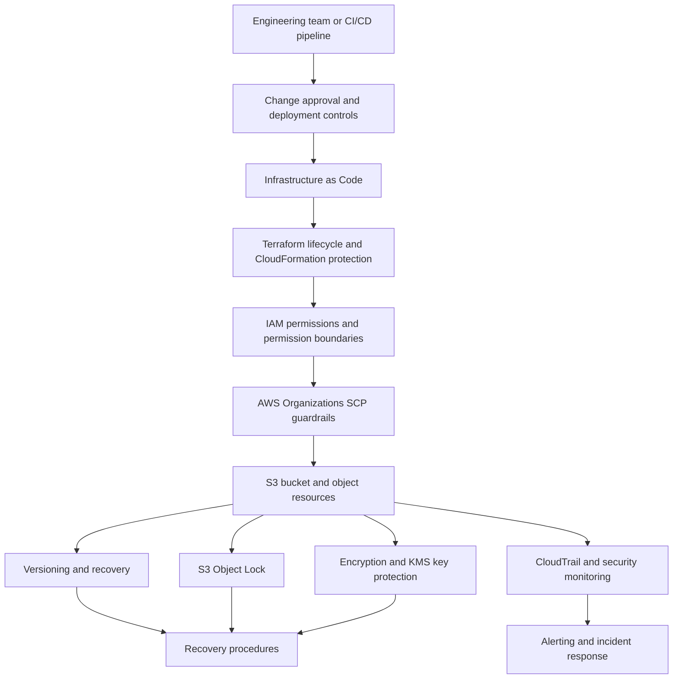
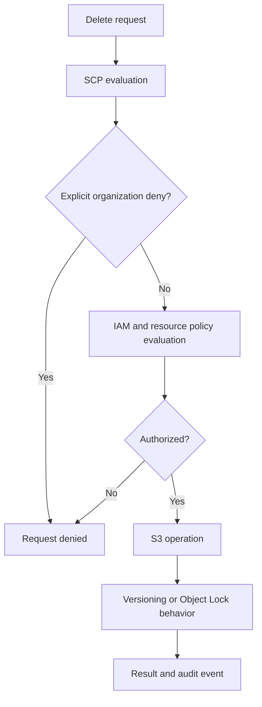
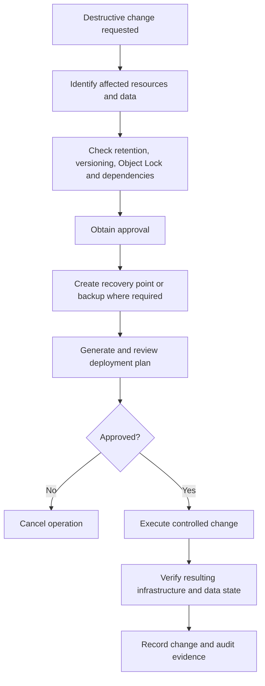
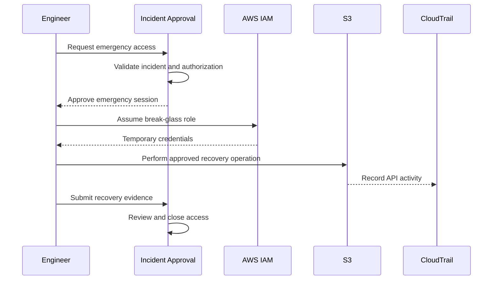

# 07- Protected Production Resources

## Overview

Amazon S3 resources often contain business-critical data, application documents, backups, audit records, and datasets that cannot be easily recreated. Accidental deletion, unauthorized configuration changes, or destructive infrastructure deployments can cause permanent data loss and service disruption.

Protecting production S3 resources requires multiple independent controls across infrastructure provisioning, IAM authorization, S3 configuration, data retention, encryption, and operational workflows.

The objective is not simply to prevent deletion. A production protection strategy should ensure that:

- Critical buckets cannot be accidentally destroyed through routine deployments.
- Unauthorized principals cannot delete protected objects or versions.
- Infrastructure changes follow controlled approval processes.
- Important data can be recovered after accidental or malicious modification.
- Encryption keys remain available for the required retention period.
- Destructive operations are observable and attributable.
- Recovery procedures are tested rather than assumed.

A layered protection architecture combines Terraform lifecycle controls, IAM policies, Service Control Policies (SCPs), CloudFormation protection, S3 versioning, S3 Object Lock, KMS key protection, and controlled break-glass procedures.

## Production Resource Protection Architecture

Resource protection should operate at multiple layers because each control addresses a different failure scenario.



### Protection layers

| Layer | Protection mechanism | Primary purpose |
|---|---|---|
| Infrastructure configuration | Terraform `prevent_destroy` | Prevent accidental Terraform resource destruction |
| CloudFormation | Deletion policies and stack protection | Control stack-level deletion and replacement |
| Identity authorization | IAM policies | Restrict destructive API operations |
| Organization governance | SCPs | Apply account-wide permission guardrails |
| S3 data protection | Versioning | Recover overwritten or deleted objects |
| Immutable retention | S3 Object Lock | Prevent protected versions from being deleted or modified during retention |
| Encryption | KMS key protection | Preserve the ability to decrypt protected data |
| Monitoring | CloudTrail and EventBridge | Detect destructive actions |
| Operations | Approval and break-glass workflows | Control exceptional administrative actions |

No single control provides complete protection.

For example, Terraform `prevent_destroy` does not stop an administrator from deleting a bucket through the AWS CLI. Similarly, S3 versioning does not prevent an authorized principal from permanently deleting a specific object version.

## Identify Critical Production Resources

Before applying protection controls, classify S3 resources according to their business impact and recovery requirements.

Typical critical resources include:

- Production application buckets.
- Customer document and media buckets.
- Database backup buckets.
- Data lake source and curated datasets.
- Audit and security log buckets.
- Replication destination buckets.
- Terraform remote-state buckets.
- Buckets containing regulated or legally retained records.

### Resource classification

| Classification | Example | Protection requirement |
|---|---|---|
| Critical | Customer documents and financial records | Strict deletion controls, versioning, tested recovery |
| Security-sensitive | CloudTrail and security logs | Centralized administration and restricted deletion |
| Operationally critical | Terraform state | Versioning, restricted access, recovery procedures |
| Important | Application media and reports | Versioning where recovery is required |
| Temporary | Processing and staging data | Controlled lifecycle and cleanup |

Classification should drive the protection strategy rather than applying identical controls to every bucket.

### Define recovery requirements

For each critical bucket, document:

- Recovery Point Objective (RPO).
- Recovery Time Objective (RTO).
- Required retention period.
- Whether object-level immutability is necessary.
- Whether cross-account or cross-Region recovery is required.
- Who can authorize destructive operations.
- Which recovery procedures have been tested.

Versioning, replication, and Object Lock address different requirements. They should not be treated as interchangeable backup mechanisms.

## Terraform Resource Protection

Terraform manages infrastructure through a desired-state configuration and execution plan.

Without resource protection, a change that removes a resource block from configuration can result in Terraform planning its destruction.

This is particularly dangerous for production S3 buckets because deleting a bucket can permanently remove access to critical application data.

### `prevent_destroy`

Terraform provides the `prevent_destroy` lifecycle argument.

It blocks Terraform plans that would destroy a resource while the lifecycle rule remains in the resource configuration.

Example:

```hcl
resource "aws_s3_bucket" "production_documents" {
  bucket = var.bucket_name

  lifecycle {
    prevent_destroy = true
  }

  tags = {
    Environment = "production"
    Application = "document-storage"
    ManagedBy   = "terraform"
  }
}
```

When Terraform attempts to destroy this bucket, planning fails with a lifecycle protection error.

### How it works

Terraform evaluates lifecycle rules while planning infrastructure changes.

If a planned action would destroy a resource protected by `prevent_destroy`, Terraform rejects the plan.

This is useful for preventing accidental destruction caused by:

- Removing a resource block.
- Changing a resource configuration that requires replacement.
- Running an unintended destroy operation.
- Incorrectly modifying environment-specific Terraform configuration.

### Important limitations

`prevent_destroy` is not an AWS-side authorization control.

It does not prevent:

- Deletion through AWS CLI.
- Deletion through the AWS Console.
- Deletion by another Terraform configuration.
- Deletion by CloudFormation.
- Deletion by another AWS principal with sufficient permissions.

The protection also depends on the lifecycle configuration remaining in Terraform.

If the resource block is removed entirely, its lifecycle rule is no longer available to protect the resource.

### Use additional safeguards

For critical production resources:

- Combine `prevent_destroy` with IAM deletion restrictions.
- Protect the Terraform state backend.
- Require production deployment approvals.
- Review replacement actions explicitly.
- Separate production infrastructure from development environments.
- Monitor destructive API operations.

### Protect bucket-related resources

A bucket consists of multiple independently managed resources in Terraform.

Protecting only the bucket does not automatically protect every related configuration.

Example:

```hcl
resource "aws_s3_bucket" "production_documents" {
  bucket = var.bucket_name

  lifecycle {
    prevent_destroy = true
  }
}

resource "aws_s3_bucket_versioning" "production_documents" {
  bucket = aws_s3_bucket.production_documents.id

  versioning_configuration {
    status = "Enabled"
  }
}

resource "aws_s3_bucket_public_access_block" "production_documents" {
  bucket = aws_s3_bucket.production_documents.id

  block_public_acls       = true
  ignore_public_acls      = true
  block_public_policy     = true
  restrict_public_buckets = true
}

resource "aws_s3_bucket_server_side_encryption_configuration" "production_documents" {
  bucket = aws_s3_bucket.production_documents.id

  rule {
    apply_server_side_encryption_by_default {
      sse_algorithm = "AES256"
    }
  }
}
```

For production, also consider protecting the Terraform-managed configuration resources from accidental removal and restricting direct changes through IAM.

## IAM Protection Against Destructive Operations

IAM controls which principals can perform AWS API operations.

A production application role should generally have only the permissions required for its workload.

For example, an application that uploads and downloads documents should not automatically receive permissions to:

- Delete the bucket.
- Modify bucket policies.
- Disable versioning.
- Delete object versions.
- Change lifecycle configuration.
- Modify encryption settings.

### Separate application and administration roles

Use different IAM roles for different responsibilities.

| Role | Typical permissions |
|---|---|
| Application role | Required object read and write operations |
| Deployment role | Approved infrastructure configuration changes |
| Security administration role | Audit and security configuration management |
| Recovery role | Controlled recovery and restoration operations |
| Break-glass role | Exceptional administrative actions |

This reduces the impact of compromised application credentials.

### Example: restrict bucket deletion

The following IAM policy denies bucket deletion for a protected bucket.

```json
{
  "Version": "2012-10-17",
  "Statement": [
    {
      "Sid": "DenyProductionBucketDeletion",
      "Effect": "Deny",
      "Action": [
        "s3:DeleteBucket"
      ],
      "Resource": "arn:aws:s3:::company-documents-production"
    }
  ]
}
```

An explicit deny overrides an otherwise applicable allow within the applicable policy evaluation.

### Example: deny permanent object-version deletion

Versioned buckets require special consideration.

A normal delete operation generally creates a delete marker. Permanently deleting a specific object version requires `s3:DeleteObjectVersion`.

The following policy prevents permanent version deletion:

```json
{
  "Version": "2012-10-17",
  "Statement": [
    {
      "Sid": "DenyPermanentObjectVersionDeletion",
      "Effect": "Deny",
      "Action": [
        "s3:DeleteObjectVersion"
      ],
      "Resource": "arn:aws:s3:::company-documents-production/*"
    }
  ]
}
```

This is useful when application and routine deployment roles must never permanently remove historical object versions.

### Deny versioning suspension

Versioning should remain enabled for buckets that depend on version-based recovery.

An explicit deny can protect the configuration:

```json
{
  "Version": "2012-10-17",
  "Statement": [
    {
      "Sid": "DenyVersioningSuspension",
      "Effect": "Deny",
      "Action": [
        "s3:PutBucketVersioning"
      ],
      "Resource": "arn:aws:s3:::company-documents-production"
    }
  ]
}
```

This denies the entire `PutBucketVersioning` API operation for the bucket.

Use this policy only when ordinary administrators and deployment roles should not change versioning at all. A separate approved administration process may be required for legitimate configuration changes.

### Protect bucket configuration

Additional destructive or security-sensitive operations may include:

| Action | Risk |
|---|---|
| `s3:DeleteBucket` | Removes the bucket resource |
| `s3:DeleteObjectVersion` | Permanently deletes an object version |
| `s3:PutBucketVersioning` | Can suspend versioning |
| `s3:PutBucketPolicy` | Can change access permissions |
| `s3:DeleteBucketPolicy` | Removes the bucket policy |
| `s3:PutEncryptionConfiguration` | Changes default encryption settings |
| `s3:PutLifecycleConfiguration` | Can introduce destructive expiration rules |
| `s3:PutReplicationConfiguration` | Can change replication behavior |
| `s3:PutBucketPublicAccessBlock` | Can weaken public-access protection |

Protect only the operations that need restrictions. An overly broad deny can block legitimate infrastructure maintenance and recovery.

## AWS Organizations Service Control Policies

Service Control Policies provide organization-level permission guardrails.

An SCP defines the maximum permissions available to principals in affected member accounts. It does not grant permissions by itself.

SCPs are useful when production accounts must not be able to perform certain destructive operations, even if an IAM administrator accidentally grants those permissions.

### Example: deny deletion of a protected bucket

```json
{
  "Version": "2012-10-17",
  "Statement": [
    {
      "Sid": "ProtectProductionBucket",
      "Effect": "Deny",
      "Action": [
        "s3:DeleteBucket"
      ],
      "Resource": [
        "arn:aws:s3:::company-documents-production"
      ]
    }
  ]
}
```

### Example: deny permanent object-version deletion

```json
{
  "Version": "2012-10-17",
  "Statement": [
    {
      "Sid": "ProtectProductionObjectVersions",
      "Effect": "Deny",
      "Action": [
        "s3:DeleteObjectVersion"
      ],
      "Resource": [
        "arn:aws:s3:::company-documents-production/*"
      ]
    }
  ]
}
```

### SCP design considerations

- Attach guardrails to the appropriate organizational unit or account.
- Exclude only explicitly approved recovery workflows where necessary.
- Test policy effects in non-production accounts.
- Consider the interaction with AWS service principals and service-linked roles.
- Document who can modify or detach the SCP.
- Monitor changes to organization policies.
- Keep emergency recovery procedures available.

SCPs do not protect against every possible administrative failure. Organization administrators with authority to modify the organization policy structure remain part of the trust boundary.

### Layered deletion protection



A successful request still depends on the S3 resource's current configuration and applicable retention controls.

## S3 Versioning as a Recovery Control

S3 Versioning preserves multiple versions of an object within a bucket.

When versioning is enabled, overwriting an object creates a new version. A normal delete operation generally creates a delete marker rather than permanently removing existing versions.

This provides a recovery mechanism for accidental overwrites and deletions.

### Enable versioning

```bash
aws s3api put-bucket-versioning \
  --bucket company-documents-production \
  --versioning-configuration Status=Enabled
```

Verify:

```bash
aws s3api get-bucket-versioning \
  --bucket company-documents-production
```

Expected configuration:

```json
{
  "Status": "Enabled"
}
```

### Inspect object versions

```bash
aws s3api list-object-versions \
  --bucket company-documents-production \
  --prefix customers/12345/report.pdf
```

The response can contain:

- Historical object versions.
- Current versions.
- Delete markers.
- Version IDs.
- Last-modified timestamps.
- Version ownership information.

### Restore an earlier version

To restore an earlier version as the current object, copy that version onto the current key.

```bash
aws s3api copy-object \
  --bucket company-documents-production \
  --key customers/12345/report.pdf \
  --copy-source "company-documents-production/customers/12345/report.pdf?versionId=VERSION_ID"
```

Replace `VERSION_ID` with the actual version ID.

This creates a new current version containing the selected historical content.

### Remove a delete marker

If an object is hidden by a delete marker, removing that specific marker can make an earlier version current again.

```bash
aws s3api delete-object \
  --bucket company-documents-production \
  --key customers/12345/report.pdf \
  --version-id DELETE_MARKER_VERSION_ID
```

This operation permanently removes the specified delete marker.

### Versioning limitations

Versioning does not guarantee permanent protection.

An authorized principal can permanently delete a specific version using `s3:DeleteObjectVersion`.

Other important considerations:

- Versioning increases storage consumption.
- Lifecycle policies can expire noncurrent versions.
- Suspending versioning changes future version behavior.
- Versioning is not a substitute for independent backups.
- Recovery requires the relevant versions to remain available.

Use IAM and retention controls to protect historical versions.

## S3 Object Lock for Immutable Data

S3 Object Lock provides write-once-read-many (WORM) protection for object versions.

It is intended for workloads that require objects to remain protected against deletion or modification for a defined retention period or legal hold.

Common use cases include:

- Regulatory records.
- Financial transaction evidence.
- Security audit archives.
- Compliance documents.
- Long-term records retention.
- Immutable backup repositories.

Object Lock operates at the object-version level.

### Retention modes

S3 Object Lock supports two retention modes.

| Mode | Protection behavior | Typical use |
|---|---|---|
| Governance | Authorized principals with the required bypass permission can bypass retention | Controlled internal retention |
| Compliance | Protected versions cannot be deleted or have their retention shortened before the retention period expires | Strict regulatory retention |

### Governance mode

Governance mode prevents ordinary principals from deleting protected versions.

A principal with the appropriate `s3:BypassGovernanceRetention` permission can bypass governance retention when the request explicitly includes the bypass behavior.

This makes governance mode useful when controlled administrative exceptions are required.

### Compliance mode

Compliance mode provides stronger protection.

During the retention period:

- A protected version cannot be deleted.
- Its retention period cannot be shortened.
- Even highly privileged account users cannot bypass the compliance retention restriction.

Retention decisions must therefore be carefully validated before applying compliance mode to production data.

### Enable Object Lock

Object Lock must be enabled for the bucket.

For a new bucket:

```bash
aws s3api create-bucket \
  --bucket company-immutable-audit \
  --region ap-south-1 \
  --object-lock-enabled-for-bucket
```

For existing buckets, enablement is subject to S3 Object Lock bucket configuration requirements and the bucket's versioning state.

### Configure default retention

Example using governance mode:

```bash
aws s3api put-object-lock-configuration \
  --bucket company-immutable-audit \
  --object-lock-configuration '{
    "ObjectLockEnabled": "Enabled",
    "Rule": {
      "DefaultRetention": {
        "Mode": "GOVERNANCE",
        "Days": 365
      }
    }
  }'
```

Objects uploaded without an explicit retention setting can inherit the bucket's default retention configuration.

### Inspect Object Lock configuration

```bash
aws s3api get-object-lock-configuration \
  --bucket company-immutable-audit
```

Inspect an object's retention:

```bash
aws s3api get-object-retention \
  --bucket company-immutable-audit \
  --key audit/2026/transaction-001.json \
  --version-id VERSION_ID
```

### Legal holds

A legal hold protects an object version independently of a fixed retention date.

A legal hold can remain in effect until explicitly removed by an authorized principal.

Enable a legal hold:

```bash
aws s3api put-object-legal-hold \
  --bucket company-immutable-audit \
  --key audit/2026/transaction-001.json \
  --version-id VERSION_ID \
  --legal-hold Status=ON
```

Inspect it:

```bash
aws s3api get-object-legal-hold \
  --bucket company-immutable-audit \
  --key audit/2026/transaction-001.json \
  --version-id VERSION_ID
```

### Object Lock limitations and operational risks

- Object Lock requires versioning.
- Retention applies to object versions rather than simply protecting a key name.
- Compliance retention cannot be shortened before expiry.
- Governance retention can be bypassed by sufficiently authorized principals.
- Legal holds require explicit management.
- Protected objects can increase storage costs.
- Lifecycle configuration must be designed around retention behavior.
- Replication and encryption requirements must be evaluated separately.

Object Lock is not a general-purpose replacement for IAM controls or backups.

## Protecting KMS Keys

S3 data encrypted with SSE-KMS depends on the availability and authorization of the associated KMS key.

Protecting the bucket while allowing the KMS key to be disabled or deleted can make stored data inaccessible.

KMS key protection should be treated as part of the data protection strategy.

### Important KMS operations

| Operation | Risk |
|---|---|
| `DisableKey` | Prevents use of the key |
| `ScheduleKeyDeletion` | Schedules permanent key deletion |
| `PutKeyPolicy` | Can change who may use or administer the key |
| `CreateGrant` | Can authorize additional key usage |
| `RevokeGrant` | Can remove access required by applications |
| `CancelKeyDeletion` | Cancels a scheduled deletion |

### Deny key deletion

A policy can deny deletion scheduling for a protected KMS key.

Example:

```json
{
  "Version": "2012-10-17",
  "Statement": [
    {
      "Sid": "ProtectProductionEncryptionKey",
      "Effect": "Deny",
      "Action": [
        "kms:ScheduleKeyDeletion"
      ],
      "Resource": "arn:aws:kms:ap-south-1:123456789012:key/KEY_ID"
    }
  ]
}
```

This example is an identity policy statement. An explicit deny must be applied to the relevant principals and policy boundary to be effective.

### Key protection recommendations

- Use customer-managed KMS keys where lifecycle and access control requirements justify them.
- Restrict key administration to a dedicated security role.
- Separate key administration from application data access.
- Monitor key-policy and grant changes.
- Restrict key deletion scheduling.
- Define a recovery procedure for accidentally disabled keys.
- Avoid deleting a key while retained S3 objects still depend on it.
- Maintain an inventory of buckets and workloads using each key.

KMS key deletion is not equivalent to deleting an S3 object. A deleted encryption key can permanently prevent decryption of retained data.

For detailed encryption configuration and permissions, refer to the dedicated encryption and key policy documentation.

## Protecting Terraform Remote State

Terraform state is a critical infrastructure resource.

It contains information Terraform uses to map configuration resources to real AWS infrastructure.

If the state file is deleted, corrupted, or modified incorrectly, infrastructure management and recovery become more difficult.

For S3-backed state, apply independent protection controls.

### Recommended state bucket configuration

- Enable versioning.
- Block public access.
- Encrypt state.
- Restrict access to approved deployment roles.
- Restrict deletion of object versions.
- Protect bucket configuration.
- Enable appropriate logging and monitoring.
- Use a separate account or security boundary where justified.
- Protect the KMS key if SSE-KMS is used.

### Example state bucket

```hcl
resource "aws_s3_bucket" "terraform_state" {
  bucket = var.state_bucket_name

  lifecycle {
    prevent_destroy = true
  }

  tags = {
    Purpose     = "terraform-state"
    Environment = "production"
    ManagedBy   = "terraform"
  }
}

resource "aws_s3_bucket_versioning" "terraform_state" {
  bucket = aws_s3_bucket.terraform_state.id

  versioning_configuration {
    status = "Enabled"
  }
}

resource "aws_s3_bucket_public_access_block" "terraform_state" {
  bucket = aws_s3_bucket.terraform_state.id

  block_public_acls       = true
  ignore_public_acls      = true
  block_public_policy     = true
  restrict_public_buckets = true
}

resource "aws_s3_bucket_server_side_encryption_configuration" "terraform_state" {
  bucket = aws_s3_bucket.terraform_state.id

  rule {
    apply_server_side_encryption_by_default {
      sse_algorithm = "AES256"
    }
  }
}
```

### Inspect state object versions

```bash
aws s3api list-object-versions \
  --bucket company-terraform-state \
  --prefix production/s3/terraform.tfstate
```

If the current state object is corrupted or overwritten, an earlier version may be recoverable.

Restoring state requires care. The selected version must correspond to the actual infrastructure state.

Do not restore an old state version blindly because doing so can make Terraform believe that real resources are missing or incorrectly configured.

### State recovery procedure

1. Stop concurrent Terraform deployments.
2. Preserve the current state object and relevant version IDs.
3. Identify the last known valid state version.
4. Compare the state with actual AWS resources.
5. Restore the selected version through an approved recovery process.
6. Run `terraform plan` and inspect every proposed action.
7. Reconcile state and infrastructure before applying changes.
8. Resume deployment only after verification.

Remote-state recovery should be tested independently of application bucket recovery.

## CloudFormation Resource Protection

CloudFormation manages infrastructure through stacks and resource lifecycle policies.

S3 resources managed by CloudFormation should use deletion and replacement protection where appropriate.

### `DeletionPolicy`

The `DeletionPolicy` attribute controls what happens to a resource when it is removed from a stack or when the stack is deleted.

Common values:

| Value | Behavior |
|---|---|
| `Delete` | Deletes the resource where supported |
| `Retain` | Keeps the resource after stack removal or deletion |
| `Snapshot` | Creates a snapshot for supported resource types |

For S3 buckets, `Retain` is useful when the bucket must survive stack deletion.

### `UpdateReplacePolicy`

`UpdateReplacePolicy` controls what happens to the old physical resource when a stack update replaces a resource.

Use it when replacement could otherwise remove an important production resource.

### Example protected S3 bucket

```yaml
AWSTemplateFormatVersion: "2010-09-09"

Description: Protected production S3 bucket

Resources:
  ProductionDocumentsBucket:
    Type: AWS::S3::Bucket
    DeletionPolicy: Retain
    UpdateReplacePolicy: Retain

    Properties:
      VersioningConfiguration:
        Status: Enabled

      PublicAccessBlockConfiguration:
        BlockPublicAcls: true
        IgnorePublicAcls: true
        BlockPublicPolicy: true
        RestrictPublicBuckets: true

      BucketEncryption:
        ServerSideEncryptionConfiguration:
          - ServerSideEncryptionByDefault:
              SSEAlgorithm: AES256

      Tags:
        - Key: Environment
          Value: production

        - Key: Application
          Value: document-storage

Outputs:
  BucketName:
    Value: !Ref ProductionDocumentsBucket

  BucketArn:
    Value: !GetAtt ProductionDocumentsBucket.Arn
```

### Stack termination protection

Termination protection prevents a CloudFormation stack from being deleted accidentally.

Enable it:

```bash
aws cloudformation update-termination-protection \
  --stack-name production-s3-stack \
  --enable-termination-protection
```

Inspect stack details:

```bash
aws cloudformation describe-stacks \
  --stack-name production-s3-stack
```

### Stack policies

A stack policy can restrict updates to selected resources.

Example:

```json
{
  "Statement": [
    {
      "Effect": "Deny",
      "Action": "Update:Delete",
      "Principal": "*",
      "Resource": "LogicalResourceId/ProductionDocumentsBucket"
    },
    {
      "Effect": "Allow",
      "Action": "Update:*",
      "Principal": "*",
      "Resource": "*"
    }
  ]
}
```

This policy prevents the specified update-delete action against the protected logical resource while allowing other stack updates.

Stack policies are not a replacement for IAM permissions or S3 bucket protection. They apply to CloudFormation stack operations.

### Important limitations

CloudFormation `Retain` does not prevent direct deletion through S3 APIs.

Termination protection does not prevent an authorized administrator from deleting individual resources outside the stack.

Stack policies do not prevent direct API operations against the underlying bucket.

Use independent IAM and organization-level controls for those cases.

## Controlled Destructive Operations

Some production operations legitimately require removing or replacing resources.

Examples include:

- Decommissioning an application.
- Migrating data to a new bucket.
- Replacing an obsolete infrastructure design.
- Removing a temporary replication destination.
- Deleting a bucket after retention requirements expire.

The objective is to make destructive operations deliberate, reviewable, and recoverable where possible.

### Recommended deletion workflow



### Pre-deletion verification

Before deleting a production bucket, verify:

- The bucket is no longer used by applications.
- No active upload or download workflows depend on it.
- Replication dependencies have been reviewed.
- Lifecycle and retention requirements have been satisfied.
- Object Lock restrictions have been checked.
- Required object versions have been preserved.
- Audit and backup requirements have been satisfied.
- DNS, CloudFront, event notifications, and application references have been updated.
- The deployment plan has been reviewed and approved.

### Inspect bucket contents

```bash
aws s3 ls s3://company-documents-production --recursive
```

For versioned buckets:

```bash
aws s3api list-object-versions \
  --bucket company-documents-production
```

A bucket with versioning enabled may contain historical versions and delete markers that are not visible through an ordinary object listing.

Do not assume that a bucket is empty because `aws s3 ls` returns no visible objects.

### Emptying a bucket

For non-versioned buckets, recursive removal can delete objects:

```bash
aws s3 rm s3://company-documents-production \
  --recursive
```

For versioned buckets, historical versions and delete markers must also be considered.

Avoid running destructive recursive commands against production without a verified inventory, explicit approval, and a recovery strategy.

## Break-Glass Access

Break-glass access provides exceptional administrative access when ordinary deployment or recovery processes cannot complete a critical operation.

It should not become a routine mechanism for bypassing production controls.

### Recommended design

- Use a dedicated emergency role.
- Restrict who can assume the role.
- Require strong authentication and appropriate approval.
- Use short-lived credentials.
- Log role assumption and subsequent API operations.
- Notify the security team when the role is used.
- Record the business reason and incident reference.
- Review permissions after every use.
- Remove temporary permissions when the incident is resolved.

### Break-glass workflow



### Operational safeguards

- Do not use long-lived access keys for emergency administration.
- Do not grant unrestricted administrator access by default.
- Avoid permanently exempting break-glass roles from organization guardrails.
- Define the minimum required permissions for the expected recovery operation.
- Test emergency access periodically.

An emergency role that cannot be assumed when needed is not a reliable recovery control. Test the full process, including authentication, authorization, and audit delivery.

## Monitoring Destructive and Security-Sensitive Changes

Protection controls should generate evidence when someone attempts to change them.

CloudTrail provides the API activity needed to investigate resource configuration changes and destructive operations.

Relevant S3 API operations include:

- `DeleteBucket`
- `DeleteObject`
- `DeleteObjects`
- `DeleteBucketPolicy`
- `PutBucketPolicy`
- `PutBucketVersioning`
- `PutBucketLifecycleConfiguration`
- `PutEncryptionConfiguration`
- `PutBucketPublicAccessBlock`
- `PutReplicationConfiguration`

For object-level operations, ensure the relevant S3 data events are enabled.

### EventBridge rule for bucket deletion attempts

```json
{
  "source": [
    "aws.s3"
  ],
  "detail-type": [
    "AWS API Call via CloudTrail"
  ],
  "detail": {
    "eventSource": [
      "s3.amazonaws.com"
    ],
    "eventName": [
      "DeleteBucket"
    ]
  }
}
```

This rule can route matching events to an SNS topic, SQS queue, Lambda function, or security incident workflow.

### EventBridge rule for versioning changes

```json
{
  "source": [
    "aws.s3"
  ],
  "detail-type": [
    "AWS API Call via CloudTrail"
  ],
  "detail": {
    "eventSource": [
      "s3.amazonaws.com"
    ],
    "eventName": [
      "PutBucketVersioning"
    ]
  }
}
```

The receiving system should inspect the request details to determine whether versioning was enabled, suspended, or otherwise changed.

### Monitoring KMS deletion scheduling

CloudTrail management events can also be used to monitor key lifecycle operations.

Important KMS operations include:

- `ScheduleKeyDeletion`
- `DisableKey`
- `PutKeyPolicy`
- `CreateGrant`
- `RevokeGrant`

Use security alerts for unexpected changes to encryption keys used by critical S3 buckets.

For the complete auditing architecture, refer to `08- Deployment Auditability and CloudTrail.md`.

## Production Protection Validation

Protection should be verified through controlled tests in a non-production environment before being relied upon in production.

### Terraform validation

Inspect the plan:

```bash
terraform plan
```

Check for:

- Bucket deletion.
- Resource replacement.
- Versioning suspension.
- Encryption changes.
- Bucket policy removal.
- Lifecycle rule changes.
- KMS key deletion scheduling.

A production pipeline should fail or require additional approval when protected resources have destructive actions.

### IAM validation

Inspect the effective permissions of application and deployment roles.

Confirm that application roles cannot:

- Delete production buckets.
- Permanently delete protected object versions.
- Suspend versioning.
- Modify security-sensitive bucket configuration.
- Schedule deletion of protected KMS keys.

Test explicit-deny behavior with dedicated non-production identities.

### S3 validation commands

Inspect versioning:

```bash
aws s3api get-bucket-versioning \
  --bucket company-documents-production
```

Inspect Object Lock:

```bash
aws s3api get-object-lock-configuration \
  --bucket company-immutable-audit
```

Inspect public-access controls:

```bash
aws s3api get-public-access-block \
  --bucket company-documents-production
```

Inspect encryption:

```bash
aws s3api get-bucket-encryption \
  --bucket company-documents-production
```

Inspect lifecycle configuration:

```bash
aws s3api get-bucket-lifecycle-configuration \
  --bucket company-documents-production
```

### Recovery testing

Perform controlled recovery exercises:

- Restore an overwritten object from an earlier version.
- Remove a test delete marker.
- Verify Object Lock prevents deletion during retention.
- Verify the break-glass role can perform its approved recovery operation.
- Recover a previous Terraform state version in an isolated test environment.
- Confirm CloudTrail records the test operations.
- Verify application behavior after restoration.

Do not perform destructive tests against production customer data.

## Common Mistakes and Pitfalls

| Mistake | Why it is dangerous | Recommended approach |
|---|---|---|
| Relying only on Terraform `prevent_destroy` | Direct AWS API deletion remains possible | Combine Terraform and AWS authorization controls |
| Removing a protected Terraform resource block | Its lifecycle protection is removed with the configuration | Use IAM restrictions and reviewed state-management procedures |
| Assuming versioning prevents deletion | Specific object versions can still be permanently deleted | Restrict `s3:DeleteObjectVersion` |
| Assuming versioning is a backup | It shares the same bucket and account failure domain | Use independent backup and recovery architecture where required |
| Using Object Lock without retention analysis | Compliance retention cannot be shortened | Validate retention requirements before enabling compliance mode |
| Assuming CloudFormation `Retain` prevents API deletion | It only controls CloudFormation resource lifecycle behavior | Add IAM and organization-level protection |
| Treating SCPs as permission grants | SCPs only define maximum available permissions | Combine them with IAM and resource policies |
| Protecting S3 but not its KMS key | Data can become inaccessible if the key is disabled or deleted | Apply key lifecycle and permission protection |
| Giving application roles bucket administration permissions | A compromised workload can modify critical controls | Separate application and deployment roles |
| Allowing unrestricted break-glass access | Emergency credentials become a persistent attack path | Use temporary access, approval, and monitoring |
| Ignoring historical versions during cleanup | Hidden versions and delete markers can remain | Inspect version listings before destructive operations |
| Assuming a retained CloudFormation bucket is protected | Retention does not prevent direct S3 deletion | Apply independent authorization controls |

## Production Readiness Checklist

### Infrastructure protection

- [ ] Critical Terraform resources use `prevent_destroy` where appropriate.
- [ ] Production plans are reviewed for delete and replacement actions.
- [ ] CloudFormation resources use appropriate deletion and replacement policies.
- [ ] Critical CloudFormation stacks have termination protection.
- [ ] Stack policies protect sensitive resources where justified.
- [ ] Terraform remote state is versioned and protected.

### Authorization

- [ ] Application roles have least-privilege S3 permissions.
- [ ] Bucket deletion is restricted.
- [ ] Permanent object-version deletion is restricted.
- [ ] Versioning suspension is controlled.
- [ ] Bucket policy and public-access changes are restricted.
- [ ] KMS key administration is separated from application access.
- [ ] SCP guardrails are applied where organization governance requires them.

### Data protection

- [ ] Versioning is enabled for buckets requiring version-based recovery.
- [ ] Historical object versions have appropriate retention.
- [ ] Object Lock is enabled where immutable retention is required.
- [ ] Governance and compliance retention requirements are understood.
- [ ] Legal holds are managed through an approved process.
- [ ] Independent backups and cross-account recovery are considered for critical data.

### Monitoring and recovery

- [ ] CloudTrail records relevant management events.
- [ ] Required S3 data events are enabled.
- [ ] Destructive actions generate alerts.
- [ ] KMS lifecycle changes are monitored.
- [ ] Recovery procedures are documented.
- [ ] Break-glass access is tested.
- [ ] Recovery exercises are performed periodically.
- [ ] Audit evidence is retained according to organizational requirements.

## Key Takeaways

- Production S3 protection requires independent controls across Terraform, IAM, SCPs, CloudFormation, S3, KMS, and operational workflows.
- Terraform `prevent_destroy` and CloudFormation retention policies protect infrastructure lifecycle operations but do not prevent direct AWS API deletion.
- S3 Versioning supports recovery, while Object Lock provides version-level retention protection; neither should be confused with an independent backup strategy.
- Protect encryption keys and Terraform remote state because losing either can compromise access to critical data or infrastructure management.
- Destructive production operations should require explicit approval, audit evidence, tested recovery procedures, and controlled break-glass access.