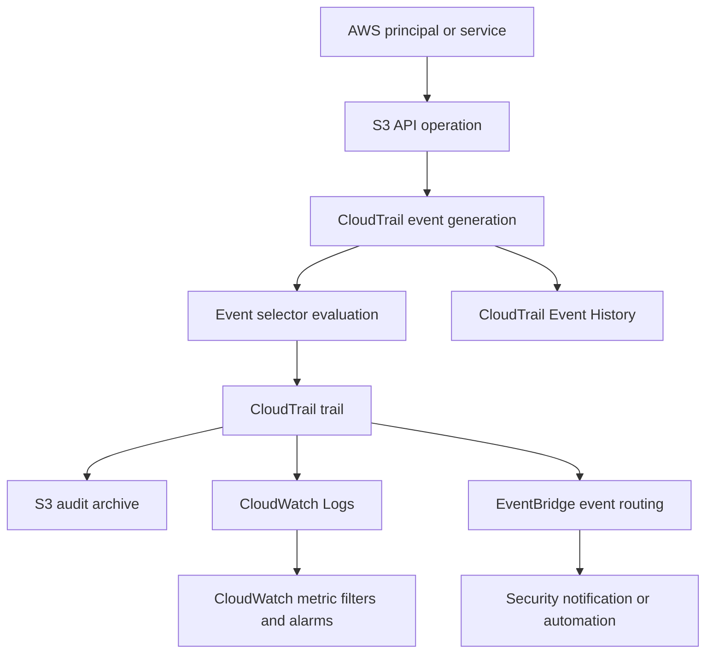
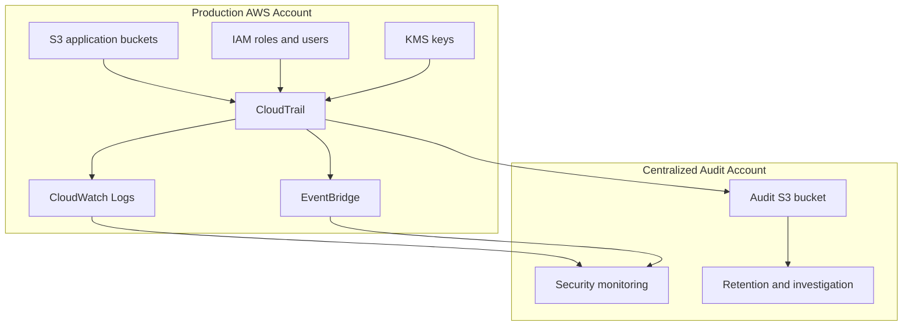
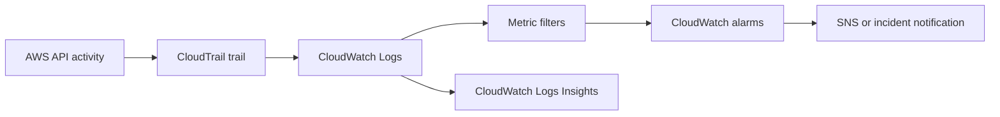
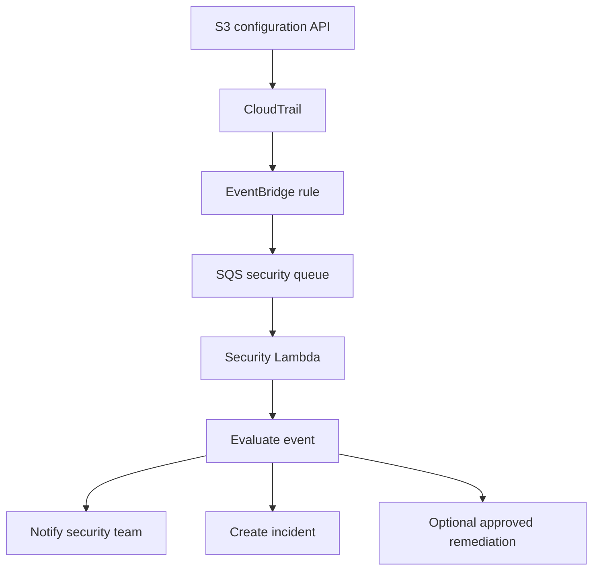
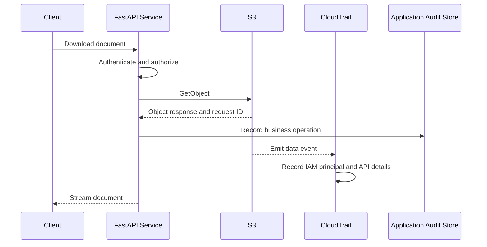
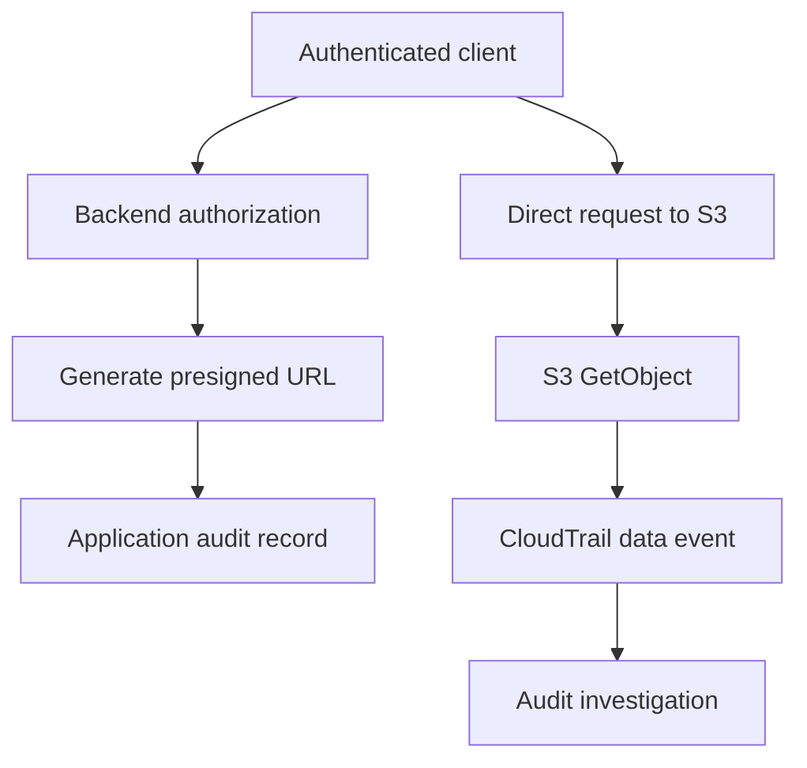
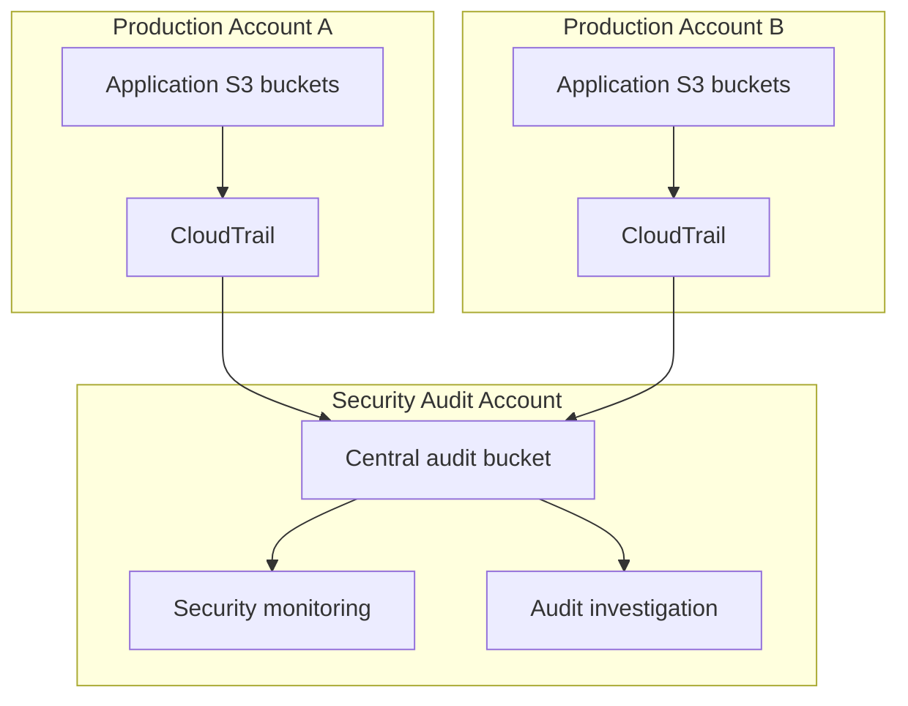

# 08- Deployment Auditability and CloudTrail

## Overview

Amazon S3 auditability provides visibility into who accessed or modified S3 resources, which operations were performed, when they occurred, and whether those operations succeeded or failed.

Production S3 environments commonly store sensitive business data, application uploads, backups, analytics datasets, and compliance records. Without reliable audit trails, investigating unauthorized access, accidental deletion, configuration changes, or data exfiltration becomes difficult.

AWS CloudTrail is the primary AWS service for recording account activity and API operations. It captures S3 management events and, when explicitly configured, S3 object-level data events.

A production audit architecture should combine:

- **CloudTrail:** Records AWS API activity.
- **S3 data events:** Capture object-level API operations.
- **CloudWatch:** Provides metrics, logs, dashboards, and operational alerts.
- **EventBridge:** Routes selected CloudTrail events to automated response workflows.
- **S3 server access logging:** Provides detailed request records for supported S3 request activity.
- **S3 Inventory:** Provides scheduled object-level inventory and metadata reports.
- **AWS Security Hub and Amazon GuardDuty:** Support security posture assessment and threat detection.

These services provide different types of evidence. They should complement each other rather than be treated as interchangeable logging mechanisms.

## Auditability Requirements for S3

An effective audit strategy starts by defining what must be observable.

Typical production requirements include:

| Audit requirement | Example question | Relevant mechanism |
|---|---|---|
| Identity tracking | Which IAM role accessed the bucket? | CloudTrail |
| Bucket configuration changes | Who changed the bucket policy? | CloudTrail management events |
| Object access | Who downloaded a customer document? | S3 data events |
| Object modification | Which principal uploaded or deleted an object? | S3 data events |
| Encryption changes | Who modified the encryption configuration? | CloudTrail management events |
| Public exposure investigation | When was a bucket policy changed? | CloudTrail and IAM Access Analyzer |
| Request-level diagnostics | Why did a particular S3 request fail? | CloudTrail, server access logging, application logs |
| Data inventory | Which objects exist and what storage classes are used? | S3 Inventory |
| Security detection | Is an unusual access pattern occurring? | GuardDuty and other security monitoring |
| Operational alerting | Did someone disable versioning? | EventBridge and CloudWatch notifications |

The audit architecture should distinguish between:

- **Management activity:** Changes to AWS resources and configurations.
- **Data activity:** Operations performed on individual S3 objects.
- **Application activity:** Actions initiated by application users and services.
- **Security findings:** Suspicious or policy-violating behavior.
- **Operational telemetry:** Request counts, latency, errors, and storage metrics.

CloudTrail does not automatically provide every type of evidence needed for an application-level investigation.

For example, an S3 event can identify the IAM principal that uploaded an object, but the application may need its own audit record to associate that upload with an authenticated customer account and business transaction.

## CloudTrail Fundamentals

CloudTrail records activity generated by AWS services and supported API operations.

For S3, it captures management events by default when the applicable CloudTrail event collection is enabled. Object-level data events require explicit configuration.

### Management events

Management events describe operations that manage AWS resources.

Examples include:

- `CreateBucket`
- `DeleteBucket`
- `PutBucketPolicy`
- `DeleteBucketPolicy`
- `PutBucketVersioning`
- `PutEncryptionConfiguration`
- `PutPublicAccessBlock`
- `PutBucketLifecycleConfiguration`
- `PutReplicationConfiguration`

These events are useful for tracking changes to bucket configuration and infrastructure.

### Data events

Data events describe operations performed on resources or data within supported services.

For S3, common examples include:

- `GetObject`
- `PutObject`
- `DeleteObject`
- `DeleteObjects`
- `CopyObject`
- `CompleteMultipartUpload`
- `CreateMultipartUpload`
- `UploadPart`

Data events are not enabled automatically for every S3 bucket.

They can generate substantial event volume and additional CloudTrail charges. Configure them according to the required audit scope.

### Management events versus data events

| Property | Management events | Data events |
|---|---|---|
| Purpose | Track resource administration | Track resource data operations |
| Example | Modify bucket policy | Download an object |
| Default collection | Management events are included in CloudTrail Event History and trails unless excluded | Must be explicitly configured |
| Typical volume | Lower | Potentially very high |
| Cost considerations | CloudTrail management event pricing and delivery rules apply | Additional data-event charges can apply |
| Common use case | Configuration auditing | Object access auditing |

### CloudTrail event lifecycle



CloudTrail Event History is useful for interactive investigation of recent management activity. A trail provides ongoing delivery to configured destinations and can retain events for longer periods.

## Configure a CloudTrail Trail for S3

A CloudTrail trail delivers event records to a configured destination.

For production S3 auditing, a centralized audit bucket is commonly used.

### Recommended architecture



A centralized audit account reduces the risk of workload administrators modifying or deleting the audit records they generate.

### Create a trail

Create a dedicated bucket for CloudTrail delivery.

```bash
aws s3api create-bucket \
  --bucket company-cloudtrail-audit-ap-south-1 \
  --region ap-south-1 \
  --create-bucket-configuration LocationConstraint=ap-south-1
```

Enable versioning:

```bash
aws s3api put-bucket-versioning \
  --bucket company-cloudtrail-audit-ap-south-1 \
  --versioning-configuration Status=Enabled
```

Configure default encryption and public-access blocking according to the organization's audit-storage baseline.

Create the trail:

```bash
aws cloudtrail create-trail \
  --name production-audit-trail \
  --s3-bucket-name company-cloudtrail-audit-ap-south-1 \
  --is-multi-region-trail \
  --enable-log-file-validation
```

Start logging:

```bash
aws cloudtrail start-logging \
  --name production-audit-trail
```

Inspect the trail:

```bash
aws cloudtrail describe-trails \
  --trail-name-list production-audit-trail
```

Check logging status:

```bash
aws cloudtrail get-trail-status \
  --name production-audit-trail
```

### Multi-Region trails

A multi-Region trail records supported activity across enabled AWS Regions in the account.

Use it when:

- Workloads operate in multiple Regions.
- Security teams require centralized visibility.
- Resources may be created outside the primary application Region.
- An organization needs consistent audit coverage.

A multi-Region trail does not mean that all S3 buckets in every account are automatically covered by one account's trail. Cross-account and organization-wide collection require the appropriate organization trail or centralized collection architecture.

### Organization trails

AWS Organizations supports organization trails that can collect events across member accounts.

This is useful when production workloads are distributed across separate AWS accounts.

Consider:

- The management or delegated administrator account.
- Member-account permissions.
- Centralized audit bucket ownership.
- Cross-account bucket policies.
- Region coverage.
- CloudTrail service permissions.
- Audit access separation.

Organization trails should be managed centrally rather than independently configured by every application team.

## Configure S3 Data Events

Management events do not provide complete object-access auditing.

To record object-level operations, configure S3 data event selectors.

### Configure selectors

A trail can use advanced event selectors to filter data events by resource type, bucket ARN, and other supported fields.

Example:

```bash
aws cloudtrail put-event-selectors \
  --trail-name production-audit-trail \
  --advanced-event-selectors '[
    {
      "Name": "Production S3 Object Activity",
      "FieldSelectors": [
        {
          "Field": "eventCategory",
          "Equals": ["Data"]
        },
        {
          "Field": "resources.type",
          "Equals": ["AWS::S3::Object"]
        },
        {
          "Field": "resources.ARN",
          "StartsWith": [
            "arn:aws:s3:::company-documents-production/"
          ]
        }
      ]
    }
  ]'
```

This selector targets object-level data events for the specified bucket.

Review the complete selector configuration before applying it because updating event selectors can replace the trail's existing selector configuration.

### Audit multiple buckets

Advanced selectors can include multiple bucket ARN prefixes.

Example:

```json
[
  {
    "Name": "Production Application Buckets",
    "FieldSelectors": [
      {
        "Field": "eventCategory",
        "Equals": ["Data"]
      },
      {
        "Field": "resources.type",
        "Equals": ["AWS::S3::Object"]
      },
      {
        "Field": "resources.ARN",
        "StartsWith": [
          "arn:aws:s3:::company-documents-production/",
          "arn:aws:s3:::company-media-production/",
          "arn:aws:s3:::company-reports-production/"
        ]
      }
    ]
  }
]
```

### Audit read and write operations

S3 data event selectors can filter by `readOnly`.

For example:

- `readOnly = true` can target read operations.
- `readOnly = false` can target write operations.

Use these filters when the audit requirement is specific.

A compliance workload may need both reads and writes, while a high-volume media delivery workload may prioritize selected write operations.

### Verify data event delivery

Upload a test object:

```bash
aws s3api put-object \
  --bucket company-documents-production \
  --key audit-validation/test.txt \
  --body ./test.txt
```

Read the object:

```bash
aws s3api get-object \
  --bucket company-documents-production \
  --key audit-validation/test.txt \
  ./downloaded-test.txt
```

Inspect the configured trail:

```bash
aws cloudtrail get-event-selectors \
  --trail-name production-audit-trail
```

After delivery, inspect the CloudTrail records and confirm that the expected operations appear.

CloudTrail delivery is not an instantaneous synchronous response to an S3 request. Allow for delivery latency when validating events.

## CloudTrail Event Structure

CloudTrail events use structured JSON records.

A typical S3 object-access event contains fields such as:

```json
{
  "eventVersion": "1.11",
  "eventTime": "2026-10-31T10:15:30Z",
  "eventSource": "s3.amazonaws.com",
  "eventName": "GetObject",
  "awsRegion": "ap-south-1",
  "sourceIPAddress": "203.0.113.10",
  "userAgent": "Boto3/1.x",
  "userIdentity": {
    "type": "AssumedRole",
    "principalId": "EXAMPLE:application-session",
    "arn": "arn:aws:sts::123456789012:assumed-role/document-api-role/application-session",
    "accountId": "123456789012"
  },
  "requestParameters": {
    "bucketName": "company-documents-production",
    "key": "customers/12345/report.pdf"
  },
  "responseElements": null,
  "requestID": "EXAMPLE123456789",
  "eventID": "EXAMPLE-EVENT-ID",
  "readOnly": true,
  "resources": [
    {
      "type": "AWS::S3::Object",
      "ARN": "arn:aws:s3:::company-documents-production/customers/12345/report.pdf"
    }
  ],
  "eventType": "AwsApiCall",
  "managementEvent": false,
  "recipientAccountId": "123456789012"
}
```

This is an illustrative event structure. Actual fields vary by API operation, identity type, event version, and service behavior.

### Important fields

| Field | Purpose |
|---|---|
| `eventTime` | Time at which the event occurred |
| `eventSource` | AWS service that generated the event |
| `eventName` | API operation name |
| `awsRegion` | Region associated with the event |
| `sourceIPAddress` | Request source address where available |
| `userAgent` | Client or SDK information where available |
| `userIdentity` | Principal responsible for the request |
| `requestParameters` | Request details recorded for the operation |
| `responseElements` | Response details where available |
| `requestID` | AWS request identifier |
| `eventID` | Unique CloudTrail event identifier |
| `resources` | Resources associated with the event |
| `errorCode` | Error code when the operation failed |
| `errorMessage` | Error description when available |

### Identity interpretation

S3 requests can originate from different identity types.

| Identity type | Typical origin |
|---|---|
| IAM user | Direct IAM user credentials |
| Assumed role | EC2, Lambda, ECS, EKS, or federated workload |
| AWS service | An AWS service acting on behalf of a workflow |
| Root | AWS account root credentials |

For backend applications, an assumed-role identity is common.

For example, a FastAPI application running on ECS may use a task role. CloudTrail records the role session rather than the application's authenticated customer identity.

Maintain application-level audit records when business-level attribution is required.

## CloudTrail Log File Validation

CloudTrail can validate the integrity of delivered log files using digest files.

Log file validation helps detect whether delivered log files have been modified or deleted after delivery.

Enable validation when creating a trail:

```bash
aws cloudtrail create-trail \
  --name production-audit-trail \
  --s3-bucket-name company-cloudtrail-audit-ap-south-1 \
  --is-multi-region-trail \
  --enable-log-file-validation
```

For an existing trail:

```bash
aws cloudtrail update-trail \
  --name production-audit-trail \
  --enable-log-file-validation
```

### Validate log files

```bash
aws cloudtrail validate-logs \
  --trail-arn arn:aws:cloudtrail:ap-south-1:123456789012:trail/production-audit-trail \
  --start-time 2026-10-01T00:00:00Z \
  --end-time 2026-10-31T23:59:59Z
```

Validation checks the integrity of CloudTrail log files against their digest information.

### Important limitations

Log file validation:

- Detects modifications to delivered log files through the validation mechanism.
- Does not prove that every required event selector was configured correctly.
- Does not prove that no events were omitted before collection.
- Does not replace restrictive access controls on the audit bucket.
- Does not independently guarantee long-term retention.

Protect the log files and digest files together.

## Protect the Audit Bucket

The audit bucket is itself a critical security resource.

If an attacker can delete CloudTrail records, the organization may lose evidence needed to investigate the attack.

Apply a dedicated protection strategy.

### Recommended controls

- Enable versioning.
- Block public access.
- Use `BucketOwnerEnforced` Object Ownership.
- Restrict writes to the CloudTrail delivery service.
- Restrict deletion and policy modification.
- Use appropriate encryption.
- Separate audit administration from workload administration.
- Apply retention requirements.
- Monitor changes to bucket policies and lifecycle configuration.
- Consider S3 Object Lock when immutable audit retention is required.

### Example audit bucket policy

The following example allows CloudTrail to validate the destination bucket and write log objects.

Replace the account, Region, and trail ARN with the actual deployment values.

```json
{
  "Version": "2012-10-17",
  "Statement": [
    {
      "Sid": "AWSCloudTrailAclCheck",
      "Effect": "Allow",
      "Principal": {
        "Service": "cloudtrail.amazonaws.com"
      },
      "Action": "s3:GetBucketAcl",
      "Resource": "arn:aws:s3:::company-cloudtrail-audit-ap-south-1",
      "Condition": {
        "StringEquals": {
          "aws:SourceArn": "arn:aws:cloudtrail:ap-south-1:123456789012:trail/production-audit-trail"
        }
      }
    },
    {
      "Sid": "AWSCloudTrailWrite",
      "Effect": "Allow",
      "Principal": {
        "Service": "cloudtrail.amazonaws.com"
      },
      "Action": "s3:PutObject",
      "Resource": "arn:aws:s3:::company-cloudtrail-audit-ap-south-1/AWSLogs/123456789012/*",
      "Condition": {
        "StringEquals": {
          "s3:x-amz-acl": "bucket-owner-full-control",
          "aws:SourceArn": "arn:aws:cloudtrail:ap-south-1:123456789012:trail/production-audit-trail"
        }
      }
    }
  ]
}
```

Validate the required delivery permissions against the selected CloudTrail destination configuration and account architecture.

### Audit bucket encryption

CloudTrail supports S3-managed encryption and SSE-KMS for log delivery when configured correctly.

For SSE-KMS:

- Use a customer-managed KMS key when key-policy control is required.
- Allow the CloudTrail service to use the key as required by the delivery configuration.
- Restrict key administration.
- Monitor key-policy changes.
- Avoid disabling or scheduling deletion of the key while audit records depend on it.

Encryption permissions and S3 delivery permissions are separate authorization layers.

## CloudTrail with CloudWatch Logs

CloudTrail can deliver events to CloudWatch Logs for near-real-time operational analysis and alerting.

A CloudWatch Logs integration is useful when security teams need to search events without repeatedly downloading and parsing S3 log files.

### Architecture



### Configure CloudWatch Logs delivery

Create a log group:

```bash
aws logs create-log-group \
  --log-group-name /aws/cloudtrail/production
```

Create or identify a CloudTrail delivery role with the required CloudWatch Logs permissions.

Update the trail:

```bash
aws cloudtrail update-trail \
  --name production-audit-trail \
  --cloud-watch-logs-log-group-arn arn:aws:logs:ap-south-1:123456789012:log-group:/aws/cloudtrail/production:* \
  --cloud-watch-logs-role-arn arn:aws:iam::123456789012:role/CloudTrailCloudWatchLogsRole
```

CloudTrail must be able to assume the configured role and publish to the log group.

### Search events with Logs Insights

Find S3 bucket deletion operations:

```sql
fields @timestamp, eventName, userIdentity.arn, sourceIPAddress, awsRegion
| filter eventSource = "s3.amazonaws.com"
| filter eventName = "DeleteBucket"
| sort @timestamp desc
| limit 100
```

Find object deletion events:

```sql
fields @timestamp, eventName, userIdentity.arn, requestParameters.bucketName,
       requestParameters.key, sourceIPAddress, errorCode
| filter eventSource = "s3.amazonaws.com"
| filter eventName in ["DeleteObject", "DeleteObjects"]
| sort @timestamp desc
| limit 100
```

These queries depend on the event fields delivered to the configured log group. Validate field paths against actual records.

### Identify failed S3 API operations

```sql
fields @timestamp, eventName, userIdentity.arn, errorCode, errorMessage,
       requestParameters.bucketName
| filter eventSource = "s3.amazonaws.com"
| filter ispresent(errorCode)
| sort @timestamp desc
| limit 100
```

This is useful for identifying authorization failures and operational errors.

## EventBridge for Security Automation

EventBridge can route CloudTrail events to targets such as SNS, Lambda, SQS, and incident-management integrations.

Use it when an event should trigger a response rather than only appear in an audit archive.

### Example: detect bucket policy changes

Create an EventBridge rule pattern:

```json
{
  "source": [
    "aws.s3"
  ],
  "detail-type": [
    "AWS API Call via CloudTrail"
  ],
  "detail": {
    "eventSource": [
      "s3.amazonaws.com"
    ],
    "eventName": [
      "PutBucketPolicy",
      "DeleteBucketPolicy"
    ]
  }
}
```

This matches selected S3 bucket policy changes recorded through CloudTrail.

### Example: detect versioning changes

```json
{
  "source": [
    "aws.s3"
  ],
  "detail-type": [
    "AWS API Call via CloudTrail"
  ],
  "detail": {
    "eventSource": [
      "s3.amazonaws.com"
    ],
    "eventName": [
      "PutBucketVersioning"
    ]
  }
}
```

The receiving workflow should inspect the event details and determine whether the operation actually suspended versioning.

The event name alone does not establish that the resulting configuration is unsafe.

### Event-driven response architecture



### Retry and failure handling

For automated security workflows:

- Make event processing idempotent.
- Preserve the original event for investigation.
- Use SQS when buffering and controlled retries are required.
- Configure a dead-letter queue where appropriate.
- Monitor queue age and message depth.
- Avoid automatic rollback without evaluating the current resource state.
- Record remediation actions separately from the original event.

A policy-change alert should not automatically restore an old bucket policy without understanding why the change occurred.

## S3 Server Access Logging

S3 server access logging records detailed request information for a bucket.

It provides request-level records that complement CloudTrail.

Typical fields include:

- Requester.
- Request time.
- Remote IP address.
- Request operation.
- Requested bucket and key.
- HTTP status.
- Error code.
- Response bytes.
- Object size.
- Request URI.
- User agent.
- Request ID and host ID.

### CloudTrail versus server access logging

| Capability | CloudTrail | S3 server access logging |
|---|---|---|
| AWS identity attribution | Structured identity information | Requester information where available |
| Management operations | Yes | No equivalent management-event coverage |
| Object API operations | Yes, when data events are enabled | Request-level access records |
| Configuration changes | Yes | Not its primary purpose |
| Delivery format | Structured event records | Text-based access log records |
| Event filtering | Event selectors | Bucket-level logging configuration |
| Delivery behavior | Trail delivery | Best-effort log delivery |
| Primary use | Security audit and API attribution | Request analysis and diagnostics |

Server access logging is delivered on a best-effort basis. It should not be the sole source of evidence for compliance-critical auditing.

### Configure server access logging

Create a dedicated destination bucket.

The source bucket and destination bucket should be configured according to S3 server access logging requirements. In particular, avoid using the source bucket as its own logging destination.

Configure logging:

```bash
aws s3api put-bucket-logging \
  --bucket company-documents-production \
  --bucket-logging-status '{
    "LoggingEnabled": {
      "TargetBucket": "company-s3-access-logs",
      "TargetPrefix": "production/documents/"
    }
  }'
```

Inspect configuration:

```bash
aws s3api get-bucket-logging \
  --bucket company-documents-production
```

### Operational considerations

- Delivery is not immediate.
- Records can contain sensitive request information.
- Log storage needs lifecycle and retention management.
- Destination bucket permissions must be configured correctly.
- High-volume buckets can generate substantial log volume.
- Avoid assuming every request will produce a corresponding delivered log record.

## S3 Inventory for Object-Level Auditing

CloudTrail records API activity. S3 Inventory provides scheduled reports describing objects stored in a bucket.

Inventory is useful for answering questions such as:

- Which objects exist?
- Which storage classes are being used?
- Which objects are encrypted?
- Which objects have version IDs?
- Which objects are marked as delete markers?
- Which objects have specific metadata or tags, when configured?

It is not a real-time request log.

### Inventory configuration

An inventory configuration specifies:

- Destination bucket.
- Destination prefix.
- Frequency.
- Output format.
- Included object versions.
- Optional object metadata fields.

Example configuration:

```json
{
  "Destination": {
    "S3BucketDestination": {
      "AccountId": "123456789012",
      "Bucket": "arn:aws:s3:::company-s3-inventory",
      "Format": "Parquet",
      "Prefix": "inventory/documents",
      "Encryption": {
        "SSES3": {}
      }
    }
  },
  "IsEnabled": true,
  "Id": "production-documents-inventory",
  "IncludedObjectVersions": "All",
  "OptionalFields": [
    "Size",
    "LastModifiedDate",
    "StorageClass",
    "ETag",
    "IsMultipartUploaded",
    "ReplicationStatus",
    "EncryptionStatus",
    "ObjectLockRetainUntilDate",
    "ObjectLockMode",
    "ObjectLockLegalHoldStatus"
  ],
  "Schedule": {
    "Frequency": "Daily"
  }
}
```

The inventory destination and encryption configuration must satisfy the applicable S3 Inventory delivery requirements.

### Apply inventory configuration

Save the configuration as `inventory.json` and run:

```bash
aws s3api put-bucket-inventory-configuration \
  --bucket company-documents-production \
  --id production-documents-inventory \
  --inventory-configuration file://inventory.json
```

Inspect it:

```bash
aws s3api get-bucket-inventory-configuration \
  --bucket company-documents-production \
  --id production-documents-inventory
```

### Inventory versus CloudTrail

| Requirement | CloudTrail | S3 Inventory |
|---|---|---|
| Who downloaded an object? | Yes, with data events | No |
| Which objects currently exist? | Not efficiently | Yes |
| Which objects use a storage class? | Not as a current-state inventory | Yes |
| Which object versions exist? | Records relevant API activity | Can report all versions |
| What changed yesterday? | API activity history | Snapshot comparison across reports |
| Real-time investigation | Event delivery and history | No |

### Use Athena for inventory analysis

S3 Inventory reports can be queried using Athena when the report format and catalog configuration support the workload.

Example SQL for an inventory table:

```sql
SELECT
    storage_class,
    COUNT(*) AS object_count,
    SUM(size) AS total_bytes
FROM s3_inventory
GROUP BY storage_class
ORDER BY total_bytes DESC;
```

This query assumes an Athena table has been created over the inventory report with compatible column definitions.

Use inventory reports for periodic compliance checks, storage analysis, and large-scale object audits.

## CloudTrail and Application-Level Audit Logging

CloudTrail identifies AWS API activity, but it does not replace application audit records.

A backend application typically needs to record business-level context.

For example, when a customer downloads a document:

- CloudTrail can identify the IAM principal that performed `GetObject`.
- The backend can identify the authenticated customer.
- The backend can record the business document ID.
- The backend can record the authorization decision.
- The backend can correlate the request with an application trace ID.

### Recommended application audit fields

| Field | Purpose |
|---|---|
| `event_id` | Unique application audit record |
| `timestamp` | Application event time |
| `actor_id` | Authenticated user or service identity |
| `tenant_id` | Tenant boundary |
| `action` | Business operation |
| `resource_id` | Business document or media identifier |
| `s3_bucket` | Storage bucket |
| `s3_key` | Object key, subject to data minimization |
| `request_id` | Application request identifier |
| `correlation_id` | Distributed trace correlation |
| `result` | Allowed, denied, completed, or failed |
| `source_service` | Backend service responsible |

Do not record presigned URLs, secret credentials, or sensitive document contents in application logs.

### FastAPI application audit example

A service layer can record the business operation independently of the S3 API call.

```python
from datetime import datetime, timezone
from uuid import uuid4

import boto3
from botocore.exceptions import BotoCoreError, ClientError


class DocumentStorageService:
    def __init__(self, audit_repository, bucket_name: str):
        self.s3 = boto3.client("s3")
        self.audit_repository = audit_repository
        self.bucket_name = bucket_name

    def download_document(
        self,
        *,
        tenant_id: str,
        actor_id: str,
        document_id: str,
        object_key: str,
        request_id: str,
    ) -> dict:
        audit_event = {
            "event_id": str(uuid4()),
            "timestamp": datetime.now(timezone.utc).isoformat(),
            "actor_id": actor_id,
            "tenant_id": tenant_id,
            "action": "document.download",
            "resource_id": document_id,
            "s3_bucket": self.bucket_name,
            "s3_key": object_key,
            "request_id": request_id,
            "result": "started",
        }

        try:
            response = self.s3.get_object(
                Bucket=self.bucket_name,
                Key=object_key,
            )

            audit_event["result"] = "success"
            audit_event["s3_request_id"] = response["ResponseMetadata"][
                "RequestId"
            ]

            return {
                "body": response["Body"],
                "content_type": response.get(
                    "ContentType",
                    "application/octet-stream",
                ),
                "audit_event": audit_event,
            }

        except (ClientError, BotoCoreError) as exc:
            audit_event["result"] = "failure"
            audit_event["error_type"] = type(exc).__name__

            self.audit_repository.write(audit_event)
            raise

        finally:
            if audit_event["result"] == "success":
                self.audit_repository.write(audit_event)
```

This example illustrates audit-event placement around an S3 operation. In a production implementation:

- Use a durable audit repository.
- Avoid logging raw exception messages if they can expose sensitive data.
- Ensure audit persistence failures have an explicit handling policy.
- Do not allow an audit write failure to silently disappear.
- Avoid buffering an entire object in application memory.
- Stream large downloads and close the S3 response body.
- Keep business authorization separate from S3 authorization.
- Use a transactional outbox when audit records must be committed reliably with business state changes.

For high-volume systems, asynchronous audit delivery can reduce request latency, but it introduces delivery and consistency considerations.

## Correlating CloudTrail and Application Events

A reliable investigation needs a correlation strategy.

CloudTrail and application logs may use different identifiers.

Useful correlation fields include:

- Application request ID.
- Distributed trace ID.
- S3 request ID.
- CloudTrail event ID.
- IAM role session name.
- Bucket and object key.
- Event timestamp.
- Tenant and business resource identifiers.

### Request correlation flow



The S3 request ID returned by the SDK can be recorded in the application audit event.

The corresponding CloudTrail event can then be investigated using the available event fields and time range.

Do not assume that every application request maps one-to-one to a CloudTrail event. Retries, multipart operations, presigned requests, and service-mediated operations can create different event patterns.

## Audit Presigned URL Access

Presigned URLs allow clients to access S3 directly using a signed request.

This changes the audit architecture.

Consider a FastAPI application that generates a presigned download URL.

The application records:

- Which user requested the URL.
- Which document was authorized.
- When the URL was generated.
- Its expiration time.
- The business operation ID.

When the client later downloads the object directly from S3, S3 data events can record the S3 API request and the signing identity.

### Presigned URL audit flow



### Important considerations

- The signing principal is not necessarily the human user.
- CloudTrail may identify the IAM role or credentials used to sign the request.
- The application must maintain the mapping between URL issuance and business identity.
- A generated URL is a bearer credential.
- Anyone possessing a valid URL may be able to use it within its constraints.
- Avoid logging the complete URL because it contains authentication material.

A presigned URL generation event does not prove that the object was downloaded. Use S3 data events to observe the actual S3 operation.

## Cross-Account and Centralized Auditing

Large AWS environments often separate production workloads from security monitoring.

A centralized audit account can receive CloudTrail logs from multiple workload accounts.

### Architecture



### Design considerations

- Use organization trails when appropriate.
- Centralize log storage in a security-controlled account.
- Restrict workload administrators from modifying audit storage.
- Apply cross-account bucket permissions carefully.
- Monitor CloudTrail delivery failures.
- Protect KMS keys used for audit encryption.
- Define retention and legal-hold requirements.
- Keep audit access separate from audit administration.

Centralization reduces fragmentation but creates a critical shared dependency. The audit account and its storage controls must be designed for availability and recovery.

## Monitoring CloudTrail Delivery

A configured trail is not sufficient evidence that audit records are being delivered successfully.

Monitor the trail and its delivery status.

### Inspect trail status

```bash
aws cloudtrail get-trail-status \
  --name production-audit-trail
```

Important fields include:

| Field | Meaning |
|---|---|
| `IsLogging` | Whether logging is enabled |
| `LatestDeliveryTime` | Latest successful log delivery time |
| `LatestDeliveryError` | Most recent delivery error |
| `LatestDigestDeliveryTime` | Latest digest delivery time |
| `LatestNotificationError` | Notification delivery error where applicable |
| `StartLoggingTime` | Time logging was started |

### CloudTrail CloudWatch metrics

CloudTrail publishes service metrics that can help monitor trail delivery.

Relevant monitoring areas include:

- Delivery errors.
- Log delivery activity.
- Digest delivery.
- Trail logging state.
- Data event volume and cost.

Use the CloudTrail metric namespace and metric dimensions documented for the deployed trail configuration.

Do not rely exclusively on the absence of delivery errors. A trail can be healthy while its event selectors omit resources that should be audited.

### Operational monitoring checklist

| Indicator | Expected condition | Response |
|---|---|---|
| Trail logging | Enabled | Investigate if disabled |
| Log delivery | Recent successful delivery | Investigate delivery delay or failure |
| Digest delivery | Active when validation is enabled | Investigate missing digests |
| Data event selectors | Match required buckets | Review configuration drift |
| Audit bucket policy | Expected delivery permissions | Investigate unauthorized changes |
| KMS key state | Enabled and usable | Investigate disabled or pending-deletion state |
| EventBridge target | Healthy delivery | Investigate failed invocations |
| CloudWatch log group | Receiving events | Investigate missing log ingestion |

## Cost and Retention Considerations

Audit systems can generate significant costs in high-volume S3 environments.

The cost model depends on event volume, delivery destinations, retention, storage, and query patterns.

### Main cost drivers

| Cost driver | Why it matters |
|---|---|
| S3 data events | High-volume object access creates large event counts |
| CloudTrail delivery | Additional copies or destinations can increase cost |
| CloudWatch Logs ingestion | Large event streams increase ingestion charges |
| CloudWatch Logs retention | Long retention increases stored log volume |
| S3 audit storage | Log archives consume storage |
| S3 Inventory | Inventory reports generate storage and request activity |
| Athena queries | Scanning large audit datasets increases query cost |
| EventBridge | High event volume can increase matching and target invocation costs |
| Notifications and processing | Lambda, SQS, SNS, and other targets have associated costs |

### Control audit costs

- Audit sensitive and regulated buckets comprehensively.
- Avoid enabling object-level auditing indiscriminately across temporary datasets.
- Use advanced event selectors to target required resources.
- Separate high-volume delivery workloads from sensitive document storage.
- Set CloudWatch Logs retention explicitly.
- Use lifecycle policies for eligible audit records.
- Use Parquet and partitioned query layouts where supported by the analytics pipeline.
- Use S3 Inventory for periodic state analysis rather than attempting to reconstruct current state from every API event.
- Review CloudTrail event volume and costs regularly.

Do not exclude required audit events simply to reduce costs. Audit coverage should be a documented security and compliance decision.

## Terraform Example: CloudTrail Audit Trail

The following Terraform configuration creates a dedicated S3 audit bucket and a multi-Region CloudTrail trail.

It is a starting point for a single-account deployment. A centralized multi-account audit architecture requires additional cross-account configuration.

### S3 audit bucket

```hcl
resource "aws_s3_bucket" "cloudtrail_audit" {
  bucket        = var.audit_bucket_name
  force_destroy = false

  lifecycle {
    prevent_destroy = true
  }

  tags = {
    Application = "security-audit"
    Environment = var.environment
    ManagedBy   = "terraform"
  }
}

resource "aws_s3_bucket_versioning" "cloudtrail_audit" {
  bucket = aws_s3_bucket.cloudtrail_audit.id

  versioning_configuration {
    status = "Enabled"
  }
}

resource "aws_s3_bucket_public_access_block" "cloudtrail_audit" {
  bucket = aws_s3_bucket.cloudtrail_audit.id

  block_public_acls       = true
  ignore_public_acls      = true
  block_public_policy     = true
  restrict_public_buckets = true
}

resource "aws_s3_bucket_server_side_encryption_configuration" "cloudtrail_audit" {
  bucket = aws_s3_bucket.cloudtrail_audit.id

  rule {
    apply_server_side_encryption_by_default {
      sse_algorithm = "AES256"
    }
  }
}
```

### CloudTrail permissions and trail

```hcl
data "aws_caller_identity" "current" {}

data "aws_region" "current" {}

resource "aws_s3_bucket_policy" "cloudtrail_audit" {
  bucket = aws_s3_bucket.cloudtrail_audit.id

  policy = jsonencode({
    Version = "2012-10-17"
    Statement = [
      {
        Sid    = "AWSCloudTrailAclCheck"
        Effect = "Allow"

        Principal = {
          Service = "cloudtrail.amazonaws.com"
        }

        Action = "s3:GetBucketAcl"

        Resource = aws_s3_bucket.cloudtrail_audit.arn

        Condition = {
          StringEquals = {
            "aws:SourceArn" = "arn:aws:cloudtrail:${data.aws_region.current.name}:${data.aws_caller_identity.current.account_id}:trail/${var.trail_name}"
          }
        }
      },
      {
        Sid    = "AWSCloudTrailWrite"
        Effect = "Allow"

        Principal = {
          Service = "cloudtrail.amazonaws.com"
        }

        Action = "s3:PutObject"

        Resource = "${aws_s3_bucket.cloudtrail_audit.arn}/AWSLogs/${data.aws_caller_identity.current.account_id}/*"

        Condition = {
          StringEquals = {
            "s3:x-amz-acl" = "bucket-owner-full-control"
            "aws:SourceArn" = "arn:aws:cloudtrail:${data.aws_region.current.name}:${data.aws_caller_identity.current.account_id}:trail/${var.trail_name}"
          }
        }
      }
    ]
  })
}

resource "aws_cloudtrail" "production" {
  name                          = var.trail_name
  s3_bucket_name                = aws_s3_bucket.cloudtrail_audit.id
  is_multi_region_trail         = true
  enable_logging                = true
  enable_log_file_validation    = true
  include_global_service_events = true

  depends_on = [
    aws_s3_bucket_policy.cloudtrail_audit
  ]

  advanced_event_selector {
    name = "Production S3 object activity"

    field_selector {
      field  = "eventCategory"
      equals = ["Data"]
    }

    field_selector {
      field  = "resources.type"
      equals = ["AWS::S3::Object"]
    }

    field_selector {
      field = "resources.ARN"

      starts_with = [
        "arn:aws:s3:::company-documents-production/"
      ]
    }
  }

  tags = {
    Environment = var.environment
    ManagedBy   = "terraform"
  }
}
```

### Variables

```hcl
variable "audit_bucket_name" {
  description = "Globally unique S3 bucket name for CloudTrail logs."
  type        = string
}

variable "trail_name" {
  description = "CloudTrail trail name."
  type        = string
  default     = "production-audit-trail"
}

variable "environment" {
  description = "Deployment environment."
  type        = string
  default     = "production"
}
```

### Outputs

```hcl
output "audit_bucket_name" {
  value = aws_s3_bucket.cloudtrail_audit.bucket
}

output "cloudtrail_arn" {
  value = aws_cloudtrail.production.arn
}
```

### Deployment commands

```bash
terraform init
terraform fmt -check
terraform validate
terraform plan -out=audit.tfplan
terraform apply audit.tfplan
```

Verify:

```bash
aws cloudtrail get-trail-status \
  --name production-audit-trail

aws cloudtrail get-event-selectors \
  --trail-name production-audit-trail
```

### Production considerations

- Pin and test Terraform and AWS provider versions.
- Confirm that the configured Region and account match the intended environment.
- Review the bucket policy before applying it.
- Include every bucket requiring object-level auditing in the selector design.
- Avoid unintentionally replacing existing event selectors.
- Use a dedicated KMS key if the audit encryption policy requires customer-managed keys.
- Add CloudWatch Logs integration and alerting when operational search and notification are required.
- Apply retention controls independently of the CloudTrail trail.
- Keep the audit bucket outside routine application teardown workflows.

This example does not create an organization trail or a cross-account destination policy.

## Audit Investigation Workflows

A useful audit system must support repeatable investigations.

The following workflows illustrate how to investigate common production incidents.

### Investigate an unexpected bucket policy change

**Symptoms**

- Public-access findings appear.
- A security control reports an unexpected policy change.
- A bucket suddenly permits additional principals.

**Investigation**

1. Search CloudTrail for `PutBucketPolicy` and `DeleteBucketPolicy`.
2. Identify the principal and assumed-role session.
3. Inspect the source IP and user agent.
4. Review the event timestamp and request details.
5. Compare the current bucket policy with the approved configuration.
6. Check the associated CI/CD deployment and change approval.

Commands:

```bash
aws cloudtrail lookup-events \
  --lookup-attributes AttributeKey=EventName,AttributeValue=PutBucketPolicy \
  --max-results 50
```

For a specific bucket, inspect its current policy:

```bash
aws s3api get-bucket-policy \
  --bucket company-documents-production
```

`lookup-events` searches CloudTrail Event History, which is primarily useful for management-event investigation. Use trail archives or other configured query systems for data-event investigations and longer retention.

**Corrective action**

- Restore the approved policy through the controlled deployment process.
- Revoke unnecessary permissions.
- Review the principal's credential and session history.
- Preserve the relevant CloudTrail evidence.
- Create an incident record.

### Investigate an unexpected object deletion

**Symptoms**

- An application reports a missing document.
- A customer reports that a previously available object disappeared.
- A scheduled job appears to have removed data.

**Investigation**

1. Confirm the exact bucket and object key.
2. Check whether versioning is enabled.
3. Search S3 data events for `DeleteObject` or `DeleteObjects`.
4. Identify the IAM principal and request time.
5. Inspect the application logs for the corresponding request.
6. Check lifecycle configuration and automated cleanup jobs.
7. Determine whether a delete marker or a permanent version deletion occurred.

Inspect versions:

```bash
aws s3api list-object-versions \
  --bucket company-documents-production \
  --prefix customers/12345/report.pdf
```

Inspect lifecycle configuration:

```bash
aws s3api get-bucket-lifecycle-configuration \
  --bucket company-documents-production
```

**Root-cause distinction**

| Evidence | Likely explanation |
|---|---|
| `DeleteObject` data event | An ordinary delete request |
| `DeleteObjects` data event | A multi-object delete request |
| No matching event, lifecycle rule present | Investigate lifecycle execution and audit coverage |
| Previous versions exist with a delete marker | Object is hidden by a current delete marker |
| Specific version permanently removed | Investigate `DeleteObject` with a version ID and relevant lifecycle behavior |

Absence of a CloudTrail event is not proof that an operation did not occur. Confirm that the appropriate data events were enabled and that the relevant bucket and time range were covered.

### Investigate suspicious downloads

**Symptoms**

- Unusual outbound data transfer.
- A customer reports an unexpected document download.
- Security monitoring detects unusual access activity.

**Investigation**

1. Search S3 `GetObject` data events.
2. Identify the principal and role session.
3. Inspect source IP and user agent.
4. Correlate timestamps with application access logs.
5. Check whether the operation used a presigned URL.
6. Review the volume and frequency of requests.
7. Inspect the associated application authorization decision.

Search CloudWatch Logs:

```sql
fields @timestamp, userIdentity.arn, sourceIPAddress,
       requestParameters.bucketName, requestParameters.key,
       userAgent
| filter eventSource = "s3.amazonaws.com"
| filter eventName = "GetObject"
| sort @timestamp desc
| limit 200
```

**Corrective action**

- Revoke or restrict compromised credentials.
- Review presigned URL issuance and expiration.
- Apply access restrictions where necessary.
- Preserve relevant records.
- Investigate potential data exposure.

Do not treat a download event alone as proof of successful human consumption. It records an API operation, not what a person did with the returned data.

## Common Mistakes and Pitfalls

| Mistake | Why it is problematic | Recommended approach |
|---|---|---|
| Assuming CloudTrail automatically logs every object access | S3 data events require explicit configuration | Configure and verify data event selectors |
| Treating Event History as a complete long-term audit archive | Event History has limited retention and scope | Configure trails and durable log storage |
| Auditing only management events | Object downloads and uploads may remain unrecorded | Include required S3 data events |
| Enabling all data events without cost analysis | High-volume workloads can create substantial charges | Use targeted selectors and review event volume |
| Using server access logging as the only audit source | Delivery is best-effort and it does not replace CloudTrail | Use complementary audit sources |
| Assuming application identity appears in CloudTrail | Direct S3 requests may use a shared IAM role | Maintain application-level audit records |
| Logging presigned URLs | URLs contain bearer authentication material | Log issuance metadata without the URL |
| Treating inventory as real-time monitoring | Inventory reports are periodic snapshots | Use CloudTrail for API activity |
| Storing logs in a workload-controlled bucket | A compromised workload administrator may affect evidence | Centralize audit storage |
| Leaving audit bucket deletion unrestricted | Attackers may remove important evidence | Restrict deletion and configuration changes |
| Ignoring KMS dependencies | Key unavailability can prevent audit-log decryption or delivery | Protect key lifecycle and permissions |
| Assuming a configured trail is healthy | Logging may be disabled or delivery may fail | Monitor trail status and delivery errors |
| Automatically reverting every policy change | Legitimate deployments may be disrupted | Evaluate events before remediation |
| Failing to correlate application and AWS events | Business-level attribution becomes difficult | Record request IDs and business identifiers |

## Production Auditability Checklist

### CloudTrail configuration

- [ ] A production trail is configured.
- [ ] Multi-Region coverage is enabled where required.
- [ ] Organization-wide coverage is configured where appropriate.
- [ ] Required management events are recorded.
- [ ] S3 object-level data events are enabled for protected buckets.
- [ ] Event selectors are reviewed for completeness.
- [ ] Log file validation is enabled where required.
- [ ] Trail logging and delivery status are monitored.

### Audit storage protection

- [ ] Audit logs are stored in a dedicated S3 bucket.
- [ ] Public access is blocked.
- [ ] Bucket versioning is enabled where appropriate.
- [ ] Audit access is separated from workload administration.
- [ ] Deletion permissions are restricted.
- [ ] Encryption and KMS dependencies are protected.
- [ ] Retention requirements are implemented.
- [ ] Immutable retention is configured where required.

### Monitoring and investigation

- [ ] CloudWatch Logs integration is configured where needed.
- [ ] EventBridge rules cover critical configuration changes.
- [ ] Delivery failures generate alerts.
- [ ] Security teams can query object-level events.
- [ ] Investigation procedures cover object deletion and suspicious downloads.
- [ ] S3 Inventory is configured where periodic object-state reporting is required.
- [ ] Application audit records can be correlated with AWS request identifiers.

### Application and operational governance

- [ ] Application logs record business-level actor and resource identifiers.
- [ ] Presigned URLs are never written to logs.
- [ ] Audit persistence failures have defined handling behavior.
- [ ] Data event coverage is reviewed when new production buckets are introduced.
- [ ] Audit costs and retention are reviewed periodically.
- [ ] Audit access and recovery procedures are tested.

## Key Takeaways

- CloudTrail management events record S3 resource configuration changes, while object-level auditing requires explicitly configured S3 data events.
- A production audit architecture should combine CloudTrail, protected S3 log storage, CloudWatch, EventBridge, and application-level audit records.
- S3 server access logging and S3 Inventory provide complementary request and object-state information; neither replaces CloudTrail.
- Centralize audit records, restrict modification and deletion, protect encryption dependencies, and monitor trail delivery continuously.
- Reliable investigations require correlation between AWS principals, S3 request identifiers, application identities, business resources, and timestamps.