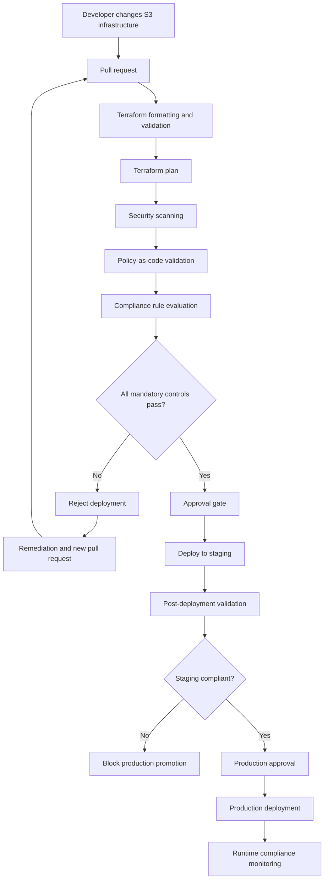
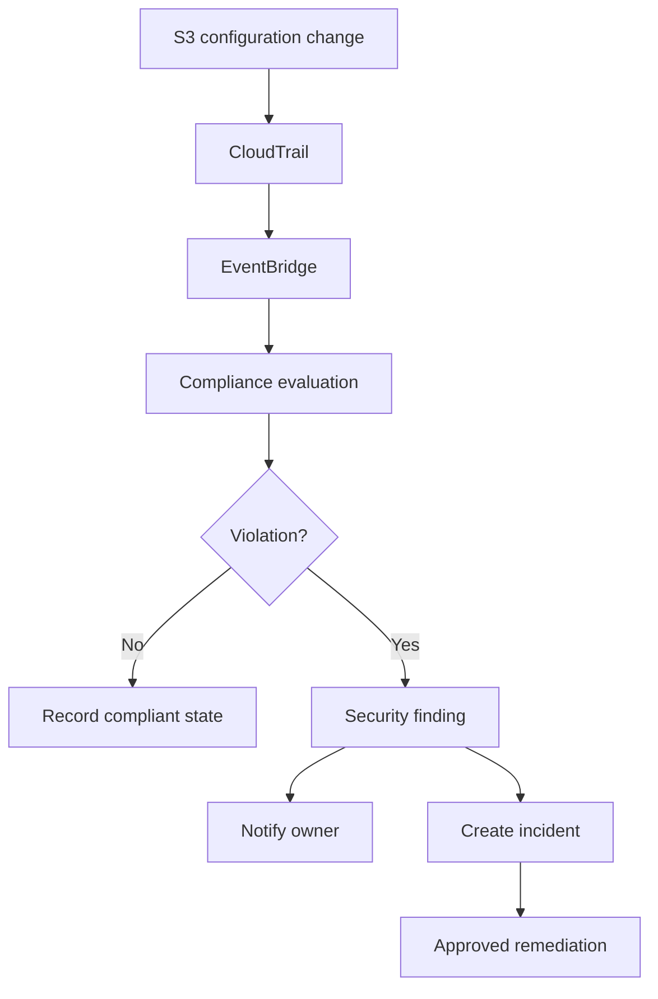
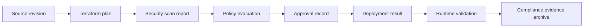

# 09- Compliance Validation Before Deployment

## Overview

Compliance validation before deployment is the process of verifying that an Amazon S3 infrastructure change satisfies the organization's security, governance, regulatory, and operational requirements before it reaches an AWS environment.

S3 configuration changes can introduce significant security and compliance risks. A Terraform change that modifies a bucket policy, disables versioning, changes encryption settings, or removes a lifecycle rule can affect data confidentiality, retention, recoverability, and auditability.

Validating infrastructure only after deployment is insufficient. Some changes can expose data immediately, permanently delete retained objects, or make audit evidence unavailable.

A production-grade validation process should combine:

- Infrastructure-as-code validation.
- Security and policy-as-code checks.
- Encryption and KMS configuration validation.
- Public-access and resource-policy checks.
- Data retention and recovery controls.
- Auditability and monitoring requirements.
- Regulatory and organizational policy checks.
- Deployment approval and evidence collection.
- Post-deployment verification.

The objective is to reject non-compliant infrastructure changes before they are applied.

## Compliance Validation Architecture

Compliance validation should be integrated into the infrastructure delivery pipeline.

A typical workflow begins when an engineer modifies an S3 Terraform module or deployment configuration. Static validation and policy checks execute before deployment. The resulting plan is reviewed, approved, and applied only when all mandatory controls pass.



### Validation stages

| Stage | Validation responsibility | Example |
|---|---|---|
| Source validation | Validate infrastructure source | Terraform formatting and syntax |
| Static security scanning | Detect insecure resource definitions | Public S3 bucket configuration |
| Policy-as-code | Enforce organizational rules | Encryption must be configured |
| Compliance validation | Evaluate required controls | Versioning required for protected data |
| Plan review | Evaluate proposed changes | Prevent bucket deletion |
| Approval | Authorize production changes | Security or platform approval |
| Deployment verification | Confirm deployed state | Check actual bucket encryption |
| Runtime monitoring | Detect configuration drift | Alert when public access is enabled |

Static validation and runtime validation solve different problems. A Terraform plan can be compliant while an administrator later changes the bucket configuration directly through the AWS console or API.

Both are required for sustained compliance.

## Define S3 Compliance Requirements

Before implementing automated checks, define the controls that every S3 deployment must satisfy.

A compliance baseline should distinguish mandatory controls from workload-specific requirements.

### Common S3 compliance controls

| Control area | Validation requirement | Example evidence |
|---|---|---|
| Public access | Public exposure is prohibited unless explicitly approved | Public Access Block configuration |
| Object ownership | ACL-based access is disabled where not required | `BucketOwnerEnforced` |
| Encryption | Default encryption is enabled | Bucket encryption configuration |
| Transport security | Insecure transport is denied | Bucket policy |
| Versioning | Enabled for protected data | Versioning configuration |
| Retention | Required retention controls are present | Lifecycle or Object Lock configuration |
| IAM | Workloads use least-privilege access | IAM policy and role definitions |
| Logging | Required audit events are collected | CloudTrail trail and data selectors |
| Monitoring | Configuration changes are monitored | AWS Config and EventBridge |
| Resource protection | Critical resources cannot be casually destroyed | Terraform and AWS deletion controls |
| Tagging | Required ownership and classification tags exist | Resource tags |
| Recovery | Required backup and recovery controls are configured | Replication and recovery evidence |

Not every bucket requires every control.

For example:

- A temporary build-artifact bucket may have a short retention period.
- A customer-document bucket may require versioning and strict retention.
- A regulated records bucket may require S3 Object Lock.
- A static website origin may require private access through CloudFront Origin Access Control.

Define requirements by data classification and workload rather than applying one undifferentiated policy to every bucket.

### Example compliance profile

```yaml
profiles:
  temporary-artifacts:
    public_access_block: required
    encryption: required
    versioning: optional
    object_lock: optional
    retention_days: 30

  application-documents:
    public_access_block: required
    encryption: required
    versioning: required
    object_lock: optional
    cloudtrail_data_events: required

  regulated-records:
    public_access_block: required
    encryption: required
    versioning: required
    object_lock: required
    cloudtrail_data_events: required
    retention_policy: required
```

This is an organizational policy model, not a native AWS configuration format. A policy engine or deployment tool must translate these requirements into enforceable checks.

## Pre-Deployment Validation with Terraform

Terraform is commonly used to provision S3 buckets, encryption settings, IAM policies, lifecycle rules, replication, and monitoring integrations.

A validation pipeline should evaluate both the Terraform source and the proposed execution plan.

### Terraform validation commands

```bash
terraform fmt -check -recursive
terraform init -backend=false
terraform validate
terraform plan -out=tfplan
terraform show -json tfplan > tfplan.json
```

These commands perform different checks.

| Command | Purpose | Limitation |
|---|---|---|
| `terraform fmt -check` | Checks formatting | Does not evaluate security |
| `terraform init` | Initializes providers and modules | Does not prove configuration compliance |
| `terraform validate` | Checks configuration consistency | Does not validate deployed AWS state |
| `terraform plan` | Calculates proposed changes | Does not independently enforce organizational policies |
| `terraform show -json` | Exposes plan details for automation | Plan JSON may contain sensitive values |

Use the same provider versions and deployment inputs in validation and deployment.

### Provider version constraints

Pin provider versions to reduce unexpected behavior changes.

```hcl
terraform {
  required_version = ">= 1.6.0, < 2.0.0"

  required_providers {
    aws = {
      source  = "hashicorp/aws"
      version = "~> 6.0"
    }
  }
}
```

The version range is an example. Select and test versions supported by the organization's infrastructure platform.

Commit the dependency lock file:

```text
.terraform.lock.hcl
```

Use controlled provider upgrades and review their impact before production deployment.

### Validate the Terraform plan

The Terraform plan is particularly important because source files alone do not show the complete effect of variables, module inputs, dependencies, and existing state.

For example, a module may define encryption correctly, but an environment-specific variable may disable the relevant resource or change the selected key.

A plan validation process should detect:

- New buckets without required security settings.
- Changes that disable versioning.
- Changes that remove public-access protections.
- Bucket policy changes that introduce public principals.
- Encryption configuration removal.
- KMS key replacement or deletion.
- Lifecycle rules that violate retention requirements.
- Replication configuration removal.
- Destructive changes to protected resources.
- Changes to CloudTrail data event selectors.

Treat Terraform plan JSON as sensitive. It can contain resource attributes and values that should not be exposed in public CI logs or unrestricted artifacts.

## Security Scanning with Checkov

Checkov is a static infrastructure security scanner that can evaluate Terraform and other infrastructure definitions against security policies.

It can identify common S3 misconfigurations before deployment.

### Install Checkov

```bash
python -m pip install checkov
```

In a controlled CI environment, pin the Checkov version through the project's dependency-management process.

### Scan Terraform

```bash
checkov \
  --directory ./terraform \
  --framework terraform
```

Scan a Terraform plan:

```bash
checkov \
  --file tfplan.json \
  --framework terraform_plan
```

The exact supported checks depend on the Checkov version and framework.

### Common S3 checks

| Security requirement | Example validation |
|---|---|
| Public access prevention | All four Block Public Access settings are enabled |
| Encryption | Default encryption is configured |
| Versioning | Versioning is enabled where required |
| Secure transport | Bucket policy denies insecure transport |
| Object ownership | ACLs are disabled where appropriate |
| Logging | Required logging is configured |
| Lifecycle | Retention and cleanup rules are present |
| Resource protection | Critical buckets are protected against deletion |

### Example Terraform resource

```hcl
resource "aws_s3_bucket" "documents" {
  bucket = var.bucket_name

  tags = {
    Environment   = var.environment
    DataClass     = "confidential"
    Owner         = "document-platform"
    ManagedBy     = "terraform"
  }
}

resource "aws_s3_bucket_public_access_block" "documents" {
  bucket = aws_s3_bucket.documents.id

  block_public_acls       = true
  ignore_public_acls      = true
  block_public_policy     = true
  restrict_public_buckets = true
}

resource "aws_s3_bucket_ownership_controls" "documents" {
  bucket = aws_s3_bucket.documents.id

  rule {
    object_ownership = "BucketOwnerEnforced"
  }
}

resource "aws_s3_bucket_versioning" "documents" {
  bucket = aws_s3_bucket.documents.id

  versioning_configuration {
    status = "Enabled"
  }
}

resource "aws_s3_bucket_server_side_encryption_configuration" "documents" {
  bucket = aws_s3_bucket.documents.id

  rule {
    apply_server_side_encryption_by_default {
      sse_algorithm = "AES256"
    }
  }
}
```

The example establishes several baseline controls. It does not by itself prove that the bucket is compliant with every organization's requirements.

### Scanner limitations

Static scanners cannot reliably establish every runtime property.

For example:

- A bucket policy may depend on a condition or principal that requires deeper policy evaluation.
- A KMS key policy may permit access through an unexpected principal.
- A lifecycle rule may conflict with a legal retention requirement.
- A bucket may be changed after deployment.
- A resource may be compliant in Terraform but inaccessible because of an incorrect KMS policy.

Use static scanning as one validation layer, not as the complete compliance decision.

## Policy-as-Code Validation

Policy-as-code makes organizational security requirements executable.

Instead of relying on engineers to remember every requirement, policies evaluate infrastructure definitions and reject non-compliant changes.

Common tools include:

- Open Policy Agent (OPA) with Rego.
- HashiCorp Sentinel.
- AWS CloudFormation Guard.
- Checkov custom policies.
- Custom validation scripts.

### Why policy-as-code is needed

Consider an organization that requires every production S3 bucket to:

- Block public access.
- Enable encryption.
- Enable versioning.
- Use mandatory ownership tags.
- Deny insecure transport.

A developer may create a bucket that passes Terraform syntax validation but violates several of these requirements.

A policy engine can evaluate the planned infrastructure and reject the change before deployment.

### OPA and Rego example

The following example evaluates Terraform plan JSON and checks that every planned or existing S3 bucket resource has the required controls represented in the plan.

It assumes the Terraform configuration manages these settings through separate resources.

```rego
package s3.compliance

import rego.v1

bucket_resources contains resource if {
    some resource in input.resource_changes
    resource.type == "aws_s3_bucket"
    resource.change.actions != ["delete"]
}

public_access_block_resources contains resource if {
    some resource in input.resource_changes
    resource.type == "aws_s3_bucket_public_access_block"
    resource.change.actions != ["delete"]
}

versioning_resources contains resource if {
    some resource in input.resource_changes
    resource.type == "aws_s3_bucket_versioning"
    resource.change.actions != ["delete"]
}

encryption_resources contains resource if {
    some resource in input.resource_changes
    resource.type == "aws_s3_bucket_server_side_encryption_configuration"
    resource.change.actions != ["delete"]
}

bucket_address(resource) := address if {
    address := resource.address
}

has_public_access_block(address) if {
    some resource in public_access_block_resources
    contains(resource.address, address)
}

has_versioning(address) if {
    some resource in versioning_resources
    contains(resource.address, address)
}

has_encryption(address) if {
    some resource in encryption_resources
    contains(resource.address, address)
}

deny contains message if {
    some bucket in bucket_resources
    address := bucket_address(bucket)
    not has_public_access_block(address)
    message := sprintf("S3 bucket %s has no associated public access block resource", [address])
}

deny contains message if {
    some bucket in bucket_resources
    address := bucket_address(bucket)
    not has_versioning(address)
    message := sprintf("S3 bucket %s has no associated versioning resource", [address])
}

deny contains message if {
    some bucket in bucket_resources
    address := bucket_address(bucket)
    not has_encryption(address)
    message := sprintf("S3 bucket %s has no associated encryption resource", [address])
}
```

This is an illustrative structural policy, not a complete production compliance engine.

It checks resource presence rather than proving that the configured values are secure. It also assumes a direct resource-address relationship that may not hold for every module or `for_each` design.

A production policy should:

- Resolve references and dependencies accurately.
- Inspect planned resource values.
- Validate every required public-access setting.
- Verify the encryption algorithm and KMS key requirements.
- Check versioning status.
- Detect destructive actions.
- Validate bucket policy content.
- Handle module addresses and resource instances.
- Distinguish approved exceptions from missing controls.

### Run OPA against a Terraform plan

Generate plan JSON:

```bash
terraform show -json tfplan > tfplan.json
```

Evaluate the policy:

```bash
opa eval \
  --data policies/s3.rego \
  --input tfplan.json \
  "data.s3.compliance.deny"
```

A CI pipeline should fail when mandatory violations are returned.

For production, use a tested OPA evaluation wrapper that converts policy results into an explicit pass/fail status and preserves the violation details.

## Validate Bucket Policies

Bucket policies are a critical compliance boundary because they can grant or deny access independently of the application's intended behavior.

Validation should inspect:

- Principal scope.
- Allowed actions.
- Resource scope.
- Wildcard permissions.
- Public access.
- Cross-account access.
- Transport-security conditions.
- Encryption requirements.
- Explicit deny statements.
- Organization-specific restrictions.

### Require secure transport

A common baseline is to deny requests that do not use TLS.

```json
{
  "Version": "2012-10-17",
  "Statement": [
    {
      "Sid": "DenyInsecureTransport",
      "Effect": "Deny",
      "Principal": "*",
      "Action": "s3:*",
      "Resource": [
        "arn:aws:s3:::company-documents-production",
        "arn:aws:s3:::company-documents-production/*"
      ],
      "Condition": {
        "Bool": {
          "aws:SecureTransport": "false"
        }
      }
    }
  ]
}
```

### Validate policy behavior

A policy review should answer:

- Can anonymous principals access the bucket?
- Can an external AWS account access it?
- Can an application role delete objects?
- Can an application role delete object versions?
- Can a principal change the bucket policy?
- Can a principal disable encryption or versioning?
- Are object-level and bucket-level resources scoped correctly?
- Does the policy accidentally conflict with required service access?

Do not treat a wildcard principal as automatically public in every policy. Public-access classification and effective authorization depend on the policy structure and AWS evaluation rules.

Use IAM Access Analyzer for supported policy analysis and public or cross-account access findings.

### Validate with AWS CLI

Inspect the bucket policy:

```bash
aws s3api get-bucket-policy \
  --bucket company-documents-production
```

Inspect public-access settings:

```bash
aws s3api get-public-access-block \
  --bucket company-documents-production
```

Inspect ownership controls:

```bash
aws s3api get-bucket-ownership-controls \
  --bucket company-documents-production
```

These commands inspect deployed configuration. They complement pre-deployment policy checks.

## Validate Encryption and KMS Requirements

Encryption is a common mandatory compliance requirement for S3 workloads.

Pre-deployment validation must distinguish between:

- Default bucket encryption.
- Object-level encryption behavior.
- KMS key configuration.
- KMS key policy.
- IAM permissions.
- Key lifecycle and availability.

### Encryption validation matrix

| Requirement | Validation |
|---|---|
| Default encryption enabled | Inspect bucket encryption configuration |
| Approved encryption algorithm | Verify SSE-S3 or approved SSE-KMS configuration |
| Approved KMS key | Validate the configured key ARN |
| KMS key enabled | Check key state |
| Key policy | Review allowed principals and actions |
| Key deletion protection | Review deletion scheduling and administrative controls |
| Cross-account encryption | Validate both IAM and KMS key authorization |
| Encryption enforcement | Evaluate bucket policy and request behavior |

### Terraform encryption validation

For an SSE-KMS bucket:

```hcl
resource "aws_s3_bucket_server_side_encryption_configuration" "documents" {
  bucket = aws_s3_bucket.documents.id

  rule {
    apply_server_side_encryption_by_default {
      sse_algorithm     = "aws:kms"
      kms_master_key_id = var.s3_kms_key_arn
    }

    bucket_key_enabled = true
  }
}
```

The KMS key must exist and be usable by the relevant principals.

### Inspect deployed encryption

```bash
aws s3api get-bucket-encryption \
  --bucket company-documents-production
```

Inspect the KMS key:

```bash
aws kms describe-key \
  --key-id alias/company-s3-production
```

Inspect the key policy:

```bash
aws kms get-key-policy \
  --key-id alias/company-s3-production \
  --policy-name default
```

### Important distinction

S3 authorization and KMS authorization are separate.

A principal may have permission to call `s3:GetObject` but still fail because it lacks the required KMS decrypt permission or the KMS key policy does not authorize the request.

For SSE-KMS, validate both layers before deployment.

Refer to the dedicated encryption and key-policy documentation for detailed KMS authorization, encryption-context, and cross-account requirements.

## Validate Versioning and Retention

Versioning and retention controls protect objects against accidental deletion and unwanted modification.

Compliance validation should verify that the selected data classification has the required protection.

### Versioning validation

Check the Terraform configuration:

```hcl
resource "aws_s3_bucket_versioning" "documents" {
  bucket = aws_s3_bucket.documents.id

  versioning_configuration {
    status = "Enabled"
  }
}
```

Inspect deployed state:

```bash
aws s3api get-bucket-versioning \
  --bucket company-documents-production
```

A compliance policy should reject changes that suspend versioning for protected buckets unless an approved exception exists.

### Object Lock validation

For data requiring immutable retention, validate:

- Object Lock is enabled at bucket creation or configured according to supported service behavior.
- Default retention settings are appropriate.
- Governance or compliance mode is selected correctly.
- Retention duration satisfies the applicable requirement.
- Legal holds are managed through an approved process.
- Lifecycle configuration does not conflict with retention requirements.

Example Terraform configuration:

```hcl
resource "aws_s3_bucket" "regulated_records" {
  bucket              = var.regulated_bucket_name
  object_lock_enabled = true

  lifecycle {
    prevent_destroy = true
  }
}

resource "aws_s3_bucket_versioning" "regulated_records" {
  bucket = aws_s3_bucket.regulated_records.id

  versioning_configuration {
    status = "Enabled"
  }
}
```

Object Lock requires versioning. Configure and validate retention settings separately.

Do not assume that Terraform `prevent_destroy` provides immutable data retention. It protects a Terraform-managed resource from ordinary destruction through that configuration; it does not prevent all direct AWS API operations.

## Validate Auditability Requirements

Compliance-sensitive S3 buckets often require evidence of configuration changes and object-level activity.

Before deployment, verify that the audit architecture covers the new bucket.

### Audit validation requirements

| Requirement | Expected configuration |
|---|---|
| Management event collection | CloudTrail trail covers required account activity |
| Object-level audit | S3 data event selectors include the bucket |
| Log destination | Approved audit bucket |
| Log protection | Restricted access and retention controls |
| Log integrity | Log file validation enabled where required |
| Monitoring | Delivery failures and critical changes are monitored |
| Investigation | Security team can query relevant events |

### Validate CloudTrail selectors

```bash
aws cloudtrail get-event-selectors \
  --trail-name production-audit-trail
```

A newly created bucket may not be covered if the trail uses explicit bucket ARN selectors.

This is a common compliance gap: the bucket itself is secure, but its object-level access is not included in the organization's audit coverage.

### Validate logging status

```bash
aws cloudtrail get-trail-status \
  --name production-audit-trail
```

Review:

- Logging enabled.
- Recent delivery status.
- Delivery errors.
- Digest delivery status where validation is enabled.

CloudTrail configuration checks should be part of deployment validation, while ongoing delivery monitoring belongs in the operational monitoring process.

Refer to the dedicated auditability and CloudTrail documentation for trail architecture, data selectors, log validation, and investigation workflows.

## Validate Mandatory Tags and Resource Standards

Tags support ownership, cost allocation, data classification, and operational governance.

A compliance pipeline should reject S3 resources missing mandatory tags.

Example Terraform configuration:

```hcl
variable "required_tags" {
  description = "Mandatory tags applied to production S3 resources."
  type        = map(string)

  default = {
    Environment   = "production"
    Owner         = "document-platform"
    DataClass     = "confidential"
    CostCenter    = "engineering"
    ManagedBy     = "terraform"
  }
}

resource "aws_s3_bucket" "documents" {
  bucket = var.bucket_name

  tags = var.required_tags
}
```

Validate:

- Required tag keys.
- Allowed values.
- Data classification.
- Resource owner.
- Environment.
- Cost center.
- Infrastructure ownership.

Do not treat tags as an authorization mechanism. They provide metadata and can participate in supported policy conditions, but tagging alone does not secure a bucket.

For object-level classification, bucket tags are not sufficient because bucket tags do not automatically propagate to objects.

Refer to the dedicated mandatory-tags and resource-standards documentation for tagging governance and enforcement.

## Validate Lifecycle and Retention Policies

Lifecycle policies can transition or expire objects automatically.

A lifecycle rule can create a compliance violation if it deletes data before its required retention period.

Validation should evaluate:

- Current object expiration.
- Noncurrent version expiration.
- Delete-marker cleanup.
- Storage-class transitions.
- Minimum retention periods.
- Object Lock restrictions.
- Incomplete multipart upload cleanup.
- Data classification requirements.

Example:

```hcl
resource "aws_s3_bucket_lifecycle_configuration" "documents" {
  bucket = aws_s3_bucket.documents.id

  rule {
    id     = "document-retention"
    status = "Enabled"

    filter {
      prefix = "temporary/"
    }

    expiration {
      days = 30
    }

    abort_incomplete_multipart_upload {
      days_after_initiation = 7
    }
  }
}
```

This example expires objects under the temporary prefix after the configured period. It should not be applied indiscriminately to retained business records.

### Retention validation questions

- Does the expiration period satisfy the data classification?
- Are noncurrent versions handled correctly?
- Can a delete marker hide an object that must remain available?
- Does the rule conflict with Object Lock?
- Are transition periods compatible with the selected storage class?
- Is the lifecycle rule scoped to the intended prefix or tags?

A policy engine should evaluate the effective retention behavior, not merely check whether a lifecycle resource exists.

## Validate Resource Protection

Critical S3 resources should not be accidentally destroyed during routine deployment.

Pre-deployment validation should detect destructive changes to:

- Production buckets.
- KMS keys.
- Replication roles.
- Audit destinations.
- Object Lock configurations.
- Terraform state resources.
- CloudTrail trails.

### Terraform deletion protection

```hcl
resource "aws_s3_bucket" "production_documents" {
  bucket = var.bucket_name

  lifecycle {
    prevent_destroy = true
  }
}
```

This is a useful guardrail but is not a complete deletion-control strategy.

Also consider:

- IAM restrictions on bucket deletion.
- IAM restrictions on object-version deletion.
- SCPs for organization-wide guardrails.
- S3 Object Lock for immutable retention.
- CloudFormation deletion policies where applicable.
- Separate approval workflows for destructive changes.

### Detect destructive Terraform plan actions

Terraform plan JSON exposes resource actions.

A CI policy can reject deletion of protected resources.

Example Rego policy:

```rego
package s3.deployment

import rego.v1

protected_resource_types := {
    "aws_s3_bucket",
    "aws_kms_key",
    "aws_cloudtrail"
}

deny contains message if {
    some resource in input.resource_changes
    resource.type in protected_resource_types
    "delete" in resource.change.actions

    message := sprintf(
        "Destructive change detected for protected resource: %s",
        [resource.address]
    )
}
```

This policy is intentionally strict. It also rejects replacement plans containing a delete action.

A production policy should distinguish:

- Direct deletion.
- Replacement.
- Approved migration.
- Temporary resource retirement.
- Explicitly authorized break-glass operations.

Never automatically approve destructive changes merely because Terraform generated a valid plan.

## Runtime Compliance Validation

Pre-deployment checks cannot guarantee that deployed resources remain compliant.

Runtime validation detects configuration changes made outside the approved deployment process.

AWS services commonly used for this include:

| Service | Responsibility |
|---|---|
| AWS Config | Evaluate resource configuration against rules |
| IAM Access Analyzer | Identify supported external or public access paths |
| CloudTrail | Record API activity |
| EventBridge | Route selected configuration-change events |
| Security Hub | Aggregate security findings |
| GuardDuty | Detect supported suspicious activity |
| CloudWatch | Monitor logs, metrics, and alarms |

### AWS Config

AWS Config can continuously evaluate supported resource configurations.

For S3, relevant managed rule categories include:

- Bucket public access.
- Bucket encryption.
- Bucket versioning.
- Bucket logging.
- Required tags.

The exact rule names, resource coverage, and parameters should be checked against the AWS Config rule catalog for the target Region and deployment.

### Event-driven compliance detection



Example EventBridge pattern for selected bucket configuration changes:

```json
{
  "source": [
    "aws.s3"
  ],
  "detail-type": [
    "AWS API Call via CloudTrail"
  ],
  "detail": {
    "eventSource": [
      "s3.amazonaws.com"
    ],
    "eventName": [
      "PutBucketPolicy",
      "DeleteBucketPolicy",
      "PutBucketPublicAccessBlock",
      "DeletePublicAccessBlock",
      "PutBucketEncryption",
      "PutBucketVersioning"
    ]
  }
}
```

Validate event names and event availability against actual CloudTrail records for the target operations.

An EventBridge rule detects selected events. It does not independently establish whether the resulting configuration violates policy.

## Compliance Validation in GitHub Actions

A CI/CD pipeline should enforce mandatory checks before a deployment is approved.

The following workflow demonstrates a Terraform validation and security-scanning stage.

It assumes:

- Terraform configuration is under `terraform/`.
- Checkov is pinned in a controlled requirements file.
- OPA is available in the runner.
- The policy files are stored under `policies/`.

```yaml
name: S3 Infrastructure Compliance

on:
  pull_request:
    paths:
      - "terraform/**"
      - "policies/**"
      - ".github/workflows/s3-compliance.yml"

  push:
    branches:
      - main
    paths:
      - "terraform/**"
      - "policies/**"
      - ".github/workflows/s3-compliance.yml"

permissions:
  contents: read

jobs:
  validate:
    name: Validate S3 Infrastructure
    runs-on: ubuntu-latest

    steps:
      - name: Checkout repository
        uses: actions/checkout@v4

      - name: Setup Terraform
        uses: hashicorp/setup-terraform@v3
        with:
          terraform_version: "1.9.8"

      - name: Terraform formatting
        run: terraform fmt -check -recursive
        working-directory: terraform

      - name: Terraform initialization
        run: terraform init -backend=false
        working-directory: terraform

      - name: Terraform validation
        run: terraform validate
        working-directory: terraform

  security_scan:
    name: Scan Terraform Configuration
    runs-on: ubuntu-latest
    needs: validate

    steps:
      - name: Checkout repository
        uses: actions/checkout@v4

      - name: Setup Python
        uses: actions/setup-python@v5
        with:
          python-version: "3.12"

      - name: Install Checkov
        run: python -m pip install -r requirements-security.txt

      - name: Run Checkov
        run: |
          checkov \
            --directory terraform \
            --framework terraform

  plan:
    name: Generate Terraform Plan
    runs-on: ubuntu-latest
    needs:
      - validate
      - security_scan

    steps:
      - name: Checkout repository
        uses: actions/checkout@v4

      - name: Setup Terraform
        uses: hashicorp/setup-terraform@v3
        with:
          terraform_version: "1.9.8"

      - name: Initialize Terraform
        run: terraform init
        working-directory: terraform

      - name: Generate plan
        run: terraform plan -out=tfplan
        working-directory: terraform
        env:
          TF_IN_AUTOMATION: "true"
```

This is a validation workflow example, not a complete production deployment pipeline.

A production implementation must also address:

- Remote state access.
- Environment-specific variables.
- Secure AWS authentication.
- Plan artifact protection.
- OIDC role trust restrictions.
- Policy evaluation against plan JSON.
- Production approval gates.
- Controlled apply execution.
- Post-deployment verification.

Do not expose Terraform plan artifacts to untrusted pull-request workflows. Plan files and JSON output can contain sensitive information.

### Add OPA plan evaluation

After generating the plan, a protected deployment workflow can export JSON and evaluate the policy:

```bash
terraform show -json tfplan > tfplan.json

opa eval \
  --fail-defined \
  --data policies/ \
  --input tfplan.json \
  "data.s3.compliance.deny[_]"
```

The policy package and evaluation expression must match the actual Rego implementation.

Run this evaluation in a trusted workflow with controlled access to plan artifacts.

## Compliance Exceptions and Approval Governance

Not every workload can satisfy every baseline control in exactly the same way.

For example:

- A CloudFront distribution may need controlled access to a private S3 origin.
- A data exchange bucket may require approved cross-account access.
- A migration bucket may temporarily need a different retention configuration.
- A workload may require an exception to a default storage-class policy.

Exceptions should be explicit, time-bound, and auditable.

### Recommended exception fields

| Field | Purpose |
|---|---|
| `exception_id` | Unique exception reference |
| `resource` | Bucket or infrastructure resource |
| `control_id` | Control being waived |
| `business_reason` | Why the exception is required |
| `risk_owner` | Accountable owner |
| `approver` | Authorized reviewer |
| `created_at` | Approval timestamp |
| `expires_at` | Expiration timestamp |
| `mitigation` | Compensating control |
| `status` | Pending, approved, rejected, expired |

Do not implement exceptions as broad scanner suppressions without ownership or expiration.

### Example exception document

```yaml
exception_id: S3-EX-2026-0042

resource:
  bucket: company-data-exchange-production

control:
  id: cross-account-access
  requirement: approved-external-principal

business_reason: >
  Required for an approved data exchange with a contracted processing account.

risk_owner: data-platform
approver: security-team

mitigation:
  - Restrict access to the approved AWS account.
  - Limit access to a dedicated prefix.
  - Require encrypted transport.
  - Enable relevant CloudTrail data events.

created_at: "2026-10-20"
expires_at: "2026-12-20"

status: approved
```

An exception should not silently weaken unrelated controls such as encryption, public-access blocking, or audit logging.

## Compliance Evidence and Audit Records

A deployment should produce evidence showing that required controls were evaluated.

Evidence is useful for:

- Internal security reviews.
- Regulatory audits.
- Change approvals.
- Incident investigations.
- Release verification.
- Compliance reporting.

### Recommended evidence artifacts

| Artifact | Evidence provided |
|---|---|
| Terraform source revision | Intended infrastructure configuration |
| Terraform plan | Proposed resource changes |
| Checkov report | Static security findings |
| OPA evaluation result | Policy compliance decision |
| Approval record | Authorized deployment decision |
| Deployment logs | Applied infrastructure changes |
| AWS Config evaluation | Runtime configuration status |
| CloudTrail records | AWS API activity |
| Post-deployment checks | Actual resource configuration |
| Exception records | Approved deviations |

Store evidence in an access-controlled location with retention appropriate to the organization's audit requirements.

Do not assume that a successful CI job proves the deployed environment is still compliant.

### Evidence collection workflow



Evidence should be associated with a specific deployment, environment, commit, and approval.

## Post-Deployment Verification

After deployment, verify the actual AWS configuration.

The deployed resource state is the authoritative configuration for runtime compliance.

### Verify public-access protection

```bash
aws s3api get-public-access-block \
  --bucket company-documents-production
```

### Verify encryption

```bash
aws s3api get-bucket-encryption \
  --bucket company-documents-production
```

### Verify versioning

```bash
aws s3api get-bucket-versioning \
  --bucket company-documents-production
```

### Verify ownership controls

```bash
aws s3api get-bucket-ownership-controls \
  --bucket company-documents-production
```

### Verify lifecycle configuration

```bash
aws s3api get-bucket-lifecycle-configuration \
  --bucket company-documents-production
```

### Verify bucket policy

```bash
aws s3api get-bucket-policy \
  --bucket company-documents-production
```

### Verify CloudTrail coverage

```bash
aws cloudtrail get-event-selectors \
  --trail-name production-audit-trail
```

### Verify deployed tags

```bash
aws s3api get-bucket-tagging \
  --bucket company-documents-production
```

### Automate post-deployment checks

A Python validation script can verify selected controls using Boto3.

```python
import sys

import boto3
from botocore.exceptions import BotoCoreError, ClientError


def validate_bucket(bucket_name: str) -> list[str]:
    s3 = boto3.client("s3")
    violations = []

    try:
        public_access = s3.get_public_access_block(
            Bucket=bucket_name
        )["PublicAccessBlockConfiguration"]

        required_public_access = [
            "BlockPublicAcls",
            "IgnorePublicAcls",
            "BlockPublicPolicy",
            "RestrictPublicBuckets",
        ]

        for setting in required_public_access:
            if public_access.get(setting) is not True:
                violations.append(
                    f"Public access control is not enabled: {setting}"
                )

    except ClientError as exc:
        violations.append(
            f"Unable to verify public access block: "
            f"{exc.response['Error']['Code']}"
        )

    try:
        encryption = s3.get_bucket_encryption(
            Bucket=bucket_name
        )["ServerSideEncryptionConfiguration"]

        rules = encryption.get("Rules", [])

        if not rules:
            violations.append("No default encryption rule is configured")

    except ClientError as exc:
        violations.append(
            f"Unable to verify encryption: "
            f"{exc.response['Error']['Code']}"
        )

    try:
        versioning = s3.get_bucket_versioning(
            Bucket=bucket_name
        )

        if versioning.get("Status") != "Enabled":
            violations.append("Bucket versioning is not enabled")

    except ClientError as exc:
        violations.append(
            f"Unable to verify versioning: "
            f"{exc.response['Error']['Code']}"
        )

    except BotoCoreError as exc:
        violations.append(
            f"AWS SDK communication failure: {type(exc).__name__}"
        )

    return violations


if __name__ == "__main__":
    if len(sys.argv) != 2:
        raise SystemExit(
            "Usage: python validate_s3_compliance.py BUCKET_NAME"
        )

    bucket = sys.argv[1]
    findings = validate_bucket(bucket)

    if findings:
        print(f"Compliance validation failed for {bucket}")

        for finding in findings:
            print(f"- {finding}")

        raise SystemExit(1)

    print(f"Selected compliance checks passed for {bucket}")
```

This script verifies only selected controls. A production validator should additionally check:

- Expected encryption algorithm and KMS key.
- Required versioning behavior.
- Ownership controls.
- Lifecycle and retention requirements.
- Bucket policy semantics.
- Required tags.
- Audit coverage.
- Replication requirements.
- Resource protection.

The script requires AWS credentials with read permissions for the inspected bucket configuration. It should run with a dedicated validation role rather than broad administrator permissions.

## Failure Handling and Remediation

A compliance pipeline should produce actionable failures.

A generic message such as `Security scan failed` is insufficient for an engineer to identify the issue.

A useful violation should include:

- Resource address.
- Bucket name or identifier.
- Failed control.
- Expected configuration.
- Observed configuration.
- Policy reference.
- Remediation guidance.
- Exception status, if applicable.

### Example compliance result

```json
{
  "status": "failed",
  "environment": "production",
  "resource": "aws_s3_bucket.documents",
  "bucket": "company-documents-production",
  "violations": [
    {
      "control": "S3-PUBLIC-ACCESS-001",
      "description": "All S3 Block Public Access settings must be enabled.",
      "expected": true,
      "observed": false,
      "severity": "critical"
    },
    {
      "control": "S3-ENCRYPTION-001",
      "description": "The bucket must use the approved KMS key.",
      "expected": "arn:aws:kms:ap-south-1:123456789012:key/example",
      "observed": "AES256",
      "severity": "high"
    }
  ]
}
```

### Remediation workflow

1. Identify the failed control and affected resource.
2. Determine whether the violation is in source configuration or deployed state.
3. Check whether an approved exception exists.
4. Correct the Terraform or policy configuration.
5. Regenerate the plan.
6. Rerun security and compliance checks.
7. Obtain required approval.
8. Deploy through the controlled pipeline.
9. Verify the actual AWS configuration.
10. Preserve the new validation evidence.

Avoid automatic remediation for destructive or access-sensitive changes unless the action has been explicitly designed, tested, and approved.

## Common Mistakes and Pitfalls

| Mistake | Why it is problematic | Recommended approach |
|---|---|---|
| Running only `terraform validate` | Syntax validation does not enforce security | Add security and policy checks |
| Scanning source without evaluating the plan | Module inputs and planned changes can introduce violations | Evaluate plan JSON |
| Checking only for resource existence | A resource may exist with insecure values | Validate effective configuration |
| Treating Checkov as the complete compliance system | Static scanners cannot establish all runtime properties | Combine static and runtime controls |
| Ignoring KMS key policies | S3 encryption may be configured while access remains incorrect | Validate IAM and KMS authorization |
| Checking only bucket encryption | Object access and key authorization require separate validation | Verify encryption and permission layers |
| Ignoring data event selectors | New buckets may not receive object-level audit coverage | Validate CloudTrail coverage |
| Treating versioning as immutable retention | Authorized principals can still permanently delete versions | Use Object Lock where required |
| Ignoring lifecycle interactions | Objects may expire before the required retention period | Validate effective lifecycle behavior |
| Allowing permanent scanner suppressions | Security exceptions become invisible technical debt | Require owners and expiration dates |
| Ignoring runtime drift | Direct AWS changes can bypass CI checks | Use AWS Config and continuous monitoring |
| Exposing plan artifacts | Terraform plans can contain sensitive values | Restrict access and retention |
| Automatically reverting every violation | Remediation can disrupt legitimate workloads | Use controlled, context-aware remediation |
| Treating tags as access controls | Tags do not independently enforce authorization | Use IAM and resource policies |

## Production Compliance Validation Checklist

### Infrastructure validation

- [ ] Terraform formatting passes.
- [ ] Terraform initialization and validation pass.
- [ ] Provider versions are controlled.
- [ ] Terraform plan is generated and reviewed.
- [ ] Destructive changes are identified.
- [ ] Sensitive plan artifacts are protected.

### Security controls

- [ ] Public-access blocking is enabled.
- [ ] Object Ownership is configured correctly.
- [ ] Default encryption is enabled.
- [ ] Approved KMS keys are configured where required.
- [ ] KMS key policies and IAM permissions are validated.
- [ ] Insecure transport is denied.
- [ ] Bucket policies are reviewed for unintended access.
- [ ] Required versioning is enabled.
- [ ] Retention and Object Lock requirements are validated.

### Governance and auditability

- [ ] Mandatory tags are present.
- [ ] Data classification requirements are satisfied.
- [ ] CloudTrail management event coverage is verified.
- [ ] Required S3 data events are configured.
- [ ] Audit storage is protected.
- [ ] Required monitoring integrations are configured.
- [ ] Compliance exceptions have owners and expiration dates.

### CI/CD and deployment

- [ ] Static security scanning passes.
- [ ] Policy-as-code checks pass.
- [ ] Production approval requirements are satisfied.
- [ ] AWS credentials use controlled short-lived authentication.
- [ ] Deployment permissions follow least privilege.
- [ ] Post-deployment validation runs.
- [ ] Evidence is associated with the deployment revision.
- [ ] Runtime compliance monitoring is enabled.

## Key Takeaways

- Validate S3 infrastructure before deployment using Terraform validation, security scanning, policy-as-code, and plan review.
- Check effective configuration rather than merely verifying that security resources exist.
- Evaluate encryption, KMS authorization, public access, versioning, retention, and audit coverage as distinct compliance controls.
- Combine pre-deployment validation with AWS Config, CloudTrail, and runtime monitoring to detect configuration drift.
- Make compliance failures actionable and manage exceptions through explicit ownership, approval, mitigation, and expiration.