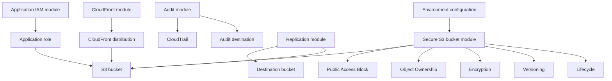
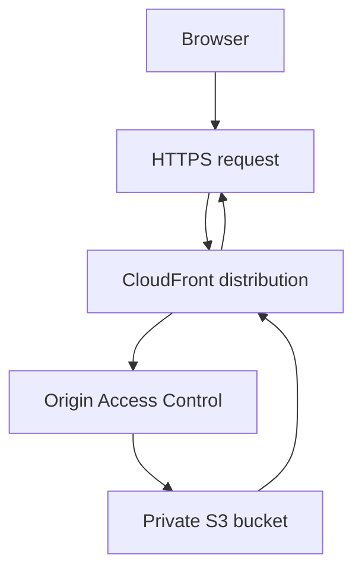
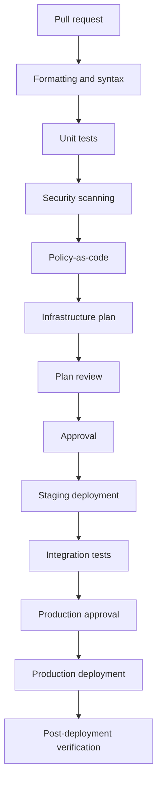

# 10- Secure Infrastructure Templates

## Overview

Secure infrastructure templates define reusable, version-controlled configurations for deploying Amazon S3 resources. They make security requirements repeatable across development, staging, and production environments and reduce the risk of configuration drift or inconsistent manual setup.

An S3 deployment template should define more than a bucket. It should establish the resource's security baseline, access boundaries, encryption configuration, lifecycle behavior, dependencies, ownership, and protection against accidental changes or deletion.

This document covers secure infrastructure implementation using Terraform, AWS CloudFormation, and AWS CDK. Each tool has a distinct role:

| Tool | Primary strength | Typical use |
|---|---|---|
| Terraform | Reusable modules and multi-environment infrastructure management | Organizations standardizing infrastructure through Terraform |
| CloudFormation | AWS-native declarative stack management | AWS-centric deployments and stack lifecycle management |
| AWS CDK | Infrastructure definitions using general-purpose programming languages | Teams that benefit from reusable constructs and programmatic composition |

The examples establish a secure S3 baseline. Workload-specific integrations such as replication, CloudTrail, CloudFront, and application IAM should be managed through separate components rather than combined into one oversized template.

## Secure Infrastructure Design Principles

### Private by default

S3 buckets should remain private unless a documented architecture explicitly requires public access.

A baseline should normally include:

- All four S3 Block Public Access settings enabled.
- Bucket-owner-enforced Object Ownership.
- Default server-side encryption.
- HTTPS-only access.
- Least-privilege IAM permissions.
- Explicit resource ownership and classification tags.
- Versioning where recovery requirements justify it.
- Lifecycle configuration aligned with retention requirements.
- Protection against accidental deletion of critical resources.

Do not make mandatory controls optional simply to make a module more flexible. Security exceptions should require explicit approval and should be visible in the deployment configuration.

### Separation of responsibilities

Avoid building a single module that manages every S3-related resource.

Separate components according to responsibility and lifecycle.

| Component | Responsibility |
|---|---|
| Secure bucket | Bucket creation and baseline security |
| Encryption | KMS key integration and key policies |
| Application IAM | Application-specific object permissions |
| Replication | Replication roles, destinations, and rules |
| Audit | CloudTrail and logging destinations |
| CloudFront | Distribution and private origin access |
| Monitoring | Metrics, alarms, and operational signals |
| Governance | Retention, compliance, and resource protection |

This separation improves module reuse and reduces the chance that an application deployment unintentionally changes security-critical infrastructure.

### Environment isolation

Development, staging, and production should have separate infrastructure state, deployment roles, and configuration.

Security baselines should remain consistent, while workload-specific settings can vary.

| Setting | Development | Staging | Production |
|---|---|---|---|
| Public access blocking | Enabled | Enabled | Enabled |
| Default encryption | Enabled | Enabled | Enabled |
| Versioning | Workload-dependent | Production-like | Based on recovery requirements |
| SSE-KMS | As required | Validate production behavior | Based on data classification |
| Object Lock | Optional | Test where applicable | Based on retention requirements |
| Logging | Appropriate test coverage | Validate integrations | Based on audit policy |
| Deletion protection | Controlled | Enabled for critical resources | Enabled |
| Lifecycle | Test policies | Production-like policies | Approved retention policies |

Environment separation must include IAM permissions, state storage, deployment roles, and resource naming—not just different variable files.

### Explicit module interfaces

Security-sensitive settings should be visible in module inputs and outputs.

Examples include:

- Bucket name.
- Environment.
- KMS key ARN.
- Versioning requirement.
- Lifecycle policy.
- Replication configuration.
- Required tags.
- Resource protection behavior.

Do not expose unrestricted switches that let callers silently disable mandatory security controls.

## Reference Architecture

A production S3 deployment commonly consists of several independently managed infrastructure components.



Each component has a separate responsibility:

- The bucket module establishes the storage resource and baseline controls.
- The application IAM module grants workload-specific access.
- The audit module configures evidence collection and delivery.
- The replication module establishes a recovery or distribution path.
- The CloudFront module provides controlled content delivery from a private origin.

Modules should expose stable outputs such as bucket ARN, bucket name, KMS key ARN, and distribution ARN.

## Terraform Secure S3 Module

Terraform supports reusable infrastructure through modules, variables, outputs, and resource dependencies.

A secure S3 module should create a private bucket with predictable defaults and narrowly scoped configuration.

### Recommended directory structure

```text
terraform/
├── modules/
│   └── secure-s3-bucket/
│       ├── versions.tf
│       ├── variables.tf
│       ├── main.tf
│       └── outputs.tf
│
└── environments/
    ├── development/
    │   ├── main.tf
    │   ├── variables.tf
    │   └── terraform.tfvars
    │
    ├── staging/
    │   ├── main.tf
    │   ├── variables.tf
    │   └── terraform.tfvars
    │
    └── production/
        ├── main.tf
        ├── variables.tf
        └── terraform.tfvars
```

### Provider constraints

`versions.tf`

```hcl
terraform {
  required_version = ">= 1.6.0, < 2.0.0"

  required_providers {
    aws = {
      source  = "hashicorp/aws"
      version = "~> 6.0"
    }
  }
}
```

The provider constraint is an example. Select a tested provider version compatible with the organization's infrastructure standards.

Commit `.terraform.lock.hcl` in the root deployment configuration to preserve provider selections.

### Module variables

`variables.tf`

```hcl
variable "bucket_name" {
  description = "Globally unique S3 bucket name."
  type        = string

  validation {
    condition = (
      length(var.bucket_name) >= 3 &&
      length(var.bucket_name) <= 63 &&
      can(regex("^[a-z0-9][a-z0-9.-]*[a-z0-9]$", var.bucket_name))
    )

    error_message = "Bucket name must use lowercase letters, numbers, periods, and hyphens."
  }
}

variable "environment" {
  description = "Deployment environment."
  type        = string

  validation {
    condition = contains(
      ["development", "staging", "production"],
      var.environment
    )

    error_message = "Environment must be development, staging, or production."
  }
}

variable "kms_key_arn" {
  description = "Optional customer-managed KMS key ARN."
  type        = string
  default     = null
  nullable    = true
}

variable "enable_versioning" {
  description = "Whether bucket versioning is enabled."
  type        = bool
  default     = true
}

variable "prevent_destroy" {
  description = "Protect the bucket from Terraform destruction."
  type        = bool
  default     = true
}

variable "additional_tags" {
  description = "Additional workload-specific tags."
  type        = map(string)
  default     = {}
}

variable "lifecycle_expiration_days" {
  description = "Expiration period for the configured lifecycle prefix."
  type        = number
  default     = null
  nullable    = true

  validation {
    condition = (
      var.lifecycle_expiration_days == null ||
      var.lifecycle_expiration_days >= 1
    )

    error_message = "Expiration must be at least one day when configured."
  }
}

variable "lifecycle_prefix" {
  description = "Object key prefix managed by the expiration rule."
  type        = string
  default     = "temporary/"
}

variable "enable_incomplete_upload_cleanup" {
  description = "Abort incomplete multipart uploads."
  type        = bool
  default     = true
}
```

### Bucket resources

`main.tf`

```hcl
locals {
  mandatory_tags = {
    Environment = var.environment
    ManagedBy   = "terraform"
    Application = "s3-storage"
  }

  tags = merge(
    local.mandatory_tags,
    var.additional_tags
  )

  encryption_algorithm = (
    var.kms_key_arn == null ? "AES256" : "aws:kms"
  )
}

resource "aws_s3_bucket" "this" {
  bucket = var.bucket_name

  lifecycle {
    prevent_destroy = var.prevent_destroy
  }

  tags = local.tags
}

resource "aws_s3_bucket_public_access_block" "this" {
  bucket = aws_s3_bucket.this.id

  block_public_acls       = true
  ignore_public_acls      = true
  block_public_policy     = true
  restrict_public_buckets = true
}

resource "aws_s3_bucket_ownership_controls" "this" {
  bucket = aws_s3_bucket.this.id

  rule {
    object_ownership = "BucketOwnerEnforced"
  }
}

resource "aws_s3_bucket_server_side_encryption_configuration" "this" {
  bucket = aws_s3_bucket.this.id

  rule {
    apply_server_side_encryption_by_default {
      sse_algorithm     = local.encryption_algorithm
      kms_master_key_id = var.kms_key_arn
    }

    bucket_key_enabled = (
      var.kms_key_arn == null ? null : true
    )
  }
}

resource "aws_s3_bucket_versioning" "this" {
  bucket = aws_s3_bucket.this.id

  versioning_configuration {
    status = var.enable_versioning ? "Enabled" : "Suspended"
  }
}

resource "aws_s3_bucket_policy" "this" {
  bucket = aws_s3_bucket.this.id

  policy = jsonencode({
    Version = "2012-10-17"

    Statement = [
      {
        Sid       = "DenyInsecureTransport"
        Effect    = "Deny"
        Principal = "*"
        Action    = "s3:*"

        Resource = [
          aws_s3_bucket.this.arn,
          "${aws_s3_bucket.this.arn}/*"
        ]

        Condition = {
          Bool = {
            "aws:SecureTransport" = "false"
          }
        }
      }
    ]
  })

  depends_on = [
    aws_s3_bucket_public_access_block.this
  ]
}

resource "aws_s3_bucket_lifecycle_configuration" "this" {
  count = (
    var.lifecycle_expiration_days != null ||
    var.enable_incomplete_upload_cleanup
  ) ? 1 : 0

  bucket = aws_s3_bucket.this.id

  rule {
    id     = "managed-object-lifecycle"
    status = "Enabled"

    filter {
      prefix = var.lifecycle_prefix
    }

    dynamic "expiration" {
      for_each = (
        var.lifecycle_expiration_days == null
        ? []
        : [var.lifecycle_expiration_days]
      )

      content {
        days = expiration.value
      }
    }

    dynamic "abort_incomplete_multipart_upload" {
      for_each = (
        var.enable_incomplete_upload_cleanup
        ? [true]
        : []
      )

      content {
        days_after_initiation = 7
      }
    }
  }

  depends_on = [
    aws_s3_bucket_versioning.this
  ]
}
```

The example applies lifecycle expiration only to the configured prefix. It does not apply a blanket expiration policy to every object.

For versioned buckets, noncurrent-version retention must be designed separately. Expiration of current objects does not automatically remove all historical versions.

The example also does not configure Object Lock, replication, or KMS key creation. Those features have additional configuration and dependency requirements and should be managed through dedicated modules where appropriate.

### Module outputs

`outputs.tf`

```hcl
output "bucket_id" {
  description = "S3 bucket name."
  value       = aws_s3_bucket.this.id
}

output "bucket_arn" {
  description = "S3 bucket ARN."
  value       = aws_s3_bucket.this.arn
}

output "bucket_region" {
  description = "S3 bucket Region."
  value       = aws_s3_bucket.this.region
}

output "bucket_domain_name" {
  description = "Regional S3 bucket domain name."
  value       = aws_s3_bucket.this.bucket_regional_domain_name
}
```

### Production environment configuration

`environments/production/main.tf`

```hcl
provider "aws" {
  region = var.aws_region

  default_tags {
    tags = {
      Environment = "production"
      ManagedBy   = "terraform"
    }
  }
}

module "documents_bucket" {
  source = "../../modules/secure-s3-bucket"

  bucket_name = var.bucket_name
  environment = "production"

  kms_key_arn = var.kms_key_arn

  enable_versioning = true
  prevent_destroy   = true

  lifecycle_prefix           = "temporary/"
  lifecycle_expiration_days  = 30

  additional_tags = {
    Owner      = "document-platform"
    DataClass  = "confidential"
    CostCenter = "engineering"
  }
}
```

`environments/production/variables.tf`

```hcl
variable "aws_region" {
  description = "AWS deployment Region."
  type        = string
  default     = "ap-south-1"
}

variable "bucket_name" {
  description = "Production document bucket name."
  type        = string
}

variable "kms_key_arn" {
  description = "Approved customer-managed KMS key ARN."
  type        = string
}
```

`environments/production/terraform.tfvars`

```hcl
bucket_name = "company-documents-production"
kms_key_arn = "arn:aws:kms:ap-south-1:123456789012:key/example-key-id"
```

Replace the example KMS ARN with the actual approved key ARN. Never commit AWS credentials or other secrets to Terraform configuration.

### Initialize, validate, and deploy

```bash
cd environments/production

terraform init
terraform fmt -check
terraform validate
terraform plan -out=production.tfplan
terraform apply production.tfplan
```

Inspect the deployed configuration:

```bash
aws s3api get-public-access-block \
  --bucket company-documents-production

aws s3api get-bucket-encryption \
  --bucket company-documents-production

aws s3api get-bucket-versioning \
  --bucket company-documents-production

aws s3api get-bucket-policy \
  --bucket company-documents-production
```

### Terraform module limitations

The baseline module does not automatically provide:

- Customer-managed KMS key creation and key policies.
- Cross-account access.
- Replication configuration.
- Object Lock retention rules.
- CloudTrail data event selectors.
- Centralized access logging.
- CloudWatch alarms.
- CloudFront Origin Access Control.
- Application-specific IAM roles.

Add these capabilities through dedicated modules with explicit inputs and outputs.

## CloudFormation Secure S3 Templates

AWS CloudFormation provides declarative infrastructure templates using YAML or JSON.

It is appropriate when an organization uses CloudFormation as its standard deployment mechanism or requires AWS-native stack management.

### CloudFormation template capabilities

A secure S3 template can use:

- Parameters for environment-specific values.
- Conditions for optional resources.
- Mappings for static environment configuration.
- Intrinsic functions for resource references.
- Outputs for resource identifiers.
- Resource dependencies to control deployment order.
- Deletion policies to control stack lifecycle behavior.

### Secure bucket template

`secure-s3-bucket.yaml`

```yaml
AWSTemplateFormatVersion: "2010-09-09"

Description: Secure private S3 bucket baseline

Parameters:
  BucketName:
    Type: String
    Description: Globally unique S3 bucket name

  Environment:
    Type: String
    AllowedValues:
      - development
      - staging
      - production

  EnableVersioning:
    Type: String
    AllowedValues:
      - Enabled
      - Suspended
    Default: Enabled

  KmsKeyArn:
    Type: String
    Default: ""
    Description: Optional customer-managed KMS key ARN

Conditions:
  UseKmsEncryption: !Not
    - !Equals
      - !Ref KmsKeyArn
      - ""

Resources:
  ApplicationBucket:
    Type: AWS::S3::Bucket

    DeletionPolicy: Retain
    UpdateReplacePolicy: Retain

    Properties:
      BucketName: !Ref BucketName

      OwnershipControls:
        Rules:
          - ObjectOwnership: BucketOwnerEnforced

      PublicAccessBlockConfiguration:
        BlockPublicAcls: true
        IgnorePublicAcls: true
        BlockPublicPolicy: true
        RestrictPublicBuckets: true

      VersioningConfiguration:
        Status: !Ref EnableVersioning

      BucketEncryption:
        ServerSideEncryptionConfiguration:
          - ServerSideEncryptionByDefault:
              !If
                - UseKmsEncryption
                - SSEAlgorithm: aws:kms
                  KMSMasterKeyID: !Ref KmsKeyArn
                - SSEAlgorithm: AES256

      LifecycleConfiguration:
        Rules:
          - Id: AbortIncompleteMultipartUploads
            Status: Enabled
            AbortIncompleteMultipartUpload:
              DaysAfterInitiation: 7

      Tags:
        - Key: Environment
          Value: !Ref Environment

        - Key: ManagedBy
          Value: cloudformation

  ApplicationBucketPolicy:
    Type: AWS::S3::BucketPolicy

    Properties:
      Bucket: !Ref ApplicationBucket

      PolicyDocument:
        Version: "2012-10-17"

        Statement:
          - Sid: DenyInsecureTransport
            Effect: Deny
            Principal: "*"
            Action: s3:*
            Resource:
              - !GetAtt ApplicationBucket.Arn
              - !Sub "${ApplicationBucket.Arn}/*"

            Condition:
              Bool:
                aws:SecureTransport: "false"

Outputs:
  BucketName:
    Description: Created S3 bucket name
    Value: !Ref ApplicationBucket

  BucketArn:
    Description: Created S3 bucket ARN
    Value: !GetAtt ApplicationBucket.Arn
```

The template uses `DeletionPolicy: Retain` and `UpdateReplacePolicy: Retain` to preserve the bucket during stack deletion or replacement.

These settings do not prevent direct S3 API deletion by an authorized principal. Retention and IAM protections must be considered separately.

The optional KMS key must already exist and be usable by the relevant principals. Its key policy and the caller's IAM policy must authorize the required operations.

### Validate the template

```bash
aws cloudformation validate-template \
  --template-body file://secure-s3-bucket.yaml
```

Use additional static validation:

```bash
cfn-lint secure-s3-bucket.yaml
```

### Deploy the stack

```bash
aws cloudformation deploy \
  --template-file secure-s3-bucket.yaml \
  --stack-name production-documents \
  --parameter-overrides \
    BucketName=company-documents-production \
    Environment=production \
    EnableVersioning=Enabled \
    KmsKeyArn=arn:aws:kms:ap-south-1:123456789012:key/example-key-id
```

This template does not create IAM resources, so an IAM capability flag is not required.

### Review changes using a change set

Use a change set before applying sensitive production changes.

```bash
aws cloudformation create-change-set \
  --stack-name production-documents \
  --change-set-name review-s3-security \
  --template-body file://secure-s3-bucket.yaml \
  --parameters \
    ParameterKey=BucketName,ParameterValue=company-documents-production \
    ParameterKey=Environment,ParameterValue=production \
    ParameterKey=EnableVersioning,ParameterValue=Enabled \
    ParameterKey=KmsKeyArn,ParameterValue=arn:aws:kms:ap-south-1:123456789012:key/example-key-id
```

Inspect the proposed changes:

```bash
aws cloudformation describe-change-set \
  --stack-name production-documents \
  --change-set-name review-s3-security
```

Execute the change set only after reviewing replacements, deletions, policy modifications, and resource retention behavior.

### CloudFormation resource protection

Use several complementary controls:

| Control | Purpose |
|---|---|
| `DeletionPolicy: Retain` | Retains a resource when its stack is deleted |
| `UpdateReplacePolicy: Retain` | Retains the old resource when replacement occurs |
| Termination protection | Prevents accidental stack deletion |
| Stack policy | Restricts selected stack update operations |
| IAM policy | Restricts direct resource-management API calls |
| S3 Object Lock | Enforces configured object retention and legal holds |

These controls have different scopes and are not interchangeable.

## AWS CDK Secure S3 Constructs

AWS CDK allows infrastructure to be defined using programming languages such as Python and TypeScript. CDK synthesizes the application into CloudFormation templates.

A reusable construct can standardize S3 bucket creation across multiple stacks.

### Project structure

```text
s3-infrastructure/
├── app.py
├── requirements.txt
├── s3_infrastructure/
│   ├── __init__.py
│   └── secure_bucket.py
└── tests/
    └── unit/
        └── test_secure_bucket.py
```

### Dependencies

`requirements.txt`

```text
aws-cdk-lib>=2.0,<3.0
constructs>=10.0,<11.0
pytest
```

Pin and test dependency versions in the actual project.

### Secure bucket construct

`s3_infrastructure/secure_bucket.py`

```python
from aws_cdk import (
    RemovalPolicy,
    aws_s3 as s3,
)
from constructs import Construct


class SecureBucket(Construct):
    def __init__(
        self,
        scope: Construct,
        construct_id: str,
        *,
        bucket_name: str,
        versioned: bool = True,
    ) -> None:
        super().__init__(scope, construct_id)

        self.bucket = s3.Bucket(
            self,
            "Bucket",
            bucket_name=bucket_name,
            block_public_access=s3.BlockPublicAccess.BLOCK_ALL,
            object_ownership=s3.ObjectOwnership.BUCKET_OWNER_ENFORCED,
            encryption=s3.BucketEncryption.S3_MANAGED,
            enforce_ssl=True,
            versioned=versioned,
            removal_policy=RemovalPolicy.RETAIN,
            auto_delete_objects=False,
        )
```

This construct uses S3-managed encryption. Workloads requiring SSE-KMS should accept an approved KMS key and configure the corresponding key policy.

### CDK application

`app.py`

```python
import os

from aws_cdk import App, Stack
from constructs import Construct

from s3_infrastructure.secure_bucket import SecureBucket


class StorageStack(Stack):
    def __init__(
        self,
        scope: Construct,
        construct_id: str,
        **kwargs,
    ) -> None:
        super().__init__(scope, construct_id, **kwargs)

        SecureBucket(
            self,
            "DocumentsStorage",
            bucket_name=os.environ["S3_BUCKET_NAME"],
            versioned=True,
        )


app = App()

StorageStack(
    app,
    "ProductionStorageStack",
    env={
        "account": os.environ["CDK_DEFAULT_ACCOUNT"],
        "region": os.environ.get("CDK_DEFAULT_REGION", "ap-south-1"),
    },
)

app.synth()
```

### CDK unit test

`tests/unit/test_secure_bucket.py`

```python
import aws_cdk as cdk
from aws_cdk.assertions import Template

from s3_infrastructure.secure_bucket import SecureBucket


def test_secure_bucket_defaults():
    app = cdk.App()
    stack = cdk.Stack(app, "TestStack")

    SecureBucket(
        stack,
        "Documents",
        bucket_name="company-documents-test",
    )

    template = Template.from_stack(stack)

    template.has_resource_properties(
        "AWS::S3::Bucket",
        {
            "PublicAccessBlockConfiguration": {
                "BlockPublicAcls": True,
                "IgnorePublicAcls": True,
                "BlockPublicPolicy": True,
                "RestrictPublicBuckets": True,
            },
            "OwnershipControls": {
                "Rules": [
                    {
                        "ObjectOwnership": "BucketOwnerEnforced"
                    }
                ]
            },
            "VersioningConfiguration": {
                "Status": "Enabled"
            },
            "BucketEncryption": {
                "ServerSideEncryptionConfiguration": [
                    {
                        "ServerSideEncryptionByDefault": {
                            "SSEAlgorithm": "AES256"
                        }
                    }
                ]
            },
        },
    )
```

### Test and deploy

```bash
python -m pip install -r requirements.txt

pytest tests/unit

cdk synth
cdk diff
cdk deploy
```

Bootstrap the target environment before the first deployment:

```bash
cdk bootstrap aws://123456789012/ap-south-1
```

Use the approved AWS account and Region. Review synthesized templates and deployment diffs before applying production changes.

## Reusable IAM Policy Templates

Bucket templates should not automatically grant application access to every object.

Application permissions should be separate from bucket administration.

### Read-only application policy

```json
{
  "Version": "2012-10-17",
  "Statement": [
    {
      "Sid": "ReadApplicationDocuments",
      "Effect": "Allow",
      "Action": [
        "s3:GetObject"
      ],
      "Resource": [
        "arn:aws:s3:::company-documents-production/application/*"
      ]
    }
  ]
}
```

This policy grants object reads under the specified prefix. It does not grant bucket listing or deletion.

### Upload-only application policy

```json
{
  "Version": "2012-10-17",
  "Statement": [
    {
      "Sid": "UploadApplicationDocuments",
      "Effect": "Allow",
      "Action": [
        "s3:PutObject"
      ],
      "Resource": [
        "arn:aws:s3:::company-documents-production/application/*"
      ]
    }
  ]
}
```

Additional permissions may be required for multipart uploads, tagging, or other object operations.

For SSE-KMS, validate KMS permissions and the key policy separately. S3 authorization and KMS authorization are different permission layers.

### IAM template design rules

- Scope object operations to object ARNs.
- Scope bucket-level operations to bucket ARNs.
- Avoid `s3:*` for application roles.
- Avoid account-wide wildcard resources.
- Separate read, write, delete, and administration roles.
- Restrict tenant access to approved prefixes or access points.
- Use temporary workload credentials.
- Avoid static AWS credentials in applications and CI/CD workflows.

## Secure CloudFront Origin Templates

A common S3 deployment architecture uses a private S3 bucket as a CloudFront origin.

The bucket should remain private. CloudFront Origin Access Control (OAC) provides controlled access to the origin.

### Architecture



### Terraform example

```hcl
resource "aws_s3_bucket" "website" {
  bucket = var.website_bucket_name

  lifecycle {
    prevent_destroy = true
  }
}

resource "aws_s3_bucket_public_access_block" "website" {
  bucket = aws_s3_bucket.website.id

  block_public_acls       = true
  ignore_public_acls      = true
  block_public_policy     = true
  restrict_public_buckets = true
}

resource "aws_s3_bucket_ownership_controls" "website" {
  bucket = aws_s3_bucket.website.id

  rule {
    object_ownership = "BucketOwnerEnforced"
  }
}

resource "aws_cloudfront_origin_access_control" "website" {
  name                              = "website-s3-origin"
  description                       = "Access to private website bucket"
  origin_access_control_origin_type = "s3"
  signing_behavior                  = "always"
  signing_protocol                  = "sigv4"
}

resource "aws_cloudfront_cache_policy" "website" {
  name        = "website-cache-policy"
  min_ttl     = 0
  default_ttl = 3600
  max_ttl     = 86400

  parameters_in_cache_key_and_forwarded_to_origin {
    enable_accept_encoding_gzip   = true
    enable_accept_encoding_brotli = true

    cookies_config {
      cookie_behavior = "none"
    }

    headers_config {
      header_behavior = "none"
    }

    query_strings_config {
      query_string_behavior = "none"
    }
  }
}

resource "aws_cloudfront_distribution" "website" {
  enabled             = true
  default_root_object = "index.html"

  origin {
    domain_name              = aws_s3_bucket.website.bucket_regional_domain_name
    origin_id                = "private-s3-origin"
    origin_access_control_id = aws_cloudfront_origin_access_control.website.id
  }

  default_cache_behavior {
    target_origin_id       = "private-s3-origin"
    viewer_protocol_policy = "redirect-to-https"
    cache_policy_id        = aws_cloudfront_cache_policy.website.id

    allowed_methods = [
      "GET",
      "HEAD"
    ]

    cached_methods = [
      "GET",
      "HEAD"
    ]
  }

  restrictions {
    geo_restriction {
      restriction_type = "none"
    }
  }

  viewer_certificate {
    cloudfront_default_certificate = true
  }
}

resource "aws_s3_bucket_policy" "website" {
  bucket = aws_s3_bucket.website.id

  policy = jsonencode({
    Version = "2012-10-17"

    Statement = [
      {
        Sid       = "AllowCloudFrontRead"
        Effect    = "Allow"
        Principal = {
          Service = "cloudfront.amazonaws.com"
        }

        Action = "s3:GetObject"

        Resource = "${aws_s3_bucket.website.arn}/*"

        Condition = {
          StringEquals = {
            "AWS:SourceArn" = aws_cloudfront_distribution.website.arn
          }
        }
      }
    ]
  })
}
```

This is a minimal distribution example. Production deployments should additionally define:

- Custom domain names and ACM certificates.
- Access logging and monitoring.
- Security response headers.
- Deployment invalidation strategy.
- Environment-specific origins.
- Error-response behavior.
- Cache policies appropriate to the application.
- Separate cache behavior for immutable and frequently updated assets.

For a custom CloudFront domain, the ACM certificate must be provisioned in the Region required by CloudFront.

The bucket policy grants CloudFront read access while the bucket remains private. Do not add a public-read bucket policy to make CloudFront work.

## Template Validation and Security Testing

Every reusable infrastructure module should be validated before it is promoted.

Validation should cover syntax, security controls, policy behavior, and actual deployment behavior.

### Terraform validation

```bash
terraform fmt -check -recursive
terraform init -backend=false
terraform validate
terraform plan
```

### Checkov security scanning

```bash
checkov \
  --directory terraform \
  --framework terraform
```

### CloudFormation validation

```bash
aws cloudformation validate-template \
  --template-body file://secure-s3-bucket.yaml
```

### CloudFormation linting

```bash
cfn-lint secure-s3-bucket.yaml
```

### CDK testing

```bash
pytest tests/unit
cdk synth
cdk diff
```

### Positive and negative tests

A secure module should test both compliant and non-compliant configurations.

| Test category | Example |
|---|---|
| Public access | Reject a bucket without all public-access protections |
| Encryption | Reject missing or unapproved encryption |
| Versioning | Reject disabled versioning for protected data |
| Transport | Reject policies that do not enforce HTTPS |
| Ownership | Reject ACL-enabled ownership where prohibited |
| IAM | Reject wildcard application permissions |
| Retention | Reject lifecycle rules that violate retention requirements |
| Resource protection | Reject unapproved bucket deletion |
| Audit | Reject missing required data-event coverage |
| Tags | Reject missing ownership or classification tags |

For Terraform, inspect the plan JSON and evaluate policy rules against the planned resources.

For CloudFormation, inspect the template and change set.

For CDK, assert properties against the synthesized CloudFormation template.

A test that checks only whether a bucket exists is insufficient. Tests must verify the actual security properties.

### Integration testing

Run integration tests in a dedicated AWS test account or isolated environment.

Verify:

- Bucket creation succeeds.
- Public-access settings are enabled.
- Object ownership is configured.
- Encryption defaults are correct.
- Versioning is enabled where required.
- Insecure transport is denied.
- Approved IAM principals can perform expected operations.
- Unapproved principals are denied.
- Lifecycle behavior matches the intended configuration.
- Logging and audit integrations receive expected events.

Static validation and unit tests do not prove that a deployment works correctly in AWS.

## CI/CD Integration

Secure infrastructure templates should be validated automatically on pull requests.

Separate validation permissions from deployment permissions.

### Recommended deployment pipeline



### GitHub Actions validation example

```yaml
name: Secure S3 Infrastructure

on:
  pull_request:
    paths:
      - "terraform/**"
      - "cloudformation/**"
      - "cdk/**"

permissions:
  contents: read

jobs:
  terraform:
    name: Terraform Validation
    runs-on: ubuntu-latest

    steps:
      - name: Checkout
        uses: actions/checkout@v4

      - name: Setup Terraform
        uses: hashicorp/setup-terraform@v3
        with:
          terraform_version: "1.9.8"

      - name: Format check
        run: terraform fmt -check -recursive

      - name: Initialize
        run: terraform init -backend=false
        working-directory: terraform

      - name: Validate
        run: terraform validate
        working-directory: terraform

  security:
    name: Infrastructure Security Scan
    runs-on: ubuntu-latest

    steps:
      - name: Checkout
        uses: actions/checkout@v4

      - name: Setup Python
        uses: actions/setup-python@v5
        with:
          python-version: "3.12"

      - name: Install Checkov
        run: python -m pip install checkov

      - name: Scan Terraform
        run: checkov --directory terraform --framework terraform

      - name: Validate CloudFormation
        run: |
          python -m pip install cfn-lint
          cfn-lint cloudformation/*.yaml

  cdk:
    name: CDK Unit Tests
    runs-on: ubuntu-latest

    steps:
      - name: Checkout
        uses: actions/checkout@v4

      - name: Setup Python
        uses: actions/setup-python@v5
        with:
          python-version: "3.12"

      - name: Install dependencies
        run: python -m pip install -r cdk/requirements.txt

      - name: Run tests
        run: pytest cdk/tests
```

This workflow validates infrastructure definitions but does not deploy them.

For production deployment:

- Use GitHub OIDC federation.
- Restrict IAM trust to the expected repository and branch or protected environment.
- Use separate deployment roles for different environments.
- Require production approval.
- Restrict access to plan artifacts.
- Record deployment identity and change references.
- Run post-deployment verification.
- Avoid long-lived AWS access keys in repository secrets.
- Pin third-party GitHub Actions to reviewed commit SHAs in security-sensitive pipelines.
- Pin scanner and build dependencies to controlled versions.

## Resource Dependencies and Deployment Ordering

Some S3 configurations depend on other AWS resources or settings.

| Resource | Dependency |
|---|---|
| Bucket policy | Bucket |
| Encryption configuration | Bucket and usable KMS key, if applicable |
| Replication configuration | Versioning and replication IAM role |
| CloudFront origin access | Distribution and OAC |
| CloudTrail delivery | Destination bucket permissions |
| Application access | IAM role and bucket policy where applicable |

Use explicit Terraform dependencies when the dependency cannot be inferred from resource references.

Avoid unnecessary dependencies that introduce cycles or make modules difficult to reuse.

For CloudFormation, use intrinsic references and `DependsOn` only when required by the deployment relationship.

For CDK, use construct references and explicit dependencies when synthesis does not establish the required ordering.

## Drift Detection and Reconciliation

A secure template can become ineffective if deployed resources are modified outside the infrastructure pipeline.

Drift detection helps identify differences between declared and deployed configuration.

### Terraform

```bash
terraform plan -refresh-only
```

A normal plan also refreshes managed resources and identifies differences that affect the proposed configuration.

### CloudFormation

Start drift detection:

```bash
aws cloudformation detect-stack-drift \
  --stack-name production-documents
```

Inspect the result:

```bash
aws cloudformation describe-stack-drift-detection-status \
  --stack-drift-detection-id DETECTION_ID
```

Review drifted resources and reconcile changes through the approved infrastructure workflow.

Do not automatically overwrite every detected difference. Some changes may represent an approved emergency fix that must first be incorporated into source control.

## Safe Deletion and Resource Protection

Deleting an S3 bucket can require removing its objects, versions, and delete markers.

Production resource deletion should be a controlled retirement process.

Before destruction:

1. Identify the resource owner.
2. Verify retention and legal-hold requirements.
3. Confirm backup and recovery requirements.
4. Inspect object versions and delete markers.
5. Check replication and dependent services.
6. Obtain the required approval.
7. Review the infrastructure change.
8. Execute the approved operation.
9. Verify the resulting state.

For protected buckets, a controlled retirement workflow is preferable to routine `terraform destroy`.

### Terraform deletion protection

The `prevent_destroy` lifecycle rule protects a resource while the resource block remains in the configuration.

It is not an AWS-side deletion control. Removing the resource block also removes the lifecycle rule from the desired configuration.

Combine infrastructure safeguards with restrictive IAM permissions, SCPs where appropriate, and retention controls.

### CloudFormation deletion protection

`DeletionPolicy: Retain` preserves a resource when the stack is deleted.

It does not prevent direct API deletion, and it does not replace Object Lock.

Use termination protection and stack policies as additional controls.

## Cost and Operational Considerations

Security and audit controls can introduce additional costs.

| Feature | Potential cost |
|---|---|
| SSE-KMS | KMS API requests and key charges |
| CloudTrail data events | Event recording charges |
| S3 Inventory | Inventory report charges |
| Server access logging | Destination storage and request charges |
| Replication | Replication requests, destination storage, and transfer |
| Object Lock | Retained storage and associated operations |
| CloudWatch Logs | Ingestion, storage, and query charges |
| CloudFront | Requests and data transfer |

Expose workload-specific options without weakening mandatory security controls.

Review expected cost, retention behavior, and operational ownership before promoting templates to production.

## Common Mistakes and Pitfalls

| Mistake | Why it causes problems | Recommended approach |
|---|---|---|
| Building one oversized S3 module | Creates tight coupling and difficult upgrades | Separate bucket, IAM, audit, and replication modules |
| Making security settings freely configurable | Callers can disable baseline controls | Enforce mandatory defaults and explicit exceptions |
| Creating a bucket without public-access blocking | Increases exposure risk | Include all four public-access settings |
| Assuming encryption alone provides authorization | S3 and KMS permissions are separate | Validate both permission layers |
| Treating `prevent_destroy` as complete deletion protection | It does not prevent direct AWS API deletion | Combine Terraform, IAM, SCP, and retention controls |
| Using automatic object deletion in production | Can remove stored data during teardown | Keep destructive cleanup explicit and approved |
| Applying lifecycle rules to the entire bucket | Can remove data outside the intended scope | Use narrow prefixes, tags, and retention validation |
| Ignoring noncurrent versions | Old versions may accumulate or violate retention requirements | Define version lifecycle behavior explicitly |
| Using public-read access for CloudFront | Exposes the origin unnecessarily | Use private S3 origins with OAC |
| Skipping template tests | Insecure changes can propagate across environments | Add positive and negative policy tests |
| Treating successful synthesis as deployment verification | Synthesized templates do not prove runtime behavior | Run integration and post-deployment checks |
| Hardcoding credentials in templates or pipelines | Exposes long-lived credentials | Use IAM roles and OIDC federation |
| Allowing uncontrolled module upgrades | Can introduce unexpected resource changes | Pin versions and review upgrade plans |

## Production Readiness Checklist

### Template design

- [ ] Modules have clearly defined responsibilities.
- [ ] Inputs and outputs are documented.
- [ ] Provider versions are constrained.
- [ ] Mandatory security settings cannot be casually disabled.
- [ ] Environment-specific values are externalized.
- [ ] Sensitive values are not committed to source control.

### S3 security

- [ ] Public-access blocking is enabled.
- [ ] Object Ownership is configured.
- [ ] Default encryption is enabled.
- [ ] Approved KMS keys are used where required.
- [ ] Secure transport is enforced.
- [ ] Versioning is enabled where required.
- [ ] Lifecycle behavior is scoped correctly.
- [ ] Retention requirements are satisfied.
- [ ] Application IAM permissions follow least privilege.

### Deployment protection

- [ ] Critical resources have deletion safeguards.
- [ ] Destructive changes require approval.
- [ ] Bucket policies are reviewed.
- [ ] KMS dependencies are protected.
- [ ] Cross-account access is explicit.
- [ ] CloudFront origins remain private where intended.

### Validation and operations

- [ ] Terraform, CloudFormation, or CDK validation passes.
- [ ] Security scanning is enabled.
- [ ] Policy-as-code tests are implemented.
- [ ] Positive and negative tests exist.
- [ ] Integration testing is performed in a non-production environment.
- [ ] Post-deployment checks verify actual AWS state.
- [ ] Drift detection is configured.
- [ ] Deployment evidence is retained.
- [ ] Cost implications are reviewed.

## Key Takeaways

- Secure infrastructure templates should enforce private-by-default S3 configuration, encryption, ownership controls, and secure transport.
- Keep bucket configuration, IAM, KMS, replication, audit, and workload-specific resources in clearly defined reusable modules.
- Terraform, CloudFormation, and CDK templates require static scanning, policy evaluation, unit testing, and runtime verification.
- Protect critical resources against accidental destruction using multiple layers rather than relying exclusively on infrastructure-as-code lifecycle settings.
- Treat templates as reusable security controls and test both compliant and non-compliant configurations before promoting changes across environments.