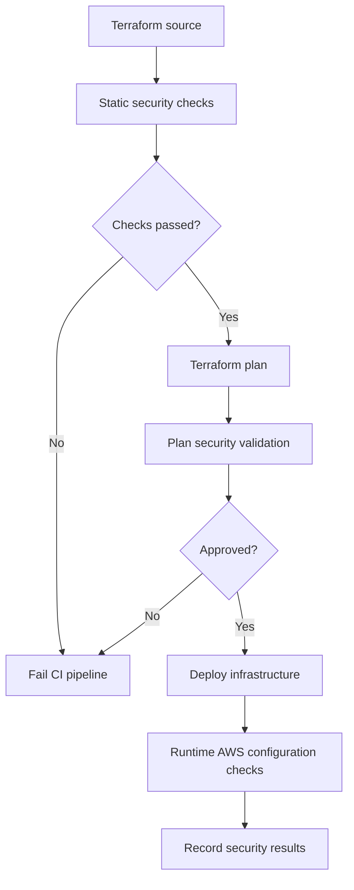

# README

## Overview

This directory contains security validation checks for Amazon S3 infrastructure deployments.

The checks are intended to detect insecure S3 configurations before they reach production. They can be integrated into Terraform validation, CI/CD pipelines, infrastructure security reviews, and deployment approval workflows.

S3 security validation should cover both resource configuration and effective access. A bucket may have encryption enabled and still expose sensitive data through an overly permissive bucket policy, an IAM role, an access point, or an unintended public-access configuration.

The checks in this directory should therefore be treated as deployment guardrails, not as a replacement for IAM policy review, AWS security monitoring, or runtime security controls.

## Scope

The security checks should validate the following areas:

| Security area | Expected configuration |
|---|---|
| Block Public Access | All four bucket-level public-access block settings enabled |
| Object Ownership | Bucket owner enforced; ACLs disabled |
| Encryption | Server-side encryption enabled with an approved encryption configuration |
| Versioning | Enabled where recovery and retention requirements require it |
| Transport security | HTTPS enforced through an appropriate bucket policy |
| Bucket policy | No unintended public or overly broad access |
| IAM permissions | Least-privilege access for application and deployment roles |
| Logging and auditing | Appropriate CloudTrail data events and access monitoring |
| Lifecycle and retention | Policies aligned with data retention and recovery requirements |

Not every check is universally mandatory. For example, versioning and SSE-KMS requirements depend on the workload's recovery, compliance, and encryption requirements.

## Security Validation Workflow

The checks should run before infrastructure deployment and, where possible, against deployed resources after deployment.



### Static Validation

Static checks inspect infrastructure definitions without requiring an AWS account.

They can detect:

- Missing public-access block resources.
- Public bucket ACL configuration.
- Missing encryption configuration.
- Missing versioning resources where required.
- Unencrypted transport policies.
- Broad IAM or bucket policy statements.

Static checks cannot reliably determine every effective permission because AWS authorization depends on identity policies, resource policies, permission boundaries, service control policies, session policies, and explicit denies.

### Deployment-Time Validation

Deployment-time checks inspect the actual AWS configuration.

They should verify:

- Bucket public-access block settings.
- Object Ownership configuration.
- Default encryption configuration.
- Versioning status.
- Bucket policies.
- Access points and their policies where applicable.
- Relevant CloudTrail and monitoring configuration.

Runtime checks are important because infrastructure can drift after deployment or be modified outside the IaC workflow.

## Recommended Tooling

| Tool | Primary purpose |
|---|---|
| Checkov | Static analysis of Terraform and other IaC configurations |
| tfsec | Terraform security scanning |
| Trivy | IaC and configuration security scanning |
| AWS Config | Continuous evaluation of deployed AWS resource configuration |
| IAM Access Analyzer | Identification of unintended external access |
| AWS Security Hub | Aggregated security findings |
| CloudTrail | Auditing AWS API activity |

Select tools according to the organization's security architecture. Avoid treating multiple scanners as independent proof of compliance when they evaluate overlapping controls.

## Running Security Checks

Run static validation tools from the infrastructure project root.

### Checkov

```bash
checkov -d . --framework terraform
```

### Trivy

```bash
trivy config .
```

### Terraform Validation

```bash
terraform fmt -check -recursive
terraform init -backend=false
terraform validate
```

These commands validate formatting, configuration structure, and selected security rules. They do not prove that deployed S3 resources are secure.

## Security Check Design

Each check should have a clearly defined contract.

| Attribute | Description |
|---|---|
| Check identifier | Stable identifier for reporting and CI integration |
| Resource scope | Bucket, access point, IAM role, or policy |
| Expected state | Required secure configuration |
| Failure condition | Configuration that violates the control |
| Severity | Critical, high, medium, or low |
| Remediation | Specific infrastructure change required |
| Evidence | Resource configuration or policy statement supporting the finding |

Checks should produce actionable findings rather than generic failure messages.

A useful finding should identify the affected resource, violated control, observed configuration, expected configuration, and remediation guidance.

## CI/CD Integration

Security checks should execute before production deployment.

A recommended pipeline sequence is:

1. Validate Terraform formatting and syntax.
2. Run IaC security scanners.
3. Generate a Terraform plan.
4. Review security-sensitive changes.
5. Require approval for production deployment.
6. Apply the approved plan.
7. Run deployed-resource security checks.
8. Retain scan results and deployment evidence.

Do not automatically suppress security findings simply because a deployment is blocked. Exceptions should have an owner, documented justification, approval, and expiry date.

## Handling Security Findings

Use severity-based remediation policies.

| Severity | Example | Recommended response |
|---|---|---|
| Critical | Public access to sensitive production data | Block deployment or initiate immediate incident response |
| High | Missing public-access protections or broad external access | Block production deployment |
| Medium | Missing recommended encryption or audit configuration | Require remediation or documented exception |
| Low | Configuration improvement or operational recommendation | Track through the engineering backlog |

Severity should reflect actual exposure and data sensitivity rather than relying exclusively on scanner defaults.

## Common Mistakes

### Treating Encryption as Complete S3 Security

Encryption protects stored data, but it does not prevent unauthorized principals from accessing objects.

Validate encryption and authorization independently.

### Checking Only Terraform Source

A secure Terraform configuration does not guarantee that deployed resources remain secure.

Use runtime configuration checks and drift detection.

### Ignoring Access Points

Bucket-level checks alone may miss access paths through S3 access points.

Include access-point policies and network-origin restrictions in the security review.

### Overly Broad Policy Exceptions

Suppressing findings globally weakens the value of automated security checks.

Use narrow exceptions with documented ownership and expiration.

### Treating Scanner Success as Compliance

A clean scanner report only indicates that the configured rules did not detect violations.

Compliance requires broader evidence, including policy review, operational controls, monitoring, and documented governance.

## Production Best Practices

- Enforce S3 Block Public Access at both account and bucket levels where appropriate.
- Use BucketOwnerEnforced Object Ownership unless ACLs are explicitly required.
- Enforce HTTPS for object requests.
- Use least-privilege IAM roles for applications and deployment pipelines.
- Separate S3 object permissions from KMS key permissions.
- Review bucket policies and access-point policies for unintended external access.
- Enable CloudTrail data events for sensitive buckets where required.
- Use AWS Config or equivalent controls to detect configuration drift.
- Retain security scan results as deployment evidence.
- Review security exceptions periodically.
- Test security checks with both compliant and intentionally non-compliant infrastructure examples.

## Key Takeaways

- S3 security validation must cover public access, ownership, encryption, transport security, and authorization.
- Static IaC scanning and deployed-resource validation address different failure modes.
- Bucket policies, IAM policies, access points, and KMS permissions must be evaluated together.
- CI/CD security checks should block high-risk deployments and retain actionable findings.
- Scanner success is not proof of compliance; continuous monitoring and governance remain necessary.