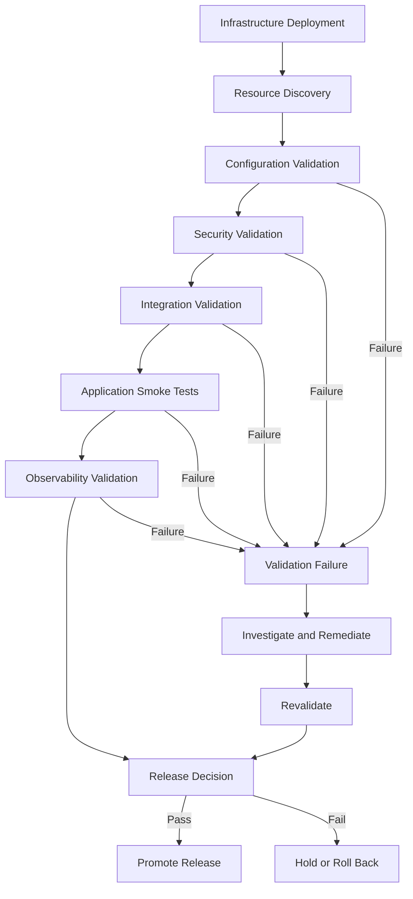
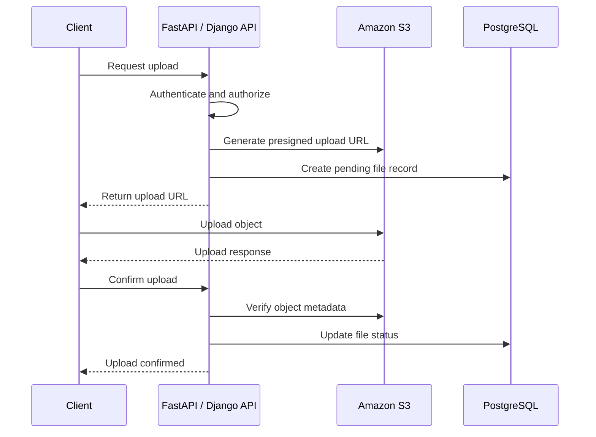
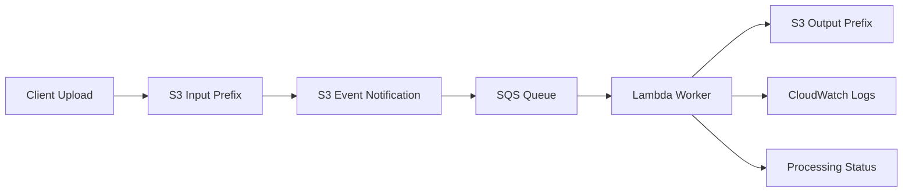
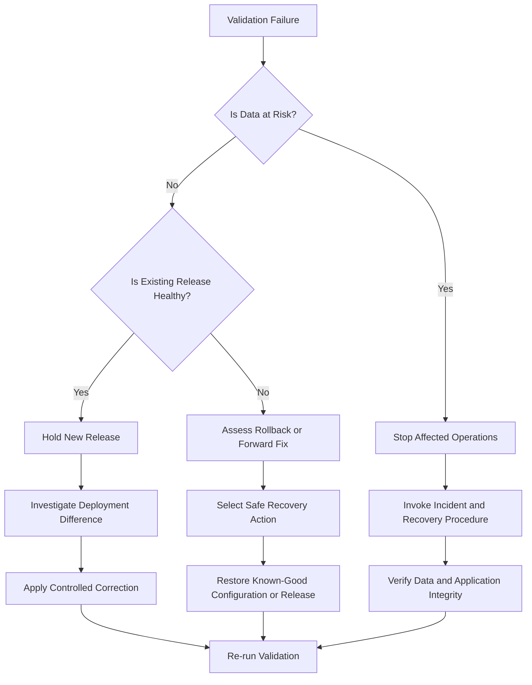

# 01- Post-Deployment Validation Strategy

## Overview

Post-deployment validation verifies that Amazon S3 infrastructure, security controls, integrations, and application workflows operate correctly after a deployment.

A successful Terraform `apply`, CloudFormation stack update, or CDK deployment confirms that AWS accepted the requested infrastructure changes. It does not prove that the resulting environment is secure, operational, or compatible with the application.

For example, an S3 bucket can be created successfully while the application remains unable to upload objects because of an incorrect IAM policy, missing KMS permissions, or an incompatible bucket policy.

A production-ready validation strategy must verify the deployed state rather than relying exclusively on infrastructure definitions.

The validation process should cover:

- Resource existence and ownership.
- Bucket configuration and governance requirements.
- Encryption and access-control enforcement.
- Versioning and lifecycle configuration.
- Application upload and download workflows.
- Presigned URL behavior.
- Event notification and downstream processing.
- CloudFront delivery where applicable.
- Replication and recovery capabilities where configured.
- Logging, metrics, and operational readiness.

Validation should be automated, repeatable, environment-aware, and capable of distinguishing compliance failures from execution errors.

## Why Post-Deployment Validation Matters

S3 deployments involve multiple AWS services and authorization boundaries. A configuration can be syntactically valid and successfully deployed while failing at runtime.

Common deployment gaps include:

| Deployment result | Potential problem |
|---|---|
| Bucket created successfully | Incorrect account, Region, or naming |
| Encryption configured | Application role cannot use the KMS key |
| Bucket policy deployed | Explicit deny blocks application operations |
| Versioning enabled | Recovery procedure has not been tested |
| Event notification configured | Lambda or SQS destination permissions are missing |
| CloudFront distribution created | Origin Access Control is incorrect |
| Lifecycle policy deployed | Filters or retention periods are incorrect |
| Replication configured | Destination permissions or encryption dependencies are incorrect |
| Application deployed | Upload or download operations fail |

Post-deployment validation identifies these gaps before the new release receives production traffic.

## Validation Architecture

A production validation workflow should separate infrastructure checks, configuration checks, security checks, integration checks, and application smoke tests.



### Validation Layers

| Layer | Responsibility | Examples |
|---|---|---|
| Infrastructure | Confirm deployed resources | Bucket existence, Region, account |
| Configuration | Verify resource settings | Encryption, versioning, lifecycle |
| Security | Verify access restrictions | Block Public Access, bucket policy, IAM |
| Integration | Verify service connectivity | Lambda, SQS, KMS, CloudFront |
| Application | Verify business workflows | Upload, download, metadata retrieval |
| Observability | Verify operational visibility | CloudWatch logs, metrics, alarms |
| Recovery | Verify recovery capabilities | Version restoration, replication recovery |

Each layer should produce a structured result and retain enough diagnostic information for investigation.

## Validation Execution Strategy

### Deployment Pipeline Placement

Run validation after infrastructure deployment and before production traffic is directed to the new release.

A typical deployment sequence is:

1. Validate infrastructure definitions.
2. Generate and review the infrastructure deployment plan.
3. Deploy infrastructure changes.
4. Wait for dependent AWS resources to become ready.
5. Discover deployed resource identifiers.
6. Execute configuration and security validation.
7. Execute integration tests.
8. Execute application smoke tests.
9. Verify monitoring and logging.
10. Approve traffic migration or release promotion.

Do not assume that every AWS resource becomes operational immediately after its provisioning API returns successfully. CloudFront distributions, event-driven integrations, and other dependent services may require additional readiness checks.

### Environment-Specific Validation

Validation requirements should be consistent across environments, while resource identifiers and operational thresholds should be environment-specific.

| Environment | Validation approach |
|---|---|
| Development | Configuration checks, unit tests, integration tests |
| Staging | Full infrastructure validation, security checks, end-to-end workflows |
| Production | Mandatory security checks, smoke tests, monitoring verification, controlled release approval |

Production validation should use non-destructive test operations and dedicated test prefixes or objects.

Avoid using real customer data for deployment smoke tests.

### Mandatory and Conditional Checks

Not every S3 deployment uses every integration. Define validation requirements explicitly for each workload.

| Validation | Applicability |
|---|---|
| Bucket existence and Region | Mandatory |
| Encryption | Mandatory |
| Public access restrictions | Mandatory |
| Required governance tags | Mandatory when organizational policy requires them |
| Versioning | Workload-dependent |
| Lifecycle | Workload-dependent |
| KMS authorization | Required when SSE-KMS is used |
| Event processing | Required when event-driven processing is deployed |
| CloudFront | Required when CloudFront delivers content |
| Replication | Required when replication is configured |
| Recovery validation | Required for workloads with defined recovery objectives |

A mandatory check must not be silently skipped because a dependency is unavailable.

## Resource Configuration Validation

### Bucket Existence and Region

Confirm that the expected bucket exists and that the validation identity belongs to the intended AWS account.

```bash
aws sts get-caller-identity
```

Inspect the bucket Region:

```bash
aws s3api get-bucket-location \
  --bucket example-application-bucket
```

Check bucket accessibility:

```bash
aws s3api head-bucket \
  --bucket example-application-bucket
```

Validate:

- Expected bucket name.
- Expected AWS account.
- Expected Region.
- Expected environment.
- Expected resource ownership.
- Correct application endpoint configuration.

`HeadBucket` is useful for checking accessibility, but its response does not provide a complete explanation of every authorization failure.

For multi-account deployments, verify the caller identity before performing resource-level checks. A correctly named bucket in the wrong account is still a deployment failure.

### Versioning

Verify that bucket versioning is enabled when required.

```bash
aws s3api get-bucket-versioning \
  --bucket example-application-bucket
```

Expected response:

```json
{
  "Status": "Enabled"
}
```

For workloads with recovery requirements, also verify that the operational recovery procedure can identify and restore a previous object version.

Versioning configuration alone does not prove that recovery works.

### Encryption

Inspect the bucket's default encryption configuration.

```bash
aws s3api get-bucket-encryption \
  --bucket example-application-bucket
```

Validate:

- Encryption configuration exists.
- The configured algorithm matches policy.
- The expected KMS key is configured when required.
- The application identity has the necessary KMS permissions.
- The application can successfully upload and retrieve an encrypted test object.

A successful `GetBucketEncryption` call does not prove that the application can use the configured KMS key.

For SSE-KMS, validate both S3 authorization and KMS authorization.

### Lifecycle Configuration

Inspect lifecycle rules:

```bash
aws s3api get-bucket-lifecycle-configuration \
  --bucket example-application-bucket
```

Verify:

- Expected lifecycle rules exist.
- Prefix and tag filters are correct.
- Transition destinations match the workload.
- Expiration periods match retention requirements.
- Noncurrent-version management is configured where required.
- Incomplete multipart upload cleanup is configured where appropriate.

Lifecycle actions are asynchronous. Deployment validation should inspect configured rules and filters rather than assume that an object has already transitioned or expired.

### Public Access Restrictions

Inspect bucket-level Block Public Access:

```bash
aws s3api get-public-access-block \
  --bucket example-application-bucket
```

Inspect account-level Block Public Access:

```bash
aws s3control get-public-access-block \
  --account-id 123456789012
```

Validate all four settings:

- `BlockPublicAcls`
- `IgnorePublicAcls`
- `BlockPublicPolicy`
- `RestrictPublicBuckets`

Also inspect bucket policy status and ownership configuration where applicable.

For detailed security validation, use the validators in:

`08- Deployment Security and Governance/validation/`

### Required Tags

Inspect bucket tags:

```bash
aws s3api get-bucket-tagging \
  --bucket example-application-bucket
```

Verify mandatory governance metadata such as:

- `Environment`
- `Application`
- `Owner`
- `CostCenter`
- `DataClassification`
- `ManagedBy`

Tag requirements should be enforced consistently through infrastructure definitions and post-deployment validation.

Bucket tags do not automatically propagate to objects. If object-level classification is required, implement a separate object-tagging validation process.

## Security Validation

Security validation confirms that deployed resources enforce the intended trust boundaries.

A deployment should not be promoted simply because the bucket is encrypted or private by default. The complete access path must be considered.

### Security Validation Matrix

| Control | Validation method | Expected outcome |
|---|---|---|
| Block Public Access | Inspect account and bucket settings | Required public-access restrictions enabled |
| Bucket policy | Retrieve and inspect policy | No unintended public access |
| Object Ownership | Inspect ownership controls | Expected ownership mode |
| Encryption | Inspect default encryption | Approved encryption configuration |
| KMS permissions | Test using application identity | Authorized encryption operations |
| TLS enforcement | Inspect bucket policy | Insecure transport denied where required |
| IAM permissions | Test application role | Only intended operations succeed |
| Versioning | Inspect bucket versioning | Enabled where required |
| Governance tags | Inspect bucket tags | Required metadata present |

### Validate the Application Identity

Use the same identity that the application uses whenever possible.

For example, if the application runs with an ECS task role, validation should use that role rather than an administrator's local AWS profile.

This prevents a common false-positive scenario:

- An administrator can upload objects.
- The deployed application role cannot upload objects.
- Infrastructure validation passes.
- Production requests fail with `AccessDenied`.

Validate both positive and negative permissions.

| Operation | Expected behavior |
|---|---|
| Upload to approved prefix | Allowed |
| Read authorized object | Allowed |
| Delete unauthorized object | Denied |
| Access another tenant's prefix | Denied |
| Access unrelated bucket | Denied |
| Use an unauthorized KMS key | Denied |

Negative tests are especially important for multi-tenant applications.

Do not perform destructive negative tests against production data. Use isolated test objects and dedicated test identities.

## Application Integration Validation

Infrastructure configuration does not guarantee application-level correctness.

Validate the actual S3 workflows used by the backend application.

### Upload and Download Workflow

A typical backend application uses S3 for document, image, and media storage.



Validate:

- Upload authorization.
- Object key generation.
- Content-type restrictions.
- Maximum file size.
- Expected encryption.
- Object metadata.
- Database state transitions.
- Download authorization.
- Presigned URL expiration.
- Error handling for missing objects.

For direct-to-S3 uploads, the backend should verify the uploaded object before marking it as available.

A client-side upload success response alone should not be treated as proof that the application has accepted and validated the file.

### Practical Smoke Test

Use a dedicated deployment test prefix.

```bash
TEST_KEY="deployment-validation/smoke-test.txt"

printf "S3 deployment validation\n" > /tmp/s3-smoke-test.txt
```

Upload the test object:

```bash
aws s3api put-object \
  --bucket example-application-bucket \
  --key "$TEST_KEY" \
  --body /tmp/s3-smoke-test.txt \
  --server-side-encryption AES256
```

Inspect the uploaded object:

```bash
aws s3api head-object \
  --bucket example-application-bucket \
  --key "$TEST_KEY"
```

Download the object:

```bash
aws s3api get-object \
  --bucket example-application-bucket \
  --key "$TEST_KEY" \
  /tmp/s3-smoke-test-downloaded.txt
```

Compare the contents:

```bash
cmp /tmp/s3-smoke-test.txt /tmp/s3-smoke-test-downloaded.txt
```

Remove the test object:

```bash
aws s3api delete-object \
  --bucket example-application-bucket \
  --key "$TEST_KEY"
```

The example explicitly requests SSE-S3. For a bucket requiring SSE-KMS or another encryption configuration, use the expected encryption settings and key instead.

For versioned buckets, this deletion normally creates a delete marker rather than permanently removing the object version. Test cleanup must account for versioning and retention policies.

Do not bypass Object Lock or retention requirements to clean up deployment test data.

### Presigned URL Validation

For applications using presigned URLs, validate:

- URL generation by the backend.
- Expected bucket and object key.
- Expiration time.
- HTTP method.
- Required signed headers.
- Content-type behavior.
- Encryption requirements.
- Authorization boundaries.
- Upload completion and object verification.

Presigned URLs are bearer credentials. Avoid printing complete URLs in application logs, CI output, or monitoring events.

## Event-Driven Integration Validation

S3 event notifications introduce asynchronous processing behavior.

A deployment can successfully configure an event notification while the downstream processing workflow remains unhealthy.

Validate the complete event path.



### Validation Checklist

| Component | Validation |
|---|---|
| S3 notification | Expected event types and prefix filters |
| Destination permission | S3 can publish to the configured destination |
| SQS | Queue exists and policy permits delivery |
| Lambda | Function exists and has required execution permissions |
| Lambda trigger | Event source mapping is enabled where applicable |
| DLQ or failure destination | Configured when required |
| Output location | Correct bucket and prefix |
| Monitoring | Logs, errors, retries, and queue depth visible |

### End-to-End Event Test

Upload a unique test object to the configured input prefix.

```bash
TEST_KEY="incoming/validation-$(date +%s).txt"

printf "event-processing-validation\n" > /tmp/event-validation.txt

aws s3api put-object \
  --bucket example-application-bucket \
  --key "$TEST_KEY" \
  --body /tmp/event-validation.txt
```

Verify:

1. The S3 event reaches the configured destination.
2. The downstream worker receives the event.
3. Processing completes successfully.
4. The expected output object or processing record exists.
5. CloudWatch logs contain the expected execution.
6. No unexpected messages remain in the queue or dead-letter queue.

S3 event notifications provide at-least-once delivery and are not guaranteed to arrive in the same order as object operations. Consumers must therefore be idempotent.

A successful single-event test is useful evidence, but it does not prove resilience under retries, duplicate delivery, or concurrent processing.

## CloudFront Integration Validation

For private S3 origins delivered through CloudFront, validate both origin access and viewer delivery.

### Validation Scope

- Distribution exists.
- Distribution deployment status is successful.
- Correct origin bucket is configured.
- Origin Access Control is configured.
- Bucket policy permits the intended CloudFront distribution.
- Direct public bucket access remains restricted.
- HTTPS viewer access works.
- Cache behavior matches deployment requirements.
- Invalidation workflow works where required.

Inspect the distribution:

```bash
aws cloudfront get-distribution \
  --id E123456789EXAMPLE
```

Inspect the origin access control:

```bash
aws cloudfront get-origin-access-control \
  --id E123456789EXAMPLE
```

Test the viewer endpoint:

```bash
curl -I https://cdn.example.com/health.txt
```

Expected behavior should include a successful HTTP response and the intended cache-related headers.

Do not assume that a working CloudFront endpoint proves the S3 origin is private. Test direct S3 access separately using an unauthorized identity.

CloudFront distributions and configuration changes may take time to deploy. Run smoke tests only after the distribution reaches its deployed state.

## Replication and Recovery Validation

For buckets with replication requirements, validate configuration and operational evidence separately.

### Replication Configuration

Inspect replication rules:

```bash
aws s3api get-bucket-replication \
  --bucket example-source-bucket
```

Verify:

- Replication is enabled.
- Destination bucket is correct.
- IAM replication role is correct.
- Filters match the intended object population.
- Encryption requirements are satisfied.
- Destination bucket versioning is enabled.
- Required KMS permissions are configured.

### Replication Execution

Upload a unique test object to the source bucket:

```bash
TEST_KEY="replication-validation/test-$(date +%s).txt"

printf "replication-validation\n" > /tmp/replication-test.txt

aws s3api put-object \
  --bucket example-source-bucket \
  --key "$TEST_KEY" \
  --body /tmp/replication-test.txt
```

Inspect the source object's replication status:

```bash
aws s3api head-object \
  --bucket example-source-bucket \
  --key "$TEST_KEY"
```

For eligible replicated objects, the response can expose replication status such as `PENDING`, `COMPLETED`, `FAILED`, or `REPLICA`.

Check the destination:

```bash
aws s3api head-object \
  --bucket example-destination-bucket \
  --key "$TEST_KEY"
```

Do not interpret an immediately missing destination object as proof that replication is broken. Replication is asynchronous.

### Recovery Validation

For disaster recovery requirements, test more than object replication.

Validate:

- Destination bucket accessibility.
- Destination IAM permissions.
- Application configuration for recovery.
- Required KMS key availability.
- Database and metadata recovery dependencies.
- DNS or traffic-routing procedures.
- Recovery time objective (RTO).
- Recovery point objective (RPO).

Replication does not automatically provide application failover. A recovery exercise must prove that the application can operate using the recovery environment.

## Observability Validation

Post-deployment validation should confirm that the deployed environment is observable before production traffic is increased.

### CloudWatch Logs

Verify that application and Lambda logs are being delivered to the expected log groups.

```bash
aws logs describe-log-groups \
  --log-group-name-prefix /aws/lambda/
```

Inspect recent log events:

```bash
aws logs tail /aws/lambda/example-s3-processor \
  --since 15m
```

Validate:

- Log group exists.
- Expected execution logs appear.
- Error events are visible.
- Log retention is configured.
- Sensitive values are not logged.
- Application correlation identifiers are available.

### CloudWatch Metrics

Review relevant S3 and integration metrics.

| Metric | Purpose |
|---|---|
| `BucketSizeBytes` | Monitors bucket storage consumption |
| `NumberOfObjects` | Monitors object population |
| `AllRequests` | Monitors request activity |
| `4xxErrors` | Identifies client-side and authorization-related failures |
| `5xxErrors` | Identifies service-side request failures |
| `ReplicationLatency` | Monitors replication delay where supported |
| `BytesDownloaded` | Measures downloaded data volume |
| `BytesUploaded` | Measures uploaded data volume |

S3 storage metrics such as bucket size and object count are generally reported daily. Request metrics require appropriate configuration and should not be assumed to exist automatically.

For event-driven systems, also inspect:

- SQS `ApproximateNumberOfMessagesVisible`.
- SQS `ApproximateAgeOfOldestMessage`.
- Lambda `Errors`.
- Lambda `Throttles`.
- Lambda `Duration`.
- Lambda `Invocations`.

### Alarm Validation

Confirm that critical alarms exist and have the intended configuration.

A deployment should verify alarm definitions and notification integration.

For critical production workflows, perform a controlled notification test using an approved test mechanism rather than intentionally causing a production outage.

## Automated Validation Framework

A maintainable validation framework should separate AWS inspection, compliance evaluation, and reporting.

Recommended organization:

```text
validation/
├── README.md
├── check_public_access.py
├── check_encryption.py
├── check_versioning.py
├── check_required_tags.py
└── post_deployment/
    ├── validate_bucket.py
    ├── validate_application.py
    ├── validate_integrations.py
    ├── validate_cloudfront.py
    └── validate_replication.py
```

The `post_deployment/` structure is a suggested extension. Add files only when their checks are implemented and maintained.

### Validation Result Model

Use a consistent result model across validators.

| Field | Description |
|---|---|
| `check_id` | Stable identifier for the validation |
| `resource` | AWS resource being inspected |
| `status` | `PASS`, `FAIL`, or `ERROR` |
| `severity` | Finding severity |
| `message` | Human-readable result |
| `timestamp` | Validation execution time |
| `environment` | Target deployment environment |
| `account_id` | AWS account identifier |
| `region` | AWS Region |

Distinguish between:

- `PASS`: The configured requirement was verified.
- `FAIL`: The resource was inspected and violated a requirement.
- `ERROR`: The validator could not establish the resource's compliance status.

An API permission failure must never be converted into a passing result.

### Exit-Code Convention

| Exit code | Meaning |
|---|---|
| `0` | All mandatory validations passed |
| `1` | One or more compliance or functional checks failed |
| `2` | Validation execution error |

The deployment pipeline should stop promotion for both failed checks and validation errors.

## CI/CD Integration

Post-deployment validation should run using short-lived AWS credentials.

GitHub Actions can assume a dedicated validation role through OIDC federation.

### Example Workflow

```yaml
name: S3 Post-Deployment Validation

on:
  workflow_dispatch:
  workflow_run:
    workflows:
      - S3 Infrastructure Deployment
    types:
      - completed

permissions:
  contents: read
  id-token: write

jobs:
  validate:
    if: github.event_name == 'workflow_dispatch' || github.event.workflow_run.conclusion == 'success'
    runs-on: ubuntu-latest

    environment: staging

    env:
      AWS_REGION: ap-south-1
      S3_BUCKET: example-application-bucket

    steps:
      - name: Checkout repository
        uses: actions/checkout@v4

      - name: Configure AWS credentials
        uses: aws-actions/configure-aws-credentials@v4
        with:
          role-to-assume: ${{ vars.AWS_VALIDATION_ROLE_ARN }}
          aws-region: ${{ env.AWS_REGION }}

      - name: Set up Python
        uses: actions/setup-python@v5
        with:
          python-version: "3.12"

      - name: Install dependencies
        run: |
          python -m pip install --upgrade pip
          python -m pip install boto3

      - name: Verify AWS identity
        run: aws sts get-caller-identity

      - name: Validate bucket configuration
        run: |
          aws s3api head-bucket \
            --bucket "$S3_BUCKET"

          aws s3api get-bucket-versioning \
            --bucket "$S3_BUCKET"

          aws s3api get-bucket-encryption \
            --bucket "$S3_BUCKET"

      - name: Run governance validators
        working-directory: 06- Deployment/05- Amazon S3/08- Deployment Security and Governance/validation
        run: |
          python check_public_access.py \
            --bucket "$S3_BUCKET" \
            --region "$AWS_REGION" \
            --output json

          python check_encryption.py \
            --bucket "$S3_BUCKET" \
            --region "$AWS_REGION" \
            --output json

          python check_versioning.py \
            --bucket "$S3_BUCKET" \
            --region "$AWS_REGION" \
            --output json

          python check_required_tags.py \
            --bucket "$S3_BUCKET" \
            --region "$AWS_REGION" \
            --output json
```

This workflow demonstrates the validation stage and assumes that the infrastructure deployment workflow already exists.

For production:

- Pin third-party GitHub Actions to reviewed immutable commit SHAs.
- Use environment-specific role ARNs and bucket identifiers.
- Configure OIDC trust restrictions for the intended repository and branch or environment.
- Keep validation permissions separate from deployment permissions.
- Retain structured reports as workflow artifacts where appropriate.
- Avoid exposing sensitive resource metadata in public workflow logs.

For a reusable release pipeline, pass resource identifiers as validated deployment outputs rather than hardcoding them in the workflow.

## Release Acceptance Criteria

A release should be promoted only when all mandatory validation layers pass.

### Acceptance Matrix

| Category | Acceptance criteria |
|---|---|
| Infrastructure | Expected resources exist in the correct account and Region |
| Configuration | Required bucket settings match deployment policy |
| Security | No unintended public access or authorization gaps |
| Encryption | Required encryption configuration is active |
| Application | Upload, download, and metadata workflows succeed |
| Event processing | Expected event reaches and completes downstream processing |
| CloudFront | Viewer endpoint and private origin access work |
| Replication | Required replication configuration and test-object behavior are verified |
| Observability | Logs, metrics, and alarms are available |
| Recovery | Required recovery procedures have been validated |

Not every deployment requires CloudFront, replication, or event processing. Mark controls as mandatory, conditional, or not applicable for each workload.

Do not silently skip a mandatory validation because a dependency is unavailable.

## Failure Handling and Rollback Decision

Not every post-deployment failure requires an immediate infrastructure rollback.

First classify the failure and determine whether the deployed state is safe to operate.

| Failure category | Recommended response |
|---|---|
| Missing mandatory security control | Block promotion and remediate |
| Incorrect bucket configuration | Correct through controlled infrastructure changes |
| Application IAM failure | Correct role or policy configuration and revalidate |
| KMS authorization failure | Investigate S3 and KMS permissions separately |
| Event-processing failure | Stop traffic that depends on processing and investigate the event path |
| CloudFront deployment delay | Wait for distribution deployment and retry validation |
| Monitoring failure | Hold promotion if operational visibility is mandatory |
| Data corruption or unintended deletion | Stop destructive activity and invoke recovery procedures |

### Rollback Decision Flow



### When to Roll Back

Consider rollback when:

- The new application release is incompatible with deployed infrastructure.
- A configuration change causes an outage.
- A previously healthy integration becomes unavailable.
- A release introduces a security regression.
- The prior infrastructure and application state can be restored safely.

### When to Prefer a Forward Fix

A forward fix may be safer when:

- The change is additive and backward-compatible.
- Rolling back would remove resources containing new production data.
- Bucket policy changes can be corrected without replacing infrastructure.
- Application database or object formats have already changed.
- Infrastructure state cannot be safely reverted to the previous configuration.

S3 rollback requires special care because object storage is persistent state.

Reverting a Terraform or CloudFormation change does not necessarily restore deleted objects, previous object versions, or application metadata.

Before rolling back, evaluate:

- Bucket replacement behavior.
- Versioning and delete markers.
- Object Lock retention.
- Replication state.
- KMS key dependencies.
- Application database compatibility.
- Lifecycle actions already executed.

## Production Operational Considerations

### Avoid Destructive Smoke Tests

Never validate production behavior by deleting customer objects or changing production bucket policies without an approved test plan.

Use:

- Dedicated validation prefixes.
- Unique test object identifiers.
- Synthetic content.
- Explicit cleanup procedures.
- Restricted test identities.

For versioned buckets, cleanup may require removing test object versions and delete markers. Respect retention and Object Lock controls.

### Handle Asynchronous Operations

Some S3-related operations are asynchronous:

- Lifecycle transitions and expiration.
- Cross-Region Replication.
- CloudFront distribution deployment.
- Event-driven processing.
- Large multipart transfers.

Separate configuration validation from execution validation.

For example, a replication rule can be correctly configured while a specific object remains pending replication. The validation workflow should use bounded polling and explicit timeout behavior rather than treating immediate absence as a definitive failure.

### Control Validation Cost

Validation itself can generate AWS charges.

Consider:

- S3 request volume.
- CloudWatch metrics and log ingestion.
- CloudFront requests and invalidations.
- Lambda invocations.
- SQS requests.
- Cross-Region data transfer.
- KMS API requests.

Use a small number of unique synthetic objects and avoid recursive object listing or broad object metadata scans during every deployment.

For large environments, use targeted checks and scheduled inventory-based assessments rather than repeatedly scanning every object.

### Preserve Evidence

Retain useful validation evidence for production releases.

Recommended fields include:

- Release identifier.
- Deployment timestamp.
- AWS account and Region.
- Resource identifiers.
- Validation status.
- Failed check details.
- Execution identity.
- Application version.
- Infrastructure version.

Do not store credentials, complete presigned URLs, sensitive object contents, or unnecessary customer metadata in validation reports.

## Common Mistakes and Pitfalls

| Mistake | Why it happens | Prevention |
|---|---|---|
| Treating successful IaC deployment as proof of correctness | Provisioning and runtime behavior are different | Run independent post-deployment checks |
| Validating with administrator credentials | Administrator access hides application permission failures | Test using the deployed application identity |
| Checking only bucket existence | Ignores security and application configuration | Validate the full resource configuration |
| Assuming default encryption proves application access | KMS permissions are independent of S3 permissions | Test real encrypted operations |
| Assuming S3 events are delivered exactly once | Event delivery can be duplicated or reordered | Implement idempotent consumers |
| Testing only event notification configuration | Does not prove downstream processing works | Execute an end-to-end event test |
| Assuming replication is immediate | Replication is asynchronous | Poll replication status with a bounded timeout |
| Ignoring CloudFront deployment status | Distribution changes can take time | Wait for deployed status before smoke testing |
| Using production objects for validation | Risks customer data and retention controls | Use isolated synthetic test objects |
| Treating lifecycle configuration as immediate execution | Lifecycle actions are asynchronous | Validate rules and separately monitor execution |
| Ignoring monitoring configuration | Infrastructure can work without operational visibility | Validate logs, metrics, and alarms before promotion |
| Automatically rolling back every failure | Rollback can cause additional data or infrastructure damage | Classify failures and choose a safe recovery action |

## Production Readiness Checklist

### Infrastructure

- [ ] Bucket exists in the intended AWS account and Region.
- [ ] Bucket name and resource identifiers match deployment outputs.
- [ ] Versioning matches workload requirements.
- [ ] Default encryption matches organizational policy.
- [ ] Lifecycle rules match retention requirements.
- [ ] Required governance tags exist.
- [ ] Replication configuration is correct where applicable.

### Security

- [ ] Account-level and bucket-level Block Public Access are verified.
- [ ] Bucket policies are reviewed.
- [ ] Object Ownership configuration is verified.
- [ ] Application IAM permissions are tested.
- [ ] KMS permissions are tested separately.
- [ ] HTTPS-only access requirements are enforced.
- [ ] Cross-tenant and unauthorized access tests fail as expected.

### Application and Integrations

- [ ] Upload workflow succeeds.
- [ ] Download workflow succeeds.
- [ ] Object metadata is correct.
- [ ] Presigned URL behavior is verified where applicable.
- [ ] Event notification reaches the expected destination.
- [ ] Processing completes successfully.
- [ ] CloudFront delivery works where applicable.
- [ ] Replication behavior is verified where applicable.

### Observability and Recovery

- [ ] CloudWatch logs are available.
- [ ] Required metrics are enabled.
- [ ] Critical alarms are configured.
- [ ] Validation failures are visible to the release pipeline.
- [ ] Recovery procedures are documented.
- [ ] RTO and RPO requirements are understood.
- [ ] Rollback or forward-fix procedures are reviewed.
- [ ] Validation evidence is retained.

## Key Takeaways

- Post-deployment validation verifies actual AWS resource configuration, security, application behavior, and operational readiness rather than relying on successful infrastructure provisioning.
- Test S3 operations using the application's real IAM identity to expose permission and KMS authorization problems.
- Validate asynchronous integrations through end-to-end execution, accounting for retries, duplicate events, replication delays, and eventual processing.
- Treat S3 rollback as a data-management operation as well as an infrastructure change; infrastructure rollback alone cannot restore deleted or modified objects.
- Promote releases only after mandatory configuration, security, application, and observability checks pass.