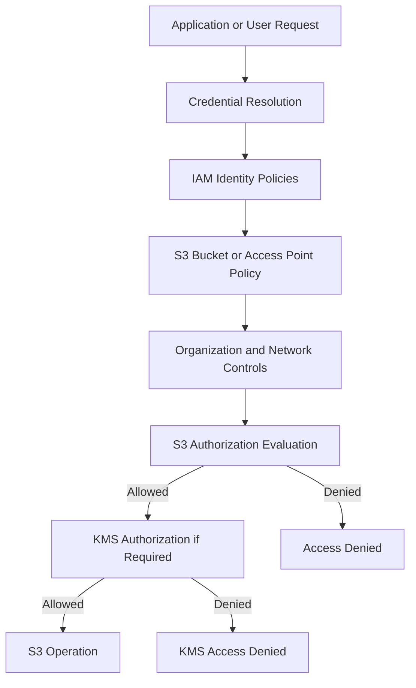

# 02- Verifying Bucket Policies and Access Controls

## Overview

Verifying S3 bucket policies and access controls is a critical part of post-deployment validation. A bucket can be created successfully, encrypted, and configured with Block Public Access while still exposing data through an unintended permission path or preventing legitimate applications from accessing it.

S3 authorization is determined by multiple interacting controls, including:

- AWS IAM identity-based policies.
- S3 bucket policies.
- S3 access point policies.
- Object Ownership and ACL behavior.
- S3 Block Public Access settings.
- AWS Organizations service control policies (SCPs).
- VPC endpoint policies.
- AWS KMS key policies and grants when SSE-KMS is used.

Post-deployment verification must establish two outcomes:

1. **Required access works:** authorized identities can perform the intended operations.
2. **Unintended access fails:** unauthorized identities cannot access protected resources.

This document focuses on validating deployed policies and access behavior. Detailed policy design, IAM evaluation, encryption architecture, and public-access prevention mechanisms belong in the dedicated S3 Security documentation.

## S3 Authorization Architecture

S3 authorization is not determined by the bucket policy alone. The effective result depends on the request identity, resource policies, applicable organization controls, network restrictions, and encryption permissions.



### Authorization Layers

| Layer | What to verify | Typical failure |
|---|---|---|
| IAM identity policy | Application role has required actions | Missing `s3:PutObject` |
| Bucket policy | Resource access is correctly restricted | Explicit deny blocks application |
| Access point policy | Access point permits intended operations | Access point request denied |
| Object Ownership | Ownership and ACL behavior match expectations | Unexpected cross-account ownership |
| Block Public Access | Public access restrictions are enabled | Public policy or ACL configuration rejected or restricted |
| SCP | Organization-level permissions allow the operation | Account-level permission boundary |
| VPC endpoint policy | Network path permits the request | Requests through endpoint denied |
| KMS key policy and grants | Encryption key operations are authorized | `kms:GenerateDataKey` or `kms:Decrypt` denied |

A successful bucket-policy inspection does not prove that every application operation will succeed. Validate the actual request path and identity.

## Establish the Validation Identity

Before inspecting policies, identify the AWS account and principal used by the validation process.

```bash
aws sts get-caller-identity
```

Example response:

```json
{
  "UserId": "AROAEXAMPLE:deployment-validation",
  "Account": "123456789012",
  "Arn": "arn:aws:sts::123456789012:assumed-role/S3ValidationRole/deployment-validation"
}
```

Record:

- AWS account ID.
- Assumed role ARN.
- Session identity.
- Target Region.
- Target bucket.
- Deployment environment.

### Validate the Application Role

The strongest application-access test uses the same IAM role that the deployed application uses.

Examples include:

| Runtime | Typical identity |
|---|---|
| Amazon EC2 | Instance profile role |
| ECS | Task role |
| EKS | Pod Identity or IRSA role |
| Lambda | Execution role |
| GitHub Actions | OIDC-assumed deployment or validation role |

Avoid validating application permissions using an administrator profile. Administrator access can hide missing permissions and produce false-positive validation results.

For CI/CD, use a dedicated validation role with only the permissions needed to inspect configuration and execute controlled test operations.

## Inspect the Bucket Policy

### Retrieve the Policy

Use the S3 API to retrieve the deployed bucket policy:

```bash
aws s3api get-bucket-policy \
  --bucket example-application-bucket \
  --query Policy \
  --output text
```

The returned policy is JSON encoded as a string.

To format it for inspection:

```bash
aws s3api get-bucket-policy \
  --bucket example-application-bucket \
  --output text |
  python -m json.tool
```

The validation process should inspect the actual deployed policy rather than relying only on the Terraform, CloudFormation, or CDK source.

### Validate Policy Structure

Check the following:

- The policy contains the expected statements.
- The `Principal` values identify intended AWS principals.
- The `Action` values are restricted to required operations.
- The `Resource` values reference the correct bucket and object ARNs.
- Conditions enforce required security boundaries.
- No unintended wildcard principal grants access.
- Explicit deny statements do not block legitimate application traffic.
- Cross-account access is limited to approved accounts and roles.

### Bucket ARN and Object ARN

Bucket-level and object-level permissions use different resource ARNs.

| Resource | ARN |
|---|---|
| Bucket | `arn:aws:s3:::example-application-bucket` |
| Objects | `arn:aws:s3:::example-application-bucket/*` |

For example:

```json
{
  "Version": "2012-10-17",
  "Statement": [
    {
      "Sid": "AllowApplicationList",
      "Effect": "Allow",
      "Principal": {
        "AWS": "arn:aws:iam::123456789012:role/ApplicationRole"
      },
      "Action": [
        "s3:ListBucket"
      ],
      "Resource": "arn:aws:s3:::example-application-bucket"
    },
    {
      "Sid": "AllowApplicationObjectOperations",
      "Effect": "Allow",
      "Principal": {
        "AWS": "arn:aws:iam::123456789012:role/ApplicationRole"
      },
      "Action": [
        "s3:GetObject",
        "s3:PutObject"
      ],
      "Resource": "arn:aws:s3:::example-application-bucket/application/*"
    }
  ]
}
```

A common mistake is attaching `s3:ListBucket` to an object ARN or attaching `s3:GetObject` to a bucket ARN.

Validate resource types against the actions being granted.

## Validate Public Access Restrictions

### Account-Level Block Public Access

Inspect account-level settings:

```bash
aws s3control get-public-access-block \
  --account-id 123456789012
```

### Bucket-Level Block Public Access

Inspect bucket-level settings:

```bash
aws s3api get-public-access-block \
  --bucket example-application-bucket
```

Verify the four controls:

| Setting | Expected behavior |
|---|---|
| `BlockPublicAcls` | Rejects public ACL changes |
| `IgnorePublicAcls` | Ignores public ACL permissions |
| `BlockPublicPolicy` | Rejects policies considered public |
| `RestrictPublicBuckets` | Restricts access to buckets with public policies |

For private application buckets, the expected configuration is generally `true` for all four settings, subject to documented workload exceptions.

### Validate Bucket Policy Public Status

Inspect S3's public-policy classification:

```bash
aws s3api get-bucket-policy-status \
  --bucket example-application-bucket
```

Expected response:

```json
{
  "PolicyStatus": {
    "IsPublic": false
  }
}
```

This status is useful but should not be treated as a complete authorization analysis.

A bucket can have non-public access grants that are still broader than intended. Conversely, a public-policy classification does not replace inspection of IAM, access point, network, and organization controls.

### Inspect Account and Bucket Settings Together

Do not validate only bucket-level settings.

The effective behavior depends on account-level and bucket-level controls. Account-level restrictions can prevent public access even when bucket-level settings are less restrictive.

A release validation report should record both configurations.

## Validate Object Ownership and ACL Configuration

Modern S3 applications should generally use Object Ownership with ACLs disabled unless a specific integration requires ACL-based ownership behavior.

Inspect ownership controls:

```bash
aws s3api get-bucket-ownership-controls \
  --bucket example-application-bucket
```

Expected configuration for an ACL-independent architecture:

```json
{
  "OwnershipControls": {
    "Rules": [
      {
        "ObjectOwnership": "BucketOwnerEnforced"
      }
    ]
  }
}
```

With `BucketOwnerEnforced`:

- ACLs are disabled.
- The bucket owner owns objects.
- Access is managed through IAM and resource policies.
- Requests attempting unsupported ACL changes can fail.

### Inspect Bucket ACL

Where ACLs are enabled and inspection is permitted:

```bash
aws s3api get-bucket-acl \
  --bucket example-application-bucket
```

Inspect object ACLs only when the workload actually depends on them.

```bash
aws s3api get-object-acl \
  --bucket example-application-bucket \
  --key application/example.pdf
```

Do not assume that a bucket ACL inspection is sufficient to establish effective object access.

When ACLs are disabled, policy-based access should be the primary validation target.

## Verify Identity-Based IAM Permissions

Bucket policies are only one part of authorization.

Inspect the application's IAM role and attached policies.

### List Attached Role Policies

```bash
aws iam list-attached-role-policies \
  --role-name ApplicationRole
```

### List Inline Role Policies

```bash
aws iam list-role-policies \
  --role-name ApplicationRole
```

### Retrieve an Attached Policy

```bash
aws iam get-policy \
  --policy-arn arn:aws:iam::123456789012:policy/ApplicationS3Access
```

Retrieve a specific policy version:

```bash
aws iam get-policy-version \
  --policy-arn arn:aws:iam::123456789012:policy/ApplicationS3Access \
  --version-id v1
```

### Validate Required Actions

A typical backend upload and download workflow may require:

| Application operation | Relevant permission |
|---|---|
| Upload object | `s3:PutObject` |
| Download object | `s3:GetObject` |
| Delete object | `s3:DeleteObject` |
| List bucket contents | `s3:ListBucket` |
| Read object tags | `s3:GetObjectTagging` |
| Write object tags | `s3:PutObjectTagging` |
| Inspect object metadata | `s3:GetObject` for `HeadObject` authorization |
| Abort multipart upload | `s3:AbortMultipartUpload` |
| List multipart parts | `s3:ListMultipartUploadParts` |

The exact permissions depend on the application workflow and request type.

For example, a backend that generates presigned URLs needs permission to sign the intended operation through its AWS credentials, but the eventual request is authorized using those credentials and the signed request constraints.

Do not grant broad administrative permissions merely to make a deployment smoke test pass.

## Validate Access with Real Operations

Policy inspection is necessary, but behavioral validation provides stronger evidence.

Test both allowed and denied operations using the intended application identity.

### Positive Access Tests

For an upload workflow:

```bash
TEST_KEY="validation/application/upload-test.txt"

printf "access-control-validation\n" > /tmp/access-test.txt

aws s3api put-object \
  --bucket example-application-bucket \
  --key "$TEST_KEY" \
  --body /tmp/access-test.txt
```

Verify the object:

```bash
aws s3api head-object \
  --bucket example-application-bucket \
  --key "$TEST_KEY"
```

Download it:

```bash
aws s3api get-object \
  --bucket example-application-bucket \
  --key "$TEST_KEY" \
  /tmp/access-test-downloaded.txt
```

Compare the content:

```bash
cmp /tmp/access-test.txt /tmp/access-test-downloaded.txt
```

### Negative Access Tests

Negative tests establish that access boundaries are working.

Examples:

- Application role cannot access another tenant's prefix.
- Application role cannot read an unrelated bucket.
- Unauthenticated users cannot retrieve private objects.
- Unauthorized roles cannot delete protected objects.
- Requests through an unapproved network path are denied when network restrictions are required.

Use a dedicated test role or isolated test resource for negative tests.

A failed request must be interpreted carefully. An operation may fail because of an invalid resource, missing credentials, KMS authorization, or a network issue rather than the specific policy being tested.

Record the request identity and error details to distinguish these cases.

## Validate Multi-Tenant Access Boundaries

Multi-tenant applications commonly store objects using tenant-specific prefixes.

Example:

```text
tenant-001/documents/document-a.pdf
tenant-001/images/image-a.png
tenant-002/documents/document-b.pdf
```

The application should prevent one tenant from accessing another tenant's data.

### Validation Matrix

| Identity | Target prefix | Expected result |
|---|---|---|
| Tenant 001 role | `tenant-001/*` | Allowed |
| Tenant 001 role | `tenant-002/*` | Denied |
| Tenant 002 role | `tenant-002/*` | Allowed |
| Tenant 002 role | `tenant-001/*` | Denied |
| Unauthenticated user | Any private prefix | Denied |

A shared application role with broad bucket permissions may be appropriate when the backend performs strict tenant authorization and never exposes arbitrary object keys.

However, if tenant isolation must be enforced independently of application correctness, consider stronger isolation boundaries such as separate roles, access points, or buckets.

Do not treat a user-controlled object key as an authorization boundary.

## Validate Cross-Account Access

Cross-account access requires coordinated permissions on both sides.

For a common role-based architecture:

- The target account bucket policy trusts an approved external role.
- The external role's identity policy allows the required S3 operations.
- Any applicable SCPs and permission boundaries permit the request.
- KMS key policies and grants allow the required cryptographic operations when SSE-KMS is used.

### Inspect the Cross-Account Bucket Policy

```bash
aws s3api get-bucket-policy \
  --bucket centralized-storage-bucket \
  --query Policy \
  --output text
```

Verify that the trusted principal is the intended role ARN rather than an unnecessarily broad account or wildcard principal.

### Test from the External Account

Assume the intended role:

```bash
aws sts assume-role \
  --role-arn arn:aws:iam::123456789012:role/CrossAccountS3AccessRole \
  --role-session-name s3-access-validation
```

Use the returned temporary credentials in a controlled test environment and validate the expected S3 operation.

Avoid printing temporary credentials in CI logs.

A successful `AssumeRole` operation proves that role assumption works. It does not prove that the resulting role can access the S3 bucket.

## Validate Access Point Policies

When applications use S3 access points, inspect their policies independently.

List access points:

```bash
aws s3control list-access-points \
  --account-id 123456789012
```

Retrieve an access point policy:

```bash
aws s3control get-access-point-policy \
  --account-id 123456789012 \
  --name application-access-point
```

Validate:

- Access point belongs to the expected account.
- Access point is associated with the intended bucket.
- Network origin restrictions match the architecture.
- Policy principals are correct.
- Required actions and object resources are scoped correctly.
- The underlying bucket policy supports the intended access path.

A valid access point policy does not independently guarantee that the underlying bucket permits the request.

Test the actual access point ARN or alias used by the application.

## Validate VPC Endpoint Restrictions

Private applications may access S3 through a gateway or interface VPC endpoint.

In such architectures, the endpoint policy becomes another authorization boundary.

Inspect the endpoint:

```bash
aws ec2 describe-vpc-endpoints \
  --filters Name=vpc-id,Values=vpc-0123456789abcdef0
```

Review:

- Endpoint ID.
- Endpoint type.
- Associated VPC.
- Route table associations for gateway endpoints.
- Security groups and subnet configuration for interface endpoints.
- Endpoint policy.

A VPC endpoint policy can restrict access even when IAM and bucket policies otherwise allow the operation.

Validate requests from the actual application network path. A successful request from a developer workstation does not prove that the workload's VPC path is configured correctly.

## Validate SSE-KMS Authorization Separately

SSE-KMS introduces a separate authorization layer.

A principal may have permission to upload an object to S3 but lack permission to use the configured KMS key.

Typical permissions include:

| Operation | Relevant KMS permission |
|---|---|
| Upload with SSE-KMS | `kms:GenerateDataKey` |
| Download SSE-KMS object | `kms:Decrypt` |
| Multipart upload with SSE-KMS | May require `kms:GenerateDataKey` and `kms:Decrypt` |
| Manage key configuration | Additional KMS administrative permissions |

Inspect the bucket's encryption configuration:

```bash
aws s3api get-bucket-encryption \
  --bucket example-application-bucket
```

Inspect the KMS key policy:

```bash
aws kms get-key-policy \
  --key-id arn:aws:kms:ap-south-1:123456789012:key/11111111-2222-3333-4444-555555555555 \
  --policy-name default
```

Inspect key metadata:

```bash
aws kms describe-key \
  --key-id arn:aws:kms:ap-south-1:123456789012:key/11111111-2222-3333-4444-555555555555
```

Validate actual upload and download operations using the application role.

Do not grant KMS administrative permissions to application roles merely to resolve an encryption failure.

For cross-account SSE-KMS access, verify both the caller's identity policy and the KMS key policy or applicable grant.

## Automate Policy and Access Validation

A reusable validator should inspect deployed configuration and execute controlled authorization tests.

Recommended validation structure:

```text
validation/
├── check_public_access.py
├── check_encryption.py
├── check_versioning.py
└── access_controls/
    ├── validate_bucket_policy.py
    ├── validate_ownership.py
    ├── validate_iam_permissions.py
    ├── validate_access_point.py
    ├── validate_cross_account.py
    └── validate_application_access.py
```

The directory structure is a suggested organization. Only add validators when they contain implemented and tested checks.

### Policy Validation Responsibilities

A bucket-policy validator should:

1. Retrieve the deployed bucket policy.
2. Parse the policy as JSON.
3. Validate required statements.
4. Check expected principals.
5. Check actions and resource ARNs.
6. Inspect required security conditions.
7. Detect unintended public principals.
8. Report missing or unexpected policy statements.
9. Distinguish inspection errors from policy violations.

A structural validator should not claim to reproduce the complete AWS IAM policy evaluation engine.

IAM policy evaluation includes multiple policy types, explicit denies, resource policies, permissions boundaries, SCPs, session policies, endpoint policies, and service-specific behavior.

Use AWS IAM Access Analyzer and controlled runtime tests as complementary validation mechanisms.

### Structured Validation Results

Use a consistent result format.

```json
{
  "check_id": "S3_BUCKET_POLICY_VALIDATION",
  "resource": "example-application-bucket",
  "status": "PASS",
  "severity": "HIGH",
  "message": "Expected application principal and resource restrictions verified.",
  "environment": "staging",
  "account_id": "123456789012",
  "region": "ap-south-1"
}
```

Recommended statuses:

| Status | Meaning |
|---|---|
| `PASS` | Required control was verified |
| `FAIL` | A policy or access requirement was violated |
| `ERROR` | Validation could not establish the result |
| `NOT_APPLICABLE` | Control does not apply to this architecture |

An `AccessDenied` response during inspection must not be interpreted as a passing security result.

## AWS IAM Access Analyzer

IAM Access Analyzer can help identify unintended external access and validate policy structures.

Use it as a complementary control rather than a replacement for runtime tests.

Relevant capabilities include:

- External access findings.
- Policy validation.
- Policy checks for security issues.
- Analysis of supported resource policies.

For S3, review findings associated with buckets and other supported resource types.

A clean Access Analyzer result does not prove that an application has all required permissions. It also does not replace testing from the intended workload identity.

## CI/CD Integration

Run access-control validation after infrastructure deployment and before release promotion.

The validation job should use a dedicated IAM role through GitHub Actions OIDC or another approved short-lived credential mechanism.

### Example Workflow

```yaml
name: S3 Access Control Validation

on:
  workflow_dispatch:

permissions:
  contents: read
  id-token: write

jobs:
  validate-access:
    runs-on: ubuntu-latest

    environment: staging

    env:
      AWS_REGION: ap-south-1
      S3_BUCKET: example-application-bucket

    steps:
      - name: Checkout repository
        uses: actions/checkout@v4

      - name: Configure AWS credentials
        uses: aws-actions/configure-aws-credentials@v4
        with:
          role-to-assume: ${{ vars.AWS_VALIDATION_ROLE_ARN }}
          aws-region: ${{ env.AWS_REGION }}

      - name: Verify validation identity
        run: aws sts get-caller-identity

      - name: Validate public access settings
        run: |
          aws s3api get-public-access-block \
            --bucket "$S3_BUCKET"

          aws s3api get-bucket-policy-status \
            --bucket "$S3_BUCKET"

      - name: Validate bucket policy
        run: |
          aws s3api get-bucket-policy \
            --bucket "$S3_BUCKET" \
            --query Policy \
            --output text |
            python -m json.tool

      - name: Validate Object Ownership
        run: |
          aws s3api get-bucket-ownership-controls \
            --bucket "$S3_BUCKET"

      - name: Validate bucket ACL where applicable
        run: |
          aws s3api get-bucket-acl \
            --bucket "$S3_BUCKET"
```

The example performs configuration inspection. It does not replace automated policy assertions or positive and negative runtime tests.

For production workflows:

- Pin GitHub Actions to reviewed immutable commit SHAs.
- Restrict OIDC trust to the intended repository and deployment environment.
- Use a dedicated validation role.
- Separate validation permissions from infrastructure deployment permissions.
- Avoid exposing policy documents containing sensitive internal account or resource details in public logs.
- Store validation reports as protected CI artifacts when required.

## Troubleshooting Access-Control Validation

Follow a repeatable diagnostic sequence rather than modifying policies immediately after an `AccessDenied` response.

### AccessDenied During Upload

**Symptoms**

- `PutObject` returns `AccessDenied`.
- Application upload fails while administrator upload succeeds.

**Possible causes**

- Missing `s3:PutObject`.
- Bucket policy explicit deny.
- Incorrect object ARN or prefix.
- VPC endpoint policy restriction.
- Required encryption headers are missing.
- KMS authorization failure.

**Verification**

```bash
aws sts get-caller-identity

aws s3api get-bucket-policy \
  --bucket example-application-bucket

aws s3api get-bucket-encryption \
  --bucket example-application-bucket
```

Determine whether the failure occurs at the S3 authorization layer or the KMS layer before changing permissions.

### AccessDenied During Listing

**Symptoms**

- `ListObjectsV2` fails.
- Direct object retrieval may still work.

**Likely cause**

The application has `s3:GetObject` but lacks `s3:ListBucket`, or a bucket-policy condition restricts listing.

**Verification**

```bash
aws s3api list-objects-v2 \
  --bucket example-application-bucket \
  --prefix application/
```

Check the bucket ARN in the relevant `s3:ListBucket` statement. Object ARNs are not substitutes for bucket ARNs.

### AccessDenied During Download

**Symptoms**

- Object metadata or download requests fail.
- Upload operations succeed.

**Possible causes**

- Missing `s3:GetObject`.
- Incorrect object key.
- Explicit deny.
- KMS decrypt permission missing.
- Object is encrypted using a different key from the expected configuration.

**Verification**

```bash
aws s3api head-object \
  --bucket example-application-bucket \
  --key application/example.pdf
```

Then test retrieval using the same application identity.

### Unexpected Public Access

**Symptoms**

- An object is accessible without intended authentication.
- Security validation identifies a public policy or ACL.

**Verification**

```bash
aws s3api get-public-access-block \
  --bucket example-application-bucket

aws s3api get-bucket-policy-status \
  --bucket example-application-bucket

aws s3api get-bucket-policy \
  --bucket example-application-bucket
```

Inspect account-level Block Public Access, bucket-level settings, policy statements, ownership controls, and applicable access paths.

Do not assume that enabling one Block Public Access setting automatically explains or resolves every exposure scenario.

### Cross-Account Access Failure

**Symptoms**

- Role assumption succeeds.
- S3 operations fail with `AccessDenied`.

**Likely causes**

- External role lacks an identity-based allow.
- Bucket policy trusts the wrong principal.
- Resource ARN is incorrect.
- SCP or permission boundary blocks the operation.
- KMS key policy does not authorize the external principal.

**Verification**

Inspect the external role policy, bucket policy, applicable organization controls, and KMS key policy separately.

### KMS Access Failure

**Symptoms**

- S3 upload or download fails only for SSE-KMS objects.
- S3 operations on unencrypted or SSE-S3 objects work.

**Likely causes**

- Missing `kms:GenerateDataKey`.
- Missing `kms:Decrypt`.
- KMS key policy does not authorize the principal.
- Wrong KMS key or Region.
- Key is disabled or unavailable.

**Corrective action**

Grant only the required cryptographic permissions to the intended principal and verify the key policy and grant configuration.

## Production Validation Checklist

### Identity and Policy Inspection

- [ ] Validation identity belongs to the expected AWS account.
- [ ] Application IAM role is identified.
- [ ] Bucket policy matches the approved deployment configuration.
- [ ] Principals are restricted to intended identities.
- [ ] Actions are limited to required operations.
- [ ] Bucket and object ARNs are correctly scoped.
- [ ] Explicit deny conditions are understood.
- [ ] Cross-account access is limited to approved principals.

### Public Access and Ownership

- [ ] Account-level Block Public Access is inspected.
- [ ] Bucket-level Block Public Access is inspected.
- [ ] Bucket policy public status is checked.
- [ ] Object Ownership matches the intended architecture.
- [ ] ACLs are disabled or intentionally managed.
- [ ] No unintended public access path exists.

### Runtime Authorization

- [ ] Application upload succeeds.
- [ ] Application download succeeds.
- [ ] Required listing operations succeed.
- [ ] Unauthorized operations fail.
- [ ] Cross-tenant access is denied where required.
- [ ] VPC endpoint restrictions are verified where applicable.
- [ ] SSE-KMS operations succeed using the application identity.

### Release Evidence

- [ ] Validation results are structured and retained.
- [ ] Inspection errors are distinguished from compliance failures.
- [ ] Failed checks block production promotion.
- [ ] Validation runs with short-lived credentials.
- [ ] No credentials or presigned URLs are exposed in logs.

## Common Mistakes and Pitfalls

| Mistake | Why it is problematic | Prevention |
|---|---|---|
| Inspecting only the bucket policy | IAM and other controls also affect authorization | Validate every applicable authorization layer |
| Using administrator credentials | Hides application permission gaps | Test using the workload identity |
| Granting `s3:*` to resolve failures | Creates excessive access | Identify the exact missing action |
| Using object ARNs for bucket actions | Resource types do not match | Validate action-to-resource compatibility |
| Assuming Block Public Access solves every access issue | It does not replace IAM and resource-policy analysis | Inspect all applicable access paths |
| Ignoring ACLs | Legacy ACLs can affect access when enabled | Verify Object Ownership and ACL configuration |
| Treating KMS failures as S3 policy failures | KMS authorization is a separate layer | Inspect S3 and KMS permissions independently |
| Testing only positive permissions | Does not establish isolation | Include negative authorization tests |
| Trusting policy JSON alone | Syntax does not prove runtime behavior | Combine policy inspection and actual requests |
| Treating Access Analyzer as a complete test suite | It does not prove every application permission | Use runtime validation as well |

## Key Takeaways

- S3 access control is determined by multiple interacting authorization layers; bucket-policy inspection alone is insufficient.
- Validate deployed policies using the actual application identity, not an administrator profile.
- Verify both permitted and denied operations to establish that access boundaries work as intended.
- Treat SSE-KMS authorization separately from S3 authorization and validate the required KMS permissions.
- Combine policy inspection, Block Public Access checks, IAM Access Analyzer, and controlled runtime tests before promoting a release.